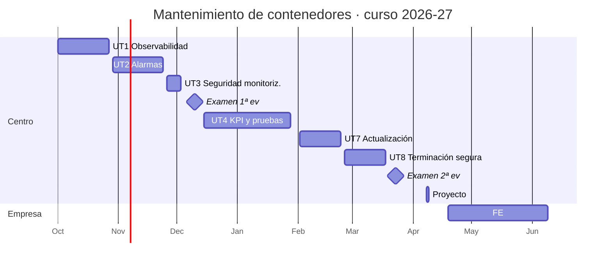

# Calendario de sesiones

Curso 2026-27 · Martes y jueves · 1 h 50 min por sesión · 41 sesiones (82 h) · Presentación el 1 de octubre de 2026 · Teoría y exámenes hasta el 23 de marzo de 2027 · Proyecto entre asignaturas el 8 de abril · Formación en empresa del 19 de abril al 9 de junio de 2027

Las fechas están calculadas sobre el calendario escolar de Castelló 2026-27. El curso empieza el jueves 1 de octubre de 2026, y esa primera sesión es la de presentación de la asignatura. La teoría y los exámenes terminan antes de Pascua: la última sesión de teoría es la del 18 de marzo y el examen de la segunda evaluación, el 23 de marzo. Después de Pascua (del 25 de marzo al 2 de abril) el martes 6 de abril queda sin clase, como margen del calendario, y la sesión del jueves 8 de abril, la última en el centro, se dedica al proyecto entre asignaturas. No son lectivos el 8, 9 y 12 de octubre, el 8 de diciembre, del 22 de diciembre al 7 de enero, del 1 al 5 de marzo (Magdalena), el 19 de marzo, la semana de Pascua ni la semana del 12 al 16 de abril, en la que ya no hay clase. Si un día cae festivo por sorpresa, todo se corre una sesión.

Cada sesión dura 110 minutos y casi todas tienen la misma forma: una explicación corta al principio (entre 10 y 30 minutos, indicada en la columna de teoría) y el resto de laboratorio. Las sesiones marcadas como práctica no tienen explicación nueva. Las sesiones en **negrita** son evaluables. La práctica evaluable de la UT8, el acta de baja, no tiene sesión propia: se va construyendo en las hojas A8.1 a A8.5 y se entrega por Aules antes del examen del 23 de marzo.

## Vista de calendario

Cada día de clase lleva el color de su unidad. Al pasar el ratón por encima se ve qué se explica y qué se practica en esa sesión y qué se entrega; con un clic se va a esa sesión en los apuntes. Los días marcados con estrella son sesiones evaluables. Con el teclado, el tabulador recorre las sesiones y muestra el mismo detalle.

## Listado de sesiones

### Primera evaluación

| Nº | Fecha | UT | Sesión | Tipo | Se explica | Se practica |
|---:|-------|----|--------|------|------------|-------------|
| 1 | 1 oct | UT1 | Presentación y el contenedor de referencia | Teoría y práctica | Presentación de la asignatura, evaluación y cómo se coordina con Despliegue (25 min). Los cuatro flujos que salen de un contenedor: métricas, logs, eventos (20 min). | Crear los repositorios servicio y monitoring con el código de Aules, desplegar el servicio del curso con compose en el puesto y observar con docker stats, logs y events mientras se genera tráfico y se para la BD. |
| 2 | 6 oct | UT1 | Métricas de recursos | Teoría y práctica | cgroups v2 y cómo cAdvisor lee de ellos; etiquetas y cardinalidad (20 min). | Leer a mano el working set de la API en sus cgroups, desplegar cAdvisor junto al servicio en el puesto, scrape desde la pila mínima de monitorización y gráfica de CPU y memoria por contenedor en Grafana. |
| 3 | 13 oct | UT1 | Instrumentar la aplicación | Teoría y práctica | Tipos de métrica (counter, gauge, histogram, summary) y cómo se instrumenta con la librería cliente (20 min). | Endpoint /metrics en la API con counter e histogram, postgres_exporter contra el servicio db del compose, comprobar ambos en Prometheus. |
| 4 | 15 oct | UT1 | Logs estructurados | Teoría y práctica | Drivers de logs de Docker, logs en JSON con request_id, cómo funciona Promtail y qué indexa Loki (20 min). | Llevar las tres pilas del puesto a app01 y mon01; configurar logs JSON, limitar json-file en daemon.json, desplegar Loki y Promtail, comprobar en Grafana Explore. |
| 5 | 20 oct | UT1 | Eventos | Teoría y práctica | Los eventos del demonio Docker y cómo se recogen (10 min). | Recoger eventos en Loki; provocar die, oom y unhealthy y localizarlos, cruzarlos con métricas y logs y dibujar el esquema del flujo de datos. |
| 6 | 22 oct | UT1 | Integridad y almacenamiento | Teoría y práctica | Qué significa verificar una integración: comunicación, recepción, integridad, relojes, retención (15 min). | Ejecutar la tabla de comprobaciones completa y cortar la red dos veces tres minutos, con los reintentos de Promtail normales y reducidos, para ver qué se recupera y qué se pierde. |
| **7** | **27 oct** | **UT1** | **Práctica evaluable UT1** | Práctica evaluable | Aclaración del enunciado (10 min). | Cerrar el informe: flujo de datos, configuración, pruebas y resultado del corte de red. |
| 8 | 29 oct | UT2 | Umbrales sobre contadores | Teoría y práctica | De la métrica a la alarma y alertar por síntomas (10 min). Umbrales sobre contadores: rate, increase y ventanas en PromQL, y cómo elegir el for (15 min). | Definir seis umbrales desde la documentación del servicio y comprobar las consultas con tráfico real. |
| 9 | 3 nov | UT2 | Cadenas en logs y eventos | Teoría y práctica | LogQL: selectores, filtros, parsers y métricas sobre logs (20 min). | Consultas LogQL para los mensajes de error conocidos y para oom y unhealthy; probar con logcli. |
| 10 | 5 nov | UT2 | Recording rules | Teoría y práctica | Agregar y correlar: por qué precalcular y cómo se nombran (15 min). | rules.yml con cinco métricas grabadas y paneles que las usen. |
| 11 | 10 nov | UT2 | Reglas de alerta | Teoría y práctica | alerts.yml, etiquetas y anotaciones, estados de una alerta (15 min). | Convertir los umbrales en las diez reglas del catálogo, con etiquetas y runbook; observar pending y firing. |
| 12 | 12 nov | UT2 | Alertmanager | Teoría y práctica | Árbol de rutas, agrupación, inhibición, silencios y receptores (25 min). | Agrupación, tres rutas, inhibición y un silencio; correo con Mailpit y Telegram, con el bot creado antes de la sesión; dos alarmas del mismo grupo en una sola notificación. |
| 13 | 17 nov | UT2 | Integración con incidencias | Teoría y práctica | El webhook de Alertmanager y su JSON (10 min). | Receptor en Flask que crea y cierra issues en el Gitea de mon01, que pasa a ser el remoto de los repositorios; probar activación y recuperación. |
| 14 | 19 nov | UT2 | Verificación completa | Práctica | Procedimiento de verificación de una alarma (5 min). | Verificar cuatro alarmas: provocarlas, medir tiempos, canales, issue creada y cerrada; rellenar la tabla. |
| **15** | **24 nov** | **UT2** | **Práctica evaluable UT2** | Práctica evaluable | Aclaración del enunciado (10 min). | Cerrar el repositorio alerting, el informe de verificación y la tabla de categorización. |
| 16 | 26 nov | UT3 | Auditoría inicial | Teoría y práctica | Superficie de exposición de la monitorización; ss, nmap y tcpdump aplicados a exporters (20 min). | Inventario de puertos en app01 y mon01, escaneo desde mon01, desde el puesto de administración y desde app01, matriz de exposición; certificados y reglas de OPNsense preparados para el traslado. |
| 17 | 1 dic | UT3 | Red, firewall y TLS | Teoría y práctica | Por qué un puerto publicado en Docker salta el firewall del host y cómo se corrige (10 min); red dedicada, nftables por host y las reglas de OPNsense (10 min); TLS y basic auth en los exporters con bcrypt (10 min). | Cerrar app01 en la VPC: targets con las direcciones nuevas, nftables del host con sus dos cadenas, TLS y basic auth en su node_exporter y escaneo de comprobación. |
| **18** | **3 dic** | **UT3** | **Práctica evaluable UT3** | Práctica evaluable | La política de protección entre contenedor y monitorización (10 min). | Cerrar mon01 (Grafana y Loki tras nginx, su nftables), certificado de cliente en Promtail y auditoría final; la matriz antes y después y el documento de política se terminan antes del examen. |
| **19** | **10 dic** | **EX1** | **Examen 1ª evaluación** | Examen | Sin explicación nueva | Prueba teórico-práctica de UT1 a UT3 en el laboratorio. |

### Segunda evaluación

| Nº | Fecha | UT | Sesión | Tipo | Se explica | Se practica |
|---:|-------|----|--------|------|------------|-------------|
| 20 | 15 dic | UT4 | Fichas de métricas | Teoría y práctica | Señales doradas, USE y RED; la ficha de métrica y las tres categorías (25 min). | Crear el repositorio operacion y documentar en él al menos diez métricas del contenedor de referencia, clasificadas en capacidad, rendimiento y calidad. |
| 21 | 17 dic | UT4 | Indicadores | Teoría y práctica | SLI, SLO y presupuesto de error; los nueve indicadores y sus trampas (25 min). | Implementar los nueve indicadores como recording rules y panel de KPI con umbrales justificados con el histórico de Prometheus. |
| 22 | 12 ene | UT4 | Catálogo de alarmas | Teoría y práctica | Qué hace un buen runbook (15 min). | Catálogo con todas las alarmas y runbook completo para cinco de ellas, enlazados desde la anotación runbook. |
| 23 | 14 ene | UT4 | Pruebas funcionales | Teoría y práctica | Tipos de prueba y qué comprueba cada una; pytest, con newman como alternativa (20 min). | Suite de ocho casos funcionales con pytest contra dev e informe JUnit. |
| 24 | 19 ene | UT4 | Calidad de servicio y rendimiento | Teoría y práctica | Carga, rendimiento y estrés (5 min); k6: options, stages, thresholds, checks (15 min); leer resultados junto a Grafana (5 min). | Script k6 con umbrales de los SLO; rampas de 10, 50 y 100 usuarios contra dev; capturas del panel. |
| 25 | 21 ene | UT4 | Estrés y seguridad | Teoría y práctica | ZAP baseline y Trivy: qué detecta cada uno, códigos de salida y qué informe se archiva (15 min). | Rampa hasta el fallo y tiempo de recuperación; ZAP y Trivy sobre la imagen; lista de hallazgos. |
| 26 | 26 ene | UT4 | Documentación de pruebas y seguimiento | Teoría y práctica | La ficha de caso de prueba y el informe de versión (10 min); el ciclo de revisión diario, semanal y mensual (10 min). | Cinco fichas de caso con evidencias, informe de la versión, puerta de pruebas comprobada a mano y una revisión semanal que termina en un pull request de ajuste de umbral. |
| **27** | **28 ene** | **UT4** | **Práctica evaluable UT4** | Práctica evaluable | Aclaración del enunciado (10 min). | Cerrar el dossier de operación: fichas, indicadores, catálogo, informe de pruebas y registro de revisión. |
| 28 | 2 feb | UT7 | Inventario de versiones y seguimiento automático | Teoría y práctica | Etiquetas frente a digests, versionado semántico, variantes de imagen; Renovate y por qué no Watchtower (25 min). | Inventario con versión y digest, fijar la imagen base del Dockerfile; Renovate sobre el repositorio y política de actualización. |
| 29 | 4 feb | UT7 | Escaneo | Teoría y práctica | CVE, CVSS, EPSS y KEV; SBOM; qué hace cada escáner (20 min). | SBOM con Syft; Trivy y Grype sobre la imagen del servicio y la de un agente, pip-audit y trivy fs sobre el código; tabla de hallazgos. |
| 30 | 9 feb | UT7 | Investigar y decidir | Teoría y práctica | Cómo leer un informe de Trivy y las cuatro soluciones posibles (10 min). | Investigar cuatro hallazgos en NVD y OSV, decidir y justificar; reconstruir con base slim, comparar y desplegar en dev. |
| 31 | 11 feb | UT7 | Actualización en pre | Teoría y práctica | El ciclo de actualización, la vuelta atrás y la verificación de integridad con SQL (10 min). | Dar de alta pre en la monitorización y actualizar la aplicación en pre con copia previa en restic; recuentos y sumas de control antes y después, suite funcional de la UT4 y plan de paso a producción. |
| 32 | 16 feb | UT7 | Fallo provocado | Práctica | Clasificación de fallos y plantilla de reporte (10 min). | Versión que falla al actualizar: analizar, clasificar, rollback o parche en 40 minutos y reporte a desarrollo. |
| 33 | 18 feb | UT7 | Trazabilidad | Teoría y práctica | Incidencias enlazadas, CHANGELOG y la etapa de escaneo en el pipeline (15 min). | Registrar las actualizaciones como incidencias con enlaces, actualizar el CHANGELOG y probar en un job de Jenkins la etapa Trivy que falla con CRITICAL. |
| **34** | **23 feb** | **UT7** | **Práctica evaluable UT7** | Práctica evaluable | Aclaración del enunciado (10 min). | Cerrar inventario y política, informe de vulnerabilidades, evidencia de actualización en pre, reporte de fallo e incidencias. |
| 35 | 25 feb | UT8 | Plan de baja | Teoría y práctica | La baja como cambio: aprobación, ventana, qué se conserva (10 min); dónde deja rastro un servicio y la lista de comprobación (15 min). | Preparar el puesto de administración para toda la unidad, inventariar con órdenes lo que pre ha dejado y abrir el acta de baja con la lista de comprobación. |
| 36 | 9 mar | UT8 | Liberar la infraestructura: servicio y contenedores | Teoría y práctica | Orden correcto de la baja y periodo de gracia (10 min); cómo se liberan contenedores, volúmenes e imágenes y cómo se guarda el volcado de bloqueo (15 min). | Silenciar pre, guardar el volcado de bloqueo cifrado, deshabilitar el despliegue a pre y dejar app01-pre sin contenedores, volúmenes ni imágenes. |
| 37 | 11 mar | UT8 | Liberar la infraestructura: VM, red y credenciales | Teoría y práctica | Lo que tofu destroy no se lleva y por qué se verifica desde fuera (10 min); cómo se liberan VM, redes, rutas, certificados y credenciales (20 min). | Retirar el prevent_destroy en una rama, destruir pre con tofu destroy, borrar router-pre y sus VNets, quitar las rutas a pre y la carpeta pre de Jenkins, y verificar cada punto desde fuera. |
| 38 | 16 mar | UT8 | Copias y logs | Teoría y práctica | Por qué borrar no borra: SSD, copy-on-write, versionado; borrado criptográfico y borrado en el sistema de copias (15 min); borrar del registry (5 min); qué recupera photorec en cada caso (5 min). | Borrar las copias de pre en restic, sus etiquetas del registry y su correo en Mailpit, comprobar Loki e intentar recuperar con photorec en tres escenarios. |
| 39 | 18 mar | UT8 | Datos y monitorización | Teoría y práctica | DELETE, DROP y VACUUM FULL; anonimización (10 min); desconfigurar targets, reglas y dashboards (5 min). | Anonimizar y borrar con VACUUM FULL en una base de prueba del PostgreSQL de dev; retirar los targets de pre, expirar el silencio y cerrar el acta. |
| **40** | **23 mar** | **EX2** | **Examen 2ª evaluación** | Examen | Sin explicación nueva | Prueba teórico-práctica de UT4, UT7 y UT8 en el laboratorio. |

### Proyecto entre asignaturas

Después de Pascua, la única sesión que queda en el centro se dedica a un proyecto conjunto con el resto de asignaturas del curso, que se plantea aparte.

| Nº | Fecha | UT | Sesión | Tipo | Se explica | Se practica |
|---:|-------|----|--------|------|------------|-------------|
| 41 | 8 abr | PRO | Proyecto entre asignaturas | Proyecto | Sin explicación nueva | Trabajo en el proyecto conjunto con el resto de asignaturas del curso, que se plantea aparte. |

## Formación en empresa (19 abr a 9 jun 2027)

| UT | Título | Horas | Evidencias |
|----|--------|------:|------------|
| UT5 | Explotación de logs, accesos y rendimiento | 14 | Ficha de evidencias A5.1 a A5.4 y procedimiento de revisión |
| UT6 | Copias de seguridad y restauración | 14 | Ficha de evidencias A6.1 a A6.3 y plan de copias y restauración |

