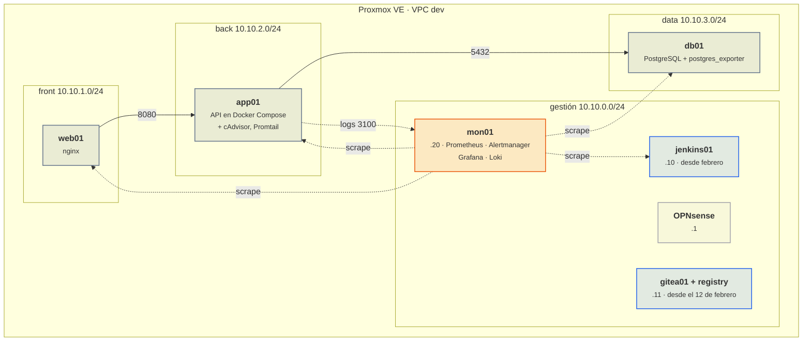

# El laboratorio

Esta asignatura no monta un laboratorio nuevo: trabaja sobre el que construye [Despliegue de plataformas de contenedores](https://victor-educ.github.io/apuntes-5166/laboratorio/), cuyas [convenciones](https://victor-educ.github.io/apuntes-5166/laboratorio/#convenciones) (redes, direcciones, IDs de VM, nombres compartidos y matriz de reglas del cortafuegos) mandan también aquí. Esta página añade solo lo propio: qué hay disponible en cada momento, qué agente corre en cada máquina, cómo se llega a la pila de monitorización cuando queda cerrada, lo que se añade en cada unidad y las convenciones de Mantenimiento.

## Qué hay en cada momento

Las dos asignaturas van en paralelo, y esta empieza a vigilar contenedores el 1 de octubre, cuando Despliegue todavía está instalando Proxmox. Por eso el laboratorio llega por fases, y cada hoja trabaja solo con lo que existe en su fecha:

| Desde | Qué hay para esta asignatura | Quién lo pone |
|-------|------------------------------|---------------|
| 1 oct | Ninguna VM: el servicio y la pila mínima corren con Docker en el puesto del alumno | A1.1 de esta asignatura |
| 15 oct | app01 y mon01 en la red del aula, sin subredes ni cortafuegos | A1.3 de Despliegue (14 oct); se ocupan en la A1.4 |
| 17 nov | Gitea provisional en mon01 (`gitea.lab:3001`) y remoto de los repositorios | A2.6 de esta asignatura |
| 27 nov | VPC dev detrás de OPNsense: app01 en back, mon01 en gestión, la base de datos en db01 y el proxy en web01 | A3.3 de Despliegue |
| 3 dic | La pila cerrada: Prometheus, Alertmanager y Mailpit solo por túnel, Loki con certificado de cliente | Práctica evaluable de la UT3 de esta asignatura |
| 18 dic | MinIO en la pila de mon01, destino de las copias | A5.2 de Despliegue |
| 8 ene | Las VM de pre; el servicio llega a ellas el 15 | A5.3 y A5.5 de Despliegue |
| 3 a 12 feb | jenkins01, agent01 y gitea01; Gitea deja mon01 el 12 | A6.1, A6.3 y A6.4 de Despliegue |
| 11 feb | pre en Mantenimiento: monitorización, copia y actualización | A7.4 de esta asignatura |
| 19 feb | El registry y la imagen `registry.lab:5000/app` | A6.6 de Despliegue |
| 11 mar | pre destruido | A8.3 de esta asignatura |

## El entorno definitivo (desde diciembre; jenkins01 y gitea01 en febrero)

El entorno completo de la figura no existe hasta diciembre, y jenkins01 y gitea01 no llegan hasta febrero. Hasta entonces se trabaja con el [entorno provisional](#entorno-provisional-octubre-y-noviembre) del apartado siguiente.



<p class="pie" markdown>El laboratorio lo construye Despliegue; en naranja, mon01, la única máquina que amplía esta asignatura: su pila de monitorización se monta aquí desde el 1 de octubre.</p>

## Entorno provisional (octubre y noviembre)

El entorno provisional tiene dos fases, y ninguna necesita más de lo que Despliegue termina el 14 de octubre (Proxmox y la plantilla cloud-init):

**Del 1 al 13 de octubre (sesiones 1, 2 y 3): no existe ninguna VM del laboratorio.** Todo corre con Docker en el puesto del alumno, en localhost: el servicio del curso entero (nginx, API y PostgreSQL en un solo compose, en `/opt/servicio`) y, en otro compose, la pila mínima de monitorización (Prometheus, Alertmanager y Grafana, en `/opt/monitoring`). Los agentes de la UT1 van en un tercer compose, en `/opt/agentes`. Los tres comparten la red de Docker `obs` y se llaman entre ellos por el nombre del servicio de compose, sin ninguna IP.

**Desde el 15 de octubre (sesión 4): dos VM.** Son las de la tabla, que Despliegue clona de la plantilla 9000 el día anterior con Docker Engine, node_exporter y la clave SSH del puesto del alumno ya dentro. Se entra desde el puesto con `ssh ops@app01` y `ssh ops@mon01`, con los nombres en el `/etc/hosts` del puesto y de mon01, como indica la A1.4.

| VM | Red | Qué lleva | Nace en | Muere en |
|----|-----|-----------|---------|----------|
| app01 (120) | vmbr0, la red del aula, IP por DHCP; `devback` (10.10.2.10) desde el 27 de noviembre | El servicio del curso en Docker Compose (nginx, API y PostgreSQL hasta el 27 de noviembre; desde entonces solo la API) y los agentes de la UT1 | A1.3 de Despliegue (14 de octubre); se ocupa en la A1.4 (15 de octubre) | No se destruye: llega al final del curso |
| mon01 (103) | vmbr0, IP por DHCP; `devmgmt` (10.10.0.20) desde el 27 de noviembre | Prometheus, Alertmanager y Grafana con el compose de la A1.1 de esta asignatura; Loki desde la A1.4, Mailpit y la Gitea provisional desde la UT2, MinIO desde el 18 de diciembre | A1.3 de Despliegue (14 de octubre), con 3 GB de RAM | No se destruye: llega al final del curso |

Sin firewall y sin subredes: todo está en la red del aula. Es suficiente para las UT1 y UT2, que van de sacar datos del contenedor y convertirlos en alarmas. La seguridad de esas comunicaciones se trata en la UT3 precisamente cuando hay dónde aplicarla.

**web01 y db01 no entran en juego hasta el 27 de noviembre**, cuando Despliegue separa las zonas. Hasta entonces no hay que buscarlas ni inventarlas: la base de datos es el servicio `db` del compose del servicio y el proxy es el servicio `nginx` del mismo compose, los dos en el mismo host que la API. Las subredes 10.10.x.x existen desde el 30 de octubre (con router-dev como `.1` desde el 4 de noviembre) y el cortafuegos desde el 20 de noviembre, con OPNsense, pero app01 y mon01 siguen en la red del aula hasta el traslado.

**Migración al entorno definitivo.** La hace la [A3.3 de Despliegue](https://victor-educ.github.io/apuntes-5166/ut/ut3-seguridad-por-capas/#a33-aplicacion-y-datos-sesion-16) el 27 de noviembre: pasa app01 a `devback` (10.10.2.10) y mon01 a `devmgmt` (10.10.0.20), instala en db01 PostgreSQL con la base `servicio` y el usuario `app` y, al lado, su postgres_exporter; pone `DB_HOST=10.10.3.10` en el `.env` del servicio, quita `db` y `nginx` de su compose y deja como proxy el nginx de web01. Los datos de prueba de octubre y noviembre no se trasladan: la API crea el esquema vacío en db01. Los de Prometheus y Loki sí se conservan, porque mon01 cambia de red, no de disco. La UT3 de esta asignatura se reparte alrededor de ese día: la A3.1 (26 de noviembre) audita con las VM todavía en el aula y la A3.2 (1 de diciembre) trabaja ya en la VPC. Desde el traslado cambian tres cosas:

- A app01, db01, web01 y mon01 se entra con salto por el puesto de administración: `ssh -J ops@<IP de aula de admin01> ops@10.10.2.10`, y lo mismo con la IP de cada una. El [laboratorio de Despliegue](https://victor-educ.github.io/apuntes-5166/laboratorio/#nombres-dns-y-acceso) trae un `~/.ssh/config` de ejemplo con el que basta `ssh app01`.
- Los nombres los resuelve el DNS de OPNsense (`mon01.lab`, `grafana.lab`, `gitea.lab` y los `<host>.dev.lab`), no el `/etc/hosts`.
- PostgreSQL de dev es un servicio del sistema en db01 y se maneja con `systemctl`; el compose del servicio de app01 solo tiene `app`.

## El entorno pre

El entorno **pre** son tres VM que crea la A5.3 de Despliegue el 8 de enero con OpenTofu (web01-pre, app01-pre y db01-pre, en 10.20.1.10, 10.20.2.10 y 10.20.3.10) más router-pre, que viene de la A2.5. El servicio lo despliega en ellas la A5.5 el 15 de enero: en app01-pre, el compose del servicio en `/opt/servicio` solo con `app`; en db01-pre, PostgreSQL con la base `servicio`; web01-pre se queda como clon limpio, sin nginx ni certificado. Qué hay en cada VM, cómo llega a pre la red de gestión y en qué orden se retira está en la [ficha de pre de Despliegue](https://victor-educ.github.io/apuntes-5166/laboratorio/#el-entorno-pre). En esta asignatura se usa así:

- **La UT4 no lo toca.** Sus pruebas van contra dev (`https://api.dev.lab`): la A4.4 es del 14 de enero y pre no sirve la API hasta el 15.
- **La UT7 lo estrena en la A7.4 (11 de febrero)**, que da de alta en Prometheus un job `node` con `env="pre"` para las tres VM (node_exporter viene de la plantilla), añade a mon01 la ruta hacia 10.20.0.0/16 (`ruta-pre.service`), hace la copia de su base de datos y lleva a app01-pre la versión nueva de la aplicación.
- **La UT8 lo da de baja** del 25 de febrero al 11 de marzo, en el orden que fija la ficha: la A8.1 inventaría sin tocar nada, la A8.2 (9 de marzo) para el servicio y libera los contenedores de app01-pre y la A8.3 (11 de marzo) destruye las VM, router-pre y sus redes.

En las hojas, pre se escribe con IP: los nombres `<host>.pre.lab` solo los resuelve router-pre. Y pre no llega a la red de gestión, solo le responde: lo que va a pre se empuja desde gestión (ficheros con Ansible, imágenes con `docker save ... | ssh ... docker load`).

## Cómo se llega a la pila desde el 3 de diciembre

Hasta el traslado del 27 de noviembre la pila se abre con la dirección del aula de mon01 (`http://mon01:9090`); desde ese día ya hay que pasar por el puesto de administración, con los túneles de abajo; hasta el 3 de diciembre Grafana sigue en el 3000 de mon01, y se abre añadiendo `-L 3000:127.0.0.1:3000` al primero y `http://localhost:3000`. La práctica evaluable de la UT3 la cierra, y desde el 3 de diciembre solo se publican hacia la red de gestión tres servicios; el resto escucha únicamente en el `127.0.0.1` de mon01:

| Servicio | Dónde escucha | Cómo se llega |
|----------|---------------|---------------|
| Grafana | `10.10.0.20:443`, detrás de nginx | Túnel al 443 desde el puesto del aula; `https://grafana.lab/` directamente desde la red de gestión |
| Loki | `10.10.0.20:3100`, tras el mismo nginx y con certificado de cliente | Promtail de app01 y `logcli` en el puesto de administración; Grafana y Prometheus le hablan por dentro |
| Gitea provisional | `10.10.0.20:3001`, hasta el 12 de febrero | La red de gestión y app01, cada uno por su fila de la matriz de reglas |
| Prometheus, Alertmanager y Mailpit | `127.0.0.1` de mon01, en el 9090, el 9093 y el 8025 | Túnel SSH, o una shell en mon01 |

Desde el puesto del aula se abren dos túneles con el puesto de administración como salto (`<admin01>` es su IP del aula; con el `~/.ssh/config` de Despliegue, `-J ops@<admin01> ops@10.10.0.20` se queda en `mon01`). El primero deja además una shell abierta en mon01:

```bash
ssh -L 9090:127.0.0.1:9090 -L 9093:127.0.0.1:9093 -L 8025:127.0.0.1:8025 -J ops@<admin01> ops@10.10.0.20
ssh -L 8443:10.10.0.20:443 ops@<admin01>
```

Con los dos abiertos, Prometheus está en `http://localhost:9090`, Alertmanager en `http://localhost:9093` y Mailpit en `http://localhost:8025`. Grafana está en `https://grafana.lab:8443`, con la línea `127.0.0.1 grafana.lab` en el fichero hosts del puesto del aula y la CA del curso (`ca.crt`) importada en el navegador: el nombre tiene que ser `grafana.lab` porque es el que lleva el certificado. El 8443 del puesto lo usan también los túneles de OPNsense y de Jenkins de Despliegue, así que de los tres solo puede estar abierto uno a la vez.

En la shell de mon01 valen las direcciones locales, y `amtool` se usa desde el contenedor de Alertmanager, que ya lo trae:

```bash
cd /opt/monitoring
curl -s 'http://localhost:9090/api/v1/query?query=up' | jq .
curl -s -X POST http://localhost:9090/-/reload
docker compose exec alertmanager amtool --alertmanager.url=http://localhost:9093 alert query
curl -s http://localhost:8025/api/v1/messages | jq .total        # mensajes en Mailpit
```

`logcli` se lanza desde el puesto de administración con el certificado de cliente `logcli`, que emite la propia práctica evaluable de la UT3 y se guarda con los demás en `~/tls-monitorizacion/`:

```bash
export LOKI_ADDR=https://10.10.0.20:3100
export LOKI_CA_CERT_PATH=$HOME/tls-monitorizacion/ca.crt
export LOKI_CLIENT_CERT_PATH=$HOME/tls-monitorizacion/logcli.crt
export LOKI_CLIENT_KEY_PATH=$HOME/tls-monitorizacion/logcli.key
logcli labels
```

Desde el 3 de diciembre no se vuelve a usar `http://10.10.0.20:9090`, `:9093`, `:3000` ni `:8025`, ni Loki sin certificado: publicarlos de nuevo para ahorrarse el túnel es deshacer lo que evalúa la UT3.

## Agentes por máquina

Todas las VM que salen de la plantilla traen node_exporter de fábrica (paquete `prometheus-node-exporter`, argumentos en `/etc/default/prometheus-node-exporter`), porque la A1.3 de Despliegue lo mete en la imagen con el mismo `virt-customize` que el agente de QEMU. Lo demás lo monta esta asignatura:

| Máquina | Agente | Puerto | Quién lo lee | Qué hoja lo instala o configura |
|---------|--------|-------:|--------------|---------------------------------|
| Todas las de la plantilla | node_exporter | 9100 | Prometheus, job `node`; el de app01, cifrado y con el usuario `prometheus`, en el job `node-tls` | Plantilla de la A1.3 de Despliegue. Job para app01 y mon01 en la A1.4 (15 oct), db01 en la A3.2 (1 dic), que además cifra el de app01, y las tres de pre, con `env="pre"`, en la A7.4 (11 feb) |
| app01 | cAdvisor | 8081 | Prometheus, job `cadvisor` (dentro de la red `obs`, `cadvisor:8080`) | A1.2 (6 oct) en el puesto; a app01 en la A1.4 |
| app01 | `/metrics` de la API | 9102 | Prometheus, job `app` | A1.3 (13 oct) |
| app01 | Promtail | 9080 | Envía a Loki; Prometheus lee sus métricas en el job `promtail` | A1.4 (15 oct); certificado de cliente para Loki en la práctica evaluable de la UT3 (3 dic) |
| app01 | docker-events | ninguno | Promtail, que lo manda a Loki con `service="docker-events"` | A1.5 (20 oct) |
| db01 | postgres_exporter | 9187 | Prometheus, job `postgres` | En el compose del servicio desde la A1.3; desde el 27 nov, paquete `prometheus-postgres-exporter` en db01 con el usuario `monitor`, que instala la A3.3 de Despliegue; su target pasa a db01 en la A3.2 |

web01, jenkins01, agent01 y gitea01 traen node_exporter igual. De ellas, la UT7 de Despliegue da de alta en Prometheus jenkins01, en marzo; web01, agent01 y gitea01 se quedan fuera de la monitorización del curso. No se instalan en el curso ni nginx-prometheus-exporter (9113), porque lo que interesa de nginx sale de su log de acceso en JSON, ni blackbox_exporter: la disponibilidad sale de `up` y `pg_up`.

## Lo que se añade en cada unidad

| Unidad | Qué se instala o configura | Dónde |
|--------|---------------------------|-------|
| UT1 | cAdvisor, postgres_exporter, endpoint `/metrics` en la API, Promtail, docker-events, Loki, job `node` de Prometheus, límites del driver de logs | Puesto del alumno hasta el 13 de octubre; app01 y mon01 desde el 15 |
| UT2 | Recording rules y alarmas (con `HostDown`), Alertmanager con rutas y receptores, Mailpit, receptor webhook de incidencias, Gitea provisional y remoto de los repositorios | mon01 |
| UT3 | nftables por host (tabla `inet fw`), filas 11 a 20 de la matriz de OPNsense, certificados de la CA del curso, TLS y basic auth en node_exporter, mTLS entre Promtail y Loki, Grafana detrás de nginx, Prometheus, Alertmanager y Mailpit solo en `127.0.0.1` | app01, db01, mon01, OPNsense y el puesto de administración |
| UT4 | pytest (newman como alternativa), k6, OWASP ZAP (contenedor), Trivy, recording rules de los indicadores, panel de KPI, catálogo de alarmas, retención de Prometheus a 45 días | Puesto de administración y mon01, siempre contra dev |
| UT7 | Renovate, Syft, Trivy, Grype, restic sobre el MinIO del laboratorio, job `node` de pre, etapa de escaneo en el pipeline | Puesto de administración; mon01 (Renovate y el job de pre); la Gitea de mon01 hasta el 12 de febrero y gitea01 después; app01-pre; jenkins01 |
| UT8 | Inventario de baja, `tofu destroy` de pre, `restic forget` de las copias de pre, cliente S3 para las versiones del bucket, photorec/testdisk, herramientas de borrado | Puesto de administración, hosts de pre, mon01 y el registry de gitea01 |
| UT5 y UT6 (empresa) | fail2ban; restic sobre el destino de copias de la empresa | Lo que indique el tutor |

## Recursos por puesto

El presupuesto de memoria de las dos asignaturas está en el [laboratorio de Despliegue](https://victor-educ.github.io/apuntes-5166/laboratorio/#presupuesto-de-memoria) y manda también aquí: 16 GB para la VM de Proxmox en el peor momento, con pre incluido hasta el 11 de marzo, y qué se apaga en cada tramo cuando hay menos. Lo que esta asignatura pone en esa cuenta es mon01, con sus 3 GB: Prometheus, Alertmanager, Grafana, Loki y Mailpit, la Gitea provisional hasta el 12 de febrero y MinIO desde el 18 de diciembre. app01 y mon01 se quedan encendidas desde el 15 de octubre hasta el final del curso.

Las pruebas de carga de la UT4 se lanzan desde el puesto de administración, que no es uno de los hosts vigilados, para no falsear sus métricas. Y Loki con retención de 7 días ocupa de 2 a 5 GB de disco por servicio vigilado, y eso es disco, no memoria.

## Convenciones

La tabla única del laboratorio (VNets y subredes, IP de cada máquina, IDs de VM, dominios, puertos, nombres compartidos y matriz de reglas) está en la [página del laboratorio de Despliegue](https://victor-educ.github.io/apuntes-5166/laboratorio/#convenciones) y manda también aquí. Lo que sigue es solo lo propio de Mantenimiento.

| Cosa | Convención |
|------|------------|
| Puertos de monitorización | 9100 node_exporter, 8081 cAdvisor publicado en el host (dentro de la red de Docker sigue siendo `cadvisor:8080`, porque el 8080 del host lo ocupa la API), 9187 postgres_exporter, 9102 `/metrics` de la app, 9080 Promtail, 3100 Loki, 9090 Prometheus, 9093 Alertmanager, 8025 Mailpit, 3000 Grafana (desde el 3 de diciembre, solo por el 443 de su nginx), 3001 la Gitea provisional de mon01 hasta el 12 de febrero, 5000 el receptor de incidencias en el `127.0.0.1` de mon01 (no es el registry, que está en el 5000 de gitea01) |
| Etiquetas de las series | El scrape pone `host` y `service`; Promtail pone `host`, `service`, `container` y `level`, este en minúsculas (`info`, `warning`, `error`). Las consultas LogQL seleccionan por `service` y `level`: `container` lleva el nombre largo (`servicio-app-1`) y cambia si el servicio se escala o se renombra |
| Etiquetas de alerta | `severity` (critical, warning, info), `team` (ops, dev), `service` (app, db, web, y `node` en `HostDown`), `env` (dev, pre), `origen` (prometheus, loki, cadvisor, docker-events) |
| Alarmas | Las diez de la A2.4: siete en Prometheus (`AppHighErrorRate`, `AppHighLatency`, `AppDown`, `HostDown`, `AppMemoryHigh`, `AppRestarting`, `DbConnectionsHigh`) y tres en el ruler de Loki (`AppLogErrorsBurst`, `AppDbTimeout`, `ContainerOOM`); la A4.3 añade `PgDown`, `AppLowAvailability`, `AppCpuSaturated`, `DbDiskLow` y `DiskWillFillIn7d`. Son las únicas del laboratorio: un nombre que no esté en esta lista no existe en `alerting` |
| Nombres de recording rules | `nivel:métrica:operación`, por ejemplo `app:errors:ratio5m` |
| Órdenes sobre el servicio | `docker compose -f /opt/servicio/compose.yml <acción> <servicio>` (proyecto `servicio`, en dev y en pre), nunca el nombre del contenedor escrito a mano. Las que provocan fallos se lanzan desde el puesto, por SSH: `ssh ops@<app01> docker compose -f /opt/servicio/compose.yml stop <servicio>` |
| Evidencias de pruebas | `tests/evidence/<versión>/` en el repositorio del servicio |
| Retención | Prometheus, 45 días, porque la disponibilidad mensual necesita más de 30 (lo comprueba la A4.2); Loki, 7 días |
| Copias | Un solo repositorio restic en MinIO (`s3:http://10.10.0.30:9000/backups`), con la contraseña en `/etc/restic/pass` del puesto de administración, permisos 600. El bucket `backups` y la credencial `restic` nacen con el propio MinIO el 18 de diciembre, en la A5.2 de Despliegue; el `restic init` se hace una sola vez en todo el curso, en el paso 3 de la A7.4. Las copias de pre llevan `--tag pre`, y la UT8 las borra por esa etiqueta, no el repositorio |
| Imagen del servicio | `app:<versión>`, construida en app01 desde `api/Dockerfile`, hasta el 19 de febrero: se escanea en el puesto de administración con `ssh ops@10.10.2.10 docker save app:<versión> > app.tar` y `trivy image --input app.tar`. Desde ese día, `registry.lab:5000/app:<versión>` y `registry.lab:5000/app:<commit corto>`, que publica el pipeline de Despliegue (su `IMAGE`). Siempre con versión concreta, y con digest fijado en pre |

Las direcciones que más se usan en esta asignatura, por si hace falta tenerlas a mano: `mon01` es la `10.10.0.20` en gestión, el puesto de administración la `10.10.0.50` y MinIO la `10.10.0.30`; `web01` es la `10.10.1.10` en front, `app01` la `10.10.2.10` en back y `db01` la `10.10.3.10` en data; en pre, el tercer octeto es el mismo sobre `10.20`. Ni web01, ni app01, ni db01 tienen pata de gestión: Prometheus llega a sus exporters atravesando el cortafuegos, que es justo lo que se abre en la UT3.

## Repositorios que hay que crear o ampliar

| Repositorio | Nace en | Copia de trabajo | Qué le añade esta asignatura |
|-------------|---------|------------------|------------------------------|
| `servicio` | A1.1 (1 oct), con el código que se da en Aules | app01, en `/opt/servicio`; en la UT4, un clon en el puesto de administración para las pruebas | Instrumentación (UT1), pruebas y evidencias (UT4), versiones fijadas, Renovate y etapa de escaneo (UT7). Despliegue le añade el Jenkinsfile en su UT6 |
| `monitoring` | A1.1 (1 oct), con la pila mínima que se da en Aules | mon01, en `/opt/monitoring` | Loki y Promtail (UT1), TLS y cierre de mon01 (UT3). En marzo la UT7 de Despliegue le añade ficheros propios (`targets/ut7-*.yml`, `rules/ut7-*.yml`) sin tocar los de aquí |
| `alerting` | A2.1 (29 oct) | mon01, en `/opt/alerting` | Recording rules, alarmas, Alertmanager y receptor de incidencias (UT2); alarmas nuevas y runbooks enlazados (UT4) |
| `operacion` | A4.1 (15 dic) | Puesto de administración | Fichas de métricas, indicadores, catálogo de alarmas, registros de revisión (UT4); plan y acta de baja (UT8) |

Ninguno muere en el curso: la UT8 retira pre, no los repositorios, y el pipeline sigue construyendo desde `servicio`. Los tres primeros reciben remoto en la A2.6 (17 de noviembre), en la Gitea provisional de mon01, como `http://gitea.lab:3001/ops/<repo>.git`, y `operacion` nace ya con él. En la A6.4 de Despliegue (12 de febrero) Gitea pasa a gitea01 y basta un `git remote set-url origin https://gitea.lab/ops/<repo>.git` por repositorio. Desde el 27 de noviembre app01 llega a Gitea por una fila permanente de la [matriz de reglas](https://victor-educ.github.io/apuntes-5166/laboratorio/#matriz-de-reglas-de-opnsense) (hacia `10.10.0.20:3001` hasta el 12 de febrero y hacia `10.10.0.11:443` después). En marzo las dos asignaturas entregan del mismo `monitoring` etiquetas distintas: `entrega-5169-ut8` y `entrega-5166-ut7`.

Ninguno puede contener un secreto: las claves y contraseñas van en carpetas que `.gitignore` excluye (`secrets/`, `tls/`), y desde la sesión 28 de Despliegue (27 de enero) el hook de gitleaks lo comprueba antes de cada commit.

## Cuando algo se rompe

El orden de recuperación es el mismo que en la asignatura de despliegue: snapshot de la VM, recrear desde plantilla o con OpenTofu, snapshot de la VM de Proxmox, reinstalar. A la lista de cosas que guardar fuera del equipo se añaden los ficheros de reglas y de Alertmanager (están en Git, pero conviene comprobar que el último push es reciente), el JSON de los dashboards y la contraseña del repositorio restic. Sin esa contraseña las copias no sirven, y por eso la UT8 no la destruye: el repositorio es uno solo y guarda también lo que se conserva, así que las copias de pre se borran por etiqueta.

Una regla concreta de esta asignatura: antes de cada actividad que provoque fallos a propósito (matar la BD, llenar la memoria, cortar la red), conviene hacer un snapshot. El objetivo es observar el fallo, no pasar la sesión reinstalando.
