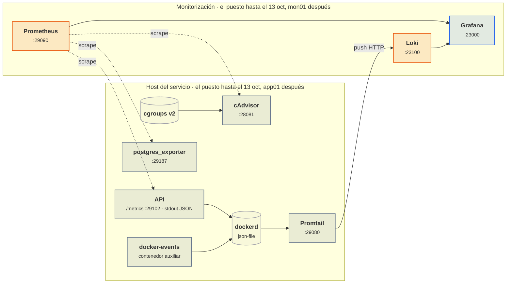
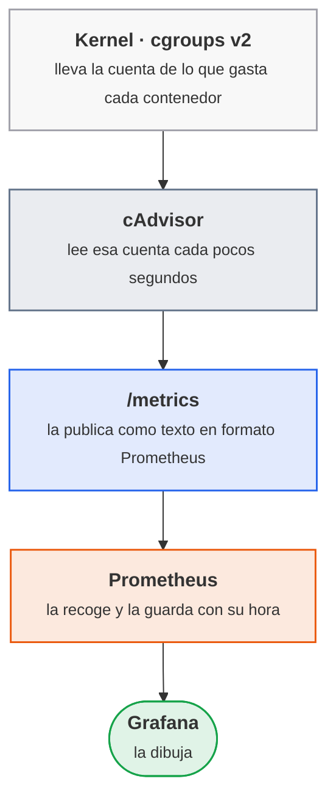
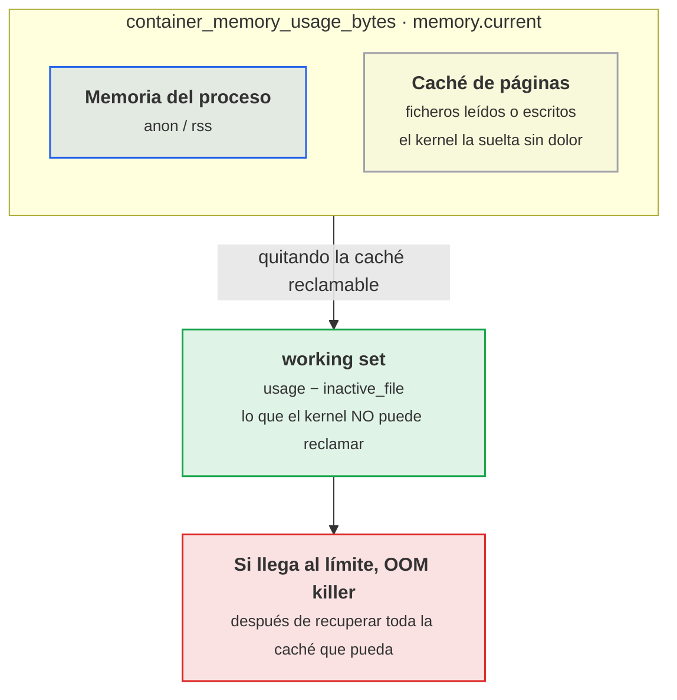
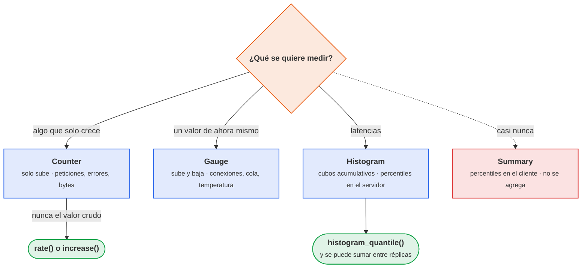
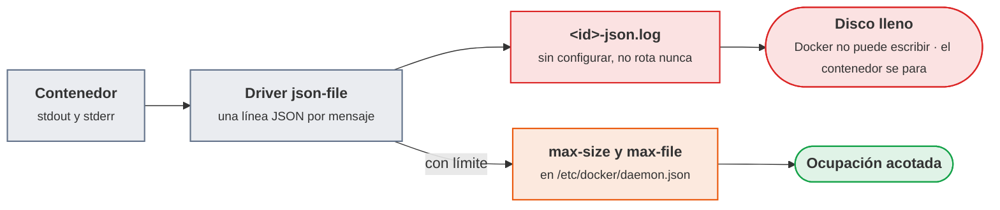
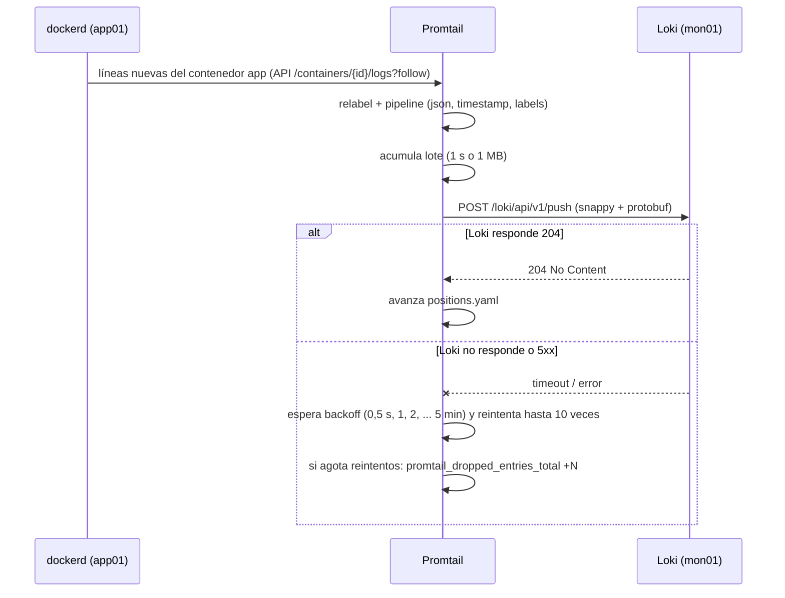
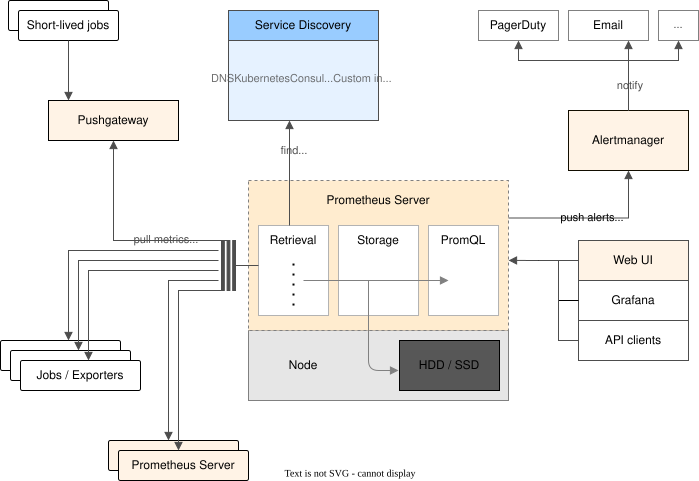
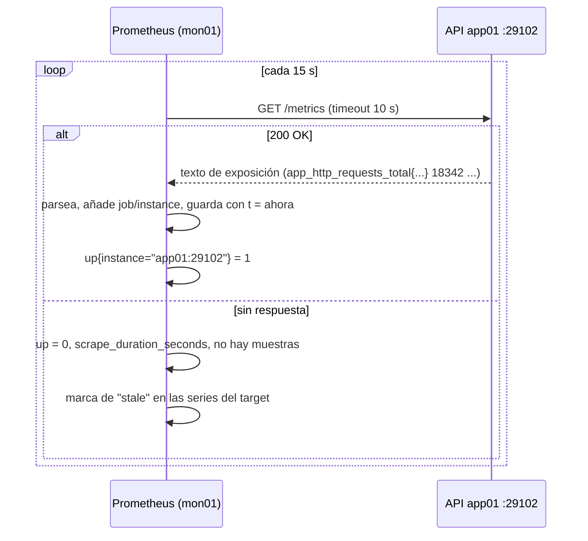

# UT1 · Observabilidad de contenedores: métricas, logs y eventos

<p class="ut-meta">14 h · Sesiones 1 a 7 · RA1 CE a</p>

Esta es la primera unidad del módulo y trabaja sobre el servicio del curso, que se da el primer día en Aules como repositorio `servicio`: una API en Python con Flask, servida con gunicorn, detrás de nginx y con PostgreSQL, todo en un solo Docker Compose. El laboratorio llega por fases, y esta unidad se hace sobre un entorno provisional: hasta el 13 de octubre no existe ninguna VM y todo corre con Docker en el puesto del alumno; el 14 de octubre la asignatura de despliegue clona en la red del laboratorio app01 (el servicio) y mon01 (la pila de monitorización), y las dos no pasan a su red definitiva, detrás de un cortafuegos, hasta el 27 de noviembre. La pila de monitorización que se monta aquí, a partir de la mínima que se da en clase, es la de todo el curso. Aquí no se despliega nada nuevo del servicio: se trata de sacar de él todo lo que cuenta sobre su estado (métricas de recursos, métricas de aplicación, logs y eventos), llevarlo al sistema de monitorización y demostrar con pruebas que llega entero, a tiempo y se guarda. Ese "demostrar" es la mitad de la unidad y el criterio de evaluación lo dice explícitamente: integrar y verificar comunicación, integridad y almacenamiento. Sin datos fiables no hay alarma que funcione, y las alarmas son lo que construye la unidad siguiente, la UT2, a partir del 29 de octubre.

Al servicio del curso, esté en el puesto o en app01, se le llama durante todo el módulo el **contenedor de referencia**, y se mantiene vivo todo el curso.

## Sesión 1 · Presentación y el contenedor de referencia

<p class="ut-meta" markdown>1 de octubre · Teoría y práctica · <span class="dur" tabindex="0" aria-label="Presentación de la asignatura · 25 min&#10;Qué expone un contenedor · 20 min&#10;A1.1 Presentación y el contenedor de referencia · 65 min" data-dur="Presentación de la asignatura · 25 min&#10;Qué expone un contenedor · 20 min&#10;A1.1 Presentación y el contenedor de referencia · 65 min">:material-school:<i class="dur-barra" style="--teoria:41%"></i>:material-flask:</span></p>

Mantener un servicio en contenedores empieza por poder contestar en todo momento a dos preguntas: si funciona y, cuando falla, por qué. Para eso no basta con entrar en la máquina a mirar: hay que saber qué información da un contenedor sobre sí mismo, de dónde sale cada una y adónde hay que llevarla para guardarla. Esta primera sesión, después de la presentación de la asignatura, dibuja ese mapa completo y lo comprueba con el servicio del curso: se pone en marcha, se tira la base de datos y se observa en tres terminales cómo reacciona cada tipo de información. Sin el mapa, lo que aparece en las terminales son piezas sueltas; con él, es el índice de lo que se monta en el resto de la unidad.

### Qué expone un contenedor

**Qué es la observabilidad.** Un servicio es **observable** cuando, desde fuera y sin tocarlo, se puede saber en qué estado está y por qué. Es lo contrario de lo que pasa cuando algo falla y la única forma de averiguarlo es entrar en la máquina, probar cosas y reiniciar a ver si se arregla. La observabilidad no se consigue con una herramienta, sino recogiendo de forma ordenada todo lo que el servicio cuenta de sí mismo.

**Qué cuenta un contenedor.** Un contenedor en ejecución no es más que un proceso (o varios) del host, aislado del resto por dos mecanismos del kernel: los *namespaces*, que deciden qué ve, y los *cgroups*, que deciden cuánto puede gastar y llevan la cuenta. Todo lo que interesa saber de él sale por uno de estos cuatro caminos:

| Flujo | Quién lo produce | Cómo se lee en local | A dónde va |
|----|----|----|----|
| Métricas de recursos | El kernel, vía cgroups | `docker stats`, `/sys/fs/cgroup`, cAdvisor | Prometheus |
| Métricas de aplicación | La propia aplicación, en `/metrics` (formato de exposición de Prometheus) | `curl app01:29102/metrics` | Prometheus |
| Logs | stdout y stderr del proceso principal, capturados por el driver de logs de Docker | `docker logs -f app` | Loki (vía Promtail) |
| Eventos | El demonio Docker: start, die, oom, health_status... | `docker events` | Loki (vía un contenedor auxiliar y Promtail) |

**Por qué cuatro y no uno.** Cada flujo responde a una pregunta distinta. Las métricas de recursos dicen cuánto gasta el contenedor; las de aplicación, si el servicio hace bien su trabajo (cuántas peticiones, cuántos errores, cuánto tardan); los logs, qué ha pasado exactamente en cada momento; y los eventos, qué le ha pasado al contenedor desde fuera (si ha arrancado, si ha muerto y por qué). Ninguno sustituye a los demás: una avería se entiende cruzándolos.

**Por qué dos sistemas para guardarlos.** Los dos primeros son números: se miden cada pocos segundos y se guardan como series temporales, una lista de parejas hora y valor, en **Prometheus**, una base de datos hecha para eso. Los otros dos son texto con su hora: no se miden, se recogen línea a línea, y se guardan en **Loki**, una base de datos de logs. **Grafana** no guarda nada: es la web que consulta los dos y dibuja el resultado. Las tres piezas están en la pila mínima de monitorización que se da hoy en Aules, y se explican a fondo en las sesiones en que se usan por primera vez.



<p class="pie" markdown>Las métricas las va a buscar Prometheus; los logs los empuja Promtail. Esa diferencia de sentido decide qué puerto hay que abrir en cada máquina.</p>

El esquema es el mismo antes y después del 14 de octubre; lo único que cambia es dónde está cada caja. Hasta el 13 de octubre las dos están en el mismo host, el puesto del alumno, y las flechas son llamadas a `localhost` o al nombre del servicio dentro de la red de compose; desde el traslado, el 15 de octubre, la de arriba es app01 y la de abajo mon01, y las flechas cruzan la red del laboratorio.

Conviene fijarse en la dirección de las flechas: las métricas las va a buscar Prometheus (*pull*), y los logs los **empuja** Promtail, un agente que corre junto al servicio (*push*). Esa diferencia decide qué se pierde cuando se corta la red. Se comprueba al final de la unidad, el 22 de octubre, cortándola a propósito.

**Por qué los puertos del curso empiezan por 2.** Cada pieza del esquema escucha en un puerto, y los que traen de fábrica son también los de muchos otros programas: el 80 lo usan XAMPP o IIS, el 3000 los servidores de desarrollo de Node, el 8080 Tomcat y el 9090 Cockpit, la consola web de Fedora y Red Hat. Si uno de ellos está en marcha en el puesto, `docker compose up` falla con `address already in use`. Para no depender de lo que tenga instalado cada equipo, el curso saca los puertos del servicio y de la monitorización de una franja que casi ningún programa usa, la del 20000 al 29999, con una regla que se recuerda sola: el puerto de fábrica más 20000. Prometheus, que de fábrica escucha en el 9090, va en el 29090; Grafana, en el 23000; la API, en el 28080; y el nginx del servicio, en el 20080. Cada servicio se configura para escuchar en ese número dentro de su contenedor y se publica en el mismo, así que tiene un solo número, el mismo en el `compose.yml`, en el navegador y en Prometheus. La franja queda por encima de los puertos de las herramientas habituales y por debajo de los que el sistema operativo reparte a las conexiones salientes, que empiezan en el 32768 en Linux y en el 49152 en Windows y macOS. La tabla completa está en las [convenciones del laboratorio](../laboratorio.md#convenciones).

### A1.1 Presentación y el contenedor de referencia (sesión 1)

Los primeros 25 minutos son la presentación de la asignatura (evaluación, laboratorio compartido con Despliegue y calendario); después, 20 minutos para el mapa de los cuatro flujos, y el resto es esta hoja.

<span class="et et-obj">Objetivo</span> Tener el servicio del curso en marcha, que es el que vas a vigilar todo el año, y ver con tus propios ojos los flujos del mapa antes de montar ninguna herramienta: cómo reaccionan el consumo, los logs y los eventos cuando se cae la base de datos y cuando vuelve.

<span class="et et-pre">Antes de empezar</span>

- Docker Engine sobre Linux en tu puesto. Hoy no existe ninguna VM del laboratorio: todo se hace en localhost. Si el puesto es Windows o macOS, trabaja en una VM Debian en VirtualBox, porque en la sesión 2, el 6 de octubre, se leen ficheros de cgroups que solo existen en un host Linux.
- De Aules, el servicio del curso (la API Flask en `api/` y un `compose.yml` con `nginx`, `app` y `db`) y la pila mínima de monitorización (Prometheus, Alertmanager y Grafana), que hoy no se usa.
- Lo explicado antes: [Qué expone un contenedor](#que-expone-un-contenedor).

<span class="et et-pas">Pasos</span>

Primero dejas preparado el sitio donde vas a trabajar todo el curso, con cada pieza en su repositorio, y pones el servicio en marcha. Después abres una ventana a cada flujo del mapa con las herramientas que Docker trae de serie, y al final provocas la primera avería del curso para ver qué cuenta cada ventana. Fíjate en lo que no puedes hacer con estas herramientas, como volver atrás en el tiempo o ver otra máquina: es lo que resuelve el resto de la unidad.

1. **Prepara el sitio de trabajo y arranca el servicio.** Deja el servicio en `/opt/servicio` y la pila de monitorización en `/opt/monitoring`, cada una como repositorio Git con un commit de partida: así nacen hoy `servicio` y `monitoring`, que crecerán todo el curso (el remoto llega el 17 de noviembre). Crea también `/opt/agentes`, vacía, para la sesión 2. Despliega el servicio y comprueba que responde en `http://localhost:20080/health`.

    *Pista:* las contraseñas van en un `.env` copiado de `.env.example`, que no se sube al repositorio. Cámbialas **antes** del primer `up`: PostgreSQL fija la suya la primera vez que arranca.

2. **Abre una ventana a cada flujo.** En tres terminales, deja a la vista el consumo de los contenedores, los logs de la API y los eventos del demonio de Docker, con las herramientas de la columna «Cómo se lee en local» de [Qué expone un contenedor](#que-expone-un-contenedor). Desde un cuarto terminal, genera tráfico continuo contra `/health` y observa qué cambia en cada ventana con cada petición.

    *Pista:* `curl -s -o /dev/null -w '%{http_code}\n'` imprime solo el código de respuesta. Los contenedores se llaman `servicio-app-1`, `servicio-db-1` y `servicio-nginx-1`.

3. **Provoca la primera avería.** Para la base de datos y cronometra qué aparece en cada ventana y cuántos segundos tarda en aparecer desde la parada; después arráncala y observa cómo se recupera el servicio. Lo que apuntes es la primera versión de lo que la monitorización tendrá que detectar sola.

<span class="et et-com">Comprobación</span> `git log` tiene un commit en `/opt/servicio` y otro en `/opt/monitoring`; el bucle de `curl` devuelve 200 con la base de datos arriba y 500 (o 503) con ella parada; en el terminal de eventos aparece el `die` de `db` con `exitCode` 0 y después el `start`.

<span class="et et-ent">Para practicar</span> Apunta en `tests/evidence/ut1/a1.1.md` del repositorio `servicio` una tabla con tres filas (métricas, logs, eventos) y tres columnas (qué se vio al parar la BD, cuántos segundos tardó, qué se vio al arrancarla).

<span class="et et-ext">Si te sobra tiempo</span> Repite el bucle con `/items`, que consulta la base de datos: ¿la API devuelve error o se queda colgada?

## Sesión 2 · Métricas de recursos

<p class="ut-meta" markdown>6 de octubre · Teoría y práctica · <span class="dur" tabindex="0" aria-label="Métricas de recursos: cgroups v2 y cAdvisor · 20 min&#10;A1.2 Métricas de recursos · 90 min" data-dur="Métricas de recursos: cgroups v2 y cAdvisor · 20 min&#10;A1.2 Métricas de recursos · 90 min">:material-school:<i class="dur-barra" style="--teoria:18%"></i>:material-flask:</span></p>

En la A1.1 se vio con `docker stats` cuánto consumía cada contenedor mientras se paraba la base de datos. Esa terminal sirve para mirar ahora mismo, pero no para mantener un servicio: no guarda lo que pasó anoche, solo enseña la máquina en la que se ejecuta y no puede avisar a nadie. Esta sesión convierte ese mismo dato en una métrica de verdad, que se guarda con su hora, se consulta desde otra máquina y puede disparar alarmas. Para eso hacen falta cuatro piezas en cadena, y la teoría las recorre en ese orden: de dónde saca el kernel los números (los cgroups), quién los publica (cAdvisor), quién los guarda (Prometheus) y quién los dibuja (Grafana). La hoja monta la cadena entera para la CPU y la memoria de los contenedores del servicio.

### Métricas de recursos: cgroups v2 y cAdvisor



<p class="pie" markdown>Nadie inventa los números: el kernel ya los está contando. El resto de la cadena solo los lee, los guarda y los enseña.</p>

#### De dónde salen los números

**El problema que resuelven los cgroups.** En una máquina con muchos procesos, nada impide que uno solo se coma toda la memoria o toda la CPU y deje sin recursos a los demás. Para evitarlo, el kernel de Linux necesita poder agrupar procesos y, para cada grupo, ponerle un límite y llevar la cuenta de lo que gasta. Eso son los **cgroups** (*control groups*, grupos de control): un mecanismo del kernel que empezaron a desarrollar ingenieros de Google en 2006 para repartir sus servidores entre muchas tareas a la vez, y que forma parte de Linux desde 2008.

**Qué tienen que ver con los contenedores.** Un contenedor no es una máquina virtual: es un proceso normal del host al que el kernel le aplica dos mecanismos a la vez. Los *namespaces* deciden qué ve el proceso (sus propios procesos, su red, su sistema de ficheros) y los cgroups deciden cuánto puede gastar. Cuando Docker arranca un contenedor, crea un cgroup y mete dentro su proceso principal; las opciones `--memory` y `--cpus` (o `mem_limit` y `cpus` en compose) no son más que valores que Docker escribe en los ficheros de ese cgroup.

**Por qué ahí están las métricas.** Para hacer cumplir un límite, el kernel tiene que medir el consumo continuamente. Esa contabilidad existe para cada contenedor, tenga límite o no, y se puede leer desde el host: está en un sistema de ficheros especial, `/sys/fs/cgroup`, donde cada cgroup es un directorio y cada fichero es un contador o un límite. Para medir un contenedor no hay que instalar nada dentro de él; basta con saber leer esos ficheros.

Hay dos versiones de esa interfaz. La primera tenía un árbol de directorios por cada recurso; la **v2**, estable desde 2016, tiene uno solo, y es la que usa Debian desde su versión 11, así que es la del laboratorio. Con Docker gestionado por systemd, cada contenedor aparece como un directorio `docker-<id>.scope` dentro de `system.slice`, y de todos sus ficheros el curso usa estos:

| Fichero | Qué contiene | Para qué sirve aquí |
|---|---|---|
| `memory.current` | La memoria que tiene cargada el grupo ahora, caché de ficheros incluida | Punto de partida de la memoria del contenedor |
| `memory.max` | El límite de memoria, o `max` si no tiene | Saber cuánto le queda antes de que el kernel actúe |
| `memory.stat` | El desglose de esa memoria: `anon` (la del proceso), `file` (caché de ficheros), `inactive_file`... | Calcular el working set, que se explica en el apartado siguiente |
| `cpu.stat` | `usage_usec`: microsegundos de CPU gastados desde que arrancó | La CPU del contenedor |
| `io.stat` | Bytes leídos y escritos en cada disco | La actividad de disco |
| `pids.current` | Procesos e hilos vivos | Detectar un contenedor que no para de crear procesos |

Así se leen para la API. La ruta del cgroup se saca del propio proceso y no se escribe a mano, porque cambia según cómo esté configurado Docker:

```bash
PID=$(docker inspect -f '{{.State.Pid}}' servicio-app-1)
CG=/sys/fs/cgroup$(cut -d: -f3 /proc/$PID/cgroup)     # /sys/fs/cgroup/system.slice/docker-<id>.scope
cat $CG/memory.current $CG/memory.max
grep usage_usec $CG/cpu.stat
grep -E '^(anon|file|inactive_file) ' $CG/memory.stat
```

`docker stats` hace exactamente esto cada segundo y lo formatea. Cuando una herramienta da un número que no cuadra, estos ficheros son la fuente de verdad contra la que se compara.

#### Memory usage frente a working set

**Por qué la memoria merece un apartado propio.** De todos los recursos, la memoria es el que mata contenedores. Si a uno le falta CPU, va más lento; si llega a su límite de memoria, el kernel mata uno de sus procesos (es el *OOM killer*, de *out of memory*) y el contenedor muere. Por eso hay que tener claro qué número vigilar, y no es el más obvio.

**De qué está hecha la memoria de un contenedor.** Linux aprovecha la memoria libre para guardar en caché los ficheros que se leen y se escriben (la *caché de páginas*), porque leer de memoria es mucho más rápido que leer de disco. Esa caché se le apunta al cgroup que la provocó: si la API escribe logs o lee ficheros, su `memory.current` crece aunque el proceso no haya pedido ni un byte más. Pero esa caché no es imprescindible y, cuando falta memoria, el kernel la suelta. Por eso un `memory.current` que sube y sube en un contenedor que escribe logs parece una fuga de memoria que en realidad no existe.

**El número que importa.** El **working set** es la memoria total menos la caché de ficheros que el kernel considera inactiva (`memory.current` menos `inactive_file`): lo que el kernel no puede soltar sin perjudicar al proceso. Cuando un contenedor llega a su límite, el kernel primero recupera caché y, si con eso no basta, entra el OOM killer. Así que el working set es la mejor aproximación a cuánto le queda de verdad al contenedor. Es la cifra que enseña `docker stats` y la que usa Kubernetes para decidir qué contenedor sacar de un nodo que se queda sin memoria.



<p class="pie" markdown>Para alarmas y para comparar contra el límite, **working set**; la memoria total solo sirve para entender de qué está hecha.</p>

cAdvisor, que se presenta más abajo, publica las dos cifras: `container_memory_usage_bytes` (la total) y `container_memory_working_set_bytes`. Con la segunda y el límite se calcula qué parte de su memoria ha gastado cada servicio:

```promql
# porcentaje del límite que usa cada servicio de compose
container_memory_working_set_bytes{container_label_com_docker_compose_service!=""}
  / container_spec_memory_limit_bytes * 100
```

Si un contenedor no tiene límite, cAdvisor publica `container_spec_memory_limit_bytes` a 0 (con cgroups v2, "sin límite" se traduce así) y la división da `+Inf`. No es un fallo de la consulta, es un aviso: a ese contenedor le falta un límite, y sin límite no hay forma de saber cuánto le queda.

#### Prometheus: guardar la métrica con su hora

**Qué falta todavía.** Leer un fichero da el valor de ahora. Mantener un servicio exige el valor de cada momento: cuánta memoria tenía la API a las tres de la madrugada, si la CPU lleva una semana subiendo, si el pico de ayer coincidió con un despliegue. Eso es una **serie temporal**, una sucesión de parejas (hora, valor) guardadas una detrás de otra. **Prometheus** es una base de datos hecha para guardar y consultar series temporales; nació en 2012 en una empresa de música en streaming para vigilar sus propios servicios, y hoy es la herramienta de referencia para las métricas de contenedores (fue el segundo proyecto que adoptó la CNCF, la fundación que custodia Kubernetes).

**Cómo consigue los datos.** Prometheus no espera a que nadie le mande nada: cada cierto tiempo (el *scrape interval*, 15 s en el curso) hace una petición HTTP a la ruta `/metrics` de cada programa que vigila, que se llama *target*, y guarda lo que recibe con la hora de ese momento. Los targets del mismo tipo se agrupan en un *job*. A esa petición periódica se le llama **scrape**, y es la razón de que quien quiera ser vigilado tenga que publicar sus datos en esa ruta. Lo que devuelve `/metrics` es texto plano, una línea por valor:

```text
container_memory_working_set_bytes{name="servicio-app-1",image="servicio-app"} 5.0659328e+07
container_cpu_usage_seconds_total{name="servicio-app-1",cpu="total"} 184.39
```

**Métrica, etiquetas y serie.** Cada línea lleva un nombre de métrica, unas **etiquetas** entre llaves que dicen de qué se está hablando (qué contenedor, qué servicio, qué máquina) y un valor. Cada combinación distinta de nombre y etiquetas es una **serie** distinta, con su propio histórico. Las etiquetas son lo que permite preguntar después por "la memoria de todos los contenedores del servicio `app`" o por "la CPU de todo lo que corre en app01", y elegirlas bien es la mitad del trabajo, como se ve en [Etiquetas y cardinalidad](#etiquetas-y-cardinalidad).

**Contadores y medidores.** La memoria es un **medidor** (*gauge*): sube y baja, y su valor se lee tal cual. La CPU es un **contador** (*counter*): acumula los segundos de CPU gastados desde que arrancó el contenedor y solo crece, así que su valor suelto no dice nada. Lo que interesa es cuánto sube por segundo, y eso lo calcula la función `rate()` de **PromQL**, el lenguaje de consulta de Prometheus. Hay dos tipos más, pensados para medir cuánto tardan las peticiones, que se ven en la sesión 3, el 13 de octubre, al instrumentar la API.

#### cAdvisor en compose

**Por qué hace falta un intermediario.** Prometheus solo sabe leer `/metrics` por HTTP, y los cgroups son ficheros del host. Hace falta un programa que lea los cgroups de todos los contenedores y los publique en ese formato: **cAdvisor** (*Container Advisor*), un agente que Google publicó en 2014 y que hoy va integrado en Kubernetes. cAdvisor descubre los contenedores de la máquina, lee sus ficheros de cgroup cada pocos segundos y los expone como métricas `container_*`. No calcula nada nuevo: son los ficheros de [De dónde salen los números](#de-donde-salen-los-numeros), con nombre y etiquetas.

**Por qué en un compose aparte.** cAdvisor no forma parte del servicio, lo vigila. Si estuviera en el mismo compose, cada `docker compose down` del servicio tumbaría también al agente que tiene que contar lo que le pasa. Por eso va en un compose de agentes, `/opt/agentes/compose.yml`, al que en las sesiones siguientes se añaden Promtail y el recolector de eventos. El fichero es el mismo en el puesto del alumno (octubre) y en app01 (desde el 15 de octubre); solo cambia la máquina donde se ejecuta.

**Qué tiene que ver del host.** Desde dentro de su contenedor, cAdvisor necesita ver tres cosas de fuera: el árbol de cgroups (`/sys`), el socket de Docker (`/var/run/docker.sock`, el fichero por el que se habla con el demonio, para saber qué cgroup es de qué contenedor y leer sus etiquetas) y el directorio de Docker (para el disco). Por eso monta esas rutas del host, todas en solo lectura:

```yaml
# /opt/agentes/compose.yml, en el host del servicio
services:
  cadvisor:
    image: gcr.io/cadvisor/cadvisor:v0.52.1
    container_name: cadvisor
    privileged: true
    devices:
      - /dev/kmsg
    volumes:
      - /:/rootfs:ro
      - /var/run:/var/run:ro
      - /sys:/sys:ro
      - /var/lib/docker/:/var/lib/docker:ro
      - /dev/disk/:/dev/disk:ro
    command:
      - --docker_only=true
      - --housekeeping_interval=10s
      - --port=28081
      - --store_container_labels=false
      - --whitelisted_container_labels=com.docker.compose.service,com.docker.compose.project
      - --disable_metrics=percpu,sched,tcp,udp,hugetlb,referenced_memory,cpu_topology,resctrl
    environment:
      CADVISOR_HEALTHCHECK_URL: http://localhost:28081/healthz
    ports:
      - "28081:28081"
    restart: unless-stopped
```

Del resto del fichero, cuatro decisiones:

- `privileged` y `/dev/kmsg` le dejan leer los avisos del kernel. Sin ellos funciona, pero no se entera de que el OOM killer ha matado a nadie y `container_oom_events_total` no sube nunca.
- `--docker_only` deja fuera los cgroups que no son contenedores (los servicios del propio host), que no aportan nada y multiplican las series.
- `--housekeeping_interval=10s` hace que mida cada 10 s en lugar de cada segundo. Con el valor por defecto, cAdvisor puede llegar a gastar un 5 % de la CPU del host solo en medirse a sí mismo y a los demás.
- `--port=28081`: cAdvisor escucha en el puerto que le diga esta opción, y se publica en ese mismo número. Su imagen trae un healthcheck que pregunta en el 8080 de fábrica; `CADVISOR_HEALTHCHECK_URL` le dice que pregunte en el nuevo, y sin ella el contenedor sale siempre `unhealthy`. Por la regla de los puertos del curso le tocaría el 28080 (su 8080 de fábrica más 20000), pero ese es el de la API en el mismo host. Dentro de la red de Docker se le llama igual, `cadvisor:28081`.

Las dos opciones de etiquetas (`--store_container_labels` y `--whitelisted_container_labels`) son las que explica el apartado siguiente.

#### Etiquetas y cardinalidad

**Qué etiquetas trae cada serie.** cAdvisor pone a cada serie `id` (la ruta del cgroup), `name` (el nombre del contenedor, por ejemplo `servicio-app-1`) e `image`. Además puede copiar las etiquetas de Docker del contenedor como etiquetas `container_label_<clave>`, con los puntos cambiados por guiones bajos. Compose pone a cada contenedor bastantes etiquetas de Docker: el proyecto, el servicio, el número de réplica, la ruta del fichero y un *hash* de la configuración (`com.docker.compose.config-hash`) que cambia cada vez que un `compose up` modifica el servicio.

**El problema: la cardinalidad.** Como cada combinación distinta de etiquetas es una serie, una etiqueta que cambia de valor en cada despliegue crea series nuevas en cada despliegue, y las viejas se quedan huérfanas. Prometheus mantiene en memoria todas las series recientes, así que cada serie de más es memoria y disco de más en mon01 y consultas más lentas. Al número de series distintas se le llama **cardinalidad**, y que crezca sin control es el problema número uno de una base de datos de series temporales.


<p class="pie" markdown>Una etiqueta que cambia en cada despliegue multiplica las series. Es el enemigo número uno de una base de datos de series temporales.</p>

**La solución del curso, en dos sitios.** En cAdvisor, el compose de arriba desactiva la copia de etiquetas y solo deja pasar dos: el servicio y el proyecto de compose. De las dos, la que importa para todo el módulo es la del servicio, `container_label_com_docker_compose_service`, porque es estable entre despliegues (siempre `app`, `db` o `nginx`), mientras que `name` cambia si se escala o se renombra un contenedor. En Prometheus, el job que recoge cAdvisor hace tres cosas más con lo que recibe, en este orden: copia esa etiqueta a una más manejable, `service`; borra todas las `container_label_*`, que ya no hacen falta; y se queda solo con las métricas que el curso usa.

```yaml
# prometheus.yml (fragmento)
scrape_configs:
  - job_name: cadvisor
    scrape_interval: 15s
    static_configs:
      - targets: ["cadvisor:28081"]     # nombre del servicio en la red de compose
        labels: { host: puesto }
    metric_relabel_configs:
      - source_labels: [container_label_com_docker_compose_service]
        target_label: service
      - regex: container_label_.*
        action: labeldrop        # después de la copia: ya no hace falta ninguna
      - source_labels: [__name__]
        regex: container_(cpu_usage_seconds_total|memory_working_set_bytes|memory_usage_bytes|spec_memory_limit_bytes|network_(receive|transmit)_bytes_total|fs_(reads|writes)_bytes_total|oom_events_total|last_seen)
        action: keep
```

`metric_relabel_configs` es la parte del job que reescribe cada serie justo después del scrape y antes de guardarla. El último bloque, `keep`, es opcional pero recomendable en un laboratorio con 2 o 3 GB de RAM en mon01: cAdvisor publica más de cien métricas por contenedor y el curso usa diez. Entre ellas está `container_last_seen`, que dice cuándo se vio por última vez cada contenedor y sirve para detectar los que han desaparecido.

El target depende de dónde esté cada pieza. En el entorno provisional, Prometheus y cAdvisor corren en el mismo puesto y comparten una red de Docker, así que basta el nombre del servicio (`cadvisor:28081`, con la etiqueta `host: puesto`). Desde el 15 de octubre, con Prometheus en mon01 y cAdvisor en app01, el target pasa a ser la IP de app01 con el mismo puerto, que es también el publicado (`<app01>:28081`), y la etiqueta, `host: app01`. El resto del bloque no cambia.

#### Las consultas del panel

**Grafana no guarda nada.** Grafana es la web que dibuja: se conecta a Prometheus como *fuente de datos*, le manda una consulta en PromQL por cada panel y pinta lo que recibe. Si un panel sale vacío, el fallo está en la consulta o en Prometheus, nunca en un dato que Grafana haya perdido.

**Qué hace cada consulta.** Las tres que se usan en la sesión se leen de dentro afuera:

```promql
# CPU en núcleos por servicio (1 = un núcleo entero)
sum by (service) (rate(container_cpu_usage_seconds_total{service!=""}[2m]))
# memoria working set por servicio
sum by (service) (container_memory_working_set_bytes{service!=""})
# tráfico de red recibido, bytes/s
sum by (service) (rate(container_network_receive_bytes_total{service!=""}[2m]))
```

- `{service!=""}` se queda con las series de contenedores del servicio y descarta el resto.
- `rate(...[2m])` convierte un contador en una velocidad: cuánto ha subido por segundo, de media, en los dos últimos minutos. Aplicado a los segundos de CPU, da los núcleos que se están usando.
- `sum by (service)` suma todas las series que tienen el mismo `service`. Hoy cada servicio tiene un solo contenedor, pero si mañana `app` tuviera tres réplicas, la consulta seguiría dando una línea por servicio.

**La ventana de `rate()`.** Con un scrape cada 15 s, en una ventana de `[2m]` caen 8 muestras, que bastan para una media estable. Con `[30s]` caen dos, y la gráfica va a saltos o se queda en blanco. La regla práctica: la ventana de `rate()`, al menos cuatro veces el intervalo de scrape.

### A1.2 Métricas de recursos (sesión 2)

<span class="et et-obj">Objetivo</span> Que la CPU y la memoria de cada contenedor del servicio dejen de ser una foto de `docker stats` y pasen a ser series guardadas en Prometheus, con una etiqueta `service` estable, y dibujadas en Grafana. Al terminar tienes la cadena entera de la teoría funcionando y sabes de dónde sale cada número que pinta el panel.

<span class="et et-pre">Antes de empezar</span>

- Sigue sin haber VM: todo en tu puesto, con el servicio de la A1.1 en `/opt/servicio` y la pila mínima en `/opt/monitoring`. Los agentes van en un tercer compose, `/opt/agentes`, que hoy estrenas.
- Lo explicado antes: [de dónde salen los números](#de-donde-salen-los-numeros), [memory usage frente a working set](#memory-usage-frente-a-working-set), [Prometheus](#prometheus-guardar-la-metrica-con-su-hora), [cAdvisor en compose](#cadvisor-en-compose), [etiquetas y cardinalidad](#etiquetas-y-cardinalidad) y [las consultas del panel](#las-consultas-del-panel).

<span class="et et-pas">Pasos</span>

Vas a montar la cadena de la teoría de abajo arriba y a comprobar cada eslabón antes de pasar al siguiente: primero lees los números en su origen, después los publica cAdvisor, luego los recoge Prometheus y al final los dibuja Grafana. Así, si al final algo no cuadra, sabes en qué eslabón buscar.

1. **Lee la memoria de la API en su origen.** Antes de montar ninguna herramienta, comprueba que entiendes el número que va a pintar el panel. Localiza el cgroup del contenedor de la API, lee su memoria total y el desglose de `memory.stat`, y calcula el working set como se explica en [Memory usage frente a working set](#memory-usage-frente-a-working-set). Compáralo con la columna de memoria de `docker stats`: si los dos cuadran, ya sabes qué mide cada herramienta. Apunta el número, porque al final tendrás que reconocerlo en Grafana.

2. **Pon las tres pilas en la misma red.** Cada compose crea su propia red, y los contenedores de una no ven los de otra. Prometheus, que está en la pila de monitorización, tiene que llegar a cAdvisor, que va a estar en la de agentes, por su nombre. Por eso las tres pilas van a compartir una red de Docker llamada `obs`, creada fuera de compose para que ningún `down` la borre.

    *Pista:* la red se crea una vez con `docker network create`, y cada compose la declara al final como su red por defecto, sin tocar ningún servicio:

    ```yaml
    networks:
      default:
        name: obs
        external: true
    ```

3. **Publica los números con cAdvisor.** Despliega cAdvisor en `/opt/agentes` con el compose de [cAdvisor en compose](#cadvisor-en-compose). Antes de conectar Prometheus, comprueba que el agente hace su trabajo: en su `/metrics`, publicado en el 28081, tienen que aparecer los contenedores del servicio con la etiqueta de su servicio de compose, que toma los valores `app`, `db` y `nginx`. Si esa etiqueta no está aquí, no estará después en ningún panel.

4. **Haz que Prometheus lo recoja, con las etiquetas limpias.** Añade a Prometheus el job `cadvisor` de [Etiquetas y cardinalidad](#etiquetas-y-cardinalidad), con el target `cadvisor:28081`, y comprueba en su página de targets que está en UP. Antes de dar el job por bueno, mide para qué sirve su bloque `keep`: cuenta las métricas distintas y las series del job con el bloque desactivado, actívalo y vuelve a contar. La diferencia es memoria y disco que mon01 se ahorra durante todo el curso.

    *Pista:* `count(count by (__name__)({job="cadvisor"}))` cuenta métricas distintas, y `count({job="cadvisor"})`, series.

5. **Dibuja CPU y memoria por servicio y cierra el círculo.** Crea en Grafana un dashboard con dos paneles, CPU en núcleos y working set por servicio, con las consultas de [Las consultas del panel](#las-consultas-del-panel), y añade al de memoria el porcentaje sobre el límite. Genera tráfico contra el servicio un par de minutos: la CPU de `app` tiene que subir con la carga, y su working set tiene que parecerse al número que apuntaste en el paso 1. Si los dos cuadran, la cadena entera funciona.

    *Pista:* la pila de Aules ya trae Prometheus como fuente de datos, en `http://prometheus:29090` y no en `localhost`, que dentro del contenedor de Grafana es el propio Grafana. Si el porcentaje sale `+Inf`, `app` no tiene límite de memoria: pónselo con `mem_limit: 512m`, el que fija la documentación del servicio.

<span class="et et-com">Comprobación</span> El working set del paso 1 se queda a unos pocos MiB de `docker stats`; `cadvisor` en UP en Targets; las series llevan `service` con los valores `app`, `db` y `nginx`, y ninguna `container_label_*`; los dos paneles pintan una línea por servicio y el número de series tras el `keep` es varias veces menor.

<span class="et et-ent">Para practicar</span> Guarda en `tests/evidence/ut1/a1.2.md` la comparación de memoria del paso 1, la captura de los dos paneles y los cuatro números (métricas distintas y series, antes y después del `keep`): la práctica evaluable parte de él. El compose de agentes y el fragmento de `prometheus.yml` van además al repositorio `monitoring`.

<span class="et et-ext">Si te sobra tiempo</span> Cambia la ventana del `rate()` a `[30s]` en el panel de CPU y observa cómo se rompe la gráfica; después vuelve a `[2m]`.

## Sesión 3 · Instrumentar la aplicación

<p class="ut-meta" markdown>13 de octubre · Teoría y práctica · <span class="dur" tabindex="0" aria-label="Métricas de aplicación · 20 min&#10;A1.3 Instrumentar la aplicación · 90 min" data-dur="Métricas de aplicación · 20 min&#10;A1.3 Instrumentar la aplicación · 90 min">:material-school:<i class="dur-barra" style="--teoria:18%"></i>:material-flask:</span></p>

Prometheus ya guarda cuánto consume cada contenedor. Pero un contenedor puede estar tranquilo, al 2 % de CPU y con la memoria estable, mientras devuelve error a todo el que le pide algo: el kernel no sabe nada de peticiones ni de errores. Esta sesión añade el segundo de los cuatro flujos de [Qué expone un contenedor](#que-expone-un-contenedor), las métricas de aplicación, que responden a las tres preguntas de quien mantiene una API: cuántas peticiones llegan, cuántas fallan y cuánto tardan. Se construye en tres pasos: primero, qué tipos de métrica hay y cuál sirve para cada pregunta; después, cómo se añaden al código de la API; y por último, qué se hace con el software que no se puede tocar, como PostgreSQL.

### Métricas de aplicación

{ .logo-inline } **Por qué hay que tocar el código.** Las métricas de recursos las calcula el kernel desde fuera, sin que el contenedor se entere. Las de aplicación no se pueden ver desde fuera: solo la propia aplicación sabe que ha recibido una petición a `/items`, que ha tardado 80 ms y que ha devuelto un 500. Por eso se **instrumenta**: se le añaden unas líneas de código que cuentan esos sucesos y los publican en `/metrics`, la misma ruta y el mismo formato de texto que ya se vio con cAdvisor, para que Prometheus las recoja con su scrape cada 15 s.

**De dónde sale el código.** No hace falta escribir el formato a mano: el proyecto Prometheus mantiene librerías cliente oficiales para los lenguajes más usados (Go, Java, Python, Ruby...). La aplicación crea sus métricas con la librería, las actualiza cuando pasa algo (una petición atendida, un error) y la librería se encarga de servirlas. Los valores viven en la memoria del proceso: cada scrape lee los que hay en ese momento.

#### Tipos de métrica

Cada pregunta se responde con un tipo de métrica distinto. Los dos primeros ya aparecieron con la CPU y la memoria de los contenedores.

- **Counter (contador)**: un número que solo sube. Sirve para contar sucesos: peticiones atendidas, errores, bytes enviados. Su valor crudo no se consulta nunca, porque depende de cuándo arrancó el proceso; se consulta su velocidad con `rate()` (por segundo) o `increase()` (en total dentro de una ventana). La ventaja de contar en lugar de medir es que no se pierde nada: si a Prometheus se le escapa un scrape, el siguiente trae el total acumulado y la velocidad sale igual. Si el proceso se reinicia, el contador vuelve a cero y `rate()` lo detecta y lo corrige.
- **Gauge (medidor)**: un valor que sube y baja, y que se consulta tal cual: peticiones en curso, conexiones abiertas, tamaño de una cola, la fecha de la última copia de seguridad.
- **Histogram (histograma)**: sirve para responder a "cuánto tardan". Explicado en el párrafo siguiente.
- **Summary (resumen)**: calcula los percentiles dentro de la propia aplicación. Es más preciso para una sola instancia, pero sus percentiles no se pueden sumar entre varias réplicas de la API, así que en la práctica se usa casi siempre el histograma.

**Por qué la latencia necesita un histograma.** La primera idea para saber cuánto tarda una API es la media, y la media engaña: si 95 peticiones tardan 20 ms y 5 tardan 3 s, la media sale 169 ms y no describe a nadie, ni a los usuarios contentos ni a los que se cansaron de esperar. Lo que se usa es el **percentil**: el p95 es el tiempo por debajo del cual quedan el 95 % de las peticiones, o dicho al revés, lo que sufre el 5 % más lento. Para calcularlo, el histograma no guarda cada duración, sino cuántas peticiones han caído por debajo de cada umbral fijo, que se llama *bucket* (cubo): cuántas tardaron menos de 0,1 s, cuántas menos de 0,25 s, cuántas menos de 0,5 s... Cada cubo es un contador con una etiqueta `le` (*less or equal*, menor o igual), y los cubos son acumulativos: el de 0,5 s incluye las del de 0,25 s. Con esos contadores Prometheus estima cualquier percentil con la función `histogram_quantile()`, y como son contadores, se pueden sumar entre réplicas.



<p class="pie" markdown>El contador crudo depende de cuándo arrancó el proceso, así que no se consulta nunca: se consulta su velocidad.</p>

#### Python con prometheus_client

**Dónde se engancha el código.** La API del curso está hecha con Flask, el microframework web de Python. Flask permite registrar funciones que se ejecutan antes y después de cada petición (`before_request` y `after_request`), y ese es el sitio natural para medir: antes se apunta la hora, y después se calcula cuánto ha tardado y se cuenta la petición con su ruta y su código de respuesta. Así se mide cualquier ruta de la API sin tocar ninguna de ellas. Este es el módulo que usa el curso, con la librería cliente oficial de Python, `prometheus_client`:

```python
# metrics.py
import time
from flask import Flask, request, g
from prometheus_client import Counter, Histogram, Gauge, start_http_server

REQUESTS = Counter(
    "app_http_requests_total",
    "Peticiones HTTP atendidas",
    ["method", "route", "status"],
)
LATENCY = Histogram(
    "app_http_request_duration_seconds",
    "Duración de la petición en segundos",
    ["method", "route"],
    buckets=(0.005, 0.01, 0.025, 0.05, 0.1, 0.25, 0.5, 1, 2.5, 5),
)
INFLIGHT = Gauge("app_http_requests_in_flight", "Peticiones en curso")
DB_UP = Gauge("app_db_reachable", "1 si la última consulta a PostgreSQL funcionó")

def instrument(app: Flask) -> None:
    @app.before_request
    def _start():
        g.t0 = time.perf_counter()
        INFLIGHT.inc()

    @app.after_request
    def _end(resp):
        route = request.url_rule.rule if request.url_rule else "unmatched"
        LATENCY.labels(request.method, route).observe(time.perf_counter() - g.t0)
        REQUESTS.labels(request.method, route, str(resp.status_code)).inc()
        INFLIGHT.dec()
        return resp

    start_http_server(29102)   # sirve /metrics en 0.0.0.0:29102
```

Las decisiones que hay detrás del módulo:

- **Un puerto propio para `/metrics`.** `start_http_server(29102)` abre un servidor aparte solo para las métricas, en lugar de servirlas en el puerto de la API, el 28080. Así el scrape no pasa por nginx, no cuenta como tráfico de usuarios y no queda expuesto al público junto con la API.
- **La plantilla de la ruta, no la URL.** La etiqueta `route` lleva la ruta tal como está definida en Flask (`/items/<int:id>`) y nunca la URL real (`/items/48213`). Con la URL real, cada id distinto sería una serie nueva: es el mismo problema de [cardinalidad](#etiquetas-y-cardinalidad) que con las etiquetas de cAdvisor, provocado esta vez por el propio código. Por la misma razón, `status` lleva el código y no el mensaje.
- **Los cubos se eligen pensando en el servicio.** Para una API que debería responder en menos de 250 ms, la lista de arriba tiene cubos de sobra alrededor de esa cifra. Para un proceso por lotes que tarda minutos no serviría: todas las peticiones caerían en el último cubo y el percentil no diría nada.
- **Las peticiones en curso como gauge.** `INFLIGHT` sube al empezar una petición y baja al terminar. Si crece y no baja, la API se está atascando: es una señal que avisa de un atasco antes de que empiecen los errores.

**Por qué un solo worker.** La API la ejecuta gunicorn, el servidor que se usa para poner en producción aplicaciones web de Python. gunicorn puede arrancar varios procesos (*workers*) que atienden peticiones en paralelo, pero cada proceso tiene su propia memoria y, por tanto, sus propios contadores: cada scrape lo atendería uno distinto y Prometheus vería valores que suben y bajan sin sentido. En el curso gunicorn arranca con un solo worker. Cuando hacen falta varios, la librería tiene un modo multiproceso que junta los contadores de todos (la variable de entorno `PROMETHEUS_MULTIPROC_DIR` y el `MultiProcessCollector`, en la [documentación de prometheus_client](https://prometheus.github.io/client_python/multiprocess/)).

#### Nombres y etiquetas: convenciones

**Por qué importan los nombres.** Prometheus deja poner cualquier nombre, pero si cada aplicación los pone a su manera, nadie sabe qué buscar, las consultas se vuelven ilegibles y los dashboards que comparte la comunidad dejan de funcionar. Por eso el propio proyecto publica unas convenciones, las de [Metric and label naming](https://prometheus.io/docs/practices/naming/):

| Regla | Bien | Mal |
|----|----|----|
| Prefijo con el nombre de la aplicación o del subsistema | `app_http_requests_total` | `requests` |
| Unidad base en el nombre, sin prefijos SI | `_seconds`, `_bytes`, `_ratio` | `_ms`, `_kb`, `_percent` |
| Los counters terminan en `_total` | `app_errors_total` | `app_error_count` |
| Una métrica mide una cosa; las dimensiones van en etiquetas | `app_http_requests_total{status="500"}` | `app_http_500_total` |
| Etiquetas de cardinalidad acotada | `method`, `status`, `route` plantilla | `user_id`, `request_id`, URL completa |
| snake_case en minúsculas | `app_db_reachable` | `appDbReachable` |

**La cuenta de la cardinalidad.** Antes de añadir una etiqueta hay que hacer siempre la misma cuenta: el número de series de una métrica es el producto del número de valores de cada etiqueta. `method` (5 valores) × `route` (20) × `status` (8) son 800 series para el contador de peticiones, y es asumible. Si se añadiera `client_ip`, con miles de valores, se pasaría del millón.

#### Las dos consultas de la sesión

Con la API instrumentada, las preguntas del principio se responden con dos consultas en PromQL:

```promql
# p95 de latencia en segundos, de todas las rutas juntas
histogram_quantile(0.95, sum by (le) (rate(app_http_request_duration_seconds_bucket[5m])))
# porcentaje de respuestas 5xx
sum(rate(app_http_requests_total{status=~"5.."}[5m])) / sum(rate(app_http_requests_total[5m])) * 100
```

- **El p95.** `rate(...[5m])` convierte cada cubo del histograma en una velocidad: cuántas peticiones por segundo han caído por debajo de cada umbral en los últimos cinco minutos. `sum by (le)` junta las rutas y conserva solo la etiqueta del cubo, que es la que necesita `histogram_quantile()` para estimar el percentil. El resultado sale en segundos, porque el histograma mide en segundos.
- **El porcentaje de errores.** Divide la velocidad de las respuestas 5xx (`status=~"5.."` es una expresión regular: cualquier código que empiece por 5) entre la velocidad de todas las respuestas. Los 4xx no cuentan: un 404 es un error del cliente, que ha pedido algo que no existe, y no dice nada de la salud del servicio. Un 500 o un 503 sí: el servicio no ha sabido responder.

#### Exporters: lo que no se puede instrumentar

**El problema.** La API se ha podido instrumentar porque su código es del curso. PostgreSQL, nginx o el propio sistema operativo del host no se pueden modificar para añadirles una librería de Prometheus, pero también hay que vigilarlos. La solución es el patrón **exporter**: un programa auxiliar que pregunta al software por la vía que este ya ofrece (una consulta SQL, una página de estado, unos ficheros del sistema) y traduce lo que obtiene al formato de `/metrics`. Corre al lado de lo que vigila, normalmente como un contenedor más del mismo compose.

**postgres_exporter** (puerto 29187) es el exporter de PostgreSQL. PostgreSQL ya lleva sus propias estadísticas en unas vistas internas (`pg_stat_database`, `pg_stat_activity`, `pg_locks`...), y el exporter las consulta y las publica. Para hacerlo necesita entrar en la base de datos, y aquí se aplica el mínimo privilegio: nunca se le da el usuario `postgres`, que lo puede todo, sino uno propio, `monitor`, con el rol `pg_monitor`, que PostgreSQL trae desde su versión 10 justamente para dar permiso de lectura de estadísticas y nada más.

```sql
CREATE USER monitor WITH PASSWORD 'cámbiame';
GRANT pg_monitor TO monitor;
GRANT CONNECT ON DATABASE servicio TO monitor;
GRANT SELECT ON items TO monitor;   -- solo para la consulta propia de queries.yaml
```

La contraseña de `monitor` no se escribe en el compose: va en un *secret* de compose, un fichero que Docker monta dentro del contenedor en `/run/secrets/` y que no aparece en `docker inspect` ni en el repositorio. Con `--web.listen-address=:29187`, el exporter escucha en el puerto de la franja en lugar de en su 9187 de fábrica, y se publica en el mismo número.

```yaml
# junto al servicio db, en el mismo compose del servicio
  postgres_exporter:
    image: quay.io/prometheuscommunity/postgres-exporter:latest
    command: ["--extend.query-path=/etc/queries.yaml", "--web.listen-address=:29187"]
    environment:
      DATA_SOURCE_URI: "db:5432/servicio?sslmode=disable"
      DATA_SOURCE_USER: monitor
      DATA_SOURCE_PASS_FILE: /run/secrets/pgx_pass
    volumes:
      - ./queries.yaml:/etc/queries.yaml:ro
    secrets: [pgx_pass]
    ports: ["29187:29187"]
    depends_on: [db]
# y al final del fichero
secrets:
  pgx_pass:
    file: ./pgx_pass.txt     # la contraseña de monitor; va en .gitignore
```

En Linux, Docker monta el *secret* con los permisos que tenga el fichero en el host, y el exporter se ejecuta como el usuario `nobody` (uid y gid 65534). Si `pgx_pass.txt` solo lo puede leer su dueño, el exporter no arranca (`failed loading data source pass file`). Se le da lectura solo a ese grupo: `sudo chgrp 65534 pgx_pass.txt && chmod 640 pgx_pass.txt`. En Docker Desktop no pasa, porque no aplica esos permisos, así que en el portátil funciona y falla al llevarlo a app01.

**Qué se mira de PostgreSQL.** `pg_up` vale 1 si el exporter consigue conectar y 0 si no, así que es la primera métrica que dice si la base de datos responde. Además, `pg_stat_database_numbackends` (las conexiones abiertas, para compararlas con el máximo permitido), `pg_stat_database_xact_commit` y `xact_rollback` (transacciones confirmadas y deshechas, con `rate()`), `pg_stat_database_blks_hit` frente a `blks_read` (cuántas lecturas se sirven desde la caché de PostgreSQL y cuántas tienen que ir a disco), `pg_locks_count` y `pg_database_size_bytes`.

**Medir lo que importa al negocio.** Las estadísticas internas dicen si PostgreSQL está sano, no si la aplicación hace lo que debe. Para eso el exporter admite consultas propias, en un fichero YAML pasado con `--extend.query-path`: cualquier cosa que se pueda preguntar con SQL se convierte en una métrica. La de abajo cuenta las filas de `items`, la tabla de la API. Cada métrica se llama como la clave del fichero más el nombre de la columna, así que la clave empieza por `pg_` para que se agrupe con las demás. Ese mecanismo está marcado como obsoleto en las versiones actuales del exporter, aunque sigue funcionando; si desaparece, la alternativa mantenida es [sql_exporter](https://github.com/burningalchemist/sql_exporter), que hace lo mismo para cualquier base de datos.

```yaml
# queries.yaml: sale como pg_items_filas (un gauge, así que sin _total)
pg_items:
  query: "SELECT count(*) AS filas FROM items"
  metrics:
    - filas: { usage: GAUGE, description: "Filas de la tabla items de la API" }
```

**Los otros dos exporters del curso.** **node_exporter** (puerto 29100) es el exporter del propio host: CPU, memoria, disco y red de la máquina entera, leídos de `/proc` y `/sys`. Completa a cAdvisor, que solo ve los contenedores: un disco lleno o una VM sin memoria no se ven desde un contenedor. Viene instalado en la plantilla de la que salen app01 y mon01 (paquete `prometheus-node-exporter`, que la plantilla ya deja escuchando en el 29100), así que no hay que desplegarlo. **nginx-prometheus-exporter** (de fábrica, en el 9113) hace lo mismo con nginx a partir de su página de estado, `stub_status`, pero da poco: conexiones activas y en espera, peticiones totales y si nginx responde, sin códigos de respuesta ni latencias por ruta. Por eso en el curso lo que se sabe de nginx sale de su log de acceso. Cómo se activa `stub_status` y se arranca el exporter está en [Para ampliar](../ampliacion.md#nginx-prometheus-exporter-y-stub_status). Ni node_exporter ni el log de nginx se usan todavía: los dos entran en la monitorización el 15 de octubre, con el traslado a las VM.

### A1.3 Instrumentar la aplicación (sesión 3)

<span class="et et-obj">Objetivo</span> Que el servicio responda a las tres preguntas que las métricas de recursos no saben contestar (cuántas peticiones llegan, cuántas fallan y cuánto tardan) y que PostgreSQL publique sus estadísticas sin tocar su código. Al terminar, Prometheus recoge la API y la base de datos, y sabes calcular el p95 de latencia y el porcentaje de errores y comprobar que cuentan lo que de verdad ha pasado.

<span class="et et-pre">Antes de empezar</span>

- Última sesión sin VM: todo sigue en tu puesto, con las tres pilas de la A1.2 en la red `obs`.
- La API es Python con Flask, servida con gunicorn y un solo worker. PostgreSQL es el servicio `db` del mismo compose: se entra con `docker compose exec db psql -U postgres -d servicio`.
- Lo explicado antes: [tipos de métrica](#tipos-de-metrica), [Python con prometheus_client](#python-con-prometheus_client), [nombres y etiquetas](#nombres-y-etiquetas-convenciones), [las dos consultas de la sesión](#las-dos-consultas-de-la-sesion) y [exporters](#exporters-lo-que-no-se-puede-instrumentar).

<span class="et et-pas">Pasos</span>

Vas a hacer que hablen dos piezas que hasta hoy estaban calladas: primero la API, a la que añades código que cuenta sus peticiones, y después PostgreSQL, que no se puede tocar y por eso necesita un exporter al lado. Cuando las dos publiquen sus métricas, las conectas a Prometheus con las mismas etiquetas que ya usa cAdvisor y, al final, provocas tráfico bueno y malo para comprobar que las consultas cuentan la historia que tú sabes que ha pasado.

1. **Haz que la API cuente sus peticiones.** Añade a la API el módulo de [Python con prometheus_client](#python-con-prometheus_client), con los mismos nombres de métrica y etiquetas, y engánchalo al crear la aplicación. La API tiene que servir sus métricas en su propio puerto, el 29102, publicado en el host. Antes de seguir, mira ese `/metrics`: tienen que aparecer el contador de peticiones y el histograma de duración, con `route` en forma de plantilla y no con la URL de cada petición.

    *Pista:* `prometheus_client` tiene que estar en `api/requirements.txt`, y eso obliga a reconstruir la imagen de la API. Deja gunicorn con un solo worker.

2. **Dale a PostgreSQL un exporter que solo pueda leer.** PostgreSQL no se puede instrumentar, así que pon a su lado postgres_exporter, en el mismo compose del servicio y publicado en el 29187. Primero crea en la base de datos el usuario `monitor` con permisos solo de lectura, y después configura el exporter con ese usuario y con la consulta propia que cuenta las filas de `items`, que es la prueba de que se puede medir cualquier cosa que se pueda preguntar con SQL. El exporter funciona si publica `pg_up` con valor 1.

    *Pista:* el SQL, el servicio con su bloque `secrets` y `queries.yaml` están completos en [Exporters](#exporters-lo-que-no-se-puede-instrumentar). `pgx_pass.txt` es una contraseña: va al `.gitignore`.

3. **Conéctalos a Prometheus con las etiquetas del curso.** Añade a Prometheus los jobs `app` y `postgres`, con la etiqueta `host: puesto` y con `service: app` y `service: db` respectivamente, y comprueba que los dos están en UP. Son las mismas etiquetas que ya llevan las series de cAdvisor, y eso es lo que te permitirá cruzar en un mismo panel, o en una misma alarma, lo que consume un servicio con lo que hace.

4. **Provoca tráfico y comprueba que las métricas cuentan lo que ha pasado.** Genera un par de minutos de tráfico variado: peticiones correctas, alguna a una ruta que no existe y medio minuto con la base de datos parada. Después calcula en Prometheus el p95 de latencia y el porcentaje de respuestas 5xx con [las dos consultas de la sesión](#las-dos-consultas-de-la-sesion) y compara lo que dicen con lo que tú hiciste: tienes que poder señalar en el resultado cada cosa que provocaste, y explicar por qué las peticiones a la ruta inexistente no suben el porcentaje de errores.

<span class="et et-com">Comprobación</span> `app` y `postgres` en UP en Targets; `app_http_requests_total` lleva `route` en forma de plantilla (`/items/<int:id>`, nunca `/items/48213`); `pg_up` vale 1 y la métrica personalizada aparece con prefijo `pg_`; el p95 sale en segundos y el porcentaje de 5xx sube solo mientras la base de datos está parada.

<span class="et et-ent">Para practicar</span> Guarda en `tests/evidence/ut1/a1.3.md` el código de la instrumentación, `queries.yaml`, los jobs de `prometheus.yml` y las dos consultas con su resultado: lo retoma la práctica evaluable. Haz además un commit propio del código en el repositorio `servicio`, que el 15 de octubre viaja con la carpeta a app01.

<span class="et et-ext">Si te sobra tiempo</span> Añade el gauge `app_db_reachable` (1 si la última consulta a PostgreSQL funcionó) y comprueba que baja a 0 al parar la base de datos.

## Sesión 4 · Logs estructurados

<p class="ut-meta" markdown>15 de octubre · Teoría y práctica · <span class="dur" tabindex="0" aria-label="Logs · 20 min&#10;A1.4 Logs estructurados · 90 min" data-dur="Logs · 20 min&#10;A1.4 Logs estructurados · 90 min">:material-school:<i class="dur-barra" style="--teoria:18%"></i>:material-flask:</span></p>

Prometheus ya sabe cuánto consume cada contenedor y cuántas peticiones fallan. Pero una métrica dice **que** algo pasa, no **por qué**: el porcentaje de errores sube, y para saber qué error es, en qué petición y con qué mensaje, hay que leer los logs. Hoy se monta el tercero de los cuatro flujos: los logs de la API y de nginx salen de app01 y llegan a mon01, escritos de forma que una máquina pueda filtrarlos y seguir una petición de un servicio a otro.

Es también el día del traslado. Ayer la asignatura de Despliegue clonó las dos VM del laboratorio, app01 y mon01, y desde hoy el servicio y su monitorización viven en máquinas distintas, como en cualquier empresa: si se cae la máquina del servicio, la que la vigila sigue en pie para contarlo. La hoja empieza llevando las tres pilas del puesto a las VM y después construye el camino de los logs en el orden de los apartados de abajo: limitar los ficheros de log de Docker, hacer que la API y nginx escriban JSON con un identificador de petición, guardar los logs en Loki y enviarlos con Promtail.

### Logs

**Por qué no basta con `docker logs`.** `docker logs` enseña lo que ha escrito un contenedor, pero tiene los mismos límites que `docker stats`: hay que entrar en la máquina, solo se ve un contenedor cada vez y, si el contenedor se borra y se vuelve a crear, sus logs desaparecen con él. Para mantener un servicio hacen falta los logs de todos los contenedores en un mismo sitio, fuera de la máquina que los produce, guardados unos días y con forma de buscar en ellos.

**Por qué un sistema distinto de Prometheus.** Los logs son texto, no números: no se pueden muestrear cada 15 s ni guardar como series, hay que guardar cada línea. Por eso tienen su propio camino, con tres piezas: Docker recoge lo que escribe cada contenedor, Promtail lo lee, le pone etiquetas y lo envía, y Loki lo guarda y lo consulta. Los apartados siguen ese orden, más uno intermedio que no es una herramienta sino una forma de escribir: conseguir que la aplicación escriba logs que una máquina sepa leer.

#### El driver de logs de Docker y por qué limitarlo

**Qué es el driver.** Un programa dentro de un contenedor no escribe sus logs en ningún fichero: los escribe por su salida estándar y su salida de error (stdout y stderr), como cualquier programa de terminal. Docker captura esas dos salidas y se las entrega a un **driver de logs**, el componente que decide dónde se guardan. Es lo que hace que `docker logs` funcione. El driver por defecto es `json-file`: escribe cada línea como un objeto JSON (`{"log":"...","stream":"stdout","time":"2026-10-13T09:12:44.120Z"}`) en `/var/lib/docker/containers/<id>/<id>-json.log`. Sin configuración adicional ese fichero **no rota nunca**. Una API que escriba 200 líneas por segundo de 300 bytes genera 5 GB al día.

!!! ojo "La causa más común de \"se ha caído el servidor\""
    En dos semanas `app01` se queda sin disco, Docker no puede escribir y el contenedor se para o se cuelga.
    No hay alarma de aplicación que avise de esto: el servicio está bien hasta que el disco se acaba. Conviene limitar
    el driver desde el primer despliegue, no cuando pase.



<p class="pie" markdown>El log es el único recurso del contenedor que crece sin que nadie lo pida. Acotarlo es una línea de configuración.</p>


El límite se pone en `/etc/docker/daemon.json`, con los mismos valores en app01 y en mon01 (JSON no admite comentarios, así que el fichero lleva solo esto):

```json
{
  "log-driver": "json-file",
  "log-opts": { "max-size": "50m", "max-file": "5" }
}
```

Tras cambiarlo, `systemctl restart docker`, y ojo: **solo aplica a contenedores creados después**. Los existentes conservan su driver y sus opciones hasta que se recrean (`docker compose up -d --force-recreate`). Con esos valores el techo por contenedor son 250 MB. La rotación es por tamaño, no por tiempo: si un contenedor apenas escribe, sus logs de hace meses siguen ahí.

Hay otros drivers (`local`, `journald`, el plugin `loki` y `none`), pero ninguno cambia la recomendación del curso: `json-file` con límites y un agente que lea los ficheros, añada contexto, reintente y no toque el demonio. Qué hace cada uno y por qué aquí no sirve está en [Para ampliar](../ampliacion.md#otros-drivers-de-logs-de-docker).

#### Logs estructurados: JSON con request_id

**El problema del texto libre.** `docker logs` funciona con cualquier cosa que la aplicación escriba, pero un log que dice `Error procesando pedido 4821 para cliente 77` solo lo entiende una persona que lo lea entero. Una máquina no sabe que 4821 es un pedido ni que esa línea es un error, así que no puede contar cuántos errores hubo en una hora ni filtrar los de una ruta. Para filtrar en Loki por nivel, contar errores por ruta o seguir una petición desde nginx hasta la base de datos, la aplicación tiene que escribir **una línea JSON por evento** con campos fijos: `ts` (fecha en formato RFC 3339, como `2026-10-13T09:12:44.120Z`, con zona horaria y milisegundos), `level`, `msg`, `logger`, y los que aporten contexto: `request_id`, `method`, `route`, `status`, `duration_s` (en segundos, la misma unidad base que las métricas), `user` (id, nunca nombre ni email).

**Por qué cada línea lleva un `request_id`.** Una petición de un usuario pasa por dos servicios, nginx y la API, y cada uno escribe sus propias líneas. Sin algo que las una, encontrar en los logs de la API la línea que corresponde a un error que vio nginx es buscar por la hora y adivinar. El `request_id` es lo que permite esa **correlación**. Lo genera nginx con la variable `$request_id` (32 caracteres hexadecimales, uno por petición), lo pasa a la API en una cabecera, la API lo incluye en todas sus líneas de log y lo devuelve al cliente en la respuesta. Cuando un usuario dice "me ha dado error a las 10:14", se busca ese id y aparece la petición completa. Hasta el 27 de noviembre nginx y la API son dos contenedores del mismo compose en app01, y la correlación es entre dos servicios. Ese día el proxy pasa a web01, y el mecanismo sigue siendo el mismo, solo que entre dos hosts.

```nginx
# nginx del servicio: en el fichero de /etc/nginx/conf.d/, que se incluye dentro del bloque http
log_format json escape=json '{"ts":"$time_iso8601","level":"info","msg":"access",'
  '"request_id":"$request_id","method":"$request_method","uri":"$request_uri",'
  '"status":$status,"bytes":$body_bytes_sent,"duration_s":$request_time,'
  '"upstream":"$upstream_addr","client":"$remote_addr"}';

server {
    listen 20080;
    access_log /dev/stdout json;     # dentro de server: sustituye al log de fábrica
    location / {
        proxy_set_header X-Request-ID $request_id;
        proxy_hide_header X-Request-ID;   # la API ya la devuelve: sin esto sale dos veces
        add_header X-Request-ID $request_id always;
        # ... proxy_pass y demás, como estaban
    }
}
```

En un contenedor el log de acceso va a stdout, no a un fichero: así lo recoge el driver de logs de Docker y lo lee el mismo Promtail que lee la API, sin montar ningún volumen de logs. En la imagen oficial de nginx `/var/log/nginx/access.log` ya es un enlace a stdout, y su `nginx.conf` ya escribe ahí, en el bloque `http`, con el formato de fábrica. Por eso `access_log` va dentro de `server`: a ese nivel sustituye al que hereda. Puesto en el bloque `http`, junto a `log_format`, se suma al de fábrica, y cada petición deja dos líneas, una JSON y otra en texto, con lo que los conteos de la verificación de la sesión 6 salen al doble.

En la API, con Python, un formateador JSON en la librería `logging` estándar y un filtro que inyecte el id que llega en la cabecera (si no llega, se genera uno):

```python
import json, logging, uuid, sys
from flask import request, g

class JsonFormatter(logging.Formatter):
    def format(self, record):
        d = {
            "ts": self.formatTime(record, "%Y-%m-%dT%H:%M:%S") + f".{int(record.msecs):03d}Z",
            "level": record.levelname.lower(),
            "logger": record.name,
            "msg": record.getMessage(),
            "request_id": getattr(g, "request_id", None) if request else None,
        }
        if record.exc_info:
            d["exc"] = self.formatException(record.exc_info)
        return json.dumps(d, ensure_ascii=False)

handler = logging.StreamHandler(sys.stdout)
handler.setFormatter(JsonFormatter())
logging.basicConfig(level=logging.INFO, handlers=[handler])

@app.before_request
def _rid():
    g.request_id = request.headers.get("X-Request-ID", uuid.uuid4().hex)

@app.after_request
def _rid_out(resp):
    resp.headers["X-Request-ID"] = g.request_id
    return resp
```

El formateador convierte cada mensaje de la librería `logging` en una línea JSON, y los dos *hooks* de Flask, los mismos que usa la [instrumentación de la API](#python-con-prometheus_client), recogen el id al empezar la petición y lo devuelven en la respuesta. Tres normas para que esto funcione después en Loki: una línea por evento (nada de trazas multilínea sueltas; van dentro del campo `exc`), siempre a stdout (no a un fichero dentro del contenedor, que nadie va a leer y que llena el disco), y el mismo nombre de campo en todos los servicios (`request_id`, no `requestId` en uno y `rid` en otro).

#### Promtail

{ .logo-inline } **Por qué hace falta un agente.** Los logs se escriben en app01 y se guardan en mon01: alguien tiene que leerlos en una máquina y llevarlos a la otra. Ese alguien es un **agente**, un programa pequeño que corre al lado de los contenedores. Al revés que las métricas, que las va a buscar Prometheus, los logs los **empuja** el agente: un log es una sucesión de líneas que no se puede perder, y es el agente quien sabe hasta dónde ha leído y quién tiene que reintentar si mon01 no contesta.

Promtail es el agente de Grafana Labs para enviar logs a Loki. Grafana lo ha declarado **al final de su vida** en favor de Grafana Alloy, pero se usa igualmente porque su configuración es YAML corto, se entiende en una sesión y sus conceptos se trasladan uno a uno a Alloy. Qué cambia con Alloy y cómo se pasa de uno a otro está en [Para ampliar](../ampliacion.md#promtail-y-grafana-alloy).

Promtail hace cuatro cosas en orden: **descubre** de dónde leer, **etiqueta** cada origen con relabel (reglas que copian, renombran o descartan etiquetas), **procesa** cada línea con un pipeline y **envía** lotes a Loki por HTTP, guardando en un fichero de posiciones hasta dónde ha leído.

```yaml
# /opt/agentes/promtail.yml en app01
server:
  http_listen_port: 29080

positions:
  filename: /var/lib/promtail/positions.yaml

clients:
  - url: http://<mon01>:23100/loki/api/v1/push   # la IP de mon01 en vmbr0
    external_labels:
      host: app01
      env: dev
    batchwait: 1s
    batchsize: 1048576
    backoff_config:
      min_period: 500ms
      max_period: 5m
      max_retries: 10
    timeout: 10s

scrape_configs:
  - job_name: docker
    docker_sd_configs:
      - host: unix:///var/run/docker.sock
        refresh_interval: 5s
    relabel_configs:
      - source_labels: [__meta_docker_container_name]
        regex: '/(.*)'
        target_label: container
      - source_labels: [__meta_docker_container_label_com_docker_compose_service]
        target_label: service
    pipeline_stages:
      - match:
          selector: '{service="app"}'
          stages:
            - json:
                expressions:
                  level: level
                  ts: ts
                  request_id: request_id
            - timestamp:
                source: ts
                format: RFC3339Nano
            - labels:
                level:
            - structured_metadata:
                request_id:
      - match:
          selector: '{service="app"} !~ "^\\{"'
          stages:
            - static_labels:
                malformed: "true"
```

Por partes:

**docker_sd_configs**. En lugar de leer los ficheros `*-json.log` (que también se puede, con `static_configs` y `__path__: /var/lib/docker/containers/*/*.log`), Promtail pregunta al demonio por el socket qué contenedores hay y lee sus logs por la API de Docker. Ventaja: obtiene el nombre y las etiquetas del contenedor sin tener que parsear rutas, y sigue a contenedores nuevos a los 5 s de arrancar. Necesita acceso al socket, así que el contenedor de Promtail lo monta en solo lectura y corre como root o con el gid del grupo `docker`.

**relabel_configs**. Las meta-etiquetas `__meta_docker_*` desaparecen al final del relabel; solo sobrevive lo que se copie a una etiqueta sin guiones bajos iniciales. Con estas dos reglas, más las `external_labels` del cliente, cada flujo queda como `{host="app01", env="dev", container="servicio-app-1", service="app"}`, y el pipeline le añade `level`. Son las etiquetas de todo el curso: `host`, `service`, `container` y `level`, siempre en minúsculas, más `env` para distinguir entornos. Las etiquetas en Loki son **índice**, y cada combinación distinta de valores es un stream con sus propios chunks (los bloques comprimidos en que Loki guarda el texto): unas pocas etiquetas con pocos valores cada una está bien; meter `request_id` o la ruta como etiqueta destroza Loki igual que destroza Prometheus. Para campos de cardinalidad alta que conviene filtrar rápido, Loki 3 tiene **structured metadata** (lo que hace la etapa `structured_metadata`): se guarda junto a la línea, no en el índice, y se consulta con `| request_id="..."`.

**pipeline_stages**. Se ejecutan por línea, en orden. `json` extrae campos a variables internas; `timestamp` usa el `ts` de la aplicación como marca de tiempo de la entrada en vez de la hora en que Promtail la leyó (importa cuando hay retraso: si Promtail estuvo 3 minutos sin poder enviar, las líneas se guardan con su hora real, no con la de reenvío); `labels` promociona `level` a etiqueta (5 valores posibles, aceptable y muy útil para `{service="app", level="error"}`). El segundo `match` marca las líneas que no son JSON (una traza de arranque, un `print` olvidado) para encontrarlas y corregirlas. Con `format: RFC3339Nano` Go acepta también RFC 3339 sin nanosegundos; si la API escribe otra cosa, el formato se expresa con la fecha de referencia de Go (`2006-01-02 15:04:05.000`).

**positions**. El fichero `positions.yaml` guarda, por origen, el último offset (o el último timestamp leído, con docker_sd) enviado con éxito. Si Promtail se reinicia, continúa desde ahí. Si el fichero está en `/tmp` dentro del contenedor y no en un volumen, cada reinicio de Promtail reenvía todo lo que Docker conserve del contenedor (hasta 250 MB con los límites de arriba), y Loki no deduplica: los `count_over_time` de la verificación salen multiplicados. Volumen persistente siempre.

**clients**. `batchwait` y `batchsize` deciden cuándo sale un lote: al segundo o al llegar a 1 MB, lo que ocurra antes. `backoff_config` es lo que salva en un corte de red: si el push falla, reintenta esperando 0,5 s, luego 1, 2, 4, 8... hasta 5 minutos entre intentos, y hasta 10 intentos por lote. La suma de las esperas con esos valores son unos 8,5 minutos: un corte de 3 minutos no pierde nada; uno más largo que esa suma sí, y se ve en `promtail_dropped_entries_total`. Ese es el límite de un corte: lo pone la suma de reintentos. `max-size` y `max-file` limitan otra cosa, cuánto puede reenviar Promtail tras un reinicio si el fichero de posiciones se queda atrás.

```yaml
# en /opt/agentes/compose.yml
  promtail:
    image: grafana/promtail:3.5.3
    container_name: promtail
    command: -config.file=/etc/promtail/promtail.yml
    volumes:
      - ./promtail.yml:/etc/promtail/promtail.yml:ro
      - /var/run/docker.sock:/var/run/docker.sock:ro
      - promtail-positions:/var/lib/promtail
    ports:
      - "29080:29080"
    restart: unless-stopped
volumes:
  promtail-positions:
```

Promtail expone sus propias métricas en el puerto de `http_listen_port`, en `:29080/metrics`, y hay que hacerles scrape desde mon01: `promtail_sent_entries_total`, `promtail_dropped_entries_total`, `promtail_request_duration_seconds_count{status_code!="204"}` (pushes fallidos) y `promtail_targets_active_total`. Quien vigila al vigilante.



<p class="pie" markdown>Promtail sí tiene lote y reintentos, al revés que el scrape de Prometheus: solo avanza `positions.yaml` cuando Loki confirma el envío.</p>

#### Loki

**Qué es y por qué este y no otro.** Loki es la base de datos de logs de Grafana Labs, y se suele describir como "Prometheus para logs": mismo modelo de etiquetas, misma filosofía de indexar poco. La alternativa clásica, Elasticsearch, indexa cada palabra de cada línea: busca muy rápido cualquier texto, pero necesita mucha más memoria y disco de los que tiene mon01. Loki, en cambio, solo indexa las etiquetas del stream y el rango de tiempo; el texto se guarda comprimido en **chunks** y se busca por fuerza bruta dentro de los chunks que las etiquetas seleccionan. Por eso es barato y por eso las consultas sin etiquetas (`{host=~".+"} |= "error"` en 7 días) son lentas: hay que descomprimir todo.

En producción Loki se reparte en varios procesos, cada uno con su papel; aquí se ejecuta entero en uno (`-target=all`, el modo "monolítico") con el disco local de mon01. Ese reparto interno en componentes está descrito en [Para ampliar](../ampliacion.md#el-reparto-interno-de-loki-en-componentes). De la configuración conviene fijarse en `limits_config` (cuánto acepta y cuánto guarda) y en `compactor` (quién borra lo viejo); el resto es fijo:

```yaml
# /opt/monitoring/loki/loki.yml en mon01
auth_enabled: false

server:
  http_listen_port: 23100

common:
  path_prefix: /loki
  storage:
    filesystem:
      chunks_directory: /loki/chunks
      rules_directory: /loki/rules
  replication_factor: 1
  ring:
    kvstore:
      store: inmemory

schema_config:
  configs:
    - from: 2026-10-01
      store: tsdb
      object_store: filesystem
      schema: v13
      index:
        prefix: index_
        period: 24h

limits_config:
  retention_period: 168h
  reject_old_samples: true
  reject_old_samples_max_age: 168h
  allow_structured_metadata: true
  ingestion_rate_mb: 8
  ingestion_burst_size_mb: 16
  max_global_streams_per_user: 5000

compactor:
  working_directory: /loki/compactor
  delete_request_store: filesystem
  retention_enabled: true
  compaction_interval: 10m
  retention_delete_delay: 2h
```

La retención de 7 días (`168h`) se aplica cada 10 minutos por el compactor, y con la demora de 2 h. Con el servicio del curso, Loki ocupa entre 2 y 5 GB de disco con esa retención. En una empresa son habituales retenciones de 30 a 90 días por normativa, y ahí el disco local ya no vale: se pasa a un object store (un almacén de ficheros por HTTP, como MinIO o S3) cambiando `object_store` y nada más. `reject_old_samples_max_age` es lo que rechaza líneas con reloj atrasado.

**LogQL** (el lenguaje de consulta de Loki, primo de PromQL) para comprobar que las cosas llegan, que es lo que hace falta en esta unidad:

```text
{host="app01"}                                     # todo lo que envía app01, ¿llegan las etiquetas?
{service="app", level="error"}                     # errores de la API, con la etiqueta level de Promtail
{service="app"} | request_id="3f9a..."             # una petición completa (structured metadata)
{service=~"app|nginx"} |= "3f9a1c..."              # la misma petición en los dos servicios
count_over_time({service="app"}[5m])               # líneas en 5 min, para comparar con el origen
sum by (level) (rate({service="app"}[1m]))        # líneas/s por nivel
{service="app", malformed="true"}                  # lo que no era JSON
```

Desde línea de comandos, `logcli` (se instala en el puesto o en mon01 y habla con Loki por HTTP):

```bash
export LOKI_ADDR=http://<mon01>:23100
logcli labels                                  # qué etiquetas existen
logcli labels service                          # valores de una etiqueta
logcli query --since=5m '{service="app"}' --limit 20
logcli query --since=5m 'count_over_time({service="app"}[5m])'
logcli series '{host="app01"}'                 # streams que tiene Loki de app01: cardinalidad
```

En Grafana se añade Loki como fuente de datos (`http://loki:23100` si está en el mismo compose que Grafana, o `http://<mon01>:23100`) y en Explore (la pantalla de consultas libres de Grafana) se elige la fuente y se escriben las mismas consultas. Explore con la fuente Prometheus y la fuente Loki en pantalla partida, el mismo rango de tiempo, es la forma más rápida de correlacionar un pico de latencia con los errores de ese momento.

### A1.4 Logs estructurados (sesión 4)

<span class="et et-obj">Objetivo</span> El laboratorio trasladado a sus dos máquinas, el servicio en app01 y la monitorización en mon01, y los logs de la API y de nginx llegando a Loki como JSON, con las etiquetas `host`, `service`, `container` y `level` y con un `request_id` común. Al terminar puedes coger cualquier petición y ver en Grafana Explore lo que dejó escrito en los dos servicios por los que pasó, que es lo primero que se hace cuando un usuario dice "me ha dado un error".

<span class="et et-pre">Antes de empezar</span>

- **Desde hoy se trabaja en app01 y mon01**, que Despliegue clonó ayer de la plantilla 9000: en vmbr0 con IP por DHCP, con el usuario `ops` (tu clave pública y `sudo` sin contraseña), Docker con compose y node_exporter en el 29100. mon01 tiene 3 GB de RAM. Llegan sin ningún servicio.
- Desde hoy se trabaja en el [Proxmox del centro](https://victor-educ.github.io/apuntes-5166/laboratorio/#donde-se-trabaja), entrando por la consola de tu VM `puesto`: las tres pilas se traen desde el portátil a `puesto` o directamente a las VM, con `git` o `scp`.
- web01 y db01 no se usan todavía: el proxy y la base de datos siguen siendo los servicios `nginx` y `db` del compose, ahora en app01. Entre las dos VM no hay cortafuegos.
- Pon nombre a las dos VM en el `/etc/hosts` de tu VM `puesto` y de mon01. En lo que sigue, `<app01>` y `<mon01>` son su IP, o su nombre allí donde vale ese fichero: en la shell y en el navegador sí; en lo que leen los contenedores (`targets` de Prometheus, `clients` de Promtail) no, porque un contenedor no lee el `/etc/hosts` de su host.
- Lo explicado antes: [el driver de logs y por qué limitarlo](#el-driver-de-logs-de-docker-y-por-que-limitarlo), [logs JSON con request_id](#logs-estructurados-json-con-request_id), [Promtail](#promtail) y [Loki](#loki).

<span class="et et-pas">Pasos</span>

La hoja tiene dos partes. En la primera trasladas lo que ya funciona en tu portátil a las dos VM y compruebas que las métricas que ya recogías siguen llegando, ahora cruzando la red. En la segunda construyes el camino de los logs en el orden en que viaja una línea: primero haces que nginx y la API escriban lo que hace falta, después montas el destino, Loki, y al final el agente que los une, Promtail. Montar Loki antes que Promtail tiene una razón: así, cuando arranques el agente, sus errores te dirán si el problema está en él y no en un destino que todavía no existe.

1. **Lleva el laboratorio a sus dos máquinas.** Copia las tres pilas del portátil a las VM, con su historia de Git: el servicio y los agentes a app01, la monitorización a mon01. Desde hoy esas son las copias de trabajo y las del portátil dejan de usarse. Repasa antes en los tres compose que cada puerto publicado es el de la franja y el mismo en que escucha el servicio dentro de su contenedor, porque desde hoy Prometheus va a buscar cada target a otra máquina por ese número. Y antes de levantar nada en app01, limita sus ficheros de log como se explica en [El driver de logs de Docker](#el-driver-de-logs-de-docker-y-por-que-limitarlo) (50 MB y 5 ficheros): es el momento, porque el límite solo se aplica a los contenedores que se crean después.

    *Pista:* la red `obs` hay que crearla otra vez en cada VM, y la base de datos de app01 nace vacía, así que el usuario `monitor` de la A1.3 se vuelve a crear, y `pgx_pass.txt` necesita los permisos que explica [Exporters](#exporters-lo-que-no-se-puede-instrumentar) para que el exporter lo pueda leer. El número de cada servicio está en las [convenciones del laboratorio](../laboratorio.md#convenciones); si se publica sin su opción de escucha, el servicio sigue en su puerto de fábrica y no contesta.

2. **Haz que Prometheus encuentre cada pieza en su nuevo sitio.** Hasta ayer Prometheus llamaba a cada target por su nombre dentro de la red de Docker del portátil; desde hoy los targets están en otra máquina, así que se llaman por la IP de app01 y el puerto publicado, que es el mismo número de antes. Cambia en los jobs `app`, `postgres` y `cadvisor` el nombre por esa IP y su etiqueta a `host: app01`, para que cada serie diga de qué máquina viene. Añade además el job `node`, con el node_exporter de las dos VM, que da lo que cAdvisor no ve (el disco o la memoria de la máquina entera), y los de `promtail` y `loki`, que vigilan la propia cadena de logs. Al terminar, `app`, `postgres`, `cadvisor` y los dos de `node` tienen que estar en UP; `loki` y `promtail` seguirán en DOWN hasta los pasos 4 y 5.

    *Pista:* el `metric_relabel_configs` de cAdvisor de la A1.2 se conserva sin tocar. El puerto de cada pieza está en la [tabla de puertos del laboratorio](../laboratorio.md#convenciones), y Loki se llama por su nombre porque comparte compose con Prometheus.

3. **Haz que una petición deje el mismo rastro en nginx y en la API.** nginx tiene que generar un `request_id` para cada petición, pasárselo a la API y escribir su log de acceso en JSON por stdout. La API tiene que escribir sus logs en JSON con ese mismo identificador. Las piezas de los dos lados están en [Logs estructurados: JSON con request_id](#logs-estructurados-json-con-request_id). Cuando esté, una petición tiene que devolver la cabecera `X-Request-ID` y el mismo valor tiene que aparecer en el log de los dos contenedores.

    *Pista:* en nginx, `log_format` va fuera del bloque `server` y `access_log`, dentro: fuera, se suma al log de fábrica y cada petición sale dos veces. Para que cada petición deje una línea en la API, añade un `info("request done")` en el `after_request`.

4. **Monta el destino: Loki en mon01.** Añade Loki al compose de monitorización con el `loki.yml` de [Loki](#loki), publicado en el 23100, y sus datos en un volumen llamado `loki`, para que los logs sobrevivan a que se recree el contenedor. Con el proyecto `monitoring`, el volumen queda como `monitoring_loki`, que es el nombre que mira la verificación de la sesión 6. Loki está listo cuando su ruta `/ready` responde `ready`.

    *Pista:* imagen `grafana/loki:3.5.3`, arrancada con `-config.file=` apuntando al fichero montado. Tarda unos 15 s en estar listo.

5. **Une los dos extremos con Promtail.** Despliega Promtail en el compose de agentes de app01 con la configuración de [Promtail](#promtail), enviando a la IP de mon01. Promtail descubre solo los contenedores de la máquina, nginx incluido, así que no hay que decirle uno por uno qué leer. Sus propios logs dicen si funciona: no tiene que haber errores al leer el socket de Docker ni respuestas 4xx de Loki.

    *Pista:* para leer el socket de Docker necesita `user: root` en el servicio, o `group_add` con el gid del grupo `docker`.

6. **Sigue una petición de punta a punta.** En Grafana, añade Loki como fuente de datos. Haz una petición al servicio, toma el `request_id` de la cabecera de la respuesta y búscalo en Explore: tienen que salir sus dos líneas, la de nginx y la de la API. Es la prueba de que funciona la cadena entera, desde lo que escribe cada contenedor hasta la consulta en mon01.

<span class="et et-com">Comprobación</span> En Targets de mon01, `app`, `postgres`, `cadvisor` y `node` en UP, y las series `container_*` siguen llevando `service`; `docker inspect` muestra los límites del driver en app01; `{host="app01"}` devuelve líneas con `container` y `service`, las de la API también con `level`, y aparecen tanto `service="app"` como `service="nginx"` (las de nginx llegan enteras, todavía sin parsear: eso es lo primero de la sesión 5); la consulta por `request_id` devuelve dos líneas (nginx y API) con la misma marca de tiempo salvo milisegundos; `{service="app", malformed="true"}` está vacío o solo tiene líneas de arranque.

<span class="et et-ent">Para practicar</span> Guarda en `tests/evidence/ut1/a1.4.md` la captura de Targets en mon01, `promtail.yml` completo, la configuración de nginx, una captura de Explore con la petición correlada en los dos servicios y la salida de `docker inspect` con los límites del driver: lo retoma la práctica evaluable. Haz commit de `prometheus.yml`, `loki.yml` y una copia de `promtail.yml` en el repositorio `monitoring`, y de la configuración de nginx y el formateador en `servicio`.

<span class="et et-ext">Si te sobra tiempo</span> Pon el mismo `daemon.json` en mon01, reinicia Docker y recrea su pila. Después localiza en Loki las líneas del servicio `db` al parar y arrancar la base de datos, y comprueba qué etiqueta `service` les pone Promtail.

## Sesión 5 · Eventos

<p class="ut-meta" markdown>20 de octubre · Teoría y práctica · <span class="dur" tabindex="0" aria-label="Eventos del demonio Docker · 10 min&#10;A1.5 Eventos · 100 min" data-dur="Eventos del demonio Docker · 10 min&#10;A1.5 Eventos · 100 min">:material-school:<i class="dur-barra" style="--teoria:9%"></i>:material-flask:</span></p>

Cuando un contenedor muere, las tres señales que ya llegan a mon01 se dan cuenta, pero ninguna sabe por qué. Las métricas dejan un hueco, los logs se cortan a mitad de una frase y el porcentaje de errores sube, pero ninguna dice si al contenedor lo mató el kernel por falta de memoria, si terminó por un error suyo o si alguien lo paró a mano. Eso lo sabe quien gestiona los contenedores, el demonio de Docker, y lo cuenta en forma de **eventos**: el cuarto y último de los cuatro flujos. Es una sesión con poca teoría, porque los eventos reutilizan el camino de los logs, el de Promtail a Loki, y casi todo el tiempo es laboratorio: provocar las tres muertes típicas de un contenedor y comprobar que cada una deja su rastro.

### Eventos del demonio Docker

**Qué es un evento.** El demonio de Docker (`dockerd`) es el servicio del host que crea, arranca y para los contenedores; los comandos `docker` y `docker compose` solo le hacen peticiones. Cada vez que cambia el estado de un contenedor, una imagen, un volumen o una red, el demonio emite un evento: una línea que dice qué ha pasado, a quién y cuándo. Para el mantenimiento importan los de contenedor, y sobre todo estos:

| Evento | Qué significa | Dato útil en `Actor.Attributes` |
|----|----|----|
| `die` | El proceso principal ha terminado | `exitCode` (0 normal, 137 SIGKILL, 143 SIGTERM, 1 error de la app) |
| `oom` | El kernel ha matado un proceso del contenedor por exceder `memory.max` | Siempre seguido de un `die` con 137 |
| `health_status: unhealthy` | El healthcheck ha fallado `retries` veces seguidas | Nombre del contenedor |
| `restart` | Docker lo ha reiniciado por la política `restart` | Cuántas veces, comparando con `start` |
| `kill`, `stop` | Alguien (o compose) lo ha parado | `signal` |

**Cómo leer el `exitCode`.** Cuando un proceso termina por una señal (el aviso que el sistema le manda para que pare), su código de salida es 128 más el número de la señal: 137 es 128 + 9, `SIGKILL`, que mata sin dejar terminar (es la que usa el OOM killer, y la que manda Docker si un `stop` no ha bastado); 143 es 128 + 15, `SIGTERM`, la petición educada de parar que manda un `docker stop`. Un 1, o cualquier otro número bajo, es la propia aplicación diciendo que ha fallado.

**Qué es un healthcheck.** Que un contenedor esté en marcha no significa que funcione: el proceso puede seguir vivo y no responder. Un *healthcheck* es una orden que Docker ejecuta dentro del contenedor cada cierto tiempo (por ejemplo, pedir `/health` a la API); si falla un número seguido de veces (`retries`), Docker lo marca como `unhealthy` y emite el evento. El compose del servicio ya trae uno para `app`.

Los eventos se ven en directo con `docker events`, y se pueden filtrar por tipo o por acción:

```bash
docker events --since 30m --filter type=container --format '{{json .}}'
docker events --filter event=die --filter event=oom --filter event=health_status
```

**Cómo llegan a Loki sin una pieza nueva.** Ni Promtail ni Prometheus tienen una fuente de datos de eventos, pero no hace falta: la forma más simple de recogerlos es un contenedor auxiliar que ejecute `docker events` con salida JSON. Su stdout pasa por el driver de logs como cualquier otro y Promtail lo envía a Loki con `service="docker-events"`. Un contenedor, cero código:

```yaml
# en /opt/agentes/compose.yml
  docker-events:
    image: docker:28-cli
    container_name: docker-events
    command: >-
      docker events --filter type=container --format '{{json .}}'
      --filter event=start --filter event=die --filter event=kill --filter event=oom
      --filter event=stop --filter event=restart --filter event=health_status
    volumes:
      - /var/run/docker.sock:/var/run/docker.sock:ro
    restart: unless-stopped
```

Los filtros `event=` dejan solo las acciones que cuentan la vida de un contenedor. Sin ellos también llegan los `exec_create`, `exec_start` y `exec_die` de cada healthcheck, cada pocos segundos y con la orden entera en `Action`: la etiqueta `action` se llenaría de valores distintos, que es justo la cardinalidad que hay que evitar en Loki.

Cada línea es un JSON con `status`, `Action`, `Actor.ID`, `Actor.Attributes.name`, `Actor.Attributes.exitCode`, `Actor.Attributes.com.docker.compose.service`, y `time`. Un `match` en el pipeline de Promtail para `{service="docker-events"}` con `json` extrae `Action` a etiqueta `action` y el nombre del contenedor afectado a structured metadata. En Loki: `{service="docker-events", action=~"die|oom"}`. La alternativa es un exporter que convierta eventos en métricas (hay varios en GitHub, ninguno oficial); tiene la ventaja de poder alertar con PromQL en lugar de LogQL, pero se pierde el detalle (el exitCode, quién lo paró). Quedarse con Loki no impide alertar: en noviembre, en la unidad de alarmas (UT2), se escriben alarmas sobre estos eventos, como la de un contenedor que muere por falta de memoria.

Dos avisos. El contenedor auxiliar solo captura eventos mientras está en marcha: si se reinicia el demonio, se pierden los de ese intervalo (poco importa: el `start` de todos los contenedores es lo primero que aparece). Y `docker events` desde un contenedor con el socket montado tiene acceso total al demonio; el `:ro` del montaje no limita la API, solo el fichero. Acotarlo exige un proxy de socket que solo deje pasar las llamadas de lectura, y eso queda fuera del curso: por eso el socket se monta solo en los agentes (cAdvisor, Promtail y docker-events) y nunca en un contenedor del servicio.

### A1.5 Eventos (sesión 5)

<span class="et et-obj">Objetivo</span> Que los eventos del demonio Docker de app01 lleguen a Loki con la etiqueta `action`, y haber comprobado que las tres formas típicas de morir de un contenedor (que lo maten, que se quede sin memoria y que deje de responder) dejan cada una su rastro: el evento que dice qué pasó, y la métrica y el log que dicen cómo. Con eso queda completo el mapa de los cuatro flujos, y lo dibujas al final.

<span class="et et-pre">Antes de empezar</span>

- A1.4 funcionando: Explore devuelve `{host="app01"}`.
- Lo explicado antes: [Eventos del demonio Docker](#eventos-del-demonio-docker).

<span class="et et-pas">Pasos</span>

Primero pones a funcionar el cuarto flujo, que reutiliza el camino de los logs. Después haces de avería: provocas a propósito las tres muertes de la teoría, apuntando la hora de cada una, porque es la forma de saber qué buscar y de comprobar que el sistema lo cuenta bien. Por último, cruzas cada evento con las otras dos señales, que es lo que hace quien atiende una avería real, y dibujas el mapa entero ahora que tiene sus cuatro flujos.

1. **Lleva los eventos a Loki.** Añade al compose de agentes de app01 el contenedor `docker-events` de [Eventos del demonio Docker](#eventos-del-demonio-docker): como su salida pasa por el mismo camino que cualquier log, Promtail ya lo envía. Para poder filtrar, Promtail tiene que sacar de cada evento su `Action` como etiqueta `action`, y el nombre del contenedor afectado y su `exitCode` como structured metadata. Aprovecha para que el JSON de nginx, que todavía llega sin procesar, se procese igual que el de la API y gane su etiqueta `level`.

    *Pista:* son dos `match` nuevos en el pipeline de `promtail.yml`, con la misma forma que el de `{service="app"}` en [Promtail](#promtail). Promtail no relee su fichero solo: después de cambiarlo, reinícialo.

2. **Provoca las tres muertes de un contenedor.** Mata la API de golpe, déjala sin memoria y haz que su healthcheck falle, una cosa cada vez y apuntando la hora de cada una. Después localiza cada evento en Loki por su `action` y apunta el `exitCode` de cada `die`. Al terminar, deja el compose de la API como estaba.

    *Pista:* el `oom` sale con un `mem_limit` muy bajo (unos 32 MB) y unas decenas de peticiones a `/items` en paralelo; el `unhealthy`, con un healthcheck que pida una ruta que no existe.

3. **Cruza cada evento con la métrica y el log.** Un evento solo dice que algo pasó; la métrica y el log dicen cómo y por qué. Para cada una de las tres muertes, mira en Prometheus y en Explore qué se ve en ese mismo minuto, con la hora que apuntaste, y resúmelo en una tabla de tres filas, una por evento, y tres columnas: «evento en Loki», «qué hace la métrica» y «qué deja en los logs». Es el ejercicio que harás en cada avería real del curso.

4. **Dibuja el mapa completo.** Con los cuatro flujos funcionando, dibuja el esquema del flujo de datos que pide el informe de la práctica evaluable: los contenedores del servicio y los agentes de app01, qué señal sale de cada uno, por qué puerto y en qué sentido (Prometheus va a buscar las métricas; Promtail empuja los logs y los eventos). Guárdalo en `tests/evidence/ut1/flujo.md`, en Mermaid o como foto de un dibujo a mano. Tenerlo hecho hoy te ahorra media sesión el día del informe.

<span class="et et-com">Comprobación</span> Loki devuelve al menos una línea de cada evento con la hora que apuntaste; el `oom` va seguido de un `die` con `exitCode` 137; `docker inspect` dice `unhealthy` cuando el evento aparece en Loki; `{service="nginx"}` trae la etiqueta `level`; la tabla del paso 3 tiene sus tres filas con una métrica y un log por evento, y el esquema de `flujo.md` recoge los cuatro flujos con su puerto y su sentido.

<span class="et et-ent">Para practicar</span> Guarda en `tests/evidence/ut1/a1.5.md` las tres consultas con su resultado, la lista de `exitCode` observados con su causa y la tabla de las tres señales del paso 3. Deja el esquema en `tests/evidence/ut1/flujo.md` y los dos `match` nuevos en el `promtail.yml` del repositorio `monitoring`.

<span class="et et-ext">Si te sobra tiempo</span> Mide cuánto tarda un evento en llegar: apunta la hora al lanzar un `docker restart` y compárala con la marca de tiempo de la línea `start` en Loki. Ese retardo es el del camino entero: del demonio de Docker a Loki, pasando por Promtail.

## Sesión 6 · Integridad y almacenamiento

<p class="ut-meta" markdown>22 de octubre · Teoría y práctica · <span class="dur" tabindex="0" aria-label="Verificar la integración · 15 min&#10;A1.6 Integridad y almacenamiento · 95 min" data-dur="Verificar la integración · 15 min&#10;A1.6 Integridad y almacenamiento · 95 min">:material-school:<i class="dur-barra" style="--teoria:14%"></i>:material-flask:</span></p>

Con los eventos, los cuatro flujos llegan ya a mon01, y es tentador darlo por terminado porque las gráficas se mueven y en Explore salen líneas. Pero "se ve algo" no es lo mismo que "llega todo, a tiempo y se guarda": un sistema de monitorización que pierde la mitad de los logs sin avisar es peor que no tenerlo, porque da una falsa tranquilidad. El criterio de evaluación de la unidad lo pide explícitamente, y esta sesión es la que lo demuestra. Primero se repasa punto por punto qué puede fallar en la cadena y con qué comando se comprueba; después, por qué la hora de las máquinas importa tanto como los datos; y por último, qué pasa con todo lo anterior cuando se corta la red entre app01 y mon01, que es la prueba que de verdad separa una configuración que funciona de una que aguanta.

### Verificar la integración

**Por qué hay que verificar.** Integrar no es configurar y olvidarse. Cada punto de la cadena puede fallar en silencio, sin que ninguna gráfica se quede en blanco: el cortafuegos descarta, Promtail lee pero no envía, Loki recibe pero rechaza las líneas por la hora, Prometheus guarda pero la retención borra antes de tiempo. Verificar es ejecutar un comando en cada punto y saber qué significa lo que sale.

**Qué se comprueba.** La tabla sigue el camino de los datos, en el mismo orden en que viajan. **Comunicación**: que cada máquina llega a la otra por el puerto que toca, en el sentido que toca. **Recepción**: que lo enviado se acepta. **Integridad**: que llega todo, con lo que se cuenta en el origen y lo que se cuenta en el destino. **Marcas de tiempo**: que la hora de cada dato es la de verdad. **Almacenamiento**: que se guarda el tiempo que se dice. Y **pérdidas**: si algo se ha perdido, cuánto y por qué. Es la tabla que hay que completar entera en la A1.6 y la base del informe de la práctica evaluable.

| Comprobación | Comando | Lo esperado | Si no cuadra |
|----|----|----|----|
| Comunicación app01 → mon01 (logs) | Desde app01: `nc -zv <mon01> 23100` | `succeeded` | Hasta el 27 de noviembre no hay cortafuegos entre las dos VM: si falla, Loki está parado (`docker compose ps` en mon01) o el puerto no está publicado |
| Comunicación mon01 → app01 (métricas) | Desde mon01: `curl -s http://<app01>:29102/metrics \| head -5` y lo mismo a `:29187`, `:28081`, `:29080` y `:29100` | Texto `# HELP ...` | `Connection refused`: no está publicado, o el servicio no escucha en ese número dentro de su contenedor; se queda colgado: IP equivocada o VM apagada (desde el 27 de noviembre, con el cortafuegos, será la primera sospecha) |
| Recepción de métricas | `http://<mon01>:29090/targets` o `curl -s localhost:29090/api/v1/targets \| jq '.data.activeTargets[] \| {job, health, lastError}'` | Todos `up` | `lastError` dice el motivo; `scrape_samples_scraped` en PromQL dice cuántas series trae cada target |
| Recepción de logs | `logcli query --since=2m '{host="app01"}' --limit 5` | Líneas recientes con `container` y `service` | Vacío: mirar `docker logs promtail` (errores 4xx de Loki) y `promtail_targets_active_total` |
| Integridad de logs | En app01: `docker logs --since 5m servicio-app-1 \| wc -l`; en Loki en el mismo momento: `count_over_time({container="servicio-app-1"}[5m])` | Iguales o diferencia de un puñado por el desfase de segundos entre los dos comandos | Loki muy por debajo: pérdidas (`promtail_dropped_entries_total`) o rechazos (`loki_discarded_samples_total` por motivo); Loki por encima: duplicados por posiciones perdidas |
| Integridad de métricas | En app01: `curl -s localhost:29102/metrics \| grep 'app_http_requests_total{method="GET",route="/health",status="200"}'`; en Prometheus, la misma serie | El valor de Prometheus es el del último scrape (hasta 15 s más viejo), nunca mayor | Mayor o muy distinto: se está mirando otra instancia o etiquetas cambiadas por relabel |
| Marcas de tiempo | En cada host: `chronyc tracking \| grep 'System time'` | Desfase inferior a 100 ms | Ver la sección de chrony; Loki y las correlaciones en Grafana lo notan a partir de segundos |
| Almacenamiento Prometheus | `prometheus_tsdb_head_series`, `prometheus_tsdb_storage_blocks_bytes`, y consultar cualquier serie con `offset 24h` | Hay datos de hace 24 h; series estables (no crecen sin parar) | Series crecen: cardinalidad (etiqueta con demasiados valores); sin datos antiguos: retención demasiado corta o el volumen no persiste |
| Almacenamiento Loki | `logcli query --since=24h --limit 1 '{host="app01"}'` y `du -sh /var/lib/docker/volumes/monitoring_loki/_data` en mon01 | Hay líneas de ayer; el tamaño crece y se estabiliza al llegar a la retención | Sin líneas: el compactor ha borrado o el volumen no persiste |
| Pérdidas | `promtail_dropped_entries_total`, `loki_discarded_samples_total` y `count_over_time({service="app"}[1h])` antes y después de un corte | Todos a cero, o su crecimiento coincide con un corte documentado | Suben sin corte: revisar límites de ingestión de Loki (`ingestion_rate_mb`) y reloj |

Un detalle de la integridad de logs: `docker logs --since 5m` y la consulta de Loki no se ejecutan en el mismo instante ni miden exactamente la misma ventana. Para una prueba limpia se genera un número conocido de líneas (`for i in $(seq 1 500); do curl -s -o /dev/null http://<app01>:20080/health; done` desde el puesto) con la API en silencio, se esperan diez segundos y se cuenta en las dos partes con una ventana holgada. Deben salir 500 y 500. Si la API escribe dos líneas por petición (una del middleware y otra del handler), 1000 y 1000.

#### Relojes: chrony

**Por qué importa la hora.** Todo lo que se hace con la monitorización consiste en poner cosas una al lado de otra en el tiempo: el pico de latencia y los errores de ese minuto, el evento `oom` y la caída de la memoria. Si los relojes de las máquinas no coinciden, esas coincidencias se desplazan y engañan. Prometheus pone la hora a las muestras con el reloj de mon01, así que las métricas solo dependen de un reloj. Los logs no: la hora la pone la aplicación (o Docker, si la aplicación no la escribe) con el reloj del host de app01, y Loki la compara con el suyo. Los contenedores no tienen reloj propio, usan el del kernel del host, así que basta con sincronizar las VM. Con un desfase de 30 s la correlación en Grafana entre un pico de latencia y sus errores queda desplazada y confunde; con más de `reject_old_samples_max_age` Loki rechaza las líneas; y con la hora en el futuro más de 10 minutos también (`creation_grace_period`).

**Cómo se mantiene en hora una máquina.** El reloj de un ordenador se adelanta o se atrasa unos segundos al día, y el de una VM más, porque se para cuando la VM se suspende. La solución es NTP (*Network Time Protocol*), el protocolo con el que una máquina pregunta la hora a un servidor de referencia y corrige la suya. Debian 13 trae `systemd-timesyncd`, un cliente NTP sencillo que vale para un portátil pero no da diagnóstico. Conviene instalar chrony, un cliente NTP más completo y con diagnóstico, en las dos VM que existen en octubre, app01 y mon01. En el entorno provisional no hay OPNsense, el cortafuegos del laboratorio, así que la fuente es la de Internet y basta con la línea `pool`. Desde el 27 de noviembre, con las VM ya detrás del cortafuegos y sin salida a Internet por NTP, la fuente pasa a ser el `.1` de la zona de cada VM, que es el propio OPNsense sirviendo la hora:

```bash
sudo apt install chrony
sudo tee /etc/chrony/sources.d/lab.sources <<EOT
# server <el .1 de la zona de la VM> iburst prefer   # desde el 27 de noviembre, detrás de OPNsense
pool 2.debian.pool.ntp.org iburst
EOT
sudo systemctl restart chrony
chronyc sources -v      # ^* delante de la fuente elegida
chronyc tracking        # System time : 0.000213 seconds fast of NTP time
```

Las VM en Proxmox pierden tiempo al suspenderse o al migrarse; chrony por defecto solo corrige a saltos (`makestep`) en los tres primeros ajustes tras arrancar, y después ajusta la velocidad del reloj poco a poco (un desfase de 10 s tarda horas en corregirse). Para el laboratorio, donde se apagan y se encienden VM constantemente, conviene añadir `makestep 1 -1` en `/etc/chrony/conf.d/lab.conf`: corrige de golpe siempre que el desfase pase de 1 s. En producción se tiene apagado por lo que hace a las bases de datos un salto de reloj hacia atrás.

#### Qué pasa cuando se pierde la red

**Por qué cortar la red a propósito.** En producción la red se corta: se reinicia un switch, se toca una regla del cortafuegos, una VM se migra de nodo. La pregunta no es si pasará, sino qué se pierde cuando pase, y la única forma de saberlo es provocarlo en el laboratorio y medirlo. Es la prueba de esta sesión y de la práctica evaluable. Para cortar basta con copiar las órdenes de abajo, que usan nftables, el cortafuegos del kernel de Linux. Ese cortafuegos se explica a fondo en la [sesión 17](ut3-seguridad-monitorizacion.md#sesion-17-red-firewall-y-tls), el 1 de diciembre, cuando se cierra app01 con reglas propias.

En app01 se corta todo el tráfico con mon01 durante tres minutos:

```bash
sudo nft add table inet corte
sudo nft add chain inet corte in '{ type filter hook input priority 0; }'
sudo nft add chain inet corte reenvio '{ type filter hook forward priority 0; }'
sudo nft add chain inet corte out '{ type filter hook output priority 0; }'
sudo nft add rule inet corte in ip saddr <mon01> drop
sudo nft add rule inet corte reenvio ip saddr <mon01> drop
sudo nft add rule inet corte reenvio ip daddr <mon01> drop
sudo nft add rule inet corte out ip daddr <mon01> drop
date; sleep 180; date
sudo nft delete table inet corte
```

La cadena `reenvio` es la que corta a los contenedores. Prometheus no habla con app01, sino con los contenedores que publican sus puertos, y Promtail envía desde el suyo: ese tráfico pasa por el hook `forward`, no por `input` ni `output`, que solo ven lo que entra o sale del propio host (node_exporter). Sin ella, el corte solo tumba el job `node` y todo lo demás sigue en UP.

Lo que hay que observar y documentar, con capturas:

- **Métricas por scrape**: a los 15 s, en Targets todos los de app01 pasan a DOWN con `context deadline exceeded`; `up{host="app01"}` vale 0. Al restaurar, vuelven a UP en el siguiente scrape. En Grafana queda un hueco de tres minutos en todas las gráficas de app01. **No se recupera**: esos datos no existen en ningún sitio. Los contadores de la API han seguido subiendo, así que `increase(app_http_requests_total[10m])` sobre un rango que incluye el corte da el total correcto, solo falta el detalle de esos minutos.
- **Métricas por remote_write** (solo si se ha montado el Prometheus local de «Si te sobra tiempo»): la cola del emisor crece durante el corte y se vacía en segundos al restaurar, y en el central aparecen las muestras con su hora original. **Se recupera** sin hueco.
- **Logs**: `docker logs promtail` muestra los reintentos (`error sending batch, will retry`, con el tiempo de espera creciente). `promtail_sent_entries_total` deja de crecer, `promtail_dropped_entries_total` sigue a cero. Al restaurar, en menos de un minuto (el siguiente reintento) llegan a Loki todas las líneas del corte con sus marcas de tiempo reales. Se comprueba con `count_over_time` sobre la ventana del corte. **Se recupera** mientras el corte dure menos que la suma de esperas de los reintentos.
- **Eventos**: igual que los logs, porque van por el mismo camino.

Repetida la prueba con `max_retries: 3`, o con un corte más largo que la suma de esperas de los reintentos (unos 8,5 minutos con la configuración de [Promtail](#promtail)), aparecen pérdidas: `promtail_dropped_entries_total` sube y el conteo en Loki queda por debajo del de `docker logs`. Ese es el número que hay que poner en el informe: cuánto aguanta la configuración propia, calculado con la suma de esperas y comprobado con el corte.

### Enviar las métricas a un sistema remoto: scrape y remote_write

!!! consulta "Material de consulta"
    Esto no se explica en clase: lo necesitas para la hoja de práctica de esta sesión.

Hasta aquí se ha dado por hecho que las métricas llegan a mon01. Este apartado explica cómo viajan, porque hay dos formas con comportamientos distintos cuando la red falla: en la primera Prometheus va a buscarlas, en la segunda se las envían. La primera es la del curso y la que explica el hueco que deja el corte de red de esta sesión; la segunda solo se monta si sobra tiempo.

<figure markdown="span">
  { width="640" }
  <figcaption>Arquitectura de Prometheus: descubrimiento, scrape de targets, TSDB local, reglas hacia Alertmanager y consulta desde Grafana. Fuente: Proyecto Prometheus, Apache 2.0.</figcaption>
</figure>

El camino normal es el **scrape**: Prometheus en mon01 tiene una lista de targets y cada `scrape_interval` (15 s en el laboratorio del curso) hace un GET a `/metrics` de cada uno, parsea el texto y guarda cada muestra con la hora del reloj de mon01. El target no sabe nada de Prometheus, solo responde a un GET. Esto tiene consecuencias que conviene tener claras:



<p class="pie" markdown>Un scrape es una petición HTTP con tiempo límite, sin cola y sin reintento: si falla, `up` vale 0 y en la serie queda el hueco.</p>

Un scrape que falla no se recupera: no hay cola, el target no guarda nada, y en la gráfica queda un hueco. Los contadores lo toleran bien (el siguiente scrape trae el valor acumulado y `rate()` lo reparte), pero un pico de un gauge que ocurrió en esos segundos se pierde para siempre. `up` es la métrica más importante de Prometheus: vale 1 si el último scrape del target tuvo éxito y 0 si no, y es lo primero que se mira en `http://<mon01>:29090/targets`.

Los jobs de esta unidad en mon01 son los del paso 2 de la [A1.4](#a14-logs-estructurados-sesion-4): todos apuntan a la IP de app01 con sus puertos publicados, salvo Loki, que se resuelve por su nombre porque comparte el compose de Prometheus, y el node_exporter de la propia mon01. Las dos VM están en la red del laboratorio sin cortafuegos entre ellas, así que no hay que abrir nada. Si un target sale `context deadline exceeded` en lugar de `connection refused`, los paquetes se están descartando sin respuesta: la VM está apagada o la IP es otra. `connection refused` es que el puerto no está escuchando en la máquina. Esto cambia el 27 de noviembre, cuando Despliegue pase las dos VM detrás de OPNsense: desde ese día cada uno de esos puertos necesita una regla que deje pasar a mon01, y ante un `context deadline exceeded` lo primero que hay que mirar es el cortafuegos.

**remote_write** es la alternativa cuando el scrape no puede hacerse: el target está detrás de NAT (una red privada cuyas direcciones mon01 no puede alcanzar directamente) o se busca tolerancia a cortes. Se despliega un Prometheus pequeño junto al servicio, en app01, que hace el scrape en local y **empuja** las muestras al central; guarda un WAL (diario de escrituras) en disco y, si el central no responde, reintenta y al volver envía lo acumulado. En el laboratorio la práctica se hace con scrape directo, que es lo que tiene cualquier empresa con una red plana, y el remote_write solo se monta si sobra tiempo en la hoja de esta sesión, para comparar el comportamiento ante el corte. La configuración del Prometheus local, el receptor del central y las métricas que dicen si su cola va bien están en [Para ampliar](../ampliacion.md#un-prometheus-local-con-remote_write).

### A1.6 Integridad y almacenamiento (sesión 6)

<span class="et et-obj">Objetivo</span> Pasar de "parece que funciona" a "está demostrado que funciona": la tabla de verificación rellena con comandos y salidas reales, y medido qué pasa con métricas y logs cuando se corta la red, primero con la configuración normal de Promtail y después con una que aguanta menos. Al terminar sabes qué se recupera, qué se pierde y cuánto corte aguanta tu configuración.

<span class="et et-pre">Antes de empezar</span>

- Todos los flujos funcionando (A1.2 a A1.5) y `sudo` en app01 y mon01, las dos únicas VM que usa hoy esta asignatura.
- `logcli` en mon01 o en el puesto (binario de la [release de Loki](https://github.com/grafana/loki/releases)), con `LOKI_ADDR` apuntando a mon01.
- Lo explicado antes: [Verificar la integración](#verificar-la-integracion), [relojes: chrony](#relojes-chrony) y [qué pasa cuando se pierde la red](#que-pasa-cuando-se-pierde-la-red).

<span class="et et-pas">Pasos</span>

El orden importa. Los relojes van primero, porque sin ellos ninguna comparación de horas de las que vienen después es fiable. Después recorres la tabla con todo en orden, para tener una foto de cómo es el sistema cuando funciona. Y solo entonces lo rompes: dos cortes de red, uno con la configuración que vas a dejar puesta y otro con una peor a propósito, para ver la diferencia entre aguantar un corte y perder datos.

1. **Pon en hora las dos máquinas.** Instala chrony en app01 y en mon01 como en [Relojes: chrony](#relojes-chrony), todavía sin OPNsense (solo la línea `pool`) y con `makestep 1 -1` para que corrija de golpe los saltos de las VM. Guarda la salida de `chronyc tracking` de las dos: el desfase tiene que quedar por debajo de 100 ms.

    *Pista:* instala a la vez `netcat-openbsd` y `jq`, que los usa la tabla del paso 2.

2. **Haz la foto del sistema sano.** Recorre la tabla de [Verificar la integración](#verificar-la-integracion) fila a fila y anota, para cada una, el comando exacto, la salida y si cuadra con lo esperado. Para la integridad de logs no basta con contar "lo que haya": haz la prueba limpia que se describe debajo de la tabla, con un número conocido de peticiones, para que los dos conteos se puedan comparar.

3. **Corta la red y mira qué se recupera.** Con tráfico en marcha, corta la red entre app01 y mon01 durante tres minutos con los comandos de [Qué pasa cuando se pierde la red](#que-pasa-cuando-se-pierde-la-red). Mientras dura el corte y al restaurarlo, observa lo que dice la teoría que tiene que pasar y compruébalo: cuánto tardan los targets de app01 en caer y en volver, qué escribe Promtail mientras no puede enviar, cuándo llegan a Loki las líneas del corte y si el hueco de las gráficas se rellena. La diferencia entre métricas y logs es la del mapa de los cuatro flujos: unas se van a buscar y las otras se empujan con reintentos.

    *Pista:* antes del corte apunta `promtail_dropped_entries_total`, `loki_discarded_samples_total` y `count_over_time({service="app"}[1h])`, para compararlos después y contrastar el conteo de Loki con el de `docker logs`.

4. **Rómpelo de verdad, mide la pérdida y déjalo bien.** Repite el corte con los reintentos de Promtail reducidos a `max_retries: 3`: esta vez el corte dura más que lo que Promtail espera antes de rendirse, y tienen que perderse líneas. Mide cuántas, y calcula cuánto corte aguanta la configuración normal. Al terminar, vuelve a `max_retries: 10`: con el valor bajo, cualquier corte corto de las unidades siguientes perdería logs.

    *Pista:* lo que aguanta la configuración normal es la suma de las esperas de sus reintentos, calculada en [Promtail](#promtail).

<span class="et et-com">Comprobación</span> Las diez filas de la tabla con resultado; desfase de reloj inferior a 100 ms en app01 y mon01; tras el primer corte los conteos de logs coinciden y `dropped_entries` no ha subido, mientras que las gráficas por scrape tienen un hueco que no se rellena; tras el segundo hay pérdida de logs medible, y `promtail.yml` vuelve a tener `max_retries: 10`.

<span class="et et-ent">Para practicar</span> Guarda en `tests/evidence/ut1/a1.6.md` la tabla rellena (comando, salida, cuadra o no), las salidas de `chronyc tracking` y, por cada corte, horas de inicio y fin, gráficas de `up` y de CPU, conteos y valor de `promtail_dropped_entries_total`. Apunta también cuánto corte aguanta la configuración normal. Ese fichero es la base del informe de la práctica evaluable.

<span class="et et-ext">Si te sobra tiempo</span> Monta en app01 el Prometheus local de [Para ampliar](../ampliacion.md#un-prometheus-local-con-remote_write) (el central necesita `--web.enable-remote-write-receiver`), repite el corte de 3 minutos y compara: por remote_write no hay hueco.

## Sesión 7 · Práctica evaluable

<p class="ut-meta" markdown>27 de octubre · Práctica evaluable · <span class="dur" tabindex="0" aria-label="Explicación · 10 min&#10;Trabajo en la práctica · 100 min" data-dur="Explicación · 10 min&#10;Trabajo en la práctica · 100 min">:material-school:<i class="dur-barra" style="--teoria:9%"></i>:material-flask:</span></p>

Este informe es lo que demuestra que la monitorización del servicio funciona: lo que leería otra persona para fiarse de ella sin haber estado delante. Por eso no se trata de contar lo que has hecho cada día, sino de enseñar el sistema tal como está y las pruebas de que hace lo que dice. Ordénalo como viajan los datos: primero el mapa (qué sale de cada contenedor y hacia dónde), después la configuración que lo hace posible, luego las pruebas de que llega todo y a tiempo, y al final qué pasa cuando algo falla.

Entrega un informe (máximo 5 páginas, PDF, en `tests/evidence/ut1/` del repositorio `servicio`) sobre el contenedor de referencia integrado en mon01. Lo que se documenta es el entorno que existe hoy: dos VM en la red del laboratorio, app01 con el servicio del curso y sus agentes y mon01 con Prometheus, Loki y Grafana. web01 y db01 no se usan todavía, así que el proxy es el servicio `nginx` y la base de datos el servicio `db`, los dos en el compose de app01. El informe se monta con lo que ya está en `tests/evidence/ut1/` (de `a1.2.md` a `a1.6.md` y `flujo.md`): no pide ninguna prueba nueva. Tiene que contener:

- [ ] Esquema del flujo de datos (métricas, logs, eventos) desde app01 hasta mon01, con puertos y sentido de cada flujo (de la A1.5, paso 4). En app01 conviven los contenedores del compose del servicio (nginx, API, PostgreSQL y postgres_exporter) y los agentes (cAdvisor, Promtail y docker-events), así que el esquema tiene que distinguir qué sale de cada contenedor.
- [ ] Configuración: el compose del servicio y el de agentes, `promtail.yml`, los jobs de `prometheus.yml`, `daemon.json` y el fragmento de la instrumentación de la API (de la A1.2, paso 3; de la A1.3, pasos 1 y 2; de la A1.4, pasos 1, 2 y 5; de la A1.5, paso 1).
- [ ] Pruebas de comunicación, recepción, integridad y almacenamiento con evidencias (comandos y salidas, capturas de Targets y de Explore), siguiendo la tabla de verificación (de la A1.6, paso 2).
- [ ] Resultado de los dos cortes de red: qué se recupera, qué se pierde, qué métrica lo demuestra y cuánto aguanta la configuración normal (de la A1.6, pasos 3 y 4).
- [ ] Salida de `chronyc tracking` de app01 y de mon01 (de la A1.6, paso 1).

| Criterio (RA1 a) | Peso |
|----|----|
| Métricas de recursos y de aplicación llegan a Prometheus | 30 % |
| Logs y eventos llegan a Loki con etiquetas correctas | 30 % |
| Integridad de datos comprobada (conteos coinciden, relojes sincronizados) | 20 % |
| Almacenamiento en mon01 verificado (retención de Prometheus y Loki) y comportamiento ante pérdida de red documentado | 20 % |

Se valora que el informe se pueda reproducir: quien lo lea con acceso al laboratorio tiene que poder ejecutar los mismos comandos y obtener lo mismo. Las capturas sin el comando que las generó no cuentan como evidencia.

## Errores frecuentes en el laboratorio

**A1.1 · La API no arranca: `password authentication failed for user "postgres"`, y nginx devuelve 504.** PostgreSQL fija la contraseña la primera vez que arranca, en el volumen de datos, y después ignora `.env`: pasa si se arrancó sin `.env` o se cambió la contraseña tras el primer `up`. Arreglo: `docker compose down -v && docker compose up -d` en `/opt/servicio` (la API vuelve a crear sus datos de ejemplo). Con Grafana pasa lo mismo con la contraseña de `admin`. Si `docker compose up` dice `required variable DB_PASSWORD is missing a value`, falta copiar `.env.example` a `.env`.

**cAdvisor arranca pero no muestra contenedores, o todas las series llevan `name=""`.** Le falta el montaje de `/var/run` (no encuentra el socket para relacionar cgroups con contenedores) o `/sys`. Con cgroups v2 además necesita `privileged`. Conviene revisar `docker logs cadvisor`: suele decir `Failed to start container manager` o `unable to get docker info`.

**El target de cAdvisor da un 404, o no responde aunque el contenedor está en marcha.** El 28080 de app01 es la API, que no sirve `/metrics` en ese puerto y responde 404; cAdvisor está en el 28081, porque el 28080 que le daría la regla ya es de la API. Si el puerto es el bueno y aun así no hay respuesta (`Empty reply from server` o `Connection reset by peer` con `curl` en app01, `connection refused` desde mon01), se ha publicado el puerto de la franja sin la opción que pone al servicio a escuchar en él (`--port` en cAdvisor, `--web.listen-address` en los exporters), y dentro del contenedor sigue en su puerto de fábrica. `docker compose ps` enseña lo publicado, no dónde escucha el proceso: eso lo dicen sus logs al arrancar.

**Los valores de `app_http_requests_total` bajan y suben entre scrapes.** gunicorn con varios workers y cada uno con su registro. Activar el modo multiproceso de prometheus_client o servir `/metrics` desde un único proceso.

**Promtail: `permission denied` al abrir `/var/run/docker.sock`.** El contenedor de Promtail corre con un usuario sin acceso al socket. Se añade `user: root` en el compose (aceptable en un agente de solo lectura) o `group_add` con el gid del grupo `docker` del host (`getent group docker`).

**Loki responde 400 `entry too far behind` o `timestamp too old`.** La primera: dentro de un mismo stream llegan líneas más antiguas que las ya aceptadas fuera de la ventana de desorden (2 h por defecto); suele ser un reenvío tras perder el fichero de posiciones. La segunda: la línea tiene más de `reject_old_samples_max_age`, normalmente por un reloj atrasado en app01 o por reenviar logs de hace días tras cambiar de configuración. `loki_discarded_samples_total` lleva la cuenta por motivo.

**Loki responde 429 `Ingestion rate limit exceeded` o `Maximum active stream limit exceeded`.** Se está enviando más de `ingestion_rate_mb` (subirlo si el disco lo permite, o bajar el nivel de log de la API), o hay en las etiquetas algo de cardinalidad alta (`request_id`, la ruta). `logcli series '{host="app01"}' | wc -l` dice cuántos streams hay; con el servicio del curso deberían ser unas decenas, no miles.

**Los conteos de Loki salen el doble que los de `docker logs`.** Promtail ha reenviado todo tras un reinicio porque el fichero de posiciones estaba en `/tmp` dentro del contenedor. Volumen persistente para `/var/lib/promtail`.

**`max-size` está puesto en daemon.json y el fichero json del contenedor sigue en 4 GB.** La opción solo se aplica a contenedores creados después del cambio. `docker compose up -d --force-recreate` y se comprueba con `docker inspect -f '{{.HostConfig.LogConfig}}' servicio-app-1`.

**A1.5 · El `oom` no salta, o la API ni siquiera arranca.** El límite de memoria no cuadra con lo que consume la API en ese puesto. Si con 32 MB no salta, se baja a 16 MB; si la API no llega a arrancar, se sube a 48 MB. Las peticiones a `/items` tienen que ir en paralelo (con `&` y un `wait` al final), porque de una en una la memoria se libera entre petición y petición.

**`docker logs` no muestra nada de la API.** La aplicación escribe a un fichero dentro del contenedor o el framework tiene el log por defecto a nivel WARNING. Todo a stdout y nivel INFO.

**En Grafana, Explore con Loki dice "no logs found" pero `logcli` en mon01 sí devuelve.** Rango de tiempo del navegador (últimos 5 minutos con un desfase de reloj del puesto) o fuente de datos configurada con `localhost:23100` desde el contenedor de Grafana, donde `localhost` es el propio Grafana. Se usa el nombre del servicio de compose (`http://loki:23100`).

**Targets en DOWN con `context deadline exceeded` justo después de tocar OPNsense.** Regla de firewall sin la dirección o el puerto correcto, o creada en la interfaz equivocada. Se comprueba con `nc -zv` desde mon01 y se mira el live log del firewall filtrando por la IP de mon01.

**Las gráficas de CPU de cAdvisor muestran valores absurdos (4000 %).** Se está usando `container_cpu_usage_seconds_total` sin `rate()`, o `rate()` con una ventana menor que el intervalo de scrape.

Los enlaces para ampliar y los apartados que van más allá de lo que se hace en clase están en [Para ampliar](../ampliacion.md#ut1-observabilidad-de-contenedores-metricas-logs-y-eventos).
