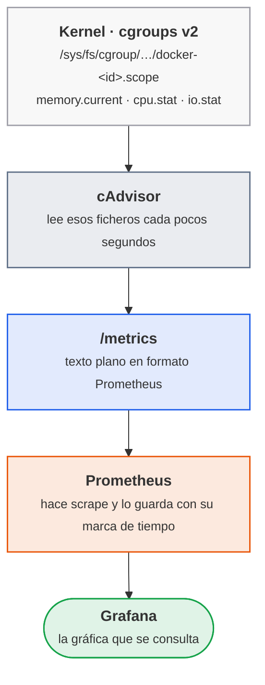
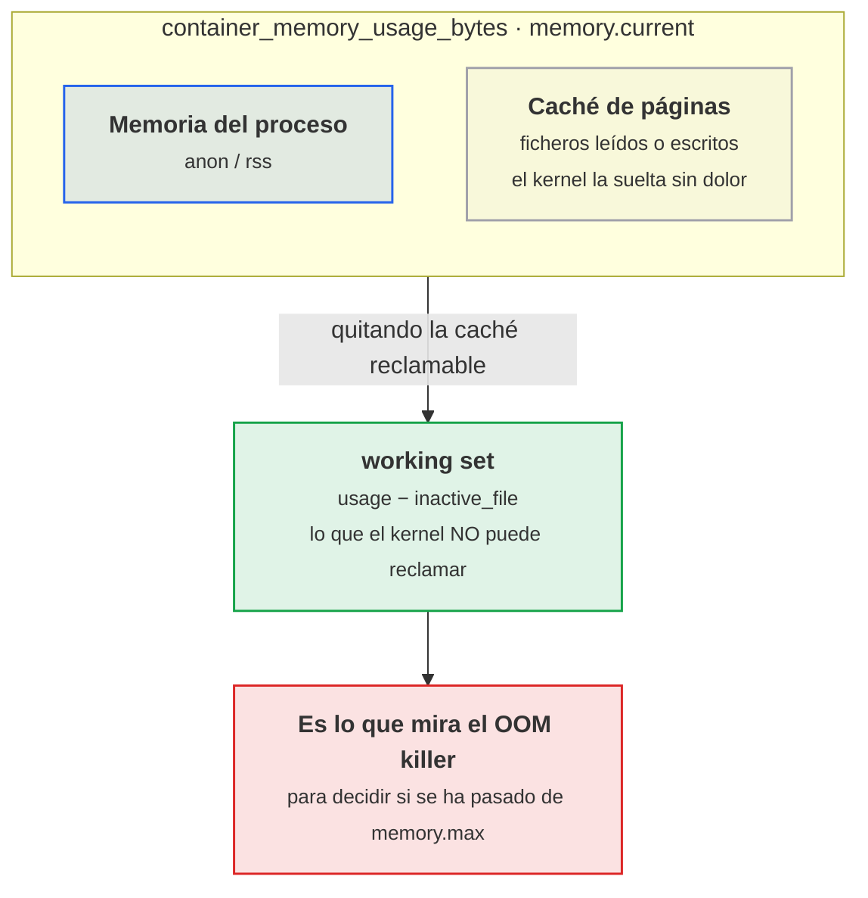
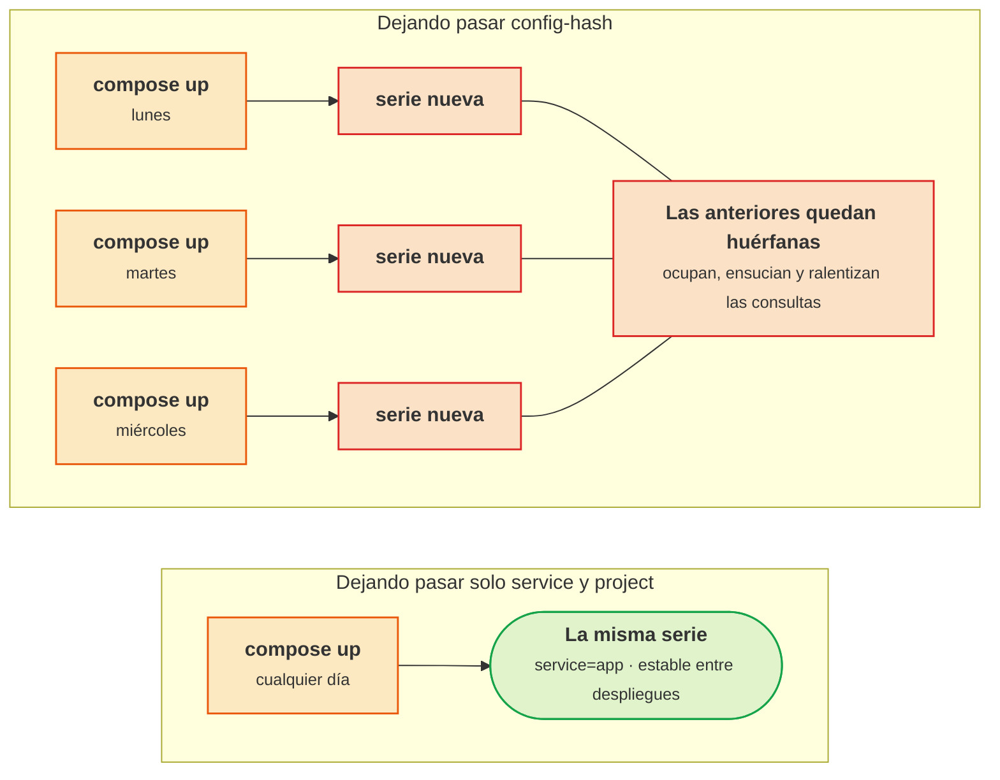
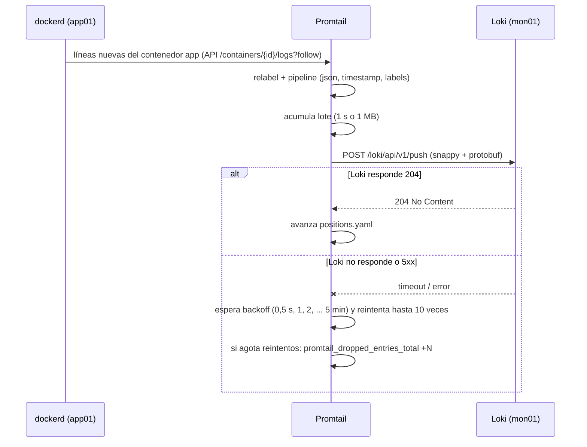

# UT1 · Observabilidad de contenedores: métricas, logs y eventos

<p class="ut-meta">14 h · Sesiones 1 a 7 · RA1 CE a</p>

Esta es la primera unidad del módulo y trabaja sobre el servicio del curso, que se entrega el primer día en Aules como repositorio `servicio`: una API en Python con Flask, servida con gunicorn, detrás de nginx y con PostgreSQL, todo en un solo Docker Compose. El laboratorio llega por fases, y esta unidad se hace sobre un entorno provisional: hasta el 13 de octubre no existe ninguna VM y todo corre con Docker en el puesto del alumno; el 14 de octubre la asignatura de despliegue clona en la red del aula app01 (el servicio) y mon01 (la pila de monitorización), y las dos no pasan a la VPC dev, detrás del cortafuegos, hasta el 27 de noviembre. La pila de monitorización que se monta aquí, a partir de la mínima que se da en clase, es la de todo el curso: la [UT7 de Despliegue](https://victor-educ.github.io/apuntes-5166/ut/ut7-monitorizacion/), en marzo, trabaja sobre ella. Aquí no se despliega nada nuevo del servicio: se trata de sacar de él todo lo que cuenta sobre su estado (métricas de recursos, métricas de aplicación, logs y eventos), llevarlo al sistema de monitorización y demostrar con pruebas que llega entero, a tiempo y se guarda. Ese "demostrar" es la mitad de la unidad y el criterio de evaluación lo dice explícitamente: integrar y verificar comunicación, integridad y almacenamiento. Sin datos fiables, la UT2 (umbrales y alarmas) no tiene sobre qué trabajar.

Al servicio del curso, esté en el puesto o en app01, se le llama durante todo el módulo el **contenedor de referencia**. Se mantiene vivo todo el curso, y en la UT8 se da de baja de forma controlada su copia del entorno pre.

## Introducción

Esta unidad se lee en el orden en que se da: primero los conceptos de la unidad y el plan de sesiones, y después cada sesión con la teoría que se explica en clase seguida de su hoja de práctica.

### Qué tienes que saber hacer al terminar

- Explicar de dónde salen las métricas de recursos de un contenedor (cgroups v2) y leerlas a mano en `/sys/fs/cgroup` antes de fiarse de una gráfica.
- Desplegar cAdvisor junto al servicio con los montajes correctos y configurar su scrape en Prometheus, sabiendo qué etiquetas identifican cada servicio de compose.
- Instrumentar la API con un endpoint `/metrics` (counter e histogram con buenas prácticas de nombres y etiquetas) y añadir exporters a lo que no se puede instrumentar (PostgreSQL).
- Configurar el driver de logs de Docker con límites, hacer que la aplicación escriba logs JSON con `request_id`, y enviarlos a Loki con Promtail con las etiquetas `host`, `service`, `container` y `level`.
- Recoger los eventos del demonio Docker (die, oom, health_status) en Loki.
- Verificar la integración con comandos concretos: comunicación, recepción, integridad (conteos y relojes), almacenamiento y pérdidas, e interpretar lo que sale.
- Explicar y documentar qué ocurre con métricas y logs cuando se corta la red entre app01 y mon01.

### Los conceptos de la unidad

Un jueves a las tres de la tarde la API del curso empieza a devolver errores 500 y nadie se entera hasta el viernes. Al entrar en app01, el fichero de logs pesa 4 GB, la CPU va bien y no hay forma de saber si fue la base de datos, la memoria o un despliegue a medias. Esta unidad existe para que esa escena no se repita: todo lo que el contenedor cuenta de sí mismo (cuánto consume, cuántas peticiones atiende y cuánto tardan, qué escribe en sus logs y cuándo arranca o muere) llega a otra máquina, mon01, se guarda varios días y se puede demostrar con comandos que llega completo y a tiempo. En una frase: que el servicio se pueda vigilar desde fuera sin entrar en la máquina.

| Herramienta o concepto | Qué es, en una frase | Para qué se usa en esta unidad |
|---|---|---|
| cgroups v2 | La contabilidad del kernel de Linux: ficheros en `/sys/fs/cgroup` con lo que gasta cada grupo de procesos | Leer a mano el consumo real de un contenedor |
| cAdvisor | Un contenedor de Google que lee esos ficheros de todos los contenedores y los publica como texto | Sacar las métricas de recursos del servicio sin escribir código |
| Prometheus y PromQL | Una base de datos de series numéricas que cada 15 s va a buscar los datos a cada máquina; PromQL es su lenguaje de consulta | Guardar las métricas en mon01 y consultarlas |
| Cardinalidad | Cuántas series distintas genera una métrica según los valores que toman sus etiquetas | Elegir qué etiquetas dejar pasar en cAdvisor, en la API y en Promtail |
| prometheus_client | La librería de Prometheus para Python: unas líneas que cuentan peticiones y miden tiempos dentro de la API | Saber si la API funciona, no solo cuánto consume |
| Exporters (postgres_exporter, node_exporter) | Programas auxiliares que preguntan a PostgreSQL o al sistema operativo del host y traducen la respuesta al formato de Prometheus | Vigilar lo que no se puede modificar por dentro, y la propia VM |
| Driver de logs json-file | El mecanismo con que Docker guarda en un fichero por contenedor lo que este escribe por pantalla | Limitar esos ficheros y dejarlos listos para un agente |
| Promtail | Un agente de Grafana Labs que lee los logs de los contenedores, les pone etiquetas y los envía por HTTP a Loki | Llevar los logs de app01 a mon01 |
| Loki, LogQL y logcli | La base de datos de logs de Grafana Labs, que indexa solo unas pocas etiquetas; LogQL es su lenguaje de consulta y logcli su cliente de terminal | Guardar y buscar los logs en mon01 |
| Grafana | La web que dibuja gráficas a partir de Prometheus y de Loki | Ver métricas y logs del mismo instante en la misma pantalla |
| docker events | Los avisos del demonio Docker: un contenedor ha arrancado, ha muerto, se ha quedado sin memoria | Recogerlos en Loki con un contenedor auxiliar |
| remote_write | Un Prometheus pequeño que envía sus muestras a otro central, con cola en disco por si la red se corta | Solo si sobra tiempo en la sesión 6: comparar qué se pierde con scrape y qué con remote_write |
| chrony y nftables | chrony mantiene en hora la VM por NTP; nftables es el cortafuegos del kernel de Linux | Sincronizar relojes y cortar la red a propósito para ver qué aguanta |

**Cómo está organizada la unidad.** La unidad sigue las sesiones en orden y cada sesión trae primero la teoría que se explica y después su hoja de práctica. En la sesión 1 se despliega el servicio del curso y se dibuja el mapa de los cuatro flujos entre el servicio y el sistema que lo vigila; la 2 saca las métricas de recursos con cAdvisor, porque ya existen y solo hay que leerlas; la 3 instrumenta la API y añade postgres_exporter, porque hay que tocar código. La sesión 4 monta el camino de los logs con Promtail y Loki, y la 5 reutiliza ese camino para los eventos del demonio. La 6 verifica la integración entera, con los relojes en hora y dos cortes de red que enseñan qué se recupera y qué se pierde, y la 7 cierra con el informe evaluable. Al final de la página quedan los errores frecuentes del laboratorio, para consultar cuando algo falla.

!!! otra "Lo que llega de la otra asignatura, y cuándo"
    Esta unidad se hace sobre el entorno provisional que describe la página de [laboratorio](../laboratorio.md), porque el definitivo no existe todavía. Del 1 al 13 de octubre (sesiones 1, 2 y 3) no hay ninguna VM del laboratorio: el servicio del curso (nginx, API y PostgreSQL en un solo compose) y la pila mínima de monitorización se levantan con Docker en el puesto del alumno, en localhost.
    El 14 de octubre, en la [sesión 3 de 5166 UT1](https://victor-educ.github.io/apuntes-5166/ut/ut1-virtualizacion/#sesion-3-primera-vm-y-plantilla), la asignatura de despliegue clona de la plantilla 9000 dos VM en el bridge del aula (vmbr0, IP por DHCP), con Docker Engine, node_exporter y la clave SSH del puesto del alumno ya dentro: `app01`, donde pasa a correr el servicio con sus agentes, y `mon01`, con 3 GB de RAM, donde pasa la pila de monitorización. Desde la sesión 4 (15 de octubre) el trabajo de esta unidad se hace sobre esas dos máquinas, y llevarlo allí es el primer paso de la A1.4. Loki se añade aquí.
    Lo que todavía no existe: no hay subredes 10.10.x.x ni cortafuegos, así que en los ejemplos se usan las IP de app01 y mon01 en vmbr0 (o sus nombres, puestos en `/etc/hosts`) y las reglas de OPNsense no aplican. web01 y db01 tampoco se usan: hasta el 27 de noviembre el proxy es el servicio `nginx` del compose y la base de datos es el servicio `db` del mismo compose. Ese día la [A3.3 de Despliegue](https://victor-educ.github.io/apuntes-5166/ut/ut3-seguridad-por-capas/#sesion-16-dmz-interna-y-zona-interna) pasa app01 y mon01 a la VPC, detrás de OPNsense, y lleva la base de datos a db01 y el proxy a web01.

### Plan de sesiones

Cada sesión de 110 minutos empieza con una explicación corta y sigue con laboratorio. La columna «Se explica» recoge los apartados de teoría que se desarrollan en clase, con su duración aproximada; la columna «Se practica», el trabajo de laboratorio de esa sesión. Las sesiones marcadas solo como práctica no traen teoría nueva.

| Sesión | Fecha | Tipo | Se explica | Se practica |
|---:|-------|------|------------|-------------|
| [1](#sesion-1-presentacion-y-el-contenedor-de-referencia) | 1 oct | Teoría y práctica | Presentación de la asignatura, evaluación y cómo se coordina con Despliegue (25 min). Los cuatro flujos que salen de un contenedor: métricas, logs, eventos (20 min). | Crear los repositorios servicio y monitoring con el código de Aules, desplegar el servicio del curso con compose en el puesto y observar con docker stats, logs y events mientras se genera tráfico y se para la BD. |
| [2](#sesion-2-metricas-de-recursos) | 6 oct | Teoría y práctica | cgroups v2 y cómo cAdvisor lee de ellos; etiquetas y cardinalidad (20 min). | Leer a mano el working set de la API en sus cgroups, desplegar cAdvisor junto al servicio en el puesto, scrape desde la pila mínima de monitorización y gráfica de CPU y memoria por contenedor en Grafana. |
| [3](#sesion-3-instrumentar-la-aplicacion) | 13 oct | Teoría y práctica | Tipos de métrica (counter, gauge, histogram, summary) y cómo se instrumenta con la librería cliente (20 min). | Endpoint /metrics en la API con counter e histogram, postgres_exporter contra el servicio db del compose, comprobar ambos en Prometheus. |
| [4](#sesion-4-logs-estructurados) | 15 oct | Teoría y práctica | Drivers de logs de Docker, logs en JSON con request_id, cómo funciona Promtail y qué indexa Loki (20 min). | Llevar las tres pilas del puesto a app01 y mon01; configurar logs JSON, limitar json-file en daemon.json, desplegar Loki y Promtail, comprobar en Grafana Explore. |
| [5](#sesion-5-eventos) | 20 oct | Teoría y práctica | Los eventos del demonio Docker y cómo se recogen (10 min). | Recoger eventos en Loki; provocar die, oom y unhealthy y localizarlos, cruzarlos con métricas y logs y dibujar el esquema del flujo de datos. |
| [6](#sesion-6-integridad-y-almacenamiento) | 22 oct | Teoría y práctica | Qué significa verificar una integración: comunicación, recepción, integridad, relojes, retención (15 min). | Ejecutar la tabla de comprobaciones completa y cortar la red dos veces tres minutos, con los reintentos de Promtail normales y reducidos, para ver qué se recupera y qué se pierde. |
| [7](#sesion-7-practica-evaluable) | 27 oct | Práctica evaluable | Aclaración del enunciado (10 min). | Cerrar el informe: flujo de datos, configuración, pruebas y resultado del corte de red. |

## Sesión 1 · Presentación y el contenedor de referencia

<p class="ut-meta" markdown>1 de octubre · Teoría y práctica · <span class="dur" tabindex="0" aria-label="Presentación de la asignatura · 25 min&#10;Qué expone un contenedor · 20 min&#10;A1.1 Presentación y el contenedor de referencia · 65 min" data-dur="Presentación de la asignatura · 25 min&#10;Qué expone un contenedor · 20 min&#10;A1.1 Presentación y el contenedor de referencia · 65 min">:material-school:<i class="dur-barra" style="--teoria:41%"></i>:material-flask:</span></p>

Al acabar, el servicio del curso queda en marcha y se ha visto en tres terminales cómo reaccionan métricas, logs y eventos cuando se cae la base de datos. Antes van la presentación de la asignatura y el mapa de los cuatro flujos que salen de un contenedor, que es lo único de teoría que necesita la hoja: sin ese mapa, lo que aparece en las terminales son piezas sueltas.

### Qué expone un contenedor

Aquí no se monta nada todavía: primero el mapa completo. Este apartado recoge qué cuatro cosas cuenta un contenedor de sí mismo, quién produce cada una, cómo se mira en la propia máquina y a qué sistema de mon01 llega.

Un contenedor en ejecución no es más que un proceso (o varios) con namespaces y cgroups (los dos mecanismos del kernel que lo aíslan del resto y le contabilizan el consumo). Todo lo que interesa saber de él sale por uno de estos cuatro caminos:

| Flujo | Quién lo produce | Cómo se lee en local | A dónde va |
|----|----|----|----|
| Métricas de recursos | El kernel, vía cgroups | `docker stats`, `/sys/fs/cgroup`, cAdvisor | Prometheus |
| Métricas de aplicación | La propia aplicación, en `/metrics` (formato de exposición de Prometheus) | `curl app01:9102/metrics` | Prometheus |
| Logs | stdout y stderr del proceso principal, capturados por el driver de logs de Docker | `docker logs -f app` | Loki (vía Promtail) |
| Eventos | El demonio Docker: start, die, oom, health_status... | `docker events` | Loki (vía un contenedor auxiliar y Promtail) |

Los dos primeros son series numéricas: se muestrean cada pocos segundos y se guardan comprimidas en una base de datos de series temporales. Los otros dos son texto con marca de tiempo: no se muestrean, se recogen línea a línea. Por eso hay dos sistemas de almacenamiento (Prometheus y Loki) y no uno. Grafana solo pinta lo que hay en ambos.


<p class="pie" markdown>Las métricas las va a buscar Prometheus; los logs los empuja Promtail. Esa diferencia de sentido es la que decide las reglas del cortafuegos en la UT3.</p>

El esquema es el mismo antes y después del 14 de octubre; lo único que cambia es dónde está cada caja. Hasta el 13 de octubre las dos están en el mismo host, el puesto del alumno, y las flechas son llamadas a `localhost` o al nombre del servicio dentro de la red de compose; desde la sesión 4 la de arriba es app01 y la de abajo mon01, y las flechas cruzan la red del aula.

Conviene fijarse en la dirección de las flechas: las métricas las **tira** Prometheus (pull), los logs los **empuja** Promtail (push). Esa diferencia lo condiciona todo cuando hay un corte de red y se comprueba al final de la unidad.

### A1.1 Presentación y el contenedor de referencia (sesión 1)

Los primeros 25 minutos son la presentación de la asignatura (evaluación, laboratorio compartido con Despliegue y calendario); después, 20 minutos para el mapa de los cuatro flujos, y el resto es esta hoja.

<span class="et et-obj">Objetivo</span> El servicio del curso corriendo con compose y, en tres terminales a la vez, cómo reaccionan métricas, logs y eventos cuando se cae la base de datos.

<span class="et et-pre">Antes de empezar</span>

- Docker Engine sobre Linux en tu puesto. Hoy, 1 de octubre, no existe ninguna VM del laboratorio: todo se hace aquí, en localhost. Si el puesto es Windows o macOS, trabaja dentro de una VM Debian en VirtualBox, que es el entorno del resto del curso: la sesión 2 lee ficheros de cgroups que solo existen en un host Linux. Desde la sesión 4 el mismo compose se lleva a app01.
- El servicio del curso, que se da hoy en Aules: la API en Python con Flask, servida con gunicorn (código en `api/`, con su `api/Dockerfile`), y en la raíz `compose.yml` con los servicios `nginx`, `app` y `db`. Es el servicio de todo el curso: en octubre y noviembre corre entero en ese compose, primero en tu puesto y desde el 15 de octubre en app01.
- La pila mínima de monitorización (Prometheus, Alertmanager y Grafana), también en Aules, aunque hoy no se use.
- Lo explicado antes: [Qué expone un contenedor](#que-expone-un-contenedor).

<span class="et et-pas">Pasos</span>

1. Crea las tres carpetas de trabajo, descomprime en `/opt/servicio` y en `/opt/monitoring` lo que se da en Aules y convierte cada una en su repositorio. Así nacen hoy `servicio` y `monitoring`, en local; el remoto en Gitea llega el 17 de noviembre, en la A2.6. Después despliega el servicio y comprueba que está sano:

    ```bash
    sudo install -d -o "$USER" /opt/servicio /opt/monitoring /opt/agentes
    # descomprime aquí los dos ficheros de Aules, uno en cada carpeta
    cd /opt/servicio && git init -q && git add . && git commit -qm "Servicio del curso, versión de partida"
    cd /opt/monitoring && git init -q && git add . && git commit -qm "Pila mínima, versión de partida"
    cd /opt/servicio && docker compose up -d
    docker compose ps            # app, db y nginx en running o healthy
    curl -s http://localhost/health
    ```

    La carpeta da nombre al proyecto de compose, `servicio`, y de ahí salen los nombres de los contenedores: `servicio-app-1`, `servicio-db-1` y `servicio-nginx-1`. Los tres están en el mismo host: `nginx` publica el puerto 80, `app` es la API y `db` es PostgreSQL. Todo lo que sigue se hace contra `localhost`.

2. Abre tres terminales en el host donde corre el servicio (hoy, tu puesto), una con `docker stats`, otra con `docker logs -f servicio-app-1` y otra con `docker events --format '{{json .}}'`.

3. Genera tráfico en un cuarto terminal contra el nginx del compose:

    ```bash
    while true; do curl -s -o /dev/null -w '%{http_code}\n' http://localhost/health; sleep 0.2; done
    ```

    Apunta qué cambia en `docker stats` y qué escribe la API por cada petición.

4. Para la base de datos y mira el reloj:

    ```bash
    date; docker compose stop db      # db es un servicio más del mismo compose
    ```

    Anota, para cada terminal, qué aparece y cuántos segundos tarda desde el `stop`: el código del bucle de `curl`, los errores de la API, el `die` de `db` con su `exitCode` y los cambios en `docker stats`. Después `docker compose start db` y observa la recuperación.

<span class="et et-com">Comprobación</span> `git log` tiene un commit en `/opt/servicio` y otro en `/opt/monitoring`; el bucle de `curl` devuelve 200 con la base de datos arriba y 500 (o 503) con ella parada; en el terminal de eventos aparece el `die` de `db` con `exitCode` 0 y después el `start`.

<span class="et et-ent">Entrega</span> Una tabla con tres filas (métricas, logs, eventos) y tres columnas (qué se vio al parar la BD, cuántos segundos tardó, qué se vio al arrancarla), en `tests/evidence/ut1/a1.1.md` del repositorio `servicio`.

<span class="et et-ext">Si te sobra tiempo</span> Repite el bucle con `/items`, que consulta la base de datos: ¿la API devuelve error o se queda colgada?

## Sesión 2 · Métricas de recursos

<p class="ut-meta" markdown>6 de octubre · Teoría y práctica · <span class="dur" tabindex="0" aria-label="Métricas de recursos: cgroups v2 y cAdvisor · 20 min&#10;A1.2 Métricas de recursos · 90 min" data-dur="Métricas de recursos: cgroups v2 y cAdvisor · 20 min&#10;A1.2 Métricas de recursos · 90 min">:material-school:<i class="dur-barra" style="--teoria:18%"></i>:material-flask:</span></p>

Al terminar, cAdvisor publica las métricas de recursos del host donde corre el servicio (hoy, el puesto; desde el 15 de octubre, app01), Prometheus las recoge con la etiqueta `service` limpia y Grafana pinta CPU y memoria por servicio. La hoja usa los cuatro apartados de abajo: los dos primeros para entender los números, el compose de cAdvisor para desplegarlo y las etiquetas y la cardinalidad para el scrape.

### Métricas de recursos: cgroups v2 y cAdvisor

Aquí se saca el primer flujo, el más sencillo porque ya existe: el kernel lleva la cuenta de lo que consume cada contenedor y solo hay que leerla. Primero se lee a mano para saber qué significa cada número, después se publica con cAdvisor para que Prometheus la recoja, y al final quedan las consultas en PromQL (el lenguaje de consulta de Prometheus) que irán al panel de Grafana. Lo que más problemas da es qué etiqueta identifica a cada contenedor y cuántas series se generan.

#### De dónde salen los números



<p class="pie" markdown>Nadie inventa los números: el kernel ya los está contando para aplicar los límites. cAdvisor solo los lee y los publica.</p>

Cuando Docker arranca un contenedor, le pide al kernel un cgroup (control group) y mete dentro su proceso principal. El cgroup es a la vez el sitio donde se aplican límites (`--memory`, `--cpus`) y el sitio donde el kernel contabiliza lo consumido. En Debian 13 con Docker Engine 28 el sistema usa **cgroups v2** con el driver systemd, así que cada contenedor aparece como una unidad `docker-<id>.scope` colgando de `system.slice`:

```bash
ID=$(docker inspect -f '{{.Id}}' servicio-app-1)
ls /sys/fs/cgroup/system.slice/docker-$ID.scope/
# cgroup.procs  cpu.max  cpu.stat  io.stat  memory.current  memory.max  memory.stat  pids.current ...

cat /sys/fs/cgroup/system.slice/docker-$ID.scope/memory.current   # bytes en uso ahora mismo
cat /sys/fs/cgroup/system.slice/docker-$ID.scope/memory.max       # "max" si no hay límite
cat /sys/fs/cgroup/system.slice/docker-$ID.scope/cpu.stat
# usage_usec 184392110
# user_usec 121003320
# system_usec 63388790
# nr_throttled 0
grep -E '^(anon|file|inactive_file|active_file) ' /sys/fs/cgroup/system.slice/docker-$ID.scope/memory.stat
```

Con cgroups v1 (lo que todavía se encuentra en hosts viejos y en alguna documentación) la jerarquía estaba partida por controlador (`/sys/fs/cgroup/memory/docker/<id>/memory.usage_in_bytes`, `/sys/fs/cgroup/cpu/...`). En v2 hay un único árbol y los ficheros se llaman distinto. Cuando cAdvisor da un número raro, esto es la fuente de verdad.

`docker stats` lee exactamente estos ficheros cada segundo y los formatea. cAdvisor hace lo mismo pero para todos los contenedores a la vez, guarda un histórico corto en memoria y lo expone en `/metrics` en formato Prometheus. No hay magia: las métricas `container_*` son estos ficheros con etiquetas.

#### Memory usage frente a working set

Es la confusión más habitual con la memoria de un contenedor. `memory.current` (lo que cAdvisor expone como `container_memory_usage_bytes`) incluye la caché de páginas: si el contenedor lee un fichero de 200 MB, el kernel se queda esas páginas en caché y cuentan como memoria del cgroup aunque el proceso no las necesite y el kernel pueda soltarlas al instante. Por eso `usage` sube y sube en un contenedor que escribe logs o lee de disco, y la gente cree que tiene una fuga.

El **working set** es `memory.current` menos `inactive_file` de `memory.stat`: la memoria que el kernel no podría reclamar sin dolor. cAdvisor lo expone como `container_memory_working_set_bytes` y es la métrica que usa el propio OOM killer (el mecanismo del kernel que mata procesos cuando se agota la memoria) para decidir si un contenedor ha superado `memory.max`. Conclusión práctica: para alarmas y para comparar contra el límite, working set; `usage_bytes` solo para entender de qué está hecha la memoria. Para "memoria que realmente ha pedido el proceso" está además `container_memory_rss` (anon en v2).



<p class="pie" markdown>Por eso `usage_bytes` sube y sube en un contenedor que escribe logs y parece una fuga que no existe. Para alarmas y para comparar contra el límite, **working set**.</p>


```promql
# porcentaje del límite que usa cada servicio de compose
container_memory_working_set_bytes{container_label_com_docker_compose_service!=""}
  / container_spec_memory_limit_bytes * 100
```

Si un contenedor no tiene límite, `container_spec_memory_limit_bytes` vale un número enorme y la división da casi cero. Es una pista, no un bug: hay que ponerle límite.

#### cAdvisor en compose

cAdvisor necesita ver el árbol de cgroups del host, el socket de Docker (`/var/run/docker.sock`, el fichero por el que se habla con el demonio; lo necesita para saber qué cgroup es qué contenedor y leer sus etiquetas) y el directorio de Docker (para métricas de disco). Se despliega en un compose aparte de agentes, en `/opt/agentes/compose.yml`, para que reiniciar el servicio no tumbe a los agentes. Es el fichero al que se van añadiendo Promtail y el recolector de eventos en las sesiones siguientes. El fichero es el mismo en el puesto del alumno (octubre) y en app01 (desde el 14 de octubre): lo que cambia es la máquina donde se ejecuta.

```yaml
# /opt/agentes/compose.yml, en el host del servicio
services:
  cadvisor:
    image: gcr.io/cadvisor/cadvisor:v0.52.1
    container_name: cadvisor
    privileged: true
    devices:
      - /dev/kmsg
    volumes:
      - /:/rootfs:ro
      - /var/run:/var/run:ro
      - /sys:/sys:ro
      - /var/lib/docker/:/var/lib/docker:ro
      - /dev/disk/:/dev/disk:ro
    command:
      - --docker_only=true
      - --housekeeping_interval=10s
      - --store_container_labels=false
      - --whitelisted_container_labels=com.docker.compose.service,com.docker.compose.project
      - --disable_metrics=percpu,sched,tcp,udp,hugetlb,referenced_memory,cpu_topology,resctrl
    ports:
      - "8081:8080"
    restart: unless-stopped
```

Cosas a saber de este fichero. `privileged` y `/dev/kmsg` hacen falta para que lea eventos OOM del kernel; sin ellos funciona pero `container_oom_events_total` nunca sube. `--docker_only` quita del listado los cgroups de systemd que no son contenedores (servicios del host), que no aportan nada y multiplican las series. `--housekeeping_interval=10s` baja el consumo de CPU del propio cAdvisor (por defecto muestrea cada segundo, y cAdvisor comiéndose el 5 % de la CPU del host es un clásico). El puerto: cAdvisor escucha en 8080 dentro del contenedor, pero en el host ese puerto suele estar ocupado por la API, así que se publica en 8081. Dentro de una red de compose se le sigue llamando por su nombre de servicio y su puerto interno, `cadvisor:8080`.

#### Etiquetas y cardinalidad

Cada serie de cAdvisor lleva `id` (la ruta del cgroup), `name` (nombre del contenedor, por ejemplo `servicio-app-1`) e `image`. Con `--store_container_labels` cAdvisor convierte todas las etiquetas Docker del contenedor en etiquetas `container_label_<clave>` con los puntos cambiados por guiones bajos. Compose pone bastantes etiquetas (proyecto, servicio, número de réplica, hash de la configuración, ruta del fichero...), y esa última, `com.docker.compose.config-hash`, cambia en cada `compose up` que modifique el servicio. Si se deja pasar, cada redespliegue crea series nuevas en Prometheus y las viejas quedan huérfanas: eso es **cardinalidad**, y es el enemigo número uno de una base de datos de series. Por eso el compose de arriba desactiva todas y solo deja pasar `com.docker.compose.service` y `com.docker.compose.project`.



<p class="pie" markdown>Una etiqueta que cambia en cada despliegue multiplica las series. Es el enemigo número uno de una base de datos de series temporales.</p>


La etiqueta que interesa para todo el módulo es `container_label_com_docker_compose_service`: es estable entre despliegues (siempre `app`, `db`, `nginx`) mientras que `name` cambia al escalar o al renombrar. En Prometheus, en el scrape de cAdvisor, se renombra a algo manejable:

```yaml
# prometheus.yml (fragmento)
scrape_configs:
  - job_name: cadvisor
    scrape_interval: 15s
    static_configs:
      - targets: ["cadvisor:8080"]      # nombre del servicio en la red de compose
        labels: { host: puesto }
    metric_relabel_configs:
      - source_labels: [container_label_com_docker_compose_service]
        target_label: service
      - regex: container_label_.*
        action: labeldrop        # después de la copia: ya no hace falta ninguna
      - source_labels: [__name__]
        regex: container_(cpu_usage_seconds_total|memory_working_set_bytes|memory_usage_bytes|spec_memory_limit_bytes|network_(receive|transmit)_bytes_total|fs_(reads|writes)_bytes_total|oom_events_total|last_seen)
        action: keep
```

El target depende de dónde esté cada pieza. En el entorno provisional Prometheus y cAdvisor corren en el mismo puesto y comparten red de compose, así que basta el nombre del servicio (`cadvisor:8080`, con la etiqueta `host: puesto`). Desde la sesión 4, con Prometheus en mon01 y cAdvisor en app01, el target es la IP de app01 en vmbr0 con el puerto publicado (`<app01>:8081`) y la etiqueta pasa a `host: app01`. El resto del bloque no cambia.

El último bloque `keep` es opcional pero recomendable en un laboratorio con 2 o 3 GB de RAM en mon01: cAdvisor expone más de 100 métricas por contenedor y solo se usan diez. `container_last_seen` sirve para saber qué contenedores existen (y para detectar en UT2 los que han desaparecido).

Las tres consultas que se usan en Grafana en la sesión 2:

```promql
# CPU en núcleos por servicio (1 = un núcleo entero)
sum by (service) (rate(container_cpu_usage_seconds_total{service!=""}[2m]))
# memoria working set por servicio
sum by (service) (container_memory_working_set_bytes{service!=""})
# tráfico de red recibido, bytes/s
sum by (service) (rate(container_network_receive_bytes_total{service!=""}[2m]))
```

La ventana `[2m]` con scrape cada 15 s da 8 puntos por ventana; con `[30s]` salen dos puntos y las gráficas van a saltos. Regla: la ventana de `rate()` al menos cuatro veces el intervalo de scrape.

### A1.2 Métricas de recursos (sesión 2)

<span class="et et-obj">Objetivo</span> cAdvisor corriendo junto al servicio, Prometheus haciéndole scrape por el nombre del servicio de compose con la etiqueta `service` limpia, y dos paneles en Grafana con CPU y working set por servicio.

<span class="et et-pre">Antes de empezar</span>

- Hoy, 6 de octubre, sigue sin existir ninguna VM del laboratorio: toda la hoja se hace con Docker en tu puesto, en localhost.
- El servicio del curso de A1.1 en `/opt/servicio` (nginx, API y PostgreSQL en un solo compose) y la pila mínima de monitorización (Prometheus, Alertmanager y Grafana, compose de clase) en `/opt/monitoring`.
- Los agentes van en un tercer compose, `/opt/agentes`, para que reiniciar el servicio no los tumbe.
- Lo explicado antes: [de dónde salen los números](#de-donde-salen-los-numeros), [memory usage frente a working set](#memory-usage-frente-a-working-set), [cAdvisor en compose](#cadvisor-en-compose) y [etiquetas y cardinalidad](#etiquetas-y-cardinalidad).

!!! otra "Lo mismo, a partir de la sesión 4, sobre app01 y mon01"
    El 14 de octubre la asignatura de Despliegue clona app01 y mon01. Desde la sesión 4 estos composes se levantan allí (el servicio y los agentes en app01, la monitorización en mon01) y de esta hoja cambian dos cosas: el target del scrape, que pasa de `cadvisor:8080` a `<IP de app01>:8081`, y la etiqueta `host`, que pasa de `puesto` a `app01`. Las carpetas de `/opt` viajan tal cual a las VM en el primer paso de la A1.4, y el `metric_relabel_configs` de esta hoja se queda como está.

!!! ojo "cAdvisor lee los cgroups del host"
    cAdvisor necesita un host Linux con cgroups v2. Si tu Docker corre dentro de una máquina virtual, las métricas son las de esa máquina y sus contenedores, que es justo lo que interesa aquí.

<span class="et et-pas">Pasos</span>

1. Crea una red de Docker compartida por las tres pilas, para que Prometheus pueda llamar a cAdvisor por su nombre de servicio:

    ```bash
    docker network create obs
    ```

    Añade al final del compose del servicio y del de monitorización este bloque, que convierte `obs` en la red por defecto de todos sus servicios sin tocar ninguno:

    ```yaml
    networks:
      default:
        name: obs
        external: true
    ```

    `docker compose up -d` en `/opt/servicio` y en `/opt/monitoring`. Con `docker network inspect obs` comprueba que los contenedores de las dos están conectados.

2. Crea `/opt/agentes/compose.yml` con el servicio `cadvisor` tal como está en [cAdvisor en compose](#cadvisor-en-compose), más el mismo bloque de red al final, y arráncalo:

    ```bash
    cd /opt/agentes && docker compose up -d
    curl -s localhost:8081/metrics | grep container_memory_working_set_bytes | head
    ```

    Localiza en esa salida la etiqueta que identifica cada servicio de compose (`container_label_com_docker_compose_service`) y apunta qué valores toma: tienen que aparecer `app`, `db` y `nginx`. Comprueba también que Prometheus lo alcanza por su nombre: `docker compose exec prometheus wget -qO- http://cadvisor:8080/healthz` desde `/opt/monitoring` responde `ok`.

3. Lee a mano la memoria de la API en su cgroup, como en [De dónde salen los números](#de-donde-salen-los-numeros), para saber qué va a pintar después el panel:

    ```bash
    PID=$(docker inspect -f '{{.State.Pid}}' servicio-app-1)
    CG=/sys/fs/cgroup$(cut -d: -f3 /proc/$PID/cgroup | head -1)   # la ruta real, sin suponerla
    cat $CG/memory.current
    grep -E '^(anon|file|inactive_file) ' $CG/memory.stat
    docker stats --no-stream servicio-app-1
    ```

    La ruta se saca del proceso porque cambia con el driver de cgroups (`system.slice/docker-<id>.scope` con systemd, el de Debian; `docker/<id>` con cgroupfs). Calcula `memory.current - inactive_file` en MiB, que es el working set de [memory usage frente a working set](#memory-usage-frente-a-working-set), y compáralo con la columna MEM USAGE de `docker stats`.

4. Añade en `/opt/monitoring/prometheus.yml` el job `cadvisor` de [Etiquetas y cardinalidad](#etiquetas-y-cardinalidad), con el target `cadvisor:8080` y, de momento, sin las tres últimas líneas (el bloque `keep`), para poder medir. Recarga Prometheus (`docker compose restart prometheus`, o `curl -X POST localhost:9090/-/reload` si arranca con `--web.enable-lifecycle`) y comprueba en `http://localhost:9090/targets` que `cadvisor` está en UP.

5. Sin el `keep`, ejecuta en `http://localhost:9090/graph` y apunta el resultado:

    ```promql
    count(count by (__name__)({job="cadvisor"}))
    count({job="cadvisor"})
    ```

    La primera cuenta métricas distintas; la segunda, series. Activa el bloque `keep`, recarga, espera un minuto y repite.

6. En Grafana (`http://localhost:3000`), con Prometheus como fuente de datos (`http://prometheus:9090`, el nombre del servicio en la red de compose, no `localhost`, que dentro del contenedor de Grafana es el propio Grafana), crea un dashboard con dos paneles Time series:

    ```promql
    # panel 1: CPU en núcleos por servicio
    sum by (service) (rate(container_cpu_usage_seconds_total{service!=""}[2m]))
    # panel 2: working set por servicio
    sum by (service) (container_memory_working_set_bytes{service!=""})
    # panel 2, segunda consulta: porcentaje del límite
    container_memory_working_set_bytes{service!=""} / container_spec_memory_limit_bytes * 100
    ```

    Si el porcentaje sale casi cero, el contenedor no tiene límite: pon `mem_limit: 256m` al servicio `app`, `docker compose up -d` y vuelve a mirar. El working set de `app` en el panel tiene que parecerse a la cifra que calculaste en el paso 3.

7. Genera tráfico con el bucle de A1.1 contra `http://localhost/health` durante dos minutos y comprueba que la CPU de `app` sube en el panel.

<span class="et et-com">Comprobación</span> La resta del paso 3 se queda a unos pocos MiB de `docker stats`; `cadvisor` en UP en Targets; las series llevan `service` con los valores `app`, `db` y `nginx`, y ninguna `container_label_*`; los dos paneles pintan una línea por servicio y el número de series tras el `keep` es varias veces menor.

<span class="et et-ent">Entrega</span> La comparación de memoria del paso 3, la captura de los dos paneles y los cuatro números (métricas distintas y series, antes y después del `keep`), en `tests/evidence/ut1/a1.2.md`. El compose de agentes y el fragmento de `prometheus.yml` van además al repositorio `monitoring`.

<span class="et et-ext">Si te sobra tiempo</span> Cambia la ventana del `rate()` a `[30s]` en el panel de CPU y observa cómo se rompe la gráfica; después vuelve a `[2m]`.

## Sesión 3 · Instrumentar la aplicación

<p class="ut-meta" markdown>13 de octubre · Teoría y práctica · <span class="dur" tabindex="0" aria-label="Métricas de aplicación · 20 min&#10;A1.3 Instrumentar la aplicación · 90 min" data-dur="Métricas de aplicación · 20 min&#10;A1.3 Instrumentar la aplicación · 90 min">:material-school:<i class="dur-barra" style="--teoria:18%"></i>:material-flask:</span></p>

Hoy se toca código: la API sirve `/metrics` con un counter y un histogram, y postgres_exporter publica lo que la base de datos no puede contar por sí misma. De la teoría de abajo la hoja usa los tipos de métrica, el ejemplo en Python, las convenciones de nombres y el apartado de exporters.

### Métricas de aplicación

{ .logo-inline } Las métricas de recursos dicen cuánto consume el contenedor, no si el servicio funciona. Una API puede estar al 2 % de CPU devolviendo 500 a todo el mundo. Para eso la aplicación se **instrumenta**: incorpora la librería cliente de Prometheus de su lenguaje, registra unas cuantas métricas y las sirve en un endpoint `/metrics` en texto plano, y Prometheus lo lee cada 15 s.

#### Tipos de métrica

- **Counter**: solo sube (peticiones totales, errores totales, bytes enviados). Nunca se consulta el valor crudo, que depende de cuándo arrancó el proceso, sino su velocidad con `rate()` o `increase()`. Si el proceso se reinicia, el contador vuelve a cero y `rate()` lo detecta y lo corrige.
- **Gauge**: sube y baja (conexiones activas, tamaño de una cola, temperatura, fecha del último backup en segundos epoch). Se consulta directo.
- **Histogram**: cuenta observaciones en cubos acumulativos (`le="0.1"`, `le="0.5"`...) y además suma y total. Permite calcular percentiles en el servidor con `histogram_quantile()` y, lo que importa, agregarlos entre instancias. Es lo que se usa para latencias.
- **Summary**: percentiles calculados en el cliente. Más preciso para una instancia, pero no se puede agregar entre varias réplicas. En la práctica, histogram casi siempre.


<p class="pie" markdown>El contador crudo depende de cuándo arrancó el proceso, así que no se consulta nunca: se consulta su velocidad.</p>


#### Python con prometheus_client

La API del curso es Flask, el microframework web de Python, servida con gunicorn. El endpoint `/metrics` lo sirve la propia aplicación en el mismo puerto 8080 o, mejor, en un puerto aparte (9102) con `start_http_server` para que no pase por el proxy y no cuente como tráfico de usuario:

```python
# metrics.py
import time
from flask import Flask, request, g
from prometheus_client import Counter, Histogram, Gauge, start_http_server

REQUESTS = Counter(
    "app_http_requests_total",
    "Peticiones HTTP atendidas",
    ["method", "route", "status"],
)
LATENCY = Histogram(
    "app_http_request_duration_seconds",
    "Duración de la petición en segundos",
    ["method", "route"],
    buckets=(0.005, 0.01, 0.025, 0.05, 0.1, 0.25, 0.5, 1, 2.5, 5),
)
INFLIGHT = Gauge("app_http_requests_in_flight", "Peticiones en curso")
DB_UP = Gauge("app_db_reachable", "1 si la última consulta a PostgreSQL funcionó")

def instrument(app: Flask) -> None:
    @app.before_request
    def _start():
        g.t0 = time.perf_counter()
        INFLIGHT.inc()

    @app.after_request
    def _end(resp):
        route = request.url_rule.rule if request.url_rule else "unmatched"
        LATENCY.labels(request.method, route).observe(time.perf_counter() - g.t0)
        REQUESTS.labels(request.method, route, str(resp.status_code)).inc()
        INFLIGHT.dec()
        return resp

    start_http_server(9102)   # sirve /metrics en 0.0.0.0:9102
```

Detalles que marcan la diferencia. La etiqueta `route` lleva la **plantilla** de la ruta (`/items/<int:id>`), nunca la URL real (`/items/48213`): con la URL real cada id distinto es una serie nueva y en una semana hay 100 000 series. Lo mismo con `status`: el código, no el mensaje. Los buckets del histogram se eligen pensando en el servicio: para una API con objetivo de 250 ms la lista de arriba es razonable; para un batch que tarda minutos no vale. Y `INFLIGHT` como gauge permite en UT2 detectar una API que se está atascando antes de que lo digan los errores.

gunicorn es el servidor que ejecuta la aplicación Python en producción, y en el curso arranca con un solo worker (proceso). Con varios workers en paralelo, cada proceso tendría su propio registro y Prometheus vería valores que saltan de un worker a otro. La librería lo resuelve con el modo multiproceso: variable de entorno `PROMETHEUS_MULTIPROC_DIR` apuntando a un directorio vacío y `MultiProcessCollector`. Está en la [documentación de prometheus_client](https://prometheus.github.io/client_python/multiprocess/); en el laboratorio del curso se activa el día que la API pase a más de un worker.

#### Nombres y etiquetas: convenciones

Prometheus no impone nombres, pero si no se siguen las convenciones las consultas se vuelven un infierno y los dashboards de la comunidad dejan de servir. Las reglas de [Metric and label naming](https://prometheus.io/docs/practices/naming/):

| Regla | Bien | Mal |
|----|----|----|
| Prefijo con el nombre de la aplicación o del subsistema | `app_http_requests_total` | `requests` |
| Unidad base en el nombre, sin prefijos SI | `_seconds`, `_bytes`, `_ratio` | `_ms`, `_kb`, `_percent` |
| Los counters terminan en `_total` | `app_errors_total` | `app_error_count` |
| Una métrica mide una cosa; las dimensiones van en etiquetas | `app_http_requests_total{status="500"}` | `app_http_500_total` |
| Etiquetas de cardinalidad acotada | `method`, `status`, `route` plantilla | `user_id`, `request_id`, URL completa |
| snake_case en minúsculas | `app_db_reachable` | `appDbReachable` |

Sobre cardinalidad, el cálculo que hay que hacer siempre: número de series = producto del número de valores de cada etiqueta. `method` (5) × `route` (20) × `status` (8) = 800 series para un counter. Asumible. Con `client_ip` (miles) se pasa del millón.

#### Exporters: lo que no se puede instrumentar

PostgreSQL, nginx, Redis o el propio host no van a incorporar una librería de Prometheus. Para ellos existe el patrón **exporter**: un proceso auxiliar que consulta al software por su interfaz nativa (SQL, una página de estado, ficheros del sistema) y traduce lo que obtiene al formato de Prometheus. Corre al lado del servicio, normalmente como sidecar (un contenedor auxiliar pegado al principal) en el mismo compose.

**postgres_exporter** (puerto 9187) consulta `pg_stat_database`, `pg_stat_activity`, `pg_stat_bgwriter`, `pg_locks` y compañía. Nunca se le da el usuario `postgres`: se crea un usuario de solo lectura con el rol `pg_monitor`, que existe desde PostgreSQL 10 precisamente para esto.

```sql
CREATE USER monitor WITH PASSWORD 'cámbiame';
GRANT pg_monitor TO monitor;
GRANT CONNECT ON DATABASE servicio TO monitor;
GRANT SELECT ON items TO monitor;   -- solo para la consulta propia de queries.yaml
```

```yaml
# junto al servicio db, en el mismo compose del servicio
  postgres_exporter:
    image: quay.io/prometheuscommunity/postgres-exporter:latest
    command: ["--extend.query-path=/etc/queries.yaml"]
    environment:
      DATA_SOURCE_URI: "db:5432/servicio?sslmode=disable"
      DATA_SOURCE_USER: monitor
      DATA_SOURCE_PASS_FILE: /run/secrets/pgx_pass
    volumes:
      - ./queries.yaml:/etc/queries.yaml:ro
    secrets: [pgx_pass]
    ports: ["9187:9187"]
    depends_on: [db]
# y al final del fichero
secrets:
  pgx_pass:
    file: ./pgx_pass.txt     # la contraseña de monitor; va en .gitignore
```

Las métricas que importan: `pg_up` (1 si consigue conectar; es la primera alarma de UT2), `pg_stat_database_numbackends` (conexiones abiertas, para comparar con `max_connections`), `pg_stat_database_xact_commit` y `xact_rollback` (con `rate()`), `pg_stat_database_blks_hit` frente a `blks_read` (acierto de caché), `pg_locks_count`, `pg_database_size_bytes`. Si hace falta algo propio (filas de una tabla, edad del registro más antiguo sin procesar), el exporter admite consultas personalizadas en un fichero YAML pasado con `--extend.query-path`; cada métrica se llama como la clave del fichero más el nombre de la columna, así que la clave empieza por `pg_` para que se agrupe con las demás. Ese mecanismo está marcado como obsoleto en las versiones actuales aunque sigue funcionando; si desaparece, la alternativa mantenida es [sql_exporter](https://github.com/burningalchemist/sql_exporter), que hace lo mismo para cualquier base de datos.

```yaml
# queries.yaml: sale como pg_items_filas (un gauge, así que sin _total)
pg_items:
  query: "SELECT count(*) AS filas FROM items"
  metrics:
    - filas: { usage: GAUGE, description: "Filas de la tabla items de la API" }
```

**node_exporter** (puerto 9100) es el exporter del propio host: CPU, memoria, disco y red de la VM, leídos de `/proc` y `/sys`. Viene instalado en la plantilla de la que salen app01 y mon01 (paquete `prometheus-node-exporter`), así que no se despliega: en la A1.4 solo se le añade su job en Prometheus.

**nginx-prometheus-exporter** (puerto 9113) hace lo mismo con nginx a partir de su módulo `stub_status`, pero da poco: conexiones activas y en espera, peticiones totales y `nginx_up`, sin códigos de respuesta ni latencias por ruta. Por eso en el curso lo que se sabe de nginx sale de su log de acceso en JSON, que llega a Loki en la sesión 4. Cómo se activa `stub_status` y se arranca el exporter está en [Para ampliar](../ampliacion.md#nginx-prometheus-exporter-y-stub_status).

### A1.3 Instrumentar la aplicación (sesión 3)

<span class="et et-obj">Objetivo</span> La API sirve `/metrics` en el 9102 con un counter y un histogram, postgres_exporter publica las métricas del servicio `db` del compose, los dos están en UP, y calculas en PromQL el p95 de latencia y el porcentaje de errores.

<span class="et et-pre">Antes de empezar</span>

- Hoy, 13 de octubre, es la última sesión sin VM: todo sigue en tu puesto, con las tres pilas de A1.2 en la red `obs`.
- El código de la API en `api/` de tu repositorio `servicio` (Python con Flask, servida con gunicorn y un solo worker).
- PostgreSQL es el servicio `db` de ese mismo compose, en el mismo host que la API. No existe db01 ni hace falta: el acceso es `docker compose exec db psql -U postgres -d servicio`.
- Lo explicado antes: [tipos de métrica](#tipos-de-metrica), [Python con prometheus_client](#python-con-prometheus_client), [nombres y etiquetas](#nombres-y-etiquetas-convenciones) y [exporters](#exporters-lo-que-no-se-puede-instrumentar).

!!! otra "Lo mismo, a partir de la sesión 4, sobre app01 y mon01"
    Mañana, 14 de octubre, la asignatura de Despliegue clona app01 y mon01. Desde la sesión 4 este compose se levanta en app01 con la API y `db` dentro, y los targets del scrape dejan de ser nombres de servicio para ser `<IP de app01>:9102` y `<IP de app01>:9187`. Ni el código de la instrumentación ni el `queries.yaml` cambian.

<span class="et et-pas">Pasos</span>

1. Añade `prometheus_client` a las dependencias de la API (`api/requirements.txt`) y copia en `api/` el `metrics.py` de [Python con prometheus_client](#python-con-prometheus_client), con los mismos nombres de métrica y etiquetas. Llama a `instrument(app)` al crear la aplicación.

2. Publica el puerto 9102 del contenedor `app` en el compose del servicio (`ports: ["9102:9102"]`), reconstruye y comprueba:

    ```bash
    cd /opt/servicio && docker compose up -d --build app
    curl -s localhost:9102/metrics | grep -E '^app_http'
    ```

    gunicorn sigue con un solo worker: con varios, los valores saltarían entre scrapes (el modo multiproceso está en la teoría).

3. Crea en PostgreSQL el usuario `monitor` con el rol `pg_monitor`, con las sentencias SQL de [Exporters](#exporters-lo-que-no-se-puede-instrumentar). La base de datos es un contenedor más del mismo compose, así que entras desde el propio host, sin ssh a ninguna parte:

    ```bash
    docker compose exec db psql -U postgres -d servicio
    ```

4. Copia al compose del servicio, tal cual, el servicio `postgres_exporter` y el bloque `secrets` de ese mismo apartado, y crea al lado del compose `queries.yaml` (el del apartado, que cuenta las filas de `items`, la tabla de la API) y `pgx_pass.txt` con la contraseña de `monitor`, este último en `.gitignore`. `DATA_SOURCE_URI` apunta al nombre del servicio de compose, `db`, porque los dos contenedores están en la misma red. `docker compose up -d postgres_exporter` y comprueba con `curl -s localhost:9187/metrics | grep -E '^pg_up|^pg_items'`: `pg_up 1` es lo primero que tiene que salir.

5. Añade los dos jobs en `/opt/monitoring/prometheus.yml` y recarga:

    ```yaml
      - job_name: app
        static_configs:
          - targets: ["app:9102"]
            labels: { host: puesto, service: app }
      - job_name: postgres
        static_configs:
          - targets: ["postgres_exporter:9187"]
            labels: { host: puesto, service: db }
    ```

6. Genera tráfico un par de minutos con el bucle de A1.1 contra `http://localhost/health`, con alguna ruta inexistente (404) y medio minuto con la base de datos parada (`docker compose stop db`, y después `start`) para provocar 500. En `http://localhost:9090/graph`:

    ```promql
    # p95 de latencia en segundos
    histogram_quantile(0.95, sum by (le) (rate(app_http_request_duration_seconds_bucket[5m])))
    # porcentaje de respuestas 5xx
    sum(rate(app_http_requests_total{status=~"5.."}[5m])) / sum(rate(app_http_requests_total[5m])) * 100
    ```

<span class="et et-com">Comprobación</span> `app` y `postgres` en UP en Targets; `app_http_requests_total` lleva `route` en forma de plantilla (`/items/<int:id>`, nunca `/items/48213`); `pg_up` vale 1 y la métrica personalizada aparece con prefijo `pg_`; el p95 sale en segundos y el porcentaje de 5xx sube solo mientras la base de datos está parada.

<span class="et et-ent">Entrega</span> En `tests/evidence/ut1/a1.3.md`: el código de la instrumentación, `queries.yaml`, los jobs de `prometheus.yml` y las dos consultas con su resultado. El código va además al repositorio `servicio` con un commit propio, que el 15 de octubre viaja con la carpeta a app01.

<span class="et et-ext">Si te sobra tiempo</span> Añade el gauge `app_db_reachable` (1 si la última consulta a PostgreSQL funcionó) y comprueba que baja a 0 al parar la base de datos.

## Sesión 4 · Logs estructurados

<p class="ut-meta" markdown>15 de octubre · Teoría y práctica · <span class="dur" tabindex="0" aria-label="Logs · 20 min&#10;A1.4 Logs estructurados · 90 min" data-dur="Logs · 20 min&#10;A1.4 Logs estructurados · 90 min">:material-school:<i class="dur-barra" style="--teoria:18%"></i>:material-flask:</span></p>

Al acabar, las tres pilas corren ya en app01 y mon01, los logs de la API y de nginx llegan a Loki como JSON con el mismo `request_id`, y se puede seguir una petición por los dos servicios desde Grafana Explore. La hoja empieza llevando las pilas del puesto a las VM y después recorre los cuatro apartados de abajo: limitar el driver de Docker, escribir JSON con `request_id`, montar Loki y desplegar Promtail.

### Logs

El tercer flujo es texto, no números, y por eso tiene su propio camino: Docker lo recoge, Promtail lo etiqueta y lo envía, y Loki lo guarda. Son cuatro cosas en orden: limitar el tamaño de los ficheros de log, conseguir que la API escriba una línea JSON por evento con un identificador de petición, configurar Promtail para que las lea y las envíe, y montar Loki en mon01 para guardarlas y consultarlas. Al terminar se puede seguir una petición desde nginx hasta la API por su identificador.

#### El driver de logs de Docker y por qué limitarlo

Docker captura stdout y stderr del proceso principal del contenedor y se los entrega a un **driver de logs**. El driver por defecto es `json-file`: escribe cada línea como un objeto JSON (`{"log":"...","stream":"stdout","time":"2026-10-13T09:12:44.120Z"}`) en `/var/lib/docker/containers/<id>/<id>-json.log`. Sin configuración adicional ese fichero **no rota nunca**. Una API que escriba 200 líneas por segundo de 300 bytes genera 5 GB al día.

!!! ojo "La causa más común de \"se ha caído el servidor\""
    En dos semanas `app01` se queda sin disco, Docker no puede escribir y el contenedor se para o se cuelga.
    No hay alarma de aplicación que avise de esto: el servicio está bien hasta que el disco se acaba. Conviene limitar
    el driver desde el primer despliegue, no cuando pase.


<p class="pie" markdown>El log es el único recurso del contenedor que crece sin que nadie lo pida. Acotarlo es una línea de configuración.</p>


El límite se pone en `/etc/docker/daemon.json`, con los mismos valores en app01 y en mon01 (JSON no admite comentarios, así que el fichero lleva solo esto):

```json
{
  "log-driver": "json-file",
  "log-opts": { "max-size": "50m", "max-file": "5" }
}
```

Tras cambiarlo, `systemctl restart docker`, y ojo: **solo aplica a contenedores creados después**. Los existentes conservan su driver y sus opciones hasta que se recrean (`docker compose up -d --force-recreate`). Con esos valores el techo por contenedor son 250 MB. La rotación es por tamaño, no por tiempo: si un contenedor apenas escribe, sus logs de hace meses siguen ahí.

Hay otros drivers (`local`, `journald`, el plugin `loki` y `none`), pero ninguno cambia la recomendación del curso: `json-file` con límites y un agente que lea los ficheros, añada contexto, reintente y no toque el demonio. Qué hace cada uno y por qué aquí no sirve está en [Para ampliar](../ampliacion.md#otros-drivers-de-logs-de-docker).

#### Logs estructurados: JSON con request_id

`docker logs` funciona con cualquier cosa que la aplicación escriba, pero un log que dice `Error procesando pedido 4821 para cliente 77` solo lo entiende una persona. Para filtrar en Loki por nivel, contar errores por ruta o seguir una petición desde nginx hasta la base de datos, la aplicación tiene que escribir **una línea JSON por evento** con campos fijos: `ts` (fecha en formato RFC 3339, como `2026-10-13T09:12:44.120Z`, con zona horaria y milisegundos), `level`, `msg`, `logger`, y los que aporten contexto: `request_id`, `method`, `route`, `status`, `duration_ms`, `user` (id, nunca nombre ni email).

El `request_id` es lo que permite la **correlación**. Lo genera nginx con la variable `$request_id` (32 caracteres hexadecimales, uno por petición), lo pasa a la API en una cabecera, la API lo incluye en todas sus líneas de log y lo devuelve al cliente en la respuesta. Cuando un usuario dice "me ha dado error a las 10:14", se busca ese id y aparece la petición completa. Hasta el 27 de noviembre nginx y la API son dos contenedores del mismo compose en app01, y la correlación es entre dos servicios; cuando el proxy pase a web01 el mecanismo será idéntico, solo que entre dos hosts.

```nginx
# nginx del servicio: en el fichero de /etc/nginx/conf.d/, que se incluye dentro del bloque http
proxy_set_header X-Request-ID $request_id;
add_header X-Request-ID $request_id always;

log_format json escape=json '{"ts":"$time_iso8601","level":"info","msg":"access",'
  '"request_id":"$request_id","method":"$request_method","uri":"$request_uri",'
  '"status":$status,"bytes":$body_bytes_sent,"duration_ms":$request_time,'
  '"upstream":"$upstream_addr","client":"$remote_addr"}';
access_log /dev/stdout json;
```

En un contenedor el log de acceso va a stdout, no a un fichero: así lo recoge el driver de logs de Docker y lo lee el mismo Promtail que lee la API, sin montar ningún volumen de logs. En la imagen oficial de nginx `/var/log/nginx/access.log` ya es un enlace a stdout; al cambiar el formato hay que escribir la ruta `/dev/stdout` de forma explícita.

En la API, con Python, un formateador JSON en la librería `logging` estándar y un filtro que inyecte el id que llega en la cabecera (si no llega, se genera uno):

```python
import json, logging, uuid, sys
from flask import request, g

class JsonFormatter(logging.Formatter):
    def format(self, record):
        d = {
            "ts": self.formatTime(record, "%Y-%m-%dT%H:%M:%S") + f".{int(record.msecs):03d}Z",
            "level": record.levelname.lower(),
            "logger": record.name,
            "msg": record.getMessage(),
            "request_id": getattr(g, "request_id", None) if request else None,
        }
        if record.exc_info:
            d["exc"] = self.formatException(record.exc_info)
        return json.dumps(d, ensure_ascii=False)

handler = logging.StreamHandler(sys.stdout)
handler.setFormatter(JsonFormatter())
logging.basicConfig(level=logging.INFO, handlers=[handler])

@app.before_request
def _rid():
    g.request_id = request.headers.get("X-Request-ID", uuid.uuid4().hex)

@app.after_request
def _rid_out(resp):
    resp.headers["X-Request-ID"] = g.request_id
    return resp
```

Tres normas para que esto funcione después en Loki: una línea por evento (nada de trazas multilínea sueltas; van dentro del campo `exc`), siempre a stdout (no a un fichero dentro del contenedor, que nadie va a leer y que llena el disco), y el mismo nombre de campo en todos los servicios (`request_id`, no `requestId` en uno y `rid` en otro).

#### Promtail

{ .logo-inline } Promtail es el agente de Grafana Labs para enviar logs a Loki. Grafana lo ha declarado **al final de su vida** en favor de Grafana Alloy, pero se usa igualmente porque su configuración es YAML corto, se entiende en una sesión y sus conceptos se trasladan uno a uno a Alloy. Qué cambia con Alloy y cómo se pasa de uno a otro está en [Para ampliar](../ampliacion.md#promtail-y-grafana-alloy).

Promtail hace cuatro cosas en orden: **descubre** de dónde leer, **etiqueta** cada origen con relabel (reglas que copian, renombran o descartan etiquetas), **procesa** cada línea con un pipeline y **envía** lotes a Loki por HTTP, guardando en un fichero de posiciones hasta dónde ha leído.

```yaml
# /opt/agentes/promtail.yml en app01
server:
  http_listen_port: 9080

positions:
  filename: /var/lib/promtail/positions.yaml

clients:
  - url: http://<mon01>:3100/loki/api/v1/push   # la IP de mon01 en vmbr0
    external_labels:
      host: app01
      env: dev
    batchwait: 1s
    batchsize: 1048576
    backoff_config:
      min_period: 500ms
      max_period: 5m
      max_retries: 10
    timeout: 10s

scrape_configs:
  - job_name: docker
    docker_sd_configs:
      - host: unix:///var/run/docker.sock
        refresh_interval: 5s
    relabel_configs:
      - source_labels: [__meta_docker_container_name]
        regex: '/(.*)'
        target_label: container
      - source_labels: [__meta_docker_container_label_com_docker_compose_service]
        target_label: service
    pipeline_stages:
      - match:
          selector: '{service="app"}'
          stages:
            - json:
                expressions:
                  level: level
                  ts: ts
                  request_id: request_id
            - timestamp:
                source: ts
                format: RFC3339Nano
            - labels:
                level:
            - structured_metadata:
                request_id:
      - match:
          selector: '{service="app"} !~ "^\\{"'
          stages:
            - static_labels:
                malformed: "true"
```

Por partes:

**docker_sd_configs**. En lugar de leer los ficheros `*-json.log` (que también se puede, con `static_configs` y `__path__: /var/lib/docker/containers/*/*.log`), Promtail pregunta al demonio por el socket qué contenedores hay y lee sus logs por la API de Docker. Ventaja: obtiene el nombre y las etiquetas del contenedor sin tener que parsear rutas, y sigue a contenedores nuevos a los 5 s de arrancar. Necesita acceso al socket, así que el contenedor de Promtail lo monta en solo lectura y corre como root o con el gid del grupo `docker`.

**relabel_configs**. Las meta-etiquetas `__meta_docker_*` desaparecen al final del relabel; solo sobrevive lo que se copie a una etiqueta sin guiones bajos iniciales. Con estas dos reglas, más las `external_labels` del cliente, cada flujo queda como `{host="app01", env="dev", container="servicio-app-1", service="app"}`, y el pipeline le añade `level`. Son las etiquetas de todo el curso: `host`, `service`, `container` y `level`, siempre en minúsculas, más `env` para distinguir entornos. Las etiquetas en Loki son **índice**, y cada combinación distinta de valores es un stream con sus propios chunks (los bloques comprimidos en que Loki guarda el texto): unas pocas etiquetas con pocos valores cada una está bien; meter `request_id` o la ruta como etiqueta destroza Loki igual que destroza Prometheus. Para campos de cardinalidad alta que conviene filtrar rápido, Loki 3 tiene **structured metadata** (lo que hace la etapa `structured_metadata`): se guarda junto a la línea, no en el índice, y se consulta con `| request_id="..."`.

**pipeline_stages**. Se ejecutan por línea, en orden. `json` extrae campos a variables internas; `timestamp` usa el `ts` de la aplicación como marca de tiempo de la entrada en vez de la hora en que Promtail la leyó (importa cuando hay retraso: si Promtail estuvo 3 minutos sin poder enviar, las líneas se guardan con su hora real, no con la de reenvío); `labels` promociona `level` a etiqueta (5 valores posibles, aceptable y muy útil para `{service="app", level="error"}`). El segundo `match` marca las líneas que no son JSON (una traza de arranque, un `print` olvidado) para encontrarlas y corregirlas. Con `format: RFC3339Nano` Go acepta también RFC 3339 sin nanosegundos; si la API escribe otra cosa, el formato se expresa con la fecha de referencia de Go (`2006-01-02 15:04:05.000`).

**positions**. El fichero `positions.yaml` guarda, por origen, el último offset (o el último timestamp leído, con docker_sd) enviado con éxito. Si Promtail se reinicia, continúa desde ahí. Si el fichero está en `/tmp` dentro del contenedor y no en un volumen, cada reinicio de Promtail reenvía todo lo que Docker conserve del contenedor (hasta 250 MB con los límites de arriba), y Loki no deduplica: los `count_over_time` de la verificación salen multiplicados. Volumen persistente siempre.

**clients**. `batchwait` y `batchsize` deciden cuándo sale un lote: al segundo o al llegar a 1 MB, lo que ocurra antes. `backoff_config` es lo que salva en un corte de red: si el push falla, reintenta esperando 0,5 s, luego 1, 2, 4, 8... hasta 5 minutos entre intentos, y hasta 10 intentos por lote. La suma de las esperas con esos valores son unos 8,5 minutos: un corte de 3 minutos no pierde nada; uno más largo que esa suma sí, y se ve en `promtail_dropped_entries_total`. Ese es el límite de un corte: lo pone la suma de reintentos. `max-size` y `max-file` limitan otra cosa, cuánto puede reenviar Promtail tras un reinicio si el fichero de posiciones se queda atrás.

```yaml
# en /opt/agentes/compose.yml
  promtail:
    image: grafana/promtail:3.5.3
    container_name: promtail
    command: -config.file=/etc/promtail/promtail.yml
    volumes:
      - ./promtail.yml:/etc/promtail/promtail.yml:ro
      - /var/run/docker.sock:/var/run/docker.sock:ro
      - promtail-positions:/var/lib/promtail
    ports:
      - "9080:9080"
    restart: unless-stopped
volumes:
  promtail-positions:
```

Promtail expone sus propias métricas en `:9080/metrics` y hay que hacerles scrape desde mon01: `promtail_sent_entries_total`, `promtail_dropped_entries_total`, `promtail_request_duration_seconds_count{status_code!="204"}` (pushes fallidos) y `promtail_targets_active_total`. Quien vigila al vigilante.



<p class="pie" markdown>Promtail sí tiene lote y reintentos, al revés que el scrape de Prometheus: solo avanza `positions.yaml` cuando Loki confirma el envío.</p>

#### Loki

Loki es "Prometheus para logs": mismo modelo de etiquetas, misma filosofía de indexar poco. Solo indexa las etiquetas del stream y el rango de tiempo; el texto se guarda comprimido en **chunks** y se busca por fuerza bruta dentro de los chunks que las etiquetas seleccionan. Por eso es barato y por eso las consultas sin etiquetas (`{host=~".+"} |= "error"` en 7 días) son lentas: hay que descomprimir todo.

En producción Loki se reparte en varios procesos, cada uno con su papel; aquí se ejecuta entero en uno (`-target=all`, el modo "monolítico") con el disco local de mon01. Ese reparto interno en componentes está descrito en [Para ampliar](../ampliacion.md#el-reparto-interno-de-loki-en-componentes). De la configuración conviene fijarse en `limits_config` (cuánto acepta y cuánto guarda) y en `compactor` (quién borra lo viejo); el resto es fijo:

```yaml
# /opt/monitoring/loki/loki.yml en mon01
auth_enabled: false

server:
  http_listen_port: 3100

common:
  path_prefix: /loki
  storage:
    filesystem:
      chunks_directory: /loki/chunks
      rules_directory: /loki/rules
  replication_factor: 1
  ring:
    kvstore:
      store: inmemory

schema_config:
  configs:
    - from: 2026-10-01
      store: tsdb
      object_store: filesystem
      schema: v13
      index:
        prefix: index_
        period: 24h

limits_config:
  retention_period: 168h
  reject_old_samples: true
  reject_old_samples_max_age: 168h
  allow_structured_metadata: true
  ingestion_rate_mb: 8
  ingestion_burst_size_mb: 16
  max_global_streams_per_user: 5000

compactor:
  working_directory: /loki/compactor
  delete_request_store: filesystem
  retention_enabled: true
  compaction_interval: 10m
  retention_delete_delay: 2h
```

La retención de 7 días (`168h`) se aplica cada 10 minutos por el compactor, y con la demora de 2 h. Con el servicio del curso, Loki ocupa entre 2 y 5 GB de disco con esa retención; en UT5, en la empresa, aparecen retenciones de 30 a 90 días por normativa y ahí el disco local ya no vale: se pasa a un object store (un almacén de ficheros por HTTP, como MinIO o S3) cambiando `object_store` y nada más. `reject_old_samples_max_age` es lo que rechaza líneas con reloj atrasado, y más adelante se cruza con chrony (el servicio que mantiene en hora la VM por NTP, el protocolo de hora en red).

**LogQL** (el lenguaje de consulta de Loki, primo de PromQL) para comprobar que las cosas llegan, que es lo que hace falta en esta unidad (los dashboards y alertas sobre logs van en UT2):

```text
{host="app01"}                                     # todo lo que envía app01, ¿llegan las etiquetas?
{service="app", level="error"}                     # errores de la API, con la etiqueta level de Promtail
{service="app"} | request_id="3f9a..."             # una petición completa (structured metadata)
{service=~"app|nginx"} |= "3f9a1c..."              # la misma petición en los dos servicios
count_over_time({service="app"}[5m])               # líneas en 5 min, para comparar con el origen
sum by (level) (rate({service="app"}[1m]))        # líneas/s por nivel
{service="app", malformed="true"}                  # lo que no era JSON
```

Desde línea de comandos, `logcli` (se instala en el puesto o en mon01 y habla con Loki por HTTP):

```bash
export LOKI_ADDR=http://<mon01>:3100
logcli labels                                  # qué etiquetas existen
logcli labels service                          # valores de una etiqueta
logcli query --since=5m '{service="app"}' --limit 20
logcli query --since=5m 'count_over_time({service="app"}[5m])'
logcli series '{host="app01"}'                 # streams que tiene Loki de app01: cardinalidad
```

En Grafana se añade Loki como fuente de datos (`http://loki:3100` si está en el mismo compose que Grafana, o `http://<mon01>:3100`) y en Explore (la pantalla de consultas libres de Grafana) se elige la fuente y se escriben las mismas consultas. Explore con la fuente Prometheus y la fuente Loki en pantalla partida, el mismo rango de tiempo, es la forma más rápida de correlacionar un pico de latencia con los errores de ese momento.

### A1.4 Logs estructurados (sesión 4)

<span class="et et-obj">Objetivo</span> Las tres pilas corriendo en app01 y mon01, y los logs de la API y del nginx del servicio llegando a Loki como JSON con el mismo `request_id` y las etiquetas `host`, `service`, `container` y `level`, de modo que puedes seguir una petición por los dos servicios desde Grafana Explore.

<span class="et et-pre">Antes de empezar</span>

- **Desde hoy el trabajo se hace en app01 y mon01.** La asignatura de Despliegue las clonó ayer de la plantilla 9000: están en vmbr0, la red del aula, con IP por DHCP, y traen el usuario `ops` con la clave pública de tu puesto y `sudo` sin contraseña, Docker Engine con el plugin compose y node_exporter escuchando en el 9100. mon01 tiene 3 GB de RAM. Llegan sin ningún servicio levantado: lo que corre encima lo llevas tú en el paso 1.
- Pon nombre a las dos VM en el `/etc/hosts` de tu puesto y en el de mon01, con una línea por VM (`<IP> app01` y `<IP> mon01`), y entra en cada una desde tu puesto con `ssh ops@app01` y `ssh ops@mon01`. En lo que sigue, `<app01>` y `<mon01>` son la IP de cada VM, o su nombre allí donde vale el `/etc/hosts`: en el navegador y en la shell, sí; en los ficheros que leen los contenedores (los `targets` de Prometheus y `clients` de Promtail), no, porque un contenedor no lee el `/etc/hosts` de su host.
- A1.3 terminada en el puesto: la API instrumentada, postgres_exporter y sus jobs en `prometheus.yml`.
- Lo explicado antes: [el driver de logs y por qué limitarlo](#el-driver-de-logs-de-docker-y-por-que-limitarlo), [logs JSON con request_id](#logs-estructurados-json-con-request_id), [Promtail](#promtail) y [Loki](#loki).

!!! otra "Qué existe hoy y qué no"
    Existen app01 y mon01, las dos en la red del aula, sin subredes y sin cortafuegos. web01 y db01 no se usan todavía, así que el nginx del que se recogen logs es el servicio `nginx` del compose del servicio, en app01, y la base de datos sigue siendo el servicio `db` del mismo compose. Eso cambia el 27 de noviembre, cuando la A3.3 de Despliegue pasa las VM detrás del cortafuegos, la base de datos a db01 y el proxy a web01.

<span class="et et-pas">Pasos</span>

1. Lleva las tres pilas del puesto a las VM. Las carpetas viajan enteras, con su `.git`: desde hoy las copias de trabajo de `servicio` y de los agentes están en app01, la de `monitoring` en mon01, y las del puesto se dejan de usar.

    ```bash
    # en el puesto
    tar -C /opt -cf - servicio agentes | ssh ops@app01 'sudo tar -C /opt -xf - && sudo chown -R ops: /opt/servicio /opt/agentes'
    tar -C /opt -cf - monitoring | ssh ops@mon01 'sudo tar -C /opt -xf - && sudo chown -R ops: /opt/monitoring'
    ```

    En app01, antes de levantar nada, limita el driver `json-file` con el `daemon.json` de [El driver de logs de Docker](#el-driver-de-logs-de-docker-y-por-que-limitarlo) (50 MB, 5 ficheros): como todavía no hay contenedores, basta reiniciar Docker para que todos nazcan con el límite. Después crea la red `obs`, que los tres composes declaran como externa, y levanta el servicio y los agentes. La base de datos de app01 nace vacía (la API crea sus tablas al arrancar), así que el usuario `monitor` se crea otra vez con las sentencias SQL del paso 3 de la A1.3:

    ```bash
    # en app01
    echo '{ "log-driver": "json-file", "log-opts": { "max-size": "50m", "max-file": "5" } }' | sudo tee /etc/docker/daemon.json
    sudo systemctl restart docker
    docker network create obs
    cd /opt/servicio && docker compose up -d --build
    docker compose exec db psql -U postgres -d servicio      # las sentencias SQL de la A1.3
    cd /opt/agentes && docker compose up -d
    docker inspect -f '{{.HostConfig.LogConfig}}' servicio-app-1    # {json-file map[max-file:5 max-size:50m]}
    ```

    En mon01, a la vez y en otra terminal, porque las descargas de imágenes son lo que más tarda: `docker network create obs` y `docker compose up -d` en `/opt/monitoring`. Después, en `/opt/monitoring/prometheus.yml`, sustituye los jobs `cadvisor`, `app` y `postgres` de las sesiones 2 y 3 por este bloque. Cambia los targets a los puertos publicados en app01, pone `host: app01` o `host: mon01` según dónde corra lo que se mide, conserva el `metric_relabel_configs` de cAdvisor de la A1.2 y añade el job `node` de las dos VM. Solo tienes que cambiar `<app01>` y `<mon01>` por sus IP:

    ```yaml
    # dentro de scrape_configs, en mon01
      - job_name: app
        static_configs:
          - targets: ["<app01>:9102"]
            labels: { host: app01, service: app }
      - job_name: postgres
        static_configs:
          - targets: ["<app01>:9187"]
            labels: { host: app01, service: db }
      - job_name: cadvisor
        scrape_interval: 15s
        static_configs:
          - targets: ["<app01>:8081"]
            labels: { host: app01 }
        metric_relabel_configs:          # el de la A1.2, sin tocar
          - source_labels: [container_label_com_docker_compose_service]
            target_label: service
          - regex: container_label_.*
            action: labeldrop
          - source_labels: [__name__]
            regex: container_(cpu_usage_seconds_total|memory_working_set_bytes|memory_usage_bytes|spec_memory_limit_bytes|network_(receive|transmit)_bytes_total|fs_(reads|writes)_bytes_total|oom_events_total|last_seen)
            action: keep
      - job_name: node                   # node_exporter viene en la plantilla
        static_configs:
          - targets: ["<app01>:9100"]
            labels: { host: app01 }
          - targets: ["<mon01>:9100"]
            labels: { host: mon01 }
      - job_name: promtail               # en DOWN hasta el paso 5
        static_configs:
          - targets: ["<app01>:9080"]
            labels: { host: app01 }
      - job_name: loki                   # en DOWN hasta el paso 4
        static_configs:
          - targets: ["loki:3100"]
            labels: { host: mon01 }
    ```

    `docker compose restart prometheus` y comprueba en `http://mon01:9090/targets` que `app`, `postgres`, `cadvisor` y los dos targets de `node` están en UP.

2. En el servicio `nginx` del compose, haz que genere el `request_id`, lo pase a la API y escriba el acceso en JSON por stdout: las directivas están en [Logs estructurados: JSON con request_id](#logs-estructurados-json-con-request_id). Van en el fichero de configuración que montas en `/etc/nginx/conf.d/`; `log_format` y `access_log` fuera del `server`, y `proxy_set_header` y `add_header` dentro. Recarga y comprueba que la cabecera vuelve:

    ```bash
    cd /opt/servicio
    docker compose exec nginx nginx -t && docker compose exec nginx nginx -s reload
    curl -i http://<app01>/health | grep -i x-request-id
    ```

3. En la API, copia el `JsonFormatter` y los dos hooks `_rid` y `_rid_out` del mismo apartado. Añade un `logging.getLogger(__name__).info("request done")` en el `after_request` para que cada petición deje una línea. Reconstruye (`docker compose up -d --build app`) y comprueba con `docker logs --tail 3 servicio-app-1` que cada línea es un JSON con `ts`, `level`, `msg` y `request_id`.

4. Monta Loki en mon01. Crea `/opt/monitoring/loki/loki.yml` copiando el del apartado [Loki](#loki) tal cual y añade al compose de monitorización este servicio, más `loki:` en la lista `volumes:` del final del fichero (créala si no existe). Con el proyecto `monitoring`, el volumen queda como `monitoring_loki`, que es el que mira la tabla de verificación de la sesión 6:

    ```yaml
      loki:
        image: grafana/loki:3.5.3
        command: -config.file=/etc/loki/loki.yml
        volumes:
          - ./loki/loki.yml:/etc/loki/loki.yml:ro
          - loki:/loki
        ports: ["3100:3100"]
        restart: unless-stopped
    ```

    `docker compose up -d loki` y comprueba con `curl -s localhost:3100/ready` que responde `ready` (tarda unos 15 s).

5. Despliega Promtail en app01, en el compose de agentes: copia `/opt/agentes/promtail.yml` y el servicio `promtail` tal como están en [Promtail](#promtail), con la IP de mon01 en `clients` y `user: root` en el servicio (o `group_add` con el gid del grupo `docker`) para leer el socket. `docker compose up -d promtail` y mira `docker logs promtail`: no debe haber errores de socket ni respuestas 4xx de Loki. Con `docker_sd_configs` Promtail descubre solo todos los contenedores del host, incluido `nginx`: no hace falta un segundo agente ni montar ficheros de log.

6. En Grafana (`http://mon01:3000`), añade Loki como fuente de datos (`http://loki:3100`) y, si la pila mínima no la trae ya, Prometheus (`http://prometheus:9090`). Genera unas peticiones y ejecuta en Explore:

    ```text
    {host="app01"}
    {service=~"app|nginx"} |= "<request_id>"
    {service="app", malformed="true"}
    ```

    El `request_id` sale de la cabecera de una petición (`curl -si http://<app01>/health | grep -i x-request-id`).

<span class="et et-com">Comprobación</span> En Targets de mon01, `app`, `postgres`, `cadvisor` y `node` en UP, y las series `container_*` siguen llevando `service`; `docker inspect` muestra los límites del driver en app01; `{host="app01"}` devuelve líneas con `container` y `service`, las de la API también con `level`, y aparecen tanto `service="app"` como `service="nginx"` (las de nginx llegan enteras, todavía sin parsear: eso es lo primero de la sesión 5); la consulta por `request_id` devuelve dos líneas (nginx y API) con la misma marca de tiempo salvo milisegundos; `{service="app", malformed="true"}` está vacío o solo tiene líneas de arranque.

<span class="et et-ent">Entrega</span> En `tests/evidence/ut1/a1.4.md`: la captura de Targets en mon01, `promtail.yml` completo, la configuración de nginx, una captura de Explore con la petición correlada en los dos servicios y la salida de `docker inspect` con los límites del driver. `prometheus.yml`, `loki.yml` y una copia de `promtail.yml` van además al repositorio `monitoring`, y la configuración de nginx y el formateador, al repositorio `servicio`.

<span class="et et-ext">Si te sobra tiempo</span> Pon el mismo `daemon.json` en mon01, reinicia Docker y recrea su pila con `docker compose up -d --force-recreate`. Después localiza en Loki las líneas del servicio `db` al parar y arrancar la base de datos, y comprueba qué etiqueta `service` les pone Promtail.

## Sesión 5 · Eventos

<p class="ut-meta" markdown>20 de octubre · Teoría y práctica · <span class="dur" tabindex="0" aria-label="Eventos del demonio Docker · 10 min&#10;A1.5 Eventos · 100 min" data-dur="Eventos del demonio Docker · 10 min&#10;A1.5 Eventos · 100 min">:material-school:<i class="dur-barra" style="--teoria:9%"></i>:material-flask:</span></p>

Sesión con poca teoría: los eventos del demonio reutilizan el camino de los logs, así que casi todo el tiempo es laboratorio. Al terminar hay que haber provocado un `die`, un `oom` y un `health_status: unhealthy` en la API y haberlos localizado en Loki; el único apartado que necesita la hoja es el de eventos, con el contenedor auxiliar que los recoge.

### Eventos del demonio Docker

El cuarto flujo es el más corto y el que dice por qué se ha caído un contenedor: si lo mató el kernel por memoria, si terminó con error o si alguien lo paró. Se recoge reutilizando el camino de los logs, con un contenedor auxiliar y sin escribir código.

El demonio emite un evento cada vez que cambia el estado de un contenedor, imagen, volumen o red. Para el mantenimiento los que importan son los de contenedor:

| Evento | Qué significa | Dato útil en `Actor.Attributes` |
|----|----|----|
| `die` | El proceso principal ha terminado | `exitCode` (0 normal, 137 SIGKILL, 143 SIGTERM, 1 error de la app) |
| `oom` | El kernel ha matado un proceso del contenedor por exceder `memory.max` | Siempre seguido de un `die` con 137 |
| `health_status: unhealthy` | El healthcheck ha fallado `retries` veces seguidas | Nombre del contenedor |
| `restart` | Docker lo ha reiniciado por la política `restart` | Cuántas veces, comparando con `start` |
| `kill`, `stop` | Alguien (o compose) lo ha parado | `signal` |

```bash
docker events --since 30m --filter type=container --format '{{json .}}'
docker events --filter event=die --filter event=oom --filter event=health_status
```

No hay una fuente de datos "eventos" en Promtail ni en Prometheus, pero no hace falta: la forma más simple de recogerlos es un contenedor auxiliar que ejecute `docker events` con salida JSON. Su stdout pasa por el driver de logs como cualquier otro y Promtail lo envía a Loki con `service="docker-events"`. Un contenedor, cero código:

```yaml
# en /opt/agentes/compose.yml
  docker-events:
    image: docker:28-cli
    container_name: docker-events
    command: docker events --filter type=container --format '{{json .}}'
    volumes:
      - /var/run/docker.sock:/var/run/docker.sock:ro
    restart: unless-stopped
```

Cada línea es un JSON con `status`, `Action`, `Actor.ID`, `Actor.Attributes.name`, `Actor.Attributes.exitCode`, `Actor.Attributes.com.docker.compose.service`, y `time`. Un `match` en el pipeline de Promtail para `{service="docker-events"}` con `json` extrae `Action` a etiqueta `action` y el nombre del contenedor afectado a structured metadata. En Loki: `{service="docker-events", action=~"die|oom"}`. La alternativa es un exporter que convierta eventos en métricas (hay varios en GitHub, ninguno oficial); tiene la ventaja de poder alertar con PromQL en lugar de LogQL, pero se pierde el detalle (el exitCode, quién lo paró). En UT2 se alerta desde Loki con el ruler.

Dos avisos. El contenedor auxiliar solo captura eventos mientras está en marcha: si se reinicia el demonio, se pierden los de ese intervalo (poco importa: el `start` de todos los contenedores es lo primero que aparece). Y `docker events` desde un contenedor con el socket montado tiene acceso total al demonio; el `:ro` del montaje no limita la API, solo el fichero. Acotarlo exige un proxy de socket que solo deje pasar las llamadas de lectura, y eso queda fuera del curso: por eso el socket se monta solo en los agentes (cAdvisor, Promtail y docker-events) y nunca en un contenedor del servicio.

### A1.5 Eventos (sesión 5)

<span class="et et-obj">Objetivo</span> Los eventos del demonio Docker de app01 llegan a Loki con la etiqueta `action`, y has provocado y localizado un `die`, un `oom` y un `health_status: unhealthy` en la API.

<span class="et et-pre">Antes de empezar</span>

- A1.4 funcionando: Explore devuelve `{host="app01"}`.
- El compose del servicio a mano (se cambia el límite de memoria y el healthcheck de `app`).
- Lo explicado antes: [Eventos del demonio Docker](#eventos-del-demonio-docker).

<span class="et et-pas">Pasos</span>

1. Mira primero el formato en local: `docker events --since 30m --filter type=container --format '{{json .}}'`.

2. Añade al compose de agentes de app01 el servicio `docker-events` de [Eventos del demonio Docker](#eventos-del-demonio-docker) (imagen `docker:28-cli` con el socket montado). Como está en el mismo compose que los demás agentes, Promtail le pone `service="docker-events"` sin hacer nada.

3. Añade en `promtail.yml` los dos `match` que faltan, junto al de `{service="app"}`. El primero es el de nginx, que quedó pendiente de la sesión 4, para que su JSON se parsee igual que el de la API:

    ```yaml
          - match:
              selector: '{service="nginx"}'
              stages:
                - json:
                    expressions:
                      level: level
                      ts: ts
                      request_id: request_id
                      status: status
                - timestamp:
                    source: ts
                    format: RFC3339
                - labels:
                    level:
                - structured_metadata:
                    request_id:
    ```

    El segundo es el de los eventos:

    ```yaml
          - match:
              selector: '{service="docker-events"}'
              stages:
                - json:
                    expressions:
                      action: Action
                      target: Actor.Attributes.name
                      exit_code: Actor.Attributes.exitCode
                - labels:
                    action:
                - structured_metadata:
                    target:
                    exit_code:
    ```

    En `/opt/agentes`, `docker compose up -d` crea docker-events y `docker compose restart promtail` le hace leer el `promtail.yml` nuevo (cambiar un fichero montado no cambia la definición del servicio, así que `up` no lo reinicia). Comprueba en Explore que `{service="docker-events"}` devuelve líneas (la primera, el `start` del propio docker-events) y que `{service="nginx"}` ya trae la etiqueta `level`.

4. Provoca los tres eventos en la API, apuntando la hora (`date`) de cada uno:

    - `die`: `docker compose kill -s SIGKILL app`, desde `/opt/servicio`.
    - `oom`: pon `mem_limit: 32m` al servicio `app` en el compose, `docker compose up -d app` y lanza peticiones que carguen datos: `for i in $(seq 1 50); do curl -s -o /dev/null http://<app01>/items & done; wait`. Si no salta, baja a 16 MB; si la API ni arranca, sube a 48.
    - `health_status: unhealthy`: cambia la ruta del healthcheck en el compose por una que no exista, `docker compose up -d app` y espera `retries` × `interval`; `docker inspect -f '{{.State.Health.Status}}' servicio-app-1` dice cuándo ha pasado a `unhealthy`.

    Al terminar, deja el compose como estaba.

5. Localiza cada evento en Loki:

    ```text
    {service="docker-events", action="die"}
    {service="docker-events", action="oom"}
    {service="docker-events", action=~"health_status.*"}
    ```

    Apunta el `exitCode` de cada `die`: 137 tras el SIGKILL y tras el `oom`, 143 cuando compose la recrea (si la API atiende SIGTERM).

6. Cruza cada evento con las otras dos señales, que es lo que hace de verdad quien atiende una avería: un evento solo dice que algo pasó, y son la métrica y el log los que dicen qué. Con la hora que apuntaste en el paso 4, mira en Prometheus y en Explore qué se ve en ese mismo minuto y rellena una tabla de tres filas, una por evento, con las columnas «evento en Loki», «qué hace la métrica» y «qué deja en los logs». Para el `oom`, `container_oom_events_total` de cAdvisor sube y el working set de `app` cae en seco al recrearse el contenedor. Para el `die`, mira el hueco de `rate(container_cpu_usage_seconds_total{service="app"}[2m])` y la última línea que escribió la API antes de morir. Para el `health_status: unhealthy`, busca en `{service="nginx"}` qué código devolvió el proxy mientras la API estaba marcada como enferma.

7. Con los cuatro flujos ya completos (métricas de recursos, métricas de aplicación, logs y eventos), dibuja el esquema del flujo de datos que pide el informe de la sesión 7. Tiene que distinguir los contenedores del compose del servicio (nginx, API y PostgreSQL) y los agentes de app01, qué señal sale de cada uno, por qué puerto y en qué sentido: Prometheus va a buscar las métricas, y Promtail y docker-events envían hacia Loki. Guárdalo en `tests/evidence/ut1/flujo.md`, en Mermaid o como foto de un dibujo a mano, con el puerto escrito en cada flecha. Hoy es la primera sesión en la que el esquema está entero, y tenerlo hecho ahora ahorra media tarde en la sesión 7.

<span class="et et-com">Comprobación</span> Las tres consultas devuelven al menos una línea con la hora que apuntaste; el `oom` va seguido de un `die` con `exitCode` 137; `docker inspect` dice `unhealthy` cuando el evento aparece en Loki; `{service="nginx"}` trae la etiqueta `level`; la tabla del paso 6 tiene sus tres filas con una métrica y un log por evento, y el esquema de `flujo.md` recoge los cuatro flujos con su puerto y su sentido.

<span class="et et-ent">Entrega</span> En `tests/evidence/ut1/a1.5.md`: las tres consultas con su resultado, la lista de `exitCode` observados con su causa y la tabla de las tres señales del paso 6. El esquema va en `tests/evidence/ut1/flujo.md` y los dos `match` nuevos, al `promtail.yml` del repositorio `monitoring`.

<span class="et et-ext">Si te sobra tiempo</span> Mide cuánto tarda un evento en llegar: apunta la hora con `date` al lanzar un `docker restart` y compárala con la marca de tiempo de la línea `start` en Loki. Ese retardo es el del camino entero, y es uno de los números que la sesión 6 mide con la tabla de verificación.

## Sesión 6 · Integridad y almacenamiento

<p class="ut-meta" markdown>22 de octubre · Teoría y práctica · <span class="dur" tabindex="0" aria-label="Verificar la integración · 15 min&#10;A1.6 Integridad y almacenamiento · 95 min" data-dur="Verificar la integración · 15 min&#10;A1.6 Integridad y almacenamiento · 95 min">:material-school:<i class="dur-barra" style="--teoria:14%"></i>:material-flask:</span></p>

Es la sesión en la que se demuestra que la integración funciona: la tabla de comprobaciones completa y dos cortes de red de tres minutos para ver qué se recupera y qué se pierde. La hoja usa la tabla de verificación, chrony para los relojes y los comandos de nftables del corte; el apartado de scrape y remote_write no se explica en clase, pero hace falta para entender el hueco que el corte deja en las gráficas.

### Verificar la integración

Integrar no es configurar y olvidarse. Cada punto de la cadena puede fallar en silencio: el firewall descarta, Promtail lee pero no envía, Loki recibe pero rechaza por reloj, Prometheus guarda pero la retención borra. Verificar es ejecutar un comando en cada punto y saber qué significa lo que sale. Esta tabla es la que hay que completar entera en la sesión 6 y la que sale en la práctica.

| Comprobación | Comando | Lo esperado | Si no cuadra |
|----|----|----|----|
| Comunicación app01 → mon01 (logs) | Desde app01: `nc -zv <mon01> 3100` | `succeeded` | Hasta el 27 de noviembre no hay cortafuegos entre las dos VM: si falla, Loki está parado (`docker compose ps` en mon01) o el puerto no está publicado |
| Comunicación mon01 → app01 (métricas) | Desde mon01: `curl -s http://<app01>:9102/metrics \| head -5` y lo mismo a `:9187`, `:8081`, `:9080` y `:9100` | Texto `# HELP ...` | `Connection refused`: no escucha o no está publicado; se queda colgado: IP equivocada o VM apagada (desde el 27 de noviembre, con el cortafuegos, será la primera sospecha) |
| Recepción de métricas | `http://<mon01>:9090/targets` o `curl -s localhost:9090/api/v1/targets \| jq '.data.activeTargets[] \| {job, health, lastError}'` | Todos `up` | `lastError` dice el motivo; `scrape_samples_scraped` en PromQL dice cuántas series trae cada target |
| Recepción de logs | `logcli query --since=2m '{host="app01"}' --limit 5` | Líneas recientes con `container` y `service` | Vacío: mirar `docker logs promtail` (errores 4xx de Loki) y `promtail_targets_active_total` |
| Integridad de logs | En app01: `docker logs --since 5m servicio-app-1 \| wc -l`; en Loki en el mismo momento: `count_over_time({container="servicio-app-1"}[5m])` | Iguales o diferencia de un puñado por el desfase de segundos entre los dos comandos | Loki muy por debajo: pérdidas (`promtail_dropped_entries_total`) o rechazos (`loki_discarded_samples_total` por motivo); Loki por encima: duplicados por posiciones perdidas |
| Integridad de métricas | En app01: `curl -s localhost:9102/metrics \| grep 'app_http_requests_total{method="GET",route="/health",status="200"}'`; en Prometheus, la misma serie | El valor de Prometheus es el del último scrape (hasta 15 s más viejo), nunca mayor | Mayor o muy distinto: se está mirando otra instancia o etiquetas cambiadas por relabel |
| Marcas de tiempo | En cada host: `chronyc tracking \| grep 'System time'` | Desfase inferior a 100 ms | Ver la sección de chrony; Loki y las correlaciones en Grafana lo notan a partir de segundos |
| Almacenamiento Prometheus | `prometheus_tsdb_head_series`, `prometheus_tsdb_storage_blocks_bytes`, y consultar cualquier serie con `offset 24h` | Hay datos de hace 24 h; series estables (no crecen sin parar) | Series crecen: cardinalidad (etiqueta con demasiados valores); sin datos antiguos: retención demasiado corta o el volumen no persiste |
| Almacenamiento Loki | `logcli query --since=24h --limit 1 '{host="app01"}'` y `du -sh /var/lib/docker/volumes/monitoring_loki/_data` en mon01 | Hay líneas de ayer; el tamaño crece y se estabiliza al llegar a la retención | Sin líneas: el compactor ha borrado o el volumen no persiste |
| Pérdidas | `promtail_dropped_entries_total`, `loki_discarded_samples_total` y `count_over_time({service="app"}[1h])` antes y después de un corte | Todos a cero, o su crecimiento coincide con un corte documentado | Suben sin corte: revisar límites de ingestión de Loki (`ingestion_rate_mb`) y reloj |

Un detalle de la integridad de logs: `docker logs --since 5m` y la consulta de Loki no se ejecutan en el mismo instante ni miden exactamente la misma ventana. Para una prueba limpia se genera un número conocido de líneas (`for i in $(seq 1 500); do curl -s -o /dev/null http://<app01>/health; done` desde el puesto) con la API en silencio, se esperan diez segundos y se cuenta en las dos partes con una ventana holgada. Deben salir 500 y 500. Si la API escribe dos líneas por petición (una del middleware y otra del handler), 1000 y 1000.

#### Relojes: chrony

Prometheus pone la hora a las muestras con el reloj de mon01, así que las métricas solo dependen de un reloj. Los logs no: la hora la pone la aplicación (o Docker, si la aplicación no la escribe) con el reloj del host de app01, y Loki la compara con el suyo. Los contenedores no tienen reloj propio, usan el del kernel del host, así que basta con sincronizar las VM. Con un desfase de 30 s la correlación en Grafana entre un pico de latencia y sus errores queda desplazada y confunde; con más de `reject_old_samples_max_age` Loki rechaza las líneas; y con la hora en el futuro más de 10 minutos también (`creation_grace_period`).

Debian 13 trae `systemd-timesyncd`, que vale para un portátil pero no da diagnóstico. Conviene instalar chrony en las dos VM que existen en octubre, app01 y mon01. En el entorno provisional no hay OPNsense, así que la fuente es la de Internet y basta con la línea `pool`. Desde el 27 de noviembre, con las VM ya detrás del cortafuegos y sin salida a Internet por NTP, la fuente pasa a ser el `.1` de la zona de cada VM, que es el propio OPNsense sirviendo la hora:

```bash
sudo apt install chrony
sudo tee /etc/chrony/sources.d/lab.sources <<EOT
# server <el .1 de la zona de la VM> iburst prefer   # desde el 27 de noviembre, detrás de OPNsense
pool 2.debian.pool.ntp.org iburst
EOT
sudo systemctl restart chrony
chronyc sources -v      # ^* delante de la fuente elegida
chronyc tracking        # System time : 0.000213 seconds fast of NTP time
```

Las VM en Proxmox pierden tiempo al suspenderse o al migrarse; chrony por defecto solo corrige a saltos (`makestep`) en los tres primeros ajustes tras arrancar, y después ajusta la velocidad del reloj poco a poco (un desfase de 10 s tarda horas en corregirse). Para el laboratorio, donde se apagan y se encienden VM constantemente, conviene añadir `makestep 1 -1` en `/etc/chrony/conf.d/lab.conf`: corrige de golpe siempre que el desfase pase de 1 s. En producción se tiene apagado por lo que hace a las bases de datos un salto de reloj hacia atrás.

#### Qué pasa cuando se pierde la red

Es la prueba de la sesión 6 y de la práctica. En app01, con nftables (el cortafuegos del kernel de Linux; aquí solo se usa para cortar, y se ve a fondo en la [sesión 17](ut3-seguridad-monitorizacion.md#sesion-17-red-firewall-y-tls) de esta asignatura, el 1 de diciembre), se corta todo el tráfico con mon01 durante tres minutos:

```bash
sudo nft add table inet corte
sudo nft add chain inet corte out '{ type filter hook output priority 0; }'
sudo nft add chain inet corte in '{ type filter hook input priority 0; }'
sudo nft add rule inet corte out ip daddr <mon01> drop
sudo nft add rule inet corte in ip saddr <mon01> drop
date; sleep 180; date
sudo nft delete table inet corte
```

Lo que hay que observar y documentar, con capturas:

- **Métricas por scrape**: a los 15 s, en Targets todos los de app01 pasan a DOWN con `context deadline exceeded`; `up{host="app01"}` vale 0. Al restaurar, vuelven a UP en el siguiente scrape. En Grafana queda un hueco de tres minutos en todas las gráficas de app01. **No se recupera**: esos datos no existen en ningún sitio. Los contadores de la API han seguido subiendo, así que `increase(app_http_requests_total[10m])` sobre un rango que incluye el corte da el total correcto, solo falta el detalle de esos minutos.
- **Métricas por remote_write** (solo si se ha montado el Prometheus local de «Si te sobra tiempo»): la cola del emisor crece durante el corte y se vacía en segundos al restaurar, y en el central aparecen las muestras con su hora original. **Se recupera** sin hueco.
- **Logs**: `docker logs promtail` muestra los reintentos (`error sending batch, will retry`, con el tiempo de espera creciente). `promtail_sent_entries_total` deja de crecer, `promtail_dropped_entries_total` sigue a cero. Al restaurar, en menos de un minuto (el siguiente reintento) llegan a Loki todas las líneas del corte con sus marcas de tiempo reales. Se comprueba con `count_over_time` sobre la ventana del corte. **Se recupera** mientras el corte dure menos que la suma de esperas de los reintentos.
- **Eventos**: igual que los logs, porque van por el mismo camino.

Repetida la prueba con `max_retries: 3`, o con un corte más largo que la suma de esperas de los reintentos (unos 8,5 minutos con la configuración de Promtail de la sesión 4), aparecen pérdidas: `promtail_dropped_entries_total` sube y el conteo en Loki queda por debajo del de `docker logs`. Ese es el número que hay que poner en el informe: cuánto aguanta la configuración propia, calculado con la suma de esperas y comprobado con el corte.

### Enviar las métricas a un sistema remoto: scrape y remote_write

!!! consulta "Material de consulta"
    Esto no se explica en clase: lo necesitas para la hoja de práctica de esta sesión.

Hasta aquí se ha dado por hecho que las métricas llegan a mon01. Este apartado explica cómo viajan, porque hay dos formas con comportamientos distintos cuando la red falla: en la primera Prometheus va a buscarlas, en la segunda se las envían. La primera es la del curso y la que explica el hueco que deja el corte de red de la sesión 6; la segunda solo se monta si sobra tiempo.

<figure markdown="span">
  { width="640" }
  <figcaption>Arquitectura de Prometheus: descubrimiento, scrape de targets, TSDB local, reglas hacia Alertmanager y consulta desde Grafana. Fuente: Proyecto Prometheus, Apache 2.0.</figcaption>
</figure>

El camino normal es el **scrape**: Prometheus en mon01 tiene una lista de targets y cada `scrape_interval` (15 s en el laboratorio del curso) hace un GET a `/metrics` de cada uno, parsea el texto y guarda cada muestra con la hora del reloj de mon01. El target no sabe nada de Prometheus, solo responde a un GET. Esto tiene consecuencias que conviene tener claras:


<p class="pie" markdown>Un scrape es una petición HTTP con tiempo límite, sin cola y sin reintento: si falla, `up` vale 0 y en la serie queda el hueco.</p>

Un scrape que falla no se recupera: no hay cola, el target no guarda nada, y en la gráfica queda un hueco. Los contadores lo toleran bien (el siguiente scrape trae el valor acumulado y `rate()` lo reparte), pero un pico de un gauge que ocurrió en esos segundos se pierde para siempre. `up` es la métrica más importante de Prometheus: vale 1 si el último scrape del target tuvo éxito y 0 si no, y es lo primero que se mira en `http://<mon01>:9090/targets`.

Los jobs de la UT1 en mon01 están en el paso 1 de la [A1.4](#a14-logs-estructurados-sesion-4): todos apuntan a la IP de app01 con sus puertos publicados, salvo Loki, que se resuelve por su nombre porque comparte el compose de Prometheus, y el node_exporter de la propia mon01. Las dos VM están en la red del aula sin cortafuegos entre ellas, así que no hay que abrir nada. Cuando el 27 de noviembre la A3.3 de Despliegue las pase a la VPC dev, en OPNsense tendrán que existir reglas que permitan desde mon01 hacia esos puertos. Si un target sale `context deadline exceeded` en lugar de `connection refused`, los paquetes se están descartando sin respuesta: la VM está apagada o la IP es otra y, desde el 27 de noviembre, lo primero que hay que mirar es el cortafuegos. `connection refused` es que el puerto no está escuchando en la máquina.

**remote_write** es la alternativa cuando el scrape no puede hacerse: el target está detrás de NAT (una red privada cuyas direcciones mon01 no puede alcanzar directamente) o se busca tolerancia a cortes. Se despliega un Prometheus pequeño junto al servicio, en app01, que hace el scrape en local y **empuja** las muestras al central; guarda un WAL (diario de escrituras) en disco y, si el central no responde, reintenta y al volver envía lo acumulado. En el laboratorio la práctica se hace con scrape directo, que es lo que tiene cualquier empresa con una red plana, y el remote_write solo se monta si sobra tiempo en la sesión 6, para comparar el comportamiento ante el corte. La configuración del Prometheus local, el receptor del central y las métricas que dicen si su cola va bien están en [Para ampliar](../ampliacion.md#un-prometheus-local-con-remote_write).

### A1.6 Integridad y almacenamiento (sesión 6)

<span class="et et-obj">Objetivo</span> La tabla de verificación rellena con comandos y salidas reales, y el resultado de dos cortes de red de tres minutos, uno con la configuración normal de Promtail y otro con los reintentos reducidos: qué se recupera, qué se pierde y en cuánto tiempo.

<span class="et et-pre">Antes de empezar</span>

- Todos los flujos funcionando (A1.2 a A1.5) y acceso `sudo` en app01 y en mon01, las dos únicas VM que usa hoy esta asignatura: el servicio entero, con nginx y PostgreSQL, está en el compose de app01.
- `logcli` en mon01 o en el puesto (binario de la [release de Loki](https://github.com/grafana/loki/releases)) con `export LOKI_ADDR=http://<mon01>:3100`.
- Lo explicado antes: [Verificar la integración](#verificar-la-integracion), [relojes: chrony](#relojes-chrony) y [qué pasa cuando se pierde la red](#que-pasa-cuando-se-pierde-la-red).

<span class="et et-pas">Pasos</span>

1. Sincroniza los relojes. En app01 y en mon01, instala chrony con los comandos de [Relojes: chrony](#relojes-chrony) (no hay OPNsense todavía: solo la línea `pool`) y añade `makestep 1 -1` en `/etc/chrony/conf.d/lab.conf`. En la misma orden instala las dos herramientas que usa la tabla del paso 2: `sudo apt install -y chrony netcat-openbsd jq`. Guarda la salida de `chronyc tracking` de las dos VM.

2. Ejecuta la tabla de [Verificar la integración](#verificar-la-integracion) fila a fila y anota comando exacto, salida y si cuadra. Para la integridad de logs, prueba limpia con un número conocido de líneas:

    ```bash
    # desde el puesto, con la API sin más tráfico
    for i in $(seq 1 500); do curl -s -o /dev/null http://<app01>/health; done
    sleep 10
    # en app01
    docker logs --since 5m servicio-app-1 | wc -l
    # en mon01
    logcli query --since=5m 'count_over_time({container="servicio-app-1"}[5m])'
    ```

    Apunta las dos cifras; deben ser 500 y 500 (o 1000 y 1000 si la API escribe dos líneas por petición).

3. Anota antes del corte `promtail_dropped_entries_total` y `loki_discarded_samples_total` (en Prometheus) y `count_over_time({service="app"}[1h])` (en Loki).

4. Corte de 3 minutos. Con el bucle de tráfico de A1.1 en marcha, Targets abierto en el navegador y `docker logs -f promtail` en app01, ejecuta en otro terminal de app01 los comandos `nft` de [Qué pasa cuando se pierde la red](#que-pasa-cuando-se-pierde-la-red) con la IP de tu mon01 (crean la tabla `corte`, esperan 180 s y la borran). Apunta cuánto tarda cada target de app01 en pasar a DOWN y con qué error, qué escribe Promtail (`error sending batch, will retry`), y al restaurar: cuánto tardan los targets en volver a UP, cuánto tardan las líneas del corte en aparecer en Loki y si el hueco de las gráficas de app01 se rellena o no.

5. Compara tras el corte: `count_over_time({service="app"}[1h])` en Loki frente a `docker logs --since 1h servicio-app-1 | wc -l`, y `promtail_dropped_entries_total` frente al valor del paso 3. Captura `up{host="app01"}` y la CPU de la API en un rango que incluya el corte.

6. Segundo corte, con los reintentos reducidos: baja `max_retries` a 3 en el `promtail.yml` de app01, `docker compose restart promtail` en `/opt/agentes`, y repite los pasos 4 y 5. Esta vez el conteo de Loki queda por debajo y `promtail_dropped_entries_total` sube; cuántas líneas se pierden es el dato del informe, junto con lo que aguanta la configuración normal, que es la suma de esperas de sus reintentos (unos 8,5 minutos, en [Promtail](#promtail)). Al terminar, vuelve a `max_retries: 10` y `docker compose restart promtail`: el valor bajo solo sirve para provocar la pérdida, y con él cualquier corte corto perdería logs en las unidades siguientes.

<span class="et et-com">Comprobación</span> Las diez filas de la tabla con resultado; desfase de reloj inferior a 100 ms en app01 y mon01; tras el primer corte los conteos de logs coinciden y `dropped_entries` no ha subido, mientras que las gráficas por scrape tienen un hueco que no se rellena; tras el segundo hay pérdida de logs medible, y `promtail.yml` vuelve a tener `max_retries: 10`.

<span class="et et-ent">Entrega</span> En `tests/evidence/ut1/a1.6.md`: la tabla rellena (comando, salida, cuadra o no), las salidas de `chronyc tracking`, por cada corte horas de inicio y fin, gráficas de `up` y de CPU, conteos y valor de `promtail_dropped_entries_total`, y cuánto aguanta la configuración normal. Es la base del informe de la sesión 7.

<span class="et et-ext">Si te sobra tiempo</span> Monta en app01 el Prometheus local de [Para ampliar](../ampliacion.md#un-prometheus-local-con-remote_write) (el central necesita `--web.enable-remote-write-receiver`), repite el corte de 3 minutos y compara: por remote_write no hay hueco.

## Sesión 7 · Práctica evaluable

<p class="ut-meta" markdown>27 de octubre · Práctica evaluable · <span class="dur" tabindex="0" aria-label="Explicación · 10 min&#10;Trabajo en la práctica · 100 min" data-dur="Explicación · 10 min&#10;Trabajo en la práctica · 100 min">:material-school:<i class="dur-barra" style="--teoria:9%"></i>:material-flask:</span></p>

Entrega un informe (máximo 5 páginas, PDF, en `tests/evidence/ut1/` del repositorio `servicio`) sobre el contenedor de referencia integrado en mon01. Lo que se documenta es el entorno que existe hoy: dos VM en la red del aula, app01 con el servicio del curso y sus agentes y mon01 con Prometheus, Loki y Grafana. web01 y db01 no se usan todavía, así que el proxy es el servicio `nginx` y la base de datos el servicio `db`, los dos en el compose de app01. El informe se monta con lo que ya está en `tests/evidence/ut1/` (de `a1.2.md` a `a1.6.md` y `flujo.md`): no pide ninguna prueba nueva. Tiene que contener:

- [ ] Esquema del flujo de datos (métricas, logs, eventos) desde app01 hasta mon01, con puertos y sentido de cada flujo (de la A1.5, paso 7). En app01 conviven los contenedores del compose del servicio (nginx, API, PostgreSQL y postgres_exporter) y los agentes (cAdvisor, Promtail y docker-events), así que el esquema tiene que distinguir qué sale de cada contenedor.
- [ ] Configuración: el compose del servicio y el de agentes, `promtail.yml`, los jobs de `prometheus.yml`, `daemon.json` y el fragmento de la instrumentación de la API (de la A1.2, paso 2; de la A1.3, pasos 1 y 4; de la A1.4, pasos 1 y 5; de la A1.5, pasos 2 y 3).
- [ ] Pruebas de comunicación, recepción, integridad y almacenamiento con evidencias (comandos y salidas, capturas de Targets y de Explore), siguiendo la tabla de verificación (de la A1.6, paso 2).
- [ ] Resultado de los dos cortes de red: qué se recupera, qué se pierde, qué métrica lo demuestra y cuánto aguanta la configuración normal (de la A1.6, pasos 4 a 6).
- [ ] Salida de `chronyc tracking` de app01 y de mon01 (de la A1.6, paso 1).

| Criterio (RA1 a) | Peso |
|----|----|
| Métricas de recursos y de aplicación llegan a Prometheus | 30 % |
| Logs y eventos llegan a Loki con etiquetas correctas | 30 % |
| Integridad de datos comprobada (conteos coinciden, relojes sincronizados) | 20 % |
| Almacenamiento en mon01 verificado (retención de Prometheus y Loki) y comportamiento ante pérdida de red documentado | 20 % |

Se valora que el informe se pueda reproducir: quien lo lea con acceso al laboratorio tiene que poder ejecutar los mismos comandos y obtener lo mismo. Las capturas sin el comando que las generó no cuentan como evidencia.

## Errores frecuentes en el laboratorio

**cAdvisor arranca pero no muestra contenedores, o todas las series llevan `name=""`.** Le falta el montaje de `/var/run` (no encuentra el socket para relacionar cgroups con contenedores) o `/sys`. Con cgroups v2 además necesita `privileged`. Conviene revisar `docker logs cadvisor`: suele decir `Failed to start container manager` o `unable to get docker info`.

**Prometheus hace scrape del puerto 8080 de app01 y trae las métricas de la API en vez de cAdvisor, o un 404.** El puerto 8080 de app01 es la API; cAdvisor está en 8081. Confusión clásica con la tabla de puertos del laboratorio.

**Los valores de `app_http_requests_total` bajan y suben entre scrapes.** gunicorn con varios workers y cada uno con su registro. Activar el modo multiproceso de prometheus_client o servir `/metrics` desde un único proceso.

**Promtail: `permission denied` al abrir `/var/run/docker.sock`.** El contenedor de Promtail corre con un usuario sin acceso al socket. Se añade `user: root` en el compose (aceptable en un agente de solo lectura) o `group_add` con el gid del grupo `docker` del host (`getent group docker`).

**Loki responde 400 `entry too far behind` o `timestamp too old`.** La primera: dentro de un mismo stream llegan líneas más antiguas que las ya aceptadas fuera de la ventana de desorden (2 h por defecto); suele ser un reenvío tras perder el fichero de posiciones. La segunda: la línea tiene más de `reject_old_samples_max_age`, normalmente por un reloj atrasado en app01 o por reenviar logs de hace días tras cambiar de configuración. `loki_discarded_samples_total` lleva la cuenta por motivo.

**Loki responde 429 `Ingestion rate limit exceeded` o `Maximum active stream limit exceeded`.** Se está enviando más de `ingestion_rate_mb` (subirlo si el disco lo permite, o bajar el nivel de log de la API), o hay en las etiquetas algo de cardinalidad alta (`request_id`, la ruta). `logcli series '{host="app01"}' | wc -l` dice cuántos streams hay; con el servicio del curso deberían ser unas decenas, no miles.

**Los conteos de Loki salen el doble que los de `docker logs`.** Promtail ha reenviado todo tras un reinicio porque el fichero de posiciones estaba en `/tmp` dentro del contenedor. Volumen persistente para `/var/lib/promtail`.

**`max-size` está puesto en daemon.json y el fichero json del contenedor sigue en 4 GB.** La opción solo se aplica a contenedores creados después del cambio. `docker compose up -d --force-recreate` y se comprueba con `docker inspect -f '{{.HostConfig.LogConfig}}' servicio-app-1`.

**`docker logs` no muestra nada de la API.** La aplicación escribe a un fichero dentro del contenedor o el framework tiene el log por defecto a nivel WARNING. Todo a stdout y nivel INFO; en UT5 se afina.

**En Grafana, Explore con Loki dice "no logs found" pero `logcli` en mon01 sí devuelve.** Rango de tiempo del navegador (últimos 5 minutos con un desfase de reloj del portátil) o fuente de datos configurada con `localhost:3100` desde el contenedor de Grafana, donde `localhost` es el propio Grafana. Se usa el nombre del servicio de compose (`http://loki:3100`).

**Targets en DOWN con `context deadline exceeded` justo después de tocar OPNsense.** Regla de firewall sin la dirección o el puerto correcto, o creada en la interfaz equivocada. Se comprueba con `nc -zv` desde mon01 y se mira el live log del firewall filtrando por la IP de mon01.

**Las gráficas de CPU de cAdvisor muestran valores absurdos (4000 %).** Se está usando `container_cpu_usage_seconds_total` sin `rate()`, o `rate()` con una ventana menor que el intervalo de scrape.

Los enlaces para ampliar y los apartados que van más allá de lo que se hace en clase están en [Para ampliar](../ampliacion.md#ut1-observabilidad-de-contenedores-metricas-logs-y-eventos).
