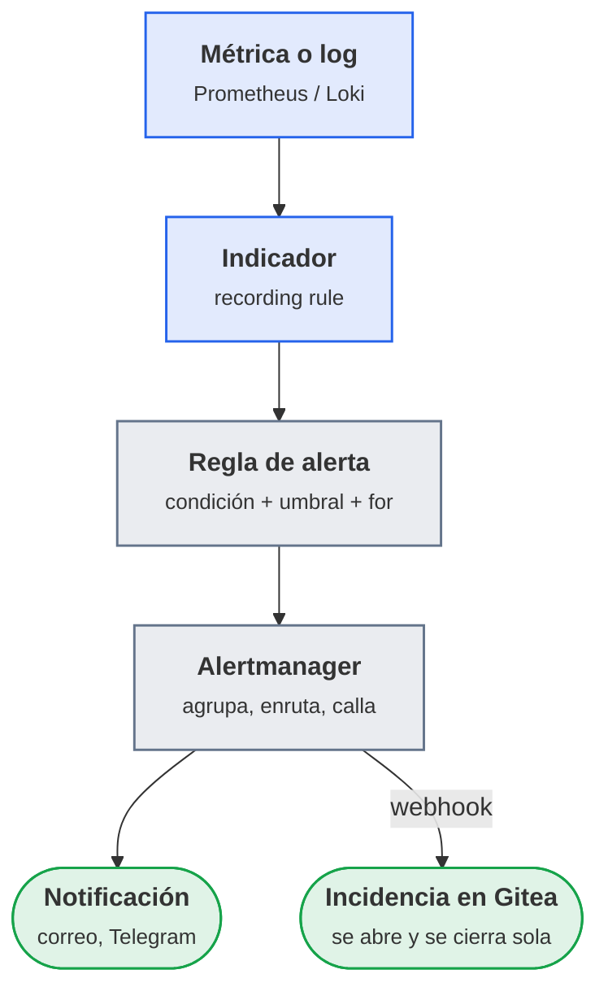
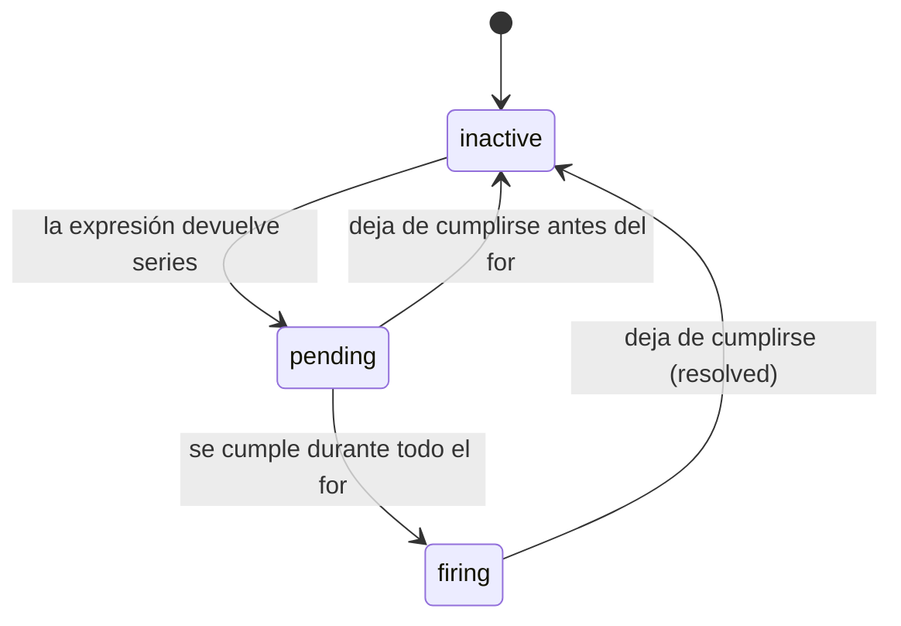
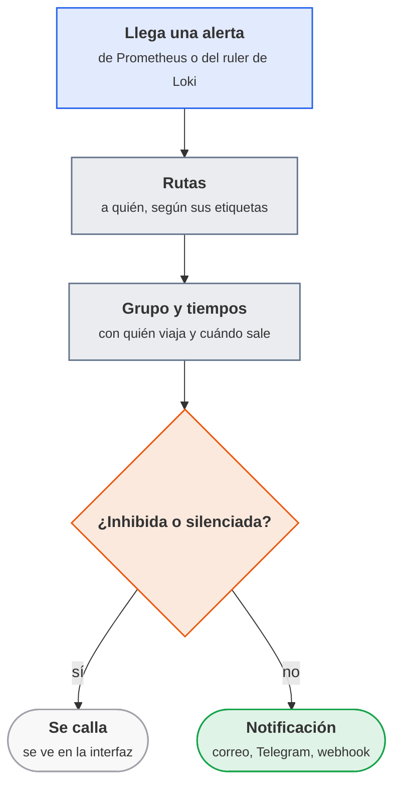
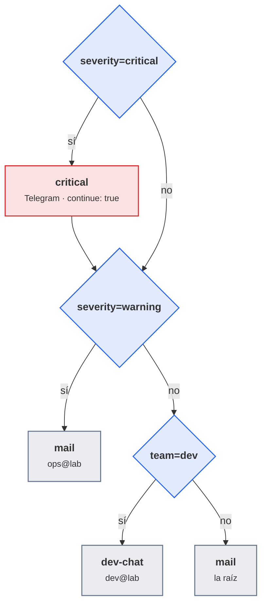

# UT2 · Umbrales, agregación y gestión de alarmas

<p class="ut-meta">8 h · Sesiones 12 a 15 · RA1 CE b, c, d, e</p>

La UT1 dejó mon01 recogiendo los datos del contenedor de referencia: en Prometheus, las métricas de recursos, las de la API y las de PostgreSQL; en Loki, los logs y los eventos del demonio Docker. Pero esos datos solo sirven si alguien mira el dashboard justo cuando algo falla, y a las tres de la madrugada no mira nadie. Esta unidad los convierte en alarmas: condiciones que se evalúan solas, avisan a quien tiene que actuar sin repetirse de más y dejan rastro en un gestor de incidencias.

La unidad monta la cadena en el orden en que la recorre una alarma: qué condiciones vigilar (sesión 12), cómo se calculan los indicadores y se escriben las reglas (sesión 13), a quién se avisa y cómo queda registrada cada alarma (sesión 14). La práctica evaluable monta el registro de incidencias y prueba la cadena entera de punta a punta.

## Sesión 12 · Umbrales sobre contadores y cadenas en logs

<p class="ut-meta" markdown>12 de noviembre · Teoría y práctica · <span class="dur" tabindex="0" aria-label="De la métrica a la alarma · 10 min&#10;Umbrales sobre contadores · 10 min&#10;Cadenas en logs y eventos · 10 min&#10;A2.1 Umbrales y cadenas · 80 min" data-dur="De la métrica a la alarma · 10 min&#10;Umbrales sobre contadores · 10 min&#10;Cadenas en logs y eventos · 10 min&#10;A2.1 Umbrales y cadenas · 80 min">:material-school:<i class="dur-barra" style="--teoria:27%"></i>:material-flask:</span></p>

Hasta ahora, para enterarse de que el servicio iba mal había que estar mirando. Una alarma empieza por una condición escrita de antemano que el sistema comprueba sin nadie delante. Esta sesión escribe las primeras sobre las dos fuentes que ya llegan a mon01: los números de Prometheus y el texto de Loki. Primero, el mapa de la cadena y el criterio para decidir qué merece ser alarma; después, cómo se escribe un umbral sobre un contador en PromQL; por último, cómo se busca en los logs un mensaje concreto y se convierte en un número. La hoja mide el valor normal de cada indicador, busca en el código de la API los mensajes a vigilar y provoca un fallo para verlos reaccionar.

### De la métrica a la alarma

**Qué es una alarma.** Una condición sobre los datos que, mantenida durante un tiempo, exige que alguien haga algo. Sin condición escrita es un panel que hay que mirar; sin tiempo mínimo, un pico de diez segundos despierta a alguien para nada; sin alguien a quien avisar, no se entera nadie; y sin algo que hacer, el aviso solo molesta.

**La cadena.** Entre un número que sube en Prometheus y un mensaje en el móvil hay varias piezas, cada una con su trabajo: Prometheus y el ruler de Loki calculan y deciden si una condición se cumple; **Alertmanager**, un programa aparte del proyecto Prometheus, decide a quién se avisa y cuándo. Gracias a ese reparto se puede cambiar el canal de aviso sin tocar ninguna regla.



<p class="pie" markdown>El umbral de cada regla no lo decide la herramienta: sale de la documentación del servicio.</p>

Todo lo que se escribe en la unidad va al repositorio `alerting`, en `/opt/alerting` de mon01:

| Eslabón | Dónde se escribe | Cuándo |
|---|---|---|
| Umbrales y cadenas, con su justificación | `docs/umbrales.md` y `docs/cadenas.md` | 12 nov |
| Indicadores (recording rules) | `prometheus/rules.yml` | 17 nov |
| Reglas de alerta | `prometheus/alerts.yml` y `loki/loki-alerts.yml` | 17 nov |
| A quién se avisa y cuándo | `alertmanager/alertmanager.yml` | 19 nov |
| Incidencias | el receptor `tickets/` | 24 nov |

El umbral sale de la documentación del servicio o de un acuerdo de nivel de servicio (lo que el servicio promete a quien lo usa). Alertmanager está en la pila mínima desde la A1.1, pero con una configuración que no avisa a nadie.

#### Alertar por síntomas, no por causas

**El problema.** Con PromQL se le puede poner un umbral a cualquier cosa. Si se le pone a todo, cada día salta algo, casi nunca importa y el equipo deja de hacer caso.

**El criterio.** El capítulo de monitorización del libro de SRE de Google (así llama Google a operar servicios en producción; [sre.google/sre-book/monitoring-distributed-systems](https://sre.google/sre-book/monitoring-distributed-systems/)) lo resume así: las alarmas que despiertan a alguien responden a **síntomas** que sufre el usuario (errores, lentitud, servicio caído), no a **causas** posibles (CPU alta, muchas conexiones). Una CPU al 95 % que sirve todo en 80 ms no es un problema; una CPU al 30 % con un 5 % de errores sí lo es.

**Qué se hace con las causas.** Se vigilan con menos urgencia. Lo marca la etiqueta **severidad**: `critical` exige actuar ya y va al canal de guardia (el de quien atiende los avisos ese turno, aunque sea de noche); `warning` puede esperar al día siguiente. La buena práctica: cada alarma `critical` tiene que pedir una acción ahora que no se pueda automatizar; si no, baja a `warning` o sobra.

#### Fatiga de alertas

**Qué es.** Lo que pasa cuando el canal de avisos recibe tantos mensajes que el equipo deja de leerlos: si de cuarenta avisos diarios treinta y ocho no piden nada, el que importa se pierde entre los demás. Por eso ningún umbral se pone bajo "por si acaso". Cuando una alarma salta sin motivo se hace una de tres cosas: subir el umbral, alargar el `for` (el tiempo que la condición tiene que durar antes de avisar) o bajarla de `critical` a `warning`.

### Umbrales sobre contadores

{ .logo-inline } **Un umbral es un filtro.** Una condición de alarma es una consulta PromQL con una comparación al final. La comparación deja pasar solo las series que la cumplen; si no pasa ninguna, el resultado está vacío y no hay nada de qué avisar. En una regla de alerta, cada serie que pasa el filtro es una alerta:

```promql
up{job="node"}          # una serie por máquina: 1 si su node_exporter responde, 0 si no
up{job="node"} == 0     # solo las máquinas que no responden; con todas en pie, ninguna
```

**Contadores y gauges.** Casi todo lo que hay que vigilar (peticiones, errores) es un **contador**, una métrica que solo sube ([Tipos de métrica](ut1-observabilidad.md#tipos-de-metrica)). Su valor solo dice cuánto lleva arrancado el proceso, así que el umbral se pone sobre su velocidad. La memoria o las conexiones abiertas son **gauges**: suben y bajan, y se comparan tal cual. El tipo de cada métrica está en su línea `# TYPE` del `/metrics`.

#### rate, increase y la ventana

**Qué hacen.** `rate(c[5m])` es cuánto sube por segundo el contador `c`, de media en los últimos cinco minutos; `increase(c[5m])` es cuánto ha subido en total en esa ventana. Las dos corrigen los reinicios del contador. Ya se usaron en la [A1.3](ut1-observabilidad.md#a13-instrumentar-la-aplicacion-sesion-3) para el p95 y el porcentaje de errores.

**La ventana.** Para alertar, entre 2 y 10 minutos: con menos, dos peticiones fallidas parecen una avería; con más, el aviso llega tarde. El curso usa `[5m]` en todos los indicadores.

**Reinicios: `changes`.** Para contar cuántas veces ha arrancado la API se usa `process_start_time_seconds`, un gauge con la hora de arranque del proceso: cada arranque cambia su valor, y `changes()` cuenta los cambios en la ventana. La métrica parecida de cAdvisor, `container_start_time_seconds`, no sirve: guarda la hora en que se creó el contenedor, que no cambia al reiniciarlo.

```promql
changes(process_start_time_seconds{job="app"}[1h]) > 3
```

#### Operadores con etiquetas

**Por qué casi todo es una división.** 50 errores por minuto son un desastre con 60 peticiones y una minucia con 60 000. Por eso los indicadores son proporciones: errores entre peticiones, memoria usada entre límite, conexiones entre máximo.

**Cómo divide PromQL.** Empareja cada serie de la izquierda con la de la derecha que tenga **las mismas etiquetas**; las que no encuentran pareja desaparecen sin error, y la división sale vacía. Tres casos:

- `sum by (service)(...) / sum by (service)(...)`: las dos partes se quedan solo con `service` y emparejan. Es el del ratio de errores.
- `a / ignoring(id) b` empareja sin mirar `id`; `a / on(service) b`, solo por `service`. Con cAdvisor, `id` es la primera etiqueta que hay que ignorar.
- `a / on(service) group_left b`: varias series a la izquierda y una a la derecha, que se reutiliza para cada una.

#### Una consulta vacía no es un cero

**El problema.** Si la consulta sale vacía, la alarma no salta, y desde fuera no se distingue "todo va bien" de "no hay nada que medir". Cuatro motivos, y solo el primero es bueno:

- **La comparación lo ha filtrado todo**: todo está bien.
- **La serie aún no existe**: hasta el primer error 5xx de la API no hay serie de errores, y el ratio sale vacío en lugar de 0.
- **La serie ha desaparecido**: si un target deja de existir, `up{job="app"} == 0` no devuelve nada. Para eso está `absent(up{job="app"})`, que devuelve 1 cuando no hay ninguna serie. La condición de servicio caído usa las dos: `up{job="app"} == 0 or absent(up{job="app"})`.
- **La métrica no se guarda**: el bloque `keep` del [job de cAdvisor](ut1-observabilidad.md#etiquetas-y-cardinalidad) solo deja pasar unas pocas métricas.

La buena práctica: ejecutar la consulta sin la comparación y, si sigue vacía, cada lado de la división por separado, hasta encontrar el que no devuelve nada.

#### Tabla de umbrales del contenedor de referencia

**De dónde salen los números.** De la documentación del servicio: límite de memoria de 512 MiB para `app`, latencia p95 de 500 ms (el tiempo por debajo del cual queda el 95 % de las peticiones), disponibilidad del 99 % (se admite un 1 % de errores) y `max_connections` de PostgreSQL a 100.

| Indicador | Consulta | Umbral orientativo | Severidad |
|---|---|---|---|
| Tasa de errores | `sum(rate(app_http_requests_total{status=~"5.."}[5m])) / sum(rate(app_http_requests_total[5m]))` | > 1 % durante 5 min | critical |
| Latencia p95 | `histogram_quantile(0.95, sum by (le)(rate(app_http_request_duration_seconds_bucket[5m])))` | > 0,5 s durante 10 min | critical |
| Servicio ausente | `up{job="app"} == 0 or absent(up{job="app"})` | 2 min | critical |
| Memoria del contenedor | `container_memory_working_set_bytes{service="app"} / container_spec_memory_limit_bytes{service="app"}` | > 90 % durante 5 min | warning |
| Reinicios | `changes(process_start_time_seconds{job="app"}[1h])` | > 3 en 1 h | warning |
| Conexiones a PostgreSQL | `sum by (service)(pg_stat_activity_count) / on(service) group_left pg_settings_max_connections` | > 80 % | warning |

Los tres primeros son síntomas y son `critical`; los otros tres son causas que anuncian un síntoma cercano (sin memoria, el kernel mata el proceso; sin conexiones, la API empieza a fallar) y son `warning`. Los contenedores se eligen con `service="app"`, la etiqueta que copia el job de cAdvisor del servicio de compose, y no con `name`, que cambia si se recrea el contenedor.

**Orientativos y definitivos.** Los valores de partida vienen de la documentación; los definitivos se ajustan mirando el valor normal del servicio. Un umbral por debajo del valor normal es una alarma permanente.

#### Cómo elegir el for

**El problema: los picos.** Una condición puede cumplirse un momento por casualidad. El `for` es el tiempo que tiene que mantenerse cierta, sin interrupción, antes de avisar. Mientras tanto la alerta está en espera (`pending`); al cumplirlo pasa a disparada (`firing`) y se notifica.

**Tres criterios:**

1. **Los retrasos se suman.** Con `rate(...[5m])` y `for: 5m`, el aviso puede llegar diez minutos después de empezar el fallo. La pregunta es si el usuario aguanta ese tiempo.
2. **Cero para lo que ya ha pasado.** Un OOM kill (el kernel mata el contenedor por pasarse de memoria) es un suceso: esperar no aporta nada. Sin `for`.
3. **Proporcional al coste de una falsa alarma.** Si despierta a alguien, `for` largo; si abre una incidencia que se mira mañana, corto.

### Cadenas en logs y eventos

{ .logo-inline } **Qué es una cadena.** Un texto fijo cuya aparición en un log significa algo: un mensaje de error de la API o un evento de Docker como `oom`. Sale del código de la aplicación o de su documentación, que es donde está escrito qué mensaje se escribe en cada caso. Se consulta en Loki con LogQL, un lenguaje parecido a PromQL.

#### Selectores de stream y filtros de línea

**Cómo es una consulta.** Dos partes. El **selector**, entre llaves, elige los flujos de log (*streams*) por sus etiquetas; es lo único que Loki tiene indexado, y es barato. Detrás van los **filtros**, que leen línea a línea lo que el selector ha dejado; eso es lo caro. La buena práctica: el selector lo más estrecho posible.

```text
{service="app", level="error"}                         # líneas de error de la API
{service="app"} |= "timeout"                           # que contienen timeout
{service="app"} |= "timeout" != "/health"              # ...pero no /health
{service="app"} |~ "(?i)timeout|refused"               # expresión regular, sin distinguir mayúsculas
{service="app", level="error"} | json | msg=~"timeout.*"   # filtra por el campo msg del JSON
```

Los filtros son `|=` (contiene), `!=` (no contiene), `|~` y `!~` (cumple o no una expresión regular), y distinguen mayúsculas: la API escribe `"level":"error"` en minúsculas. Las etiquetas disponibles (`host`, `service`, `container`, `level` y, en los eventos de Docker, `action`) las pone Promtail; `logcli labels` dice las que existen. Como la API escribe sus logs en JSON, `| json` convierte sus campos (`level`, `msg`, `request_id`...) en etiquetas temporales con las que se puede filtrar.

#### Métricas sobre logs

**Del texto al número.** Una línea no se compara con un umbral. Para eso se envuelve la consulta en `count_over_time(...[ventana])`, que cuenta las líneas de la ventana, igual que `rate()` envuelve un contador:

```text
sum(count_over_time({service="app", level="error"} [5m])) > 10
sum(count_over_time({service="app", level="error"} | json | msg=~"timeout.*" [5m])) > 0
sum by (host)(count_over_time({service="docker-events", action="oom"} [10m])) > 0
```

El `sum` junta los streams; con `sum by (host)` se conserva la máquina, para que la alarma diga dónde ha sido.

**Dónde se guardan las cadenas.** En `docs/cadenas.md` del repositorio, una entrada por cadena con su consulta, de dónde sale y qué significa que aparezca: dentro de seis meses nadie recordará por qué se vigila un mensaje concreto.

### A2.1 Umbrales y cadenas (sesión 12)

<span class="et et-obj">Objetivo</span> Las condiciones que la unidad convertirá en alarmas, probadas con un fallo real y con un origen que se puede defender: los seis umbrales en PromQL, con el valor normal medido en tu servicio, y las cadenas en LogQL, con dos mensajes sacados del código de la API y el evento `oom` de Docker. Al terminar tienes `docs/umbrales.md` y `docs/cadenas.md`, la base de las reglas del 17 de noviembre y lo que revisa la práctica evaluable en el criterio b.

<span class="et et-pre">Antes de empezar</span>

- `app01` y `mon01` encendidas, con todos los targets de `http://mon01:29090` en UP y los logs y eventos de app01 llegando a Loki.
- Los nombres `app01` y `mon01` en el `/etc/hosts` de tu VM `puesto` y de mon01, como los dejó la A1.4; si el DHCP les ha cambiado la IP, corrígela.
- `logcli` en tu VM `puesto` con `export LOKI_ADDR=http://mon01:23100`. Si no lo instalaste en la UT1, es un binario de la [release de Loki](https://github.com/grafana/loki/releases).
- La documentación del servicio (la da el profesor) y el código de la API, en `/opt/servicio/api/` de app01.
- Explicado hoy: [Alertar por síntomas](#alertar-por-sintomas-no-por-causas), [Tabla de umbrales](#tabla-de-umbrales-del-contenedor-de-referencia), [Una consulta vacía no es un cero](#una-consulta-vacia-no-es-un-cero), [Cómo elegir el for](#como-elegir-el-for), [Selectores de stream y filtros de línea](#selectores-de-stream-y-filtros-de-linea) y [Métricas sobre logs](#metricas-sobre-logs).

<span class="et et-pas">Pasos</span>

Primero preparas el repositorio y un tráfico de fondo, sin el cual los ratios no tienen nada que dividir. Después mides el valor normal de cada indicador y buscas las cadenas en el código. Con todo listo provocas dos fallos para ver reaccionar números y texto, y al final fijas los umbrales y documentas las cadenas.

1. **Prepara el repositorio y el tráfico.** Todo lo de la unidad va al repositorio `alerting` de mon01, que entregas en la práctica evaluable. Nace con `secrets/` ignorado, porque ahí irán los tokens de Telegram y de Gitea. En mon01:

    ```bash
    sudo mkdir -p /opt/alerting && sudo chown "$USER" /opt/alerting && cd /opt/alerting
    git init && mkdir -p docs secrets && echo "secrets/" > .gitignore
    echo "# alerting. Sin remoto todavía: lo recibe en la práctica evaluable." > README.md
    git add . && git commit -m "Repositorio alerting"
    ```

    Y en tu VM `puesto`, un bucle que deja corriendo toda la sesión (las hojas siguientes también lo usan). Mete una ruta inexistente de cada diez, para comprobar que un 404 no cuenta como error del servicio:

    ```bash
    i=0; while true; do
      curl -s -o /dev/null -w "%{http_code} " http://app01:20080/items
      i=$((i+1)); [ $((i % 10)) -eq 0 ] && curl -s -o /dev/null http://app01:20080/no-existe
      sleep 1
    done
    ```

    Comprobación: el bucle imprime `200` sin parar.

2. **Mide el valor normal de cada indicador.** Ejecuta las seis consultas de la [tabla de umbrales](#tabla-de-umbrales-del-contenedor-de-referencia) en *Graph* de `http://mon01:29090`, o desde el puesto con esta función, y apunta el valor que se mantiene con el tráfico de fondo:

    ```bash
    q() { curl -s http://mon01:29090/api/v1/query --data-urlencode "query=$1" | jq -c '.data.result[] | [.metric, .value[1]]'; }
    q 'sum(rate(app_http_requests_total{status=~"5.."}[5m])) / sum(rate(app_http_requests_total[5m]))'
    ```

    Si una sale vacía, busca el motivo con [Una consulta vacía no es un cero](#una-consulta-vacia-no-es-un-cero) antes de seguir. La de servicio ausente, con la API respondiendo, sale vacía y es lo correcto: su número se lee en `up{job="app"}`. La de errores puede salir vacía si la API aún no ha dado ningún 5xx; apúntalo así.

3. **Busca las cadenas en su origen.** Saca del código de la API dos mensajes de error distintos que se escriban cuando falla la base de datos, con su fichero y su línea, y escribe para cada uno una consulta LogQL (al menos una con `| json`). En app01 y en el puesto:

    ```bash
    grep -rnE "log(ger)?\.(error|exception)\(" /opt/servicio/api/     # en app01
    logcli labels service                                               # en el puesto
    logcli query --since=1h '{service="app", level="error"} |= "<texto del mensaje>"'
    logcli query --since=1h '{service="app", level="error"} | json | msg=~"<inicio del mensaje>.*"'
    ```

    Comprobación: todavía no tienen por qué devolver líneas; las verás aparecer en el paso siguiente.

4. **Provoca un fallo y mira reaccionar números y texto.** Para `db` dos minutos con el bucle corriendo y vuelve a arrancarla. Mientras está parada, repite la consulta de errores del paso 2 y tus dos consultas LogQL del paso 3:

    ```bash
    cd /opt/servicio && docker compose stop db      # en app01
    docker compose start db                          # dos minutos después
    ```

    Comprobación: el ratio de errores sube y tus dos consultas devuelven líneas. Una consulta que no ha devuelto ninguna línea no está probada: cambia el texto o el selector. Apunta también qué hacen las otras cinco consultas de la tabla.

5. **Provoca un `oom` y convierte las consultas en números.** En app01, un contenedor de usar y tirar que muere por falta de memoria. Después busca el evento y pasa la consulta del `oom` y una de la API a consultas métricas, como en [Métricas sobre logs](#metricas-sobre-logs):

    ```bash
    docker run --rm -m 32m python:3-slim python -c "x = bytearray(200 * 1024 * 1024)"   # en app01
    logcli query --since=15m '{service="docker-events", action="oom"}'
    logcli instant-query 'sum by (host)(count_over_time({service="docker-events", action="oom"} [10m]))'
    logcli instant-query 'sum(count_over_time(<tu consulta de la API> [10m]))'
    ```

    Comprobación: las dos consultas métricas dan más de cero. Son las que irán al ruler de Loki el 17 de noviembre.

6. **Fija los umbrales y documenta las cadenas.** Con el valor normal y la documentación delante, decide umbral, `for` y severidad de cada indicador ([Cómo elegir el for](#como-elegir-el-for)) y escribe los dos ficheros. `docs/umbrales.md`:

    ```markdown
    | Indicador | Consulta | Valor normal | Umbral | for | Severidad | De dónde sale |
    |---|---|---|---|---|---|---|
    | Tasa de errores | `<consulta>` | <medido> | <umbral> | <for> | critical | Disponibilidad del 99 % (documentación, <página>) |
    ```

    `docs/cadenas.md`, una entrada por cadena (las dos de la API y la del `oom`):

    ```markdown
    ## <nombre corto>
    - Consulta: `<consulta métrica>`
    - De dónde sale: `<fichero>:<línea>` (o el evento `oom` de Docker)
    - Qué significa que aparezca: <qué ha pasado y qué hay que mirar>
    ```

    Haz commit de los dos. Comprobación: `git log` muestra el commit, y ningún umbral está por debajo de su valor normal.

<span class="et et-com">Comprobación</span> Las seis consultas devuelven lo esperado con el tráfico de fondo y el ratio de errores ha reaccionado a la parada de `db`; cada consulta de `docs/cadenas.md` ha devuelto al menos una línea, la del evento encuentra el `oom` y las dos métricas dan más de cero; `docs/umbrales.md` está en el repositorio con las siete columnas rellenas.

<span class="et et-ent">Para practicar</span> Guarda `docs/umbrales.md` y `docs/cadenas.md` en el repositorio `alerting`: las reglas de la A2.2 salen de ellos, y la práctica evaluable los revisa para el criterio b.

<span class="et et-ext">Si te sobra tiempo</span> Reinicia `app` cuatro veces, con medio minuto entre una y otra para que Prometheus vea cada arranque, y comprueba que la consulta de reinicios marca 4. Y provoca un `unhealthy` con un contenedor de usar y tirar con `--health-cmd "exit 1"` y un intervalo corto (bórralo después): su `action` es `health_status: unhealthy`, así que se filtra con `action=~"health_status.*"`. Añade la cadena a `docs/cadenas.md`.

## Sesión 13 · Recording rules y reglas de alerta

<p class="ut-meta" markdown>17 de noviembre · Teoría y práctica · <span class="dur" tabindex="0" aria-label="Agregación y correlación: recording rules · 10 min&#10;Reglas de alerta · 15 min&#10;A2.2 Recording rules y reglas de alerta · 85 min" data-dur="Agregación y correlación: recording rules · 10 min&#10;Reglas de alerta · 15 min&#10;A2.2 Recording rules y reglas de alerta · 85 min">:material-school:<i class="dur-barra" style="--teoria:23%"></i>:material-flask:</span></p>

Las seis consultas de la [tabla de umbrales](#tabla-de-umbrales-del-contenedor-de-referencia) funcionan, pero son largas, se copian en cada panel y cada alerta, y el ratio de errores no existe como métrica en ningún sitio. Las **recording rules** calculan cada indicador una vez y lo guardan con nombre propio. Después, las **reglas de alerta** convierten las condiciones en algo que Prometheus y el ruler de Loki evalúan solos, cada pocos segundos, y mandan a Alertmanager con unas etiquetas que dicen qué es cada alerta y cuánto urge. La teoría va en ese orden: el fichero de recording rules, el de reglas de alerta con sus etiquetas, cómo se prueba una regla sin esperar a que falle nada y las reglas sobre logs del ruler de Loki.

### Agregación y correlación: recording rules

**Qué es.** Una regla que Prometheus evalúa solo, cada cierto tiempo: ejecuta una consulta y guarda el resultado como una serie nueva con nombre propio. Desde ese momento es una métrica más, que se consulta, se grafica y se usa en alertas, pero ya viene calculada.

#### Por qué precalcular

- **Correlar.** El ratio de errores no está en ninguna métrica: sale de dividir dos contadores. La regla lo convierte en una serie con nombre e histórico. Es lo que pide el criterio c: obtener indicadores nuevos a partir de los contadores.
- **Agregar.** Pasar de una serie por réplica a una por servicio con `sum by (service)`. Con una sola réplica no cambia nada, pero la regla queda preparada para más.
- **Aligerar.** Un percentil se calcula una vez cada 30 s, no cada vez que alguien abre un panel.
- **Coherencia.** El panel y la alarma leen la misma serie, así que no pueden dejar de coincidir.

#### Convención de nombres

Las métricas grabadas se nombran `nivel:métrica:operaciones`, con dos puntos, que las métricas normales no usan, así que se reconocen a simple vista. En el laboratorio, `nivel` es el servicio (`app`, `db`), `métrica` lo que se mide (`requests`, `errors`, `latency_p95`) y `operaciones` lo que se le ha hecho con su ventana (`rate5m`, `ratio5m`). `app:errors:ratio5m` se lee "en app, ratio de errores, ventana de 5 minutos".

#### El fichero rules.yml

**Qué lleva.** Cuatro indicadores de la tabla (errores, latencia, memoria y conexiones) más `app:requests:rate5m`, auxiliar para los paneles de tráfico. La ausencia y los reinicios no se graban, porque no calculan ningún indicador. Cada grupo tiene un nombre, un intervalo y sus reglas; cada regla, un `record` (el nombre nuevo) y un `expr` (la consulta):

```yaml
groups:
  - name: app_rules
    interval: 30s
    rules:
      - record: app:requests:rate5m
        expr: sum by (service)(rate(app_http_requests_total[5m]))
      - record: app:errors:ratio5m
        expr: |
          sum by (service)(rate(app_http_requests_total{status=~"5.."}[5m]))
          /
          sum by (service)(rate(app_http_requests_total[5m]))
      - record: app:latency_p95:5m
        expr: histogram_quantile(0.95, sum by (service, le)(rate(app_http_request_duration_seconds_bucket[5m])))
      - record: app:memory:ratio
        expr: |
          container_memory_working_set_bytes{service="app"}
          / ignoring(id)
          container_spec_memory_limit_bytes{service="app"}
      - record: db:connections:ratio
        expr: sum by (service)(pg_stat_activity_count) / on(service) group_left pg_settings_max_connections
```

**Cómo se carga.** Se referencia en `prometheus.yml` con `rule_files: [ "rules.yml", "alerts.yml" ]`, se valida con `promtool check rules` (la utilidad que viene en la imagen de Prometheus) y se recarga con un `POST` a `/-/reload`. Una recarga con errores no tumba Prometheus: se queda con lo anterior, y lo dice `prometheus_config_last_reload_successful`, que vale 0.

**La norma del repositorio.** Las alertas sobre indicadores calculados (ratios, percentiles, porcentajes) usan su métrica grabada, no la consulta cruda. Las de ausencia (`AppDown`, `HostDown`) y la de reinicios (`AppRestarting`) van sobre la serie cruda, porque no calculan nada. La práctica evaluable lo revisa.

### Reglas de alerta

**Qué es.** Lo mismo que una recording rule, pero el resultado se usa como condición: cada serie que devuelve la expresión es una alerta, y si la sigue devolviendo durante el `for`, Prometheus la manda a Alertmanager. El bloque `alerting` de `prometheus.yml` ya dice dónde está Alertmanager.

**El fichero.** `alerts.yml` traduce la tabla de umbrales a seis reglas más `HostDown`, que avisa si una máquina deja de contestar al job `node`. Los umbrales y los `for` son los orientativos; en la hoja se cambian por los de cada `docs/umbrales.md`:

```yaml
groups:
  - name: app_alerts
    rules:
      - alert: AppHighErrorRate
        expr: app:errors:ratio5m > 0.01
        for: 5m
        labels:
          severity: critical
          team: ops
          service: app
          origen: prometheus
          env: dev
        annotations:
          summary: "Errores 5xx al {{ $value | humanizePercentage }} en {{ $labels.service }}"
          description: "El ratio de errores lleva 5 min por encima del 1 % (SLA). Revisa la API y el servicio db en app01."
          runbook: "https://wiki.lab/runbooks/app-errors"
      - alert: AppHighLatency
        expr: app:latency_p95:5m > 0.5
        for: 10m
        labels: { severity: critical, team: ops, service: app, origen: prometheus, env: dev }
        annotations:
          summary: "p95 de {{ $value | humanizeDuration }} en {{ $labels.service }}"
          runbook: "https://wiki.lab/runbooks/app-latency"
      - alert: AppDown
        expr: up{job="app"} == 0 or absent(up{job="app"})
        for: 2m
        labels: { severity: critical, team: ops, service: app, origen: prometheus, env: dev }
        annotations:
          summary: "El exporter de app no responde desde hace 2 min"
      - alert: HostDown
        expr: up{job="node"} == 0
        for: 2m
        labels: { severity: critical, team: ops, service: node, origen: prometheus, env: dev }
        annotations:
          summary: "{{ $labels.host }} no responde al node_exporter desde hace 2 min"
      - alert: AppMemoryHigh
        expr: app:memory:ratio > 0.9
        for: 5m
        labels: { severity: warning, team: dev, service: app, origen: cadvisor, env: dev }
        annotations:
          summary: "Memoria al {{ $value | humanizePercentage }} del límite en {{ $labels.name }}"
      - alert: AppRestarting
        expr: changes(process_start_time_seconds{job="app"}[1h]) > 3
        for: 0m
        labels: { severity: warning, team: dev, service: app, origen: prometheus, env: dev }
        annotations:
          summary: "app reiniciado {{ $value }} veces en 1 h"
      - alert: DbConnectionsHigh
        expr: db:connections:ratio > 0.8
        for: 5m
        labels: { severity: warning, team: ops, service: db, origen: prometheus, env: dev }
        annotations:
          summary: "PostgreSQL al {{ $value | humanizePercentage }} de max_connections"
```

Cargado el fichero, las siete reglas salen en la página *Alerts* de Prometheus en verde. Si alguna sale en amarillo o rojo sin haber provocado nada, su umbral está por debajo del valor normal.

**El catálogo cerrado.** Estas siete y las tres del [ruler de Loki](#alertas-en-el-ruler-de-loki) (`AppLogErrorsBurst`, `AppDbTimeout` y `ContainerOOM`) son las diez alarmas de la unidad. El resto del curso las cita por estos nombres, y una alarma que no esté en la lista no existe en el repositorio `alerting`. Solo crece el 12 de enero, cuando el catálogo de la UT4 (indicadores y pruebas) le añade cinco.

#### Etiquetas y anotaciones

**Las etiquetas se deciden en la regla.** Son lo único que Alertmanager mira para enrutar y callar alertas, y lo que usa el receptor de incidencias para clasificarlas. Todas las reglas llevan las mismas cinco:

| Etiqueta | Valores | Para qué la usa la cadena |
|---|---|---|
| `severity` | critical, warning, info | Elige el canal: Telegram para `critical`, correo para el resto |
| `team` | ops, dev | Las de `dev` llegan además al correo del equipo de desarrollo |
| `service` | app, db, web, y `node` para las de la máquina | Agrupa las alertas del mismo servicio |
| `origen` | prometheus, cadvisor, loki, docker-events | Dice de dónde sale el dato |
| `env` | dev, pre | Separa entornos |

Es la categorización que pide el criterio e, decidida en el origen. Prometheus añade además las etiquetas de la serie (`instance`, `job`, `host`...) y `alertname`, el nombre de la regla.

**Las anotaciones son para la persona.** Texto con huecos entre dobles llaves: `{{ $labels.service }}` inserta una etiqueta y `{{ $value }}` el valor; `humanizePercentage` convierte 0.0234 en `2.34%`. La convención: `summary` de una línea, lo que cabe en un móvil; `description` con el contexto; y `runbook` con la URL del procedimiento de qué hacer, que de momento apunta a una wiki de ejemplo (los runbooks se escriben el 12 de enero, en la UT4).

#### Estados de una alerta



<p class="pie" markdown>`inactive` (verde), `pending` (amarillo) y `firing` (rojo) se ven en la página *Alerts* de Prometheus.</p>

Prometheus manda la alerta a Alertmanager en cuanto entra en `firing` y la reenvía mientras siga así. Cuando deja de cumplirse, la manda una última vez con su hora de fin, y Alertmanager la da por resuelta (`resolved`).

#### Probar las reglas con promtool

**Para qué.** Esperar a que el servicio falle para ver si una regla dispara es lento y obliga a romper algo cada vez que cambia un umbral. `promtool test rules` inventa series, simula el paso del tiempo y comprueba qué alertas tienen que estar disparadas. Tarda un segundo y se queda en el repositorio como prueba.

**Cómo es.** Este fichero comprueba que, con un 5 % constante de errores, `AppHighErrorRate` no ha disparado a los 2 minutos (su `for` es de 5) y sí a los 6, con sus etiquetas y anotaciones exactas:

```yaml
rule_files:
  - ../alerts.yml
evaluation_interval: 15s
tests:
  - interval: 15s
    input_series:
      - series: 'app:errors:ratio5m{service="app"}'
        values: '0.05x40'
    alert_rule_test:
      - eval_time: 2m
        alertname: AppHighErrorRate
        exp_alerts: []
      - eval_time: 6m
        alertname: AppHighErrorRate
        exp_alerts:
          - exp_labels: { service: app, severity: critical, team: ops, origen: prometheus, env: dev }
            exp_annotations:
              summary: "Errores 5xx al 5% en app"
              description: "El ratio de errores lleva 5 min por encima del 1 % (SLA). Revisa la API y el servicio db en app01."
              runbook: "https://wiki.lab/runbooks/app-errors"
```

- `values: '0.05x40'` es el valor 0,05 repetido cada 15 s durante diez minutos.
- En cada `eval_time`, `exp_alerts` es la lista de alertas en `firing` que se espera: vacía a los 2 minutos, una a los 6.
- Las anotaciones tienen que coincidir letra a letra con las que da la plantilla.

#### Alertas en el ruler de Loki

**Para qué.** Las consultas de [Métricas sobre logs](#metricas-sobre-logs) solo se ejecutan a mano. El **ruler** de Loki las evalúa cada minuto, como Prometheus hace con las suyas, y manda las que se cumplen al mismo Alertmanager. Así las alarmas sobre texto entran en la misma cadena.

**Cómo se activa.** Con este bloque en `loki.yml`:

```yaml
ruler:
  storage:
    type: local
    local:
      directory: /loki/rules              # de dónde lee las reglas
  rule_path: /tmp/loki-rules-scratch      # directorio de trabajo, no se toca
  alertmanager_url: http://alertmanager:29093
  enable_api: true                        # para consultar las reglas cargadas
  evaluation_interval: 1m
```

**Dónde van las reglas.** En `/loki/rules/fake/`: con `auth_enabled: false` Loki tiene un solo cliente, que se llama `fake`, y lee las reglas del subdirectorio con ese nombre. El fichero `loki-alerts.yml` tiene la forma de uno de Prometheus, con expresiones LogQL y las mismas cinco etiquetas:

```yaml
groups:
  - name: app_logs
    interval: 1m
    rules:
      - alert: AppLogErrorsBurst
        expr: sum(count_over_time({service="app", level="error"} [5m])) > 10
        for: 2m
        labels:
          severity: warning
          team: dev
          service: app
          origen: loki
          env: dev
        annotations:
          summary: "Más de 10 líneas de error en 5 min en la API"
          runbook: "https://wiki.lab/runbooks/app-log-errors"
      - alert: AppDbTimeout
        expr: sum(count_over_time({service="app", level="error"} | json | msg=~"timeout.*" [5m])) > 0
        for: 0m
        labels:
          severity: critical
          team: ops
          service: app
          origen: loki
          env: dev
        annotations:
          summary: "La API registra timeouts contra la base de datos"
      - alert: ContainerOOM
        expr: sum by (host)(count_over_time({service="docker-events", action="oom"} [10m])) > 0
        labels:
          severity: critical
          team: ops
          service: app
          origen: docker-events
          env: dev
        annotations:
          summary: "OOM kill en {{ $labels.host }}"
```

La cadena de `AppDbTimeout` es un ejemplo: la buena sale del `docs/cadenas.md` de la A2.1. `ContainerOOM` no lleva `for` porque un OOM ya ha pasado.

**Cómo se comprueba.** Antes de cargarlo, `lokitool rules lint -n` (`lokitool` es un binario de la misma release que `logcli`; sin `-n` reescribe el fichero con su propio formato). Las reglas se aplican reiniciando Loki, y las cargadas se ven en `/loki/api/v1/rules`.

### A2.2 Recording rules y reglas de alerta (sesión 13)

<span class="et et-obj">Objetivo</span> Los indicadores del servicio como métricas con nombre propio y las diez alarmas del catálogo evaluándose solas: siete en `alerts.yml` de Prometheus y tres en `loki-alerts.yml` del ruler de Loki, todas con las cinco etiquetas. Al terminar tienes además una prueba de `promtool test rules` que pasa y una alarma real medida en su paso por `pending` y `firing`. `rules.yml` es la evidencia del criterio c.

<span class="et et-pre">Antes de empezar</span>

- `docs/umbrales.md` y `docs/cadenas.md` de la A2.1, y el bucle de tráfico de la A2.1 corriendo en tu VM `puesto`.
- `lokitool` en mon01, de la release de Loki 3.5.3:

    ```bash
    curl -LO https://github.com/grafana/loki/releases/download/v3.5.3/lokitool-linux-amd64.zip
    unzip lokitool-linux-amd64.zip && sudo install lokitool-linux-amd64 /usr/local/bin/lokitool
    ```

- Explicado hoy: [El fichero rules.yml](#el-fichero-rulesyml), [Reglas de alerta](#reglas-de-alerta), [Probar las reglas con promtool](#probar-las-reglas-con-promtool) y [Alertas en el ruler de Loki](#alertas-en-el-ruler-de-loki).

<span class="et et-pas">Pasos</span>

Escribes los dos ficheros de Prometheus y los cargas a la vez. En cuanto están cargados provocas una alarma real, porque tarda en disparar, y mientras esperas compruebas las métricas grabadas. Después pruebas la regla con `promtool`, cargas las reglas de Loki y lo guardas todo.

1. **Escribe los dos ficheros de reglas.** En `/opt/alerting/prometheus/`, copia `rules.yml` de [El fichero rules.yml](#el-fichero-rulesyml) y `alerts.yml` de [Reglas de alerta](#reglas-de-alerta). Cambia solo lo tuyo: en `rules.yml`, las etiquetas que corregiste en la A2.1 para que las consultas no salieran vacías; en `alerts.yml`, los umbrales (`> 0.01`...) y los `for` de tu `docs/umbrales.md`. Las cinco etiquetas de cada regla se quedan como están.

    Comprobación: las alarmas sobre ratios, percentiles y porcentajes usan una métrica con dos puntos (`app:...`, `db:...`).

2. **Cárgalos en Prometheus.** Valídalos, móntalos de solo lectura en el contenedor y referéncialos en `prometheus.yml`. En el `compose.yml` de `/opt/monitoring`, añade estas dos líneas a los `volumes` del servicio `prometheus`:

    ```yaml
          - /opt/alerting/prometheus/rules.yml:/etc/prometheus/rules.yml:ro
          - /opt/alerting/prometheus/alerts.yml:/etc/prometheus/alerts.yml:ro
    ```

    y a `prometheus.yml`, la línea `rule_files: [ "rules.yml", "alerts.yml" ]`. Después:

    ```bash
    cd /opt/alerting/prometheus
    docker run --rm -v "$PWD:/w" --entrypoint promtool prom/prometheus:v3.5.0 check rules /w/rules.yml /w/alerts.yml
    cd /opt/monitoring && docker compose up -d prometheus     # un montaje nuevo obliga a recrear
    ```

    Comprobación: `promtool` dice `SUCCESS` y las siete reglas salen en *Alerts* de `http://mon01:29090` como `inactive`. Si no aparecen, mira `prometheus_config_last_reload_successful` y el log de Prometheus.

3. **Provoca una alarma real y, mientras, comprueba las métricas grabadas.** Para `db` en app01 con el bucle de tráfico corriendo y apunta las horas de la parada, de `pending` y de `firing` de `AppHighErrorRate` en *Alerts*. Con la alerta en `firing`, arranca `db` y apunta cuándo desaparece. Mientras esperas, ejecuta cada métrica grabada junto a su consulta cruda (el `expr` de `rules.yml`) con la función `q` de la A2.1:

    ```bash
    q 'app:errors:ratio5m'
    q 'sum by (service)(rate(app_http_requests_total{status=~"5.."}[5m])) / sum by (service)(rate(app_http_requests_total[5m]))'
    ```

    Comprobación: cada pareja da el mismo valor; si no, la regla no calcula lo que crees. Compara los retrasos medidos con la ventana y el `for` de la regla ([Cómo elegir el for](#como-elegir-el-for)).

4. **Prueba la regla sin esperar.** Copia la prueba de [Probar las reglas con promtool](#probar-las-reglas-con-promtool) en `prometheus/tests/alerts_test.yml` y cambia el `eval_time` y las anotaciones esperadas para que coincidan con tu `AppHighErrorRate`. Pásala:

    ```bash
    cd /opt/alerting/prometheus
    docker run --rm -v "$PWD:/w" -w /w/tests --entrypoint promtool prom/prometheus:v3.5.0 test rules alerts_test.yml
    ```

    Comprobación: `SUCCESS`. Si falla, la salida enseña lo esperado y lo obtenido: casi siempre es una anotación que no coincide letra a letra.

5. **Activa el ruler de Loki con las tres reglas de texto.** Añade a `/opt/monitoring/loki/loki.yml` el bloque `ruler` de [Alertas en el ruler de Loki](#alertas-en-el-ruler-de-loki) y copia las tres reglas del mismo apartado en `/opt/alerting/loki/loki-alerts.yml`, con la cadena de `AppDbTimeout` cambiada por una de tu `docs/cadenas.md`. Móntalo con esta línea en los `volumes` del servicio `loki` del compose:

    ```yaml
          - /opt/alerting/loki/loki-alerts.yml:/loki/rules/fake/loki-alerts.yml:ro
    ```

    ```bash
    lokitool rules lint -n /opt/alerting/loki/loki-alerts.yml
    cd /opt/monitoring && docker compose up -d loki
    curl -s http://mon01:23100/loki/api/v1/rules
    ```

    Comprobación: el `lint` sale limpio y el `curl` devuelve tus tres reglas. Si no salen, el fichero no ha quedado en `/loki/rules/fake/`.

6. **Guárdalo con las horas medidas.** Apunta las horas del paso 3 en `docs/umbrales.md`, junto a `AppHighErrorRate`, y haz commit de `prometheus/`, `loki/` y `docs/` en `alerting`; en `monitoring`, de `compose.yml`, `prometheus.yml` y `loki/loki.yml`.

<span class="et et-com">Comprobación</span> `promtool check rules` y `promtool test rules` terminan en `SUCCESS`; las cinco métricas grabadas dan el mismo valor que su consulta cruda; *Alerts* muestra las siete reglas de Prometheus; `lokitool rules lint` sale limpio y `curl http://mon01:23100/loki/api/v1/rules` devuelve tus tres reglas; tienes anotado `pending`, `firing` y resolución, con horas.

<span class="et et-ent">Para practicar</span> Guarda `prometheus/rules.yml`, `prometheus/alerts.yml`, `prometheus/tests/alerts_test.yml` y `loki/loki-alerts.yml` en el repositorio `alerting`. Para la sesión del 19 de noviembre, trae creado un bot de Telegram con @BotFather, metido en un grupo de pruebas y con el `chat_id` del grupo apuntado: cómo se hace está en [Receptores y plantillas](#receptores-y-plantillas).

<span class="et et-ext">Si te sobra tiempo</span> En el dashboard de la A1.2, cambia la consulta del porcentaje de memoria por `app:memory:ratio` y añade un panel con `app:errors:ratio5m` y otro con `app:latency_p95:5m`: así el panel y las alarmas leen la misma serie. Exporta el dashboard a `grafana/dashboard.json` de `alerting`.

## Sesión 14 · Alertmanager e incidencias

<p class="ut-meta" markdown>19 de noviembre · Teoría y práctica · <span class="dur" tabindex="0" aria-label="Alertmanager · 15 min&#10;Categorizar, notificar y tratar · 5 min&#10;Demostración: incidencias en Gitea · 15 min&#10;A2.3 Alertmanager · 75 min" data-dur="Alertmanager · 15 min&#10;Categorizar, notificar y tratar · 5 min&#10;Demostración: incidencias en Gitea · 15 min&#10;A2.3 Alertmanager · 75 min">:material-school:<i class="dur-barra" style="--teoria:32%"></i>:material-flask:</span></p>

Prometheus y el ruler de Loki ya mandan sus alertas a Alertmanager, pero su configuración de partida las manda a un receptor vacío, `nadie`. Y si cada alerta fuera un mensaje, una máquina caída daría diez mensajes repetidos a todo el mundo. Alertmanager decide con qué alertas va cada una, a quién se manda, cuándo y qué se calla. Como no guarda historial, la cadena termina en un **gestor de incidencias** donde cada alarma queda registrada. La teoría sigue ese camino: rutas, tiempos, inhibición, silencios, receptores y pruebas con alertas sintéticas; después, qué datos clasifican cada alarma y una demostración que lleva las alarmas a incidencias de Gitea. La hoja monta las rutas y las prueba; las incidencias se montan en la práctica evaluable.

### Alertmanager

**Prometheus evalúa; Alertmanager decide.** Alertmanager recibe las alertas de Prometheus y del ruler de Loki, las agrupa, decide a quién van, calla las que sobran y notifica por los receptores configurados, repitiendo mientras sigan activas. Toda su configuración está en `alertmanager.yml`, que se valida con `amtool check-config` (`amtool` viene en la imagen de Alertmanager) y se recarga con un `POST` a `/-/reload`.



<p class="pie" markdown>El camino de una alerta dentro de Alertmanager. Inhibir o silenciar no borra la alerta: solo impide que se notifique.</p>

#### El árbol de rutas

**Para qué.** Una alerta `critical` tiene que llegar al móvil; una `warning` puede esperar en el correo; las del equipo de desarrollo, a ese equipo. Las **rutas** lo deciden: una raíz con rutas hijas, cada una con condiciones sobre las etiquetas (`matchers`) y un **receptor**, el destino.

**El fichero del laboratorio.** Cinco bloques: `global` (valores comunes, aquí el correo), `templates` (las plantillas de los mensajes), `route` (las rutas), `inhibit_rules` (qué se calla) y `receivers` (los destinos):

```yaml
global:
  resolve_timeout: 5m
  smtp_smarthost: mailpit:1025
  smtp_from: alertmanager@lab
  smtp_require_tls: false

templates:
  - /etc/alertmanager/templates/*.tmpl

route:
  receiver: mail
  group_by: [alertname, service]
  group_wait: 30s
  group_interval: 5m
  repeat_interval: 4h
  routes:
    - matchers: [severity="critical"]
      receiver: critical
      continue: true
    - matchers: [severity="warning"]
      receiver: mail
    - matchers: [team="dev"]
      receiver: dev-chat
      group_by: [alertname, service, env]

inhibit_rules:
  - source_matchers: [alertname="HostDown"]
    target_matchers: [severity=~"warning|critical"]
    equal: [host]
  - source_matchers: [alertname="AppDown"]
    target_matchers: [service="app"]
    equal: [env]

receivers:
  - name: mail
    email_configs:
      - to: ops@lab
        send_resolved: true
  - name: critical
    telegram_configs:
      - bot_token_file: /etc/alertmanager/secrets/tg_token
        chat_id: -100123456789
        parse_mode: HTML
        message: '{{ template "lab.telegram" . }}'
        send_resolved: true
  - name: dev-chat
    email_configs:
      - to: dev@lab
        send_resolved: true
```

**Cómo se recorre.** Las rutas hijas se prueban en orden y la primera que coincide se queda la alerta, salvo que lleve `continue: true`, que sigue probando las siguientes. Así, una alerta `critical` de `team=dev` va a Telegram y también a `dev-chat`; una `warning` se queda en `mail`, sea del equipo que sea; y lo que no coincide con ninguna cae en el receptor de la raíz. La buena práctica: el token del bot va en un fichero (`bot_token_file`) fuera del repositorio, nunca en el YAML.



<p class="pie" markdown>Sin el `continue: true` de la rama crítica, una alerta grave del equipo de desarrollo se quedaría en Telegram y no llegaría a `dev-chat`.</p>

`amtool config routes test severity=critical team=dev` dice a qué receptores llegaría una alerta con esas etiquetas, sin provocar nada.

#### group_wait, group_interval y repeat_interval

**Para qué.** Si se cae una máquina llegan diez alertas casi a la vez, y lo útil es un mensaje con las diez. `group_by` dice qué etiquetas tienen que compartir las alertas para viajar juntas: con `[alertname, service]`, las de la misma regla y el mismo servicio. Tres tiempos deciden cuándo sale cada mensaje:

| Tiempo | Qué hace | En el laboratorio |
|---|---|---|
| `group_wait` | Espera tras la primera alerta de un grupo, por si llegan más, y las manda juntas | 30 s |
| `group_interval` | Cada cuánto se manda lo que ha cambiado en un grupo ya avisado (alertas nuevas o resueltas) | 5 min |
| `repeat_interval` | Cada cuánto se recuerda un grupo que sigue igual | 4 h |

Por eso la resolución de una alarma no llega al instante, sino en el siguiente `group_interval`.

#### Inhibición

**Para qué.** Cuando una máquina se cae, todo lo que corre en ella dispara su alerta, y el aviso que importa (la máquina está caída) se pierde entre los demás. Una regla de inhibición dice: mientras esté activa una alerta que cumpla `source_matchers`, calla las que cumplan `target_matchers` y tengan el mismo valor en las etiquetas de `equal`.

**Las dos del laboratorio.** Con `HostDown{host="app01"}` en `firing`, se callan las alertas de app01; con `AppDown`, las demás de `service="app"` del mismo entorno. Las inhibidas se ven en la interfaz, pero no llegan a ningún receptor. Se usa `host` y no `instance` porque `host` lo llevan todas las alertas de la misma máquina, mientras que `instance` cambia con el puerto de cada exporter.

!!! ojo "Sin `equal`, la inhibición calla de más"
    Sin `equal`, un host caído callaría las alertas de todas las demás máquinas, y una segunda avería pasaría
    sin aviso.

#### Silencios

**Para qué.** Hay fallos que se provocan a propósito: una actualización, un reinicio programado, una prueba. Un **silencio** calla unas alertas durante un tiempo, con autor y un comentario de por qué. Se crea desde la web de Alertmanager (puerto 29093) o con `amtool`:

```bash
amtool --alertmanager.url=http://mon01:29093 silence add \
  service=db env=dev --duration=2h \
  --author=ops --comment="Mantenimiento PostgreSQL 17.x, ticket #142"
amtool --alertmanager.url=http://mon01:29093 silence query
amtool --alertmanager.url=http://mon01:29093 silence expire <id>
```

Los silencios se guardan en el directorio de datos de Alertmanager (`--storage.path`): con un volumen, sobreviven a un reinicio. Lo que no guarda es el historial de alertas, y por eso las alarmas terminan en incidencias ([Categorizar, notificar y tratar](#categorizar-notificar-y-tratar)).

#### Receptores y plantillas

**Los tres canales del laboratorio:**

- **Correo**, para lo que puede esperar, contra Mailpit, un servidor de correo de pruebas. En una empresa sería su servidor de correo, con usuario y TLS.
- **Telegram**, para lo que tiene que sonar en el móvil. El bot se crea hablando con @BotFather, que entrega su token; se mete el bot en un grupo, se escribe algo y `https://api.telegram.org/bot<TOKEN>/getUpdates` devuelve el `chat_id` del grupo (negativo).
- **Webhook**, un `POST` con JSON a una URL. Es el que lleva las alarmas al gestor de incidencias.

La buena práctica: `send_resolved: true` explícito en todos, para que también se avise cuando la alerta se resuelve.

**La plantilla propia.** Las de fábrica son largas para un móvil. Esta, en `alertmanager/templates/lab.tmpl`, deja solo lo necesario, con el estado (FIRING o RESOLVED) delante:

```text
{{ define "lab.title" }}[{{ .Status | toUpper }}{{ if eq .Status "firing" }}:{{ .Alerts.Firing | len }}{{ end }}] {{ .GroupLabels.alertname }} ({{ .GroupLabels.service }}){{ end }}

{{ define "lab.telegram" }}
<b>{{ template "lab.title" . }}</b>
{{ range .Alerts -}}
<b>{{ .Status | toUpper }} · {{ .Labels.severity }}</b> {{ .Annotations.summary }}
Desde: {{ .StartsAt.Format "02/01 15:04" }} · Origen: {{ .Labels.origen }}
{{ if .Annotations.runbook }}<a href="{{ .Annotations.runbook }}">Runbook</a>{{ end }}
{{ end }}
{{ end }}
```

`define` da nombre a un trozo de plantilla, y el receptor lo usa con `message: '{{ template "lab.telegram" . }}'`.

#### Mailpit como SMTP de pruebas

**Para qué.** Probar avisos por correo sin mandar correos de verdad. Mailpit acepta todo lo que le llega por el puerto 1025, no lo entrega a nadie y lo enseña en una web. En el compose de mon01 solo se publica la web, en el 28025 del curso; el 1025 se queda dentro de la red del compose, que es por donde llega Alertmanager:

```yaml
  mailpit:
    image: axllent/mailpit:v1.22.3
    ports: ["28025:28025"]
    environment:
      MP_UI_BIND_ADDR: "0.0.0.0:28025"    # la web escucha en el puerto del curso
      MP_MAX_MESSAGES: 500
```

#### Alertas sintéticas

**Para qué.** Probar rutas, grupos, inhibiciones y plantillas sin romper el servicio ni esperar minutos. Una alerta sintética se mete a mano en Alertmanager con las etiquetas que se quiera:

```bash
amtool --alertmanager.url=http://mon01:29093 alert add alertname=PruebaAviso severity=warning service=app \
  --annotation=summary="Prueba de la ruta warning"
```

Para Alertmanager son alertas como las demás: pasan por rutas, grupos, inhibiciones y silencios. No salen en *Alerts* de Prometheus, y se resuelven solas a los 5 minutos (`resolve_timeout`).

### Categorizar, notificar y tratar

**Qué es tratar una alarma.** Notificar es avisar a alguien; tratar es que el aviso se convierta en una **incidencia**, un registro con dueño desde que el problema aparece hasta que se cierra. Para eso cada alarma llega ya clasificada, con datos que salen de las etiquetas de la regla y de Alertmanager:

| Parámetro | Valores | De dónde sale |
|---|---|---|
| Fecha de creación | `startsAt` (hora UTC) | Alertmanager, del primer envío |
| Fecha de resolución | `endsAt` | Alertmanager, cuando se resuelve |
| Origen | prometheus, cadvisor, loki, docker-events | Etiqueta `origen` |
| Criticidad | critical, warning, info | Etiqueta `severity` |
| Servicio / entorno | app, db, web, node; dev, pre | Etiquetas `service`, `env` |
| Equipo | ops, dev | Etiqueta `team` |
| Estado | firing, resolved | Campo `status` |
| Identidad | `fingerprint` | Alertmanager; empareja el disparo con su resolución |

Es lo que se rellena para cada alarma en la tabla de verificación de la práctica evaluable.

#### El JSON del webhook

**Qué llega.** Un receptor con `webhook_configs` manda a una URL un `POST` con los datos del grupo de alertas. Este es un ejemplo, que la demostración usa como fichero de prueba:

```json
{
  "version": "4",
  "groupKey": "{}/{severity=\"critical\"}:{alertname=\"AppHighErrorRate\", service=\"app\"}",
  "truncatedAlerts": 0,
  "status": "firing",
  "receiver": "critical",
  "groupLabels": { "alertname": "AppHighErrorRate", "service": "app" },
  "commonLabels": {
    "alertname": "AppHighErrorRate", "env": "dev", "origen": "prometheus",
    "service": "app", "severity": "critical", "team": "ops"
  },
  "commonAnnotations": {
    "summary": "Errores 5xx al 2.4% en app",
    "runbook": "https://wiki.lab/runbooks/app-errors"
  },
  "externalURL": "http://mon01:29093",
  "alerts": [
    {
      "status": "firing",
      "labels": {
        "alertname": "AppHighErrorRate", "env": "dev", "origen": "prometheus",
        "service": "app", "severity": "critical", "team": "ops"
      },
      "annotations": {
        "summary": "Errores 5xx al 2.4% en app",
        "description": "El ratio de errores lleva 5 min por encima del 1 % (SLA). Revisa la API y el servicio db en app01.",
        "runbook": "https://wiki.lab/runbooks/app-errors"
      },
      "startsAt": "2026-11-12T09:41:30.512Z",
      "endsAt": "0001-01-01T00:00:00Z",
      "generatorURL": "http://mon01:29090/graph?g0.expr=app%3Aerrors%3Aratio5m+%3E+0.01",
      "fingerprint": "5c2f8a1e9b0d4c77"
    }
  ]
}
```

Lo que usa el receptor está en la lista `alerts`: de cada alerta, su `status` (el de fuera es el del grupo entero), sus etiquetas y anotaciones, sus fechas y su `fingerprint`, que es siempre el mismo para la misma alerta y sirve para saber qué incidencia cerrar.

#### Receptor Flask que abre y cierra incidencias en Gitea

**Por qué un programa en medio.** Alertmanager manda su JSON y Gitea tiene una API para crear y cerrar incidencias, pero alguien tiene que traducir uno a otro y recordar qué alerta es qué incidencia. En el laboratorio lo hace un script corto en Python con Flask (una librería para montar un servicio web en pocas líneas), que corre como contenedor con el nombre `tickets`.

**Dónde van las incidencias.** Gitea es un servidor de Git ligero con repositorios, incidencias (*issues*) y una API, como un GitHub propio. Corre en un contenedor de mon01 desde la práctica evaluable de esta unidad; el 12 de febrero Despliegue lo lleva a `gitea01` en su unidad de integración continua, y ese día solo hay que cambiar `GITEA_URL`.

```python
import json, os, requests
from flask import Flask, request

GITEA = os.environ.get("GITEA_URL", "http://gitea:23001")
REPO = os.environ.get("GITEA_REPO", "ops/incidencias")
HDR = {"Authorization": "token " + os.environ["GITEA_TOKEN"]}
API = f"{GITEA}/api/v1/repos/{REPO}/issues"
STATE_FILE = os.environ.get("STATE_FILE", "/data/issues.json")

app = Flask(__name__)
state = json.load(open(STATE_FILE)) if os.path.exists(STATE_FILE) else {}

def save():
    json.dump(state, open(STATE_FILE, "w"))

def abrir(a):
    l, an = a["labels"], a.get("annotations", {})
    titulo = f"[{l.get('severity','?')}][{l.get('service','?')}] {l['alertname']}: {an.get('summary','')}"
    cuerpo = (f"**Inicio:** {a['startsAt']}\n**Origen:** {l.get('origen','?')} · "
              f"**Entorno:** {l.get('env','?')} · **Equipo:** {l.get('team','?')}\n\n"
              f"{an.get('description','')}\n\nRunbook: {an.get('runbook','-')}\n"
              f"Consulta: {a.get('generatorURL','')}\n\n`fingerprint: {a['fingerprint']}`")
    r = requests.post(API, json={"title": titulo, "body": cuerpo}, headers=HDR, timeout=10)
    r.raise_for_status()
    state[a["fingerprint"]] = r.json()["number"]

def cerrar(a):
    num = state.pop(a["fingerprint"], None)
    if num is None:
        return
    requests.post(f"{API}/{num}/comments", headers=HDR, timeout=10,
                  json={"body": f"Resuelta automáticamente. Fin: {a['endsAt']}"})
    requests.patch(f"{API}/{num}", json={"state": "closed"}, headers=HDR, timeout=10)

@app.post("/alertmanager")
def alertmanager():
    for a in request.get_json(force=True)["alerts"]:
        if a["status"] == "firing" and a["fingerprint"] not in state:
            abrir(a)
        elif a["status"] == "resolved":
            cerrar(a)
    save()
    return "", 204

if __name__ == "__main__":
    app.run(host="0.0.0.0", port=25000)
```

Leído de arriba abajo:

- **La configuración sale de variables de entorno**, sobre todo el token: el código va al repositorio y el token no.
- **`state`** guarda en disco qué issue corresponde a cada `fingerprint`: así no abre dos issues para la misma alerta y sabe cuál cerrar.
- **`abrir`** crea la issue con la severidad, el servicio y el nombre en el título, y la categorización completa en el cuerpo.
- **`cerrar`** comenta la hora de fin y cierra la issue.
- **`/alertmanager`** recorre las alertas mirando el `status` de cada una y responde 204; si falla, Alertmanager reintenta.
- **`app.run`** escucha en el 25000, su puerto del curso, y en `0.0.0.0`: con el `127.0.0.1` de fábrica de Flask, Alertmanager no le llegaría desde otro contenedor.

### Demostración: incidencias en Gitea

**Qué se ve.** El último eslabón de la cadena: una alarma que abre una incidencia al dispararse y la cierra sola al resolverse. Se hace en un mon01 con la cadena de las A2.1 a A2.3 montada, y cada uno la repite en su mon01 en la práctica evaluable. Se construye desde el final, probando cada tramo por separado para saber dónde está el fallo si algo no funciona.

**1. Gitea en la pila de mon01.** Como servicio del compose de `/opt/monitoring`, en el 23001 (el 23000 es de Grafana). `ROOT_URL` es la dirección de sus enlaces, con el nombre `gitea.lab`, que se añade a la línea de mon01 del `/etc/hosts` de la VM `puesto`, mon01, app01 y el puesto de administración:

```yaml
  gitea:
    image: gitea/gitea:1.24
    ports: ["23001:23001"]
    environment:
      GITEA__server__HTTP_PORT: "23001"
      GITEA__server__ROOT_URL: "http://gitea.lab:23001/"
    volumes:
      - gitea_data:/data
```

En la primera visita a `http://gitea.lab:23001` se elige SQLite como base de datos y se crea el administrador. Después se crea la organización `ops` con cuatro repositorios vacíos: `incidencias`, para las issues, y `alerting`, `servicio` y `monitoring`, que serán el remoto de los del curso. Por último, en *Configuración → Aplicaciones → Generar token*, un token con permiso de escritura sobre issues.

**2. El receptor, como servicio `tickets`.** El script del [receptor](#receptor-flask-que-abre-y-cierra-incidencias-en-gitea) se guarda tal cual en `/opt/alerting/tickets/app.py`, con este `Dockerfile`:

```dockerfile
FROM python:3-slim
RUN pip install --no-cache-dir flask requests
COPY app.py /app.py
CMD ["python", "/app.py"]
```

y entra en la misma pila que Alertmanager, que le llega por la red del compose como `tickets`:

```yaml
  tickets:
    build: /opt/alerting/tickets
    ports: ["127.0.0.1:25000:25000"]
    env_file: /opt/alerting/secrets/tickets.env
    volumes:
      - tickets_data:/data
```

`gitea_data` y `tickets_data` se declaran en el bloque `volumes` del compose. `secrets/tickets.env`, con permisos 600, lleva `GITEA_URL=http://gitea:23001` (el nombre del servicio, porque el contenedor no lee el `/etc/hosts` de mon01), `GITEA_REPO=ops/incidencias` y `GITEA_TOKEN`. El 25000 solo se publica en `127.0.0.1`, para la prueba siguiente.

**3. El receptor, probado sin Alertmanager.** El JSON de [El JSON del webhook](#el-json-del-webhook) se guarda como `/opt/alerting/tickets/tests/firing.json`, y una copia con `"resolved"` en los dos `status` y un `endsAt` real como `resolved.json`. Se mandan los dos, reiniciando el receptor entre medias:

```bash
cd /opt/alerting/tickets
curl -s -X POST -H 'Content-Type: application/json' \
  --data @tests/firing.json http://127.0.0.1:25000/alertmanager
```

Con el primero aparece en `ops/incidencias` una issue `[critical][app] AppHighErrorRate: ...`; con el segundo, la misma issue recibe el comentario y se cierra. El reinicio demuestra que el receptor no olvida qué issue es de qué alerta.

**4. La conexión con Alertmanager.** Cada uno de los tres receptores de `alertmanager.yml` lleva, además de su correo o su Telegram, un webhook:

```yaml
    webhook_configs:
      - url: http://tickets:25000/alertmanager
        send_resolved: true
```

Va en los tres para que ninguna alarma se quede sin incidencia; una alerta que pasa por dos receptores no duplica su issue, porque su `fingerprint` ya la tiene. Se valida con `amtool check-config` y se recarga Alertmanager.

**5. La prueba con alarmas reales.** Con el bucle de tráfico corriendo se para `db`. A los pocos minutos se abren dos issues: `AppHighErrorRate`, de Prometheus, y `AppLogErrorsBurst`, del ruler de Loki, con `origen: loki`. Se arranca `db` y, en el siguiente `group_interval`, las dos se cierran solas.

**6. El mismo Gitea como remoto.** Cada repositorio del curso (`alerting` y `monitoring` en mon01, `servicio` en app01) recibe su remoto `http://gitea.lab:23001/ops/<repo>.git` y se hace el primer push. Antes del de `alerting`, `git check-ignore secrets/tickets.env` tiene que imprimir la ruta; si no, el token se sube con el resto.

**Lo que hay que llevarse.** La issue se abre con el `firing` y se cierra con el `resolved` sin que nadie la toque. Su título y su cuerpo llevan fecha, origen, criticidad y servicio, que salen de las etiquetas de la regla: la categorización del criterio e se decide al escribir la regla. Y como el cierre depende del `resolved`, una alarma inhibida mientras se resuelve puede dejar su issue abierta: por eso, al verificar, la alarma que inhibe a las demás se provoca la última.

### A2.3 Alertmanager (sesión 14)

<span class="et et-obj">Objetivo</span> Que las alertas de la A2.2 lleguen a quien tienen que llegar, juntas cuando son del mismo problema y calladas cuando sobran. Al terminar tienes Alertmanager con tres rutas, una inhibición comprobada y un silencio, avisando por Mailpit y por Telegram con plantilla propia. Es la notificación de los criterios d y e; las incidencias se añaden en la práctica evaluable, como en la [demostración](#demostracion-incidencias-en-gitea).

<span class="et et-pre">Antes de empezar</span>

- Las reglas de la A2.2 cargadas y el bot de Telegram en un grupo de pruebas, con el `chat_id` del grupo apuntado y el token en `/opt/alerting/secrets/tg_token`. Sin bot, pon de momento en el receptor `critical` un `email_configs` a `guardia@lab` en lugar del `telegram_configs`; la captura final será la de Mailpit.
- Explicado hoy: [Alertmanager](#alertmanager), de [El árbol de rutas](#el-arbol-de-rutas) a [Alertas sintéticas](#alertas-sinteticas).

<span class="et et-pas">Pasos</span>

Primero preparas la pila para que Alertmanager lea su configuración del repositorio y guarde los silencios. Después cargas la configuración y compruebas las rutas sin mandar nada. Por último pruebas con alertas sintéticas, que llegan en segundos; el silencio va antes porque una de las pruebas tiene que esquivarlo.

1. **Prepara la pila.** En el `compose.yml` de `/opt/monitoring`, añade el servicio `mailpit` de [Mailpit como SMTP de pruebas](#mailpit-como-smtp-de-pruebas) y cambia el de `alertmanager` para que lea del repositorio `alerting` y guarde sus datos en un volumen (sin él, cada reinicio borraría los silencios):

    ```yaml
      alertmanager:
        image: prom/alertmanager:v0.28.1
        command:
          - --config.file=/etc/alertmanager/alertmanager.yml
          - --web.listen-address=:29093
          - --storage.path=/alertmanager
        volumes:
          - /opt/alerting/alertmanager:/etc/alertmanager:ro
          - /opt/alerting/secrets:/etc/alertmanager/secrets:ro
          - alertmanager_data:/alertmanager
        ports: ["29093:29093"]
        restart: unless-stopped
    ```

    Declara `alertmanager_data:` en el bloque `volumes` del final. Comprobación: `docker compose config` no da errores.

2. **Carga la configuración y comprueba las rutas.** Copia el `alertmanager.yml` de [El árbol de rutas](#el-arbol-de-rutas) en `/opt/alerting/alertmanager/`, cambiando `chat_id` por el de tu grupo, y la plantilla de [Receptores y plantillas](#receptores-y-plantillas) en `alertmanager/templates/lab.tmpl`. Valida, levanta y prueba las rutas:

    ```bash
    cd /opt/monitoring
    docker compose run --rm --entrypoint amtool alertmanager check-config /etc/alertmanager/alertmanager.yml
    docker compose up -d mailpit alertmanager
    docker compose exec alertmanager amtool config routes test \
      --config.file=/etc/alertmanager/alertmanager.yml severity=warning team=dev
    ```

    Comprobación: `check-config` dice `SUCCESS` y `http://mon01:29093` responde. Decide si te convence a qué receptor llega una `warning` del equipo de desarrollo: si no, cambia el orden de las rutas o su `continue`, y apunta la decisión y su porqué en el README.

3. **Pon un silencio.** Crea un silencio de una hora sobre `service=db`, como si fueras a hacer un mantenimiento de la base de datos, y déjalo puesto:

    ```bash
    AM="docker compose exec alertmanager amtool --alertmanager.url=http://localhost:29093"
    $AM silence add service=db --duration=1h --author=ops --comment="<motivo del mantenimiento>"
    ```

    Comprobación: `$AM silence query` lo lista y se ve en la pestaña *Silences* de la web.

4. **Prueba con alertas sintéticas.** Lanza estas alertas, con `service=app` para que el silencio no las tape:

    ```bash
    $AM alert add alertname=PruebaGrupo severity=critical service=app instance=r1 --annotation=summary="Prueba de grupo"
    $AM alert add alertname=PruebaGrupo severity=critical service=app instance=r2 --annotation=summary="Prueba de grupo"
    $AM alert add alertname=PruebaAviso severity=warning service=app --annotation=summary="Prueba de la ruta warning"
    $AM alert add alertname=HostDown severity=critical service=node host=app01
    $AM alert add alertname=PruebaInhibida severity=warning service=app host=app01
    $AM alert query -i      # las inhibidas
    ```

    Comprobación: las dos `PruebaGrupo` llegan a Telegram en un solo mensaje; `PruebaAviso` llega a Mailpit (`http://mon01:28025`) y no a Telegram; `PruebaInhibida` sale en `alert query -i` y no llega a ningún sitio. A los 5 minutos se resuelven y llega el `[RESOLVED]` en el siguiente `group_interval`.

5. **Guárdalo sin secretos.** Haz commit de `alertmanager/` en `alerting` y del `compose.yml` en `monitoring`. Comprobación: `git status` no muestra nada de `secrets/`.

<span class="et et-com">Comprobación</span> `amtool check-config` sin errores; en Mailpit hay un correo de `PruebaAviso` y ninguno de `PruebaInhibida`, que `alert query -i` da como inhibida; en Telegram, un `[FIRING:2]` con dos alertas y su `[RESOLVED]`; el silencio se ve en la interfaz; no hay secretos en el repositorio.

<span class="et et-ent">Para practicar</span> Guarda `alertmanager/` y el `compose.yml` de mon01 en sus repositorios, y una captura de Telegram con la notificación agrupada en `docs/capturas/` de `alerting`. La práctica evaluable añade a estos tres receptores el webhook de incidencias: repasa antes la [demostración](#demostracion-incidencias-en-gitea), porque la repites en tu mon01.

<span class="et et-ext">Si te sobra tiempo</span> Cambia en la ruta `critical` el agrupamiento a `group_by: [service]`, recarga Alertmanager y lanza dos sintéticas `critical` con `alertname` distinto y el mismo `service=app`. Compara cuántos mensajes llegan con uno y otro `group_by`, y deja el que prefieras, justificado en el README.

## Sesión 15 · Práctica evaluable

<p class="ut-meta" markdown>24 de noviembre · Práctica evaluable · <span class="dur" tabindex="0" aria-label="Procedimiento de verificación de una alarma · 10 min&#10;Trabajo en la práctica · 100 min" data-dur="Procedimiento de verificación de una alarma · 10 min&#10;Trabajo en la práctica · 100 min">:material-school:<i class="dur-barra" style="--teoria:9%"></i>:material-flask:</span></p>

Cada pieza de la cadena se ha probado ya por separado: las consultas en la A2.1, las reglas en la A2.2, Alertmanager en la A2.3 y el receptor de incidencias en la [demostración](#demostracion-incidencias-en-gitea). Falta montar el receptor en el mon01 de cada uno y seguir alarmas reales de punta a punta, del fallo a la incidencia cerrada, midiendo cuánto tarda cada tramo. Los diez primeros minutos explican el procedimiento con el que se da por buena una alarma; después va el enunciado.

### Procedimiento de verificación de una alarma

**Para qué.** Una alarma escrita no es fiable hasta que se ve que dispara, avisa, deja su incidencia y se cierra sola. Se repite para cada alarma nueva y cada cambio de umbral, `for` o ruta, siempre con los mismos pasos, y el resultado se apunta en el informe.

| Paso | Qué se hace | Qué se comprueba | Dónde |
|---|---|---|---|
| 1 | Se anota la hora y se provoca la condición | El indicador cruza el umbral | Prometheus *Graph* o Grafana |
| 2 | Se espera | La alerta pasa a `pending` | Prometheus *Alerts* |
| 3 | Se espera el `for` | Pasa a `firing`; se anota el tiempo desde el paso 1 | Prometheus *Alerts* y Alertmanager (29093) |
| 4 | Se espera `group_wait` | Llega el aviso a cada canal de la ruta, con su plantilla | Mailpit (28025) y Telegram |
| 5 | Se mira Gitea | Existe la issue con título y fecha correctos | Gitea, ops/incidencias |
| 6 | Se resuelve la causa | El indicador vuelve por debajo del umbral | Prometheus *Graph* |
| 7 | Se espera `group_interval` | Llega el aviso de resolución; se anota el tiempo desde el paso 6 | Los mismos canales |
| 8 | Se mira Gitea | La issue está cerrada con el comentario | Gitea |
| 9 | Se registra | Alarma, categoría, cómo se provoca, tiempos, canales e issue | Informe de verificación |

**Qué se hace con los tiempos.** Se comparan con lo que el servicio tolera. Si la alarma tarda más de lo aceptable, se baja el `for` o la ventana; si ha saltado por un pico sin importancia, se sube el umbral o se alarga el `for` ([Fatiga de alertas](#fatiga-de-alertas)).

### Enunciado

La práctica cierra la unidad en tu mon01: montas el tratamiento de incidencias de la demostración, verificas con él cuatro alarmas reales de orígenes distintos (`HostDown`, `AppHighErrorRate`, `AppLogErrorsBurst` de Loki y `ContainerOOM` de eventos Docker) y entregas el repositorio `alerting` en orden.

Entrega el repositorio `alerting`, comprimido y subido por Aules, con `rules.yml`, `alerts.yml`, `loki-alerts.yml`, `alertmanager.yml` (sin secretos: tokens en ficheros ignorados), el receptor de incidencias con su `Dockerfile` y el `README` que has ido completando. En `docs/` van `umbrales.md` y `cadenas.md` (A2.1) y `verificacion.md`, que escribes hoy: su tabla es a la vez el informe de verificación y la tabla de categorización, con cada alarma, su origen, criticidad y servicio y las fechas de creación y cierre de su issue.

Trabaja en este orden: primero el tratamiento de incidencias, porque sin él la verificación no deja rastro; después las provocaciones, que tardan (una alarma puede llevar un cuarto de hora de punta a punta), lanzando juntas las que no se estorban y dejando para el final la que inhibe a las demás; y al final repasa el repositorio contra la lista de abajo.

1. **Monta el tratamiento de incidencias.** Repite en tu mon01 las cuatro primeras partes de la [demostración](#demostracion-incidencias-en-gitea): Gitea con la organización `ops` y sus cuatro repositorios; el receptor `tickets` con el código, el `Dockerfile` y el compose tal cual; la prueba con `firing.json` y `resolved.json`, con un reinicio del receptor en medio; y el webhook en los tres receptores de `alertmanager.yml`. Es la parte de tratamiento del criterio e.

    *Pista:* si el receptor responde 500 o no aparece ninguna issue, mira `docker compose logs tickets`: casi siempre es el token o `GITEA_REPO` ([Errores frecuentes](#errores-frecuentes-en-el-laboratorio)).

2. **Prepara la tabla de verificación.** Crea `docs/verificacion.md` con estas columnas: alarma, origen, criticidad, servicio, cómo se provoca, hora y tiempo hasta firing, canales, issue creada, hora y tiempo hasta resolved, issue cerrada, cambios. Origen, criticidad y servicio salen de las etiquetas de la regla.

3. **Lanza primero las provocaciones lentas.** Provoca a la vez `ContainerOOM` y la parada de `db`, que dispara `AppHighErrorRate` desde Prometheus y `AppLogErrorsBurst` desde Loki, anotando la hora de cada una; vuelve a arrancar `db` en cuanto estén abiertas sus dos issues. Son tres grupos distintos en Alertmanager y no se pisan. Mientras esperas los cierres, adelanta los remotos del paso 6.

    *Pista:* el `oom` sale del mismo contenedor de usar y tirar de la A2.1, y `ContainerOOM` se resuelve sola cuando el evento sale de su ventana de 10 min.

4. **Deja para el final la que inhibe.** Cuando esas tres issues estén cerradas, provoca `HostDown` parando el node_exporter de app01 (`sudo systemctl stop prometheus-node-exporter`) y arráncalo en cuanto llegue el aviso. Va la última por la [inhibición](#inhibicion): mientras está activa, calla las alertas de app01.

5. **Rellena las filas y ajusta lo que piden los tiempos.** Completa la fila de cada alarma siguiendo el [procedimiento](#procedimiento-de-verificacion-de-una-alarma); las horas de firing y resolved están en el cuerpo y el comentario de su issue. Rellena *Cambios* y aplícalos en `alerts.yml`: qué `for` o ventana bajas si tarda demasiado, o qué subes si ha saltado por un pico. Valida, recarga y haz commit de `docs/verificacion.md` y de las reglas que hayas tocado.

6. **Dale un remoto a cada repositorio.** Haz commit de `tickets/` y `alertmanager/` en `alerting`, con los enlaces a las issues en el README en lugar de la nota del remoto pendiente, y del `compose.yml` en `monitoring`. Da a cada copia (`alerting` y `monitoring` en mon01, `servicio` en app01) su remoto `http://gitea.lab:23001/ops/<repo>.git` y haz el primer push: las unidades siguientes trabajan sobre esos remotos. Antes de comprimir `alerting`, comprueba que no hay secretos ni en el repositorio ni en su historial.

    *Pista:* antes del primer push de `alerting`, `git check-ignore secrets/tickets.env` tiene que imprimir la ruta.

- [ ] `promtool check rules`, `promtool test rules` y `amtool check-config` sin errores (A2.2, pasos 2 y 4, y A2.3, paso 2)
- [ ] Las alertas sobre indicadores calculados (ratios, percentiles, porcentajes) usan su métrica grabada (A2.2, paso 1)
- [ ] Todas las reglas llevan las cinco etiquetas de categorización (A2.2, pasos 1 y 5)
- [ ] El receptor abre y cierra issues con `firing.json` y `resolved.json`, también tras un reinicio, y los tres receptores de Alertmanager llevan el webhook
- [ ] Activación y recuperación probadas para las cuatro alarmas, con issue abierta y cerrada y los tiempos en `docs/verificacion.md`
- [ ] `alerting`, `monitoring` y `servicio` con su último commit en Gitea, y `secrets/` fuera de `alerting`

| Criterio | RA1 | Peso |
|---|---|---|
| Umbrales de contadores y cadenas de eventos definidos desde la documentación (A2.1) | b | 25 % |
| Recording rules de agregación y correlación que generan indicadores nuevos (A2.2) | c | 20 % |
| Eventos integrados en el gestor de alarmas con activación y recuperación probadas y almacenadas fuera (A2.2, A2.3 y la verificación de esta práctica) | d | 30 % |
| Categorización por fecha, origen, criticidad y servicio, con notificación y tratamiento (A2.3, el receptor de incidencias y la tabla de verificación) | e | 25 % |

## Errores frecuentes en el laboratorio

**La división devuelve "no data".** Las etiquetas de los dos lados no coinciden. Se ejecuta cada lado por separado, se comparan las etiquetas y se añade el `ignoring(...)`, `on(...)` o `sum by` que falte. Con cAdvisor, el culpable habitual es `id`.

**La consulta de reinicios da 0 aunque la API se haya reiniciado.** Se está usando `container_start_time_seconds` de cAdvisor, que no cambia al reiniciar, o `increase` en lugar de `changes()`. También pasa si los reinicios van tan seguidos que Prometheus no ve alguno.

**El exporter cae y no salta nada.** `up == 0` no dispara si la serie ha desaparecido. Se añade `or absent(up{job="..."})`.

**La alerta nunca sale de `pending`.** La expresión devuelve series de forma intermitente, normalmente por una ventana demasiado corta, y cada hueco reinicia el `for`. Se amplía la ventana a `[5m]`.

**Las reglas nuevas no aparecen después de recargar Prometheus.** La recarga ha fallado y Prometheus sigue con lo anterior (`prometheus_config_last_reload_successful` vale 0). `docker compose logs --tail 20 prometheus` dice qué fichero y qué línea fallan.

**El ruler de Loki no carga las reglas.** El fichero tiene que quedar en `/loki/rules/fake/` dentro del contenedor; en `/loki/rules/` se ignora sin error.

**El correo no llega a Mailpit.** Falta `smtp_require_tls: false` en `global`, o Alertmanager y Mailpit no están en el mismo compose (`dial tcp: lookup mailpit`).

**La web de Mailpit o la de Gitea no responde en su puerto.** El contenedor se publica en la franja del curso, pero dentro sigue en su puerto de fábrica. Falta `MP_UI_BIND_ADDR` en Mailpit o `GITEA__server__HTTP_PORT` en Gitea.

**Telegram devuelve `Bad Request: chat not found`.** El bot no está en el grupo, o el `chat_id` es el de un usuario y no el del grupo (negativo). Se escribe en el grupo y se consulta `https://api.telegram.org/bot<TOKEN>/getUpdates`.

**La inhibición no inhibe.** Falta `equal` o la etiqueta no tiene el mismo valor en las dos alertas. `amtool alert query -i` dice qué alertas están inhibidas.

**El webhook crea una issue por cada repetición.** El fichero de estado no persiste entre reinicios del contenedor: falta el volumen en `/data`.

**El receptor de incidencias responde 500 y no aparece ninguna issue.** Token sin permiso de escritura sobre issues o `GITEA_REPO` mal escrito; lo dicen los logs de `tickets`. Si es un error de conexión, `GITEA_URL` tiene que ser `http://gitea:23001`, no `gitea.lab`, que el contenedor no resuelve.

Los enlaces para ampliar están en [Para ampliar](../ampliacion.md#ut2-umbrales-agregacion-y-gestion-de-alarmas).
