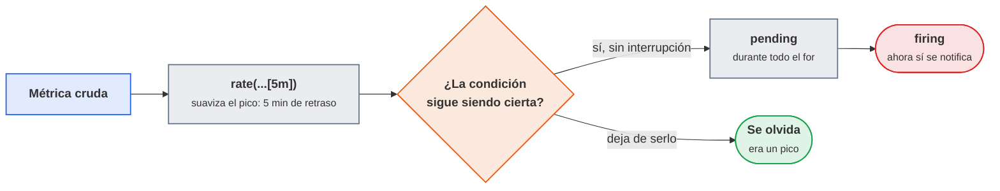
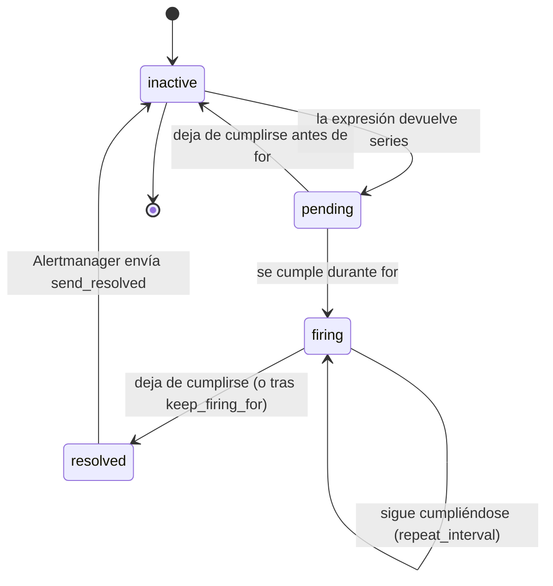
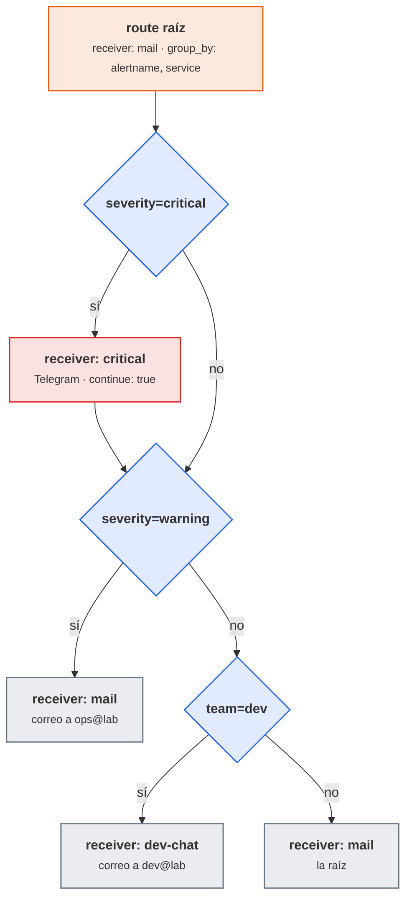
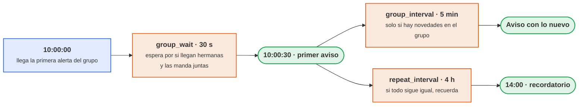

# UT2 · Umbrales, agregación y gestión de alarmas

<p class="ut-meta">16 h · Sesiones 8 a 15 · RA1 CE b, c, d, e</p>

La UT1 dejó mon01 recogiendo tres cosas del contenedor de referencia: métricas (cAdvisor, node_exporter, el exporter de la API y el de PostgreSQL en Prometheus), logs (Loki) y eventos del demonio Docker. Ahora mismo eso es un almacén que sólo sirve si alguien mira el dashboard. Esta unidad convierte esos datos en alarmas: condiciones que se evalúan solas, que despiertan a alguien cuando toca y que dejan rastro en un gestor de incidencias. La UT3 protege esta pila (autenticación, TLS, quién puede silenciar qué) en tres sesiones y con ella se cierra la primera evaluación, cuyo examen es el 10 de diciembre y entra UT1, UT2 y UT3 completas. Ya en la segunda, la UT4 escribe el catálogo de alarmas y sus runbooks (el procedimiento escrito de qué hacer cuando suena cada una) a partir de lo que se monta aquí.

## Sesión 8 · Umbrales sobre contadores

<p class="ut-meta" markdown>29 de octubre · Teoría y práctica · <span class="dur" tabindex="0" aria-label="De la métrica a la alarma · 10 min&#10;Umbrales sobre contadores · 15 min&#10;A2.1 Umbrales sobre contadores · 85 min" data-dur="De la métrica a la alarma · 10 min&#10;Umbrales sobre contadores · 15 min&#10;A2.1 Umbrales sobre contadores · 85 min">:material-school:<i class="dur-barra" style="--teoria:23%"></i>:material-flask:</span></p>

Al acabar esta sesión quedan seis consultas PromQL que devuelven datos con tráfico real, cada una con su umbral justificado por la documentación. Antes de escribirlas conviene tener clara la cadena que va de la métrica a la notificación y por qué se alerta por síntomas y no por causas. Para la hoja hacen falta sobre todo los apartados de `rate`, `increase` y la ventana, los operadores con etiquetas y la tabla de umbrales del contenedor de referencia.

### De la métrica a la alarma

Antes de escribir una sola consulta conviene ver qué piezas hay entre un número que sube en Prometheus y un mensaje en el móvil, porque cada pieza vive en un fichero distinto. Este apartado dibuja esa cadena y fija qué merece ser alarma.

Una alarma es una condición sobre los datos que, mantenida durante un tiempo, exige que alguien haga algo. Las cuatro palabras importantes son *condición*, *tiempo*, *alguien* y *algo*. Si falta cualquiera de ellas no es una alarma, es un panel con colores. La cadena completa que se construye en esta unidad tiene seis eslabones y cada uno vive en un sitio distinto de mon01.


<p class="pie" markdown>El único paso que no es técnico es el umbral, y es el que más se discute: lo decide el servicio, no la herramienta.</p>

La métrica es lo que ya está recogido. El indicador es una fórmula sobre ella (ratio de errores, percentil de latencia). El umbral es el número que separa lo normal de lo que no, y ese número no se inventa: sale de la documentación del servicio o de un acuerdo de nivel de servicio. La regla de alerta une indicador, umbral y duración, y le pega etiquetas. Alertmanager recibe las reglas disparadas y decide a quién avisar, cuándo y cuántas veces. La notificación llega a un humano y, en paralelo, un webhook (una llamada HTTP de un programa a otro para avisar de que ha pasado algo) abre una incidencia que queda guardada aunque Alertmanager se reinicie.

#### Alertar por síntomas, no por causas

El capítulo de monitorización del libro de SRE de Google (SRE, Site Reliability Engineering, es como Google llama a operar servicios; [sre.google/sre-book/monitoring-distributed-systems](https://sre.google/sre-book/monitoring-distributed-systems/), gratuito) fija el principio que se sigue aquí: las alarmas que despiertan a alguien deben responder a síntomas que sufre el usuario (la API devuelve errores, tarda demasiado, no responde), no a causas posibles (la CPU está al 90 %, hay muchas conexiones a la base de datos, el disco crece). El razonamiento es sencillo. Las causas son infinitas y cada una tiene un umbral discutible; los síntomas son pocos y todos tienen la misma consecuencia: alguien no puede usar el servicio. Una CPU al 95 % que sirve todas las peticiones en 80 ms no es un problema. Una CPU al 30 % con un 5 % de errores 500 sí lo es.

Eso no quiere decir que las métricas de causa se tiren. Sirven para dos cosas: como alarmas de aviso (warning) que se miran en horario laboral, y como paneles que se consultan cuando una alarma de síntoma ha despertado a alguien y hay que buscar por qué. En la tabla de umbrales de esta unidad se ve: tasa de errores y latencia son `critical`; memoria y conexiones son `warning`.

El mismo capítulo da la regla para decidir si una alarma merece existir: cada vez que suena, alguien tiene que actuar de forma inteligente, tiene que hacerlo ahora, y eso no puede automatizarse. Si falla cualquiera de las tres condiciones, la alarma es ruido. El texto de Rob Ewaschuk que lo inspira, *My Philosophy on Alerting*, está enlazado desde ese capítulo y merece la media hora que lleva leerlo.

#### Fatiga de alertas

La fatiga de alertas es lo que pasa cuando el canal de notificaciones recibe tantos avisos que el equipo deja de leerlos. Es un fallo de ingeniería, no de disciplina: si en el canal de Telegram de guardia entran cuarenta mensajes al día y treinta y ocho no requieren acción, la gente aprende a ignorar el canal, y la alarma número treinta y nueve, la que importa, se pierde con las demás. Lo que distingue a un equipo que funciona es que lo mide y lo corrige.

Medirla es parte del trabajo: Prometheus y Alertmanager exponen series con las que se cuentan las horas que ha estado activa cada alarma, las notificaciones por semana y persona de guardia o el porcentaje de avisos que acaban en una acción. Las consultas concretas y los cuatro indicadores que se usan en la práctica están en [Para ampliar](../ampliacion.md#como-se-mide-la-fatiga-de-alertas). Cuando una alarma sale mal en esos números se hace una de tres cosas: subir el umbral, alargar el `for`, o bajarla de `critical` a `warning` y quitarla del canal de guardia.

### Umbrales sobre contadores

{ .logo-inline } Aquí los contadores que ya recoge Prometheus (peticiones, errores, memoria, reinicios, conexiones) se convierten en condiciones numéricas con un umbral justificado. Hay tres funciones de PromQL que se usan mal a menudo y un problema de etiquetas en casi todas las divisiones; sin eso, las alertas devuelven "no data" o disparan cuando no toca.

Un umbral sobre un contador nunca se escribe sobre el contador. `app_http_requests_total` vale 4 831 220 y mañana valdrá más: el número absoluto no dice nada. Lo que se compara con un umbral es su derivada, la tasa por segundo, o el incremento en una ventana.

#### rate, increase y la ventana

`rate(c[5m])` calcula la tasa media por segundo del contador `c` en los últimos cinco minutos. `increase(c[5m])` es exactamente `rate(c[5m]) * 300`: el incremento total en la ventana. Las dos funciones corrigen los reinicios del contador (cuando el contenedor arranca de nuevo y vuelve a cero) y extrapolan al borde de la ventana, por lo que `increase` puede devolver valores no enteros aunque el contador sólo suba de uno en uno.

La ventana importa más que la función. Con un `scrape_interval` (cada cuánto Prometheus va a recoger muestras) de 15 s, `rate(c[1m])` sólo tiene cuatro muestras y va a dar picos y agujeros; `rate(c[5m])` tiene veinte y da una curva suave. Regla práctica: la ventana debe contener al menos cuatro muestras (cuatro veces el intervalo de scrape) y, para alertas, entre 2 y 10 minutos. Ventanas más largas suavizan tanto que la alarma llega tarde. `irate` toma sólo las dos últimas muestras y sirve para gráficas de detalle, no para alertar.

Hay una tercera función que hace falta para el contador de reinicios. `container_start_time_seconds` de cAdvisor es un gauge (un valor que sube y baja; aquí, la marca de tiempo del último arranque), no un contador, así que `increase` sobre él no significa nada. La función correcta es `changes(v[1h])`, que cuenta cuántas veces ha cambiado el valor:

```promql
changes(container_start_time_seconds{service="app"}[1h]) > 3
```

Dos detalles de esta consulta que vienen de la UT1 y hay que comprobar antes de escribirla. El primero es la etiqueta: el job de cAdvisor renombra `container_label_com_docker_compose_service` a `service`, así que los contenedores se seleccionan con `service="app"`, no con `name`, que lleva el nombre largo del contenedor (`servicio-app-1`) y cambia si se escala o se renombra. El segundo es la métrica: `container_start_time_seconds` **no está** entre las diez que deja pasar el bloque `keep` de [ese job](ut1-observabilidad.md#etiquetas-y-cardinalidad), que la UT1 describe como opcional y ajustable. Si está activo, hay que añadir `start_time_seconds` a su lista y recargar Prometheus, o la consulta devolverá vacío para siempre. La alternativa, si se prefiere no tocar el `keep`, es contar los eventos `die` en Loki con `count_over_time({service="docker-events", action="die"} [1h]) > 3`, en la línea de las reglas del ruler de la sesión 9.

Usar `increase` sobre esta métrica es un error frecuente y silencioso: la consulta no falla, simplemente devuelve un número que no significa nada, porque `container_start_time_seconds` es un gauge y no un contador. Antes de escoger la función conviene mirar el tipo de la métrica en su línea `# TYPE` del endpoint `/metrics`.

#### Operadores con etiquetas

Casi todos los indicadores son una división entre dos series, y una división en PromQL sólo funciona si las etiquetas de ambos lados coinciden exactamente. Tres situaciones que aparecen a menudo:

- Las etiquetas coinciden tras agregar: `sum by (service)(rate(errores)) / sum by (service)(rate(total))`. Es el caso limpio.
- Sobran etiquetas en un lado: `container_memory_working_set_bytes{service="app"} / ignoring(id) container_spec_memory_limit_bytes{service="app"}`. `ignoring(x)` descarta `x` al emparejar; `on(a,b)` empareja sólo por `a` y `b`.
- Un lado tiene una serie y el otro varias (uno a muchos): `pg_stat_activity_count / on(server) group_left pg_settings_max_connections`. `group_left` dice que el lado izquierdo tiene más series y que la del derecho se repite para cada una.

Y una función que no es un operador pero que resuelve el problema más frecuente en alertas: `absent(up{job="app"})` devuelve 1 cuando la serie no existe. Sin ella, si el exporter desaparece, `up == 0` no dispara nada. La combinación `up{job="app"} == 0 or absent(up{job="app"})` cubre ambos casos. `absent_over_time(serie[10m])` hace lo mismo para "no ha habido muestras en 10 minutos".

#### Tabla de umbrales del contenedor de referencia

Los umbrales orientativos salen de la documentación del servicio del curso: límite de memoria de 512 MiB en el Compose de app01, objetivo de latencia p95 (el tiempo por debajo del cual quedan el 95 % de las peticiones) de 500 ms y de disponibilidad del 99 % (que equivale a un 1 % de errores), `max_connections=100` en el servicio `db` del compose de app01.

| Indicador | Consulta | Umbral orientativo | Severidad |
|---|---|---|---|
| Tasa de errores | `sum(rate(app_http_requests_total{status=~"5.."}[5m])) / sum(rate(app_http_requests_total[5m]))` | > 1 % durante 5 min | critical |
| Latencia p95 | `histogram_quantile(0.95, sum by (le)(rate(app_http_request_duration_seconds_bucket[5m])))` | > 0,5 s durante 10 min | critical |
| Servicio ausente | `up{job="app"} == 0 or absent(up{job="app"})` | 2 min | critical |
| Memoria del contenedor | `container_memory_working_set_bytes{service="app"} / container_spec_memory_limit_bytes{service="app"}` | > 90 % durante 5 min | warning |
| Reinicios | `changes(container_start_time_seconds{service="app"}[1h])` (o eventos `die` en Loki) | > 3 en 1 h | warning |
| Conexiones a PostgreSQL | `sum by (service)(pg_stat_activity_count) / on(service) group_left pg_settings_max_connections` | > 80 % | warning |

Los valores de partida vienen de la documentación; los definitivos se ajustan con una o dos semanas de datos reales. Un umbral del 1 % de errores es absurdo si el servicio lleva un 0,8 % permanente por un endpoint de salud mal configurado: primero se arregla eso, luego se pone el umbral. Para ver la distribución histórica de un indicador antes de fijar el umbral, `quantile_over_time(0.99, app:errors:ratio5m[7d])` da el valor que sólo se supera el 1 % del tiempo.

#### Cómo elegir el for



<p class="pie" markdown>Los dos retrasos se **suman**: con `[5m]` y `for: 5m` el aviso llega diez minutos tarde. La pregunta es si el usuario aguanta diez minutos de errores.</p>

`for` es el tiempo que la condición debe mantenerse cierta, en evaluaciones consecutivas, antes de que la alerta pase de `pending` a `firing`. Es el filtro contra picos. Tres criterios:

1. Más largo que la ventana de `rate` no tiene sentido duplicar: si ya se suaviza con `[5m]`, un `for: 5m` añade otros cinco minutos de retraso. Total: diez minutos hasta el aviso. La pregunta es si el usuario aguanta diez minutos de errores.
2. Cero para lo que es irreversible o discreto: un OOM kill (el kernel ha matado el contenedor por pasarse de memoria) ya ha pasado, esperar no aporta información. `for: 0m` (o simplemente omitirlo).
3. Proporcional al coste de la falsa alarma: si la notificación despierta a alguien, `for` largo; si abre una incidencia que se mirará mañana, corto.

Prometheus tiene además `keep_firing_for` (desde la versión 2.42), que mantiene la alerta en `firing` un tiempo después de que la condición deje de cumplirse. Sirve para el caso contrario al de `for`: una alarma que oscila (flapping) alrededor del umbral y genera una pareja de notificaciones (disparo, resolución) cada pocos minutos. Con `keep_firing_for: 10m` se queda encendida hasta que lleve diez minutos limpia.

### A2.1 Umbrales sobre contadores (sesión 8)

<span class="et et-obj">Objetivo</span> Seis consultas PromQL que devuelven datos con tráfico real, cada una con un umbral justificado por la documentación del servicio, en `docs/umbrales.md`.

<span class="et et-pre">Antes de empezar</span>

- `app01` y `mon01` de la UT1 encendidas, con todos los targets de `http://mon01:9090` en UP.
- Los nombres `app01` y `mon01` en el `/etc/hosts` de tu puesto y de mon01, como los dejó la A1.4 (hasta el 27 de noviembre nadie más los resuelve); si el DHCP les ha cambiado la IP, corrígela.
- La documentación del servicio (la da el profesor): límite de memoria, latencia p95, disponibilidad y `max_connections`.
- Explicado al principio: [rate, increase y la ventana](#rate-increase-y-la-ventana) y [Operadores con etiquetas](#operadores-con-etiquetas).

<span class="et et-pas">Pasos</span>

1. Crea en mon01 el repositorio `alerting` (`/opt/alerting`), con `secrets/` en el `.gitignore` y un `README` que anote que falta el remoto, que llega en la A2.6.

2. Deja en tu puesto, toda la sesión, un bucle de tráfico contra `http://app01/items` que meta de vez en cuando una ruta inexistente: las hojas siguientes cuentan con él.

    *Pista:* con `curl -s` el bucle falla en silencio, así que comprueba antes que la API da 200. El 404 no cuenta como 5xx.

3. Ejecuta en Prometheus las seis consultas de la [tabla de umbrales](#tabla-de-umbrales-del-contenedor-de-referencia) y apunta el valor que se mantiene con el tráfico de fondo: es el "valor normal".

    *Pista:* la de reinicios sale vacía si el `keep` del job `cadvisor` de la A1.2 no deja pasar `start_time_seconds`: añádelo a su lista y recarga Prometheus.

4. Comprueba que reaccionan: cuatro reinicios de `app` con unos 20 s entre ellos (la de reinicios marca 4) y `db` parada un par de minutos (el ratio de errores sube hacia 1) y vuelta a arrancar.

5. Fija cada umbral con el valor normal y la documentación delante y escribe `docs/umbrales.md` con la tabla `Indicador | Consulta | Valor normal | Umbral | for | Severidad | De dónde sale` (la página o el parámetro de la documentación). Súbelo al repositorio.

    *Pista:* un umbral por debajo del valor normal es una alarma permanente.

<span class="et et-com">Comprobación</span> Las seis consultas devuelven una serie con el tráfico de fondo y reaccionan al paso 4; `docs/umbrales.md` está comprometido en el repositorio con las siete columnas rellenas.

<span class="et et-ent">Entrega</span> `docs/umbrales.md` en el repositorio `alerting`.

## Sesión 9 · Cadenas en logs y eventos

<p class="ut-meta" markdown>3 de noviembre · Teoría y práctica · <span class="dur" tabindex="0" aria-label="Cadenas en logs y eventos · 20 min&#10;A2.2 Cadenas en logs y eventos · 90 min" data-dur="Cadenas en logs y eventos · 20 min&#10;A2.2 Cadenas en logs y eventos · 90 min">:material-school:<i class="dur-barra" style="--teoria:18%"></i>:material-flask:</span></p>

Esta sesión completa las condiciones numéricas de la anterior con las que se vigilan en texto: mensajes de error de la API y eventos del demonio Docker. Para la hoja hacen falta los selectores y filtros, los parsers y las métricas sobre logs. El apartado del ruler de Loki es material de consulta para la sesión 11, cuando estas consultas se conviertan en reglas.

### Cadenas en logs y eventos

{ .logo-inline } Hay fallos que no se ven en ninguna métrica porque la aplicación no los cuenta: una excepción concreta, un `timeout` hablando con la base de datos, un evento `oom` (sin memoria) del demonio Docker. Para esos se vigila el texto, y en la pila del curso el texto está en Loki y se consulta con LogQL.

#### Selectores de stream y filtros de línea

Una consulta LogQL tiene dos partes: el selector de stream, entre llaves, que elige qué flujos de log se leen (por etiquetas indexadas, igual que en Prometheus), y una tubería de filtros y parsers que se aplican línea a línea. El selector es lo único que usa el índice; todo lo demás es un barrido del contenido. Por eso el selector debe ser lo más estrecho posible.

```text
{service="app"}                                     # todo el log de la API
{service="app", level="error"}                      # solo sus líneas de error
{service="app"} |= "timeout"                        # líneas que contienen timeout
{service="app"} |= "timeout" != "/health"           # ...pero no las de /health
{service="app"} |~ "timeout|refused"                # expresión regular (RE2)
{service=~"app|nginx"} !~ "GET /static/.*"          # regex negada
```

Los cuatro filtros de línea son `|=`, `!=`, `|~` y `!~`. Se encadenan y se evalúan en orden, así que conviene poner primero el que descarte más líneas. Las etiquetas del selector, `host`, `service`, `container` y `level`, son las que pone el Promtail de la UT1; si se cambiaron, cambian aquí. Y un detalle que rompe muchas reglas: los filtros de línea distinguen mayúsculas. La API escribe el nivel en minúsculas (`"level":"error"`), así que `|= "ERROR"` no encuentra nada; para el nivel se usa la etiqueta `level`, que la UT1 ya sube al índice.

#### Parsers: json y logfmt

Cuando la aplicación escribe JSON estructurado (la API del curso lo hace desde la UT1, con líneas como `{"level":"error","msg":"db timeout","route":"/items","duration_ms":5012}`), el parser `| json` convierte cada campo en una etiqueta temporal sobre la que se puede filtrar con los mismos operadores que en el selector:

```text
{service="app", level="error"} | json | msg=~"timeout.*"
{service="app"} | json | duration_ms > 2000
{service="app", level="error"} | json | line_format "{{.route}} {{.msg}}"
```

Conviene fijarse en que `msg=~"timeout.*"` después del parser es un filtro de etiqueta (comparación exacta o regex) sobre un campo extraído, no un filtro de línea, y en que los campos numéricos se pueden comparar como números. `level` no hace falta extraerlo: ya es etiqueta del stream y filtrar por él en el selector es más barato. `line_format` reescribe la línea con las etiquetas extraídas, útil para que la notificación lleve sólo lo que importa.

`| logfmt` hace lo mismo con el formato `clave=valor clave2="valor con espacios"` que usan Docker, Loki, Grafana y buena parte del ecosistema Go. El demonio Docker, si llega a Loki vía journald (el registro del sistema de systemd), escribe en logfmt; nginx, si no se le cambia el formato como en la UT1, escribe en el suyo propio, y para eso está `| pattern "<ip> - - <_> \"<method> <path> <_>\" <status> <_>"`, que extrae campos por posición sin regex.

Un aviso sobre coste: `| json` sobre un stream de 2 000 líneas por segundo se nota. Conviene estrechar primero con el selector (`level="error"`) o con un filtro de línea barato (`|= "timeout"`, que busca una subcadena) y parsear después sólo las líneas que sobreviven.

#### Métricas sobre logs

Para alertar hace falta un número, y LogQL obtiene números de los logs con funciones de rango sobre una consulta de log:

```text
sum(count_over_time({service="app", level="error"} [5m])) > 10
sum(count_over_time({service="app", level="error"} | json | msg=~"timeout.*" [5m])) > 0
sum by (host)(count_over_time({service="docker-events", action="oom"} [10m])) > 0
sum(rate({service="nginx"} | json | status >= 500 [5m]))
```

`count_over_time` cuenta líneas en la ventana; `rate` las divide por los segundos de la ventana; `bytes_over_time` y `bytes_rate` miden volumen, útil para detectar un contenedor que se pone a escribir sin control. Si se ha extraído un campo numérico con un parser, `| unwrap duration_ms` lo convierte en valor y entonces `quantile_over_time(0.95, {service="app"} | json | unwrap duration_ms [5m])` da un p95 de latencia calculado desde los logs, sin instrumentar nada. Es más caro que un histograma de Prometheus y menos preciso, pero funciona con aplicaciones que no exponen métricas, que es la mayoría de las heredadas que se encuentran en una empresa.

Las cadenas a vigilar (mensajes de error conocidos, códigos internos) no se inventan: las da la documentación de la aplicación o su código fuente. Se mantienen en un fichero versionado junto a las reglas, con un comentario por cadena que diga de dónde sale y qué significa, porque dentro de seis meses nadie recordará por qué se vigila `"E1042"`.

#### Alertas en el ruler de Loki

Loki lleva un componente, el ruler, que evalúa reglas con la misma sintaxis que Prometheus y las envía a Alertmanager. Es lo que hace que las alarmas sobre texto entren en la misma cadena que las de métricas sin pasar por Grafana. Se activa en `loki.yml`:

```yaml
ruler:
  storage:
    type: local
    local:
      directory: /loki/rules
  rule_path: /tmp/loki-rules-scratch
  alertmanager_url: http://alertmanager:9093
  enable_api: true
  evaluation_interval: 1m
```

Con la autenticación multiinquilino desactivada (`auth_enabled: false`, como en el laboratorio) las reglas van en `/loki/rules/fake/`, donde `fake` es el nombre del inquilino por defecto. El fichero `loki-alerts.yml` de ese directorio tiene la misma forma que uno de Prometheus; conviene fijarse en que las expresiones son LogQL y en que cada regla lleva las etiquetas de categorización que se usan en el resto de la unidad:

```yaml
groups:
  - name: app_logs
    interval: 1m
    rules:
      - alert: AppLogErrorsBurst
        expr: sum(count_over_time({service="app", level="error"} [5m])) > 10
        for: 2m
        labels:
          severity: warning
          team: dev
          service: app
          origen: loki
          env: dev
        annotations:
          summary: "Más de 10 líneas de error en 5 min en la API"
          runbook: "https://wiki.lab/runbooks/app-log-errors"
      - alert: AppDbTimeout
        expr: sum(count_over_time({service="app", level="error"} | json | msg=~"timeout.*" [5m])) > 0
        for: 0m
        labels:
          severity: critical
          team: ops
          service: app
          origen: loki
          env: dev
        annotations:
          summary: "La API registra timeouts contra la base de datos"
      - alert: ContainerOOM
        expr: sum by (host)(count_over_time({service="docker-events", action="oom"} [10m])) > 0
        labels:
          severity: critical
          team: ops
          service: app
          origen: docker-events
          env: dev
        annotations:
          summary: "OOM kill en {{ $labels.host }}"
```

La cadena de `AppDbTimeout` es un ejemplo: la buena es la que diga el código de la API, y sale de la A2.2. Se valida con `lokitool rules lint loki-alerts.yml` (`lokitool` es la utilidad de línea de comandos de Loki y viene en la imagen de Loki 3) y se aplica reiniciando el contenedor. Las reglas activas se ven en `GET /loki/api/v1/rules` y en `/prometheus/api/v1/alerts`, que Loki expone imitando la API de Prometheus. El ruler también admite `record:` para recording rules sobre logs, cuyo resultado puede escribirse en Prometheus con `remote_write` (el mecanismo con el que Prometheus acepta series enviadas desde fuera); aquí no se usa, pero es la forma de tener un contador de errores de log en Prometheus sin instrumentar la aplicación.

### A2.2 Cadenas en logs y eventos (sesión 9)

<span class="et et-obj">Objetivo</span> Tres consultas LogQL para mensajes de error conocidos de la API (al menos una con parser `json`) y dos para eventos Docker (`oom` y `unhealthy`), probadas con `logcli` y guardadas en `docs/cadenas.md` con su origen.

<span class="et et-pre">Antes de empezar</span>

- Loki con los logs de `app` y los eventos Docker de la UT1, `logcli` en tu puesto con `LOKI_ADDR=http://mon01:3100` y el bucle de tráfico de la A2.1 corriendo.
- El código de la API (`/opt/servicio/api/` en app01) o su documentación.
- Explicado al principio: [Cadenas en logs y eventos](#cadenas-en-logs-y-eventos), hasta [Métricas sobre logs](#metricas-sobre-logs).

<span class="et et-pas">Pasos</span>

1. Saca del código de la API o de su documentación tres mensajes de error distintos, con su fichero y su línea.

2. Escribe y prueba con `logcli` una consulta LogQL por mensaje, al menos una con `| json` y filtro por campo. Una consulta sin líneas no está probada: provoca el error y repite.

    *Pista:* saca el selector de `logcli labels`, no de memoria. Con `db` parada treinta segundos, la API escribe errores.

3. Provoca en app01 un `oom` y un `unhealthy` con dos contenedores de usar y tirar, encuéntralos con las consultas de eventos de la UT1 y borra después el enfermo.

    *Pista:* `docker run --rm -m 32m python:3-slim python -c "x = bytearray(200 * 1024 * 1024)"` muere por falta de memoria; el `unhealthy` sale de `--health-cmd "exit 1"` con un intervalo corto. Su `action` lleva el estado dentro (`health_status: unhealthy`): se filtra con una expresión regular.

4. Convierte una consulta de la API y las dos de eventos en consultas métricas que den más de cero cuando aparece la cadena: son las que irán al ruler en la A2.4.

5. Escribe `docs/cadenas.md` con una entrada por cadena (consulta, de dónde sale y qué significa que aparezca) y súbelo al repositorio.

<span class="et et-com">Comprobación</span> Cada consulta de `docs/cadenas.md` devuelve al menos una línea con `logcli`; las de eventos encuentran el `oom` y el `unhealthy` provocados; las tres métricas dan más de cero.

<span class="et et-ent">Entrega</span> `docs/cadenas.md` en el repositorio `alerting`.

## Sesión 10 · Recording rules

<p class="ut-meta" markdown>5 de noviembre · Teoría y práctica · <span class="dur" tabindex="0" aria-label="Agregación y correlación: recording rules · 15 min&#10;A2.3 Recording rules · 95 min" data-dur="Agregación y correlación: recording rules · 15 min&#10;A2.3 Recording rules · 95 min">:material-school:<i class="dur-barra" style="--teoria:14%"></i>:material-flask:</span></p>

Al terminar queda un `rules.yml` cargado en Prometheus con las consultas de la sesión 8 guardadas como métricas nuevas con nombre propio, y paneles de Grafana que las usan. La hoja se apoya en los tres apartados que siguen: por qué precalcular, cómo se nombran las métricas grabadas y el fichero de ejemplo.

### Agregación y correlación: recording rules

Las consultas del apartado anterior funcionan, pero son largas, se repiten en cada panel y en cada alerta, y cada uno las calcula por su cuenta. Este apartado enseña a guardarlas una sola vez como métricas nuevas con nombre propio. Al terminar queda un `rules.yml` con los indicadores del contenedor de referencia listos para las reglas de alerta.

Una recording rule evalúa una expresión PromQL cada cierto tiempo y guarda el resultado como una serie nueva, con su propio nombre, en la base de datos de Prometheus. A partir de ese momento es una métrica más: se consulta, se grafica y se alerta sobre ella igual que sobre `up`.

#### Por qué precalcular

Tres razones, en orden de importancia para este trabajo:

**Correlar.** El indicador "ratio de errores" no existe en ninguna métrica; existe en la relación entre dos contadores. La recording rule lo materializa. Lo mismo con "latencia por petición", "porcentaje de memoria usada" o "conexiones respecto al máximo". Esto es literalmente el CE c: agregar y correlar contadores para obtener indicadores nuevos.

**Agregar.** Pasar de una serie por instancia (tres réplicas de la API, cada una con sus contadores) a una serie por servicio. Las alertas deben mirar el servicio, no la réplica: que una réplica tenga un 3 % de errores mientras el balanceador la ha sacado del pool no es un incidente.

**Aligerar.** `histogram_quantile` sobre un histograma con 12 buckets y 3 réplicas, calculado cada 15 s por cada panel de Grafana que lo pinta y cada regla que lo evalúa, es un coste que se multiplica. Precalculado una vez cada 30 s, cuesta lo mismo pintar diez paneles que uno.

Hay una cuarta razón menos evidente: coherencia. Si el panel calcula el ratio de errores con una fórmula y la alerta con otra ligeramente distinta (ventana de 5 m en una, de 2 m en la otra), habrá alarmas disparadas con paneles en verde y nadie se fiará de ninguno de los dos. Con la recording rule, ambos usan la misma serie.

#### Convención de nombres

Prometheus recomienda `nivel:métrica:operaciones`, separado por dos puntos, que es el único carácter que no puede aparecer en el nombre de una métrica exportada (así nunca chocan):

- `nivel` es el nivel de agregación, es decir, las etiquetas que quedan: `service`, `instance`, `path`. En el laboratorio se agrega por servicio y se abrevia como `app`, `db`.
- `métrica` es el nombre de la métrica base sin sufijo `_total`: `requests`, `errors`, `latency_p95`.
- `operaciones` es lo que se le ha hecho, incluida la ventana: `rate5m`, `ratio5m`, `sum`.

Así, `app:errors:ratio5m` se lee como "en el nivel de servicio app, ratio de errores, ventana de 5 m". Cuando se encadenan reglas (una que usa el resultado de otra), el nombre de la segunda hereda el nivel y añade operaciones. La guía oficial, con más ejemplos, está en [prometheus.io/docs/practices/rules](https://prometheus.io/docs/practices/rules/).

#### El fichero rules.yml

Cuatro indicadores de la tabla de umbrales (errores, latencia, memoria y conexiones) convertidos en métricas grabadas, más `app:requests:rate5m` como auxiliar; la ausencia y los reinicios no se graban, porque su consulta no calcula nada que merezca guardarse. Conviene fijarse en el nombre de cada regla, en el `sum by (service)` que agrega por servicio y en los `ignoring` y `group_left` de los operadores con etiquetas.

```yaml
groups:
  - name: app_rules
    interval: 30s
    rules:
      - record: app:requests:rate5m
        expr: sum by (service)(rate(app_http_requests_total[5m]))
      - record: app:errors:ratio5m
        expr: |
          sum by (service)(rate(app_http_requests_total{status=~"5.."}[5m]))
          /
          sum by (service)(rate(app_http_requests_total[5m]))
      - record: app:latency_p95:5m
        expr: histogram_quantile(0.95, sum by (service, le)(rate(app_http_request_duration_seconds_bucket[5m])))
      - record: app:memory:ratio
        expr: |
          container_memory_working_set_bytes{service="app"}
          / ignoring(id)
          container_spec_memory_limit_bytes{service="app"}
      - record: db:connections:ratio
        expr: sum by (service)(pg_stat_activity_count) / on(service) group_left pg_settings_max_connections
```

Todas las reglas de un grupo se evalúan en secuencia, cada `interval`, así que dentro de un grupo una regla puede usar el resultado de la anterior en la misma pasada. Entre grupos no hay orden garantizado. El fichero se referencia desde `prometheus.yml` con `rule_files: [ "rules.yml", "alerts.yml" ]`, se valida con `promtool check rules rules.yml` (`promtool` es la utilidad de línea de comandos que acompaña a Prometheus; siempre, antes de recargar) y se aplica con `curl -X POST http://mon01:9090/-/reload` si Prometheus arrancó con `--web.enable-lifecycle`, o con `kill -HUP` al proceso. Un error de sintaxis con reload en caliente no tumba Prometheus: se queda con la configuración anterior y lo registra en el log, así que conviene mirar `prometheus_config_last_reload_successful` después de cada cambio.

Las alertas sobre indicadores calculados (ratios, percentiles, porcentajes) usan su métrica grabada, no la consulta cruda. Es la norma del repositorio `alerting` y se revisa en la práctica evaluable. Las de ausencia (`AppDown`, `HostDown`) y la de reinicios (`AppRestarting`) se quedan sobre la serie cruda a propósito, porque no calculan ningún indicador.

### A2.3 Recording rules (sesión 10)

<span class="et et-obj">Objetivo</span> Un `rules.yml` cargado en Prometheus con las cinco métricas grabadas del ejemplo, visibles en el explorador y usadas en el dashboard de Grafana.

<span class="et et-pre">Antes de empezar</span>

- Las consultas de A2.1 funcionando; `prometheus.yml` y `compose.yml` de mon01; el dashboard de la UT1 en Grafana.
- Explicado al principio: [Por qué precalcular](#por-que-precalcular), [Convención de nombres](#convencion-de-nombres) y [El fichero rules.yml](#el-fichero-rulesyml).

<span class="et et-pas">Pasos</span>

1. Crea `prometheus/rules.yml` en el repositorio `alerting` con las cinco reglas de [El fichero rules.yml](#el-fichero-rulesyml), ajustando etiquetas (`name`, `job`, `service`) y consultas a las tuyas de la A2.1.

2. Haz que Prometheus lo cargue desde el repositorio (montado de solo lectura en `/etc/prometheus/rules.yml` y referenciado en `rule_files`) y que acepte recargas en caliente (`--web.enable-lifecycle`). Valídalo con `promtool` antes de cada recarga.

    *Pista:* `promtool` viene en la imagen de Prometheus. Una recarga fallida no avisa: mira `prometheus_config_last_reload_successful` después de cada una.

3. Comprueba que cada métrica grabada da el mismo valor que su consulta cruda.

    *Pista:* nacen en la primera evaluación del grupo; espera un minuto.

4. En el dashboard de la UT1, cambia la consulta del porcentaje del límite de memoria por `app:memory:ratio` y añade dos paneles, uno con `app:errors:ratio5m` y otro con `app:latency_p95:5m`. Exporta el dashboard a `grafana/dashboard.json` y sube al repositorio `rules.yml`, el dashboard y una copia de `prometheus.yml`.

<span class="et et-com">Comprobación</span> `promtool check rules` responde `SUCCESS`; las cinco métricas aparecen en *Graph* con valor; el panel de memoria pinta lo mismo que antes y los dos nuevos tienen datos.

<span class="et et-ent">Entrega</span> `prometheus/rules.yml` y `grafana/dashboard.json` en el repositorio `alerting`.

## Sesión 11 · Reglas de alerta

<p class="ut-meta" markdown>10 de noviembre · Teoría y práctica · <span class="dur" tabindex="0" aria-label="Reglas de alerta · 15 min&#10;A2.4 Reglas de alerta · 95 min" data-dur="Reglas de alerta · 15 min&#10;A2.4 Reglas de alerta · 95 min">:material-school:<i class="dur-barra" style="--teoria:14%"></i>:material-flask:</span></p>

En esta sesión las consultas y los umbrales se convierten en reglas de alerta que Prometheus y el ruler de Loki evalúan solos, y se ve una alerta pasar por `pending` y `firing`. Para la hoja hace falta el apartado entero, en especial las etiquetas de categorización y los estados de una alerta. Las reglas de Loki se escriben con el apartado [Alertas en el ruler de Loki](#alertas-en-el-ruler-de-loki) de la sesión 9.

### Reglas de alerta

Aquí se juntan umbrales, indicadores grabados y `for` en un fichero `alerts.yml` que Prometheus evalúa solo. Lo que este apartado añade es lo que decide todo lo que viene después: las etiquetas que Alertmanager usará para enrutar y las anotaciones que leerá la persona avisada.

Una regla de alerta tiene la misma estructura que una recording rule, pero en lugar de guardar la serie la compara con un umbral y, si se cumple durante `for`, la envía a Alertmanager con sus etiquetas y anotaciones. El fichero siguiente traduce la tabla de umbrales a seis reglas, más `HostDown`, que avisa si una máquina deja de contestar al job `node` que la UT1 dejó para app01 y mon01. Conviene fijarse en que las `expr` de los indicadores calculados usan las métricas grabadas (las de ausencia y reinicios van sobre la serie cruda, como se vio en la sesión 10) y en que las cinco etiquetas se repiten en todas.

```yaml
groups:
  - name: app_alerts
    rules:
      - alert: AppHighErrorRate
        expr: app:errors:ratio5m > 0.01
        for: 5m
        labels:
          severity: critical
          team: ops
          service: app
          origen: prometheus
          env: dev
        annotations:
          summary: "Errores 5xx al {{ $value | humanizePercentage }} en {{ $labels.service }}"
          description: "El ratio de errores lleva 5 min por encima del 1 % (SLA). Revisa la API y el servicio db en app01."
          runbook: "https://wiki.lab/runbooks/app-errors"
      - alert: AppHighLatency
        expr: app:latency_p95:5m > 0.5
        for: 10m
        labels: { severity: critical, team: ops, service: app, origen: prometheus, env: dev }
        annotations:
          summary: "p95 de {{ $value | humanizeDuration }} en {{ $labels.service }}"
          runbook: "https://wiki.lab/runbooks/app-latency"
      - alert: AppDown
        expr: up{job="app"} == 0 or absent(up{job="app"})
        for: 2m
        labels: { severity: critical, team: ops, service: app, origen: prometheus, env: dev }
        annotations:
          summary: "El exporter de app no responde desde hace 2 min"
      - alert: HostDown
        expr: up{job="node"} == 0
        for: 2m
        labels: { severity: critical, team: ops, service: node, origen: prometheus, env: dev }
        annotations:
          summary: "{{ $labels.host }} no responde al node_exporter desde hace 2 min"
      - alert: AppMemoryHigh
        expr: app:memory:ratio > 0.9
        for: 5m
        labels: { severity: warning, team: dev, service: app, origen: cadvisor, env: dev }
        annotations:
          summary: "Memoria al {{ $value | humanizePercentage }} del límite en {{ $labels.name }}"
      - alert: AppRestarting
        expr: changes(container_start_time_seconds{service="app"}[1h]) > 3
        for: 0m
        labels: { severity: warning, team: dev, service: app, origen: cadvisor, env: dev }
        annotations:
          summary: "app reiniciado {{ $value }} veces en 1 h"
      - alert: DbConnectionsHigh
        expr: db:connections:ratio > 0.8
        for: 5m
        labels: { severity: warning, team: ops, service: db, origen: prometheus, env: dev }
        annotations:
          summary: "PostgreSQL al {{ $value | humanizePercentage }} de max_connections"
```

Cargado este fichero y recargado Prometheus, las siete reglas aparecen en la pestaña *Alerts* en verde (`inactive`); si alguna sale en amarillo o rojo nada más cargar, conviene revisar el umbral antes de seguir.

Con las tres reglas del ruler de Loki de la sesión 9 (`AppLogErrorsBurst`, `AppDbTimeout` y `ContainerOOM`), estas siete forman el catálogo de alarmas de la unidad. Es una lista cerrada de diez nombres: las unidades siguientes, y la UT4 cuando escriba sus runbooks, las citan así.

#### Etiquetas y anotaciones

Las etiquetas viajan con la alerta y son lo único que Alertmanager usa para agrupar, enrutar e inhibir. Por eso el conjunto tiene que ser el mismo en todas las reglas: `severity` (critical, warning, info), `team` (ops, dev), `service` (app, db, web, y `node` para las alarmas de la máquina), `origen` (prometheus, cadvisor, loki, docker-events) y `env` (dev, pre, pro). Es la categorización que pide el CE e, decidida en el origen. A esas etiquetas Prometheus añade las de la propia serie (`instance`, `job`, `host`, `name`, `service` si viene de la recording rule) y `alertname`.

Las anotaciones no se usan para enrutar; son texto para la persona que recibe el aviso. Se escriben con plantillas de Go (texto con huecos entre dobles llaves): `{{ $labels.service }}` inserta una etiqueta, `{{ $value }}` el valor de la expresión en el momento de disparar, y las funciones `humanize` (1234567 pasa a 1.235M), `humanizePercentage` (0.0234 pasa a 2.34 %), `humanizeDuration` (0.5 pasa a 500ms) y `humanizeTimestamp` hacen el valor legible. Convención del laboratorio: `summary` de una línea con el qué y el dónde, `description` con el contexto que no cabe en un mensaje de Telegram, `runbook` con la URL del procedimiento (que se escribe en la UT4).

Prometheus valida la sintaxis con `promtool check rules alerts.yml` y, mejor, permite probar la lógica sin esperar a que pase nada con `promtool test rules`, que toma series sintéticas y comprueba qué alertas deben disparar en cada instante.

#### Estados de una alerta



<p class="pie" markdown>Los dos retardos que explican por qué el aviso no llega cuando se espera: el `for` vive entre `pending` y `firing`, y el `send_resolved` entre `resolved` e `inactive`.</p>

Los tres primeros estados se ven en Prometheus, en la pestaña *Alerts*: `inactive` (verde), `pending` (amarillo, con el tiempo que lleva) y `firing` (rojo). Prometheus manda la alerta a Alertmanager en cuanto entra en `firing` y la reenvía en cada evaluación mientras siga así; cuando deja de cumplirse, manda una última vez con `endsAt` fijado, y eso es lo que Alertmanager interpreta como `resolved`. Si Prometheus muere sin despedirse, Alertmanager considera resuelta la alerta cuando pasa `resolve_timeout` (5 min por defecto) sin recibirla.

### A2.4 Reglas de alerta (sesión 11)

<span class="et et-obj">Objetivo</span> Las diez alarmas del catálogo cargadas (siete en el `alerts.yml` de Prometheus y tres en el `loki-alerts.yml` del ruler de Loki), un `promtool test rules` que pasa, y una alerta observada pasando por `pending` y `firing`.

<span class="et et-pre">Antes de empezar</span>

- Las métricas grabadas de A2.3 evaluándose; `docs/umbrales.md` y `docs/cadenas.md`; `loki.yml` de mon01; el bucle de tráfico de A2.1 corriendo en tu puesto.
- Explicado al principio: [Reglas de alerta](#reglas-de-alerta) entero; para Loki, [Alertas en el ruler de Loki](#alertas-en-el-ruler-de-loki).

<span class="et et-pas">Pasos</span>

1. Crea `prometheus/alerts.yml` con las siete reglas de [Reglas de alerta](#reglas-de-alerta) y los umbrales y `for` de tu `docs/umbrales.md`, y cárgalo en Prometheus igual que `rules.yml`, en `/etc/prometheus/alerts.yml`. Las siete tienen que salir en *Alerts* como `inactive`.

    *Pista:* un volumen nuevo obliga a recrear el contenedor; recargar no basta. Una regla en `pending` sin haber provocado nada tiene el umbral por debajo del valor normal.

2. Provoca ya `AppHighErrorRate`, porque tarda: para `db` con el bucle de tráfico corriendo y, mientras sigues con los pasos 3 y 4, apunta las horas de la parada, de `pending` y de `firing`. Con la alerta en `firing`, arranca `db` y apunta cuándo desaparece.

3. Crea `prometheus/tests/alerts_test.yml`, que comprueba que `AppHighErrorRate` no dispara a los 2 min y sí a los 6 con un 5 % constante de errores, y pásalo con `promtool test rules`:

    ```yaml
    rule_files:
      - ../alerts.yml
    evaluation_interval: 15s
    tests:
      - interval: 15s
        input_series:
          - series: 'app:errors:ratio5m{service="app"}'
            values: '0.05x40'
        alert_rule_test:
          - eval_time: 2m
            alertname: AppHighErrorRate
            exp_alerts: []
          - eval_time: 6m
            alertname: AppHighErrorRate
            exp_alerts:
              - exp_labels: { service: app, severity: critical, team: ops, origen: prometheus, env: dev }
                exp_annotations:
                  summary: "Errores 5xx al 5% en app"
                  description: "El ratio de errores lleva 5 min por encima del 1 % (SLA). Revisa la API y el servicio db en app01."
                  runbook: "https://wiki.lab/runbooks/app-errors"
    ```

    *Pista:* las anotaciones y el `for` esperados tienen que coincidir letra a letra con los tuyos. `promtool` se lanza con `docker run` sobre la imagen de Prometheus de la pila; la orden está en la [chuleta](../chuleta.md#prometheus-y-promql).

4. Activa el ruler en `loki.yml` con el bloque de [Alertas en el ruler de Loki](#alertas-en-el-ruler-de-loki) y cárgale `loki/loki-alerts.yml` con las tres reglas del mismo apartado, con la cadena de `AppDbTimeout` cambiada por una de tu `docs/cadenas.md`. Valida el fichero ya montado con `lokitool rules lint`.

    *Pista:* dentro del contenedor tiene que quedar en `/loki/rules/fake/loki-alerts.yml`; en otro sitio se ignora sin error.

5. Sube al repositorio `prometheus/` y `loki/`, con las horas del paso 2 apuntadas en `docs/umbrales.md`.

<span class="et et-com">Comprobación</span> `promtool check rules` y `promtool test rules` terminan en `SUCCESS`; *Alerts* muestra las siete reglas de Prometheus; `lokitool rules lint` limpio y `curl http://mon01:3100/loki/api/v1/rules` devuelve tus tres reglas; tienes anotado `pending` → `firing` → resuelta con horas.

<span class="et et-ent">Entrega</span> `prometheus/alerts.yml`, `prometheus/tests/alerts_test.yml` y `loki/loki-alerts.yml` en el repositorio `alerting`. Para la sesión 12 trae creado un bot de Telegram con @BotFather, metido en un grupo de pruebas y con el `chat_id` del grupo apuntado: cómo se hace está en [Receptores y plantillas](#receptores-y-plantillas).

## Sesión 12 · Alertmanager

<p class="ut-meta" markdown>12 de noviembre · Teoría y práctica · <span class="dur" tabindex="0" aria-label="Alertmanager · 25 min&#10;A2.5 Alertmanager · 85 min" data-dur="Alertmanager · 25 min&#10;A2.5 Alertmanager · 85 min">:material-school:<i class="dur-barra" style="--teoria:23%"></i>:material-flask:</span></p>

Alertmanager es el tramo más largo de la unidad: al acabar quedan tres rutas, una inhibición comprobada, un silencio y notificaciones por correo y Telegram con plantilla propia, y dos alarmas del mismo grupo llegando en un solo mensaje. La hoja usa el apartado completo, del árbol de rutas a Mailpit; los tres intervalos de agrupación explican los tiempos que se miden en la hoja.

### Alertmanager

Prometheus evalúa; Alertmanager decide. Recibe alertas de uno o varios Prometheus (y del ruler de Loki, y de Grafana si se configura: Grafana trae su propio motor de alertas, y cuándo conviene y por qué en el laboratorio no se usa está en [Para ampliar](../ampliacion.md#grafana-alerting-como-alternativa)) y hace cinco cosas con ellas: deduplica (dos Prometheus en alta disponibilidad mandan la misma alerta y sale una), agrupa, enruta, inhibe y silencia. Luego notifica por los receptores configurados y repite mientras la alerta siga activa. Configuración en `alertmanager.yml`, validación con `amtool check-config alertmanager.yml` (`amtool` es a Alertmanager lo que `promtool` a Prometheus), recarga con `POST /-/reload`.

#### El árbol de rutas

Este es el `alertmanager.yml` del laboratorio: valores globales, plantillas, el árbol `route` con sus tres rutas hijas, inhibiciones y, al final, los receptores a los que apuntan las rutas. Es el que se monta en la hoja de esta sesión; en la sesión 13 solo se le añade el webhook. Conviene fijarse en el `continue: true` de la ruta critical, en el orden de las rutas y en que los secretos van en ficheros, no en el YAML. Alertmanager admite más piezas que este laboratorio no usa (rutas que se callan por horario, Slack, una ruta propia hacia el gestor de incidencias); están en [Para ampliar](../ampliacion.md#rutas-por-horario-slack-y-tickets-en-alertmanager).

```yaml
global:
  resolve_timeout: 5m
  smtp_smarthost: mailpit:1025
  smtp_from: alertmanager@lab
  smtp_require_tls: false

templates:
  - /etc/alertmanager/templates/*.tmpl

route:
  receiver: mail
  group_by: [alertname, service]
  group_wait: 30s
  group_interval: 5m
  repeat_interval: 4h
  routes:
    - matchers: [severity="critical"]
      receiver: critical
      continue: true
    - matchers: [severity="warning"]
      receiver: mail
    - matchers: [team="dev"]
      receiver: dev-chat
      group_by: [alertname, service, env]

inhibit_rules:
  - source_matchers: [alertname="HostDown"]
    target_matchers: [severity=~"warning|critical"]
    equal: [host]
  - source_matchers: [alertname="AppDown"]
    target_matchers: [service="app"]
    equal: [env]

receivers:
  - name: mail
    email_configs:
      - to: ops@lab
        send_resolved: true
  - name: critical
    telegram_configs:
      - bot_token_file: /etc/alertmanager/secrets/tg_token
        chat_id: -100123456789
        parse_mode: HTML
        message: '{{ template "lab.telegram" . }}'
        send_resolved: true
  - name: dev-chat
    email_configs:
      - to: dev@lab
        send_resolved: true
```



<p class="pie" markdown>El `continue: true` de la rama crítica es la clave: sin él, una alerta grave del equipo de desarrollo se quedaría en Telegram y no llegaría a `dev-chat`.</p>

El árbol se recorre desde la raíz, en orden, y en cuanto una ruta coincide se detiene ahí y usa ese receptor. Salvo que la ruta tenga `continue: true`: entonces, además de usar su receptor, sigue probando las hermanas siguientes. En el ejemplo, una alerta `severity=critical, team=dev` va a `critical` (Telegram) y también a `dev-chat`; una `severity=warning` se queda en `mail` sea del equipo que sea, porque la ruta warning va antes que la de dev y no lleva `continue`; y lo que no coincide con ninguna hija cae en el receptor de la raíz, que también es `mail`. Los parámetros de agrupación y repetición se heredan de la raíz y cada ruta puede sobrescribirlos, como hace `dev-chat` con `group_by`. `amtool config routes test --config.file=alertmanager.yml severity=critical team=dev` dice a qué receptores llegaría un conjunto de etiquetas sin tener que provocar nada.

Los `matchers` admiten `=`, `!=`, `=~` y `!~`, y una lista de varios se combina con AND. Para descartar un tipo de alerta se usa una ruta hacia un receptor sin integraciones, por convención `"null"` (con comillas, porque YAML interpretaría `null` como valor nulo): la alerta existe, se ve en la interfaz, pero no notifica.

#### group_wait, group_interval y repeat_interval

Los tres parámetros que más confusión generan, con una línea temporal. El supuesto es `group_by: [alertname, service]`, `group_wait: 30s`, `group_interval: 5m`, `repeat_interval: 4h`, y que app01 se queda sin base de datos a las 10:00:00.



<p class="pie" markdown>`group_wait` agrupa, `group_interval` avisa de lo que cambia y `repeat_interval` recuerda lo que no se ha arreglado. Son tres relojes distintos y por eso se confunden.</p>


| Instante | Qué pasa |
|---|---|
| 10:00:00 | Llega `AppHighErrorRate{service=app}`. No existe el grupo (`AppHighErrorRate`, `app`); se crea y arranca `group_wait`. |
| 10:00:20 | Llega `AppHighErrorRate{service=app, instance=app01:9102}` (otra réplica, misma alerta y servicio). Entra en el mismo grupo. No se notifica todavía. |
| 10:00:30 | Vence `group_wait`. Se envía **una** notificación con las dos alertas del grupo. |
| 10:02:00 | Llega una tercera réplica al grupo. No se notifica: el grupo está en su `group_interval`. |
| 10:05:30 | Vence `group_interval`. Como el grupo ha cambiado (hay una alerta nueva), se envía una notificación actualizada con las tres. |
| 10:10:30 | Vence otro `group_interval`. Nada ha cambiado, no se envía nada. |
| 14:00:30 | Han pasado 4 h desde la última notificación de un grupo sin cambios: vence `repeat_interval` y se reenvía, por si nadie lo ha atendido. |
| 14:20:00 | Se arregla. Las tres alertas llegan con `endsAt`. En el siguiente vencimiento de `group_interval` (14:20:30 como pronto, 14:25:30 en el peor caso) se envía la notificación de resolución, si `send_resolved: true`. |

`group_wait` es la espera inicial para juntar alertas que llegan a la vez (diez contenedores muertos en un host caído, en un solo correo). `group_interval` es cada cuánto se revisa un grupo ya notificado para mandar los cambios (nuevas alertas o resoluciones). `repeat_interval` es cada cuánto se insiste con un grupo que no ha cambiado, y siempre debe ser múltiplo de `group_interval` porque sólo se comprueba en esos vencimientos. Un `group_wait` de 0 s da inmediatez a cambio de una notificación por alerta; un `repeat_interval` de 1 h con diez alarmas activas son 240 mensajes al día.

#### Inhibición

Una regla de inhibición dice: mientras esté activa una alerta que cumpla `source_matchers`, no notifiques las que cumplan `target_matchers` y compartan los valores de las etiquetas de `equal`. El caso canónico es el primero del ejemplo: si `HostDown{host="app01"}` está en firing, las alertas de lo que corre en app01 (la API que no responde, la memoria de sus contenedores, un OOM) son consecuencia, no información, y se callan. Siguen existiendo (se ven en la interfaz marcadas como inhibidas) pero no llegan a ningún receptor ni al webhook. La segunda regla hace lo mismo un nivel más abajo: con `AppDown` activa, se callan las demás alertas de `service="app"` del mismo entorno.

La etiqueta de `equal` tiene que existir con el mismo valor en la alerta fuente y en las inhibidas. Por eso el ejemplo usa `host`, que la UT1 pone en todos los jobs del scrape y el Promtail en todos los flujos de log, y no `instance`: cada exporter tiene su puerto, y el `instance` del node_exporter (`...:9100`) nunca coincide con el de la API (`...:9102`). Las alertas que agregan con `sum by (service)` pierden `host` y quedan fuera, pero con la máquina caída tampoco tienen datos con los que disparar.

!!! ojo "Sin `equal`, la inhibición silencia de más"
    `equal` acota a qué alertas alcanza la inhibición. Sin él, un host caído en el CPD de Madrid silenciaría
    las alertas de Sevilla, y nadie se enteraría de la segunda avería hasta que llamara un cliente. Cuidado
    también con las inhibiciones circulares: si A inhibe a B y B inhibe a A, Alertmanager lo resuelve de
    forma poco intuitiva.


<p class="pie" markdown>Si el host está caído, sus alertas hijas son consecuencia, no información. Lo que no puede pasar es que callen también las de otro sitio, y eso es lo que decide `equal`.</p>


#### Silencios

Un silencio es una inhibición temporal creada a mano, con matchers, principio, fin y un comentario obligatorio que diga por qué. Se crean desde la interfaz web (puerto 9093) o con `amtool`:

```bash
amtool --alertmanager.url=http://mon01:9093 silence add \
  service=db env=dev --duration=2h \
  --author=ops --comment="Mantenimiento PostgreSQL 17.x, ticket #142"
amtool --alertmanager.url=http://mon01:9093 silence query
amtool --alertmanager.url=http://mon01:9093 silence expire <id>
amtool --alertmanager.url=http://mon01:9093 alert query severity=critical
```

Los silencios se guardan en el directorio de datos de Alertmanager (`--storage.path`), así que sobreviven a un reinicio del contenedor si el volumen persiste. Lo que no sobrevive es la memoria de las alertas: Alertmanager no tiene historial. Lo que ya no está en firing desaparece. Esa es la razón del webhook y las incidencias que vienen después.

#### Receptores y plantillas

Alertmanager trae integraciones para correo, varias aplicaciones de chat, servicios de guardia y un webhook genérico; la lista completa está en [Para ampliar](../ampliacion.md#rutas-por-horario-slack-y-tickets-en-alertmanager). En el laboratorio se usan tres:

- **Correo** contra Mailpit (un SMTP de pruebas, explicado más abajo): `smtp_smarthost: mailpit:1025`, `smtp_require_tls: false`. En producción sería el relay de la empresa con `smtp_auth_username`/`smtp_auth_password_file` y TLS.
- **Telegram**: se crea el bot con @BotFather (un bot de Telegram que da de alta bots y entrega su token), se mete el bot en un grupo, se escribe algo en el grupo y se consulta `https://api.telegram.org/bot<TOKEN>/getUpdates`, que devuelve el `chat_id` (negativo para grupos; el de un supergrupo empieza por -100). El token va en fichero (`bot_token_file`) y ese fichero fuera del repositorio; en la UT3 se formaliza.
- **Webhook**: un POST con JSON a la URL que se indique. Es la integración universal: cualquier cosa que no esté en la lista se hace con esto, y es la que lleva cada alarma al gestor de incidencias en la sesión 13.

Todas admiten `send_resolved`, y el valor por defecto cambia según la integración. Conviene ponerlo explícito siempre: una alarma cuya resolución no se notifica obliga a mirar el panel para saber si sigue viva.

El texto de la notificación se controla con plantillas de Go. Las que trae Alertmanager por defecto son largas y feas en Telegram; una plantilla propia en `/etc/alertmanager/templates/lab.tmpl`:

```text
{{ define "lab.title" }}[{{ .Status | toUpper }}{{ if eq .Status "firing" }}:{{ .Alerts.Firing | len }}{{ end }}] {{ .GroupLabels.alertname }} ({{ .GroupLabels.service }}){{ end }}

{{ define "lab.telegram" }}
<b>{{ template "lab.title" . }}</b>
{{ range .Alerts -}}
<b>{{ .Status | toUpper }} · {{ .Labels.severity }}</b> {{ .Annotations.summary }}
Desde: {{ .StartsAt.Format "02/01 15:04" }} · Origen: {{ .Labels.origen }}
{{ if .Annotations.runbook }}<a href="{{ .Annotations.runbook }}">Runbook</a>{{ end }}
{{ end }}
{{ end }}
```

y en el receptor, la línea `message: '{{ template "lab.telegram" . }}'` que ya lleva el ejemplo. Los objetos disponibles (`.Status`, `.Alerts`, `.Alerts.Firing`, `.GroupLabels`, `.CommonLabels`, `.CommonAnnotations`, `.ExternalURL`) están en la [referencia de notificaciones](https://prometheus.io/docs/alerting/latest/notifications/). El estado en mayúsculas al principio de cada línea permite distinguir FIRING de RESOLVED en el móvil antes de leer nada más.

#### Mailpit como SMTP de pruebas

Mailpit es un servidor SMTP falso: acepta cualquier correo en el puerto 1025, no lo entrega a nadie, y lo muestra en una interfaz web en el 8025 con búsqueda y vista del HTML. Sustituye a MailHog, que lleva años sin mantenimiento. En el Compose de mon01 solo se publica la web: Alertmanager llega al 1025 por la red del compose, con el nombre `mailpit`.

```yaml
  mailpit:
    image: axllent/mailpit:v1.22.3
    ports: ["8025:8025"]
    environment:
      MP_MAX_MESSAGES: 500
```

Con eso se pueden probar plantillas de correo y comprobar `send_resolved` sin molestar a nadie ni depender del relay de la empresa. Tiene además una API (`/api/v1/messages`) que permite comprobar desde un script que ha llegado un correo con cierto asunto, lo que convierte la verificación de alarmas en algo automatizable.

### A2.5 Alertmanager (sesión 12)

<span class="et et-obj">Objetivo</span> Alertmanager con tres rutas, una inhibición comprobada y un silencio, notificando por Mailpit y Telegram con plantilla propia, y dos alarmas del mismo grupo llegando en una sola notificación.

<span class="et et-pre">Antes de empezar</span>

- Las reglas de la A2.4 cargadas y el bot de Telegram que pedía su entrega, en un grupo de pruebas, con el `chat_id` del grupo (negativo) y el token en `secrets/tg_token`. Sin bot, pon de momento en el receptor `critical` un `email_configs` a `guardia@lab` en lugar del `telegram_configs`; la captura de la entrega será la de Mailpit.
- Explicado al principio: todo el apartado [Alertmanager](#alertmanager), de [El árbol de rutas](#el-arbol-de-rutas) a [Mailpit como SMTP de pruebas](#mailpit-como-smtp-de-pruebas).

<span class="et et-pas">Pasos</span>

1. Añade Mailpit a la pila de mon01 con el bloque de [Mailpit como SMTP de pruebas](#mailpit-como-smtp-de-pruebas) y haz que el servicio `alertmanager` lea del repositorio `alerting` (`alertmanager/` en `/etc/alertmanager` y `secrets/` en `/etc/alertmanager/secrets`, de solo lectura) y guarde sus datos en un volumen `alertmanager_data`, en `/alertmanager` con `--storage.path`, para que los silencios sobrevivan a un reinicio.

2. Crea `alertmanager/alertmanager.yml` con el de [El árbol de rutas](#el-arbol-de-rutas) y el `chat_id` de tu grupo, y `alertmanager/templates/lab.tmpl` con la plantilla de [Receptores y plantillas](#receptores-y-plantillas); el webhook llega en la A2.6. Valídalo con `amtool check-config`, levanta Mailpit y Alertmanager y comprueba que el bloque `alerting` de `prometheus.yml` apunta a `alertmanager:9093`.

    *Pista:* `amtool` viene en la imagen de Alertmanager: `docker compose run --rm --entrypoint amtool alertmanager` lo usa sin el servicio en marcha.

3. Comprueba con `amtool config routes test` a qué receptores llega una alerta `severity=warning team=dev` y decide si es lo que quieres; si no, cambia el orden de las rutas o su `continue`. Apunta la decisión en el README.

4. Crea un silencio de una hora sobre `service=db`, con autor y comentario, y déjalo puesto para el paso siguiente.

5. Comprueba con alertas sintéticas que:

    - dos `PruebaGrupo` `critical` de `service=app` que solo se distinguen en `instance` llegan a Telegram en una sola notificación, y después su resolución;
    - una `PruebaAviso` `warning` llega a Mailpit y no a Telegram;
    - con una `HostDown` sintética de `host=app01` activa, una `PruebaInhibida` del mismo `host` queda inhibida.

    *Pista:* `amtool alert add` necesita `--alertmanager.url`; la orden está en la [chuleta](../chuleta.md#alertmanager). Usa `service=app`, porque el silencio tapa las de `db`. Las sintéticas se resuelven solas al vencer `resolve_timeout` (5 min).

6. Sube `alertmanager/` y el `compose.yml` de mon01 a sus repositorios, sin `secrets/`.

<span class="et et-com">Comprobación</span> `amtool check-config` sin errores; en Mailpit hay un correo de `PruebaAviso` y ninguno de `PruebaInhibida`, que `alert query -i` da como inhibida; en Telegram, un `[FIRING:2]` con dos alertas y su `[RESOLVED]`; el silencio se ve en la interfaz; no hay secretos en el repositorio.

<span class="et et-ent">Entrega</span> `alertmanager/` y el `compose.yml` de mon01, más una captura de Telegram con la notificación agrupada en `docs/capturas/`.

<span class="et et-ext">Si te sobra tiempo</span> Cambia en la ruta `critical` el agrupamiento a `group_by: [service]`, recarga Alertmanager y lanza dos sintéticas `critical` con `alertname` distinto y el mismo `service=app`: llegan en un solo mensaje, cuando con `[alertname, service]` serían dos. Deja el `group_by` que prefieras, justificado en el README.

## Sesión 13 · Integración con incidencias

<p class="ut-meta" markdown>17 de noviembre · Teoría y práctica · <span class="dur" tabindex="0" aria-label="Categorizar, notificar y tratar · 10 min&#10;A2.6 Integración con incidencias · 100 min" data-dur="Categorizar, notificar y tratar · 10 min&#10;A2.6 Integración con incidencias · 100 min">:material-school:<i class="dur-barra" style="--teoria:9%"></i>:material-flask:</span></p>

Esta sesión saca cada alarma de Alertmanager hacia Gitea: un receptor webhook que abre una incidencia categorizada al disparar y la cierra al resolverse. Para la hoja hacen falta el JSON que envía Alertmanager y el receptor Flask. El mismo Gitea hace de remoto de los repositorios hasta febrero, y la hoja deja dados de alta los tres.

### Categorizar, notificar y tratar

Cada alarma que sale de Alertmanager se clasifica para decidir quién la atiende, con qué prioridad y dónde queda registrada. La clasificación no se hace a mano: viene en las etiquetas puestas en la regla y en los campos que añade Alertmanager.

| Parámetro | Valores | De dónde sale |
|---|---|---|
| Fecha de creación | `startsAt` (fecha en formato estándar RFC 3339, en hora universal UTC) | Alertmanager, del primer envío de Prometheus |
| Fecha de resolución | `endsAt` | Alertmanager, cuando llega el resolved |
| Origen | prometheus, cadvisor, loki, docker-events | Etiqueta `origen` de la regla |
| Criticidad | critical, warning, info | Etiqueta `severity` |
| Servicio / entorno | app, db, web, node; dev, pre, pro | Etiquetas `service`, `env` |
| Equipo | ops, dev | Etiqueta `team` |
| Estado | firing, resolved (más silenced e inhibited en la interfaz) | Campo `status` |
| Identidad | `fingerprint` (hash de las etiquetas) | Alertmanager; es lo que permite emparejar el firing con su resolved |

#### El JSON del webhook

Alertmanager envía al webhook un POST con `Content-Type: application/json` y este cuerpo (recortado sólo en las URL):

```json
{
  "version": "4",
  "groupKey": "{}/{severity=\"critical\"}:{alertname=\"AppHighErrorRate\", service=\"app\"}",
  "truncatedAlerts": 0,
  "status": "firing",
  "receiver": "critical",
  "groupLabels": { "alertname": "AppHighErrorRate", "service": "app" },
  "commonLabels": {
    "alertname": "AppHighErrorRate", "env": "dev", "origen": "prometheus",
    "service": "app", "severity": "critical", "team": "ops"
  },
  "commonAnnotations": {
    "summary": "Errores 5xx al 2.4% en app",
    "runbook": "https://wiki.lab/runbooks/app-errors"
  },
  "externalURL": "http://mon01:9093",
  "alerts": [
    {
      "status": "firing",
      "labels": {
        "alertname": "AppHighErrorRate", "env": "dev", "origen": "prometheus",
        "service": "app", "severity": "critical", "team": "ops"
      },
      "annotations": {
        "summary": "Errores 5xx al 2.4% en app",
        "description": "El ratio de errores lleva 5 min por encima del 1 % (SLA). Revisa la API y el servicio db en app01.",
        "runbook": "https://wiki.lab/runbooks/app-errors"
      },
      "startsAt": "2026-11-12T09:41:30.512Z",
      "endsAt": "0001-01-01T00:00:00Z",
      "generatorURL": "http://mon01:9090/graph?g0.expr=app%3Aerrors%3Aratio5m+%3E+0.01",
      "fingerprint": "5c2f8a1e9b0d4c77"
    }
  ]
}
```

Tres detalles que importan al escribir el receptor. `status` del sobre es `firing` si alguna alerta del grupo lo está, y `resolved` sólo cuando todas lo están; por eso hay que mirar el `status` de cada elemento de `alerts`, no el del sobre. `endsAt` vale la fecha cero de Go mientras la alerta está activa. Y `fingerprint` es estable para el mismo conjunto de etiquetas, así que es el identificador natural para saber qué incidencia cerrar. `truncatedAlerts` es mayor que cero si el grupo tenía más alertas de las que caben (`max_alerts` en el receptor).

#### Receptor Flask que abre y cierra incidencias en Gitea

Las incidencias van a un Gitea que hoy corre en un contenedor de mon01, al lado de la pila: `gitea01`, la máquina de plataforma que las alojará de verdad, no existe hasta la A6.4 de Despliegue, el 12 de febrero, y cuando llegue solo habrá que cambiar `GITEA_URL`. El receptor es un script en Flask (una librería mínima de Python para montar un servicio web en pocas líneas). Recibe el POST, crea una issue por cada alerta en `firing` que no tenga ya una abierta, y cierra la correspondiente cuando llega en `resolved`. La relación fingerprint → número de issue se guarda en un JSON en disco para que sobreviva a un reinicio.

```python
import json, os, requests
from flask import Flask, request

GITEA = os.environ.get("GITEA_URL", "http://gitea:3000")
REPO = os.environ.get("GITEA_REPO", "ops/incidencias")
HDR = {"Authorization": "token " + os.environ["GITEA_TOKEN"]}
API = f"{GITEA}/api/v1/repos/{REPO}/issues"
STATE_FILE = os.environ.get("STATE_FILE", "/data/issues.json")

app = Flask(__name__)
state = json.load(open(STATE_FILE)) if os.path.exists(STATE_FILE) else {}

def save():
    json.dump(state, open(STATE_FILE, "w"))

def abrir(a):
    l, an = a["labels"], a.get("annotations", {})
    titulo = f"[{l.get('severity','?')}][{l.get('service','?')}] {l['alertname']}: {an.get('summary','')}"
    cuerpo = (f"**Inicio:** {a['startsAt']}\n**Origen:** {l.get('origen','?')} · "
              f"**Entorno:** {l.get('env','?')} · **Equipo:** {l.get('team','?')}\n\n"
              f"{an.get('description','')}\n\nRunbook: {an.get('runbook','-')}\n"
              f"Consulta: {a.get('generatorURL','')}\n\n`fingerprint: {a['fingerprint']}`")
    r = requests.post(API, json={"title": titulo, "body": cuerpo}, headers=HDR, timeout=10)
    r.raise_for_status()
    state[a["fingerprint"]] = r.json()["number"]

def cerrar(a):
    num = state.pop(a["fingerprint"], None)
    if num is None:
        return
    requests.post(f"{API}/{num}/comments", headers=HDR, timeout=10,
                  json={"body": f"Resuelta automáticamente. Fin: {a['endsAt']}"})
    requests.patch(f"{API}/{num}", json={"state": "closed"}, headers=HDR, timeout=10)

@app.post("/alertmanager")
def alertmanager():
    for a in request.get_json(force=True)["alerts"]:
        if a["status"] == "firing" and a["fingerprint"] not in state:
            abrir(a)
        elif a["status"] == "resolved":
            cerrar(a)
    save()
    return "", 204

if __name__ == "__main__":
    app.run(host="0.0.0.0", port=5000)
```

El token de Gitea se genera en *Configuración → Aplicaciones → Generar token* con permiso de escritura sobre issues y se pasa por variable de entorno, nunca en el código. Las etiquetas de Gitea (las de colores) se asignan por identificador numérico en la API (`"labels": [3, 7]`), no por nombre, así que el script las mete en el título entre corchetes, que es buscable y no requiere mantener un mapa; si hacen falta etiquetas reales, se consulta `GET /api/v1/repos/{owner}/{repo}/labels` una vez al arrancar y se construye el diccionario nombre → id.

Con esto la alarma queda almacenada fuera de Alertmanager: cuándo empezó, cuándo terminó, qué era, quién comentó qué. Y de paso quedan los datos para medir la fatiga de alertas, porque Alertmanager solo guarda las alertas activas y olvida el pasado. Cómo cambia el receptor con otros gestores de incidencias (GitLab, Zammad, GLPI) o con una herramienta de automatización visual sin código está en [Para ampliar](../ampliacion.md#otros-gestores-de-incidencias-gitlab-n8n-zammad-y-glpi).

### A2.6 Integración con incidencias (sesión 13)

<span class="et et-obj">Objetivo</span> Un receptor webhook en mon01 que abre una issue en `ops/incidencias` de Gitea por cada alerta en `firing`, categorizada, y la cierra con comentario al llegar el `resolved`; y los repositorios `alerting`, `servicio` y `monitoring` con su remoto en ese Gitea.

<span class="et et-pre">Antes de empezar</span>

- Alertmanager de A2.5 notificando, el bucle de tráfico de A2.1 corriendo en tu puesto y sitio en mon01 para un contenedor más (Gitea pide unos 300 MB de memoria).
- Explicado al principio: [El JSON del webhook](#el-json-del-webhook). Para el código, [Receptor Flask que abre y cierra incidencias en Gitea](#receptor-flask-que-abre-y-cierra-incidencias-en-gitea).

<span class="et et-pas">Pasos</span>

1. Levanta Gitea en la pila de mon01, porque `gitea01` no existe hasta el 12 de febrero: imagen `gitea/gitea:1.24`, datos en un volumen `gitea_data` (queda como `monitoring_gitea_data`), su 3000 en el 3001 del host (el 3000 es de Grafana) y `GITEA__server__ROOT_URL=http://gitea.lab:3001/`. Añade `gitea.lab` a la línea de mon01 del `/etc/hosts` de tu puesto, de mon01, de app01 y del puesto de administración, que también empujan a este Gitea. Instálalo con SQLite y crea tu usuario administrador, la organización `ops` y, dentro, cuatro repositorios vacíos: `incidencias`, `alerting`, `servicio` y `monitoring`.

2. Despliega el receptor como servicio `tickets` de la misma pila: en `/opt/alerting/tickets`, el script de [Receptor Flask](#receptor-flask-que-abre-y-cierra-incidencias-en-gitea) tal cual como `app.py` y un `Dockerfile` sobre `python:3-slim` con `flask` y `requests`; en el compose, sus variables en `secrets/tickets.env` (permisos 600, con el token de Gitea) y su estado en un volumen `tickets_data`, en `/data`. Publica su 5000 solo en `127.0.0.1`: Alertmanager llega por la red del compose, y desde fuera solo hace falta para el paso 3.

    *Pista:* `GITEA_URL` es `http://gitea:3000`, la de la red del compose, no la del navegador.

3. Prueba el receptor sin Alertmanager, desde mon01: guarda el cuerpo de [El JSON del webhook](#el-json-del-webhook) en `/opt/alerting/tickets/tests/firing.json`, saca de él `resolved.json` y envíalos uno tras otro con un reinicio del receptor en medio. La issue tiene que abrirse en `ops/incidencias` con el primero y cerrarse con comentario con el segundo.

    *Pista:* `resolved.json` es el mismo cuerpo con `"resolved"` en lugar de `"firing"` y un `endsAt` real: sale con un `sed`.

4. Añade a los tres receptores de `alertmanager.yml` un `webhook_configs` hacia `http://tickets:5000/alertmanager` con `send_resolved: true`, valida y recarga. Una alerta que pasa por dos receptores no duplica su issue: su `fingerprint` ya la tiene.

5. Provoca a la vez dos alarmas de orígenes distintos parando `db` con el bucle de tráfico corriendo: tienen que abrirse una issue de `AppHighErrorRate` (Prometheus) y otra de `AppLogErrorsBurst` (Loki, con `origen: loki`). Arranca `db` y comprueba que las dos se cierran al siguiente `group_interval`. Apunta las horas; mientras esperas el cierre, haz el paso 6.

6. Sube `tickets/` y `alertmanager/` al repositorio `alerting`, con los enlaces a las issues de prueba en el README en lugar de la nota del remoto pendiente, y el `compose.yml` al de `monitoring`. Después da a cada copia de trabajo (`alerting` y `monitoring` en mon01, `servicio` en app01) su remoto `http://gitea.lab:3001/ops/<repo>.git` y haz el primer push.

    *Pista:* antes del primer push de `alerting`, `git check-ignore secrets/tickets.env` tiene que imprimir la ruta; si no, el token se sube con el resto.

<span class="et et-com">Comprobación</span> `firing.json` crea una issue y `resolved.json` la cierra aunque el receptor se reinicie entre los dos; las alarmas del paso 5 tienen cada una su issue categorizada, abierta al firing y cerrada con comentario; los tres repositorios tienen su último commit en Gitea y `secrets/` no está en `alerting`.

<span class="et et-ent">Entrega</span> `tickets/` completo en el repositorio `alerting` y los enlaces a las issues de prueba en el README.

## Sesión 14 · Verificación completa

<p class="ut-meta" markdown>19 de noviembre · Práctica · <span class="dur" tabindex="0" aria-label="Procedimiento de verificación de una alarma · 5 min&#10;A2.7 Verificación completa · 105 min" data-dur="Procedimiento de verificación de una alarma · 5 min&#10;A2.7 Verificación completa · 105 min">:material-school:<i class="dur-barra" style="--teoria:5%"></i>:material-flask:</span></p>

Sesión de práctica: los cinco primeros minutos explican el procedimiento con el que se da por buena una alarma y el resto es laboratorio. Al terminar queda la tabla de verificación rellena para cuatro alarmas, con su categoría, los tiempos medidos y los cambios que motivan, que es la base del informe de la práctica evaluable.

### Procedimiento de verificación de una alarma

Una alarma escrita no es todavía una alarma de la que fiarse: falta ver que dispara, que llega a quien tiene que llegar, que deja su incidencia y que se cierra sola. Sin esta prueba una alarma no se considera en producción. Se ejecuta para cada alarma nueva y cada cambio de umbral, `for` o ruta, y el resultado se apunta en el informe.

| Paso | Qué se hace | Qué se comprueba | Dónde |
|---|---|---|---|
| 1 | Se anota la hora y se provoca la condición (parar `db` con el bucle de tráfico corriendo, parar un exporter, un contenedor que se queda sin memoria) | El indicador cruza el umbral en la gráfica | Prometheus *Graph* o Grafana |
| 2 | Se espera | La alerta pasa a `pending` con el reloj del `for` | Prometheus *Alerts* |
| 3 | Se espera el `for` | Pasa a `firing`; se anota el tiempo desde el paso 1 | Prometheus *Alerts* y Alertmanager (9093) |
| 4 | Se espera `group_wait` | Llega la notificación a cada canal de la ruta, con el texto de la plantilla correcto | Mailpit (8025) y Telegram |
| 5 | Se mira Gitea | Existe la issue con título, etiquetas y fecha correctos | Gitea, repositorio ops/incidencias |
| 6 | Se resuelve la causa | El indicador vuelve por debajo del umbral | Prometheus *Graph* |
| 7 | Se espera `group_interval` | Llega la notificación de resolución (`send_resolved`); se anota el tiempo desde el paso 6 | Los mismos canales |
| 8 | Se mira Gitea | La issue está cerrada con el comentario de resolución | Gitea |
| 9 | Se registra | Alarma, su categoría, cómo se provoca, tiempo hasta firing, canales, issue, tiempo hasta resolved, issue cerrada | Informe de verificación |

Los tiempos del paso 3 y del 7 son los que luego se comparan con lo que el servicio tolera. Si el usuario nota los errores a los 30 s y la alarma tarda 10 min en sonar, o se baja el `for` o se acepta que esa alarma es de diagnóstico, no de aviso.

### A2.7 Verificación completa (sesión 14)

<span class="et et-obj">Objetivo</span> La tabla de verificación rellena para cuatro alarmas de orígenes distintos (`HostDown`, `AppHighErrorRate`, `AppLogErrorsBurst` de Loki y `ContainerOOM` de eventos Docker), con su categoría, los tiempos medidos y los cambios que motivan.

<span class="et et-pre">Antes de empezar</span>

- Toda la cadena de A2.4 a A2.6 en marcha (compruébalo con una alerta sintética de `amtool alert add`) y el bucle de tráfico de A2.1 corriendo en tu puesto.
- Explicado al principio: [Procedimiento de verificación de una alarma](#procedimiento-de-verificacion-de-una-alarma).

<span class="et et-pas">Pasos</span>

1. Crea `docs/verificacion.md` con la tabla vacía: alarma, origen, criticidad, servicio, cómo se provoca, hora y tiempo hasta firing, canales, issue creada, hora y tiempo hasta resolved, issue cerrada, cambios. Origen, criticidad y servicio salen de las etiquetas de la regla, y con ellas esta tabla es también la de categorización de la práctica evaluable.

2. Lanza al empezar las provocaciones que más tardan, la de `ContainerOOM` y la parada de `db` (que dispara `AppHighErrorRate` y `AppLogErrorsBurst`), anotando la hora de cada una, y vuelve a arrancar `db` en cuanto estén abiertas sus dos issues.

    *Pista:* el `oom` sale del mismo contenedor de usar y tirar de la A2.2. Son tres grupos distintos, uno por `alertname`, así que no se pisan; `ContainerOOM` se resuelve sola cuando el evento sale de su ventana de 10 min.

3. Cuando esas tres issues estén cerradas, y no antes, provoca `HostDown` parando el node_exporter de app01, y arráncalo en cuanto llegue el aviso.

    *Pista:* en app01 es el servicio de systemd `prometheus-node-exporter`. `HostDown` va la última porque, mientras está activa, inhibe las alertas de app01 que llevan `host`, y el `resolved` de una alarma inhibida puede no llegar nunca a su issue.

4. Rellena la fila de cada alarma siguiendo el [procedimiento](#procedimiento-de-verificacion-de-una-alarma); las horas de firing y resolved están en el `startsAt` y el `endsAt` de su issue. Si alguna no ha cerrado al acabar la sesión, completa su fila al principio de la sesión 15.

5. Rellena *Cambios* y aplícalos en `alerts.yml`: si el tiempo hasta firing es mayor de lo que el servicio tolera, qué `for` o ventana bajas; si ha saltado por un pico sin importancia, qué subes. Valida, recarga y sube al repositorio `docs/verificacion.md` y las reglas que hayas tocado.

<span class="et et-com">Comprobación</span> Cuatro filas completas en `docs/verificacion.md`, cada una con su categoría y su issue abierta y cerrada en Gitea a las horas de la tabla; los cambios aplicados y `promtool check rules` sin errores.

<span class="et et-ent">Entrega</span> `docs/verificacion.md` en el repositorio `alerting`, base del informe de la práctica evaluable.

<span class="et et-ext">Si te sobra tiempo</span> Añade la fila de `AppRestarting`: cuatro reinicios de `app` con 20 s entre ellos, como en la A2.1 (paso 4). Se resuelve sola cuando los reinicios salen de la ventana de una hora, así que conviene lanzarla al principio de la sesión.

## Sesión 15 · Práctica evaluable

<p class="ut-meta" markdown>24 de noviembre · Práctica evaluable · <span class="dur" tabindex="0" aria-label="Explicación · 10 min&#10;Trabajo en la práctica · 100 min" data-dur="Explicación · 10 min&#10;Trabajo en la práctica · 100 min">:material-school:<i class="dur-barra" style="--teoria:9%"></i>:material-flask:</span></p>

La práctica no pide nada que no hayas hecho en las hojas: se trata de cerrar y ordenar lo que ya está en el repositorio. Entrega el repositorio `alerting`, comprimido y subido por Aules, con `rules.yml`, `alerts.yml`, `loki-alerts.yml`, `alertmanager.yml` (sin secretos: tokens en ficheros ignorados), el receptor webhook con su Compose y el `README` que has ido completando en las hojas. En `docs/` van `umbrales.md` (A2.1), `cadenas.md` (A2.2) y `verificacion.md` (A2.7), cuya tabla es a la vez el informe de verificación y la tabla de categorización: cada alarma con su origen, criticidad y servicio y las fechas de creación y cierre de su issue. Si alguna fila de la A2.7 quedó sin cerrar, se completa al principio de esta sesión.

- [ ] `promtool check rules` y `amtool check-config` sin errores (A2.4, paso 1, y A2.5, paso 2)
- [ ] Las alertas sobre indicadores calculados (ratios, percentiles, porcentajes) usan su métrica grabada (A2.4, paso 1)
- [ ] Todas las reglas llevan las cinco etiquetas de categorización (A2.4, pasos 1 y 4)
- [ ] Activación y recuperación probadas para las cuatro alarmas de la A2.7, con issue abierta y cerrada (A2.7, pasos 2 a 4)

| Criterio | RA1 | Peso |
|---|---|---|
| Umbrales de contadores y cadenas de eventos definidos desde la documentación (A2.1 y A2.2) | b | 25 % |
| Recording rules de agregación y correlación que generan indicadores nuevos (A2.3) | c | 20 % |
| Eventos integrados en el gestor de alarmas con activación y recuperación probadas y almacenadas fuera (A2.4 a A2.7) | d | 30 % |
| Categorización por fecha, origen, criticidad y servicio, con notificación y tratamiento (A2.6 y tabla de la A2.7) | e | 25 % |

## Errores frecuentes en el laboratorio

**La alerta nunca sale de `pending`.** Casi siempre es porque la expresión devuelve series de forma intermitente: con `rate(x[1m])` y scrape de 15 s, hay evaluaciones en las que la ventana no tiene muestras suficientes y la serie desaparece, lo que reinicia el contador de `for`. Conviene ampliar la ventana a `[5m]` o revisar que `evaluation_interval` no sea mayor que el scrape.

**`increase` devuelve 2,7 reinicios.** Es la extrapolación de la ventana, y además `container_start_time_seconds` es un gauge. Para gauges que representan marcas de tiempo se usa `changes()`, y si hace falta un entero para un contador real, `round(increase(...))` o `resets()`.

**La división devuelve "no data".** Las etiquetas de numerador y denominador no coinciden. Se ejecuta cada lado por separado, se comparan las etiquetas y se añade `ignoring(...)`, `on(...)` o el `sum by` que falte. Con cAdvisor el culpable habitual es `id` o `image`.

**El exporter cae y no salta nada.** `up == 0` no dispara si la serie ha desaparecido del todo (por ejemplo, porque el target lo generaba un descubrimiento que ya no lo lista). Se añade `or absent(up{job="..."})`.

**Las reglas nuevas no aparecen después de recargar Prometheus.** Una recarga con errores no lo tumba: sigue con la configuración anterior y `prometheus_config_last_reload_successful` vale 0. El log de Prometheus (`docker compose logs --tail 20 prometheus`, en `/opt/monitoring`) dice qué fichero y qué línea fallan; pasar `promtool check rules` antes de cada recarga lo evita.

**Alertmanager rechaza el fichero: `receiver "null" not found`.** Se ha escrito `receiver: null` sin comillas y YAML lo ha convertido en valor nulo. Va entre comillas en los dos sitios.

**Llegan notificaciones por duplicado.** O la ruta tiene `continue: true` y dos receptores comparten canal, o hay dos Prometheus con `external_labels` distintas mandando la "misma" alerta (para Alertmanager son distintas si difieren en cualquier etiqueta). `amtool alert query` muestra las etiquetas completas.

**El correo no llega a Mailpit.** `smtp_require_tls` está a `true` por defecto y Mailpit no habla TLS de serie. Se pone a `false` en `global`. Si aparece `dial tcp: lookup mailpit`, el contenedor de Alertmanager no está en la misma red de Compose que Mailpit.

**Telegram devuelve `Bad Request: chat not found`.** El bot no está en el grupo, o el `chat_id` es el de un usuario y no el del grupo (que es negativo). Se manda un mensaje al grupo con el bot dentro y se consulta `https://api.telegram.org/bot<TOKEN>/getUpdates`.

**El ruler de Loki no carga las reglas.** El directorio es `/loki/rules/<tenant>/` y con `auth_enabled: false` el tenant es `fake`. Un fichero directamente en `/loki/rules/` se ignora sin error. Y la validación: `lokitool rules lint`.

**El webhook crea una issue por cada repetición.** El script no comprueba si el `fingerprint` ya tiene issue, o el fichero de estado está en un directorio que no persiste entre reinicios del contenedor. Se monta `/data` como volumen.

**El receptor de incidencias responde 500 y no aparece ninguna issue.** Casi siempre es el token sin permiso de escritura sobre issues o `GITEA_REPO` mal escrito; los logs del servicio `tickets` lo dicen. Si el error es de conexión, `GITEA_URL` apunta a `gitea.lab:3001`, un nombre que el contenedor no resuelve porque no lee el `/etc/hosts` de mon01: va `http://gitea:3000`.

**La inhibición no inhibe.** Falta `equal` o los valores de la etiqueta no coinciden literalmente (`instance="app01:9100"` en la fuente y `instance="app01:9102"` en el objetivo son distintos). Se usa una etiqueta común como `host`, que la UT1 pone en todos los jobs, o se inhibe por `env`. `amtool alert query -i` dice si una alerta está inhibida.

Los enlaces para ampliar y los apartados que van más allá de lo que se hace en clase están en [Para ampliar](../ampliacion.md#ut2-umbrales-agregacion-y-gestion-de-alarmas).
