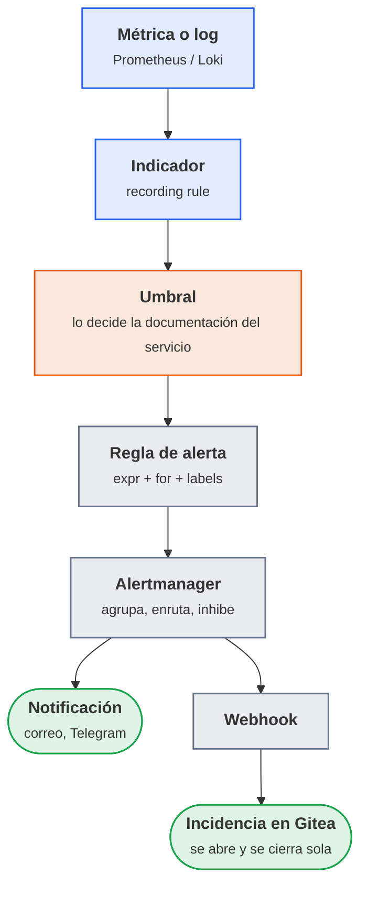
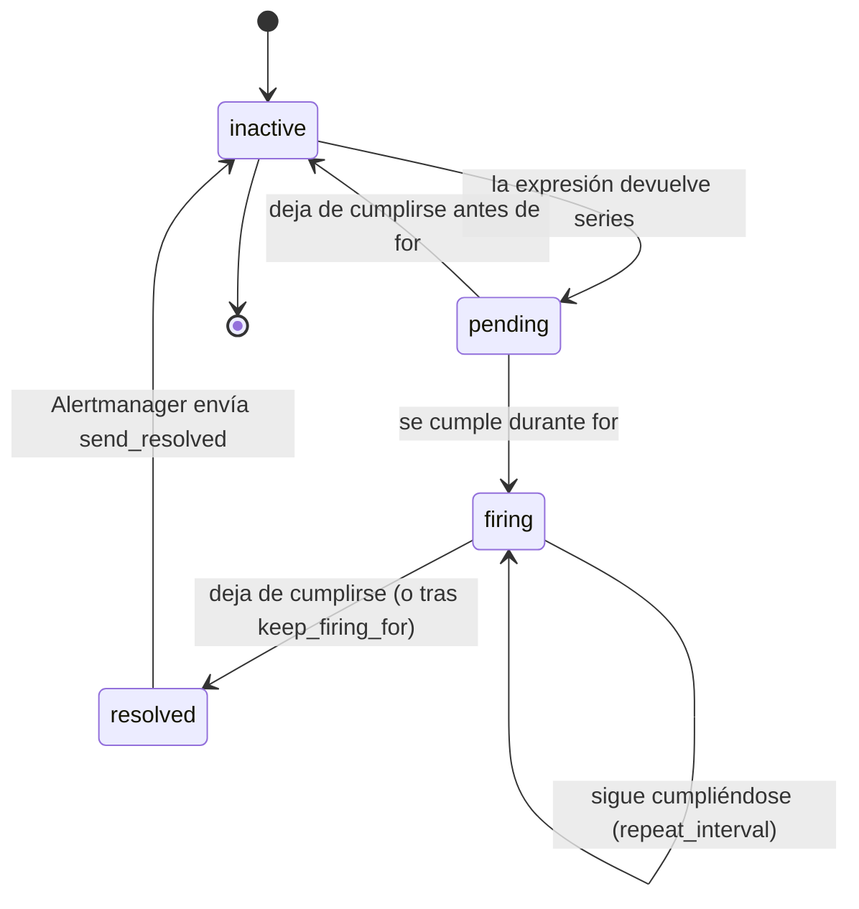
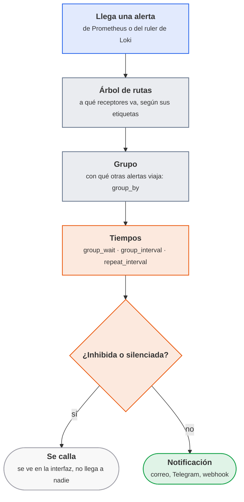
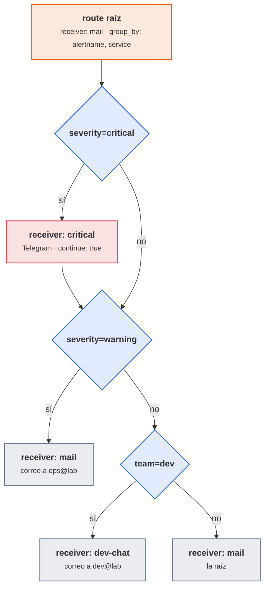
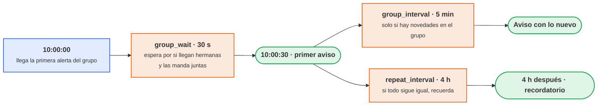
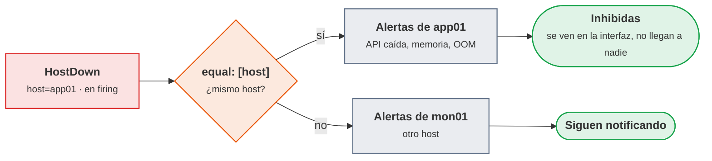

# UT2 · Umbrales, agregación y gestión de alarmas

<p class="ut-meta">16 h · Sesiones 8 a 15 · RA1 CE b, c, d, e</p>

La UT1 dejó mon01 recogiendo los cuatro flujos del contenedor de referencia: en Prometheus, las métricas de recursos de cAdvisor y node_exporter, las de la propia API y las de postgres_exporter; en Loki, los logs y los eventos del demonio Docker. La A1.6 demostró además que llegan enteros y a tiempo. Pero todo eso es todavía un almacén: solo sirve si alguien está mirando el dashboard en el momento en que algo falla, y a las tres de la madrugada no mira nadie. Esta unidad convierte esos datos en alarmas: condiciones que se evalúan solas, que avisan a quien tiene que actuar, cuando toca y sin repetirse sin necesidad, y que dejan rastro en un gestor de incidencias.

La unidad monta la cadena en el orden en que la recorre una alarma: qué condiciones merece la pena vigilar en las métricas y en los logs, cómo se calculan una sola vez los indicadores sobre los que se vigila, cómo se convierten las condiciones en reglas que se evalúan solas, quién decide a quién se avisa y cuándo, y dónde queda registrada cada alarma. La última sesión antes de la práctica evaluable prueba la cadena entera de punta a punta.

## Sesión 8 · Umbrales sobre contadores

<p class="ut-meta" markdown>29 de octubre · Teoría y práctica · <span class="dur" tabindex="0" aria-label="De la métrica a la alarma · 10 min&#10;Umbrales sobre contadores · 15 min&#10;A2.1 Umbrales sobre contadores · 85 min" data-dur="De la métrica a la alarma · 10 min&#10;Umbrales sobre contadores · 15 min&#10;A2.1 Umbrales sobre contadores · 85 min">:material-school:<i class="dur-barra" style="--teoria:23%"></i>:material-flask:</span></p>

Hasta ahora, para enterarse de que el servicio iba mal había que estar mirando: las terminales de la A1.1, los paneles de Grafana. Una alarma empieza por lo contrario: una condición escrita de antemano que el sistema pueda comprobar sin nadie delante. Esta sesión escribe las primeras, las que salen de las métricas de Prometheus, y la teoría sigue el orden en que se construyen. Primero, el mapa de la cadena que monta la unidad y el criterio para decidir qué merece ser alarma, porque un aviso que no exige actuar es ruido. Después, las herramientas de PromQL para escribir la condición: casi todo lo que interesa vigilar sale de contadores que solo crecen, y antes de compararlos con un número hay que convertirlos en velocidades, dividir unos entre otros y saber qué significa que una consulta salga vacía. Por último, los seis umbrales del contenedor de referencia y cuánto tiempo tiene que durar una condición antes de avisar. La hoja mide el valor normal de cada indicador con tráfico real y fija cada umbral con la documentación del servicio delante.

### De la métrica a la alarma

**Qué es una alarma.** Una alarma es una condición sobre los datos que, mantenida durante un tiempo, exige que alguien haga algo. Las cuatro palabras importantes son *condición*, *tiempo*, *alguien* y *algo*, y si falta cualquiera no es una alarma. Sin una condición escrita, es un panel que alguien tiene que estar mirando; sin un tiempo mínimo, un pico de diez segundos despierta a alguien para nada; sin alguien a quien avisar, no se entera nadie; y sin algo que hacer, el aviso solo molesta.

**Por qué es una cadena de piezas.** Entre un número que sube en Prometheus y un mensaje en el móvil hay seis eslabones, y la unidad dedica una sesión a casi cada uno. No es un programa único porque cada pieza hace un trabajo distinto: quien calcula (Prometheus, el ruler de Loki) no necesita saber a quién se avisa, y quien avisa (Alertmanager, un programa aparte del mismo proyecto Prometheus) no necesita saber calcular. Gracias a ese reparto se puede cambiar el canal de guardia sin tocar una sola regla, o añadir una fuente de alertas nueva, como Loki, sin tocar los avisos.



<p class="pie" markdown>El único paso que no es técnico es el umbral, y es el que más se discute: lo decide el servicio, no la herramienta.</p>

| Eslabón | Qué es | Dónde se escribe (repositorio `alerting`) | Cuándo |
|---|---|---|---|
| Métrica o log | Lo que ya se recoge del contenedor de referencia | En Prometheus y Loki, sin cambios | Ya está |
| Indicador | Una fórmula sobre las métricas: el ratio de errores, el percentil de latencia | `prometheus/rules.yml`, como recording rules | 5 nov |
| Umbral | El número que separa lo normal de lo que no, con su justificación | `docs/umbrales.md` y `docs/cadenas.md` | 29 oct y 3 nov |
| Regla de alerta | Indicador, umbral y duración juntos, con las etiquetas que la clasifican | `prometheus/alerts.yml` y `loki/loki-alerts.yml` | 10 nov |
| Alertmanager | Recibe las alertas disparadas y decide a quién avisar, cuándo y cuántas veces | `alertmanager/alertmanager.yml` | 12 nov |
| Notificación e incidencia | El aviso a una persona (correo, Telegram) y, en paralelo, la incidencia en Gitea | Los receptores de `alertmanager.yml` y el receptor `tickets/` | 12 y 17 nov |

El umbral no se inventa: sale de la documentación del servicio o de un acuerdo de nivel de servicio (lo que el servicio se compromete a cumplir con quien lo usa). Alertmanager forma parte de la pila mínima desde la A1.1, pero con una configuración de partida que no avisa a nadie. Y la incidencia la abre un webhook (una llamada HTTP que un programa hace a otro para avisarle de que ha pasado algo), que deja la alarma guardada en un sitio que no depende de Alertmanager.

#### Alertar por síntomas, no por causas

**El problema: qué merece una alarma.** Con PromQL se le puede poner un umbral a cualquier cosa que recoja Prometheus: la CPU, la memoria, las conexiones a la base de datos, el disco, los errores. Si se le pone a todo, cada día salta algo, casi nunca importa y el equipo aprende a no hacer caso. Hace falta un criterio para elegir.

**El criterio: síntomas, no causas.** El capítulo de monitorización del libro de SRE de Google (SRE, *Site Reliability Engineering*, es como Google llama a operar servicios en producción; [sre.google/sre-book/monitoring-distributed-systems](https://sre.google/sre-book/monitoring-distributed-systems/), gratuito) fija el principio que se sigue aquí: las alarmas que despiertan a alguien deben responder a síntomas que sufre el usuario (la API devuelve errores, tarda demasiado, no responde), no a causas posibles (la CPU está al 90 %, hay muchas conexiones a la base de datos, el disco crece). El razonamiento es sencillo. Las causas son infinitas y cada una tiene un umbral discutible; los síntomas son pocos y todos tienen la misma consecuencia: alguien no puede usar el servicio. Una CPU al 95 % que sirve todas las peticiones en 80 ms no es un problema. Una CPU al 30 % con un 5 % de errores 500 sí lo es.

**Qué se hace con las causas.** No se tiran. Sirven para dos cosas: como avisos que se miran en horario laboral, antes de que se conviertan en un síntoma, y como paneles que se consultan cuando una alarma de síntoma ha despertado a alguien y hay que buscar el porqué. La diferencia la marca la **severidad** que lleva cada alarma: `critical` es lo que exige actuar ya y va al canal de guardia, el de la persona que en ese turno atiende los avisos aunque sea de noche; `warning` puede esperar al día siguiente. La tabla de umbrales de esta sesión lo aplica: errores, latencia y servicio caído son `critical`; memoria, reinicios y conexiones, `warning`.

**La prueba de cada alarma.** El mismo capítulo da la regla para decidir si una alarma merece existir: cada vez que suena, alguien tiene que actuar de forma inteligente, tiene que hacerlo ahora, y eso no puede automatizarse. Si falla cualquiera de las tres condiciones, la alarma es ruido: si la respuesta es siempre la misma, la puede dar un script; si puede esperar, no tiene por qué despertar a nadie. El capítulo lo resume en unas pocas preguntas que conviene hacerse ante cada alarma nueva: si alguna vez se podrá ignorar sabiendo que no pasa nada, si de verdad indica que los usuarios están afectados, si se puede hacer algo al recibirla y si el mismo problema ya está avisando a alguien por otro lado.

#### Fatiga de alertas

**Qué pasa si se alerta de todo.** La fatiga de alertas es lo que pasa cuando el canal de notificaciones recibe tantos avisos que el equipo deja de leerlos. Es un fallo de ingeniería, no de disciplina: si en el canal de Telegram de guardia entran cuarenta mensajes al día y treinta y ocho no requieren acción, la gente aprende a ignorar el canal, y la alarma número treinta y nueve, la que importa, se pierde con las demás. No es un problema exclusivo de la informática: está muy estudiado en los hospitales, con las alarmas de los monitores de cuidados intensivos, que de tanto sonar dejan de oírse.

**Por qué condiciona los umbrales.** Es la razón de que en esta unidad ningún umbral se ponga bajo "por si acaso": cada aviso de más gasta la atención que va a necesitar el que importa. Lo que distingue a un equipo que funciona es que mide la fatiga y la corrige. Prometheus y Alertmanager exponen series con las que se cuentan las horas que ha estado activa cada alarma, las notificaciones por semana y persona de guardia o el porcentaje de avisos que acaban en una acción; las consultas y los cuatro indicadores habituales están en [Para ampliar](../ampliacion.md#como-se-mide-la-fatiga-de-alertas). Cuando una alarma sale mal en esos números se hace una de tres cosas: subir el umbral, alargar el `for` (el tiempo que la condición tiene que durar antes de avisar, que se explica al final de esta sesión), o bajarla de `critical` a `warning` y sacarla del canal de guardia.

### Umbrales sobre contadores

{ .logo-inline } **Qué es un umbral en PromQL.** Una condición de alarma es una consulta con una comparación al final. En PromQL la comparación no devuelve verdadero o falso: funciona como un filtro. De todas las series que calcula la consulta, deja pasar solo las que cumplen la comparación, con su valor; si no pasa ninguna, el resultado está vacío y no hay nada de qué avisar. Se ve bien con `up`, la métrica que vale 1 cuando el último [scrape](ut1-observabilidad.md#enviar-las-metricas-a-un-sistema-remoto-scrape-y-remote_write) de un target funcionó y 0 cuando no:

```promql
up{job="node"}          # una serie por máquina: 1 si su node_exporter responde, 0 si no
up{job="node"} == 0     # solo las máquinas que no responden; con todas en pie, ninguna
```

Por eso, en una regla de alerta, cada serie que pasa el filtro es una alerta.

**El problema de los contadores.** La mayor parte de lo que hay que vigilar en el servicio (peticiones, errores, segundos de CPU) llega a Prometheus como contador, el tipo de métrica que solo sube ([Tipos de métrica](ut1-observabilidad.md#tipos-de-metrica)). Un umbral sobre un contador nunca se escribe sobre su valor: `app_http_requests_total` vale 4 831 220 y mañana valdrá más, y ese número solo dice cuánto tiempo lleva arrancado el proceso. Lo que se compara con un umbral es su velocidad, cuánto sube por segundo, o cuánto ha subido en una ventana de tiempo. Las métricas que no son contadores, como la memoria o las conexiones abiertas, son medidores (gauges): suben y bajan, y esas sí se comparan tal cual.

Los apartados siguen el orden en que se escribe una condición: convertir el contador en una velocidad con la ventana adecuada, dividir unas series entre otras para obtener un ratio, entender por qué una consulta puede salir vacía y, con eso, fijar los seis umbrales del servicio y cuánto tiempo tiene que cumplirse cada uno.

#### rate, increase y la ventana

**De dónde se parte.** `rate()` no es nuevo: convirtió los segundos de CPU en núcleos para el panel de recursos ([Las consultas del panel](ut1-observabilidad.md#las-consultas-del-panel)) y sirvió en la [A1.3](ut1-observabilidad.md#a13-instrumentar-la-aplicacion-sesion-3) para el p95 y el porcentaje de errores. Para alertar se usa igual, pero hace falta saber dos cosas más: qué hace exactamente con los reinicios y con los bordes de la ventana, y qué ventana conviene cuando el resultado puede despertar a alguien.

**Qué calculan.** `rate(c[5m])` es la velocidad media por segundo del contador `c` en los últimos cinco minutos. `increase(c[5m])` es exactamente `rate(c[5m]) * 300`: lo que ha subido en total en esa ventana. Las dos corrigen los reinicios: si el contenedor arranca de nuevo y el contador vuelve a cero, lo detectan y no lo toman por una bajada. Y las dos extrapolan: las muestras casi nunca caen justo en los bordes de la ventana, así que Prometheus estima cuánto habría subido en la ventana completa prolongando la tendencia hasta los bordes. Por eso `increase` puede devolver 2,7 aunque el contador suba de uno en uno: para compararlo con un umbral da igual, pero no sirve para contar sucesos sueltos.

**La ventana importa más que la función.** Con un `scrape_interval` (cada cuánto Prometheus recoge muestras) de 15 s, `rate(c[1m])` solo tiene cuatro muestras y va a dar picos y agujeros; `rate(c[5m])` tiene veinte y da una curva suave. La regla de las gráficas sigue valiendo, la ventana al menos cuatro veces el intervalo de scrape, y para alertas se añade otra: entre 2 y 10 minutos. Con menos, y poco tráfico, un par de peticiones fallidas pesan tanto que parecen una avería; con más, la media se suaviza tanto que la alarma llega tarde. El curso usa `[5m]` en todos los indicadores. `irate` toma solo las dos últimas muestras y sirve para gráficas de detalle, nunca para alertar.

**Una tercera función para los reinicios.** Para saber cuántas veces se ha reiniciado la API no hay ningún contador. Lo que hay es una marca de tiempo: la librería que instrumenta la API publica, además de las métricas de la A1.3, unas cuantas del propio proceso, y una de ellas es `process_start_time_seconds`, la hora a la que arrancó, en segundos desde 1970. Es un gauge, y no sube de uno en uno: salta a una hora nueva cada vez que la API vuelve a arrancar. Como la serie es siempre la misma, la del job `app`, Prometheus ve cada salto. `increase` sobre ella no significa nada; la función correcta es `changes(v[1h])`, que cuenta cuántas veces ha cambiado el valor en la ventana, es decir, cuántos arranques ha habido en la última hora:

```promql
changes(process_start_time_seconds{job="app"}[1h]) > 3
```

**Por qué no la de cAdvisor.** cAdvisor publica una métrica de nombre parecido, `container_start_time_seconds`, y es la primera que se busca, pero no sirve para esto. Para un contenedor de Docker, cAdvisor la rellena con la fecha en que se *creó* el contenedor, que no cambia cuando se reinicia; y si el contenedor se recrea, cambia su `id` y la serie es otra. En los dos casos `changes()` da 0 aunque la API se haya caído diez veces. Es el ejemplo de por qué una consulta de alarma no se da por buena hasta que se la ve reaccionar al fallo, que es lo que hace la hoja.

**Cómo se sabe qué tipo es cada métrica.** Usar `increase` sobre un gauge es un error frecuente y silencioso: la consulta no falla, simplemente devuelve un número que no significa nada. Antes de escoger la función se mira el tipo en el propio `/metrics`, donde cada métrica va precedida de una línea `# TYPE`; en el de la API, por ejemplo:

```text
# TYPE app_http_requests_total counter
# TYPE process_start_time_seconds gauge
```

Si es `counter`, se usa `rate` o `increase`; si es `gauge`, el valor tal cual o, para una marca de tiempo como esta, `changes`.

#### Operadores con etiquetas

**Por qué casi todo es una división.** Un umbral fijo sobre un valor suelto rara vez sirve: 50 errores por minuto son un desastre con 60 peticiones por minuto y una minucia con 60 000. Por eso casi todos los indicadores son una proporción entre dos series: errores entre peticiones, memoria usada entre memoria límite, conexiones abiertas entre conexiones permitidas. Una proporción vale lo mismo con poco o con mucho tráfico, y su umbral no hay que retocarlo cada vez que el servicio crece.

**Cómo divide PromQL.** Una división entre dos consultas no divide números, divide series: para cada serie de la izquierda, PromQL busca en la derecha la que tenga exactamente las mismas etiquetas (sin contar el nombre de la métrica) y divide sus valores. Las series que no encuentran pareja desaparecen del resultado sin dar ningún error. Por eso una división con las etiquetas mal emparejadas no falla: devuelve vacío ("no data" en Grafana), y una alarma escrita sobre ella no saltará nunca. Hay tres situaciones habituales:

- **Las etiquetas coinciden tras agregar.** `sum by (service)(rate(errores)) / sum by (service)(rate(total))`: las dos partes se quedan solo con `service`, así que se emparejan sin más. Es el caso limpio, y es el del ratio de errores.
- **Una etiqueta sobra o no coincide en un lado.** `a / ignoring(id) b` empareja sin mirar `id`, y `a / on(service) b` empareja solo por `service`. Con cAdvisor el primer sospechoso es `id`: dos métricas suyas, como las del ratio de memoria, casi siempre coinciden en todo, pero `id`, la ruta del cgroup, es la etiqueta más larga y la primera que hay que ignorar cuando una división de cAdvisor sale vacía.
- **Un lado tiene varias series y el otro una (muchos a uno).** `pg_stat_activity_count / on(service) group_left pg_settings_max_connections`: a la izquierda hay varias series, por base de datos y estado de la conexión, y a la derecha una sola, el máximo de conexiones. `group_left` dice que el lado izquierdo es el que tiene varias series y que la del derecho se reutiliza para cada una. Sin él, PromQL se niega a emparejar una serie con varias y la consulta da error. La consulta de conexiones de la tabla suma antes la izquierda por servicio, así que allí queda una serie a cada lado y el `group_left` no hace falta, aunque tampoco estorba.

#### Una consulta vacía no es un cero

**Por qué importa.** Una alarma salta cuando su consulta devuelve alguna serie. Si la consulta sale vacía, la alarma no salta, y desde fuera no se distingue "todo va bien" de "la consulta no encuentra nada que medir". En el curso hay cuatro situaciones en las que una consulta sale vacía, y solo la primera significa que todo va bien:

- **La comparación ha filtrado todo.** Es el caso bueno: `up{job="node"} == 0` sale vacía porque todas las máquinas responden.
- **La serie todavía no existe.** La librería de la API crea la serie de cada combinación de etiquetas la primera vez que la usa: hasta que la API no devuelve su primer error 5xx desde que arrancó, no hay ninguna serie con `status` 5xx. Mientras tanto, la parte de arriba del ratio de errores sale vacía, y la división también, en lugar de dar 0.
- **La serie ha dejado de existir.** Si un target desaparece de la configuración de Prometheus, o deja de listarlo el descubrimiento que lo generaba, su serie `up` desaparece con él, y `up{job="app"} == 0` no devuelve nada aunque la API lleve horas sin responder. Para eso está `absent()`: `absent(up{job="app"})` devuelve una serie con valor 1 precisamente cuando no existe ninguna serie que coincida, y nada cuando sí existe. Por eso la condición de servicio caído es `up{job="app"} == 0 or absent(up{job="app"})`, que cubre los dos casos. `absent_over_time(serie[10m])` hace lo mismo para "no ha habido ninguna muestra en 10 minutos".
- **La métrica no se guarda.** El bloque `keep` del [job de cAdvisor](ut1-observabilidad.md#etiquetas-y-cardinalidad) solo deja pasar diez métricas. Una consulta sobre cualquier otra métrica de cAdvisor sale vacía para siempre, sin error: hay que añadirla antes a esa lista.

La forma de saber en cuál se está es siempre la misma: ejecutar la consulta sin la comparación y, si sigue vacía, cada parte de la división por separado, hasta encontrar la que no devuelve nada.

#### Tabla de umbrales del contenedor de referencia

**De dónde salen los números.** Con las herramientas anteriores ya se pueden escribir las seis condiciones del servicio. Los umbrales orientativos salen de la documentación del servicio del curso: límite de memoria de 512 MiB para `app`, objetivo de latencia p95 de 500 ms (el p95 es el tiempo por debajo del cual quedan el 95 % de las peticiones), disponibilidad del 99 %, que equivale a admitir un 1 % de errores, y el `max_connections` de PostgreSQL, que en el servicio `db` es el valor por defecto, 100.

| Indicador | Consulta | Umbral orientativo | Severidad |
|---|---|---|---|
| Tasa de errores | `sum(rate(app_http_requests_total{status=~"5.."}[5m])) / sum(rate(app_http_requests_total[5m]))` | > 1 % durante 5 min | critical |
| Latencia p95 | `histogram_quantile(0.95, sum by (le)(rate(app_http_request_duration_seconds_bucket[5m])))` | > 0,5 s durante 10 min | critical |
| Servicio ausente | `up{job="app"} == 0 or absent(up{job="app"})` | 2 min | critical |
| Memoria del contenedor | `container_memory_working_set_bytes{service="app"} / container_spec_memory_limit_bytes{service="app"}` | > 90 % durante 5 min | warning |
| Reinicios | `changes(process_start_time_seconds{job="app"}[1h])` | > 3 en 1 h | warning |
| Conexiones a PostgreSQL | `sum by (service)(pg_stat_activity_count) / on(service) group_left pg_settings_max_connections` | > 80 % | warning |

**Por qué cada umbral.** Los dos primeros traducen la documentación tal cual: más de un 1 % de errores sostenido es incumplir la disponibilidad prometida, y un p95 por encima de 500 ms, el objetivo de latencia. El de servicio ausente no tiene número: basta con que la API no conteste durante dos minutos de scrapes seguidos. Los tres restantes son causas, y por eso son `warning`, pero causas que anuncian un síntoma cercano. La memoria se mide con el [working set](ut1-observabilidad.md#memory-usage-frente-a-working-set), el número que de verdad acerca al contenedor a su límite, y si llega al límite el kernel mata su proceso; como el umbral es un porcentaje, vale igual con el `mem_limit` que tenga `app` en el compose de app01. Más de tres arranques en una hora es un contenedor que se cae y vuelve una y otra vez, algo que la política `restart` del compose del servicio disimula. Y al llegar a `max_connections`, PostgreSQL rechaza las conexiones nuevas y la API empieza a devolver errores.

**Con qué etiquetas se eligen las series.** En las consultas sobre cAdvisor los contenedores se eligen con `service="app"`, la etiqueta que el job de cAdvisor copia del servicio de compose, y no con `name`, que lleva el nombre largo del contenedor (`servicio-app-1`) y cambia si se escala o se renombra. En las de la API y de PostgreSQL se usan `job` o `service`, las etiquetas que pone el scrape.

**De valores orientativos a definitivos.** Los valores de partida vienen de la documentación; los definitivos se ajustan con una o dos semanas de datos reales. Un umbral del 1 % de errores es absurdo si el servicio lleva un 0,8 % permanente por un endpoint de salud mal configurado: primero se arregla eso, luego se pone el umbral. Para ver la distribución histórica de un indicador antes de fijarlo, `quantile_over_time(0.99, app:errors:ratio5m[7d])` da el valor que solo se supera el 1 % del tiempo. `app:errors:ratio5m` es el ratio de errores guardado como métrica propia, que se crea el 5 de noviembre con las recording rules.

#### Cómo elegir el for

**El problema: los picos.** Una condición puede cumplirse un momento por pura casualidad: un par de peticiones lentas, un scrape que llega tarde. Si cada vez que se cumple se avisara a alguien, la fatiga de alertas estaría garantizada. El `for` es el filtro contra esos picos: el tiempo que la condición tiene que mantenerse cierta, sin interrupción, antes de que la alerta se notifique. Prometheus evalúa cada regla de alerta cada 15 s (el `evaluation_interval` de la pila mínima); mientras la condición se cumple pero todavía no ha pasado el `for`, la alerta está en espera (`pending`), y solo cuando lo cumple pasa a disparada (`firing`) y se notifica. Estas consultas se convierten en reglas el 10 de noviembre, y ese día se ven todos los estados de una alerta.


<p class="pie" markdown>Los dos retrasos se **suman**: con `[5m]` y `for: 5m` el aviso llega diez minutos tarde. La pregunta es si el usuario aguanta diez minutos de errores.</p>

Tres criterios para elegirlo:

1. **Los retrasos se suman.** La ventana de `rate` ya suaviza: con `[5m]`, la media tarda hasta cinco minutos en reflejar del todo un cambio. Un `for: 5m` añade otros cinco minutos de espera encima, así que el aviso puede llegar hasta diez minutos después de que empiecen los errores. La pregunta que decide es si el usuario aguanta diez minutos así.
2. **Cero para lo que ya ha pasado.** Un OOM kill (el kernel ha matado el contenedor por pasarse de memoria) es un suceso, no una tendencia: esperar no aporta información. `for: 0m`, o simplemente no ponerlo.
3. **Proporcional al coste de una falsa alarma.** Si la notificación despierta a alguien, `for` largo; si abre una incidencia que se mirará mañana, corto.

**El caso contrario: alarmas que parpadean.** Prometheus tiene además `keep_firing_for` (desde la versión 2.42), que mantiene la alerta disparada un tiempo después de que la condición deje de cumplirse. Sirve para el problema opuesto al de `for`: una alarma que oscila alrededor del umbral (lo que se llama *flapping*) y manda una pareja de notificaciones, disparo y resolución, cada pocos minutos. Con `keep_firing_for: 10m` se queda encendida hasta que lleve diez minutos limpia.

### A2.1 Umbrales sobre contadores (sesión 8)

<span class="et et-obj">Objetivo</span> Las seis condiciones que la unidad va a convertir en alarmas, escritas en PromQL, probadas con tráfico real y con un umbral que se puede defender: el valor normal medido en tu servicio y la cifra de la documentación de la que sale. Al terminar tienes `docs/umbrales.md`, la base de las reglas de alerta del 10 de noviembre y lo primero que mira la práctica evaluable en el criterio b.

<span class="et et-pre">Antes de empezar</span>

- `app01` y `mon01` encendidas, con todos los targets de `http://mon01:29090` en UP.
- Los nombres `app01` y `mon01` en el `/etc/hosts` de tu puesto y de mon01, como los dejó la A1.4 (hasta el 27 de noviembre nadie más los resuelve); si el DHCP les ha cambiado la IP, corrígela.
- La documentación del servicio (la da el profesor): límite de memoria, latencia p95, disponibilidad y `max_connections`.
- Explicado al principio: [De la métrica a la alarma](#de-la-metrica-a-la-alarma) y [Alertar por síntomas](#alertar-por-sintomas-no-por-causas), para el criterio; [rate, increase y la ventana](#rate-increase-y-la-ventana), [Operadores con etiquetas](#operadores-con-etiquetas) y [Una consulta vacía no es un cero](#una-consulta-vacia-no-es-un-cero), para las consultas; la [tabla de umbrales](#tabla-de-umbrales-del-contenedor-de-referencia) y [Cómo elegir el for](#como-elegir-el-for), para los números.

<span class="et et-pas">Pasos</span>

Primero preparas el terreno: el repositorio donde va a vivir todo lo de la unidad y un tráfico de fondo constante, sin el cual los ratios no tienen nada que dividir. Después mides cuánto vale cada indicador en un día normal, provocas fallos para ver que las consultas reaccionan y, solo al final, fijas los umbrales. El orden importa: un umbral fijado sin conocer el valor normal acaba siendo una alarma permanente o una que no suena nunca.

1. **Crea el repositorio de la unidad.** Todo lo que se escribe en esta unidad (umbrales, cadenas, reglas, la configuración de Alertmanager y el receptor de incidencias) va al repositorio `alerting`, en `/opt/alerting` de mon01, y es lo que entregas en la práctica evaluable. Créalo hoy con `secrets/` en el `.gitignore` desde el primer commit, porque ahí irán el 12 y el 17 de noviembre el token del bot de Telegram y el de Gitea, y con un `README` que anote que todavía no tiene remoto: lo recibe en la A2.6.

2. **Pon tráfico de fondo.** Deja en tu puesto, toda la sesión, un bucle de peticiones contra `http://app01:20080/items` que meta de vez en cuando una ruta inexistente. Sin tráfico, la velocidad de las peticiones es cero, los ratios dividen entre cero y no hay valor normal que medir; las rutas inexistentes sirven para comprobar que un 404 no cuenta como error del servicio. Las hojas siguientes cuentan con este bucle.

    *Pista:* con `curl -s` el bucle falla en silencio, así que comprueba antes que la API da 200.

3. **Mide el valor normal de cada indicador.** Ejecuta en Prometheus las seis consultas de la [tabla de umbrales](#tabla-de-umbrales-del-contenedor-de-referencia) y apunta el valor que se mantiene con el tráfico de fondo: es el "valor normal", la referencia contra la que fijarás cada umbral. Si una consulta sale vacía, averigua por qué antes de seguir, con [Una consulta vacía no es un cero](#una-consulta-vacia-no-es-un-cero) delante: una consulta vacía no tiene valor normal y una alarma escrita sobre ella no dispararía nunca.

    *Pista:* la de servicio ausente lleva ya su condición y, con la API respondiendo, vacía es lo correcto; su número se lee en `up{job="app"}`.

4. **Comprueba que reaccionan al fallo.** Un valor estable no demuestra nada hasta que lo ves moverse cuando el servicio falla. Reinicia `app` cuatro veces, con medio minuto entre una y otra, y la de reinicios tiene que marcar 4; después para `db` un par de minutos, hasta que el ratio de errores suba hacia 1, y vuelve a arrancarla. Fíjate también en qué hacen las demás con cada fallo, porque no todas reaccionan igual.

    *Pista:* el medio minuto es para que Prometheus llegue a hacer scrape de cada arranque; con menos, alguno puede escapársele.

5. **Fija los umbrales y justifícalos.** Con el valor normal y la documentación delante, decide el umbral, el `for` y la severidad de cada indicador, con los criterios de [Cómo elegir el for](#como-elegir-el-for) y de [Alertar por síntomas](#alertar-por-sintomas-no-por-causas). Escríbelo en `docs/umbrales.md`, con la tabla `Indicador | Consulta | Valor normal | Umbral | for | Severidad | De dónde sale` (la página o el parámetro de la documentación), y haz commit en el repositorio. Es el documento del que saldrán las reglas de alerta.

    *Pista:* un umbral por debajo del valor normal es una alarma permanente.

<span class="et et-com">Comprobación</span> Las seis consultas devuelven una serie con el tráfico de fondo y reaccionan al paso 4; `docs/umbrales.md` está comprometido en el repositorio con las siete columnas rellenas.

<span class="et et-ent">Para practicar</span> Guarda `docs/umbrales.md` en el repositorio `alerting`.

## Sesión 9 · Cadenas en logs y eventos

<p class="ut-meta" markdown>3 de noviembre · Teoría y práctica · <span class="dur" tabindex="0" aria-label="Cadenas en logs y eventos · 20 min&#10;A2.2 Cadenas en logs y eventos · 90 min" data-dur="Cadenas en logs y eventos · 20 min&#10;A2.2 Cadenas en logs y eventos · 90 min">:material-school:<i class="dur-barra" style="--teoria:18%"></i>:material-flask:</span></p>

Los umbrales de la A2.1 vigilan números, y hay fallos que no aparecen en ningún número porque la aplicación no los cuenta: una excepción concreta, un tiempo de espera agotado al hablar con la base de datos, un contenedor que el kernel ha matado por falta de memoria. Esos fallos sí dejan rastro en texto, en los logs de la API y en los eventos del demonio Docker que ya llegan a Loki, y hoy se escriben las condiciones sobre ese texto. Hasta ahora LogQL, el lenguaje de consulta de Loki, solo se ha usado para comprobar que los logs llegaban; ahora hace falta encontrar una línea concreta entre miles y convertir su aparición en un número, porque una alarma es una comparación con un umbral. La teoría sigue el orden en que se escribe una de estas consultas: elegir de qué flujos se lee, filtrar las líneas, extraer los campos de cada una y contar las que quedan. El último apartado presenta el ruler de Loki, el componente que evalúa estas consultas solo, igual que Prometheus las suyas.

### Cadenas en logs y eventos

{ .logo-inline } **Qué es una cadena aquí.** Una cadena es un texto fijo cuya aparición en un log significa algo concreto: un mensaje de error de la API, un código interno, el nombre de un evento de Docker como `oom` o `health_status: unhealthy`. No se inventan: salen del código de la aplicación o de su documentación, porque solo ahí está escrito qué mensaje se escribe en cada situación. En la pila del curso ese texto está en Loki y se consulta con LogQL, un lenguaje inspirado en PromQL: las mismas llaves para elegir por etiquetas, funciones de rango parecidas.

#### Selectores de stream y filtros de línea

**Lo barato y lo caro.** Loki solo indexa las etiquetas, como se vio al [montarlo](ut1-observabilidad.md#loki). Cada combinación distinta de etiquetas es un *stream*, un flujo de líneas que se guarda junto en bloques comprimidos, y el texto de las líneas no tiene índice. De ahí sale la forma de toda consulta LogQL, en dos partes. La primera es el **selector de stream**, entre llaves, que elige qué flujos se leen por sus etiquetas, igual que en Prometheus; es lo único que usa el índice, y por eso es barato. La segunda es una tubería de filtros y parsers que se aplican línea a línea a lo que el selector ha dejado; eso obliga a descomprimir y recorrer cada línea, y es lo caro. Por eso el selector debe ser lo más estrecho posible.

```text
{service="app"}                                     # todo el log de la API
{service="app", level="error"}                      # solo sus líneas de error
{service="app"} |= "timeout"                        # líneas que contienen timeout
{service="app"} |= "timeout" != "/health"           # ...pero no las de /health
{service="app"} |~ "timeout|refused"                # expresión regular (RE2)
{service=~"app|nginx"} !~ "GET /static/.*"          # regex negada
```

**Los filtros de línea.** Son cuatro: `|=` (contiene), `!=` (no contiene), `|~` (cumple una expresión regular) y `!~` (no la cumple). Las expresiones regulares usan la sintaxis RE2, la de Go. Se encadenan y se evalúan en orden, así que conviene poner primero el que descarte más líneas.

**Qué etiquetas hay.** Las del selector son las que pone Promtail en app01: `host`, `service`, `container` y `level`, y en los eventos de Docker, además, `action`. Si se cambiaron, cambian aquí; `logcli labels` dice las que existen de verdad. Un detalle que rompe muchas reglas: los filtros de línea distinguen mayúsculas. La API escribe el nivel en minúsculas (`"level":"error"`), así que `|= "ERROR"` no encuentra nada. Para el nivel se usa la etiqueta `level`, que Promtail ya sube al índice, y para un texto del que no se sabe cómo está escrito, una expresión regular que empiece por `(?i)`, que no distingue mayúsculas.

#### Parsers: json y logfmt

**Para qué sirve un parser.** Un filtro de línea solo sabe si un texto aparece o no. Cuando la línea es JSON se puede hacer más: filtrar por el valor de un campo concreto (que el mensaje empiece por `timeout`, que una petición haya tardado más de 2 segundos) o quedarse solo con algunos campos. Un **parser** lee cada línea y convierte sus campos en etiquetas temporales, que existen solo mientras dura la consulta y no se guardan en el índice, así que no crean cardinalidad. La API del curso escribe JSON desde la A1.4, con los campos `ts`, `level`, `logger`, `msg` y `request_id`, y el nginx del servicio, con otros como `status`, `uri` y `duration_s` (en segundos). Para ellos el parser es `| json`. Los ejemplos usan una línea de error de la API, como `{"level":"error","msg":"timeout al consultar la base de datos","request_id":"3f9a1c..."}`, y el log de acceso de nginx, que lleva además `status` y `duration_s`:

```text
{service="app", level="error"} | json | msg=~"timeout.*"
{service="nginx"} | json | duration_s > 2
{service="app", level="error"} | json | line_format "{{.request_id}} {{.msg}}"
```

Conviene fijarse en tres cosas. `msg=~"timeout.*"` después del parser es un filtro de etiqueta (comparación exacta o con expresión regular) sobre un campo extraído, no un filtro de línea, y los campos numéricos se pueden comparar como números. `level` no hace falta extraerlo: ya es etiqueta del stream, y filtrar por él en el selector es más barato. Y `line_format` reescribe la línea con los campos extraídos, con una plantilla de huecos entre dobles llaves, útil para que la notificación lleve solo lo que importa.

**Los otros formatos.** En el laboratorio todo lo que llega a Loki es JSON (la API, nginx desde la A1.4 y los eventos de Docker), así que `| json` basta. Fuera de él aparecen otros dos casos. `| logfmt` hace lo mismo con el formato `clave=valor clave2="valor con espacios"` que usan Docker, Loki, Grafana y buena parte del software escrito en Go: el demonio Docker, si llega a Loki a través de journald (el registro del sistema de systemd), escribe así. Y para formatos propios, como el log de acceso de nginx en su formato de fábrica, está `| pattern "<ip> - - <_> \"<method> <path> <_>\" <status> <_>"`, que extrae campos por su posición sin escribir una expresión regular.

**El coste.** `| json` sobre un stream de 2 000 líneas por segundo se nota. Conviene estrechar primero con el selector (`level="error"`) o con un filtro de línea barato (`|= "timeout"`, que solo busca una subcadena) y parsear después solo las líneas que sobreviven.

#### Métricas sobre logs

**Del texto al número.** Una consulta como las anteriores devuelve líneas, y una línea no se puede comparar con un umbral. LogQL convierte una consulta de líneas en una métrica envolviéndola en una función de rango, igual que `rate()` envuelve un contador en PromQL: la ventana va entre corchetes al final de la consulta de líneas, y el resultado es un número por stream. Con eso ya se puede escribir una condición:

```text
sum(count_over_time({service="app", level="error"} [5m])) > 10
sum(count_over_time({service="app", level="error"} | json | msg=~"timeout.*" [5m])) > 0
sum by (host)(count_over_time({service="docker-events", action="oom"} [10m])) > 0
sum(rate({service="nginx"} | json | status >= 500 [5m]))
```

**Qué función para qué.** `count_over_time` cuenta líneas en la ventana, y es la de casi todas las alarmas de cadenas, porque la pregunta es "¿ha aparecido?" o "¿ha aparecido más de N veces?". `rate` divide esa cuenta entre los segundos de la ventana. `bytes_over_time` y `bytes_rate` miden volumen, útil para detectar un contenedor que se pone a escribir sin control. El `sum` de fuera junta los streams, igual que en PromQL; con `sum by (host)` se conserva la máquina, que es la etiqueta que dice de qué host es cada alarma.

**Latencias sin instrumentar.** Si se ha extraído un campo numérico con un parser, `| unwrap duration_s` lo convierte en el valor de la muestra, y entonces `quantile_over_time(0.95, {service="nginx"} | json | unwrap duration_s [5m])` da un p95 de latencia calculado desde los logs de nginx, sin instrumentar nada. Es más caro que un histograma de Prometheus y menos preciso, pero funciona con aplicaciones que no exponen métricas, que es la mayoría de las heredadas que se encuentran en una empresa.

**Dónde se guardan las cadenas.** Las cadenas a vigilar se mantienen en un fichero versionado junto a las reglas, con una entrada por cadena que diga de dónde sale y qué significa que aparezca, porque dentro de seis meses nadie recordará por qué se vigila `"E1042"`. En el laboratorio ese fichero es `docs/cadenas.md`, y lo escribe la hoja de hoy.

#### Alertas en el ruler de Loki

**El problema.** Las consultas de arriba se ejecutan a mano, en Grafana o con `logcli`. Para que sean alarmas, alguien tiene que evaluarlas cada minuto y avisar cuando se cumplen, como hará Prometheus con las suyas. Loki lleva para eso un componente propio, el **ruler**: evalúa reglas escritas con la misma estructura que las de Prometheus, pero con expresiones LogQL, y manda las que se cumplen al mismo Alertmanager. Así las alarmas sobre texto entran en la misma cadena que las de métricas, con las mismas rutas, silencios e incidencias, sin pasar por Grafana. La hoja de hoy no lo usa: el ruler se pone en marcha el 10 de noviembre, en la A2.4, junto con las reglas de alerta de Prometheus.

**Cómo se activa.** Con un bloque `ruler` en `loki.yml`:

```yaml
ruler:
  storage:
    type: local
    local:
      directory: /loki/rules
  rule_path: /tmp/loki-rules-scratch
  alertmanager_url: http://alertmanager:29093
  enable_api: true
  evaluation_interval: 1m
```

Cada opción responde a una pregunta:

- `storage` dice de dónde lee las reglas: del disco local, en `/loki/rules`.
- `rule_path` es un directorio de trabajo donde el ruler deja copias temporales de las reglas mientras las evalúa; no hay que tocarlo.
- `alertmanager_url` dice a quién manda las alertas: al Alertmanager de la misma pila, por su nombre de servicio en la red de compose.
- `enable_api` publica la API con la que se consultan las reglas cargadas, para comprobar que el ruler las ha leído.
- `evaluation_interval` es cada cuánto evalúa las reglas.

**Dónde van las reglas.** Loki está pensado para servir a varios clientes a la vez (*inquilinos*) y guarda las reglas de cada uno en un subdirectorio con su nombre. Con la autenticación multiinquilino desactivada (`auth_enabled: false`, como en el laboratorio) solo hay un inquilino y se llama `fake`, así que las reglas van en `/loki/rules/fake/`. El fichero `loki-alerts.yml` de ese directorio tiene la misma forma que uno de Prometheus, con dos cosas que conviene ver: las expresiones son LogQL, y cada regla lleva las cinco etiquetas de categorización de todas las alarmas del curso (`severity`, `team`, `service`, `origen` y `env`):

```yaml
groups:
  - name: app_logs
    interval: 1m
    rules:
      - alert: AppLogErrorsBurst
        expr: sum(count_over_time({service="app", level="error"} [5m])) > 10
        for: 2m
        labels:
          severity: warning
          team: dev
          service: app
          origen: loki
          env: dev
        annotations:
          summary: "Más de 10 líneas de error en 5 min en la API"
          runbook: "https://wiki.lab/runbooks/app-log-errors"
      - alert: AppDbTimeout
        expr: sum(count_over_time({service="app", level="error"} | json | msg=~"timeout.*" [5m])) > 0
        for: 0m
        labels:
          severity: critical
          team: ops
          service: app
          origen: loki
          env: dev
        annotations:
          summary: "La API registra timeouts contra la base de datos"
      - alert: ContainerOOM
        expr: sum by (host)(count_over_time({service="docker-events", action="oom"} [10m])) > 0
        labels:
          severity: critical
          team: ops
          service: app
          origen: docker-events
          env: dev
        annotations:
          summary: "OOM kill en {{ $labels.host }}"
```

**Lo que dicen las tres reglas.** `AppLogErrorsBurst` avisa de una racha de errores en el log de la API, más de diez en cinco minutos, con un `for` corto. `AppDbTimeout` vigila una cadena concreta, y basta con que aparezca una vez. `ContainerOOM` no lleva `for` porque un OOM ya ha pasado, como se vio en [Cómo elegir el for](#como-elegir-el-for), y agrupa por `host` para que la alarma diga en qué máquina ha sido. La cadena de `AppDbTimeout` es un ejemplo: la buena es la que diga el código de la API, y sale de la A2.2.

**Cómo se comprueba.** El fichero se valida antes de cargarlo con `lokitool rules lint`. `lokitool` es la utilidad de línea de comandos de Loki para trabajar con reglas; no viene en la imagen de Loki, sino como binario aparte en la misma *release* que `logcli`, y se instala igual. Sin más opciones, `lint` además reescribe el fichero con su propio formato (ordena las claves y cambia la sangría); con `-n` (prueba en seco) solo comprueba y no toca nada. Las reglas se aplican reiniciando el contenedor de Loki, y las activas se ven en `GET /loki/api/v1/rules` y en `/prometheus/api/v1/alerts`, que Loki expone imitando la API de Prometheus. El ruler también admite `record:` para recording rules sobre logs, cuyo resultado puede escribirse en Prometheus con `remote_write` (el [mecanismo](ut1-observabilidad.md#enviar-las-metricas-a-un-sistema-remoto-scrape-y-remote_write) con el que Prometheus acepta series enviadas desde fuera); aquí no se usa, pero es la forma de tener un contador de errores de log en Prometheus sin instrumentar la aplicación.

### A2.2 Cadenas en logs y eventos (sesión 9)

<span class="et et-obj">Objetivo</span> Las condiciones sobre texto que completan las de la A2.1: tres cadenas de error de la API, sacadas de su código, y los dos eventos de Docker que delatan a un contenedor en apuros (`oom` y `unhealthy`), cada una con una consulta LogQL probada con `logcli` contra líneas reales. Al terminar tienes `docs/cadenas.md`, con el origen de cada cadena, del que saldrán las reglas del ruler de Loki en la A2.4.

<span class="et et-pre">Antes de empezar</span>

- Loki con los logs de `app` y los eventos Docker, `logcli` en tu puesto con `LOKI_ADDR=http://mon01:23100` y el bucle de tráfico de la A2.1 corriendo.
- El código de la API (`/opt/servicio/api/` en app01) o su documentación.
- Explicado al principio: [Cadenas en logs y eventos](#cadenas-en-logs-y-eventos), hasta [Métricas sobre logs](#metricas-sobre-logs). El ruler no hace falta hoy.

<span class="et et-pas">Pasos</span>

Vas del origen a la métrica. Primero buscas en el código qué mensajes puede escribir la API, porque una cadena que no sale del código es una suposición. Después escribes la consulta que encuentra cada uno y la pruebas provocando el fallo, porque una consulta que no ha devuelto ninguna línea no está probada. Haces lo mismo con los eventos de Docker y, al final, conviertes las consultas en números, que es lo que necesita una alarma.

1. **Busca las cadenas en su origen.** Saca del código de la API o de su documentación tres mensajes de error distintos, con su fichero y su línea. Son los textos exactos que escribirá el log cuando pase cada cosa, y anotar de dónde salen es lo que permitirá a quien venga después saber por qué se vigilan, como se explica en [Métricas sobre logs](#metricas-sobre-logs).

2. **Encuentra cada mensaje en Loki.** Escribe una consulta LogQL por mensaje, al menos una con `| json` y filtro por un campo, y pruébala con `logcli`. Empieza por el selector más estrecho que puedas, como en [Selectores de stream y filtros de línea](#selectores-de-stream-y-filtros-de-linea), y deja el parser para el final. Una consulta que no devuelve ninguna línea no está probada: provoca el error y repite.

    *Pista:* saca el selector de `logcli labels`, no de memoria. Con `db` parada treinta segundos, la API escribe errores.

3. **Provoca los dos eventos de Docker y encuéntralos.** Un evento no se espera a que pase: se provoca. En app01, provoca un `oom` y un `unhealthy` con dos contenedores de usar y tirar, encuéntralos en Loki con las consultas de [Eventos del demonio Docker](ut1-observabilidad.md#eventos-del-demonio-docker) y borra después el contenedor enfermo, que si no seguiría ahí.

    *Pista:* `docker run --rm -m 32m python:3-slim python -c "x = bytearray(200 * 1024 * 1024)"` muere por falta de memoria; el `unhealthy` sale de `--health-cmd "exit 1"` con un intervalo corto. Su `action` lleva el estado dentro (`health_status: unhealthy`): se filtra con una expresión regular.

4. **Convierte las consultas en números.** Una alarma compara un número con un umbral, así que una consulta de la API y las dos de eventos tienen que pasar a consultas métricas, como en [Métricas sobre logs](#metricas-sobre-logs), que den más de cero cuando aparece la cadena. Son las que irán al ruler en la A2.4.

5. **Documenta cada cadena.** Escribe `docs/cadenas.md` con una entrada por cadena: la consulta, de dónde sale (fichero y línea, o el evento de Docker) y qué significa que aparezca. Haz commit en el repositorio.

<span class="et et-com">Comprobación</span> Cada consulta de `docs/cadenas.md` devuelve al menos una línea con `logcli`; las de eventos encuentran el `oom` y el `unhealthy` provocados; las tres métricas dan más de cero.

<span class="et et-ent">Para practicar</span> Guarda `docs/cadenas.md` en el repositorio `alerting`: lo pide la práctica evaluable.

## Sesión 10 · Recording rules

<p class="ut-meta" markdown>5 de noviembre · Teoría y práctica · <span class="dur" tabindex="0" aria-label="Agregación y correlación: recording rules · 15 min&#10;A2.3 Recording rules · 95 min" data-dur="Agregación y correlación: recording rules · 15 min&#10;A2.3 Recording rules · 95 min">:material-school:<i class="dur-barra" style="--teoria:14%"></i>:material-flask:</span></p>

Las seis consultas de la [tabla de umbrales](#tabla-de-umbrales-del-contenedor-de-referencia) funcionan, pero en cuanto se usan de verdad aparecen tres problemas. Son largas y se copian en cada panel y en cada alerta, y en cuanto una copia cambia un detalle (una ventana de 2 minutos donde las demás tienen 5) el panel y la alarma dejan de decir lo mismo. Algunas son caras, como el percentil de latencia, y se recalculan enteras cada vez que alguien abre el dashboard. Y el indicador que importa, el ratio de errores, no existe como métrica en ningún sitio: hay que reconstruirlo cada vez a partir de dos contadores. Esta sesión resuelve los tres a la vez con las **recording rules**, que calculan cada indicador una sola vez y lo guardan como una métrica nueva con nombre propio. La teoría va en orden: por qué precalcular, cómo se nombran las métricas que resultan y el fichero que las define. La hoja carga ese fichero en Prometheus y cambia el dashboard de la A1.2 para que use las métricas nuevas. Son también las que usarán las reglas de alerta, que se escriben el 10 de noviembre.

### Agregación y correlación: recording rules

**Qué es.** Una recording rule es una regla que Prometheus evalúa solo, cada cierto tiempo: ejecuta una expresión PromQL y guarda el resultado como una serie nueva, con su propio nombre, en su base de datos. A partir de ese momento es una métrica más: se consulta, se grafica y se alerta sobre ella igual que sobre `up`, pero ya viene calculada. Las reglas son parte del propio Prometheus, así que no hace falta ningún componente nuevo, solo un fichero que Prometheus lea al arrancar o al recargar. Al terminar este apartado queda un `rules.yml` con los indicadores del contenedor de referencia, listos para las reglas de alerta.

#### Por qué precalcular

Tres razones, en orden de importancia para este trabajo:

**Correlar.** El indicador "ratio de errores" no existe en ninguna métrica: existe en la relación entre dos contadores. La recording rule lo materializa, y desde ese momento tiene nombre e histórico y se consulta como cualquier otra serie. Lo mismo con el porcentaje de memoria usada o las conexiones respecto al máximo. Es literalmente lo que pide el criterio c de la unidad: agregar y correlar contadores para obtener indicadores nuevos.

**Agregar.** Pasar de una serie por instancia a una serie por servicio. Si la API tuviera tres réplicas, cada una con sus contadores, la alarma no debería mirar cada réplica, sino el servicio: que una réplica tenga un 3 % de errores cuando el balanceador (el proxy que reparte las peticiones entre réplicas) ya ha dejado de mandarle tráfico no es un incidente. Con una sola réplica, como en el laboratorio, el `sum by (service)` no cambia el resultado, pero deja la regla preparada para cuando haya más.

**Aligerar.** `histogram_quantile` sobre un histograma con una docena de cubos y tres réplicas, calculado cada vez que un panel de Grafana se refresca y cada vez que una regla se evalúa, es un coste que se multiplica. Precalculado una vez cada 30 s, cuesta lo mismo pintar diez paneles que uno.

Hay una cuarta razón menos evidente: **coherencia**. Si el panel calcula el ratio de errores con una fórmula y la alerta con otra ligeramente distinta (ventana de 5 minutos en una, de 2 en la otra), habrá alarmas disparadas con paneles en verde, y nadie se fiará de ninguno de los dos. Con la recording rule, ambos usan la misma serie.

#### Convención de nombres

**Por qué una convención.** Una métrica grabada se va a usar en paneles, en alertas y en las unidades siguientes, y su nombre tiene que decir, sin abrir el fichero, qué se ha calculado y sobre qué. Prometheus recomienda la forma `nivel:métrica:operaciones`, con dos puntos como separador. Los dos puntos están reservados para las reglas grabadas: los exporters y las librerías de instrumentación no deben usarlos, así que un nombre con dos puntos nunca choca con una métrica exportada y se reconoce a simple vista como calculada.

- `nivel` es el nivel de agregación: de qué se habla después de agregar. La guía oficial pone ahí el nombre de las etiquetas que quedan (`service:...`); el laboratorio lo simplifica y pone el servicio al que se refiere, `app` o `db`, porque todas sus reglas agregan por servicio y así el nombre dice además de cuál.
- `métrica` es el nombre de la métrica base sin el sufijo `_total`, o el del indicador: `requests`, `errors`, `latency_p95`.
- `operaciones` es lo que se le ha hecho, incluida la ventana: `rate5m`, `ratio5m`, `sum`.

Así, `app:errors:ratio5m` se lee como "en el servicio app, ratio de errores, ventana de 5 minutos". Cuando se encadenan reglas (una que usa el resultado de otra), el nombre de la segunda hereda el nivel y añade operaciones. La guía oficial, con más ejemplos, está en [prometheus.io/docs/practices/rules](https://prometheus.io/docs/practices/rules/).

#### El fichero rules.yml

**Qué lleva.** Cuatro indicadores de la tabla de umbrales (errores, latencia, memoria y conexiones) convertidos en métricas grabadas, más `app:requests:rate5m`, que no tiene umbral pero sirve de auxiliar para los paneles de tráfico. La ausencia y los reinicios no se graban, porque su consulta no calcula ningún indicador: compara una serie con un valor y nada más. El fichero se organiza en grupos (`groups`), cada uno con un nombre, un intervalo de evaluación y su lista de reglas; cada regla es una pareja de `record` (el nombre de la métrica nueva) y `expr` (la consulta que la calcula):

```yaml
groups:
  - name: app_rules
    interval: 30s
    rules:
      - record: app:requests:rate5m
        expr: sum by (service)(rate(app_http_requests_total[5m]))
      - record: app:errors:ratio5m
        expr: |
          sum by (service)(rate(app_http_requests_total{status=~"5.."}[5m]))
          /
          sum by (service)(rate(app_http_requests_total[5m]))
      - record: app:latency_p95:5m
        expr: histogram_quantile(0.95, sum by (service, le)(rate(app_http_request_duration_seconds_bucket[5m])))
      - record: app:memory:ratio
        expr: |
          container_memory_working_set_bytes{service="app"}
          / ignoring(id)
          container_spec_memory_limit_bytes{service="app"}
      - record: db:connections:ratio
        expr: sum by (service)(pg_stat_activity_count) / on(service) group_left pg_settings_max_connections
```

Conviene fijarse en tres cosas, que aplican lo visto con los umbrales: el nombre de cada regla sigue la convención, el `sum by (service)` agrega por servicio, y la memoria y las conexiones llevan los `ignoring` y `group_left` de [Operadores con etiquetas](#operadores-con-etiquetas). El `interval: 30s` hace que el grupo se evalúe cada 30 segundos en lugar de cada 15, el `evaluation_interval` general: con ventanas de 5 minutos el indicador apenas cambia en 15 segundos, y así se calcula la mitad de veces.

**El orden dentro de un grupo.** Todas las reglas de un grupo se evalúan en secuencia, cada `interval`, así que dentro de un grupo una regla puede usar el resultado de la anterior en la misma pasada. Entre grupos no hay orden garantizado.

**Cómo se carga.** El fichero se referencia desde `prometheus.yml` con `rule_files: [ "rules.yml", "alerts.yml" ]`, y antes de cada recarga se valida con `promtool check rules rules.yml` (`promtool` es la utilidad de línea de comandos que acompaña a Prometheus y viene en su misma imagen). La recarga en caliente es un `POST` a `/-/reload`, que solo funciona si Prometheus arrancó con `--web.enable-lifecycle` (la pila mínima del curso ya lo lleva), o una señal `HUP` al proceso. Un error de sintaxis con recarga en caliente no tumba Prometheus: se queda con la configuración anterior y lo registra en el log, así que después de cada cambio conviene mirar `prometheus_config_last_reload_successful`, que vale 0 si la última recarga falló.

**La norma del repositorio.** Las alertas sobre indicadores calculados (ratios, percentiles, porcentajes) usan su métrica grabada, no la consulta cruda: así la alarma y el panel no pueden dejar de coincidir. Es la norma del repositorio `alerting` y se revisa en la práctica evaluable. Las de ausencia (`AppDown`, `HostDown`) y la de reinicios (`AppRestarting`) se quedan sobre la serie cruda a propósito, porque no calculan ningún indicador.

### A2.3 Recording rules (sesión 10)

<span class="et et-obj">Objetivo</span> Que los indicadores del servicio existan en Prometheus como métricas con nombre propio, calculadas una sola vez, y que el dashboard las use. Al terminar tienes un `rules.yml` cargado en Prometheus con las cinco métricas grabadas del ejemplo, visibles en el explorador y usadas en el dashboard de Grafana, y las reglas de alerta tienen ya sobre qué escribirse. Es la evidencia del criterio c.

<span class="et et-pre">Antes de empezar</span>

- Las consultas de A2.1 funcionando; `prometheus.yml` y `compose.yml` de mon01; el dashboard de la A1.2 en Grafana.
- Explicado al principio: [Por qué precalcular](#por-que-precalcular), [Convención de nombres](#convencion-de-nombres) y [El fichero rules.yml](#el-fichero-rulesyml).

<span class="et et-pas">Pasos</span>

Escribes las reglas, haces que Prometheus las cargue y, antes de usarlas en ningún sitio, compruebas que cada métrica grabada da lo mismo que la consulta de la que sale: una regla mal escrita da un número creíble y equivocado, y en un panel no se nota. Solo entonces cambias el dashboard para que las use.

1. **Escribe las reglas.** Crea `prometheus/rules.yml` en el repositorio `alerting` con las cinco reglas de [El fichero rules.yml](#el-fichero-rulesyml), ajustando etiquetas (`name`, `job`, `service`) y consultas a las tuyas de la A2.1. Las reglas son tus consultas de la A2.1 con nombre propio: si allí tuviste que corregir una etiqueta para que no saliera vacía, la corrección va también aquí.

2. **Haz que Prometheus las cargue desde el repositorio.** Las reglas viven en `alerting` y Prometheus en la pila de `/opt/monitoring`, así que el fichero se monta en el contenedor, de solo lectura, en `/etc/prometheus/rules.yml`, y se referencia en `rule_files`. La pila mínima ya arranca Prometheus con `--web.enable-lifecycle`, así que acepta recargas en caliente. Valida el fichero con `promtool` antes de cada recarga: una recarga con errores no tumba Prometheus, pero tampoco carga nada.

    *Pista:* `promtool` viene en la imagen de Prometheus. Un montaje nuevo obliga a recrear el contenedor, recargar no basta; y una recarga fallida no avisa: mira `prometheus_config_last_reload_successful` después de cada una.

3. **Comprueba que cada métrica grabada dice lo mismo que su consulta.** Para cada una de las cinco, ejecuta la métrica grabada y la consulta cruda de la que sale y compara los valores. Si no coinciden, la regla no calcula lo que crees, y todo lo que se construya encima heredará el error.

    *Pista:* nacen en la primera evaluación del grupo; espera un minuto.

4. **Pásale el dashboard a las métricas grabadas.** En el dashboard de la A1.2, cambia la consulta del porcentaje del límite de memoria por `app:memory:ratio` y añade dos paneles, uno con `app:errors:ratio5m` y otro con `app:latency_p95:5m`: así el panel y las alarmas leerán la misma serie, como pide la [coherencia](#por-que-precalcular). Exporta el dashboard a `grafana/dashboard.json` y haz commit de `rules.yml`, el dashboard y una copia de `prometheus.yml`.

<span class="et et-com">Comprobación</span> `promtool check rules` responde `SUCCESS`; las cinco métricas aparecen en *Graph* con valor; el panel de memoria pinta lo mismo que antes y los dos nuevos tienen datos.

<span class="et et-ent">Para practicar</span> Guarda `prometheus/rules.yml` y `grafana/dashboard.json` en el repositorio `alerting`.

## Sesión 11 · Reglas de alerta

<p class="ut-meta" markdown>10 de noviembre · Teoría y práctica · <span class="dur" tabindex="0" aria-label="Reglas de alerta · 15 min&#10;A2.4 Reglas de alerta · 95 min" data-dur="Reglas de alerta · 15 min&#10;A2.4 Reglas de alerta · 95 min">:material-school:<i class="dur-barra" style="--teoria:14%"></i>:material-flask:</span></p>

Cada alarma tiene ya su condición, su umbral, su `for` y, si es un indicador calculado, su métrica grabada. Pero todavía no avisa de nada: alguien tiene que ejecutar la consulta y mirar el resultado. Hoy esas condiciones pasan a ser **reglas de alerta** que Prometheus y el ruler de Loki evalúan solos, cada pocos segundos, y que mandan a Alertmanager las que se cumplen. Lo nuevo no es la condición, que ya está escrita, sino lo que viaja con cada alerta: unas etiquetas que dicen qué es, de quién es y cuánto urge, y que Alertmanager usará para decidir a quién avisar, y unas anotaciones con el texto que leerá la persona avisada. La teoría va en ese orden: el fichero de reglas, sus etiquetas y anotaciones, los estados por los que pasa una alerta, que explican por qué el aviso no llega en el mismo instante en que empieza el problema, y cómo se prueba una regla sin esperar a que falle nada. Las reglas de Loki se escriben con lo que ya explicó el apartado [Alertas en el ruler de Loki](#alertas-en-el-ruler-de-loki).

### Reglas de alerta

**Qué es una regla de alerta.** Tiene la misma estructura que una recording rule, pero en lugar de guardar el resultado de la consulta lo usa como condición: en cada evaluación, cada serie que devuelve la expresión es una alerta, y si la sigue devolviendo durante el `for`, Prometheus la manda a Alertmanager con sus etiquetas y anotaciones. Si la consulta devuelve tres series (tres contenedores por encima del umbral), son tres alertas distintas, cada una con sus etiquetas, y Alertmanager las agrupará después. La pila mínima ya tiene en `prometheus.yml` el bloque `alerting`, que le dice a Prometheus dónde está Alertmanager, así que desde que se carga la primera regla las alertas empiezan a llegarle.

**El fichero.** El `alerts.yml` del laboratorio traduce la tabla de umbrales a seis reglas, más `HostDown`, que avisa si una máquina deja de contestar al job `node`, el del node_exporter de app01 y mon01. Las `expr` de los indicadores calculados usan las métricas grabadas de `rules.yml`; las de ausencia y reinicios van sobre la serie cruda, porque no calculan nada. Los umbrales y los `for` son los orientativos de la [tabla de umbrales](#tabla-de-umbrales-del-contenedor-de-referencia), y en la hoja se cambian por los de cada `docs/umbrales.md`. Y las cinco etiquetas de `labels` se repiten en todas, por lo que explica el apartado siguiente:

```yaml
groups:
  - name: app_alerts
    rules:
      - alert: AppHighErrorRate
        expr: app:errors:ratio5m > 0.01
        for: 5m
        labels:
          severity: critical
          team: ops
          service: app
          origen: prometheus
          env: dev
        annotations:
          summary: "Errores 5xx al {{ $value | humanizePercentage }} en {{ $labels.service }}"
          description: "El ratio de errores lleva 5 min por encima del 1 % (SLA). Revisa la API y el servicio db en app01."
          runbook: "https://wiki.lab/runbooks/app-errors"
      - alert: AppHighLatency
        expr: app:latency_p95:5m > 0.5
        for: 10m
        labels: { severity: critical, team: ops, service: app, origen: prometheus, env: dev }
        annotations:
          summary: "p95 de {{ $value | humanizeDuration }} en {{ $labels.service }}"
          runbook: "https://wiki.lab/runbooks/app-latency"
      - alert: AppDown
        expr: up{job="app"} == 0 or absent(up{job="app"})
        for: 2m
        labels: { severity: critical, team: ops, service: app, origen: prometheus, env: dev }
        annotations:
          summary: "El exporter de app no responde desde hace 2 min"
      - alert: HostDown
        expr: up{job="node"} == 0
        for: 2m
        labels: { severity: critical, team: ops, service: node, origen: prometheus, env: dev }
        annotations:
          summary: "{{ $labels.host }} no responde al node_exporter desde hace 2 min"
      - alert: AppMemoryHigh
        expr: app:memory:ratio > 0.9
        for: 5m
        labels: { severity: warning, team: dev, service: app, origen: cadvisor, env: dev }
        annotations:
          summary: "Memoria al {{ $value | humanizePercentage }} del límite en {{ $labels.name }}"
      - alert: AppRestarting
        expr: changes(process_start_time_seconds{job="app"}[1h]) > 3
        for: 0m
        labels: { severity: warning, team: dev, service: app, origen: prometheus, env: dev }
        annotations:
          summary: "app reiniciado {{ $value }} veces en 1 h"
      - alert: DbConnectionsHigh
        expr: db:connections:ratio > 0.8
        for: 5m
        labels: { severity: warning, team: ops, service: db, origen: prometheus, env: dev }
        annotations:
          summary: "PostgreSQL al {{ $value | humanizePercentage }} de max_connections"
```

Cargado este fichero y recargado Prometheus, las siete reglas aparecen en su página *Alerts* en verde (`inactive`: la condición no se cumple). Si alguna sale en amarillo o rojo nada más cargar, la condición ya se cumple con el servicio sano, y conviene revisar el umbral antes de seguir.

**El catálogo cerrado.** Con las tres reglas del [ruler de Loki](#alertas-en-el-ruler-de-loki) (`AppLogErrorsBurst`, `AppDbTimeout` y `ContainerOOM`), estas siete forman el catálogo de alarmas de la unidad. Es una lista cerrada de diez nombres: el resto del curso las cita así, y una alarma que no esté en la lista no existe en el repositorio `alerting`. Solo crece una vez, el 12 de enero, cuando el catálogo de alarmas de la UT4 le añade cinco.

#### Etiquetas y anotaciones

**Por qué las etiquetas se deciden en la regla.** Las etiquetas viajan con la alerta y son lo único que Alertmanager mira para agrupar, enrutar e inhibir, y el receptor de incidencias las usa además para clasificar cada incidencia. Lo que no esté en las etiquetas de la regla no lo puede saber ningún eslabón posterior de la cadena. Por eso el conjunto se fija aquí, en el origen, y es el mismo en todas las reglas:

| Etiqueta | Valores | Para qué la usa la cadena |
|---|---|---|
| `severity` | critical, warning, info | Elige el canal: Telegram para `critical`, correo para el resto |
| `team` | ops, dev | Las de `dev` llegan además al correo del equipo de desarrollo |
| `service` | app, db, web, y `node` para las alarmas de la máquina | Agrupa las alertas del mismo servicio y calla las de un servicio caído |
| `origen` | prometheus, cadvisor, loki, docker-events | Dice de dónde sale el dato, para clasificar la incidencia |
| `env` | dev, pre | Separa entornos: la inhibición de `AppDown` solo calla las alertas de su mismo entorno |

Es la categorización que pide el criterio e de la unidad, decidida en el origen. A esas cinco etiquetas Prometheus añade las de la propia serie que ha cumplido la condición (`instance`, `job`, `host`, `name`, y `service` si viene de la recording rule, aunque la de la regla manda) y `alertname`, el nombre de la regla.

**Las anotaciones, para la persona.** Las anotaciones no se usan para enrutar: son el texto que lee quien recibe el aviso. Se escriben con plantillas de Go (Prometheus y Alertmanager están escritos en Go y usan su sistema de plantillas): texto con huecos entre dobles llaves. `{{ $labels.service }}` inserta una etiqueta, `{{ $value }}` el valor de la expresión en el momento de disparar, y las funciones `humanize` (1234567 pasa a `1.235M`), `humanizePercentage` (0.0234 pasa a `2.34%`), `humanizeDuration` (0.5 pasa a `500ms`) y `humanizeTimestamp` hacen el valor legible. La convención del laboratorio: `summary` de una línea con el qué y el dónde, que es lo que cabe en la pantalla de un móvil; `description` con el contexto que no cabe en un mensaje de Telegram; y `runbook` con la URL del runbook, el procedimiento escrito de qué hacer cuando salta la alarma. En el laboratorio esa URL apunta de momento a una wiki de ejemplo: los runbooks se escriben el 12 de enero, en la unidad de indicadores y pruebas (UT4), y entonces cada regla pasa a enlazar su documento.

#### Estados de una alerta

**Por qué el aviso no llega al instante.** Entre que empieza un problema y que llega el mensaje pasan varios minutos, y no por lentitud: cada estado que atraviesa la alerta es un filtro puesto a propósito contra las falsas alarmas.



<p class="pie" markdown>Los dos retardos que explican por qué el aviso no llega cuando se espera: el `for` vive entre `pending` y `firing`, y el `send_resolved` entre `resolved` e `inactive`.</p>

**Lo que se ve en Prometheus.** Los tres primeros estados están en la página *Alerts*: `inactive` (verde, la condición no se cumple), `pending` (amarillo, se cumple pero todavía no ha pasado el `for`, y se ve cuánto lleva) y `firing` (rojo, ya se ha mandado a Alertmanager). Prometheus manda la alerta en cuanto entra en `firing` y la reenvía cada poco mientras siga así; cuando la condición deja de cumplirse, la manda una vez más con su hora de fin (`endsAt`) fijada en ese momento, y eso es lo que Alertmanager interpreta como `resolved`.

**Si Prometheus se cae.** Cada envío lleva una caducidad, unos minutos por delante, que Prometheus renueva en cada reenvío. Si Prometheus muere sin despedirse, nadie la renueva, y Alertmanager da la alerta por resuelta cuando caduca. El parámetro `resolve_timeout` de Alertmanager (5 minutos por defecto) hace lo mismo con las alertas que llegan sin caducidad, como las de prueba que se crean a mano.

#### Probar las reglas con promtool

**El problema.** Una regla de alerta es código, y el código se prueba. Pero esperar a que el servicio falle de verdad para ver si una regla dispara es lento (con `for: 5m`, como mínimo cinco minutos por prueba) y obliga a romper algo cada vez que se cambia un umbral. `promtool`, la misma utilidad que valida la sintaxis con `promtool check rules`, tiene otra orden para esto: `promtool test rules` toma series inventadas, simula el paso del tiempo y comprueba qué alertas tienen que estar disparadas en cada instante. Una prueba tarda un segundo y se queda en el repositorio: si alguien cambia el `for` o el texto de una anotación, la prueba falla antes de que el cambio llegue a Prometheus.

**Cómo es una prueba.** Un fichero YAML que dice qué reglas cargar, qué series inventar y qué se espera de ellas. Este comprueba que `AppHighErrorRate` todavía no ha disparado a los 2 minutos de un 5 % constante de errores, porque su `for` es de 5, y que a los 6 sí, con sus etiquetas y anotaciones exactas:

```yaml
rule_files:
  - ../alerts.yml
evaluation_interval: 15s
tests:
  - interval: 15s
    input_series:
      - series: 'app:errors:ratio5m{service="app"}'
        values: '0.05x40'
    alert_rule_test:
      - eval_time: 2m
        alertname: AppHighErrorRate
        exp_alerts: []
      - eval_time: 6m
        alertname: AppHighErrorRate
        exp_alerts:
          - exp_labels: { service: app, severity: critical, team: ops, origen: prometheus, env: dev }
            exp_annotations:
              summary: "Errores 5xx al 5% en app"
              description: "El ratio de errores lleva 5 min por encima del 1 % (SLA). Revisa la API y el servicio db en app01."
              runbook: "https://wiki.lab/runbooks/app-errors"
```

`input_series` define la serie inventada: `'0.05x40'` es el valor 0,05 repetido 41 veces, una por cada `interval` de 15 s, así que cubre diez minutos. `alert_rule_test` pide, en cada `eval_time`, la lista de alertas disparadas (`firing`) con ese nombre: vacía a los 2 minutos, porque la alerta aún está en `pending`, y con una alerta a los 6. Las etiquetas esperadas son las de la serie más las de la regla, sin `alertname`, y las anotaciones tienen que coincidir letra a letra con las que produce la plantilla: `humanizePercentage` convierte 0.05 en `5%`.

### A2.4 Reglas de alerta (sesión 11)

<span class="et et-obj">Objetivo</span> Que las diez alarmas del catálogo se evalúen solas: siete en el `alerts.yml` de Prometheus y tres en el `loki-alerts.yml` del ruler de Loki, todas con las cinco etiquetas de categorización. Al terminar tienes además una prueba de `promtool test rules` que pasa y una alerta real observada pasando por `pending` y `firing`, con sus horas: la primera vez que ves la cadena funcionar sola, y la medida de cuánto tarda en avisar.

<span class="et et-pre">Antes de empezar</span>

- Las métricas grabadas de A2.3 evaluándose; `docs/umbrales.md` y `docs/cadenas.md`; `loki.yml` de mon01; el bucle de tráfico de A2.1 corriendo en tu puesto.
- `lokitool` en mon01: es un binario de la misma release de Loki que `logcli`, y se instala igual.
- Explicado al principio: [Reglas de alerta](#reglas-de-alerta) entero, con [Probar las reglas con promtool](#probar-las-reglas-con-promtool) para el paso 3; para Loki, [Alertas en el ruler de Loki](#alertas-en-el-ruler-de-loki).

<span class="et et-pas">Pasos</span>

Empiezas por las reglas de Prometheus, porque una de ellas sirve para medir: en cuanto están cargadas provocas su alarma, y como tarda en disparar, mientras esperas escribes la prueba de `promtool` y cargas las reglas de Loki. Al final lo guardas todo, con las horas que has medido.

1. **Carga las reglas de Prometheus.** Crea `prometheus/alerts.yml` con las siete reglas de [Reglas de alerta](#reglas-de-alerta), pero con los umbrales y los `for` de tu `docs/umbrales.md`, que son los que justificaste con tu servicio. Cárgalo en Prometheus igual que `rules.yml`, en `/etc/prometheus/alerts.yml`. Las siete tienen que salir en *Alerts* como `inactive`: con el servicio sano, ninguna condición debería cumplirse.

    *Pista:* un volumen nuevo obliga a recrear el contenedor; recargar no basta. Una regla en `pending` sin haber provocado nada tiene el umbral por debajo del valor normal.

2. **Provoca una alarma real y mide sus tiempos.** Provoca ya `AppHighErrorRate`, porque tarda: para `db` con el bucle de tráfico corriendo y apunta las horas de la parada, de `pending` y de `firing` mientras sigues con los pasos 3 y 4. Con la alerta en `firing`, arranca `db` y apunta cuándo desaparece. Son los retrasos de los que habla [Cómo elegir el for](#como-elegir-el-for): compáralos con la ventana y el `for` de la regla.

3. **Prueba la regla sin esperar.** Crea `prometheus/tests/alerts_test.yml` con la prueba de [Probar las reglas con promtool](#probar-las-reglas-con-promtool) y pásala con `promtool test rules`. Tiene que probar tu regla, no la del ejemplo: si cambiaste el `for` o el texto de las anotaciones de `AppHighErrorRate`, la prueba lo refleja.

    *Pista:* las anotaciones y el `for` esperados tienen que coincidir letra a letra con los tuyos. `promtool` se lanza con `docker run` sobre la imagen de Prometheus de la pila; la orden está en la [chuleta](../chuleta.md#prometheus-y-promql).

4. **Activa el ruler de Loki con las tres reglas de texto.** Añade a `loki.yml` el bloque de [Alertas en el ruler de Loki](#alertas-en-el-ruler-de-loki) y cárgale `loki/loki-alerts.yml` con las tres reglas del mismo apartado, con la cadena de `AppDbTimeout` cambiada por una de tu `docs/cadenas.md`. Valida el fichero con `lokitool rules lint` antes de reiniciar Loki, para no descubrir un error de sintaxis después, buscándolo en su log.

    *Pista:* dentro del contenedor tiene que quedar en `/loki/rules/fake/loki-alerts.yml`; en otro sitio se ignora sin error. Usa `lint` con `-n`, o te reescribirá el fichero.

5. **Guárdalo con las horas medidas.** Haz commit de `prometheus/` y `loki/`, con las horas del paso 2 apuntadas en `docs/umbrales.md`, junto a la regla a la que corresponden.

<span class="et et-com">Comprobación</span> `promtool check rules` y `promtool test rules` terminan en `SUCCESS`; *Alerts* muestra las siete reglas de Prometheus; `lokitool rules lint` limpio y `curl http://mon01:23100/loki/api/v1/rules` devuelve tus tres reglas; tienes anotado `pending` → `firing` → resuelta con horas.

<span class="et et-ent">Para practicar</span> Guarda `prometheus/alerts.yml`, `prometheus/tests/alerts_test.yml` y `loki/loki-alerts.yml` en el repositorio `alerting`. Para la sesión del 12 de noviembre, la de Alertmanager, trae creado un bot de Telegram con @BotFather, metido en un grupo de pruebas y con el `chat_id` del grupo apuntado: cómo se hace está en [Receptores y plantillas](#receptores-y-plantillas).

## Sesión 12 · Alertmanager

<p class="ut-meta" markdown>12 de noviembre · Teoría y práctica · <span class="dur" tabindex="0" aria-label="Alertmanager · 25 min&#10;A2.5 Alertmanager · 85 min" data-dur="Alertmanager · 25 min&#10;A2.5 Alertmanager · 85 min">:material-school:<i class="dur-barra" style="--teoria:23%"></i>:material-flask:</span></p>

Prometheus y el ruler de Loki ya mandan a Alertmanager cada alerta que dispara. Pero la configuración de partida de la pila mínima lo manda todo a un receptor vacío, llamado `nadie`, así que no se entera nadie. Y si cada alerta se convirtiera sin más en un mensaje, el resultado sería casi peor: una máquina caída con diez alertas daría diez mensajes, repetidos cada pocos minutos, a todo el mundo y a cualquier hora. Alertmanager existe para decidir: con qué otras alertas va cada una, a quién se le manda, cuándo y cuántas veces, y qué se calla. Es el tramo más largo de la unidad, y la teoría sigue el camino que hace una alerta dentro de Alertmanager: el árbol de rutas que elige a quién avisar, los tres tiempos que deciden cuándo, la inhibición y los silencios que callan lo que sobra, y los receptores y plantillas que dan forma al mensaje, con Mailpit para probar el correo sin mandar nada a nadie. Al final, cómo se prueba todo eso sin provocar fallos de verdad. La hoja monta las tres rutas, comprueba una inhibición y un silencio, y hace llegar a Telegram dos alarmas del mismo grupo en un solo mensaje.

### Alertmanager

**Prometheus evalúa; Alertmanager decide.** Alertmanager es un programa aparte del proyecto Prometheus. Recibe alertas de uno o varios Prometheus, del ruler de Loki y de Grafana si se configura (Grafana trae su propio motor de alertas; cuándo conviene y por qué en el laboratorio no se usa está en [Para ampliar](../ampliacion.md#grafana-alerting-como-alternativa)), y hace cinco cosas con ellas: deduplica (dos Prometheus idénticos, montados en paralelo para que la caída de uno no deje el servicio sin vigilancia, mandan la misma alerta y sale un solo aviso), agrupa, enruta, inhibe y silencia. Luego notifica por los receptores configurados y repite mientras la alerta siga activa. Tenerlo aparte de Prometheus es lo que permite que varias fuentes compartan las mismas rutas, los mismos silencios y los mismos canales.



<p class="pie" markdown>El camino de una alerta dentro de Alertmanager, en el orden de los apartados que siguen. La inhibición y el silencio no borran la alerta: solo impiden que se notifique.</p>

Toda la configuración está en un fichero, `alertmanager.yml`. Se valida con `amtool check-config alertmanager.yml` (`amtool` es a Alertmanager lo que `promtool` a Prometheus, y viene en su misma imagen) y se recarga en caliente con un `POST` a `/-/reload`.

#### El árbol de rutas

**El problema: no todas las alertas van al mismo sitio.** Una alerta `critical` tiene que llegar al móvil de quien está de guardia; una `warning` puede esperar en el correo hasta mañana; y las del equipo de desarrollo tienen que llegarle a ese equipo. Alertmanager lo decide con un **árbol de rutas**: una ruta raíz con rutas hijas, cada una con unas condiciones sobre las etiquetas de la alerta (`matchers`) y un receptor, el destino al que se mandan las alertas que las cumplen.

**El fichero del laboratorio.** Este es el `alertmanager.yml` que se monta en la hoja de esta sesión. Tiene cinco bloques, y cada uno responde a una pregunta:

- `global`: los valores comunes a todo el fichero; aquí, el servidor de correo (Mailpit) y el `resolve_timeout`.
- `templates`: dónde están las plantillas propias de los mensajes.
- `route`: el árbol de rutas, con los parámetros de agrupación de la raíz y tres rutas hijas.
- `inhibit_rules`: qué alertas se callan mientras otra está activa.
- `receivers`: los destinos a los que apuntan las rutas, cada uno con sus integraciones (correo, Telegram).

```yaml
global:
  resolve_timeout: 5m
  smtp_smarthost: mailpit:1025
  smtp_from: alertmanager@lab
  smtp_require_tls: false

templates:
  - /etc/alertmanager/templates/*.tmpl

route:
  receiver: mail
  group_by: [alertname, service]
  group_wait: 30s
  group_interval: 5m
  repeat_interval: 4h
  routes:
    - matchers: [severity="critical"]
      receiver: critical
      continue: true
    - matchers: [severity="warning"]
      receiver: mail
    - matchers: [team="dev"]
      receiver: dev-chat
      group_by: [alertname, service, env]

inhibit_rules:
  - source_matchers: [alertname="HostDown"]
    target_matchers: [severity=~"warning|critical"]
    equal: [host]
  - source_matchers: [alertname="AppDown"]
    target_matchers: [service="app"]
    equal: [env]

receivers:
  - name: mail
    email_configs:
      - to: ops@lab
        send_resolved: true
  - name: critical
    telegram_configs:
      - bot_token_file: /etc/alertmanager/secrets/tg_token
        chat_id: -100123456789
        parse_mode: HTML
        message: '{{ template "lab.telegram" . }}'
        send_resolved: true
  - name: dev-chat
    email_configs:
      - to: dev@lab
        send_resolved: true
```

El diseño sigue a la severidad: lo `critical` va a Telegram, que suena en el móvil; lo `warning`, al correo del equipo de operaciones (`ops@lab`); y lo del equipo de desarrollo, a su propio correo (`dev@lab`). Conviene fijarse en el `continue: true` de la ruta `critical`, en el orden de las rutas y en que el token del bot va en un fichero (`bot_token_file`) y no en el YAML: la configuración se sube al repositorio y el secreto no. Alertmanager admite más piezas que este laboratorio no usa (rutas que se callan por horario, Slack, una ruta propia hacia el gestor de incidencias); están en [Para ampliar](../ampliacion.md#rutas-por-horario-slack-y-tickets-en-alertmanager).



<p class="pie" markdown>El `continue: true` de la rama crítica es la clave: sin él, una alerta grave del equipo de desarrollo se quedaría en Telegram y no llegaría a `dev-chat`.</p>

**Cómo se recorre.** El árbol se recorre desde la raíz, probando las rutas hijas en orden, y en cuanto una coincide se detiene ahí y usa su receptor. Salvo que la ruta tenga `continue: true`: entonces, además de usar su receptor, sigue probando las hermanas siguientes. En el ejemplo, una alerta `severity=critical, team=dev` va a `critical` (Telegram) y también a `dev-chat`; una `severity=warning` se queda en `mail` sea del equipo que sea, porque la ruta warning va antes que la de dev y no lleva `continue`; y lo que no coincide con ninguna hija cae en el receptor de la raíz, que también es `mail`. Los parámetros de agrupación y repetición se heredan de la raíz y cada ruta puede sobrescribirlos, como hace `dev-chat` con `group_by`. `amtool config routes test --config.file=alertmanager.yml severity=critical team=dev` dice a qué receptores llegaría un conjunto de etiquetas sin tener que provocar nada.

**Los matchers.** Admiten `=`, `!=`, `=~` y `!~`, como los selectores de PromQL, y una lista de varios se combina con AND: tienen que cumplirse todos. Para descartar un tipo de alerta se usa una ruta hacia un receptor sin integraciones, por convención `"null"` (con comillas, porque YAML interpretaría `null` como valor nulo): la alerta existe y se ve en la interfaz, pero no notifica.

#### group_wait, group_interval y repeat_interval

**El problema: con quién, cuándo y cuántas veces.** Las rutas deciden a quién; quedan dos preguntas. La primera, con quién viaja cada alerta: si se cae una máquina con diez contenedores, llegan diez alertas casi a la vez, y lo útil es un mensaje con las diez, no diez mensajes. Eso es el **grupo**: `group_by` dice qué etiquetas tienen que compartir las alertas para viajar juntas, y con `[alertname, service]` van juntas todas las alertas de la misma regla y el mismo servicio. La segunda, cuándo y cuántas veces: un aviso que se manda una vez y se olvida se pierde, y uno que se repite cada minuto es ruido. De eso se encargan tres tiempos, los que más confusión generan de toda la configuración, y se entienden mejor sobre una línea temporal.

**Una línea temporal.** El supuesto es `group_by: [alertname, service]`, `group_wait: 30s`, `group_interval: 5m`, `repeat_interval: 4h`, y que app01 se queda sin base de datos a las 10:00:00. En el laboratorio `AppHighErrorRate` agrega por servicio y da una sola alerta; el supuesto imagina tres réplicas de la API con una alerta cada una, que es lo que la A2.5 imita con alertas sintéticas que solo se distinguen en `instance`.



<p class="pie" markdown>`group_wait` agrupa, `group_interval` avisa de lo que cambia y `repeat_interval` recuerda lo que no se ha arreglado. Son tres relojes distintos y por eso se confunden.</p>

| Instante | Qué pasa |
|---|---|
| 10:00:00 | Llega `AppHighErrorRate{service=app}`. No existe el grupo (`AppHighErrorRate`, `app`); se crea y arranca `group_wait`. |
| 10:00:20 | Llega `AppHighErrorRate{service=app, instance=app01:29102}` (otra réplica, misma alerta y servicio). Entra en el mismo grupo. No se notifica todavía. |
| 10:00:30 | Vence `group_wait`. Se envía **una** notificación con las dos alertas del grupo. |
| 10:02:00 | Llega una tercera réplica al grupo. No se notifica: el grupo está en su `group_interval`. |
| 10:05:30 | Vence `group_interval`. Como el grupo ha cambiado (hay una alerta nueva), se envía una notificación actualizada con las tres. |
| 10:10:30 | Vence otro `group_interval`. Nada ha cambiado, no se envía nada. |
| 14:05:30 | Se cumplen 4 h desde la última notificación (la de las 10:05:30, no la primera) y el grupo no ha cambiado: vence `repeat_interval` y se reenvía, por si nadie lo ha atendido. |
| 14:20:00 | Se arregla: las tres alertas dejan de cumplirse y llegan con su `endsAt`. |
| 14:20:30 | Siguiente vencimiento de `group_interval`: se envía la notificación de resolución, si el receptor tiene `send_resolved: true`. |

**Qué es cada uno.** `group_wait` es la espera inicial para juntar alertas que llegan a la vez (diez contenedores muertos en un host caído, en un solo correo). `group_interval` es cada cuánto se revisa un grupo ya notificado para mandar los cambios (alertas nuevas o resueltas). `repeat_interval` es cada cuánto se insiste con un grupo que no ha cambiado; como solo se comprueba en los vencimientos de `group_interval`, conviene que sea múltiplo de él. Los extremos se pagan: un `group_wait` de 0 s da inmediatez a cambio de una notificación por alerta, y un `repeat_interval` de 1 h con diez alarmas activas son 240 mensajes al día.

#### Inhibición

**El problema: las consecuencias.** Cuando una máquina se cae, deja de responder todo lo que corre en ella: la API, sus métricas, sus contenedores. Cada regla afectada dispara su propia alerta, y quien está de guardia recibe una ráfaga de avisos que dicen lo mismo con distintas palabras, mientras el único que importa, que la máquina está caída, se pierde entre ellos. Una regla de inhibición lo evita diciendo: mientras esté activa una alerta que cumpla `source_matchers`, no notifiques las que cumplan `target_matchers` y compartan los valores de las etiquetas de `equal`.

**Las dos del laboratorio.** El caso canónico es la primera del ejemplo: si `HostDown{host="app01"}` está en `firing`, las alertas de lo que corre en app01 (la API que no responde, la memoria de sus contenedores, un OOM) son consecuencia, no información, y se callan. Siguen existiendo (se ven en la interfaz marcadas como inhibidas) pero no llegan a ningún receptor ni al webhook. La segunda hace lo mismo un nivel más abajo: con `AppDown` activa, se callan las demás alertas de `service="app"` del mismo entorno.

**Por qué `host` y no `instance`.** La etiqueta de `equal` tiene que existir con el mismo valor en la alerta fuente y en las inhibidas. Por eso el ejemplo usa `host`, que llevan todos los jobs del scrape y que Promtail pone en todos los flujos de log, y no `instance`: cada exporter tiene su puerto, y el `instance` del node_exporter (`...:29100`) nunca coincide con el de la API (`...:29102`). Las alertas que agregan con `sum by (service)` pierden `host` y quedan fuera, pero con la máquina caída tampoco tienen datos con los que disparar.

!!! ojo "Sin `equal`, la inhibición silencia de más"
    `equal` acota a qué alertas alcanza la inhibición. Sin él, un host caído en el CPD de Madrid silenciaría
    las alertas de Sevilla, y nadie se enteraría de la segunda avería hasta que llamara un cliente. Cuidado
    también con las inhibiciones circulares: si A inhibe a B y B inhibe a A, Alertmanager lo resuelve de
    forma poco intuitiva.



<p class="pie" markdown>Si el host está caído, sus alertas hijas son consecuencia, no información. Lo que no puede pasar es que callen también las de otro sitio, y eso es lo que decide `equal`.</p>

#### Silencios

**El problema: el fallo que se sabe que va a pasar.** Hay fallos que se provocan a propósito: una actualización de PostgreSQL, un reinicio programado, una prueba del laboratorio. Durante ese rato las alarmas van a saltar, y avisar de algo que se está haciendo a propósito es ruido. Un **silencio** es una inhibición temporal creada a mano: unos matchers (qué alertas calla), un principio y un fin, y un comentario obligatorio que diga por qué, para que quien lo encuentre sepa quién lo puso y si sigue teniendo sentido. Se crean desde la interfaz web de Alertmanager (puerto 29093) o con `amtool`:

```bash
amtool --alertmanager.url=http://mon01:29093 silence add \
  service=db env=dev --duration=2h \
  --author=ops --comment="Mantenimiento PostgreSQL 17.x, ticket #142"
amtool --alertmanager.url=http://mon01:29093 silence query
amtool --alertmanager.url=http://mon01:29093 silence expire <id>
amtool --alertmanager.url=http://mon01:29093 alert query severity=critical
```

**Qué sobrevive a un reinicio.** Los silencios se guardan en el directorio de datos de Alertmanager (`--storage.path`), así que sobreviven a un reinicio del contenedor si ese directorio está en un volumen. Lo que no sobrevive es la memoria de las alertas: Alertmanager no tiene historial, y lo que ya no está en `firing` desaparece. Esa es la razón del webhook y las incidencias, que se montan el 17 de noviembre.

#### Receptores y plantillas

**Los canales del laboratorio.** Alertmanager trae integraciones para correo, varias aplicaciones de chat, servicios de guardia y un webhook genérico; la lista completa está en [Para ampliar](../ampliacion.md#rutas-por-horario-slack-y-tickets-en-alertmanager). En el laboratorio se usan tres, una por cada necesidad:

- **Correo**, para lo que puede esperar, contra Mailpit (un SMTP de pruebas, explicado más abajo): `smtp_smarthost: mailpit:1025`, `smtp_require_tls: false`. En producción sería el servidor de correo de la empresa, con `smtp_auth_username`/`smtp_auth_password_file` y TLS.
- **Telegram**, para lo que tiene que sonar en el móvil. Se crea el bot con @BotFather (un bot de Telegram que da de alta bots y entrega su token), se mete el bot en un grupo, se escribe algo en el grupo y se consulta `https://api.telegram.org/bot<TOKEN>/getUpdates`, que devuelve el `chat_id` (negativo para grupos; el de un supergrupo empieza por -100). El token va en un fichero (`bot_token_file`) y ese fichero, fuera del repositorio.
- **Webhook**, para todo lo demás: un `POST` con JSON a la URL que se indique. Es la integración universal: cualquier cosa que no esté en la lista se hace con esto, y es la que lleva cada alarma al gestor de incidencias.

Todas admiten `send_resolved`, que decide si se avisa también cuando la alerta se resuelve, y el valor por defecto cambia según la integración: en el correo es `false`; en Telegram y en el webhook, `true`. Conviene ponerlo explícito siempre: una alarma cuya resolución no se notifica obliga a mirar el panel para saber si sigue viva.

**Por qué una plantilla propia.** El texto de la notificación se controla con las mismas plantillas de Go que las anotaciones. Las que trae Alertmanager por defecto salen largas y difíciles de leer en Telegram; una plantilla propia en `/etc/alertmanager/templates/lab.tmpl` deja en cada mensaje solo lo que hace falta para decidir:

```text
{{ define "lab.title" }}[{{ .Status | toUpper }}{{ if eq .Status "firing" }}:{{ .Alerts.Firing | len }}{{ end }}] {{ .GroupLabels.alertname }} ({{ .GroupLabels.service }}){{ end }}

{{ define "lab.telegram" }}
<b>{{ template "lab.title" . }}</b>
{{ range .Alerts -}}
<b>{{ .Status | toUpper }} · {{ .Labels.severity }}</b> {{ .Annotations.summary }}
Desde: {{ .StartsAt.Format "02/01 15:04" }} · Origen: {{ .Labels.origen }}
{{ if .Annotations.runbook }}<a href="{{ .Annotations.runbook }}">Runbook</a>{{ end }}
{{ end }}
{{ end }}
```

y en el receptor, la línea `message: '{{ template "lab.telegram" . }}'` que ya lleva el ejemplo. `define` da nombre a un trozo de plantilla y `template` lo usa en otro sitio. Los objetos disponibles (`.Status`, `.Alerts`, `.Alerts.Firing`, `.GroupLabels`, `.CommonLabels`, `.CommonAnnotations`, `.ExternalURL`) están en la [referencia de notificaciones](https://prometheus.io/docs/alerting/latest/notifications/). El estado en mayúsculas al principio de cada línea permite distinguir FIRING de RESOLVED en el móvil antes de leer nada más.

#### Mailpit como SMTP de pruebas

**Por qué un servidor falso.** Para probar las notificaciones por correo hace falta un servidor de correo, y no conviene usar uno de verdad: cada prueba mandaría mensajes reales, a direcciones que no existen o a gente que no los espera. Mailpit es un servidor SMTP falso: acepta cualquier correo en el puerto 1025, no lo entrega a nadie y lo muestra en una interfaz web, con búsqueda y vista del HTML. Sustituye a MailHog, que lleva años sin mantenimiento. En el compose de mon01 solo se publica la web, y en el puerto del curso: `MP_UI_BIND_ADDR` la pone a escuchar en el 28025, el mismo número con el que se publica (la regla de puertos está en [Convenciones](../laboratorio.md#convenciones)). El SMTP se queda en su 1025 de fábrica y sin publicar, porque solo lo usa Alertmanager, que llega a él por la red del compose con el nombre `mailpit`. `MP_MAX_MESSAGES` limita cuántos mensajes guarda.

```yaml
  mailpit:
    image: axllent/mailpit:v1.22.3
    ports: ["28025:28025"]
    environment:
      MP_UI_BIND_ADDR: "0.0.0.0:28025"
      MP_MAX_MESSAGES: 500
```

Con eso se pueden probar plantillas de correo y comprobar `send_resolved` sin molestar a nadie ni depender del servidor de la empresa. Tiene además una API (`/api/v1/messages`) que permite comprobar desde un script que ha llegado un correo con cierto asunto, lo que convierte la verificación de alarmas en algo automatizable.

#### Alertas sintéticas

**El problema: probar sin romper.** Las rutas, la agrupación, la inhibición y las plantillas se configuran hoy, y comprobarlas con fallos de verdad sería lento (cada alarma real tarda minutos en disparar) y obligaría a romper el servicio una vez por cada prueba. `amtool config routes test` dice a qué receptores iría una alerta, pero no manda nada. Para ver llegar un mensaje se usan **alertas sintéticas**: alertas inventadas, con las etiquetas que se quiera, que se meten a mano en Alertmanager sin pasar por ninguna regla:

```bash
amtool --alertmanager.url=http://mon01:29093 alert add alertname=PruebaAviso severity=warning service=app \
  --annotation=summary="Prueba de la ruta warning"
```

**Cómo se comportan.** Para Alertmanager son alertas como cualquier otra: pasan por las rutas, se agrupan, se inhiben y se silencian igual, y llegan a los receptores con la plantilla. Por eso sirven también para probar una inhibición: una `HostDown` sintética con `host=app01` calla a otra sintética con el mismo `host`. Tienen dos diferencias con las reales. No aparecen en la página *Alerts* de Prometheus, porque no salen de ninguna regla, sino solo en la interfaz de Alertmanager. Y como llegan sin caducidad, se resuelven solas al pasar `resolve_timeout` (5 minutos), salvo que se les dé un fin con `--end`.

### A2.5 Alertmanager (sesión 12)

<span class="et et-obj">Objetivo</span> Que las alertas de la A2.4 lleguen a quien tienen que llegar, juntas cuando son del mismo problema y calladas cuando sobran. Al terminar tienes Alertmanager con tres rutas, una inhibición comprobada y un silencio, notificando por Mailpit y por Telegram con plantilla propia, y has visto llegar dos alarmas del mismo grupo en una sola notificación.

<span class="et et-pre">Antes de empezar</span>

- Las reglas de la A2.4 cargadas y, de la misma hoja, el bot de Telegram en un grupo de pruebas, con el `chat_id` del grupo (negativo) y el token en `secrets/tg_token`. Sin bot, pon de momento en el receptor `critical` un `email_configs` a `guardia@lab` en lugar del `telegram_configs`; la captura que guardas al final será la de Mailpit.
- Explicado al principio: todo el apartado [Alertmanager](#alertmanager), de [El árbol de rutas](#el-arbol-de-rutas) a [Alertas sintéticas](#alertas-sinteticas).

<span class="et et-pas">Pasos</span>

Primero preparas la pila para que Alertmanager lea su configuración del repositorio y no pierda los silencios al reiniciarse. Después cargas la configuración y compruebas las rutas sobre el papel, sin mandar nada. Por último lo pruebas de verdad con alertas sintéticas, que llegan en segundos y no obligan a romper el servicio; el silencio va antes porque una de las pruebas tiene que esquivarlo.

1. **Prepara la pila.** Añade Mailpit a la pila de mon01 con el bloque de [Mailpit como SMTP de pruebas](#mailpit-como-smtp-de-pruebas). Haz que el servicio `alertmanager` lea su configuración del repositorio `alerting` (`alertmanager/` en `/etc/alertmanager` y `secrets/` en `/etc/alertmanager/secrets`, de solo lectura) y guarde sus datos en un volumen `alertmanager_data`, en `/alertmanager` con `--storage.path`: sin volumen, cada reinicio borraría los [silencios](#silencios).

    *Pista:* `--storage.path` va en el `command` de Alertmanager, junto a las opciones que ya tiene. Si al tocarlo se pierde `--web.listen-address=:29093`, Alertmanager vuelve a su 9093 de fábrica y Prometheus deja de llegarle.

2. **Carga la configuración.** Crea `alertmanager/alertmanager.yml` con el de [El árbol de rutas](#el-arbol-de-rutas) y el `chat_id` de tu grupo, y `alertmanager/templates/lab.tmpl` con la plantilla de [Receptores y plantillas](#receptores-y-plantillas); el webhook llega en la A2.6. Valídalo con `amtool check-config`, levanta Mailpit y Alertmanager y comprueba que el bloque `alerting` de `prometheus.yml` apunta a `alertmanager:29093`, que es por donde le llegan las alertas de Prometheus.

    *Pista:* `amtool` viene en la imagen de Alertmanager: `docker compose run --rm --entrypoint amtool alertmanager` lo usa sin el servicio en marcha.

3. **Comprueba las rutas sin mandar nada.** Con `amtool config routes test`, mira a qué receptores llega una alerta `severity=warning team=dev` y decide si es lo que quieres: la pregunta es si el equipo de desarrollo tiene que enterarse de sus propios avisos. Si no te convence, cambia el orden de las rutas o su `continue`, y apunta la decisión y su porqué en el README.

4. **Pon un silencio.** Crea un silencio de una hora sobre `service=db`, con autor y comentario, como si fueras a hacer un mantenimiento de la base de datos, y déjalo puesto para el paso siguiente.

5. **Prueba con alertas sintéticas.** Comprueba, con [alertas sintéticas](#alertas-sinteticas), que:

    - dos `PruebaGrupo` `critical` de `service=app` que solo se distinguen en `instance` llegan a Telegram en una sola notificación, y después su resolución;
    - una `PruebaAviso` `warning` llega a Mailpit y no a Telegram;
    - con una `HostDown` sintética de `host=app01` activa, una `PruebaInhibida` del mismo `host` queda inhibida.

    *Pista:* `amtool alert add` necesita `--alertmanager.url`; la orden está en la [chuleta](../chuleta.md#alertmanager). Usa `service=app`, porque el silencio tapa las de `db`. Las sintéticas se resuelven a los 5 minutos de `resolve_timeout`, y el aviso llega en el siguiente `group_interval`.

6. **Guárdalo sin secretos.** Haz commit de `alertmanager/` en `alerting` y del `compose.yml` de mon01 en `monitoring`, sin `secrets/`.

<span class="et et-com">Comprobación</span> `amtool check-config` sin errores; en Mailpit hay un correo de `PruebaAviso` y ninguno de `PruebaInhibida`, que `alert query -i` da como inhibida; en Telegram, un `[FIRING:2]` con dos alertas y su `[RESOLVED]`; el silencio se ve en la interfaz; no hay secretos en el repositorio.

<span class="et et-ent">Para practicar</span> Guarda `alertmanager/` y el `compose.yml` de mon01 en sus repositorios, y una captura de Telegram con la notificación agrupada en `docs/capturas/` de `alerting`.

<span class="et et-ext">Si te sobra tiempo</span> Cambia en la ruta `critical` el agrupamiento a `group_by: [service]`, recarga Alertmanager y lanza dos sintéticas `critical` con `alertname` distinto y el mismo `service=app`: llegan en un solo mensaje, cuando con `[alertname, service]` serían dos. Deja el `group_by` que prefieras, justificado en el README.

## Sesión 13 · Integración con incidencias

<p class="ut-meta" markdown>17 de noviembre · Teoría y práctica · <span class="dur" tabindex="0" aria-label="Categorizar, notificar y tratar · 10 min&#10;A2.6 Integración con incidencias · 100 min" data-dur="Categorizar, notificar y tratar · 10 min&#10;A2.6 Integración con incidencias · 100 min">:material-school:<i class="dur-barra" style="--teoria:9%"></i>:material-flask:</span></p>

Cada alarma llega ya a una persona, pero en cuanto se resuelve no queda nada de ella: Alertmanager no guarda historial, y un mensaje de Telegram se pierde entre los demás del grupo. Así no se puede contestar a preguntas que en mantenimiento son de todos los días: cuándo empezó y cuándo terminó el último corte, quién lo atendió y qué se hizo, cuántas veces ha saltado esta alarma este mes. Los criterios d y e de la unidad lo piden expresamente: alarmas almacenadas fuera de Alertmanager y clasificadas por fecha, origen, criticidad y servicio. La solución es la de cualquier empresa, un **gestor de incidencias**, donde cada alarma se convierte en una incidencia con su historia. La teoría va en el orden en que viaja la información: qué datos de cada alarma sirven para clasificarla, qué envía exactamente Alertmanager cuando avisa por webhook y el pequeño programa que traduce ese aviso en incidencias que se abren y se cierran solas. El mismo Gitea que guarda las incidencias hace de remoto de los repositorios hasta febrero, y la hoja deja dados de alta los tres.

### Categorizar, notificar y tratar

**Qué es tratar una alarma.** Una incidencia es el registro de un problema desde que aparece hasta que se cierra: cuándo empezó, qué era, quién lo cogió, qué se hizo y cuándo terminó. Notificar es avisar a alguien; tratar es que ese aviso se convierta en trabajo con dueño y con rastro. Para que eso funcione, cada alarma que sale de Alertmanager tiene que llegar ya clasificada: quién la atiende, con qué prioridad, de dónde viene. Y esa clasificación no se hace a mano: viene en las etiquetas que se pusieron en la regla y en los campos que añade Alertmanager.

| Parámetro | Valores | De dónde sale |
|---|---|---|
| Fecha de creación | `startsAt` (fecha en formato estándar RFC 3339, en hora universal UTC) | Alertmanager, del primer envío de Prometheus |
| Fecha de resolución | `endsAt` | Alertmanager, cuando llega el resolved |
| Origen | prometheus, cadvisor, loki, docker-events | Etiqueta `origen` de la regla |
| Criticidad | critical, warning, info | Etiqueta `severity` |
| Servicio / entorno | app, db, web, node; dev, pre | Etiquetas `service`, `env` |
| Equipo | ops, dev | Etiqueta `team` |
| Estado | firing, resolved (más silenced e inhibited en la interfaz) | Campo `status` |
| Identidad | `fingerprint` (hash de las etiquetas) | Alertmanager; es lo que permite emparejar el firing con su resolved |

Cada fila acaba en el título, el cuerpo o las fechas de una incidencia. Es también lo que se rellena para cada alarma en la tabla de verificación del 19 de noviembre.

#### El JSON del webhook

**Qué llega.** Cuando una ruta apunta a un receptor con `webhook_configs`, Alertmanager no manda un mensaje para una persona: manda los datos del grupo de alertas a una URL, para que otro programa haga con ellos lo que quiera. Es un `POST` con `Content-Type: application/json` y este cuerpo (recortado solo en las URL):

```json
{
  "version": "4",
  "groupKey": "{}/{severity=\"critical\"}:{alertname=\"AppHighErrorRate\", service=\"app\"}",
  "truncatedAlerts": 0,
  "status": "firing",
  "receiver": "critical",
  "groupLabels": { "alertname": "AppHighErrorRate", "service": "app" },
  "commonLabels": {
    "alertname": "AppHighErrorRate", "env": "dev", "origen": "prometheus",
    "service": "app", "severity": "critical", "team": "ops"
  },
  "commonAnnotations": {
    "summary": "Errores 5xx al 2.4% en app",
    "runbook": "https://wiki.lab/runbooks/app-errors"
  },
  "externalURL": "http://mon01:29093",
  "alerts": [
    {
      "status": "firing",
      "labels": {
        "alertname": "AppHighErrorRate", "env": "dev", "origen": "prometheus",
        "service": "app", "severity": "critical", "team": "ops"
      },
      "annotations": {
        "summary": "Errores 5xx al 2.4% en app",
        "description": "El ratio de errores lleva 5 min por encima del 1 % (SLA). Revisa la API y el servicio db en app01.",
        "runbook": "https://wiki.lab/runbooks/app-errors"
      },
      "startsAt": "2026-11-12T09:41:30.512Z",
      "endsAt": "0001-01-01T00:00:00Z",
      "generatorURL": "http://mon01:29090/graph?g0.expr=app%3Aerrors%3Aratio5m+%3E+0.01",
      "fingerprint": "5c2f8a1e9b0d4c77"
    }
  ]
}
```

**Cómo se lee.** El sobre describe el grupo: su estado, el receptor que lo manda, las etiquetas del `group_by` (`groupLabels`) y las que comparten todas sus alertas (`commonLabels`). Dentro, `alerts` lleva cada alerta con sus etiquetas, sus anotaciones, sus fechas y su `fingerprint`.

**Tres detalles que importan al escribir el receptor.** `status` del sobre es `firing` si alguna alerta del grupo lo está, y `resolved` solo cuando todas lo están; por eso hay que mirar el `status` de cada elemento de `alerts`, no el del sobre. `endsAt` vale la fecha cero de Go (`0001-01-01T00:00:00Z`) mientras la alerta está activa. Y `fingerprint` es estable para el mismo conjunto de etiquetas, así que es el identificador natural para saber qué incidencia cerrar cuando llegue el `resolved`. `truncatedAlerts` es mayor que cero si el grupo tenía más alertas de las que caben (`max_alerts` en el receptor).

#### Receptor Flask que abre y cierra incidencias en Gitea

**Por qué hace falta un programa en medio.** Alertmanager sabe hacer un `POST` con su JSON, y Gitea tiene una API para crear y cerrar incidencias, pero no hablan el mismo idioma: Gitea espera un título y un cuerpo, y alguien tiene que decidir qué alerta corresponde a qué incidencia. Hace falta un traductor, y en el laboratorio es un script corto en Python con Flask (una librería mínima para montar un servicio web en pocas líneas, la misma con la que está hecha la API del servicio) que corre como un contenedor más de la pila, con el nombre `tickets`.

**Dónde van las incidencias.** Gitea es una forja de Git ligera que se instala en un servidor propio: repositorios, incidencias (*issues*) y una API para manejarlos, como un GitHub casero. Hoy corre en un contenedor de mon01, al lado de la pila. La máquina de plataforma que lo alojará de verdad, `gitea01`, no existe hasta el 12 de febrero, cuando Despliegue lleva allí Gitea en su unidad de integración continua, y ese día solo habrá que cambiar `GITEA_URL`.

**Qué hace el receptor.** Recibe el `POST`, crea una issue por cada alerta en `firing` que no tenga ya una abierta y, cuando la alerta llega en `resolved`, le añade un comentario y la cierra. La relación entre `fingerprint` y número de issue se guarda en un JSON en disco para que sobreviva a un reinicio.

```python
import json, os, requests
from flask import Flask, request

GITEA = os.environ.get("GITEA_URL", "http://gitea:23001")
REPO = os.environ.get("GITEA_REPO", "ops/incidencias")
HDR = {"Authorization": "token " + os.environ["GITEA_TOKEN"]}
API = f"{GITEA}/api/v1/repos/{REPO}/issues"
STATE_FILE = os.environ.get("STATE_FILE", "/data/issues.json")

app = Flask(__name__)
state = json.load(open(STATE_FILE)) if os.path.exists(STATE_FILE) else {}

def save():
    json.dump(state, open(STATE_FILE, "w"))

def abrir(a):
    l, an = a["labels"], a.get("annotations", {})
    titulo = f"[{l.get('severity','?')}][{l.get('service','?')}] {l['alertname']}: {an.get('summary','')}"
    cuerpo = (f"**Inicio:** {a['startsAt']}\n**Origen:** {l.get('origen','?')} · "
              f"**Entorno:** {l.get('env','?')} · **Equipo:** {l.get('team','?')}\n\n"
              f"{an.get('description','')}\n\nRunbook: {an.get('runbook','-')}\n"
              f"Consulta: {a.get('generatorURL','')}\n\n`fingerprint: {a['fingerprint']}`")
    r = requests.post(API, json={"title": titulo, "body": cuerpo}, headers=HDR, timeout=10)
    r.raise_for_status()
    state[a["fingerprint"]] = r.json()["number"]

def cerrar(a):
    num = state.pop(a["fingerprint"], None)
    if num is None:
        return
    requests.post(f"{API}/{num}/comments", headers=HDR, timeout=10,
                  json={"body": f"Resuelta automáticamente. Fin: {a['endsAt']}"})
    requests.patch(f"{API}/{num}", json={"state": "closed"}, headers=HDR, timeout=10)

@app.post("/alertmanager")
def alertmanager():
    for a in request.get_json(force=True)["alerts"]:
        if a["status"] == "firing" and a["fingerprint"] not in state:
            abrir(a)
        elif a["status"] == "resolved":
            cerrar(a)
    save()
    return "", 204

if __name__ == "__main__":
    app.run(host="0.0.0.0", port=25000)
```

Leído de arriba abajo:

- **La configuración sale de variables de entorno.** La URL de Gitea, el repositorio y, sobre todo, el token: nunca en el código, porque el código se sube al repositorio y el token no.
- **El estado vive en disco.** `state` es un diccionario `fingerprint → número de issue`, cargado al arrancar y guardado después de cada aviso. Sirve para dos cosas: no abrir dos issues para la misma alerta cuando llega repetida o por dos receptores, y saber qué issue cerrar cuando llega el `resolved`.
- **`abrir`** compone el título con la severidad, el servicio y el nombre de la alarma, y el cuerpo con la categorización completa, y crea la issue.
- **`cerrar`** busca la issue de esa alerta, le añade un comentario con la hora de fin y la cierra.
- **La ruta `/alertmanager`** recorre `alerts` mirando el `status` de cada una, no el del sobre, y responde 204 (correcto, sin contenido): una respuesta 2xx le dice a Alertmanager que el aviso ha llegado, y si el receptor no contesta o falla con un error 5xx, Alertmanager lo reintenta.
- **`app.run`** arranca el receptor en el 25000, su puerto del curso, y en `0.0.0.0`, todas las interfaces del contenedor: con el `127.0.0.1` que Flask usa por defecto, Alertmanager no le llegaría desde su propio contenedor.

El token de Gitea se genera en *Configuración → Aplicaciones → Generar token* con permiso de escritura sobre issues y se pasa por variable de entorno. Las etiquetas de Gitea (las de colores) se asignan por identificador numérico en la API (`"labels": [3, 7]`), no por nombre, así que el script mete la categorización en el título entre corchetes, que es buscable y no requiere mantener un mapa; si hacen falta etiquetas reales, se consulta `GET /api/v1/repos/{owner}/{repo}/labels` una vez al arrancar y se construye el diccionario nombre → id.

**Lo que se gana.** Con esto la alarma queda almacenada fuera de Alertmanager: cuándo empezó, cuándo terminó, qué era, quién comentó qué. Y de paso quedan los datos para medir la fatiga de alertas, porque Alertmanager solo guarda las alertas activas y olvida el pasado. Cómo cambia el receptor con otros gestores de incidencias (GitLab, Zammad, GLPI) o con una herramienta de automatización visual sin código está en [Para ampliar](../ampliacion.md#otros-gestores-de-incidencias-gitlab-n8n-zammad-y-glpi).

### A2.6 Integración con incidencias (sesión 13)

<span class="et et-obj">Objetivo</span> Que cada alarma deje rastro fuera de Alertmanager: una issue en `ops/incidencias` de Gitea que se abre sola, categorizada, cuando la alerta dispara, y se cierra sola, con comentario, cuando se resuelve. Al terminar tienes ese receptor webhook en mon01 y, de paso, los repositorios `alerting`, `servicio` y `monitoring` con su remoto en el mismo Gitea, donde vivirán hasta febrero.

<span class="et et-pre">Antes de empezar</span>

- Alertmanager de A2.5 notificando, el bucle de tráfico de A2.1 corriendo en tu puesto y sitio en mon01 para un contenedor más (Gitea pide unos 300 MB de memoria).
- Explicado al principio: [Categorizar, notificar y tratar](#categorizar-notificar-y-tratar) y [El JSON del webhook](#el-json-del-webhook). Para el código, [Receptor Flask que abre y cierra incidencias en Gitea](#receptor-flask-que-abre-y-cierra-incidencias-en-gitea).

<span class="et et-pas">Pasos</span>

Construyes la cadena desde el final: primero Gitea, que es donde tienen que acabar las incidencias; después el receptor, que pruebas solo, con ficheros JSON, antes de conectarlo a nada; y cuando abre y cierra bien, lo conectas a Alertmanager y lo pruebas con alarmas reales. Probar cada tramo por separado es lo que te permite saber, si algo falla, dónde está el fallo. Al final, el mismo Gitea pasa a ser el remoto de tus repositorios.

1. **Levanta Gitea, donde acabarán las incidencias.** Como `gitea01` no existe hasta el 12 de febrero, Gitea va de momento en la pila de mon01: imagen `gitea/gitea:1.24`, datos en un volumen `gitea_data` (queda como `monitoring_gitea_data`), escuchando y publicado en el 23001 con `GITEA__server__HTTP_PORT=23001` (el 23000 que le daría la regla de puertos es el de Grafana) y `GITEA__server__ROOT_URL=http://gitea.lab:23001/`, la dirección que Gitea pone en sus enlaces. Añade `gitea.lab` a la línea de mon01 del `/etc/hosts` de tu puesto, de mon01, de app01 y del puesto de administración, porque todos van a empujar a este Gitea. Instálalo con SQLite y crea tu usuario administrador, la organización `ops` y, dentro, cuatro repositorios vacíos: `incidencias`, `alerting`, `servicio` y `monitoring`.

2. **Despliega el receptor.** Pon el receptor como servicio `tickets` de la misma pila, para que Alertmanager le llegue por la red del compose: en `/opt/alerting/tickets`, el script de [Receptor Flask](#receptor-flask-que-abre-y-cierra-incidencias-en-gitea) tal cual como `app.py` y un `Dockerfile` sobre `python:3-slim` con `flask` y `requests`. En el compose, sus variables van en `secrets/tickets.env` (permisos 600, porque lleva el token de Gitea) y su estado en un volumen `tickets_data`, en `/data`, para que la relación entre alertas e issues sobreviva a un reinicio. Publica su 25000 solo en `127.0.0.1`: Alertmanager llega por la red del compose, y desde fuera solo hace falta para el paso 3.

    *Pista:* `GITEA_URL` es `http://gitea:23001`: el mismo puerto que en el navegador, pero con `gitea`, el nombre del servicio en la red del compose, porque `gitea.lab` el contenedor no lo resuelve.

3. **Prueba el receptor sin Alertmanager.** Antes de conectarlo a nada, comprueba que hace bien su trabajo con avisos que controlas tú. Desde mon01, guarda el cuerpo de [El JSON del webhook](#el-json-del-webhook) en `/opt/alerting/tickets/tests/firing.json`, saca de él `resolved.json` y envíalos uno tras otro, con un reinicio del receptor en medio. La issue tiene que abrirse en `ops/incidencias` con el primero y cerrarse con comentario con el segundo; el reinicio demuestra que el receptor no olvida qué issue es de qué alerta.

    *Pista:* `resolved.json` es el mismo cuerpo con `"resolved"` en lugar de `"firing"` y un `endsAt` real: sale con un `sed`.

4. **Conéctalo a Alertmanager.** Añade a los tres receptores de `alertmanager.yml` un `webhook_configs` hacia `http://tickets:25000/alertmanager` con `send_resolved: true`, valida y recarga. Va en los tres para que ninguna alarma se quede sin incidencia, sea cual sea su ruta; y una alerta que pasa por dos receptores no duplica su issue, porque su `fingerprint` ya la tiene.

5. **Pruébalo con alarmas reales de dos orígenes.** Provoca a la vez dos alarmas de orígenes distintos parando `db` con el bucle de tráfico corriendo: tienen que abrirse una issue de `AppHighErrorRate` (Prometheus) y otra de `AppLogErrorsBurst` (Loki, con `origen: loki`), la prueba de que las dos fuentes de alertas acaban en el mismo sitio. Arranca `db` y comprueba que las dos se cierran solas al siguiente `group_interval` después de resolverse. Apunta las horas; mientras esperas el cierre, haz el paso 6.

6. **Dale un remoto a cada repositorio.** Haz commit de `tickets/` y `alertmanager/` en `alerting`, con los enlaces a las issues de prueba en el README en lugar de la nota del remoto pendiente, y del `compose.yml` en `monitoring`. Después da a cada copia de trabajo (`alerting` y `monitoring` en mon01, `servicio` en app01) su remoto `http://gitea.lab:23001/ops/<repo>.git` y haz el primer push: desde hoy el trabajo de las tres pilas está también fuera de las VM.

    *Pista:* antes del primer push de `alerting`, `git check-ignore secrets/tickets.env` tiene que imprimir la ruta; si no, el token se sube con el resto.

<span class="et et-com">Comprobación</span> `firing.json` crea una issue y `resolved.json` la cierra aunque el receptor se reinicie entre los dos; las alarmas del paso 5 tienen cada una su issue categorizada, abierta al firing y cerrada con comentario; los tres repositorios tienen su último commit en Gitea y `secrets/` no está en `alerting`.

<span class="et et-ent">Para practicar</span> Deja `tickets/` completo en el repositorio `alerting` y apunta en su README los enlaces a las issues de prueba.

## Sesión 14 · Verificación completa

<p class="ut-meta" markdown>19 de noviembre · Práctica · <span class="dur" tabindex="0" aria-label="Procedimiento de verificación de una alarma · 5 min&#10;A2.7 Verificación completa · 105 min" data-dur="Procedimiento de verificación de una alarma · 5 min&#10;A2.7 Verificación completa · 105 min">:material-school:<i class="dur-barra" style="--teoria:5%"></i>:material-flask:</span></p>

Cada pieza de la cadena se ha probado ya por separado: las consultas con tráfico real en la A2.1, las reglas con `promtool` y una alarma real en la A2.4, Alertmanager con alertas sintéticas en la A2.5 y el receptor con ficheros JSON en la A2.6. Lo que falta es seguir alarmas reales de punta a punta, del fallo a la incidencia cerrada, midiendo cuánto tarda cada tramo. Es lo que hizo la A1.6 con los datos, ahora con las alarmas: no basta con que cada pieza funcione, hay que demostrar que funcionan juntas y en un tiempo aceptable. Es una sesión de práctica: los cinco primeros minutos explican el procedimiento con el que se da por buena una alarma, y el resto es laboratorio, con cuatro alarmas que recorren cada una un camino distinto de la cadena. Al terminar queda la tabla de verificación rellena, con la categoría de cada alarma, los tiempos medidos y los cambios que motivan, que es la base del informe de la práctica evaluable.

### Procedimiento de verificación de una alarma

**Por qué un procedimiento.** Una alarma escrita no es todavía una alarma de la que fiarse: falta ver que dispara, que llega a quien tiene que llegar, que deja su incidencia y que se cierra sola. Sin esta prueba una alarma no se considera en producción. Se repite para cada alarma nueva y para cada cambio de umbral, `for` o ruta, siempre con los mismos pasos, para que los resultados se puedan comparar, y el resultado se apunta en el informe.

| Paso | Qué se hace | Qué se comprueba | Dónde |
|---|---|---|---|
| 1 | Se anota la hora y se provoca la condición (parar `db` con el bucle de tráfico corriendo, parar un exporter, un contenedor que se queda sin memoria) | El indicador cruza el umbral en la gráfica | Prometheus *Graph* o Grafana |
| 2 | Se espera | La alerta pasa a `pending` con el reloj del `for` | Prometheus *Alerts* |
| 3 | Se espera el `for` | Pasa a `firing`; se anota el tiempo desde el paso 1 | Prometheus *Alerts* y Alertmanager (29093) |
| 4 | Se espera `group_wait` | Llega la notificación a cada canal de la ruta, con el texto de la plantilla correcto | Mailpit (28025) y Telegram |
| 5 | Se mira Gitea | Existe la issue con título, etiquetas y fecha correctos | Gitea, repositorio ops/incidencias |
| 6 | Se resuelve la causa | El indicador vuelve por debajo del umbral | Prometheus *Graph* |
| 7 | Se espera `group_interval` | Llega la notificación de resolución (`send_resolved`); se anota el tiempo desde el paso 6 | Los mismos canales |
| 8 | Se mira Gitea | La issue está cerrada con el comentario de resolución | Gitea |
| 9 | Se registra | Alarma, su categoría, cómo se provoca, tiempo hasta firing, canales, issue, tiempo hasta resolved, issue cerrada | Informe de verificación |

**Qué se hace con los tiempos.** Los tiempos del paso 3 y del 7 son los que luego se comparan con lo que el servicio tolera. Si el usuario nota los errores a los 30 s y la alarma tarda 10 min en sonar, o se baja el `for` o la ventana, o se acepta que esa alarma es de diagnóstico, no de aviso. Y si una alarma ha saltado por un pico sin importancia, es al revés: se sube el umbral o se alarga el `for`, como se vio en [Fatiga de alertas](#fatiga-de-alertas).

### A2.7 Verificación completa (sesión 14)

<span class="et et-obj">Objetivo</span> La prueba de que la cadena entera funciona con fallos reales: la tabla de verificación rellena para cuatro alarmas de orígenes distintos (`HostDown`, `AppHighErrorRate`, `AppLogErrorsBurst` de Loki y `ContainerOOM` de eventos Docker), con su categoría, los tiempos medidos y los cambios que motivan. Cada una recorre un camino distinto de la cadena, así que entre las cuatro la cubren entera, y la tabla es a la vez el informe de verificación y la tabla de categorización de la práctica evaluable.

<span class="et et-pre">Antes de empezar</span>

- Toda la cadena de A2.4 a A2.6 en marcha (compruébalo con una alerta sintética de `amtool alert add`) y el bucle de tráfico de A2.1 corriendo en tu puesto.
- Explicado al principio: [Procedimiento de verificación de una alarma](#procedimiento-de-verificacion-de-una-alarma).

<span class="et et-pas">Pasos</span>

Las provocaciones tardan: entre el `for`, la agrupación y la resolución, una alarma puede llevarse un cuarto de hora de punta a punta. Por eso preparas primero la tabla, lanzas juntas las provocaciones que no se estorban y dejas para el final la que inhibe a las demás. Mientras esperas, vas rellenando filas, y con los tiempos delante decides qué hay que cambiar.

1. **Prepara la tabla.** Crea `docs/verificacion.md` con la tabla vacía: alarma, origen, criticidad, servicio, cómo se provoca, hora y tiempo hasta firing, canales, issue creada, hora y tiempo hasta resolved, issue cerrada, cambios. Origen, criticidad y servicio salen de las etiquetas de la regla, y con ellas esta tabla es también la de categorización de la práctica evaluable.

2. **Lanza primero las provocaciones lentas.** Provoca al empezar `ContainerOOM` y la parada de `db` (que dispara `AppHighErrorRate` y `AppLogErrorsBurst`), anotando la hora de cada una, y vuelve a arrancar `db` en cuanto estén abiertas sus dos issues. Pueden ir a la vez porque son tres grupos distintos en Alertmanager, uno por `alertname`, y no se pisan.

    *Pista:* el `oom` sale del mismo contenedor de usar y tirar de la A2.2, y `ContainerOOM` se resuelve sola cuando el evento sale de su ventana de 10 min.

3. **Deja para el final la que inhibe.** Cuando esas tres issues estén cerradas, y no antes, provoca `HostDown` parando el node_exporter de app01, y arráncalo en cuanto llegue el aviso. Va la última por la [inhibición](#inhibicion): mientras está activa, calla las alertas de app01 que llevan `host`.

    *Pista:* en app01 es el servicio de systemd `prometheus-node-exporter`. Si `HostDown` coincidiera con las otras, el `resolved` de una alarma inhibida podría no llegar nunca a su issue.

4. **Rellena las filas.** Completa la fila de cada alarma siguiendo el [procedimiento](#procedimiento-de-verificacion-de-una-alarma); las horas de firing y resolved están en el `startsAt` y el `endsAt` de su issue. Si alguna no ha cerrado al acabar la sesión, completa su fila al principio de la sesión 15.

5. **Ajusta lo que piden los tiempos.** Rellena *Cambios* y aplícalos en `alerts.yml`: si el tiempo hasta firing es mayor de lo que el servicio tolera, qué `for` o ventana bajas; si ha saltado por un pico sin importancia, qué subes. Es el último paso del ciclo que empezó en la A2.1: el umbral de la documentación, corregido con lo que has medido. Valida, recarga y haz commit de `docs/verificacion.md` y de las reglas que hayas tocado.

<span class="et et-com">Comprobación</span> Cuatro filas completas en `docs/verificacion.md`, cada una con su categoría y su issue abierta y cerrada en Gitea a las horas de la tabla; los cambios aplicados y `promtool check rules` sin errores.

<span class="et et-ent">Para practicar</span> Guarda `docs/verificacion.md` en el repositorio `alerting`: es la base del informe de la práctica evaluable.

<span class="et et-ext">Si te sobra tiempo</span> Añade la fila de `AppRestarting`: cuatro reinicios de `app` con medio minuto entre ellos, como en la A2.1 (paso 4). Se resuelve sola cuando los reinicios salen de la ventana de una hora, así que conviene lanzarla al principio de la sesión.

## Sesión 15 · Práctica evaluable

<p class="ut-meta" markdown>24 de noviembre · Práctica evaluable · <span class="dur" tabindex="0" aria-label="Explicación · 10 min&#10;Trabajo en la práctica · 100 min" data-dur="Explicación · 10 min&#10;Trabajo en la práctica · 100 min">:material-school:<i class="dur-barra" style="--teoria:9%"></i>:material-flask:</span></p>

La práctica no pide nada que no hayas hecho en las hojas: se trata de cerrar y ordenar lo que ya está en el repositorio. Entrega el repositorio `alerting`, comprimido y subido por Aules, con `rules.yml`, `alerts.yml`, `loki-alerts.yml`, `alertmanager.yml` (sin secretos: tokens en ficheros ignorados), el receptor webhook con su Compose y el `README` que has ido completando en las hojas. En `docs/` van `umbrales.md` (A2.1), `cadenas.md` (A2.2) y `verificacion.md` (A2.7), cuya tabla es a la vez el informe de verificación y la tabla de categorización: cada alarma con su origen, criticidad y servicio y las fechas de creación y cierre de su issue. Si alguna fila de la A2.7 quedó sin cerrar, se completa al principio de esta sesión.

Trabaja en este orden. Cierra primero lo pendiente, las filas de la A2.7 sin terminar. Repasa después el repositorio contra la lista de abajo, que es lo que mira la corrección, y empieza por las validaciones: un fichero que no pasa `promtool` o `amtool` no se ha cargado, y nada de lo que depende de él cuenta como probado. Comprueba al final que no hay secretos ni en el repositorio ni en su historial antes de comprimirlo.

- [ ] `promtool check rules` y `amtool check-config` sin errores (A2.4, paso 1, y A2.5, paso 2)
- [ ] Las alertas sobre indicadores calculados (ratios, percentiles, porcentajes) usan su métrica grabada (A2.4, paso 1)
- [ ] Todas las reglas llevan las cinco etiquetas de categorización (A2.4, pasos 1 y 4)
- [ ] Activación y recuperación probadas para las cuatro alarmas de la A2.7, con issue abierta y cerrada (A2.7, pasos 2 a 4)

| Criterio | RA1 | Peso |
|---|---|---|
| Umbrales de contadores y cadenas de eventos definidos desde la documentación (A2.1 y A2.2) | b | 25 % |
| Recording rules de agregación y correlación que generan indicadores nuevos (A2.3) | c | 20 % |
| Eventos integrados en el gestor de alarmas con activación y recuperación probadas y almacenadas fuera (A2.4 a A2.7) | d | 30 % |
| Categorización por fecha, origen, criticidad y servicio, con notificación y tratamiento (A2.6 y tabla de la A2.7) | e | 25 % |

## Errores frecuentes en el laboratorio

**La alerta nunca sale de `pending`.** Casi siempre es porque la expresión devuelve series de forma intermitente: con `rate(x[1m])` y scrape de 15 s, hay evaluaciones en las que la ventana no tiene muestras suficientes y la serie desaparece, lo que reinicia el contador de `for`. Conviene ampliar la ventana a `[5m]` o revisar que `evaluation_interval` no sea mayor que el scrape.

**`increase` devuelve 2,7 reinicios, o la consulta de reinicios da 0 aunque la API se haya reiniciado.** Lo primero es la extrapolación de la ventana aplicada a una métrica que no es un contador: `process_start_time_seconds` es un gauge con la hora de arranque, y para marcas de tiempo se usa `changes()`; si hace falta un entero para un contador real, `round(increase(...))` o `resets()`. Lo segundo pasa si la consulta usa `container_start_time_seconds` de cAdvisor, que guarda la hora de creación del contenedor y no cambia al reiniciarlo, o si los reinicios van tan seguidos que Prometheus no llega a hacer scrape de alguno.

**La división devuelve "no data".** Las etiquetas de numerador y denominador no coinciden. Se ejecuta cada lado por separado, se comparan las etiquetas y se añade `ignoring(...)`, `on(...)` o el `sum by` que falte. Con cAdvisor el culpable habitual es `id` o `image`.

**El exporter cae y no salta nada.** `up == 0` no dispara si la serie ha desaparecido del todo (por ejemplo, porque el target lo generaba un descubrimiento que ya no lo lista). Se añade `or absent(up{job="..."})`.

**Las reglas nuevas no aparecen después de recargar Prometheus.** Una recarga con errores no lo tumba: sigue con la configuración anterior y `prometheus_config_last_reload_successful` vale 0. El log de Prometheus (`docker compose logs --tail 20 prometheus`, en `/opt/monitoring`) dice qué fichero y qué línea fallan; pasar `promtool check rules` antes de cada recarga lo evita.

**Alertmanager rechaza el fichero: `receiver "null" not found`.** Se ha escrito `receiver: null` sin comillas y YAML lo ha convertido en valor nulo. Va entre comillas en los dos sitios.

**Llegan notificaciones por duplicado.** O la ruta tiene `continue: true` y dos receptores comparten canal, o hay dos Prometheus con `external_labels` distintas mandando la "misma" alerta (para Alertmanager son distintas si difieren en cualquier etiqueta). `amtool alert query` muestra las etiquetas completas.

**El correo no llega a Mailpit.** `smtp_require_tls` está a `true` por defecto y Mailpit no habla TLS de serie. Se pone a `false` en `global`. Si aparece `dial tcp: lookup mailpit`, el contenedor de Alertmanager no está en la misma red de Compose que Mailpit.

**La web de Mailpit o la de Gitea no responde en su puerto.** Desde el puesto, el navegador dice que se ha rechazado la conexión; desde la propia mon01, `curl` da `Empty reply from server` o `Connection reset by peer`. El contenedor está publicado en la franja, pero dentro sigue escuchando en su puerto de fábrica, y Docker no tiene a quién entregar la conexión. Falta la opción que lo cambia: `MP_UI_BIND_ADDR` en Mailpit y `GITEA__server__HTTP_PORT` en Gitea. Las primeras líneas de `docker compose logs` de cada uno dicen en qué puerto ha arrancado.

**Telegram devuelve `Bad Request: chat not found`.** El bot no está en el grupo, o el `chat_id` es el de un usuario y no el del grupo (que es negativo). Se manda un mensaje al grupo con el bot dentro y se consulta `https://api.telegram.org/bot<TOKEN>/getUpdates`.

**El ruler de Loki no carga las reglas.** El directorio es `/loki/rules/<tenant>/` y con `auth_enabled: false` el tenant es `fake`. Un fichero directamente en `/loki/rules/` se ignora sin error. Y la validación: `lokitool rules lint`, con `-n` para que no reescriba el fichero.

**El webhook crea una issue por cada repetición.** El script no comprueba si el `fingerprint` ya tiene issue, o el fichero de estado está en un directorio que no persiste entre reinicios del contenedor. Se monta `/data` como volumen.

**El receptor de incidencias responde 500 y no aparece ninguna issue.** Casi siempre es el token sin permiso de escritura sobre issues o `GITEA_REPO` mal escrito; los logs del servicio `tickets` lo dicen. Si el error es de conexión, `GITEA_URL` apunta a `gitea.lab:23001`, un nombre que el contenedor no resuelve porque no lee el `/etc/hosts` de mon01: va `http://gitea:23001`, con el mismo puerto y el nombre del servicio.

**La inhibición no inhibe.** Falta `equal` o los valores de la etiqueta no coinciden literalmente (`instance="app01:29100"` en la fuente y `instance="app01:29102"` en el objetivo son distintos). Se usa una etiqueta común como `host`, que llevan todos los jobs, o se inhibe por `env`. `amtool alert query -i` dice si una alerta está inhibida.

Los enlaces para ampliar y los apartados que van más allá de lo que se hace en clase están en [Para ampliar](../ampliacion.md#ut2-umbrales-agregacion-y-gestion-de-alarmas).
