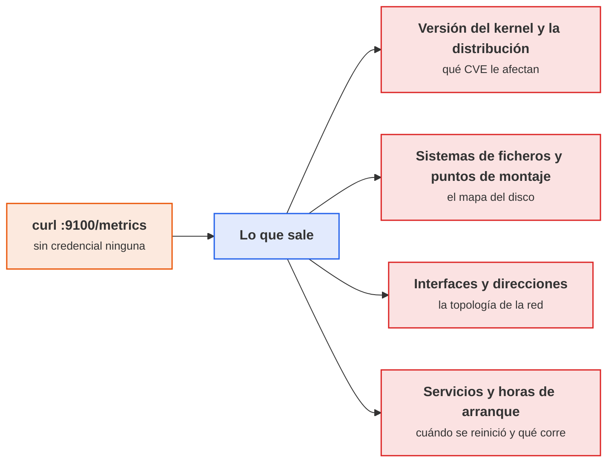
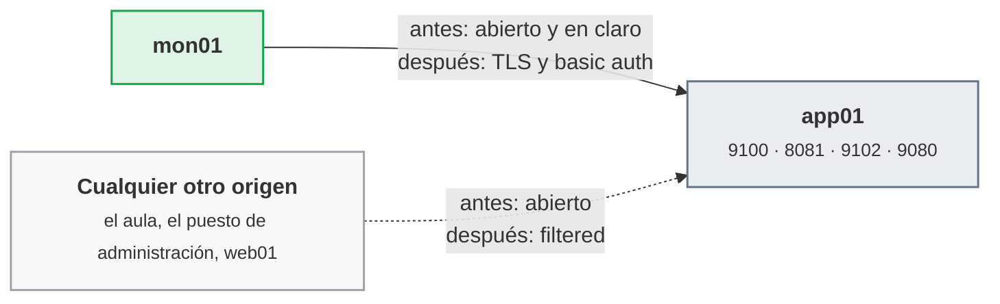
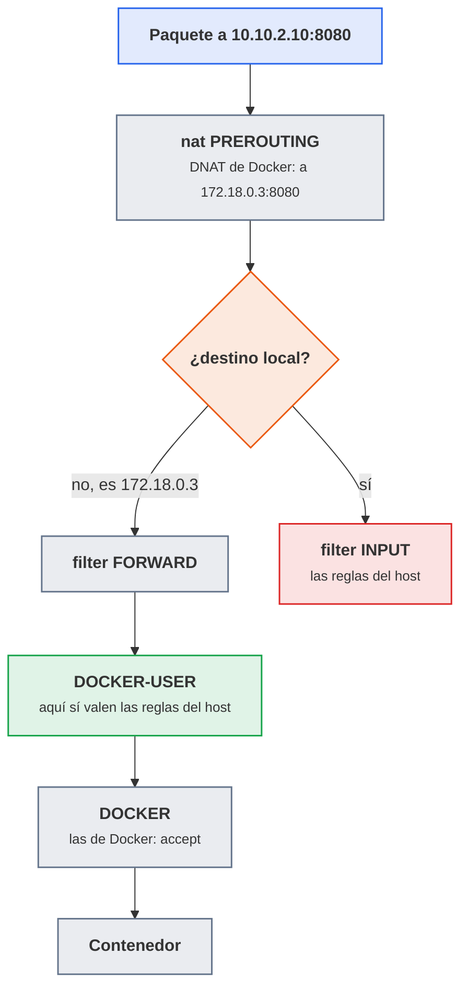
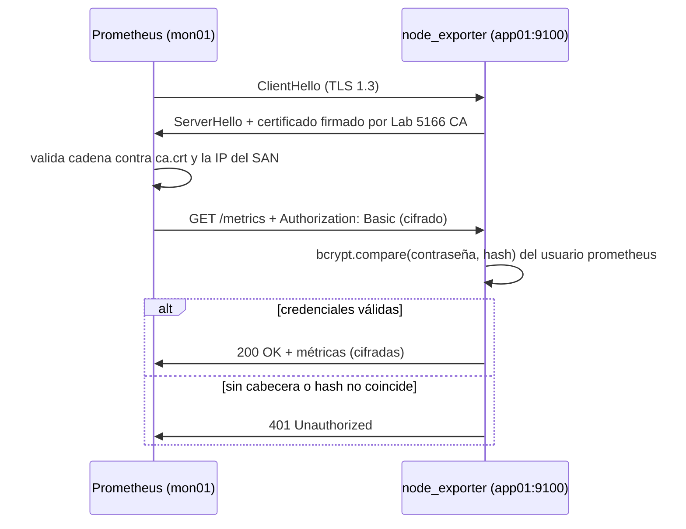

# UT3 · Seguridad de las comunicaciones de monitorización

<p class="ut-meta">6 h · Sesiones 16 a 18 · RA1 CE f, g</p>

La UT1 conectó el servicio del curso a la pila de mon01 (node_exporter, cAdvisor, postgres_exporter, el `/metrics` de la API, Promtail y Loki) y la UT2 le puso alarmas encima. Todo eso funciona, pero funciona en claro: cada exporter es un servidor HTTP sin autenticación, Promtail manda los logs a Loki por HTTP y Grafana está en el 3000 con la contraseña del primer día. Esta unidad da la vuelta a la pila y la mira como la miraría alguien que ha entrado en la red: qué puertos hay abiertos, quién puede llegar a ellos y qué se lleva si llega. Después se cierra lo que sobra por capas (la forma de publicar de Docker, el firewall del host y OPNsense), se cifra y se autentica lo que queda, y se documenta como una política que se pueda auditar. Lo que se hace aquí se apoya directamente en la [UT3 de la asignatura de despliegue](https://victor-educ.github.io/apuntes-5166/ut/ut3-seguridad-por-capas/): mismas zonas, mismo OPNsense y la misma CA del curso, con nmap y tcpdump tal como se vieron en Despliegue. Con esta unidad se cierra la primera evaluación: el examen es el 10 de diciembre y entra UT1, UT2 y UT3 completas. La UT4 vuelve a la explotación (KPI y pruebas) sobre una pila que ya no filtra nada.

## Introducción

Esta unidad sigue el orden de un trabajo real de seguridad: primero se mide, luego se cierra, luego se cifra y al final se documenta. Aquí van los objetivos al terminar, los conceptos y herramientas que se usan y el plan de las tres sesiones.

### Qué tienes que saber hacer al terminar

- Inventariar lo que escucha en cada host (`ss`, `docker ps`) y contrastarlo desde fuera con nmap y tcpdump, dejando evidencias con fecha (CE f).
- Rellenar una matriz de exposición origen/destino/puerto/esperado/obtenido y justificar cada puerto que queda abierto (CE f).
- Explicar por qué un puerto publicado por Docker se salta el firewall del host y resolverlo de tres maneras distintas (CE g).
- Escribir un fichero nftables persistente por host y la regla equivalente en OPNsense (CE g).
- Activar TLS y basic auth en los exporters, mTLS entre Promtail y Loki y TLS con roles en Grafana, y demostrar con curl, openssl y tcpdump que el tráfico va cifrado (CE g).
- Escribir el documento de política de protección entre el contenedor y la monitorización, y saber dónde se redactan los secretos de los logs y dónde se fijan la retención y los permisos (CE g).

### Los conceptos de la unidad

Un alumno, desde su puesto del aula, lanza un `curl` contra el app01 de un compañero por el puerto 9100 y le vuelve la lista completa de lo que corre en la máquina: versión del kernel, servicios activos, IPs, hasta la hora del último reinicio. Nadie se entera, porque nada lo registra. Basta cambiar "compañero" por alguien que ha entrado en la red a través del proxy de la DMZ, y añadir que puede leer todos los logs en Loki, silenciar las alarmas de Alertmanager y entrar en Grafana con la contraseña del primer día. Ese es el problema de la unidad: la pila que se montó para vigilar el servicio se ha convertido en la puerta más fácil para atacarlo. El objetivo al terminar cabe en una frase: que a la monitorización solo llegue quien tiene que llegar, que todo lo que viaje por la red vaya cifrado y con credenciales, y que se pueda demostrar con pruebas fechadas.

| Herramienta o concepto | Qué es, en una frase | Para qué se usa en esta unidad |
|------------------------|----------------------|-----------------------------------|
| `ss` y `docker ps` | Comandos que listan desde dentro del host qué puertos escuchan y cuáles publicó Docker | Inventario inicial: saber qué cree el host que expone |
| nmap | Un escáner de puertos: pregunta a una máquina remota, puerto a puerto, si alguien responde | Comprobar desde cada zona qué se ve de verdad, antes y después de cerrar |
| tcpdump | Un grabador de tráfico de red: muestra los paquetes que pasan por una interfaz | Ver quién usa cada puerto y demostrar que el tráfico va cifrado |
| nftables | El firewall del kernel Linux (sucesor de iptables), con reglas escritas en un fichero de texto | Cerrar en cada host todo lo que no justifique la matriz |
| Docker y su NAT | Docker publica puertos reescribiendo el destino de los paquetes en el kernel, no abriendo un socket normal | Entender por qué un puerto publicado ignora las reglas del firewall y cómo evitarlo |
| OPNsense | El cortafuegos central de la VPC que se montó en la 5166, con reglas por interfaz | Segunda capa: bloquear entre zonas lo que los hosts ya bloquean |
| Matriz de exposición | Una tabla con una fila por origen, destino y puertos: lo esperado, lo obtenido antes y después de proteger, y la evidencia | Es la entrega del criterio f: demuestra con pruebas fechadas qué se veía y qué se ve |
| TLS y la CA del curso | TLS es el cifrado de HTTPS; la CA es la autoridad que firma certificados en la que confían todos, y la del curso se crea en Despliegue con `openssl ca` | Cifrar el tráfico de métricas y logs con certificados propios, sin comprar ninguno |
| Basic auth y bcrypt | Usuario y contraseña en cada petición HTTP; bcrypt es un hash lento pensado para guardar contraseñas | Que los exporters solo respondan a Prometheus |
| `--web.config.file` | El fichero con el que node_exporter y los demás exporters oficiales activan TLS y basic auth | Cifrar y autenticar el scrape sin poner nada delante del exporter |
| mTLS | TLS mutuo: también el cliente presenta certificado y el servidor lo valida | Que Loki solo acepte logs de los Promtail legítimos |
| nginx como proxy inverso | Un servidor web puesto delante de otro para aportarle lo que no tiene (TLS, autenticación) | Poner TLS delante de Grafana y exigir certificado de cliente delante de Loki, sin tocar ninguno de los dos |
| Etapa `replace` de Promtail | Un filtro que reescribe cada línea de log antes de enviarla | Borrar contraseñas y tokens de los logs antes de que lleguen a Loki |

Cómo está organizada la unidad: sigue las tres sesiones en orden, y cada sesión trae primero la teoría que se explica en clase y después su hoja de práctica. En la sesión 16 se mide: inventario de puertos en app01 y mon01, escaneo desde mon01 y desde el puesto de administración, y la matriz de exposición con lo que no debería verse. Como trabajo mecánico que libera las sesiones siguientes, ese día se emiten también los certificados y se dejan preparadas en OPNsense las reglas de la monitorización, para que tras el traslado a la VPC, al día siguiente, baste con cambiar los targets. En la sesión 17 se cierra y se cifra app01, que es la máquina donde se ven los dos casos a la vez: el exporter que escucha como servicio del host y los que publica Docker. Ahí van el fichero nftables con sus dos cadenas y, encima, TLS y basic auth en el scrape de su node_exporter. La sesión 18 es la práctica evaluable: se cierra mon01 (Grafana y Loki detrás de nginx, Prometheus, Alertmanager y Mailpit solo en local y su propio nftables), Promtail pasa a enviar con certificado de cliente, se repite la auditoría sobre el estado final y se cierran la matriz y el documento de política. El material que esas tareas necesitan y que no se explica en clase va como consulta dentro de la propia sesión 18, y los errores frecuentes del laboratorio quedan al final.

!!! otra "Lo que hace falta de la otra asignatura"
    Esta unidad (26 nov a 3 dic) va en paralelo con la [UT3 de Despliegue, seguridad por capas con OPNsense](https://victor-educ.github.io/apuntes-5166/ut/ut3-seguridad-por-capas/) (20 nov a 9 dic). De allí vienen el modelo de zonas, OPNsense con sus alias y sus reglas y la CA del curso, que se crea en la A3.2 de Despliegue el 25 de noviembre. nmap y tcpdump se explicaron en la [sesión 10 de Despliegue](https://victor-educ.github.io/apuntes-5166/ut/ut2-vpc/#como-se-prueba-una-red) y aquí se repasan aplicados a los puertos de la monitorización. El cortafuegos en el propio host, con nftables, se explica aquí, en la sesión 17.
    Hasta el 26 de noviembre app01 y mon01 viven en el bridge del aula (vmbr0). El traslado a la VPC dev, detrás de OPNsense, lo hace la A3.3 de Despliegue el 27 de noviembre, que ese mismo día instala en db01 PostgreSQL y su postgres_exporter: la A3.1 de esta unidad audita con las VM todavía en el aula, y desde la A3.2 (1 de diciembre) todas las IP 10.10.x.x de los ejemplos son las de la VPC.
    La matriz de reglas del cortafuegos es una sola, la del [laboratorio de Despliegue](https://victor-educ.github.io/apuntes-5166/laboratorio/), y esta unidad le añade las filas 11 a 13 con los mismos nombres de pestaña y de alias: no se empieza una nueva. La fila por la que app01 llega a la Gitea provisional es la 6, de Despliegue.

### Plan de sesiones

Cada sesión de 110 minutos empieza con una explicación corta y sigue con laboratorio. La columna «Se explica» recoge los apartados de teoría que se desarrollan en clase, con su duración aproximada; la columna «Se practica», el trabajo de laboratorio de esa sesión. Las sesiones marcadas solo como práctica no traen teoría nueva.

| Sesión | Fecha | Tipo | Se explica | Se practica |
|---:|-------|------|------------|-------------|
| [16](#sesion-16-auditoria-inicial) | 26 nov | Teoría y práctica | Superficie de exposición de la monitorización; ss, nmap y tcpdump aplicados a exporters (20 min). | Inventario de puertos en app01 y mon01, escaneo desde mon01, desde el puesto de administración y desde app01, matriz de exposición; certificados y reglas de OPNsense preparados para el traslado. |
| [17](#sesion-17-red-firewall-y-tls) | 1 dic | Teoría y práctica | Por qué un puerto publicado en Docker salta el firewall del host y cómo se corrige (10 min); red dedicada, nftables por host y las reglas de OPNsense (10 min); TLS y basic auth en los exporters con bcrypt (10 min). | Cerrar app01 en la VPC: targets con las direcciones nuevas, nftables del host con sus dos cadenas, TLS y basic auth en su node_exporter y escaneo de comprobación. |
| [18](#sesion-18-practica-evaluable) | 3 dic | Práctica evaluable | La política de protección entre contenedor y monitorización (10 min). | Cerrar mon01 (Grafana y Loki tras nginx, su nftables), certificado de cliente en Promtail y auditoría final; la matriz antes y después y el documento de política se terminan antes del examen. |

!!! examen "La unidad cierra la primera evaluación"
    El 10 de diciembre hay examen de la primera evaluación y entra UT1, UT2 y UT3 completas. De esta unidad se pregunta lo que se explica en clase: qué se ve en un `/metrics` abierto, cómo se lee cada estado de nmap, por qué un puerto publicado por Docker no pasa por la cadena `input` y dónde va entonces la regla, y qué resuelve TLS frente a qué resuelve la autenticación. La práctica evaluable de la sesión 18 se entrega por Aules antes del examen: el trabajo de laboratorio queda hecho el 3 de diciembre, y la matriz y el documento de política se pueden terminar hasta la víspera.

## Sesión 16 · Auditoría inicial

<p class="ut-meta" markdown>26 de noviembre · Teoría y práctica · <span class="dur" tabindex="0" aria-label="Superficie de exposición de la monitorización · 10 min&#10;Auditar: saber qué hay antes de tocar nada · 10 min&#10;A3.1 Auditoría inicial · 90 min" data-dur="Superficie de exposición de la monitorización · 10 min&#10;Auditar: saber qué hay antes de tocar nada · 10 min&#10;A3.1 Auditoría inicial · 90 min">:material-school:<i class="dur-barra" style="--teoria:18%"></i>:material-flask:</span></p>

Al acabar esta sesión queda hecha la matriz de exposición de la pila tal como está hoy: qué puertos escuchan en app01 y mon01, quién llega a ellos y qué se lee si llega, todo con una evidencia fechada por fila. Antes de la hoja de práctica conviene leer qué se ve en un `/metrics` abierto y la tabla de puertos del entorno, que es de donde salen la columna "esperado" de la matriz y las reglas de OPNsense que la hoja deja preparadas, y después los cinco pasos de la auditoría (ss y docker ps, nmap, curl, tcpdump y la matriz).

### Superficie de exposición de la monitorización

Cada exporter es un servidor HTTP más en cada máquina. Cuando se montó la pila en la UT1 el objetivo era que Prometheus llegase a todo (el scrape: la lectura periódica de cada `/metrics`), y la forma rápida de conseguirlo fue dejar node_exporter escuchando en todas las interfaces y publicar puertos en el host: `8081:8080`, `9102:9102`, `9080:9080`. El resultado es que la monitorización abre más puertos que la propia aplicación. El servicio del curso, bien desplegado, expone un único 443 en web01; la monitorización, sin control, expone cuatro puertos en app01, dos en db01 y siete en mon01 (contando Mailpit y la Gitea provisional de la UT2), ninguno con contraseña.

<figure markdown="span">
  { width="640" }
  <figcaption>Arquitectura de Prometheus: cada flecha de scrape es una conexión HTTP que hay que proteger. Fuente: Proyecto Prometheus, Apache 2.0.</figcaption>
</figure>

#### Qué se ve en un /metrics abierto

La idea de que las métricas son "solo números" no aguanta un `curl`. Esto es lo que devuelve un node_exporter recién instalado a cualquiera que llegue al 9100:



<p class="pie" markdown>No hace falta entrar en la máquina para saber cómo atacarla: basta con que el exporter esté abierto.</p>


```text
node_uname_info{domainname="(none)",machine="x86_64",nodename="app01",release="6.12.22-amd64",sysname="Linux",version="#1 SMP PREEMPT_DYNAMIC Debian 6.12.22-1"} 1
node_os_info{id="debian",name="Debian GNU/Linux",version_id="13"} 1
node_network_address_info{address="10.10.2.10",device="ens18",netmask="24"} 1
node_filesystem_size_bytes{device="/dev/sda1",mountpoint="/var/lib/docker"} 2.1e+10
node_systemd_unit_state{name="ssh.service",state="active"} 1
node_systemd_unit_state{name="postgresql.service",state="inactive"} 1
node_boot_time_seconds 1.763979e+09
```

Con eso un atacante sabe qué CVE (vulnerabilidades publicadas con identificador) le afectan a la máquina, dónde está y cuánto lleva sin reiniciarse, que suele ser cuánto lleva sin parchear. cAdvisor es peor: `container_last_seen` lleva las etiquetas `image` y `name` de cada contenedor, así que se ve `app:1.4.2`, y las etiquetas del contenedor que no se filtran aparecen como `container_label_*`. Si alguien puso una URL con credenciales en una etiqueta del compose, está ahí. postgres_exporter publica los nombres de las bases de datos y las conexiones por usuario. El `/metrics` de la API del curso enumera todas las rutas que existen (`app_http_requests_total{route="/login"}`), incluidas las que no están enlazadas desde ningún sitio.

Los propios servidores de la pila filtran todavía más: la API de Prometheus da en `/api/v1/targets` el mapa de todo lo que se monitoriza y en `/api/v1/status/config` la configuración cargada, Alertmanager acepta silencios sin autenticación (un atacante silencia la alarma y después ataca) y Loki sin autenticación deja leer todos los logs e inyectar líneas falsas. El detalle de cada API está en [Para ampliar](../ampliacion.md#lo-que-dejan-ver-prometheus-alertmanager-y-loki-sin-autenticacion).

No es teórico: hay recuentos públicos de cientos de miles de exporters abiertos a Internet ([casos reales](../ampliacion.md#casos-reales-de-pilas-de-monitorizacion-expuestas)).

#### Puertos del entorno del curso y quién debe llegar

| Componente | Puerto | Dónde corre | Quién debe llegar |
|------------|-------:|-------------|-------------------|
| node_exporter | 9100 | app01, db01, mon01 (viene en la plantilla) | Solo mon01 |
| cAdvisor | 8081 | app01 | Solo mon01 |
| /metrics de la app | 9102 | app01 | Solo mon01 |
| Promtail | 9080 | app01 | Solo mon01, que lee sus métricas |
| postgres_exporter | 9187 | db01 | Solo mon01 |
| Loki | 3100 | mon01 | El Promtail de app01 y `logcli` desde el puesto de administración, con certificado de cliente; Grafana y Prometheus por dentro |
| Grafana | 3000 dentro de mon01, 443 tras nginx | mon01 | Usuarios desde la red de gestión |
| Prometheus | 9090 | mon01 | Grafana y Alertmanager por dentro; administradores por túnel SSH |
| Alertmanager | 9093 | mon01 | Prometheus por dentro; administradores por túnel SSH |
| Mailpit | 8025 | mon01 | Administradores por túnel SSH |
| Gitea provisional | 3001 | mon01, hasta el 12 de febrero | La red de gestión y app01 |

cAdvisor escucha en el 8080 dentro de la red de Docker, pero en el host de app01 ese puerto es el de la API, así que se publica en el 8081: lo que se escanea y va a la matriz es el 8081.

Todo lo demás, cerrado. Y de estos, los administradores entran por la red de gestión (10.10.0.0/24) con usuario nominal, nunca desde front ni desde back. Los servidores de mon01 se hablan por nombre en la red de Docker, así que en la 10.10.0.20 solo se publica lo que llega de otra máquina: un nginx que hace de puerta de Grafana (443) y de Loki (3100), y la Gitea provisional (3001). Prometheus, Alertmanager y Mailpit quedan en `127.0.0.1`, detrás de un túnel SSH.

Y un detalle del laboratorio que condiciona toda la unidad: **app01 y db01 no tienen pata en la red de gestión**. Cada uno lleva una sola tarjeta, la de su zona (app01 la 10.10.2.10 en back, db01 la 10.10.3.10 en data), y mon01 vive en gestión con la 10.10.0.20. Eso significa que el scrape cruza siempre el cortafuegos, y que la protección no puede consistir en esconder el puerto en una interfaz que solo ve gestión: hay que permitir el paso justo en OPNsense y cerrar el resto en cada host.

Las reglas de OPNsense salen directamente de la tabla anterior. Son las filas 11 a 13 de la matriz de reglas del laboratorio, con las pestañas y los alias que se crearon en la [sesión 15 de Despliegue](https://victor-educ.github.io/apuntes-5166/ut/ut3-seguridad-por-capas/#sesion-15-reglas-por-zona-y-publicacion-de-un-servicio): `srv_app` y `srv_db` ya existen, y solo se añaden el host `srv_mon` (10.10.0.20) y los alias de puertos `p_mon_app` y `p_mon_db`.

| Fila | Pestaña | Acción | Origen | Destino | Puertos | Log | Descripción |
|-----:|---------|--------|--------|---------|---------|-----|-------------|
| 11 | MGMT | Pass | `srv_mon` | `srv_app` | `p_mon_app`: 9100, 8081, 9102, 9080 | sí | 11 Scrape de mon01 a app01 |
| 12 | MGMT | Pass | `srv_mon` | `srv_db` | `p_mon_db`: 9100, 9187 | sí | 12 Scrape de mon01 a db01 |
| 13 | DMZINT | Pass | `srv_app` | `srv_mon` | 3100 | sí | 13 Promtail de app01 hacia Loki |

Cada regla va en la pestaña por la que entra el tráfico, y cualquier otro origen cae en la denegación por defecto, la fila 99. app01 llega además al 3001 de la Gitea provisional por la fila 6, que puso Despliegue. Sin las filas 11 a 13 los targets de app01 y db01 se quedan en DOWN en la VPC y los logs de app01 no llegan a Loki. La A3.1 las deja puestas el día antes del traslado, y así el 1 de diciembre basta con cambiar los targets a las direcciones nuevas.

### Auditar: saber qué hay antes de tocar nada

La auditoría es la parte del criterio f y se hace antes de proteger nada, porque la evaluable pide la matriz antes y después. Son cinco pasos, sobre app01 y mon01.

!!! otra "Repaso"
    nmap y tcpdump, y cómo se leen sus salidas, se explicaron en la [sesión 10 de Despliegue](https://victor-educ.github.io/apuntes-5166/ut/ut2-vpc/#como-se-prueba-una-red). Aquí solo se repasa lo que cambia al aplicarlos a los exporters.

#### Inventario desde dentro

`ss -tlnup` lista los sockets en escucha con su proceso (el proceso solo se ve con root):

```bash
sudo ss -tlnup
# Netid State  Recv-Q Send-Q Local Address:Port  Peer Address:Port Process
# tcp   LISTEN 0      4096               *:9100             *:*     users:(("prometheus-node",pid=812,fd=3))
# tcp   LISTEN 0      4096         0.0.0.0:8081       0.0.0.0:*     users:(("docker-proxy",pid=1544,fd=4))
# tcp   LISTEN 0      4096         0.0.0.0:9102       0.0.0.0:*     users:(("docker-proxy",pid=1590,fd=4))
# tcp   LISTEN 0      4096         0.0.0.0:9080       0.0.0.0:*     users:(("docker-proxy",pid=1602,fd=4))
# tcp   LISTEN 0      128          0.0.0.0:22         0.0.0.0:*     users:(("sshd",pid=610,fd=3))
```

La columna de dirección local es la que importa: `0.0.0.0` o `*` es todas las interfaces, incluidos los bridges de Docker; `127.0.0.1`, solo local; `10.10.2.10`, solo la tarjeta de la zona. Los que aparecen con `docker-proxy` los publica Docker, y con `userland-proxy` desactivado ni siquiera saldrían en `ss`, porque la publicación se haría solo con NAT. Por eso el segundo comando es obligatorio:

```bash
docker ps --format '{{.Names}}\t{{.Ports}}'
# servicio-app-1   0.0.0.0:9102->9102/tcp, :::9102->9102/tcp
# cadvisor         0.0.0.0:8081->8080/tcp, :::8081->8080/tcp
# promtail         0.0.0.0:9080->9080/tcp, :::9080->9080/tcp
# servicio-db-1    5432/tcp
```

`0.0.0.0:9102->9102/tcp` es un puerto abierto a todo el mundo, en IPv4 y en IPv6; el primer número es el del host, que es el que se escanea desde fuera. `5432/tcp` sin flecha se expone pero no se publica: solo se alcanza desde la red de Docker.

#### Escaneo desde fuera

El inventario dice lo que el host cree que expone; el escaneo, lo que de verdad se ve desde fuera. Los orígenes de la unidad son fijos: mon01, que debe ver los exporters; el puesto de administración (10.10.0.50), que no tiene por qué leer métricas; web01, que no debe ver nada de la monitorización; y app01 hacia mon01, que solo debe llegar a Loki y a la Gitea provisional. El 26 de noviembre, con web01 ya detrás de OPNsense, el origen "de fuera" es el puesto de administración, por su tarjeta del aula.

De nmap interesan dos escaneos: `-sS` (SYN, con root, sin completar la conexión) y `-sV`, que identifica el servicio de cada puerto abierto y dice si hay TLS.

```bash
sudo nmap -sS -p- --reason -T4 <app01> <mon01>             # desde el puesto de administración, todos los puertos
sudo nmap -sS -p 22,8081,9080,9100,9102 --reason <app01>   # desde mon01, solo los esperados
```

La lectura de los estados es lo que se pide en la práctica y lo que la gente confunde:

| Estado nmap | Qué ha pasado en la red | Qué significa aquí |
|-------------|-------------------------|--------------------|
| `open` | Llegó un SYN-ACK | Hay un servicio escuchando y nada lo filtra |
| `closed` | Llegó un RST | El paquete llegó al host pero nadie escucha en ese puerto; un firewall con `reject` también da esto |
| `filtered` | No llegó nada, o llegó un ICMP unreachable | Un firewall con `drop` lo ha tirado por el camino (OPNsense o nftables) |

Hoy, desde el puesto de administración, el 9100 de app01 sale `open`; al final tiene que salir `filtered`, y desde mon01 seguir `open`. La salida se guarda con `-oN escaneo-desde-admin-$(date +%F).txt`: la fecha del nombre y la hora de la cabecera son la evidencia. Si todo está filtrado, el escaneo tarda minutos, porque nmap espera el timeout de cada puerto: eso ya indica un `drop`. web01 tiene nmap desde la A3.1 de Despliegue; desde app01, que no lo tiene, se usa `nc -zv -w 3 <IP> <puerto>`: `succeeded` es open, `refused` es closed y el tiempo agotado, filtered.

#### Protocolos y autenticación

El tercer paso comprueba qué protocolo habla cada puerto abierto y si pide credenciales. Con `curl -v` se ve todo el diálogo:

```bash
curl -sv http://<app01>:9100/metrics 2>&1 | head -20
```

Un `HTTP/1.1 200 OK` con las métricas, desde el puesto de administración, son tres fallos a la vez: alcanzable desde donde no toca, en claro y sin autenticación. Se arreglan en tres sitios distintos: el firewall, TLS y basic auth.

#### Tráfico real con tcpdump

El escaneo dice qué puertos aceptan conexiones; tcpdump dice quién las está usando de verdad. En app01, mirando el tráfico de Promtail hacia Loki:

```bash
sudo tcpdump -i ens18 -nn -A port 3100 -c 20
# 10:42:17.301 IP 10.10.2.10.48122 > 10.10.0.20.3100: Flags [P.], seq ..., length 1834
# 10:42:17.303 IP 10.10.0.20.3100 > 10.10.2.10.48122: Flags [P.], seq ..., length 89
```

Se busca que el único destino sea mon01 y que inicie app01 (puerto alto de origen, 3100 de destino). Con `-A` se ve el contenido: antes de proteger se lee `POST /loki/api/v1/push` y las líneas de log; con mTLS no se lee nada. Esa pareja de capturas es la evidencia de cifrado de la práctica.

#### La matriz de exposición

Todo se registra en una matriz como la de pruebas de la [UT3 de despliegue](https://victor-educ.github.io/apuntes-5166/ut/ut3-seguridad-por-capas/), orientada a puertos de monitorización. Estas son las filas mínimas, las mismas el 26 de noviembre, con las direcciones del aula, y el 3 de diciembre, con las de la VPC:

| Origen | Destino | Puertos | Esperado | Obtenido (antes) | Obtenido (después) | Evidencia |
|--------|---------|---------|----------|------------------|--------------------|-----------|
| mon01 | app01 | 9100, 8081, 9102, 9080 | open | open | | escaneo-app01-desde-mon01-2026-11-26.txt |
| puesto de administración | app01 | 9100, 8081, 9102, 9080 | filtered | open | | escaneo-desde-admin-2026-11-26.txt |
| puesto de administración | mon01 | 3000, 8025, 9090, 9093, 9100 | filtered | open | | ídem |
| puesto de administración | mon01 | 443 | open | closed (aún no hay nginx) | | ídem |
| puesto de administración | mon01 | 3001, 3100 | open (3100 solo con certificado de cliente) | open | | ídem |
| app01 | mon01 | 3100 | open y cifrado | open y en claro | | tcpdump-app01-3100-2026-11-26.txt |
| app01 | mon01 | 3000, 8025, 9090, 9093 | filtered | open | | nc-mon01-desde-app01-2026-11-26.txt |
| web01 | app01 y mon01 | todos los de la tabla de puertos | filtered | no se mide: web01 ya está detrás de OPNsense | | |

Las filas donde esperado y obtenido no coinciden se marcan en rojo: son la lista de trabajo de la sesión 17 y de la evaluable, donde se rellena "obtenido (después)".



<p class="pie" markdown>El objetivo de la unidad en una imagen: que solo quede una flecha, y además autenticada.</p>

### A3.1 Auditoría inicial (sesión 16)

<span class="et et-obj">Objetivo</span> Tener la matriz de exposición de la pila de monitorización tal como está hoy, con una evidencia fechada por fila y en rojo las filas que no deberían estar así, y dejar preparados los certificados y las reglas de OPNsense que la unidad necesita después del traslado a la VPC.

<span class="et et-pre">Antes de empezar</span>

- app01 y mon01 encendidas con la pila de la UT2 funcionando (Prometheus con todos los targets en UP). Hoy, 26 de noviembre, siguen en el bridge del aula (vmbr0): el traslado a la VPC lo hace mañana la A3.3 de Despliegue. Los comandos llevan `<app01>` y `<mon01>` porque hoy se usan las direcciones del aula.
- El puesto de administración encendido. No trae nmap: se instala en el paso 1, y como está en gestión tiene salida a Internet siempre. Tiene una tarjeta en el aula además de la 10.10.0.50, y es por ella por donde llega hoy a app01 y a mon01.
- La consola de OPNsense con los alias de la A3.2 de Despliegue (`srv_app`, `srv_db`, `net_mgmt`...).
- La CA del curso (`Lab 5166 CA`) en `~/ca/` del puesto de administración, con su `ca.cnf`: se creó ayer, 25 de noviembre, en la [A3.2 de Despliegue](https://victor-educ.github.io/apuntes-5166/ut/ut3-seguridad-por-capas/). Si ese día no se creó, créala con aquel apartado antes del paso 6.
- Se ha explicado al principio de la sesión [qué se ve en un /metrics abierto](#superficie-de-exposicion-de-la-monitorizacion), la [tabla de puertos con las filas 11 a 13](#puertos-del-entorno-del-curso-y-quien-debe-llegar) y los [cinco pasos de la auditoría](#auditar-saber-que-hay-antes-de-tocar-nada), con el repaso de nmap y tcpdump.

!!! ojo "Hoy se audita lo que hay, no lo que habrá"
    La pila vive todavía en la red del aula, donde no hay cortafuegos de ninguna clase: cualquier puesto del aula llega a los exporters, y eso es justo lo que la matriz tiene que demostrar con fecha. Por eso el origen "de fuera" de hoy es el puesto de administración por su tarjeta del aula, y no web01, que ya está detrás de OPNsense y no llega al aula. Los certificados y las reglas de los pasos 6 y 7 se preparan ya con las direcciones de la VPC (app01 10.10.2.10, mon01 10.10.0.20), porque no dependen de dónde esté hoy la máquina.

<span class="et et-pas">Pasos</span>

1. Inventario desde dentro, en app01 y en mon01. Antes, instala en app01 lo que va a necesitar en la unidad y `nmap` en mon01 y en el puesto de administración, mientras app01 y mon01 salen por el aula (app01 deja de salir mañana):

    ```bash
    sudo apt install -y tcpdump netcat-openbsd nftables     # en app01; en mon01 y en el puesto de administración, nmap
    H=$(hostname); F=inventario-$H-$(date +%F).txt
    { echo "== ss =="; sudo ss -tlnup; echo "== docker ps =="; docker ps --format '{{.Names}}\t{{.Ports}}'; } | tee $F
    ```

    Anota por cada puerto la dirección local (`0.0.0.0`, `127.0.0.1` o una IP concreta) y si lo publica Docker. Hoy app01 lleva todavía la base de datos, nginx y postgres_exporter, que mañana se van a db01 y a web01: salen en el inventario, pero la matriz se queda con los puertos que siguen en app01.

2. Escaneo desde mon01 hacia app01, solo con los puertos esperados. Todos deben salir `open`:

    ```bash
    sudo nmap -sS -p 22,8081,9080,9100,9102 --reason <app01> -oN escaneo-app01-desde-mon01-$(date +%F).txt
    ```

3. Escaneo desde el puesto de administración, que hoy hace de atacante: todos los puertos de app01 y de mon01 en una sola orden (hoy todo responde y tarda menos de un minuto). Después, el `curl` a los exporters de app01, que demuestra que se leen en claro y sin credenciales:

    ```bash
    sudo nmap -sS -p- --reason -T4 <app01> <mon01> -oN escaneo-desde-admin-$(date +%F).txt
    for p in 9100 8081 9102 9080; do echo "== $p =="; curl -sv http://<app01>:$p/metrics 2>&1 | head -15; done | tee curl-app01-desde-admin-$(date +%F).txt
    ```

4. Desde app01, el tráfico real del 3100 y lo que ve de mon01. Comprueba la interfaz con `ip -br link`, captura 20 paquetes de Promtail hacia Loki, con `-A` para que se lea el contenido, y prueba con `nc` los puertos de mon01 a los que app01 no tendría que llegar:

    ```bash
    sudo tcpdump -i ens18 -nn -A port 3100 -c 20 | tee tcpdump-app01-3100-$(date +%F).txt
    for p in 3000 8025 9090 9093; do nc -zv -w 3 <mon01> $p; done 2>&1 | tee nc-mon01-desde-app01-$(date +%F).txt
    ```

5. Reúne las evidencias con `scp` en `audit/antes/` del repositorio `monitoring` de mon01 (`/opt/monitoring`) y crea `audit/matriz.md` copiando la tabla de [La matriz de exposición](#la-matriz-de-exposicion) con sus ocho filas. Rellena "obtenido (antes)" con lo medido, con las direcciones de hoy, y deja vacía la columna "después". Marca en rojo (negrita o una columna "estado") las filas donde esperado y obtenido no coinciden, y haz commit.

6. Emite en el puesto de administración los certificados que las sesiones 17 y 18 solo tendrán que instalar. Las claves van a una carpeta propia, fuera de cualquier repositorio, y la firma se hace desde `~/ca` con `openssl ca` y las secciones `server_cert` y `client_cert` de `ca.cnf`, como se explica en [Certificados con la CA del curso](#certificados-con-la-ca-del-curso). Copia el bloque tal cual; si la clave de la CA tiene contraseña, te la pedirá en cada firma:

    ```bash
    mkdir -m 700 -p ~/tls-monitorizacion && cd ~/ca && T=~/tls-monitorizacion
    srv() {   # srv <nombre> <SAN>: certificado de servidor
      openssl req -new -newkey ec -pkeyopt ec_paramgen_curve:prime256v1 -nodes \
        -keyout $T/$1.key -out $T/$1.csr -subj "/CN=$1" -addext "subjectAltName=$2"
      openssl ca -batch -notext -config ca.cnf -extensions server_cert -in $T/$1.csr -out $T/$1.crt
    }
    srv app01-node    DNS:app01.dev.lab,IP:10.10.2.10
    srv app01-nginx   DNS:app01.dev.lab,IP:10.10.2.10
    srv db01-node     DNS:db01.dev.lab,IP:10.10.3.10
    srv db01-postgres DNS:db01.dev.lab,IP:10.10.3.10
    srv mon01-node    DNS:mon01.lab,IP:10.10.0.20
    srv mon01-loki    DNS:mon01.lab,IP:10.10.0.20
    srv mon01-nginx   DNS:mon01.lab,DNS:grafana.lab,IP:10.10.0.20
    # el de cliente de Promtail: sin SAN y con client_cert
    openssl req -new -newkey ec -pkeyopt ec_paramgen_curve:prime256v1 -nodes \
      -keyout $T/promtail-app01.key -out $T/promtail-app01.csr -subj "/CN=promtail-app01"
    openssl ca -batch -notext -config ca.cnf -extensions client_cert -in $T/promtail-app01.csr -out $T/promtail-app01.crt
    cp ca.crt $T/
    ```

    Comprueba dos, uno de cada clase: `openssl x509 -in $T/app01-node.crt -noout -ext subjectAltName,extendedKeyUsage` y `openssl x509 -in $T/promtail-app01.crt -noout -ext extendedKeyUsage`. `tail index.txt` lista los ocho recién firmados. Si repites el bloque, `openssl ca` vuelve a firmar los que ya estaban y los apunta dos veces en `index.txt`: emite solo los que falten.

7. Deja preparadas en OPNsense las filas 11 a 13 de la [tabla del apartado](#puertos-del-entorno-del-curso-y-quien-debe-llegar), para que desde el traslado de mañana el cortafuegos ya deje pasar el scrape y los logs, y el 1 de diciembre solo haya que cambiar los targets. En Firewall, Aliases, crea `srv_mon` (Host, 10.10.0.20), `p_mon_app` (Port: 9100, 8081, 9102, 9080) y `p_mon_db` (Port: 9100, 9187); después, las tres reglas en su pestaña, con el número al principio de la descripción, y Apply. Hoy no se pueden probar, porque las VM siguen en el aula. Mañana, cuando empieces `matriz-reglas.md` en la A3.3 de Despliegue, añade las tres filas con la justificación de la tabla de puertos.

<span class="et et-com">Comprobación</span> Un fichero de inventario por host, el escaneo desde mon01 y el del puesto de administración con la fecha en el nombre y en la cabecera, el fichero de curl con `200 OK` y métricas, el de `nc` desde app01 con los cuatro puertos `succeeded`, y una captura de tcpdump donde se lee `POST /loki/api/v1/push` en claro. En la matriz, las filas del puesto de administración y de app01 hacia puertos de monitorización están en rojo y la de mon01 no. En `~/tls-monitorizacion/` hay ocho certificados con su clave y `ca.crt`, y los dos comprobados dicen lo que tienen que decir: el de servidor lleva su SAN y `serverAuth`, y el de cliente, `clientAuth`. En OPNsense están los tres alias y las filas 11 a 13.

<span class="et et-ent">Entrega</span> Nada que entregar todavía: `audit/antes/` y `audit/matriz.md` forman la parte "antes" de la práctica evaluable de la sesión 18. Haz commit en el repositorio `monitoring` antes de salir. Los certificados y sus claves no van a ningún repositorio: se quedan en el puesto y de ahí se copian a cada host en las sesiones 17 y 18.

<span class="et et-ext">Si te sobra tiempo</span> Consulta `http://<mon01>:9090/api/v1/targets` y `/api/v1/status/config` desde el puesto de administración y anota qué se lee de la infraestructura sin ninguna credencial.

## Sesión 17 · Red, firewall y TLS

<p class="ut-meta" markdown>1 de diciembre · Teoría y práctica · <span class="dur" tabindex="0" aria-label="Por qué Docker se salta el firewall del host · 10 min&#10;Reducir: red Docker dedicada y firewall por host · 10 min&#10;Proteger: cifrado y autenticación · 10 min&#10;A3.2 Red, firewall y TLS · 80 min" data-dur="Por qué Docker se salta el firewall del host · 10 min&#10;Reducir: red Docker dedicada y firewall por host · 10 min&#10;Proteger: cifrado y autenticación · 10 min&#10;A3.2 Red, firewall y TLS · 80 min">:material-school:<i class="dur-barra" style="--teoria:27%"></i>:material-flask:</span></p>

Esta sesión junta las dos capas que quedan, cerrar y cifrar, porque una sin la otra no protege nada: un puerto cerrado sigue hablando en claro con quien sí puede llegar, y un puerto cifrado sigue expuesto a quien no debería verlo. La hoja las aplica sobre app01, que tiene a la vez un exporter que escucha como servicio del host y tres puertos que publica Docker. Al acabar, app01 queda cerrado por su propio nftables además de por OPNsense, eso sobrevive a un reinicio, y el scrape de su node_exporter va cifrado y con contraseña, con `nmap -sV` respondiendo `ssl/http`. Empieza por el apartado sobre Docker y NAT, porque sin él las reglas de la hoja parecen no funcionar; después vienen la publicación acotada, el fichero nftables completo, la segunda capa en OPNsense y, al final, los certificados de la CA del curso y el `web.config.file` con bcrypt. Los ficheros van completos aquí y la hoja se limita a copiarlos y cambiar dos o tres líneas. El cierre de mon01 y el mTLS entre Promtail y Loki se montan en la práctica evaluable de la sesión 18, con su material de consulta allí.

### Por qué Docker se salta el firewall del host

Es el error más común al poner un firewall en una máquina con Docker, y conviene entender el mecanismo porque aparece en cualquier host que combine las dos cosas. Alguien pone reglas en nftables (el firewall del kernel Linux) o en ufw (un frontal simplificado de iptables) para cerrar el 8080, comprueba con `nft list ruleset` que están, y desde otra máquina el 8080 sigue abierto. La regla no está mal: es que el paquete nunca pasa por ella.

Para seguir el mecanismo hay que conocer tres piezas de Netfilter, el filtro de paquetes del kernel: las tablas (`nat` para reescribir direcciones, `filter` para aceptar o tirar), las cadenas por las que pasa un paquete según su camino (`PREROUTING` al entrar, `INPUT` si va al propio host, `FORWARD` si el host lo reenvía) y DNAT, la reescritura de la dirección de destino.

Cuando se publica un puerto con `-p 8080:8080`, Docker no abre un socket en el host y reenvía (eso solo lo hace `docker-proxy` como apoyo para el tráfico local). Lo que hace es escribir reglas en las tablas del kernel: una regla DNAT en la cadena `PREROUTING` de la tabla `nat` que cambia el destino `10.10.2.10:8080` por `172.18.0.3:8080` (la IP del contenedor en su red bridge), y reglas en la cadena `FORWARD` de la tabla `filter` que aceptan ese tráfico hacia el bridge. Un paquete que llega de fuera con destino al contenedor entra por `PREROUTING`, se le cambia el destino, y como el nuevo destino no es una IP local del host, el kernel lo enruta: pasa por `FORWARD`, no por `INPUT`. Las reglas de `INPUT` (que es donde todo el mundo pone las reglas de "este host solo acepta X") no lo ven jamás. Con `-p 9100:9100` de un node_exporter en contenedor pasa exactamente lo mismo.



<p class="pie" markdown>El tráfico a un contenedor publicado nunca pasa por `INPUT`: por eso una regla en el firewall del host no lo filtra y hay que ponerla en `DOCKER-USER`.</p>

Docker sabe que esto es un problema y por eso crea la cadena `DOCKER-USER` al principio de `FORWARD`: es la única cadena que Docker promete no tocar, y todo el tráfico hacia contenedores pasa por ella antes que por las reglas de Docker. En Debian 13 con Docker Engine 28 las reglas de Docker se escriben con la API de iptables, que por debajo es `iptables-nft`, así que conviven con el ruleset propio de nftables en tablas distintas (`ip filter`, `ip nat` de Docker frente a `inet fw`). Un matiz de nftables que aquí importa: cuando hay varias tablas con cadenas base en el mismo hook, el kernel las evalúa todas. Un `accept` en la cadena de Docker no salva al paquete de un `drop` en la propia; un `drop` en cualquiera es definitivo. Por eso una cadena `forward` en la tabla propia con reglas de `drop` explícitas funciona aunque Docker acepte el tráfico en la suya.

Hay tres soluciones, y en el laboratorio se usan las tres según el caso:

1. **Publicar en una IP concreta.** `-p 10.10.2.10:9102:9102` (o `"10.10.2.10:9102:9102"` en el compose) hace que la regla DNAT solo se aplique a paquetes cuyo destino original es esa IP. En una máquina con varias tarjetas esto basta para esconder un puerto de las zonas que no deben verlo. En el laboratorio del curso no basta, y conviene tenerlo claro desde el principio: app01 tiene una sola tarjeta, la de la zona back, así que publicar en la 10.10.2.10 no lo esconde de nadie que ya esté en back. Lo que sí consigue es dejar de publicar en `0.0.0.0`, es decir, retirar el puerto de `localhost` y de los bridges de Docker, donde cualquier contenedor del host lo alcanzaba. Lo mismo vale para los exporters que corren como servicio del sistema (node_exporter con `--web.listen-address=10.10.2.10:9100`), que no tienen nada que ver con Docker pero sufren el mismo problema de "escuchar en todas partes". Se puede fijar como valor por defecto en `/etc/docker/daemon.json` con `"ip": "10.10.2.10"`, y entonces cualquier `-p 8080:8080` que a alguien se le olvide restringir se publica ahí y no en todas las interfaces. Quién llega de verdad al puerto lo decide la solución 3 y OPNsense.
2. **No publicar: red interna.** Si Prometheus corre en un contenedor de la misma máquina, no hace falta publicar nada: los dos contenedores comparten una red Docker y se hablan por nombre. Es lo que se hace en mon01 con Prometheus, Alertmanager, Loki y Grafana. Para app01, donde Prometheus está en otra máquina, la red Docker no cruza hosts, así que se combina con la solución 1 o la 3 (apartado siguiente).
3. **Reglas en DOCKER-USER o en la cadena forward de nftables.** Es la solución que protege aunque alguien publique mal un puerto, y por eso es la que exige la política. Con iptables:

```bash
iptables -I DOCKER-USER -i ens18 -p tcp -m conntrack --ctorigdstport 8081 ! -s 10.10.0.20 -j DROP
```

El `--ctorigdstport` es necesario porque en `DOCKER-USER` el paquete ya ha pasado por el DNAT y su puerto de destino es el del contenedor, que no siempre coincide con el publicado; conntrack (el seguimiento de conexiones del kernel) recuerda el destino original. Con nftables la misma idea va en la cadena `forward` de la tabla propia y aparece en el fichero completo más abajo.

!!! ojo "ufw y Docker"
    `ufw` es un frontal de iptables que solo escribe en `INPUT`, así que con Docker no sirve para nada respecto a los puertos publicados, y hay años de hilos en foros de gente sorprendida. Si aparece ufw en una máquina con Docker, lo prudente es asumir que los puertos publicados están abiertos y comprobarlo con nmap desde fuera.

### Reducir: red Docker dedicada y firewall por host

El trabajo de este apartado es cerrar puertos. El objetivo es que, al terminar, un escaneo desde cualquier sitio que no sea mon01 devuelva `filtered` para todos los puertos de la monitorización, y que ese resultado se deba a dos capas independientes: la forma de publicar los puertos y el firewall de cada host, por un lado, y OPNsense en el centro de la VPC, por otro. Si una de las dos falla o alguien la desconfigura, la otra sigue cerrando.

<figure markdown="span">
  { width="560" }
  <figcaption>La monitorización cruza zonas (gestión hacia back y data) y por eso necesita regla en el cortafuegos central, además de en cada host. Fuente: Pbroks13, dominio público, vía Wikimedia Commons.</figcaption>
</figure>

#### Publicar solo donde hace falta

La red dedicada ya existe: es `obs`, la red de Docker que comparten desde la UT1 los composes del servicio, de los agentes y de la monitorización, y por la que los contenedores se llaman por nombre. Lo que falta es acotar lo que se publica hacia fuera. En app01 hay que publicar, porque Prometheus está en otra máquina, así que se aplica la solución 1 cambiando solo las líneas `ports` de los dos composes:

```yaml
# /opt/servicio/compose.yml, servicio app
    ports:
      - "10.10.2.10:8080:8080"   # la API, la que consume web01
      - "10.10.2.10:9102:9102"   # /metrics, solo para mon01
# /opt/agentes/compose.yml: cadvisor con "10.10.2.10:8081:8080" y promtail con "10.10.2.10:9080:9080"
```

Lo que se retira es la publicación en `0.0.0.0` (localhost y los bridges de Docker), no el puerto de servicio: el 8080 sigue ahí para web01. Que desde otras zonas no se llegue no lo arregla este cambio, sino el nftables del host y OPNsense. En mon01, en cambio, se aplica la solución 2: la pila habla por nombre dentro de `obs`, y en la 10.10.0.20 solo publican nginx (443 y 3100) y la Gitea provisional. Se monta en la práctica evaluable, con el fichero completo en [Cerrar mon01](#cerrar-mon01-publicacion-y-cortafuegos).

#### nftables por host: el fichero completo

Cada host lleva su propio firewall aunque OPNsense ya filtre entre zonas, porque OPNsense no ve el tráfico dentro de una misma subred (una máquina comprometida en back llegaría a app01 sin pasar por él) y porque dos capas independientes son lo que pide la defensa en profundidad. El fichero va en `/etc/nftables.conf`, que es el que carga `nftables.service` en Debian, y se activa con `systemctl enable --now nftables`. Este es el de app01 completo; conviene fijarse en las dos cadenas: `input` es para lo que escucha el propio host (node_exporter, SSH) y `forward` para los puertos que publica Docker, que no pasan por `input`:

```text
#!/usr/sbin/nft -f
flush table inet fw

table inet fw {
    set mon_ports {
        type inet_service
        elements = { 9100, 8081, 9102, 9080 }
    }

    chain input {
        type filter hook input priority filter; policy drop;

        iif lo accept
        ct state established,related accept
        ct state invalid drop
        ip protocol icmp accept
        ip6 nexthdr icmpv6 accept

        # gestión: SSH solo desde la red de gestión
        ip saddr 10.10.0.0/24 tcp dport 22 accept

        # monitorización: el exporter que escucha como servicio (node_exporter), solo desde mon01
        ip saddr 10.10.0.20 tcp dport @mon_ports accept
        tcp dport @mon_ports log prefix "mon-denegado: " drop
    }

    chain forward {
        type filter hook forward priority filter; policy accept;

        # puertos publicados por Docker: mismo criterio, con el puerto de antes del DNAT
        iifname "ens18" ip saddr != 10.10.0.20 meta l4proto tcp ct original proto-dst @mon_ports log prefix "mon-docker-denegado: " drop
        # el 8080 de la API no necesita regla: lo publica Docker, pasa por aquí con
        # política accept, y OPNsense solo deja llegar a él desde web01 (fila 3)
    }

    chain output {
        type filter hook output priority filter; policy accept;
    }
}
```

La cadena `input` tiene política `drop` y solo abre lo que la matriz justifica; la regla de `log ... drop` va explícita, aunque la política ya tiraría esos paquetes, para que quede rastro en `journalctl -k` de quién lo intenta. La cadena `forward` no tiene política `drop`: si la tuviera, cortaría el tráfico de los contenedores hacia otras máquinas (Promtail hacia Loki, la API hacia la base de datos), que también pasa por `forward`. Se deja `accept` y se ponen `drop` explícitos para lo que importa, apoyándose en que un `drop` en la tabla propia es definitivo aunque la tabla de Docker acepte. `ct original proto-dst` es el equivalente nftables del `--ctorigdstport`: el puerto de destino tal como llegó, antes del DNAT. `flush table inet fw` al principio hace el fichero idempotente (se recarga con `nft -f /etc/nftables.conf` sin duplicar reglas) y no toca las tablas de Docker, que es lo que haría un `flush ruleset`: Docker no las regenera hasta que se reinicia el servicio, y quedarían contenedores publicados sin NAT.

El de db01 es el mismo con dos cambios: el conjunto pasa a `{ 9100, 9187 }` y se añade `ip saddr 10.10.2.10 tcp dport 5432 accept`, porque allí PostgreSQL es un servicio del host y sí pasa por `input`; la cadena `forward` sobra, porque db01 no tiene Docker. El de mon01 tiene una trampa: casi todo lo que se protege allí lo publica Docker (el nginx que da paso a Grafana y a Loki, y la Gitea provisional), así que una cadena `input` sola no filtra nada de eso y hacen falta las dos. Su fichero está en la sesión 18, en [Cerrar mon01](#cerrar-mon01-publicacion-y-cortafuegos), porque se escribe a la vez que se retira el 3000 de Grafana.

#### Segunda capa en OPNsense

Las filas 11 a 13 que la A3.1 dejó en OPNsense son la segunda capa: desde el cortafuegos central dicen lo mismo que cada host. Con las dos, un escaneo desde web01 hacia app01:9100 da `filtered` por dos motivos independientes, y en el registro en vivo (Firewall, Log Files, Live View) aparece el bloqueo con la regla que lo decidió; una captura de esa vista es la evidencia de la segunda capa. Ver que la capa del host funciona sola exige llegar a app01 sin que OPNsense corte antes, y eso solo se consigue con una fila temporal, que es una de las tareas de «si te sobra tiempo» de la A3.2. En mon01 es más fácil, porque el puesto de administración está en su misma subred y OPNsense no se interpone: es la prueba que hace la evaluable.

### Proteger: cifrado y autenticación

Con el firewall, alguien de front ya no llega a los exporters. Pero cualquiera con acceso a la red de gestión (un portátil de un administrador, una VM mal colocada, o la propia mon01 si la comprometen) sigue leyendo las métricas y los logs en claro. TLS resuelve la confidencialidad y la autenticación del servidor; basic auth o mTLS (TLS mutuo: también el cliente presenta certificado) resuelven quién puede pedir.

#### Certificados con la CA del curso

La CA del curso es la que se creó en la [A3.2 de Despliegue](https://victor-educ.github.io/apuntes-5166/ut/ut3-seguridad-por-capas/) (`Lab 5166 CA`) y vive en `~/ca/` del puesto de administración, con su `ca.cnf`, `index.txt`, `serial` y `crlnumber`; `ca.key` no sale nunca de ahí. Se firma con `openssl ca`, que apunta cada certificado en `index.txt` y así permite revocarlo después. Por cada servicio que va a hablar TLS se emite un certificado de servidor con su nombre y su IP en el SAN (Subject Alternative Name, la lista de nombres e IP para los que vale), porque Prometheus y Promtail validan el SAN y no el CN (el campo clásico de nombre):

```bash
# en ~/ca del puesto de administración, para el node_exporter de app01
openssl req -new -newkey ec -pkeyopt ec_paramgen_curve:prime256v1 -nodes \
  -keyout app01-node.key -out app01-node.csr -subj "/CN=app01-node" \
  -addext "subjectAltName=DNS:app01.dev.lab,IP:10.10.2.10"
openssl ca -config ca.cnf -extensions server_cert -notext -in app01-node.csr -out app01-node.crt
```

La sección `server_cert` de `ca.cnf` marca el certificado como de servidor (`serverAuth`), y `copy_extensions = copy` hace que el SAN de la petición pase al certificado. Los de cliente (el de Promtail y el de `logcli` del puesto de administración) se firman con `-extensions client_cert`, que pone `clientAuth`, y no llevan SAN. El CN es el nombre del fichero y no el del host porque app01 y mon01 llevan varios certificados cada una, y así `index.txt` dice cuál es cuál. En el laboratorio del curso se emiten todos de una vez en la A3.1, así que después solo queda copiarlos a cada host con `scp`, con propietario el usuario que los lee y permisos 600 en la clave. Un certificado de un año en un laboratorio está bien; en una empresa lo normal es una CA interna que emite por ACME (el protocolo automático que usa Let's Encrypt), por ejemplo step-ca, con certificados de días.

#### TLS y basic auth en los exporters

node_exporter, postgres_exporter y el resto de exporters oficiales usan la misma librería (`exporter-toolkit`) y admiten `--web.config.file`. El fichero tiene dos bloques, TLS de servidor y usuarios de basic auth:

```yaml
# /etc/node_exporter/web.yml
tls_server_config:
  cert_file: /etc/node_exporter/app01-node.crt
  key_file: /etc/node_exporter/app01-node.key
  min_version: TLS13
basic_auth_users:
  prometheus: "$2y$10$Wb3l0jwVfM1xC5eYq7p0Ee2q1HkzFq4t1g1hA5m9Xn3uQ2Xv3q5Ki"
```

La contraseña va en bcrypt (un hash lento hecho a propósito para contraseñas), no en claro. Se genera con `htpasswd -nBC 10 prometheus` (paquete `apache2-utils`), que pide la contraseña y escribe `usuario:hash`. El coste 10 es suficiente: el exporter comprueba el hash en cada scrape (cada 15 segundos), y un coste 14 haría que cada petición tardase medio segundo de CPU. En el paquete de Debian los argumentos del exporter van en `/etc/default/prometheus-node-exporter`, en la línea `ARGS`, y el servicio corre con el usuario `prometheus`, que es quien tiene que poder leer la clave:

```bash
ARGS="--web.listen-address=10.10.2.10:9100 --web.config.file=/etc/node_exporter/web.yml"
```

En Prometheus, un job solo tiene un esquema, así que app01 pasa a un job propio, `node-tls`, y mon01 y db01 siguen en `node` por HTTP. La alarma `HostDown` de la UT2 (en `prometheus/alerts.yml` del repositorio `alerting`), que mira `up{job="node"}`, pasa a mirar `up{job=~"node|node-tls"}` para seguir cubriendo app01. El job nuevo:

```yaml
  - job_name: node-tls
    scheme: https
    tls_config:
      ca_file: /etc/prometheus/tls/ca.crt
    basic_auth:
      username: prometheus
      password_file: /etc/prometheus/secrets/node_exporter.pass
    static_configs:
      - targets: ["10.10.2.10:9100"]
        labels: { host: app01 }
```

`password_file` en lugar de `password` para que la contraseña no esté en un `prometheus.yml` que va a un repositorio Git. `server_name` no hace falta porque el certificado lleva la IP del target en el SAN. Los ficheros que Prometheus lee se montan en su contenedor con un `compose.override.yml` al lado del compose de mon01, que Docker Compose lee solo sin tener que nombrarlo; `tls/` y `secrets/` van en el `.gitignore` del repositorio `monitoring`, y el fichero de la contraseña, con propietario 65534 (el usuario con el que corre Prometheus en su imagen) y permisos 600:

```yaml
# /opt/monitoring/compose.override.yml
services:
  prometheus:
    volumes:
      - ./tls:/etc/prometheus/tls:ro
      - ./secrets:/etc/prometheus/secrets:ro
```



<p class="pie" markdown>Dos comprobaciones distintas y en este orden: el certificado dice quién es el exporter, y la contraseña dice quién es Prometheus.</p>

cAdvisor y el 9102 de la API no usan exporter-toolkit y no tienen TLS ni autenticación propias. La salida habitual es ponerles delante un nginx sidecar (un contenedor auxiliar al lado del servicio) en la red `obs`, que termine TLS, pida basic auth y sea el único que publica esos dos puertos; mientras no está, los protegen la cadena `forward` y OPNsense. Su configuración es la del proxy de Grafana con un bloque `server` por puerto y `auth_basic`:

```nginx
server {
    listen 8081 ssl;
    server_name app01.dev.lab;
    ssl_certificate     /etc/nginx/tls/app01-nginx.crt;
    ssl_certificate_key /etc/nginx/tls/app01-nginx.key;
    ssl_protocols TLSv1.3;
    auth_basic           "monitorizacion";
    auth_basic_user_file /etc/nginx/htpasswd;
    location / { proxy_pass http://cadvisor:8080; }
}
# El segundo bloque es igual cambiando dos líneas: listen 9102 ssl; y proxy_pass http://app:9102;
```

El job de Prometheus para ellos es como `node-tls`. El sidecar tiene la ventaja de que no toca el código del servicio; se monta, si sobra tiempo, en la práctica evaluable. El ejemplo completo de hoy es el node_exporter de app01, que es el caso que después se repite igual en los demás.

### Verificar que de verdad está protegido

!!! consulta "Material de consulta"
    Esto no se explica en clase: lo necesita la hoja de hoy en sus dos últimos pasos, y la práctica evaluable de la sesión 18 para cerrar la auditoría.

Lo que vale para la práctica no es el fichero de configuración sino la prueba de que hace lo que dice. Estas son las comprobaciones, con el resultado esperado; las cuatro primeras se lanzan desde mon01 (con `ca.crt` en el directorio de trabajo), la quinta desde el puesto de administración con el certificado de cliente de `logcli` y la sexta desde una shell en mon01:

```bash
# 1. sin CA: el certificado no se puede validar
curl https://10.10.2.10:9100/metrics
# curl: (60) SSL certificate problem: unable to get local issuer certificate

# 2. con CA pero sin credenciales
curl --cacert ca.crt https://10.10.2.10:9100/metrics
# 401 Unauthorized

# 3. con CA y credenciales: las métricas
curl --cacert ca.crt -u prometheus https://10.10.2.10:9100/metrics | head -3

# 4. el handshake visto por openssl: versión, cifrado, cadena y verificación
openssl s_client -connect 10.10.2.10:9100 -CAfile ca.crt </dev/null
#   Protocol: TLSv1.3 / Cipher: TLS_AES_128_GCM_SHA256
#   Verify return code: 0 (ok)

# 5. Loki tras nginx: sin certificado de cliente la petición no pasa de nginx
curl --cacert ca.crt https://10.10.0.20:3100/ready
# 400 No required SSL certificate was sent
curl --cacert ca.crt --cert logcli.crt --key logcli.key https://10.10.0.20:3100/ready
# ready

# 6. Prometheus sigue viendo los targets UP
curl -s localhost:9090/api/v1/targets | jq -r '.data.activeTargets[] | "\(.labels.job) \(.scrapeUrl) \(.health)"'
```

La evidencia de cifrado en la red es tcpdump con `-A` sobre el puerto del exporter durante un scrape: antes se leía `GET /metrics HTTP/1.1` y las métricas; ahora se ven los bytes del ClientHello (`16 03 01` al principio del primer paquete de la conexión, TLS con versión de registro 1.0 que después negocia 1.3) y a partir de ahí datos que no significan nada. Con el 3100, mientras Promtail envía, pasa lo mismo, y esa es la pareja de capturas que se entrega. `nmap -sV -p 9100 10.10.2.10` desde mon01 lo resume en una línea: `9100/tcp open ssl/http`. Ese `ssl/` es la diferencia entre la matriz de antes y la de después.

### A3.2 Red, firewall y TLS (sesión 17)

<span class="et et-obj">Objetivo</span> Que los puertos de monitorización de app01 salgan `filtered` desde fuera de mon01 y sigan `open` desde mon01, que ese cierre se deba a dos capas (el nftables del propio host y OPNsense) y que el scrape de su node_exporter viaje ya cifrado y con contraseña.

<span class="et et-pre">Antes de empezar</span>

- La matriz "antes" de la A3.1 con sus filas en rojo: es la lista de trabajo.
- app01 y mon01 ya en la VPC dev, donde las dejó la A3.3 de Despliegue el 27 de noviembre: app01 en `devback` (10.10.2.10) y mon01 en `devmgmt` (10.10.0.20), cada una con una sola tarjeta. db01 (10.10.3.10) tiene desde ese día PostgreSQL y su postgres_exporter, y el node_exporter le viene de la plantilla. A app01 se entra con salto por el puesto de administración: `ssh -J ops@<IP de aula de admin01> ops@10.10.2.10`. Si el traslado no se hizo, es lo primero, con la receta de aquella hoja.
- Las filas 11 a 13 y sus alias en OPNsense, del paso 7 de la A3.1.
- La pila ya no se abre con la IP del aula: desde tu puesto, el primer túnel de [Cómo se llega a la pila](../laboratorio.md#como-se-llega-a-la-pila-desde-el-3-de-diciembre), con `-L 3000:127.0.0.1:3000` añadido para Grafana, que hasta la evaluable sigue en el 3000 (`http://localhost:3000`). Ese túnel deja además la shell de mon01 del paso 1.
- Los certificados de la A3.1 en `~/tls-monitorizacion/` del puesto de administración. Si faltan, emite al menos `app01-node` con el bloque del paso 6 de aquella hoja.
- `htpasswd` en el puesto de administración (paquete `apache2-utils`).
- Se ha explicado al principio de la sesión [por qué Docker se salta el firewall del host](#por-que-docker-se-salta-el-firewall-del-host), las [tres soluciones](#reducir-red-docker-dedicada-y-firewall-por-host) y el [cifrado y la autenticación de los exporters](#proteger-cifrado-y-autenticacion). Ten a mano lo que vas a copiar: el [fichero nftables de app01](#nftables-por-host-el-fichero-completo) y, en [TLS y basic auth en los exporters](#tls-y-basic-auth-en-los-exporters), el `web.yml`, la línea `ARGS`, el job `node-tls` y el `compose.override.yml`.

!!! truco "Copia, no teclees"
    Todos los ficheros de hoy están enteros en la teoría de esta sesión. El trabajo no es escribirlos sino adaptarlos: en cada uno cambian una o dos líneas, y el paso dice cuáles.

!!! ojo "Hoy se cierra app01; mon01 se cierra en la evaluable"
    La sesión 18 vuelve a tocar el compose y el `nftables.conf` de mon01 para poner nginx delante de Grafana y de Loki, así que cerrarlo hoy sería escribir dos veces el mismo fichero. Hasta entonces mon01 queda protegido de las otras zonas por la denegación por defecto de OPNsense.

<span class="et et-pas">Pasos</span>

1. En mon01, pon los targets en las direcciones de la VPC. Un `sed` cambia la IP del aula de app01 por la 10.10.2.10 y la de mon01 por la 10.10.0.20; después, a mano en `prometheus.yml`, lo que cambia de máquina con el traslado de la base de datos: el target del job `postgres` pasa a `10.10.3.10:9187` con `host: db01`, y el job `node` gana el target `10.10.3.10:9100` con `host: db01`. Recarga y comprueba que todos están en UP, los de app01 y db01 ya a través de las filas 11 y 12. Deja también un silencio para app01 hasta el final de la clase: entre los pasos 5 y 6 su node_exporter estará en DOWN, y `HostDown` abriría una incidencia.

    ```bash
    cd /opt/monitoring
    sed -i -e 's/<IP de aula de app01>/10.10.2.10/g' -e 's/<IP de aula de mon01>/10.10.0.20/g' prometheus.yml
    docker compose kill -s HUP prometheus
    curl -s localhost:9090/api/v1/targets | jq -r '.data.activeTargets[] | "\(.labels.job) \(.scrapeUrl) \(.health)"'
    docker compose exec alertmanager amtool silence add host=app01 --duration=90m --comment="A3.2" --alertmanager.url=http://localhost:9093
    ```

2. En app01, devuelve los logs a Loki y cierra el host. Promtail sigue enviando a la IP del aula de mon01: cámbiala y reinícialo (la fila 13 le deja pasar). Después, el node_exporter, que no es un contenedor y escucha por sí mismo: en `/etc/default/prometheus-node-exporter` deja la línea `ARGS="--web.listen-address=10.10.2.10:9100"` y reinicia la unidad. Por último, escribe `/etc/nftables.conf` copiando tal cual el [fichero de app01](#nftables-por-host-el-fichero-completo), revisando solo la IP de mon01 y el conjunto `mon_ports`, y valida la sintaxis antes de cargar nada:

    ```bash
    sed -i 's/<IP de aula de mon01>/10.10.0.20/' /opt/agentes/promtail.yml
    docker compose -f /opt/agentes/compose.yml restart promtail
    docker logs --tail 5 promtail                       # sin errores de envío
    sudo systemctl restart prometheus-node-exporter
    ss -tln | grep 9100                                 # 10.10.2.10:9100, ya no *:9100
    sudo nft -c -f /etc/nftables.conf
    ```

    Fíjate en que cAdvisor, el 9102 y el 9080 siguen publicados en `0.0.0.0`: quien los cierra es la cadena `forward` del fichero y no el compose. Retirarlos de ahí es la primera tarea de «si te sobra tiempo».

3. Activa el firewall de app01. Entras por el puesto de administración, que está en la red de gestión, así que la regla de SSH del fichero te deja pasar:

    ```bash
    sudo systemctl enable --now nftables
    sudo nft list ruleset | head -40
    ```

    Comprueba que lo que cruza `forward` sigue pasando: desde tu puesto del aula, `curl -s https://api.dev.lab/health` responde (web01 llega al 8080 de la API a través de `forward`), y `docker logs --tail 5 promtail` sigue sin errores. Si alguna de las dos falla, has puesto política `drop` en `forward`.

4. En el puesto de administración, prepara lo que necesitan app01 y mon01. `htpasswd` pide la contraseña y escribe `prometheus:<hash>`: guarda el hash para app01 y la contraseña para mon01.

    ```bash
    cd ~/tls-monitorizacion
    htpasswd -nBC 10 prometheus
    scp app01-node.crt app01-node.key ca.crt ops@10.10.2.10:
    ssh ops@10.10.0.20 'mkdir -p /opt/monitoring/tls /opt/monitoring/secrets'
    scp ca.crt ops@10.10.0.20:/opt/monitoring/tls/
    ```

5. En app01, activa TLS y basic auth en el node_exporter. Instala los ficheros con el usuario del servicio como propietario y la clave en 600, escribe `/etc/node_exporter/web.yml` copiando el del [apartado](#tls-y-basic-auth-en-los-exporters) (las rutas ya son las de app01) con tu hash entre comillas dobles, cambia la línea `ARGS` por la completa del apartado y reinicia:

    ```bash
    sudo install -d -o prometheus -m 750 /etc/node_exporter
    sudo install -o prometheus -m 600 app01-node.key /etc/node_exporter/
    sudo install -o prometheus -m 644 app01-node.crt ca.crt /etc/node_exporter/
    sudo systemctl restart prometheus-node-exporter
    ```

    Desde este momento el target de app01 del job `node` cae a DOWN: Prometheus todavía le habla en HTTP y sin contraseña. El silencio del paso 1 evita que `HostDown` abra una incidencia mientras llegas al paso siguiente.

6. En mon01, haz que Prometheus lea ese exporter con TLS y contraseña. Guarda la contraseña en `secrets/node_exporter.pass` para el usuario 65534, crea `compose.override.yml` copiando el del apartado, quita el target de app01 del job `node` y añade el job `node-tls` tal cual. En el repositorio `alerting`, cambia la `expr` de `HostDown` a `up{job=~"node|node-tls"} == 0`. El volumen nuevo obliga a recrear el contenedor, que de paso relee la configuración y las reglas. Termina con las tres comprobaciones de curl:

    ```bash
    cd /opt/monitoring
    read -rs P && printf '%s' "$P" > secrets/node_exporter.pass     # escribe la contraseña y Enter
    sudo chown 65534 secrets/node_exporter.pass && sudo chmod 600 secrets/node_exporter.pass
    printf 'tls/\nsecrets/\n' >> .gitignore
    docker compose up -d prometheus
    curl https://10.10.2.10:9100/metrics                          # error 60: sin CA no se valida
    curl --cacert tls/ca.crt https://10.10.2.10:9100/metrics      # 401: certificado bien, credenciales no hay
    curl --cacert tls/ca.crt -u prometheus https://10.10.2.10:9100/metrics | head -3
    ```

    Si el target `node-tls` se queda en DOWN, el mensaje exacto y su causa están en [Errores frecuentes](#errores-frecuentes-en-el-laboratorio). Los exporters que no saben hablar TLS (cAdvisor, el 9102 de la API y Promtail) siguen en claro, protegidos por la cadena `forward` y por OPNsense.

7. Cierra con las evidencias, en `/opt/monitoring/audit/despues/`: desde el puesto de administración, el escaneo de los puertos de monitorización de app01, y desde mon01 un `-sV` contra el 9100, que resume el cifrado en una línea:

    ```bash
    sudo nmap -sS -p 8081,9080,9100,9102 --reason 10.10.2.10 -oN escaneo-app01-desde-admin-$(date +%F).txt   # en el puesto
    sudo nmap -sV -p 9100 10.10.2.10 -oN nmap-sv-app01-$(date +%F).txt                                     # en mon01
    ```

    El juego completo de escaneos desde todos los orígenes, la captura del Live View de OPNsense y el reinicio que demuestra que todo es persistente se hacen sobre el estado final, en la [sesión 18](#sesion-18-practica-evaluable), para no medir dos veces lo mismo.

<span class="et et-com">Comprobación</span> Prometheus tiene todos los targets en UP, incluidos los dos de db01, y el de `node-tls` con un `scrapeUrl` que empieza por `https://`. En app01, `ss` muestra el 9100 solo en la 10.10.2.10, `nft list ruleset` enseña la tabla `inet fw` con sus dos cadenas y `systemctl is-enabled nftables` dice `enabled`. `curl` sin CA da error 60, con CA y sin credenciales 401, y con las dos devuelve métricas; `nmap -sV` responde `ssl/http` en el 9100. Desde el puesto de administración, los cuatro puertos de app01 salen `filtered`. La API sigue respondiendo en `https://api.dev.lab` y en Explore de Grafana hay líneas de app01 del último minuto.

<span class="et et-ent">Entrega</span> Nada que entregar todavía. En el repositorio `monitoring`: la copia del `nftables.conf` de app01 en `seguridad/nftables/app01.conf`, el `web.yml` en `seguridad/` con el hash sustituido por `<bcrypt>`, `prometheus.yml` con el job `node-tls`, `compose.override.yml` y los dos escaneos de hoy en `audit/despues/`; en `alerting`, el cambio de `HostDown`. Commit en los dos. La columna "obtenido (después)" de la matriz se rellena en la práctica evaluable, sobre el estado final.

<span class="et et-ext">Si te sobra tiempo</span> Por este orden. Retira de `0.0.0.0` los tres puertos que publica Docker en app01, cambiando las líneas `ports` como en [Publicar solo donde hace falta](#publicar-solo-donde-hace-falta): el firewall ya los cierra desde fuera, pero en `0.0.0.0` siguen al alcance de cualquier contenedor del host. Comprueba la capa del host sola: abre en la pestaña DMZEXT de OPNsense una fila temporal (Pass, `srv_web` a `srv_app`, puertos `p_mon_app`, descripción `TEMPORAL alta 01-12 baja 01-12 prueba de nftables`), repite desde web01 el escaneo de app01 del paso 7 (sigue `filtered`, ahora solo por nftables), comprueba en app01 que `sudo journalctl -k | grep mon-` muestra líneas `mon-denegado:` y `mon-docker-denegado:` con la IP de web01, y borra la fila. Y cierra db01, que es repetir el paso 2 con otras direcciones: `--web.listen-address=10.10.3.10:9100` en `/etc/default/prometheus-node-exporter`, `--web.listen-address=10.10.3.10:9187` en `/etc/default/prometheus-postgres-exporter`, y el `nftables.conf` de app01 con los dos cambios del apartado. Si db01 no trae el paquete `nftables`, instálalo con una fila temporal, como en la A3.3 de Despliegue.

## Sesión 18 · Práctica evaluable

<p class="ut-meta" markdown>3 de diciembre · Práctica evaluable · <span class="dur" tabindex="0" aria-label="La política de protección entre contenedor y monitorización · 10 min&#10;Trabajo en la práctica · 100 min" data-dur="La política de protección entre contenedor y monitorización · 10 min&#10;Trabajo en la práctica · 100 min">:material-school:<i class="dur-barra" style="--teoria:9%"></i>:material-flask:</span></p>

En esta sesión se cierra la unidad entera: se cierra mon01 (publicación acotada, un nginx que hace de única puerta de Grafana y de Loki, y su propio `nftables.conf`), Promtail pasa a enviar los logs con certificado de cliente, se repite la auditoría sobre el estado final y, con lo medido, se completan la matriz y el documento de política. El cierre de mon01 se hace aquí a propósito: su `nftables.conf` se escribe a la vez que el compose, ya con el 443 en lugar del 3000, para no escribirlo dos veces. Los diez minutos de explicación se dedican al documento de política: qué son las cinco reglas y cómo se comprueba cada una. Los cuatro apartados que vienen a continuación son material de consulta, con los ficheros que hay que copiar; después van el documento de política y el enunciado, con el reparto del tiempo, los entregables y los criterios de calificación.

### Cerrar mon01: publicación y cortafuegos

!!! consulta "Material de consulta"
    Esto no se explica en clase: lo necesita el primer bloque de la práctica evaluable de hoy.

En mon01 se aplica la solución 2 de la sesión 17: los servicios de la pila se hablan por nombre en la red `obs`, y hacia fuera solo se publica lo que tiene que llegar desde otra máquina. Son dos cambios en `/opt/monitoring/compose.yml`: las líneas `ports` de los servicios que ya existen y un servicio nuevo, `nginx`, que hace de puerta de Grafana y de Loki.

| Servicio | Línea `ports` que queda | Por qué |
|----------|-------------------------|---------|
| `prometheus` | `["127.0.0.1:9090:9090"]` | Solo por túnel SSH |
| `alertmanager` | `["127.0.0.1:9093:9093"]` | Solo por túnel SSH |
| `mailpit` | `["127.0.0.1:8025:8025"]` | Solo por túnel SSH |
| `grafana` | ninguna: se borra | Se entra por nginx, en el 443 |
| `loki` | ninguna: se borra | Se entra por nginx, en el 3100, con certificado de cliente |
| `gitea` | `["10.10.0.20:3001:3000"]` | La red de gestión y app01, hasta el 12 de febrero |
| `nginx`, nuevo | `["10.10.0.20:443:443", "10.10.0.20:3100:3100"]` | La única puerta de Grafana y de Loki |

```yaml
# en /opt/monitoring/compose.yml, dentro de services
  nginx:
    image: nginx:1.28
    ports: ["10.10.0.20:443:443", "10.10.0.20:3100:3100"]
    volumes:
      - ./nginx/mon01.conf:/etc/nginx/conf.d/default.conf:ro
      - ./tls:/etc/nginx/tls:ro
    depends_on: [grafana, loki]
    restart: unless-stopped
```

`nginx/mon01.conf` lleva dos bloques `server`, el de [Grafana](#grafana-detras-de-nginx-con-tls-y-roles) y el de [Loki](#mtls-entre-promtail-y-loki). En `tls/` se juntan `ca.crt`, que está desde la A3.2, y los certificados `mon01-nginx` y `mon01-loki` de la A3.1, con las claves de root y en 600: el directorio también está montado en Prometheus, que no tiene por qué leerlas. Al levantar, `docker ps` enseña siete flechas y ninguna en `0.0.0.0`: cuatro en `127.0.0.1` (las tres de la tabla y el receptor de incidencias de la UT2, que ya estaba ahí) y tres en la 10.10.0.20.

El cortafuegos de mon01 tiene las mismas dos cadenas que el de app01, con otros puertos. En `input` queda lo que escucha el propio host (SSH y el node_exporter, al que Prometheus llega desde su contenedor, por la red de Docker); en `forward`, lo que publica Docker, con un `accept` por cada origen legítimo antes del `drop` final. La primera regla de `forward` deja pasar las respuestas de las conexiones que abren los propios contenedores: sin ella, la respuesta de Telegram a Alertmanager, que vuelve del 443, caería en el `drop` del final.

```text
#!/usr/sbin/nft -f
flush table inet fw

table inet fw {
    set mon_pub {
        type inet_service
        elements = { 443, 3100, 3001 }
    }

    chain input {
        type filter hook input priority filter; policy drop;

        iif lo accept
        ct state established,related accept
        ct state invalid drop
        ip protocol icmp accept
        ip6 nexthdr icmpv6 accept

        # gestión: SSH solo desde la red de gestión
        ip saddr 10.10.0.0/24 tcp dport 22 accept
        # node_exporter: Prometheus llega desde su contenedor
        ip saddr { 10.10.0.20, 172.16.0.0/12 } tcp dport 9100 accept
        tcp dport 9100 log prefix "mon-denegado: " drop
    }

    chain forward {
        type filter hook forward priority filter; policy accept;

        ct state established,related accept
        # Loki, tras nginx: el Promtail de app01 y logcli desde gestión
        iifname "ens18" ip saddr { 10.10.2.10, 10.10.0.0/24 } meta l4proto tcp ct original proto-dst 3100 accept
        # Grafana, tras nginx: solo la red de gestión
        iifname "ens18" ip saddr 10.10.0.0/24 meta l4proto tcp ct original proto-dst 443 accept
        # Gitea provisional: la red de gestión y app01, hasta el 12 de febrero
        iifname "ens18" ip saddr { 10.10.0.0/24, 10.10.2.10 } meta l4proto tcp ct original proto-dst 3001 accept
        # cualquier otro origen hacia lo que publica la pila
        iifname "ens18" meta l4proto tcp ct original proto-dst @mon_pub log prefix "mon-docker-denegado: " drop
    }

    chain output {
        type filter hook output priority filter; policy accept;
    }
}
```

Lo que se publica en `127.0.0.1` no necesita regla: no se alcanza desde fuera, y el tráfico local entra por `lo`. El 12 de febrero, cuando Gitea pase a gitea01, sobran su línea `ports`, el 3001 del conjunto y su `accept`.

#### Cómo se llega a la pila desde hoy

Con mon01 cerrado, las interfaces que se consultaban por la IP del aula pasan a estar detrás del puesto de administración, que es la máquina de gestión con tarjeta en el aula:

- **Prometheus, Alertmanager y Mailpit**, desde el puesto del aula, con un túnel SSH que salta por el puesto de administración: `ssh -L 9090:127.0.0.1:9090 -L 9093:127.0.0.1:9093 -L 8025:127.0.0.1:8025 -J ops@<IP de aula de admin01> ops@10.10.0.20`, y después `http://localhost:9090` en el navegador. Desde una shell en mon01, `curl http://localhost:9090/...`, y `amtool` con `docker compose exec alertmanager amtool ...`.
- **Grafana**, desde el puesto de administración, en `https://grafana.lab/`. Desde el puesto del aula, con `ssh -L 8443:10.10.0.20:443 ops@<IP de aula de admin01>`, la línea `127.0.0.1 grafana.lab` en el fichero hosts del puesto y la CA del curso importada, en `https://grafana.lab:8443`.
- **Loki**, con `logcli` desde el puesto de administración y su certificado de cliente: `LOKI_ADDR=https://10.10.0.20:3100`, `LOKI_CA_CERT_PATH`, `LOKI_CLIENT_CERT_PATH` y `LOKI_CLIENT_KEY_PATH` apuntando a `ca.crt`, `logcli.crt` y `logcli.key`.

### mTLS entre Promtail y Loki

!!! consulta "Material de consulta"
    Esto no se explica en clase: lo necesitan el primer y el segundo bloque de la práctica evaluable de hoy.

En el sentido de los logs la relación se invierte: son los hosts los que hablan con mon01, y Loki tiene que saber que quien le envía logs es un Promtail legítimo y no cualquiera con acceso al 3100. Loki no trae autenticación propia para eso, así que en el laboratorio la pone el mismo nginx que protege Grafana: escucha en el 3100 de la 10.10.0.20, presenta el certificado `mon01-loki`, exige un certificado de cliente firmado por la CA del curso y solo entonces reenvía a `loki:3100` por la red interna. Grafana y Prometheus siguen hablando con Loki por dentro, sin pasar por nginx, y no hay que tocarlos. Loki sabe también exigir el certificado él mismo (`http_tls_config` con `RequireAndVerifyClientCert`), pero entonces todo el que le habla, incluidos Grafana y Prometheus, necesitaría certificado de cliente.


<p class="pie" markdown>La dirección del tráfico decide el mecanismo: si se va a buscar, basta con autenticarse; si el otro empuja los datos, hay que saber quién es.</p>


```nginx
# /opt/monitoring/nginx/mon01.conf, segundo bloque: Loki
server {
    listen 3100 ssl;
    server_name mon01.lab;
    ssl_certificate        /etc/nginx/tls/mon01-loki.crt;
    ssl_certificate_key    /etc/nginx/tls/mon01-loki.key;
    ssl_protocols          TLSv1.3;
    ssl_client_certificate /etc/nginx/tls/ca.crt;   # la CA con la que se validan los clientes
    ssl_verify_client      on;                      # sin certificado de cliente válido, no pasa
    client_max_body_size   10m;                     # los lotes de Promtail llegan a 1 MB

    location / { proxy_pass http://loki:3100; }
}
```

En app01, Promtail cambia la URL a `https` y presenta su certificado. Los tres ficheros van en `/opt/agentes/tls/` (la clave en 600) y se montan en el contenedor con una línea más en los `volumes` del servicio `promtail` de `/opt/agentes/compose.yml`, `- ./tls:/etc/promtail/tls:ro`:

```yaml
# /opt/agentes/promtail.yml en app01: el bloque clients
clients:
  - url: https://10.10.0.20:3100/loki/api/v1/push
    tls_config:
      ca_file: /etc/promtail/tls/ca.crt
      cert_file: /etc/promtail/tls/promtail-app01.crt
      key_file: /etc/promtail/tls/promtail-app01.key
    # external_labels, batchwait, batchsize, backoff_config y timeout, igual que estaban
```

`server_name` no hace falta porque el certificado de Loki lleva la 10.10.0.20 en el SAN. Con `ssl_verify_client on`, una petición sin certificado de cliente recibe de nginx un `400 No required SSL certificate was sent` y no llega a Loki; con un certificado que no firmó la CA del curso, o que no es de cliente, `400 The SSL certificate error`. El certificado de `logcli` para consultar desde el puesto de administración se emite igual que el de Promtail, desde `~/ca`:

```bash
cd ~/ca && T=~/tls-monitorizacion
openssl req -new -newkey ec -pkeyopt ec_paramgen_curve:prime256v1 -nodes \
  -keyout $T/logcli.key -out $T/logcli.csr -subj "/CN=logcli"
openssl ca -batch -notext -config ca.cnf -extensions client_cert -in $T/logcli.csr -out $T/logcli.crt
```

Promtail está en modo mantenimiento desde Loki 3 y Grafana recomienda Alloy como sustituto; la configuración TLS de Alloy es equivalente (`loki.write` con bloque `tls_config`), así que lo que se aprende aquí se traslada tal cual.

### Grafana detrás de nginx con TLS y roles

!!! consulta "Material de consulta"
    Esto no se explica en clase: lo necesita el primer bloque de la práctica evaluable de hoy.

Grafana no debe escuchar directamente en 10.10.0.20:3000. El nginx de [Cerrar mon01](#cerrar-mon01-publicacion-y-cortafuegos) publica `10.10.0.20:443` y reenvía a `grafana:3000` por la red interna:

```nginx
# /opt/monitoring/nginx/mon01.conf, primer bloque: Grafana
server {
    listen 443 ssl;
    http2 on;
    server_name grafana.lab mon01.lab;
    ssl_certificate     /etc/nginx/tls/mon01-nginx.crt;
    ssl_certificate_key /etc/nginx/tls/mon01-nginx.key;
    ssl_protocols TLSv1.3;

    location / {
        proxy_pass http://grafana:3000;
        proxy_set_header Host $http_host;          # con el puerto: el túnel del 8443 lo necesita
        proxy_set_header X-Forwarded-Proto https;
        proxy_set_header X-Forwarded-For $proxy_add_x_forwarded_for;
        # Grafana Live usa WebSocket
        proxy_http_version 1.1;
        proxy_set_header Upgrade $http_upgrade;
        proxy_set_header Connection "upgrade";
    }
}
```

Y en la configuración de Grafana (por variables de entorno en el servicio `grafana` del compose, que en Grafana equivalen a las secciones de `grafana.ini`) se cierra lo que viene abierto de fábrica:

```yaml
environment:
  GF_SERVER_ROOT_URL: https://grafana.lab/
  GF_SECURITY_COOKIE_SECURE: "true"
  GF_AUTH_ANONYMOUS_ENABLED: "false"
  GF_USERS_ALLOW_SIGN_UP: "false"
  GF_USERS_AUTO_ASSIGN_ORG_ROLE: Viewer
  GF_AUTH_BASIC_ENABLED: "false"
```

Los roles de Grafana son cuatro por organización: Admin (todo), Editor (crea y modifica dashboards y alertas), Viewer (solo mira) y, desde Grafana 10, No basic role combinado con permisos por recurso. La regla de la política es sencilla: cada persona con su usuario nominal, Viewer por defecto, Editor para quien mantiene dashboards y un solo Admin, el `admin` de fábrica, que no usa nadie a diario. `auto_assign_org_role: Viewer` garantiza que un usuario nuevo no pueda tocar nada hasta que alguien le suba el rol. `auth.basic` desactivado evita que la API de Grafana acepte usuario y contraseña en cada petición (los tokens de cuenta de servicio son la forma correcta de automatizar, y se pueden revocar). La contraseña del `admin` no se cambia con variables de entorno, que solo cuentan la primera vez que arranca Grafana, sino con `docker compose exec grafana grafana cli admin reset-admin-password '<nueva>'`. Prometheus, Alertmanager y Mailpit quedan en `127.0.0.1`: cómo se llega a ellos está en [Cómo se llega a la pila desde hoy](#como-se-llega-a-la-pila-desde-hoy).

### Datos: redacción, retención y permisos

!!! consulta "Material de consulta"
    Esto no se explica en clase: lo necesita el documento de política de la práctica evaluable, que dice dónde se redactan los secretos y dónde se fijan la retención y los permisos, y su «si sobra tiempo», que añade las etapas `replace` al Promtail de app01.

Cifrar el canal no sirve de nada si el contenido ya está mal. Los logs de la API del curso pasaron a Loki en la UT1 tal como salían de la aplicación, y las aplicaciones registran cosas que no deberían: parámetros de la petición con contraseñas, cabeceras `Authorization`, tokens en URLs de callback. La primera línea de defensa es la aplicación: registrar de forma estructurada (JSON con campos elegidos), nunca volcar la petición entera, y tener una lista de campos que el logger sustituye antes de escribir. Como no siempre se controla el código, la segunda línea está en Promtail, que puede reescribir cada línea antes de enviarla. Las tres etapas van al principio de `pipeline_stages` del job `docker` de `/opt/agentes/promtail.yml`, antes de los dos `match` de la UT1:

```yaml
    pipeline_stages:
      - replace:
          expression: '(?i)password=(\S+)'
          replace: '***'
      - replace:
          expression: 'Authorization: (?:Basic|Bearer) (\S+)'
          replace: '***'
      - replace:
          expression: '\b(\d{4})\d{8}(\d{4})\b'
          replace: '${1}********${2}'
```

En la etapa `replace`, si la expresión tiene grupos de captura, se sustituye el contenido de cada grupo (no la línea entera), de modo que `password=hunter2` queda como `password=***` y la clave del campo se conserva para poder seguir buscando. El tercer ejemplo enmascara el centro de un número de 16 dígitos (una tarjeta) dejando los cuatro primeros y los cuatro últimos. Se comprueba con `promtail --dry-run --config.file=...` sobre un fichero de muestra antes de desplegar, y después con una consulta en Grafana: `{service="app"} |= "password="` no debe devolver nada que no lleve asteriscos. La redacción en Promtail tiene un límite: actúa sobre lo que ya salió de la aplicación, así que ese secreto estuvo unos milisegundos en `journald` o en el fichero JSON del driver de Docker. Por eso la política pide las dos cosas.

La retención también es una decisión de seguridad: cuanto más tiempo se guarda, más hay que robar y más cuesta cumplir una petición de borrado. En Loki está fijada desde la UT1 en `loki.yml`, con `retention_period: 168h` y el compactor activo (sin el compactor, la retención no se aplica y el disco crece hasta llenarse). En Prometheus se fija con `--storage.tsdb.retention.time` en el `command` de su servicio; en el laboratorio son 45 días, porque la disponibilidad mensual de la UT4 necesita más de 30. Los datos viven en volúmenes con nombre (`monitoring_loki` y los de Prometheus y Grafana), dentro de `/var/lib/docker/volumes`, que solo lee root: la base de datos de Grafana, con las credenciales de los datasources, y los chunks de Loki, con los logs de todos, quedan a salvo de un usuario sin privilegios de mon01. Lo que hay que vigilar es quién está en el grupo `docker`, porque pertenecer a él equivale a ser root, y que `tls/` y `secrets/` sigan con las claves en 600.

### La política de protección entre contenedor y monitorización

El criterio g no pide solo configurar sino documentar. El documento de política que se entrega es corto (una o dos páginas), vive en el repositorio `monitoring` junto a la configuración, y dice lo que se cumple y cómo se comprueba. El del curso tiene cinco reglas:

1. **Los exporters solo son alcanzables desde mon01.** Publicados en la IP de la zona del host o en red interna, con regla en nftables del host (cadenas `input` y `forward`) y en OPNsense. Comprobación: escaneo desde el puesto de administración y desde web01 con resultado `filtered`, y desde mon01 `open`.
2. **Todo tráfico de monitorización va cifrado y autenticado.** TLS 1.3 con certificados de la CA del curso; basic auth en exporters; certificado de cliente para enviar a Loki; Grafana tras nginx con TLS y usuarios nominales. Comprobación: curl sin CA, sin credenciales y sin certificado de cliente fallan; tcpdump no muestra HTTP en claro.
3. **Desde las zonas de servicio solo se llega a lo imprescindible.** web01 no tiene ninguna regla hacia mon01, y app01 solo llega a Loki (3100, con certificado) y a la Gitea provisional (3001, hasta el 12 de febrero). Comprobación: escaneo desde web01 a mon01 con todos los puertos `filtered`, y desde app01 con todo `filtered` salvo esos dos.
4. **Los administradores acceden por la red de gestión, con usuario nominal.** Grafana sin acceso anónimo ni registro; Prometheus, Alertmanager y Mailpit solo en `127.0.0.1`, por túnel SSH. Comprobación: lista de usuarios de Grafana con roles, `docker ps` de mon01.
5. **Cualquier puerto nuevo requiere actualizar la matriz y las reglas.** Un exporter nuevo entra por un cambio en el repositorio que toca a la vez el compose, `nftables.conf`, las reglas de OPNsense y la matriz, y se prueba con el mismo escaneo. Sin eso no se despliega.

Junto a cada regla van la fecha de la última comprobación y el nombre del fichero de evidencia. Es el mismo formato de procedimiento de cambios de la 5166, y es lo que un auditor externo (o el tutor de empresa) va a pedir en la primera reunión.

### Enunciado

Toma la pila de monitorización tal como la dejó la A3.2 y déjala conforme a la política de protección de esta unidad, con evidencias de cada paso. Se entrega por Aules antes del examen del 10 de diciembre, como un directorio `monitoring/seguridad/` en el repositorio `monitoring` con un `README.md` que enlace cada evidencia.

Los tres primeros bloques son trabajo en las máquinas y ocupan los cien minutos de hoy. Conviene hacerlos en este orden, porque cada uno deja hecho lo que mide el siguiente. La matriz y el documento de política son transcribir y redactar con lo que ya está en el repositorio: se empiezan si sobra rato y se terminan antes del examen.

1. **Cerrar mon01: publicación, nginx y nftables, 40 minutos.** Todo está en [Cerrar mon01](#cerrar-mon01-publicacion-y-cortafuegos) y en los dos apartados que lo siguen.
    - Del puesto de administración a `/opt/monitoring/tls/` de mon01, los certificados `mon01-nginx` y `mon01-loki` con sus claves, que pasan a ser de root y 600.
    - En el compose, las líneas `ports` de la tabla, el servicio `nginx` y las variables `GF_*` en el servicio `grafana`; en `nginx/mon01.conf`, los dos bloques `server`. `docker compose up -d` y `docker ps`: siete flechas, ninguna en `0.0.0.0`. Desde este momento el Promtail de app01 no puede enviar, porque el 3100 ya pide certificado: es lo esperado, y lo arregla el bloque 2.
    - Escribe `/etc/nftables.conf` copiando tal cual el fichero de mon01, valídalo con `sudo nft -c -f /etc/nftables.conf` y actívalo con `sudo systemctl enable --now nftables`.
    - Cambia la contraseña del `admin` de Grafana con la orden de `grafana cli` del apartado. Desde tu puesto del aula, con el túnel del 8443 de [Cómo se llega a la pila](#como-se-llega-a-la-pila-desde-hoy) y la CA del curso importada, entra en `https://grafana.lab:8443`, crea tu usuario nominal con rol Editor y comprueba con él que los dashboards de la UT2 siguen ahí y que Explore sigue leyendo Loki, porque Grafana le habla por dentro.
2. **Certificado de cliente en Promtail, 20 minutos.** Del puesto de administración a `/opt/agentes/tls/` de app01, `promtail-app01.crt`, su clave (en 600) y `ca.crt`. Cambia el bloque `clients` de `promtail.yml` por el de [mTLS entre Promtail y Loki](#mtls-entre-promtail-y-loki), añade el volumen al servicio `promtail` y lanza `docker compose up -d promtail`: `docker logs promtail` deja de mostrar errores y en Explore vuelven las líneas de app01. En el puesto de administración, emite el certificado de cliente de `logcli` con el bloque del mismo apartado: lo usa la quinta comprobación del bloque 3, y con él se consulta Loki desde hoy.
3. **Auditoría final, 35 minutos.** Todo a `monitoring/audit/despues/`, con la fecha en el nombre.
    - Las seis comprobaciones de [Verificar que de verdad está protegido](#verificar-que-de-verdad-esta-protegido), con su salida. La sexta, todos los targets en UP, es la evidencia de que mon01 sigue llegando a los exporters.
    - Los escaneos del estado final, con los mismos puertos desde cada origen:

        ```bash
        P=22,443,3000,3001,3100,8025,8081,9080,9090,9093,9100,9102
        sudo nmap -sS -p $P --reason 10.10.2.10 10.10.0.20 -oN escaneo-desde-admin-$(date +%F).txt   # en el puesto de administración
        sudo nmap -sS -p $P --reason 10.10.2.10 10.10.0.20 -oN escaneo-desde-web01-$(date +%F).txt   # en web01
        for p in 443 3000 3001 3100 8025 9090 9093; do nc -zv -w 3 10.10.0.20 $p; done 2>&1 | tee nc-mon01-desde-app01-$(date +%F).txt   # en app01
        ```

    - En app01, `sudo tcpdump -i ens18 -nn -A port 3100 -c 20 | tee tcpdump-app01-3100-$(date +%F).txt`: es la mitad "después" de la pareja que empezó en la A3.1, y ya no se lee nada.
    - La captura del Live View de OPNsense filtrada por el 9100 durante el escaneo desde web01: la evidencia de la segunda capa.
    - Reinicia app01 y mon01 a la vez y, cuando vuelvan, comprueba que en las dos `sudo nft list ruleset | head -3` enseña la tabla `inet fw`, que `docker ps` de mon01 tiene las mismas siete flechas y que los targets siguen en UP: es la prueba de que la configuración es persistente.
4. **Matriz.** Las mismas ocho filas de la A3.1, ni una menos, con la columna "obtenido (después)" y el fichero de evidencia en cada una: los ficheros ya están, así que es transcribir. Las filas que sigan en rojo se explican en el documento de política.
5. **Documento de política.** Las cinco reglas de arriba adaptadas a tu entorno: el esqueleto está escrito, y lo que añades es qué parte está hecha y con qué fichero se demuestra. Lo que se haya quedado sin cifrar (cAdvisor, el 9102 de la API, Promtail y los exporters de db01) o sin cerrar (db01, si no se hizo en la A3.2) se escribe como pendiente con fecha prevista, y con lo de [Datos: redacción, retención y permisos](#datos-redaccion-retencion-y-permisos) se dice dónde se redactan los secretos de los logs y dónde están fijadas la retención y los permisos. Una política que dice lo que falta vale mucho más que una que declara lo que no está hecho.

Si sobra tiempo, cierra lo que queda, que es repetir recetas ya escritas: el sidecar nginx de cAdvisor y del 9102 en app01 (si en la A3.2 no retiraste esos puertos de `0.0.0.0`, ese es su primer paso), db01 con su `nftables.conf` y el TLS de sus dos exporters, el node_exporter de mon01 con su `web.yml`, y las tres etapas `replace` de [Datos](#datos-redaccion-retencion-y-permisos) en el Promtail de app01.

Entregables:

- [ ] Matriz de exposición antes y después, con las mismas ocho filas y la evidencia de cada una (de la A3.1, paso 5, y del bloque 4).
- [ ] `nftables.conf` de app01 y de mon01 (de la A3.2, paso 2, y del bloque 1), el de db01 si se hizo, y captura de las filas 11 a 13 de OPNsense con sus alias (de la A3.1, paso 7).
- [ ] Configuración de TLS y autenticación: el `web.yml` de app01 con el hash sustituido por `<bcrypt>` y el job `node-tls` (de la A3.2, pasos 5 y 6), `nginx/mon01.conf` y las variables `GF_*` (del bloque 1) y el bloque `clients` de Promtail (del bloque 2).
- [ ] Escaneos y pruebas de conexión con fecha desde el puesto de administración, web01 y app01, antes (de la A3.1, pasos 2 a 4) y después (de la A3.2, paso 7, y del bloque 3), que demuestran que solo mon01 llega a los exporters.
- [ ] Captura de tcpdump del 3100 antes (legible) y después (TLS), y salidas de las seis comprobaciones de curl y openssl (de la A3.1, paso 4, y del bloque 3).
- [ ] Documento de política adaptado a tu entorno, con las cinco reglas, su comprobación y la fecha de la última verificación (del bloque 5).

| Criterio | RA1 | Peso |
|----------|-----|-----:|
| Auditoría de comunicaciones: solo protocolos y puertos requeridos habilitados, con evidencias | f | 50 % |
| Reglas de protección configuradas (red, firewall, TLS y autenticación) y documentadas | g | 50 % |

Para el criterio f se valora que la matriz sea completa (todos los orígenes relevantes, no solo mon01), que los estados de nmap estén bien interpretados y que cada fila tenga evidencia con fecha. Para el criterio g se valora que las reglas estén en las dos capas, que la configuración sea persistente (sobrevive a reiniciar host y contenedores) y que el documento de política se corresponda con lo que de verdad hay configurado; una política que dice que Loki pide certificado con un 3100 que acepta peticiones sin él se corrige sobre la mitad de ese criterio. Del criterio g, el cierre de app01 y el TLS de su node_exporter vienen hechos de la sesión 17 y aquí solo se documentan; lo que se configura hoy, y se evalúa a la vez que se hace, es el cierre de mon01 (publicación, nginx y su `nftables.conf`), el certificado de cliente de Promtail y Grafana tras nginx con usuarios nominales.

## Errores frecuentes en el laboratorio

**El puerto sigue abierto después de poner la regla en nftables.** Casi siempre es un puerto publicado por Docker y la regla está en `input`. Se ve con `docker ps` (si tiene flecha con `0.0.0.0`, es esto) y la regla va en `forward` con `ct original proto-dst`, o se publica en la IP concreta.

**Después de `nft flush ruleset` los contenedores no tienen red.** El `flush ruleset` ha borrado las tablas `ip nat` e `ip filter` de Docker. `systemctl restart docker` las regenera. En el fichero se usa `flush table inet fw` y nunca `flush ruleset`.

**Prometheus marca el target como DOWN con `x509: certificate signed by unknown authority`.** Prometheus no encuentra `ca.crt` (ruta dentro del contenedor distinta de la del host, o falta el `compose.override.yml`) o el certificado se emitió con otra CA. `docker compose exec prometheus ls -l /etc/prometheus/tls/ca.crt` y `openssl verify -CAfile ca.crt app01-node.crt`.

**`x509: certificate is valid for app01.dev.lab, not 10.10.2.10`.** El target es una IP y el certificado no la lleva en el SAN. Hay que añadir `server_name` al `tls_config` o reemitir el certificado con `IP:10.10.2.10`.

**El target da `401 Unauthorized` con la contraseña correcta.** El hash bcrypt tiene un `$` que se ha comido el shell o YAML. En el `web.yml` va entre comillas dobles; si se generó con `echo` sin comillas simples, se han perdido caracteres. Se regenera con `htpasswd -nBC 10` y se pega el hash tal cual.

**Promtail registra `server returned HTTP status 400 Bad Request` contra Loki.** nginx no ha aceptado su certificado de cliente: no lo presenta (falta el `tls_config` o el volumen de `tls/`), lo firmó otra CA o se emitió sin `clientAuth`. `docker compose logs nginx` en mon01 dice cuál de las tres, y `openssl x509 -in promtail-app01.crt -noout -ext extendedKeyUsage` comprueba la última.

**Grafana deja de ver Loki al cerrar mon01.** El datasource apunta a la IP de mon01 o a `https://`, y entonces pasa por nginx, que le pide certificado. Tiene que seguir en `http://loki:3100`: Grafana le habla por dentro.

**Grafana redirige a `http://`, pierde la sesión o responde `origin not allowed` al entrar por nginx.** Falta `GF_SERVER_ROOT_URL` con `https://` o la cabecera `X-Forwarded-Proto`: sin ellas Grafana cree que está en HTTP y las cookies marcadas `secure` no se envían. El `origin not allowed` al entrar por el túnel del 8443 es `Host $host` en lugar de `Host $http_host`, que pierde el puerto.

**nmap desde web01 tarda minutos y no acaba.** Es lo esperado con todo filtrado: cada puerto espera su timeout. Para las evidencias se escanean solo los puertos de la matriz, los de la variable `P` del bloque 3, y un `-p-` se guarda una sola vez.

**`HostDown` de app01 saltando tras el cambio a TLS.** Se cambió el exporter a TLS antes que el job de Prometheus, o al revés, y pasaron más de los 2 minutos del `for` entre un cambio y otro. Las dos cosas se cambian en la misma ventana y se recrea Prometheus con `docker compose up -d prometheus`; si hay que hacerlo por partes, conviene poner antes un silencio de 30 minutos en Alertmanager.

Los enlaces para ampliar y los apartados que van más allá de lo que se hace en clase están en [Para ampliar](../ampliacion.md#ut3-seguridad-de-las-comunicaciones-de-monitorizacion).
