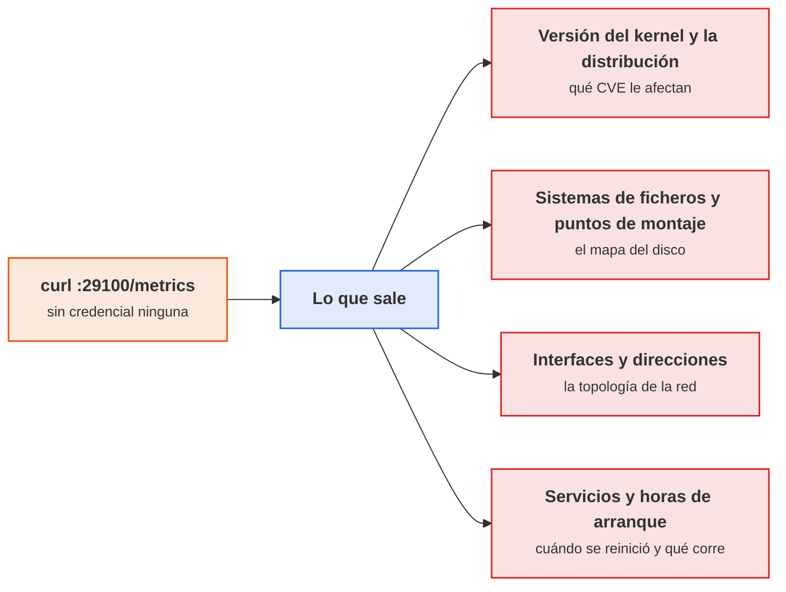
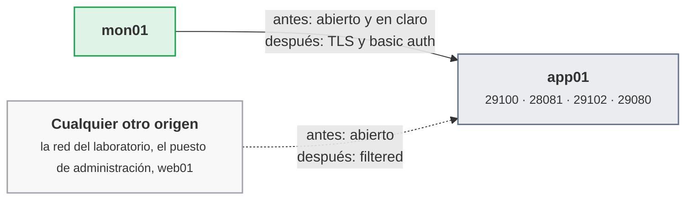
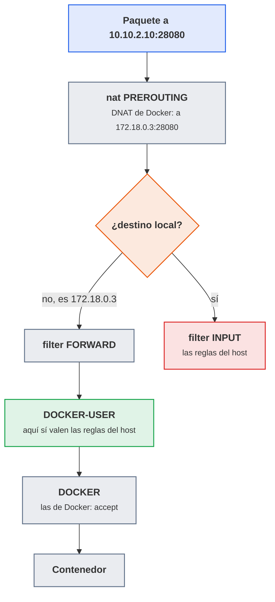
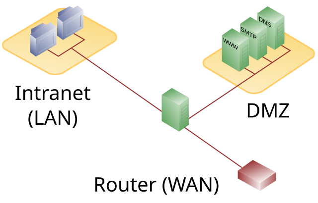
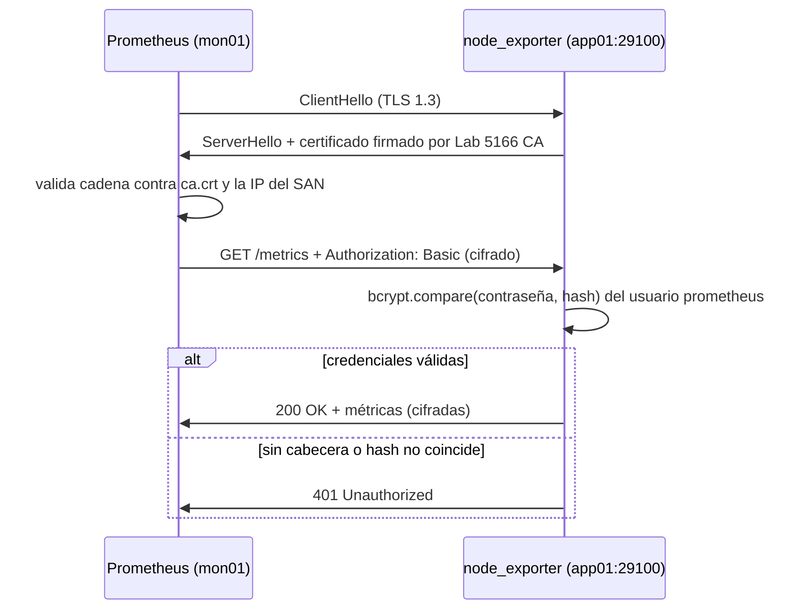
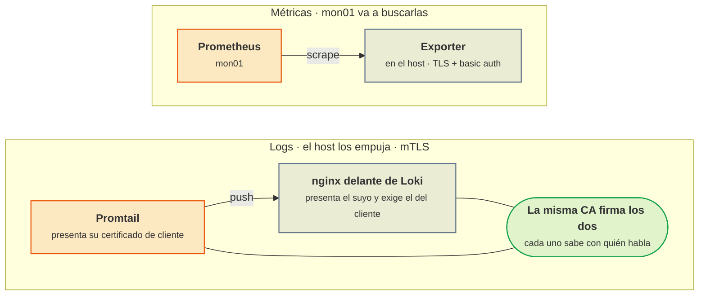

# UT3 · Seguridad de las comunicaciones de monitorización

<p class="ut-meta">6 h · Sesiones 16 a 18 · RA1 CE f, g</p>

Las dos primeras unidades conectaron el servicio del curso a la pila de mon01 (node_exporter, cAdvisor, postgres_exporter, el `/metrics` de la API, Promtail y Loki) y le pusieron alarmas encima. Todo eso se montó pensando en que funcionase y en que Prometheus llegase a todo, y funciona en claro: cada exporter es un servidor HTTP sin autenticación, Promtail manda los logs a Loki por HTTP y Grafana está en el 23000 con la contraseña del primer día. Y la monitorización es justo la pieza que más conviene proteger, porque es la que llega a todas las máquinas y la que sabe todo de ellas: quien entra en ella tiene el mapa de la infraestructura y, si alcanza las alarmas, puede apagarlas antes de atacar.

Esta unidad mira la pila como la miraría alguien que ha entrado en la red y la protege en el orden en que se hace en una empresa. Primero se audita: qué puertos hay abiertos, quién puede llegar a ellos y qué se lleva si llega, con una evidencia fechada de cada cosa; es el criterio f. Después se cierra lo que sobra por capas (la forma de publicar de Docker, el firewall de cada host y OPNsense), se cifra y se autentica lo que queda, y se documenta como una política que se pueda comprobar; es el criterio g. Con esta unidad se cierra la primera evaluación, que tiene su examen el 10 de diciembre. Todo se apoya en la [unidad de seguridad por capas de Despliegue](https://victor-educ.github.io/apuntes-5166/ut/ut3-seguridad-por-capas/), que se cursa a la vez, del 20 de noviembre al 9 de diciembre: allí se montan OPNsense, sus zonas y la CA del curso que se usan aquí.

## Sesión 16 · Auditoría inicial

<p class="ut-meta" markdown>26 de noviembre · Teoría y práctica · <span class="dur" tabindex="0" aria-label="Superficie de exposición de la monitorización · 10 min&#10;Auditar: saber qué hay antes de tocar nada · 10 min&#10;A3.1 Auditoría inicial · 90 min" data-dur="Superficie de exposición de la monitorización · 10 min&#10;Auditar: saber qué hay antes de tocar nada · 10 min&#10;A3.1 Auditoría inicial · 90 min">:material-school:<i class="dur-barra" style="--teoria:18%"></i>:material-flask:</span></p>

Durante dos unidades la pila se ha montado para que funcione, y nadie ha preguntado todavía quién más puede llegar a ella. Antes de cerrar nada hay que saberlo, por dos motivos: lo que se cree abierto (lo que dicen los compose) no siempre es lo que está abierto de verdad, y la práctica evaluable pide demostrar con fecha cómo estaba la pila antes de protegerla y cómo queda después. La teoría sigue el orden en que se razona una auditoría: primero qué regala un `/metrics` abierto, para saber por qué importa; después la tabla de puertos con quién debe llegar a cada uno, que es lo esperado; y al final las cuatro medidas que dicen lo que hay de verdad (el inventario desde dentro, el escaneo desde fuera, qué protocolo habla cada puerto y qué tráfico circula) y la matriz que compara lo esperado con lo medido. La hoja hace esa auditoría sobre app01 y mon01 y deja preparados los certificados y las reglas de OPNsense que harán falta después del traslado. Hoy es el último día en que la pila se puede medir tal como se construyó: mañana, 27 de noviembre, la A3.3 de Despliegue traslada app01 y mon01 a la VPC, detrás de OPNsense.

### Superficie de exposición de la monitorización

**Qué es la superficie de exposición.** Es el conjunto de puntos por los que alguien de fuera puede interactuar con un sistema: cada puerto que escucha, cada servicio que responde, cada API que acepta peticiones. Cuanto más grande, más sitios por donde atacar, y por eso la primera regla de cualquier protección es reducirla: lo que no escucha no se puede atacar.

**Por qué la de la monitorización es tan grande.** Cada exporter es un servidor HTTP más en cada máquina. Cuando se montó la pila, el objetivo era que Prometheus llegase a todo (el scrape: la lectura periódica de cada `/metrics`), y la forma rápida de conseguirlo fue dejar node_exporter escuchando en todas las interfaces y publicar puertos en el host: `28081:28081`, `29102:29102`, `29080:29080`. Ni los exporters ni Prometheus traen activados de fábrica el cifrado ni la contraseña, y al montarla no se activaron. El resultado es que la monitorización abre más puertos que la propia aplicación. El servicio del curso, bien desplegado, expone un único 443 en web01; la monitorización, sin control, expone cuatro puertos en app01, dos en db01 y siete en mon01 (contando Mailpit y la Gitea provisional), ninguno con contraseña.

<figure markdown="span">
  { width="640" }
  <figcaption>Arquitectura de Prometheus: cada flecha de scrape es una conexión HTTP que hay que proteger. Fuente: Proyecto Prometheus, Apache 2.0.</figcaption>
</figure>

#### Qué se ve en un /metrics abierto

**Las métricas no son «solo números».** La idea no aguanta un `curl`. Esto es lo que devuelve un node_exporter recién instalado a cualquiera que llegue al 29100:

```text
node_uname_info{domainname="(none)",machine="x86_64",nodename="app01",release="6.12.22-amd64",sysname="Linux",version="#1 SMP PREEMPT_DYNAMIC Debian 6.12.22-1"} 1
node_os_info{id="debian",name="Debian GNU/Linux",version_id="13"} 1
node_network_address_info{address="10.10.2.10",device="ens18",netmask="24"} 1
node_filesystem_size_bytes{device="/dev/sda1",mountpoint="/var/lib/docker"} 2.1e+10
node_systemd_unit_state{name="ssh.service",state="active"} 1
node_systemd_unit_state{name="postgresql.service",state="inactive"} 1
node_boot_time_seconds 1.763979e+09
```

**Lo que regala node_exporter.** Con esas siete líneas un atacante sabe qué versión exacta del kernel y de la distribución corre la máquina, y con eso qué CVE (vulnerabilidades publicadas con identificador) le afectan; sabe en qué red está y con qué dirección, qué discos tiene montados, qué servicios están activos y cuánto lleva sin reiniciarse (`node_boot_time_seconds`), que suele ser cuánto lleva sin aplicar los parches del kernel, porque esos necesitan reiniciar. Es justo la información que se busca al preparar un ataque, servida sin pedir nada a cambio.



<p class="pie" markdown>No hace falta entrar en la máquina para saber cómo atacarla: basta con que el exporter esté abierto.</p>

**Lo que regalan los demás exporters.** cAdvisor pone en sus series la imagen y el nombre de cada contenedor (las etiquetas `image` y `name`, por ejemplo en `container_last_seen`), así que se ve qué versión de la aplicación corre (`app:1.4.2`). Con su configuración de fábrica copia además todas las etiquetas de Docker de cada contenedor como `container_label_*`, y si alguien puso en una etiqueta del compose una URL con credenciales, está ahí; la configuración del curso solo deja pasar dos, pero el `/metrics` sigue diciendo qué corre y en qué versión. postgres_exporter publica los nombres de las bases de datos y las conexiones por usuario. El `/metrics` de la API del curso enumera las rutas que han recibido alguna petición (`app_http_requests_total{route="/items/<int:id>"}`), incluidas las que no están enlazadas desde ningún sitio.

**Lo que regalan los servidores de la pila.** Prometheus, Alertmanager y Loki filtran todavía más: la API de Prometheus da en `/api/v1/targets` el mapa de todo lo que se monitoriza y en `/api/v1/status/config` la configuración cargada, Alertmanager acepta silencios sin autenticación (un atacante silencia la alarma y después ataca) y Loki sin autenticación deja leer todos los logs e inyectar líneas falsas. El detalle de cada API está en [Para ampliar](../ampliacion.md#lo-que-dejan-ver-prometheus-alertmanager-y-loki-sin-autenticacion).

No es teórico: hay recuentos públicos de cientos de miles de exporters abiertos a Internet ([casos reales](../ampliacion.md#casos-reales-de-pilas-de-monitorizacion-expuestas)).

#### Puertos del entorno del curso y quién debe llegar

**La referencia contra la que se audita.** Auditar es comparar lo que hay con lo que debería haber, y para eso primero hay que escribir lo que debería haber. Esta tabla es esa referencia: cada puerto de la pila, en qué máquina corre y quién tiene motivo para llegar a él. El criterio es el de mínimo privilegio, cada puerto solo para quien lo necesita para su trabajo, y de la tabla salen tanto la columna «esperado» de la matriz de la auditoría como las reglas de los cortafuegos.

| Componente | Puerto | Dónde corre | Quién debe llegar |
|------------|-------:|-------------|-------------------|
| node_exporter | 29100 | app01, db01, mon01 (viene en la plantilla) | Solo mon01 |
| cAdvisor | 28081 | app01 | Solo mon01 |
| /metrics de la app | 29102 | app01 | Solo mon01 |
| Promtail | 29080 | app01 | Solo mon01, que lee sus métricas |
| postgres_exporter | 29187 | db01 | Solo mon01 |
| Loki | 23100 | mon01 | El Promtail de app01 y `logcli` desde el puesto de administración, con certificado de cliente; Grafana y Prometheus por dentro |
| Grafana | 23000 dentro de mon01, 443 tras nginx | mon01 | Usuarios desde la red de gestión |
| Prometheus | 29090 | mon01 | Grafana y Alertmanager por dentro; administradores por túnel SSH |
| Alertmanager | 29093 | mon01 | Prometheus por dentro; administradores por túnel SSH |
| Mailpit | 28025 | mon01 | Administradores por túnel SSH |
| Gitea provisional | 23001 | mon01, hasta el 12 de febrero | La red de gestión y app01 |

Cada servicio escucha en su contenedor en el mismo número con el que se publica, según la [convención de puertos del curso](https://victor-educ.github.io/apuntes-5166/laboratorio/#puertos), así que el número de la tabla es a la vez el que se escanea, el que va a la matriz y el que usan los demás contenedores por la red de Docker.

**Todo lo demás, cerrado.** Y de estos, los administradores entran por la red de gestión (10.10.0.0/24) con usuario nominal (una cuenta por persona, nunca compartida, para que cada acción tenga autor), nunca desde front ni desde back. Los servidores de mon01 se hablan por nombre en la red de Docker, así que en la 10.10.0.20 solo se publica lo que llega de otra máquina: un nginx que hace de puerta de Grafana (443) y de Loki (23100), y la Gitea provisional (23001). Prometheus, Alertmanager y Mailpit quedan en `127.0.0.1`, detrás de un túnel SSH (un puerto del puesto que, por dentro de una conexión SSH, llega a mon01). De fábrica no piden credenciales, y el túnel les pone delante la autenticación y el cifrado de SSH sin tocar nada en ellos.

**Por qué el scrape cruza el cortafuegos.** Un detalle del laboratorio condiciona toda la unidad: **app01 y db01 no tienen pata en la red de gestión**. Cada uno lleva una sola tarjeta, la de su zona (app01 la 10.10.2.10 en back, db01 la 10.10.3.10 en data), y mon01 vive en gestión con la 10.10.0.20. Eso significa que el scrape cruza siempre el cortafuegos, y que la protección no puede consistir en esconder el puerto en una interfaz que solo ve gestión: hay que permitir el paso justo en OPNsense y cerrar el resto en cada host.

**Las reglas de OPNsense.** Salen directamente de la tabla anterior. Son las filas 11 a 13 de la matriz de reglas del laboratorio, y se escriben como las reglas por zona que explicó Despliegue el 25 de noviembre: cada regla en la pestaña de la interfaz por la que entra el tráfico (las [reglas y su orden de evaluación](https://victor-educ.github.io/apuntes-5166/ut/ut3-seguridad-por-capas/#reglas-y-orden-de-evaluacion)) y con alias, nombres que agrupan direcciones o puertos para que la regla se lea sola (los [aliases](https://victor-educ.github.io/apuntes-5166/ut/ut3-seguridad-por-capas/#aliases)). `srv_app` y `srv_db` ya existen, y solo se añaden el host `srv_mon` (10.10.0.20) y los alias de puertos `p_mon_app` y `p_mon_db`.

| Fila | Pestaña | Acción | Origen | Destino | Puertos | Log | Descripción |
|-----:|---------|--------|--------|---------|---------|-----|-------------|
| 11 | MGMT | Pass | `srv_mon` | `srv_app` | `p_mon_app`: 29100, 28081, 29102, 29080 | sí | 11 Scrape de mon01 a app01 |
| 12 | MGMT | Pass | `srv_mon` | `srv_db` | `p_mon_db`: 29100, 29187 | sí | 12 Scrape de mon01 a db01 |
| 13 | DMZINT | Pass | `srv_app` | `srv_mon` | 23100 | sí | 13 Promtail de app01 hacia Loki |

Cualquier otro origen cae en la denegación por defecto, la fila 99. app01 llega además al 23001 de la Gitea provisional por la fila 6, que es de Despliegue. Sin las filas 11 a 13 los targets de app01 y db01 se quedan en DOWN en la VPC y los logs de app01 no llegan a Loki. La A3.1 las deja puestas el día antes del traslado, y así el 1 de diciembre basta con cambiar los targets a las direcciones nuevas.

### Auditar: saber qué hay antes de tocar nada

**Qué es auditar aquí.** Medir lo que hay de verdad, compararlo con lo que debería haber y dejar una prueba fechada de cada medida. Es el criterio f, y se hace antes de proteger nada por dos razones: lo que se cambia ya no se puede medir como estaba, y la evaluable pide la matriz antes y después, porque la comparación es lo que demuestra que la protección funciona.

**Por qué cuatro medidas y no una.** Cada herramienta ve una parte. El inventario desde dentro dice lo que el host cree que expone; el escaneo desde fuera, lo que de verdad se alcanza a través de la red; la prueba de protocolo, lo que se lleva quien llega; y la captura de tráfico, quién usa cada puerto y qué viaja por él. Los problemas se esconden justo en las diferencias entre una medida y otra: un puerto que `ss` no lista y que se ve desde fuera, o un exporter que no está en ningún compose y responde igual. Las cuatro se hacen sobre app01 y mon01, y la matriz las junta: son los cinco apartados que siguen.

!!! otra "Repaso"
    nmap y tcpdump, y cómo se leen sus salidas, se explicaron en Despliegue el 6 de noviembre, en [Cómo se prueba una red](https://victor-educ.github.io/apuntes-5166/ut/ut2-vpc/#como-se-prueba-una-red). Aquí solo se repasa lo que cambia al aplicarlos a los exporters.

#### Inventario desde dentro

**Qué escucha cada host.** `ss -tlnup` lista los sockets TCP y UDP en escucha (`-t`, `-u`, `-l`), con números en lugar de nombres (`-n`) y con el proceso que los abrió (`-p`; el proceso solo se ve con root):

```bash
sudo ss -tlnup
# Netid State  Recv-Q Send-Q Local Address:Port  Peer Address:Port Process
# tcp   LISTEN 0      4096               *:29100            *:*     users:(("prometheus-node",pid=812,fd=3))
# tcp   LISTEN 0      4096         0.0.0.0:28081      0.0.0.0:*     users:(("docker-proxy",pid=1544,fd=4))
# tcp   LISTEN 0      4096         0.0.0.0:29102      0.0.0.0:*     users:(("docker-proxy",pid=1590,fd=4))
# tcp   LISTEN 0      4096         0.0.0.0:29080      0.0.0.0:*     users:(("docker-proxy",pid=1602,fd=4))
# tcp   LISTEN 0      128          0.0.0.0:22         0.0.0.0:*     users:(("sshd",pid=610,fd=3))
```

**La dirección es lo que importa.** La columna de dirección local dice desde dónde se puede llegar: `0.0.0.0` o `*` es todas las interfaces, incluidos los bridges de Docker; `127.0.0.1`, solo desde la propia máquina; `10.10.2.10`, solo por la tarjeta de la zona. Un exporter en `0.0.0.0` no es un agujero por sí mismo, pero quiere decir que todo depende de que un cortafuegos lo cierre.

**Lo que publica Docker no siempre sale en `ss`.** Los puertos que aparecen con el proceso `docker-proxy` los publica Docker. Ese proceso es solo un apoyo: Docker publica en realidad con reglas de NAT en el kernel, y si se desactiva el proxy (`"userland-proxy": false` en `daemon.json`) el puerto sigue abierto pero desaparece de `ss`. Por eso el inventario no está completo sin preguntar a Docker qué publica:

```bash
docker ps --format '{{.Names}}\t{{.Ports}}'
# servicio-app-1   0.0.0.0:29102->29102/tcp, :::29102->29102/tcp
# cadvisor         8080/tcp, 0.0.0.0:28081->28081/tcp, :::28081->28081/tcp
# promtail         0.0.0.0:29080->29080/tcp, :::29080->29080/tcp
# servicio-db-1    5432/tcp
```

`0.0.0.0:29102->29102/tcp` es un puerto publicado para todo el mundo, en IPv4 y en IPv6; el primer número es el del host, que es el que se escanea desde fuera, y el segundo, el del contenedor, que en el curso es siempre el mismo. `5432/tcp` sin flecha se expone pero no se publica: solo se alcanza desde la red de Docker. El `8080/tcp` de cAdvisor, también sin flecha, es otra cosa: el puerto que su imagen declara de fábrica (su `EXPOSE`), que sigue en la lista aunque el contenedor escuche en el 28081; ahí no escucha nada. node_exporter no sale en esta lista porque no es un contenedor sino un servicio del sistema, que viene en la plantilla de las VM: de él solo informa `ss`. Cómo son esas reglas de NAT, y por qué el cortafuegos del host no ve los puertos que publica Docker, se explica el 1 de diciembre, en [Por qué Docker se salta el firewall del host](#por-que-docker-se-salta-el-firewall-del-host).

#### Escaneo desde fuera

**Por qué desde fuera, y desde dónde.** El inventario dice lo que el host cree que expone; el escaneo, lo que de verdad se alcanza desde otra máquina, con todo lo que hay por medio (cortafuegos, rutas, el NAT de Docker). Como lo que se alcanza depende de desde dónde se mire, se escanea desde varios orígenes, y los de la unidad son fijos porque cada uno representa a un tipo de cliente:

- **mon01**, el cliente legítimo: tiene que ver los exporters.
- **El puesto de administración** (10.10.0.50), una máquina de gestión que no es la monitorización: no tiene por qué leer métricas, aunque esté en la red de confianza.
- **web01**, la máquina más expuesta, en la DMZ externa: es la primera que caería si alguien entra desde Internet, y no debe ver nada de la monitorización.
- **app01 hacia mon01**, el sentido contrario: los logs van de app01 a mon01, así que app01 tiene que llegar a Loki y a la Gitea provisional, y a nada más.

El 26 de noviembre, con web01 ya detrás de OPNsense, el origen «de fuera» es el puesto de administración, por su tarjeta en la red del laboratorio.

**Las opciones de nmap.** Interesan dos escaneos: `-sS` (SYN, con root: manda solo el primer paquete de cada conexión y no la completa, así que es rápido) y `-sV`, que identifica el servicio de cada puerto abierto y dice si habla TLS. `--reason` añade a cada puerto el paquete que decidió su estado, que es justo lo que hay que interpretar; `-p-` recorre los 65 535 puertos en lugar de los mil más habituales, entre los que no está ninguno de los que usa el curso del 20000 al 29999 (sin `-p`, nmap no encuentra ni un exporter), y `-T4` acorta las esperas, algo razonable en una red de laboratorio sin pérdidas. Detrás de un cortafuegos hace falta además `-Pn`: antes de escanear, nmap comprueba si el host está vivo con un ping y un par de sondas TCP, y si el cortafuegos las tira todas lo da por caído y no escanea nada (avisa con `Host seems down`); `-Pn` se salta esa comprobación.

```bash
sudo nmap -sS -p- --reason -T4 <app01> <mon01>                 # desde el puesto de administración, todos los puertos
sudo nmap -sS -p 22,28081,29080,29100,29102 --reason <app01>   # desde mon01, solo los esperados
```

**Cómo se lee cada estado.** Es lo que se pide en la práctica y lo que la gente confunde:

| Estado nmap | Qué ha pasado en la red | Qué significa aquí |
|-------------|-------------------------|--------------------|
| `open` | Llegó un SYN-ACK | Hay un servicio escuchando y nada lo filtra |
| `closed` | Llegó un RST | El paquete llegó al host pero nadie escucha en ese puerto; un firewall que rechaza con RST en vez de tirar (la acción Reject) también da esto |
| `filtered` | No llegó nada, o llegó un ICMP unreachable | Un firewall con `drop` lo ha tirado por el camino (OPNsense o nftables) |

Hoy, desde el puesto de administración, el 29100 de app01 sale `open`; al final tiene que salir `filtered`, y desde mon01 seguir `open`. La salida se guarda con `-oN escaneo-desde-admin-$(date +%F).txt`: la fecha del nombre y la hora de la cabecera son la evidencia. Si todo está filtrado, el escaneo tarda minutos, porque nmap espera el timeout de cada puerto: eso ya indica un `drop`. web01 ya tiene nmap; desde app01, que no lo tiene, se usa `nc -zv -w 3 <IP> <puerto>`: `succeeded` es open, `refused` es closed y el tiempo agotado, filtered.

#### Protocolos y autenticación

**Por qué no basta con el escaneo.** `open` dice que alguien responde, no qué entrega ni si pregunta quién llama. La tercera medida pide cada `/metrics` como lo pediría cualquiera, sin credenciales, y mira el diálogo entero con `curl -v`:

```bash
curl -sv http://<app01>:29100/metrics 2>&1 | head -20
```

**Qué se lee en la salida.** Las líneas que empiezan por `>` son lo que envía curl, y las que empiezan por `<`, lo que contesta el servidor. Si la conexión fuese cifrada, antes de la petición aparecería el handshake TLS (el saludo inicial en el que cliente y servidor acuerdan cómo cifrar), con una línea `SSL connection using TLSv1.3`; si el exporter pidiese credenciales, la respuesta sería `401 Unauthorized`. Un `HTTP/1.1 200 OK` seguido de las métricas, desde el puesto de administración, son tres fallos a la vez: alcanzable desde donde no toca, en claro y sin autenticación. Cada uno se arregla en un sitio distinto, y ese es el orden de lo que queda de unidad: el cortafuegos decide quién llega, TLS cifra lo que viaja y la autenticación decide a quién se contesta.

#### Tráfico real con tcpdump

**Lo que no ve ninguna de las anteriores.** El escaneo y curl prueban qué pasa cuando alguien abre una conexión hacia un puerto; no dicen quién la abre de verdad ni qué viaja por ella. Para los logs eso es lo que importa, porque ahí la conexión la abre app01: Promtail empuja sus lotes hacia el 23100 de mon01, y la única forma de ver qué viaja es capturarlo. En app01:

```bash
sudo tcpdump -i ens18 -nn -A port 23100 -c 20
# 10:42:17.301 IP 10.10.2.10.48122 > 10.10.0.20.23100: Flags [P.], seq ..., length 1834
# 10:42:17.303 IP 10.10.0.20.23100 > 10.10.2.10.48122: Flags [P.], seq ..., length 89
```

**Qué se busca.** La salida de ejemplo es con las direcciones de la VPC; el 26 de noviembre salen las de la red del laboratorio. Las opciones son las de siempre (`-i` la interfaz, `-nn` sin traducir direcciones ni puertos a nombres, `-c 20` para parar a los veinte paquetes) más `-A`, que imprime el contenido de cada paquete como texto. Se busca que el único destino sea mon01 y que inicie app01: un puerto de origen efímero (el que el sistema asigna al cliente, distinto en cada conexión) y el 23100 de destino. Antes de proteger se lee la petición `POST /loki/api/v1/push` con sus cabeceras y trozos de las líneas de log, porque Promtail las comprime, pero comprimir no es cifrar. Cuando el envío vaya cifrado, al final de la unidad, no se leerá nada, y esa pareja de capturas, la de hoy y la del final, es la evidencia de cifrado de la práctica evaluable.

#### La matriz de exposición

**Para qué una matriz.** Los ficheros de nmap, curl y tcpdump son la prueba, pero nadie los lee uno a uno. La matriz los ordena para que se entiendan de un vistazo: una fila por cada origen y destino, con lo que se esperaba (de la tabla de puertos), lo que se obtuvo (de las medidas) y el fichero que lo demuestra. Estas son las filas mínimas, las mismas el 26 de noviembre, con las direcciones de la red del laboratorio, y el 3 de diciembre, con las de la VPC:

| Origen | Destino | Puertos | Esperado | Obtenido (antes) | Obtenido (después) | Evidencia |
|--------|---------|---------|----------|------------------|--------------------|-----------|
| mon01 | app01 | 29100, 28081, 29102, 29080 | open | open | | escaneo-app01-desde-mon01-2026-11-26.txt |
| puesto de administración | app01 | 29100, 28081, 29102, 29080 | filtered | open | | escaneo-desde-admin-2026-11-26.txt |
| puesto de administración | mon01 | 23000, 28025, 29090, 29093, 29100 | filtered | open | | ídem |
| puesto de administración | mon01 | 443 | open | closed (aún no hay nginx) | | ídem |
| puesto de administración | mon01 | 23001, 23100 | open (23100 solo con certificado de cliente) | open | | ídem |
| app01 | mon01 | 23100 | open y cifrado | open y en claro | | tcpdump-app01-23100-2026-11-26.txt |
| app01 | mon01 | 23000, 28025, 29090, 29093 | filtered | open | | nc-mon01-desde-app01-2026-11-26.txt |
| web01 | app01 y mon01 | todos los de la tabla de puertos | filtered | no se mide: web01 ya está detrás de OPNsense | | |

Las filas donde esperado y obtenido no coinciden se marcan en rojo: son la lista de trabajo del resto de la unidad, y en la práctica evaluable se rellena «obtenido (después)». Al final de la unidad, la misma matriz con las dos columnas llenas es la demostración de que el trabajo está hecho.



<p class="pie" markdown>El objetivo de la unidad en una imagen: que solo quede una flecha, y además autenticada.</p>

### A3.1 Auditoría inicial (sesión 16)

<span class="et et-obj">Objetivo</span> Tener la matriz de exposición de la pila de monitorización tal como está hoy, con una evidencia fechada por fila y en rojo las filas que no deberían estar así. Es la mitad «antes» de la práctica evaluable, y solo se puede medir hoy: mañana app01 y mon01 se van a la VPC y la pila deja de estar como se construyó. De paso dejas preparados los certificados y las reglas de OPNsense que la unidad necesita después del traslado, para que el resto de la unidad solo tenga que instalarlos.

<span class="et et-pre">Antes de empezar</span>

- app01 y mon01 con la pila de monitorización y alarmas funcionando (todos los targets en UP), todavía en la red del laboratorio y sin cortafuegos: eso es lo que la matriz tiene que demostrar con fecha. Hoy se usan sus direcciones en la red del laboratorio; el traslado a la VPC es mañana, en la A3.3 de Despliegue.
- El puesto de administración, que tiene tarjeta en la red del laboratorio además de la 10.10.0.50, hace hoy de origen «de fuera»: web01 ya está detrás de OPNsense y no llega a la red del laboratorio.
- La consola de OPNsense, con los alias `srv_app` y `srv_db`, y la CA del curso (`Lab 5166 CA`) en `~/ca/` del puesto de administración, las dos tal como las dejó ayer la [A3.2 de Despliegue](https://victor-educ.github.io/apuntes-5166/ut/ut3-seguridad-por-capas/). Si la CA no existe, créala con aquel apartado antes del paso 5.
- Lo explicado antes: [qué se ve en un /metrics abierto](#que-se-ve-en-un-metrics-abierto), la [tabla de puertos con las filas 11 a 13](#puertos-del-entorno-del-curso-y-quien-debe-llegar) y las [cuatro medidas de la auditoría con su matriz](#auditar-saber-que-hay-antes-de-tocar-nada), con el repaso de nmap y tcpdump. Para el paso 5, [Certificados con la CA del curso](#certificados-con-la-ca-del-curso), que se explica el 1 de diciembre pero hoy solo hace falta para firmar.

<span class="et et-pas">Pasos</span>

Vas a hacer dos cosas. Primero, en los cuatro primeros pasos, la auditoría, de dentro afuera y en el orden de la teoría: lo que cada host dice que escucha, lo que se alcanza desde otras máquinas y lo que contesta cada puerto, lo que viaja por la red y, al final, la matriz que lo compara todo con lo esperado. Después, en los dos últimos, preparas el traslado de mañana: los certificados y las reglas de OPNsense no se pueden probar hoy, pero dejarlos hechos es lo que permite que la clase del 1 de diciembre se dedique entera a cerrar y a cifrar.

1. **Haz el inventario de app01 y de mon01.** Antes de mirar desde fuera, apunta lo que cada máquina dice que expone, con las dos órdenes de [Inventario desde dentro](#inventario-desde-dentro), en `inventario-<host>-<fecha>.txt`. Por cada puerto, anota en qué dirección escucha y si lo publica Docker: son los dos datos que deciden después dónde va la regla que lo cierra.

    *Pista:* instala antes `tcpdump`, `netcat-openbsd` y `nftables` en app01, que mañana pierde la salida a Internet, y `nmap` en mon01 y en el puesto de administración. De app01, la matriz solo recoge lo que sigue allí tras el traslado: la base de datos, nginx y postgres_exporter se van mañana.

2. **Escanea desde fuera y pide las métricas sin credenciales.** Comprueba qué se alcanza de verdad desde los dos orígenes de hoy, como en [Escaneo desde fuera](#escaneo-desde-fuera): desde mon01, los puertos esperados de app01 (`escaneo-app01-desde-mon01-<fecha>.txt`), que tienen que salir abiertos porque es el cliente legítimo; desde el puesto de administración, todos los de app01 y mon01 (`escaneo-desde-admin-<fecha>.txt`), que es lo que vería cualquiera de la red del laboratorio. Después, desde el puesto, guarda en `curl-app01-desde-admin-<fecha>.txt` lo que responden los cuatro exporters de app01 a una petición sin credenciales, como en [Protocolos y autenticación](#protocolos-y-autenticacion): demuestra que, además de alcanzables, hablan en claro y contestan a cualquiera.

3. **Mira qué viaja por la red desde app01.** Guarda en `tcpdump-app01-23100-<fecha>.txt` veinte paquetes del tráfico de Promtail hacia Loki con el contenido legible, como en [Tráfico real con tcpdump](#trafico-real-con-tcpdump): es la mitad «antes» de la pareja de capturas que demuestra el cifrado. Guarda también en `nc-mon01-desde-app01-<fecha>.txt` si app01 llega a los puertos 23000, 28025, 29090 y 29093 de mon01: es el sentido contrario, lo que alcanzaría quien comprometiese la API.

    *Pista:* comprueba el nombre de la interfaz con `ip -br link` antes de capturar. `nc` escribe su resultado en la salida de error: redirígela al fichero.

4. **Junta las medidas en la matriz.** Reúne las evidencias en `audit/antes/` del repositorio `monitoring` de mon01 (`/opt/monitoring`) y crea `audit/matriz.md` con las ocho filas de [La matriz de exposición](#la-matriz-de-exposicion): «obtenido (antes)» con lo medido y las direcciones de hoy, «después» vacía, y en rojo (negrita o una columna «estado») las filas donde esperado y obtenido no coinciden, que son la lista de trabajo del resto de la unidad. Haz commit: su fecha es una prueba más de cuándo se midió.

5. **Emite de una vez los certificados de la unidad.** El resto de la unidad cifra el scrape y los logs, y cada servicio que va a hablar TLS necesita su certificado firmado por la CA del curso. Emítelos hoy todos, como en [Certificados con la CA del curso](#certificados-con-la-ca-del-curso), y déjalos con sus claves y una copia de `ca.crt` en `~/tls-monitorizacion/` del puesto de administración, fuera de cualquier repositorio: después solo habrá que copiarlos. Son ocho. Siete son de servidor, con su SAN: `app01-node` y `app01-nginx` (`DNS:app01.dev.lab,IP:10.10.2.10`), `db01-node` y `db01-postgres` (`DNS:db01.dev.lab,IP:10.10.3.10`), `mon01-node` y `mon01-loki` (`DNS:mon01.lab,IP:10.10.0.20`) y `mon01-nginx` (lo mismo más `DNS:grafana.lab`). El octavo, `promtail-app01`, es de cliente y no lleva SAN. Comprueba uno de cada clase con `openssl x509 -noout -ext subjectAltName,extendedKeyUsage`.

    *Pista:* con la función de aquel apartado, cada certificado de servidor es una línea; el de cliente lleva `-extensions client_cert` y ningún SAN. Si repites una firma, `index.txt` la apunta dos veces: emite solo los que falten.

6. **Deja en OPNsense las reglas del traslado.** Crea las filas 11 a 13 de la [tabla del apartado](#puertos-del-entorno-del-curso-y-quien-debe-llegar), con sus alias nuevos (`srv_mon`, `p_mon_app` y `p_mon_db`) y el número de fila al principio de la descripción, para que el log y la matriz de reglas se crucen sin buscar. Hoy no se pueden probar, porque app01 y mon01 todavía no pasan por OPNsense, pero desde el traslado de mañana son las que dejan pasar el scrape y los logs. Mañana añade también las tres filas, con su justificación, a la `matriz-reglas.md` que empiezas en la A3.3 de Despliegue.

<span class="et et-com">Comprobación</span> Un fichero de inventario por host, el escaneo desde mon01 y el del puesto de administración con la fecha en el nombre y en la cabecera, el fichero de curl con `200 OK` y métricas, el de `nc` desde app01 con los cuatro puertos `succeeded`, y una captura de tcpdump donde se lee `POST /loki/api/v1/push` en claro. En la matriz, las filas del puesto de administración y de app01 hacia puertos de monitorización están en rojo y la de mon01 no. En `~/tls-monitorizacion/` hay ocho certificados con su clave y `ca.crt`, y los dos comprobados dicen lo que tienen que decir: el de servidor lleva su SAN y `serverAuth`, y el de cliente, `clientAuth`. En OPNsense están los tres alias y las filas 11 a 13.

<span class="et et-ent">Para practicar</span> Antes de salir, haz commit de `audit/antes/` y `audit/matriz.md` en el repositorio `monitoring`: la práctica evaluable de la unidad parte de esta matriz, que es su mitad «antes». Los certificados y sus claves no van a ningún repositorio: déjalos en `~/tls-monitorizacion/` del puesto, y de ahí los copiarás a cada host.

<span class="et et-ext">Si te sobra tiempo</span> Consulta `http://<mon01>:29090/api/v1/targets` y `/api/v1/status/config` desde el puesto de administración y anota qué se lee de la infraestructura sin ninguna credencial.

## Sesión 17 · Red, firewall y TLS

<p class="ut-meta" markdown>1 de diciembre · Teoría y práctica · <span class="dur" tabindex="0" aria-label="Por qué Docker se salta el firewall del host · 10 min&#10;Reducir: red Docker dedicada y firewall por host · 10 min&#10;Proteger: cifrado y autenticación · 10 min&#10;A3.2 Red, firewall y TLS · 80 min" data-dur="Por qué Docker se salta el firewall del host · 10 min&#10;Reducir: red Docker dedicada y firewall por host · 10 min&#10;Proteger: cifrado y autenticación · 10 min&#10;A3.2 Red, firewall y TLS · 80 min">:material-school:<i class="dur-barra" style="--teoria:27%"></i>:material-flask:</span></p>

La matriz de la A3.1 tiene filas en rojo de tres clases: puertos que se alcanzan desde donde no toca, tráfico que viaja en claro y servicios que contestan a cualquiera. Desde el 27 de noviembre app01 y mon01 están en la VPC, detrás de OPNsense, y eso permite por fin arreglarlas con las dos capas que quedan: **reducir**, para que solo llegue quien debe, y **proteger**, para que lo que llega vaya cifrado y con credenciales. Hacen falta las dos, porque una sin la otra no protege nada: un puerto cerrado sigue hablando en claro con quien sí puede llegar, y un puerto cifrado sigue expuesto a quien no debería verlo. La teoría va en el orden en que se aplican. Primero, por qué un cortafuegos en un host con Docker no filtra los puertos que publica Docker, porque sin eso las reglas de la hoja parecen no funcionar; después, la reducción por capas (publicar solo donde hace falta, el nftables de cada host y la segunda capa en OPNsense); luego, qué resuelve TLS y qué resuelve la autenticación, los certificados de la CA del curso y cómo se activan los dos en un exporter; y al final, cómo se demuestra que todo eso funciona. La hoja lo aplica a app01, que tiene a la vez un exporter que escucha como servicio del host y tres puertos que publica Docker: al acabar, app01 queda cerrado por su propio nftables además de por OPNsense, de forma que sobrevive a un reinicio, y el scrape de su node_exporter va cifrado y con contraseña, con `nmap -sV` respondiendo `ssl/http`. Los ficheros van completos aquí y la hoja solo tiene que adaptarlos. El cierre de mon01 y el mTLS entre Promtail y Loki se montan en la práctica evaluable, el 3 de diciembre, con su material de consulta allí.

### Por qué Docker se salta el firewall del host

**El síntoma.** Es el error más común al poner un firewall en una máquina con Docker, y conviene entender el mecanismo porque aparece en cualquier host que combine las dos cosas. Alguien pone reglas en nftables o en ufw (un frontal simplificado de iptables) para cerrar el 28080, comprueba con `nft list ruleset` que están, y desde otra máquina el 28080 sigue abierto. La regla no está mal: es que el paquete nunca pasa por ella.

**Las piezas del cortafuegos del kernel.** El filtro de paquetes de Linux se llama Netfilter y vive en el kernel; iptables y nftables son las dos herramientas con las que se le escriben reglas (nftables es la actual y la que trae Debian; iptables, la histórica, que todavía usan muchos programas, Docker entre ellos). Para seguir el mecanismo hacen falta tres piezas: las **tablas**, que agrupan las reglas según lo que hacen (`nat` para reescribir direcciones, `filter` para aceptar o tirar); las **cadenas**, los puntos del camino del paquete donde se aplican (`PREROUTING` al entrar, `INPUT` si va al propio host, `FORWARD` si el host lo reenvía a otro sitio); y el **DNAT** (NAT de destino), la reescritura de la dirección o el puerto de destino de un paquete, que es lo que hace el port forward de un router.

**Cómo publica Docker un puerto.** Un contenedor tiene su propia dirección en una red bridge de Docker (por ejemplo, la 172.18.0.3), que solo existe dentro del host. Para que un puerto del host llegue a él, Docker hace lo mismo que el [port forward de OPNsense](https://victor-educ.github.io/apuntes-5166/ut/ut3-seguridad-por-capas/#nat-port-forward-y-outbound), pero dentro del propio host. Con `-p 28080:28080` no abre un socket y reenvía (eso solo lo hace `docker-proxy` como apoyo para el tráfico local): escribe una regla DNAT en la cadena `PREROUTING` de la tabla `nat` que cambia el destino `10.10.2.10:28080` por `172.18.0.3:28080` (el contenedor escucha en el mismo número), y reglas en la cadena `FORWARD` de la tabla `filter` que aceptan ese tráfico hacia el bridge.

**Por qué la regla del host no lo ve.** Un paquete que llega de fuera con destino al contenedor entra por `PREROUTING` y se le cambia el destino; como el nuevo destino ya no es una dirección del host, el kernel lo enruta: pasa por `FORWARD`, no por `INPUT`. Las reglas de `INPUT`, que es donde todo el mundo pone las de «este host solo acepta X», no lo ven jamás. Con `-p 29100:29100` de un node_exporter en contenedor pasaría exactamente lo mismo.



<p class="pie" markdown>El tráfico a un contenedor publicado nunca pasa por `INPUT`: por eso una regla en el firewall del host no lo filtra y hay que ponerla en `DOCKER-USER`.</p>

**La cadena que Docker deja para el administrador.** Docker sabe que esto es un problema y por eso crea la cadena `DOCKER-USER` al principio de `FORWARD`: es la única cadena que Docker promete no tocar, y todo el tráfico hacia contenedores pasa por ella antes que por las reglas de Docker. En Debian 13 con Docker Engine 28 las reglas de Docker se escriben con la API de iptables, que por debajo es `iptables-nft`, así que acaban como tablas de nftables (`ip filter`, `ip nat`) que conviven con la tabla propia del host (`inet fw`, la del fichero de más abajo). Un matiz de nftables que aquí importa: cuando hay varias tablas con cadenas base en el mismo hook (el mismo punto del camino del paquete), el kernel las evalúa todas. Un `accept` en la cadena de Docker no salva al paquete de un `drop` en la propia; un `drop` en cualquiera es definitivo. Por eso una cadena `forward` en la tabla propia con reglas de `drop` explícitas funciona aunque Docker acepte el tráfico en la suya.

**Las tres soluciones.** En el laboratorio se usan las tres, según el caso:

1. **Publicar en una IP concreta.** `-p 10.10.2.10:29102:29102` (o `"10.10.2.10:29102:29102"` en el compose) hace que la regla DNAT solo se aplique a paquetes cuyo destino original es esa IP. En una máquina con varias tarjetas esto basta para esconder un puerto de las zonas que no deben verlo. En el laboratorio del curso no basta, y conviene tenerlo claro desde el principio: app01 tiene una sola tarjeta, la de la zona back, así que publicar en la 10.10.2.10 no lo esconde de nadie que ya esté en back. Lo que sí consigue es dejar de publicar en `0.0.0.0`, es decir, retirar el puerto de `localhost` y de los bridges de Docker, donde cualquier contenedor del host lo alcanzaba. Lo mismo vale para los exporters que corren como servicio del sistema (node_exporter con `--web.listen-address=10.10.2.10:29100`), que no tienen nada que ver con Docker pero sufren el mismo problema de "escuchar en todas partes". Se puede fijar como valor por defecto en `/etc/docker/daemon.json` con `"ip": "10.10.2.10"`, y entonces cualquier `-p 28080:28080` que a alguien se le olvide restringir se publica ahí y no en todas las interfaces. Quién llega de verdad al puerto lo decide la solución 3 y OPNsense.
2. **No publicar: red interna.** Si Prometheus corre en un contenedor de la misma máquina, no hace falta publicar nada: los dos contenedores comparten una red Docker y se hablan por nombre. Es lo que se hace en mon01 con Prometheus, Alertmanager, Loki y Grafana. Para app01, donde Prometheus está en otra máquina, la red Docker no cruza hosts, así que se combina con la solución 1 o la 3 (apartado siguiente).
3. **Reglas en DOCKER-USER o en la cadena forward de nftables.** Es la solución que protege aunque alguien publique mal un puerto, y por eso es la que exige la política. Con iptables:

```bash
iptables -I DOCKER-USER -i ens18 -p tcp -m conntrack --ctorigdstport 28081 ! -s 10.10.0.20 -j DROP
```

El `--ctorigdstport` es necesario porque en `DOCKER-USER` el paquete ya ha pasado por el DNAT y su puerto de destino es el del contenedor, que no siempre coincide con el publicado; conntrack (el seguimiento de conexiones del kernel, el mismo que hace funcionar los [cortafuegos con estado](https://victor-educ.github.io/apuntes-5166/ut/ut3-seguridad-por-capas/#cortafuegos-con-estado)) recuerda el destino original. En el curso los dos números coinciden, porque cada servicio escucha en el mismo con el que se publica, pero la regla no debe depender de eso: si alguien publica un contenedor que dentro escucha en otro número, una regla sobre el puerto de destino ya no lo filtra. Con nftables la misma idea va en la cadena `forward` de la tabla propia y aparece en el fichero completo más abajo.

!!! ojo "ufw y Docker"
    `ufw` es un frontal de iptables que solo escribe en `INPUT`, así que con Docker no sirve para nada respecto a los puertos publicados, y hay años de hilos en foros de gente sorprendida. Si aparece ufw en una máquina con Docker, lo prudente es asumir que los puertos publicados están abiertos y comprobarlo con nmap desde fuera.

### Reducir: red Docker dedicada y firewall por host

El trabajo de este apartado es cerrar puertos. El objetivo es que, al terminar, un escaneo desde cualquier sitio que no sea mon01 devuelva `filtered` para todos los puertos de la monitorización, y que ese resultado se deba a dos capas independientes: la forma de publicar los puertos y el firewall de cada host, por un lado, y OPNsense en el centro de la VPC, por otro. Si una de las dos falla o alguien la desconfigura, la otra sigue cerrando. Es la [defensa en profundidad](https://victor-educ.github.io/apuntes-5166/ut/ut3-seguridad-por-capas/#defensa-en-profundidad-y-zonas) del modelo de capas, aplicada a la monitorización.

<figure markdown="span">
  { width="560" }
  <figcaption>La monitorización cruza zonas (gestión hacia back y data) y por eso necesita regla en el cortafuegos central, además de en cada host. Fuente: Pbroks13, dominio público, vía Wikimedia Commons.</figcaption>
</figure>

#### Publicar solo donde hace falta

**Lo que se arregla en el compose.** La red dedicada ya existe: es `obs`, la red de Docker que comparten los composes del servicio, de los agentes y de la monitorización, y por la que los contenedores se llaman por nombre. Lo que falta es acotar lo que se publica hacia fuera. En app01 hay que publicar, porque Prometheus está en otra máquina, así que se aplica la solución 1 cambiando solo las líneas `ports` de los dos composes:

```yaml
# /opt/servicio/compose.yml, servicio app
    ports:
      - "10.10.2.10:28080:28080"   # la API, la que consume web01
      - "10.10.2.10:29102:29102"   # /metrics, solo para mon01
# /opt/agentes/compose.yml: cadvisor con "10.10.2.10:28081:28081" y promtail con "10.10.2.10:29080:29080"
```

Lo que se retira es la publicación en `0.0.0.0` (localhost y los bridges de Docker), no el puerto de servicio: el 28080 sigue ahí para web01. Que desde otras zonas no se llegue no lo arregla este cambio, sino el nftables del host y OPNsense. En mon01, en cambio, se aplica la solución 2: la pila habla por nombre dentro de `obs`, y en la 10.10.0.20 solo publican nginx (443 y 23100) y la Gitea provisional. Se monta en la práctica evaluable, con el fichero completo en [Cerrar mon01](#cerrar-mon01-publicacion-y-cortafuegos).

#### nftables por host: el fichero completo

**Por qué cada host lleva el suyo.** Cada host lleva su propio firewall aunque OPNsense ya filtre entre zonas, por dos motivos: OPNsense no ve el tráfico dentro de una misma subred (una máquina comprometida en back llegaría a app01 sin pasar por él), y dos capas independientes son lo que pide la defensa en profundidad. En Debian el cortafuegos del host se escribe con nftables: el fichero va en `/etc/nftables.conf`, que es el que carga `nftables.service` al arrancar, y se activa con `systemctl enable --now nftables`.

**Cómo se lee un fichero de nftables.** A diferencia de iptables, en nftables no hay tablas ni cadenas hechas de antemano: se declaran. Una **tabla** agrupa todo lo propio, y la familia `inet` hace que valga a la vez para IPv4 y para IPv6. Dentro, cada **cadena base** se engancha a un punto del camino del paquete (`hook input`, `forward` u `output`, los mismos del apartado anterior) con una prioridad, y lleva una **política**: lo que se hace con el paquete que llega al final sin que ninguna regla haya decidido. Un **conjunto** (`set`) es una lista con nombre que las reglas usan con `@`, para escribir los puertos una sola vez. Y las reglas que empiezan por `ct` consultan conntrack: `ct state established,related accept` deja pasar todo lo que pertenece a una conexión ya aceptada, así que solo hay que escribir reglas para el primer paquete de cada una.

Este es el de app01 completo; conviene fijarse en las dos cadenas: `input` es para lo que escucha el propio host (node_exporter, SSH) y `forward` para los puertos que publica Docker, que no pasan por `input`:

```text
#!/usr/sbin/nft -f
table inet fw
flush table inet fw

table inet fw {
    set mon_ports {
        type inet_service
        elements = { 29100, 28081, 29102, 29080 }
    }

    chain input {
        type filter hook input priority filter; policy drop;

        iif lo accept
        ct state established,related accept
        ct state invalid drop
        ip protocol icmp accept
        ip6 nexthdr icmpv6 accept

        # gestión: SSH solo desde la red de gestión
        ip saddr 10.10.0.0/24 tcp dport 22 accept

        # monitorización: el exporter que escucha como servicio (node_exporter), solo desde mon01
        ip saddr 10.10.0.20 tcp dport @mon_ports accept
        tcp dport @mon_ports log prefix "mon-denegado: " drop
    }

    chain forward {
        type filter hook forward priority filter; policy accept;

        # puertos publicados por Docker: mismo criterio, con el puerto de antes del DNAT
        iifname "ens18" ip saddr != 10.10.0.20 meta l4proto tcp ct original proto-dst @mon_ports log prefix "mon-docker-denegado: " drop
        # el 28080 de la API no necesita regla: lo publica Docker, pasa por aquí con
        # política accept, y OPNsense solo deja llegar a él desde web01 (fila 3)
    }

    chain output {
        type filter hook output priority filter; policy accept;
    }
}
```

Las decisiones del fichero:

- **Las dos primeras líneas** crean la tabla si no existe y la vacían, así que el fichero se puede recargar con `nft -f /etc/nftables.conf` sin duplicar reglas. La primera hace falta porque no se puede vaciar una tabla que todavía no existe: sin ella, la primera carga del fichero fallaría. Las dos tocan solo la tabla propia: un `flush ruleset`, que es como empieza el `/etc/nftables.conf` que trae Debian, borraría también las tablas de Docker, que no las regenera hasta que se reinicia el servicio, y dejaría los contenedores publicados sin NAT.
- **`input` con política `drop`**: el host solo acepta lo que la matriz justifica. Primero va lo que no se discute (el tráfico local por `lo`, las respuestas de conexiones ya aceptadas y el ICMP, sin el que no funcionan ni el ping de diagnóstico ni IPv6), y después SSH solo desde la red de gestión y los puertos de monitorización solo desde mon01.
- **El `log ... drop` explícito**, aunque la política ya tiraría esos paquetes, deja rastro en `journalctl -k` de quién lo intenta, con un prefijo fácil de buscar.
- **`forward` con política `accept`** y `drop` explícitos solo para lo que importa. Con política `drop` cortaría también el tráfico de los contenedores hacia otras máquinas (Promtail hacia Loki, la API hacia la base de datos), que pasa por `forward`. Funciona porque, como se vio en el apartado anterior, un `drop` en la tabla propia es definitivo aunque la tabla de Docker acepte.
- **`ct original proto-dst`** es el equivalente nftables del `--ctorigdstport`: el puerto de destino tal como llegó, antes del DNAT.

El de db01 es el mismo con dos cambios: el conjunto pasa a `{ 29100, 29187 }` y se añade `ip saddr 10.10.2.10 tcp dport 5432 accept`, porque allí PostgreSQL es un servicio del host y sí pasa por `input`; la cadena `forward` sobra, porque db01 no tiene Docker. El de mon01 tiene una trampa: casi todo lo que se protege allí lo publica Docker (el nginx que da paso a Grafana y a Loki, y la Gitea provisional), así que una cadena `input` sola no filtra nada de eso y hacen falta las dos. Su fichero está en [Cerrar mon01](#cerrar-mon01-publicacion-y-cortafuegos), con el material de la práctica evaluable del 3 de diciembre, porque se escribe a la vez que se retira el 23000 de Grafana.

#### Segunda capa en OPNsense

**Qué añade.** Las filas 11 a 13 que la A3.1 dejó en OPNsense son la segunda capa: desde el cortafuegos central dicen lo mismo que cada host. Si alguien compromete app01 y vacía su nftables, OPNsense sigue cerrando; si alguien abre de más en OPNsense, sigue cerrando el host. Con las dos, un escaneo desde web01 hacia app01:29100 da `filtered` por dos motivos independientes, y en el [registro en vivo de OPNsense](https://victor-educ.github.io/apuntes-5166/ut/ut3-seguridad-por-capas/#logs) (Firewall, Log Files, Live View) aparece el bloqueo con la regla que lo decidió; una captura de esa vista es la evidencia de la segunda capa.

**Cómo se prueba cada capa por separado.** Ver que la capa del host funciona sola exige llegar a app01 sin que OPNsense corte antes, y eso solo se consigue con una fila temporal, que es una de las tareas de «si te sobra tiempo» de la A3.2. En mon01 es más fácil, porque el puesto de administración está en su misma subred y OPNsense no se interpone: es la prueba que hace la evaluable.

### Proteger: cifrado y autenticación

**Lo que el cortafuegos no arregla.** Con el cortafuegos, alguien de front ya no llega a los exporters. Pero el cortafuegos decide por la dirección de origen, y eso deja dos huecos. El primero: el scrape sigue viajando en claro, de gestión a back a través de OPNsense, y cualquiera que pueda capturar en ese camino (una máquina comprometida en el mismo segmento, el propio cortafuegos) lee las métricas y los logs. El segundo: la regla confía en una dirección, no en un programa, y todo lo que corre en mon01 sale con la 10.10.0.20, incluidos sus contenedores (la Gitea provisional, por ejemplo); si uno de ellos cae en malas manos, pasa el filtro como si fuera Prometheus. Para cerrar esos dos huecos hacen falta otras dos piezas: cifrar el canal y que cada extremo demuestre quién es.

#### Qué resuelve TLS y qué resuelve la autenticación

**Qué es TLS.** TLS (*Transport Layer Security*, seguridad de la capa de transporte) es el protocolo que cifra una conexión y permite al cliente comprobar con quién está hablando. Es el sucesor de SSL, cuyo nombre sigue apareciendo en mensajes de error y en directivas de nginx, y es la S de HTTPS: el mismo HTTP de siempre, dentro de un canal cifrado. Al abrir la conexión, en el handshake, el servidor presenta su certificado: un documento que dice «esta clave pública es de `app01.dev.lab` y de la 10.10.2.10» y que lleva la firma de una autoridad de certificación (CA). El cliente comprueba esa firma con el certificado de la CA, que tiene guardado y en el que confía, y comprueba que el nombre o la dirección a la que se ha conectado está en el certificado. Si todo cuadra, los dos acuerdan una clave para esa conexión y a partir de ahí todo viaja cifrado.

**Lo que resuelve.** Dos cosas: la confidencialidad (quien capture el tráfico no lee nada, y si lo altera se nota) y la identidad del servidor (Prometheus sabe que habla con el exporter de app01 y no con otra máquina que se haga pasar por él).

**Lo que no resuelve.** Quién es el cliente. Un servidor TLS normal acepta la conexión de cualquiera: cifra la conversación, pero no pregunta con quién la tiene. Para eso hace falta autenticación, y en el curso se usa una forma distinta en cada sentido del tráfico, aunque técnicamente las dos valdrían en los dos:

- **Basic auth en los exporters**, a los que Prometheus va a buscar las métricas. El cliente manda en cada petición una cabecera `Authorization` con su usuario y su contraseña, solo codificados en base64, que se deshace sin ninguna clave: basic auth sin TLS es entregar la contraseña en claro, y por eso van siempre juntos. Encaja porque cada exporter tiene un solo cliente legítimo, Prometheus, y la librería de los exporters la trae hecha.
- **mTLS** (TLS mutuo) **delante de Loki**, al que los hosts empujan sus logs. El cliente también presenta un certificado firmado por la CA, y el servidor lo comprueba igual que el cliente comprueba el suyo. Encaja porque Loki no trae autenticación propia, y el nginx que se le pone delante comprueba certificados sin guardar ninguna contraseña: le basta con el certificado de la CA del curso.

**Por qué TLS 1.3 y no otra versión.** La 1.3, de 2018, es la actual, y quitó los algoritmos antiguos que daban problemas en las anteriores. Todos los clientes del curso la hablan (Prometheus, Promtail, curl y los navegadores), así que no hay motivo para aceptar nada anterior, y por eso cada servidor de la unidad la exige como mínimo.

#### Certificados con la CA del curso

**Qué hace falta para hablar TLS.** Cada servicio que va a hablar TLS necesita un certificado con su nombre y su dirección, firmado por una CA en la que confíen sus clientes. El curso tiene la suya, la que se creó en la [A3.2 de Despliegue](https://victor-educ.github.io/apuntes-5166/ut/ut3-seguridad-por-capas/#certificados) (`Lab 5166 CA`), que vive en `~/ca/` del puesto de administración con su `ca.cnf`, `index.txt`, `serial` y `crlnumber`; `ca.key` no sale nunca de ahí. Una CA propia y no un certificado autofirmado por servicio, porque así cada cliente confía en un solo fichero, `ca.crt`, y con él en todo lo que la CA firme; y no Let's Encrypt, porque solo firma nombres públicos que puede comprobar desde Internet, y `app01.dev.lab` no lo es.

**Cómo se emite uno.** Se firma con `openssl ca`, que apunta cada certificado en `index.txt` y así permite revocarlo después. Por cada servicio que va a hablar TLS se emite un certificado de servidor con su nombre y su IP en el SAN (Subject Alternative Name, la lista de nombres e IP para los que vale), porque Prometheus y Promtail validan el SAN y no el CN (el campo clásico de nombre). Son dos órdenes: `openssl req` crea la clave y la petición de firma (CSR) con el nombre y el SAN, y `openssl ca` la firma con la extensión de servidor. Como en la A3.1 se emiten ocho seguidos y entre uno y otro solo cambian el nombre y el SAN, las dos órdenes van en una función:

```bash
# en ~/ca del puesto de administración; los certificados se dejan en $T
T=~/tls-monitorizacion && mkdir -p $T
srv() {   # srv <nombre> <SAN>
  openssl req -new -newkey ec -pkeyopt ec_paramgen_curve:prime256v1 -nodes \
    -keyout $T/$1.key -out $T/$1.csr -subj "/CN=$1" -addext "subjectAltName=$2"
  openssl ca -batch -notext -config ca.cnf -extensions server_cert -in $T/$1.csr -out $T/$1.crt
}
srv app01-node DNS:app01.dev.lab,IP:10.10.2.10    # el del node_exporter de app01
```

`-batch` hace que `openssl ca` firme sin preguntar, y `-notext` deja en el `.crt` solo el certificado, sin su versión en texto. La sección `server_cert` de `ca.cnf` marca el certificado como de servidor (`serverAuth`), y `copy_extensions = copy` hace que el SAN de la petición pase al certificado. Los de cliente (el de Promtail y el de `logcli` del puesto de administración) se firman con `-extensions client_cert`, que pone `clientAuth`, y no llevan SAN, porque nadie se conecta a ellos. El CN es el nombre del fichero y no el del host porque app01 y mon01 llevan varios certificados cada una, y así `index.txt` dice cuál es cuál.

**Cómo se usan en el curso.** Se emiten todos de una vez en la A3.1, así que después solo queda copiarlos a cada host con `scp`, con propietario el usuario que los lee y permisos 600 en la clave. Un certificado de un año en un laboratorio está bien; en una empresa lo normal es una CA interna que emite por ACME (el protocolo automático que usa Let's Encrypt), por ejemplo step-ca, con certificados de días que se renuevan solos.

#### TLS y basic auth en los exporters

**Una sola configuración para todos los exporters.** node_exporter, postgres_exporter y el resto de exporters oficiales comparten la librería de su servidor web (`exporter-toolkit`, del propio proyecto Prometheus), y por eso todos admiten la misma opción, `--web.config.file`, que apunta a un fichero con dos bloques: el TLS del servidor y los usuarios de basic auth:

```yaml
# /etc/node_exporter/web.yml
tls_server_config:
  cert_file: /etc/node_exporter/app01-node.crt
  key_file: /etc/node_exporter/app01-node.key
  min_version: TLS13
basic_auth_users:
  prometheus: "$2y$10$Wb3l0jwVfM1xC5eYq7p0Ee2q1HkzFq4t1g1hA5m9Xn3uQ2Xv3q5Ki"
```

**Por qué la contraseña va en bcrypt.** El fichero no guarda la contraseña sino su hash bcrypt, un hash lento hecho a propósito para contraseñas: quien lea el fichero (en una copia de seguridad, en un repositorio) no obtiene la contraseña, y adivinarla probando millones cuesta muchísimo. Se genera con `htpasswd -nBC 10 prometheus` (paquete `apache2-utils`), que pide la contraseña y escribe `usuario:hash`; al fichero va solo el hash. El 10 es el coste: cada punto más duplica el tiempo de cálculo, y 10 es el valor habitual, lento para quien prueba contraseñas a ciegas y asumible para el exporter, que tiene que comprobarla cuando Prometheus se presenta.

**Dónde se activa.** En el paquete de Debian los argumentos del exporter van en `/etc/default/prometheus-node-exporter`, en la línea `ARGS`, y el servicio corre con el usuario `prometheus`, que es quien tiene que poder leer la clave:

```bash
ARGS="--web.listen-address=10.10.2.10:29100 --web.config.file=/etc/node_exporter/web.yml"
```

El puerto ya estaba en esa línea desde la plantilla (`--web.listen-address=:29100`); lo que se añade es la IP delante y `--web.config.file`.

**Qué cambia en Prometheus.** En Prometheus, el esquema (`http` o `https`), la CA y las credenciales son de cada job y no de cada target, así que app01 pasa a un job propio, `node-tls`, y mon01 y db01 siguen en `node` por HTTP. La alarma `HostDown` (en `prometheus/alerts.yml` del repositorio `alerting`), que mira `up{job="node"}`, pasa a mirar `up{job=~"node|node-tls"}` para seguir cubriendo app01. El job nuevo:

```yaml
  - job_name: node-tls
    scheme: https
    tls_config:
      ca_file: /etc/prometheus/tls/ca.crt
    basic_auth:
      username: prometheus
      password_file: /etc/prometheus/secrets/node_exporter.pass
    static_configs:
      - targets: ["10.10.2.10:29100"]
        labels: { host: app01 }
```

`password_file` en lugar de `password` para que la contraseña no esté en un `prometheus.yml` que va a un repositorio Git. `server_name` no hace falta porque el certificado lleva la IP del target en el SAN. Los ficheros que Prometheus lee se montan en su contenedor con un `compose.override.yml` al lado del compose de mon01, que Docker Compose lee solo sin tener que nombrarlo y que permite añadir volúmenes sin tocar el compose original; `tls/` y `secrets/` van en el `.gitignore` del repositorio `monitoring`, y el fichero de la contraseña, con propietario 65534 (el usuario con el que corre Prometheus en su imagen) y permisos 600:

```yaml
# /opt/monitoring/compose.override.yml
services:
  prometheus:
    volumes:
      - ./tls:/etc/prometheus/tls:ro
      - ./secrets:/etc/prometheus/secrets:ro
```



<p class="pie" markdown>Dos comprobaciones distintas y en este orden: el certificado dice quién es el exporter, y la contraseña dice quién es Prometheus.</p>

**cAdvisor y la API, con un sidecar.** cAdvisor y el 29102 de la API no usan exporter-toolkit y no tienen TLS ni autenticación propias. La salida habitual es ponerles delante un nginx sidecar (un contenedor auxiliar al lado del servicio) en la red `obs`, que termine TLS, pida basic auth y sea el único que publica esos dos puertos; mientras no está, los protegen la cadena `forward` y OPNsense. Su configuración es un bloque `server` de nginx por puerto, con TLS y `auth_basic`:

```nginx
server {
    listen 28081 ssl;
    server_name app01.dev.lab;
    ssl_certificate     /etc/nginx/tls/app01-nginx.crt;
    ssl_certificate_key /etc/nginx/tls/app01-nginx.key;
    ssl_protocols TLSv1.3;
    auth_basic           "monitorizacion";
    auth_basic_user_file /etc/nginx/htpasswd;
    location / { proxy_pass http://cadvisor:28081; }
}
# El segundo bloque es igual cambiando dos líneas: listen 29102 ssl; y proxy_pass http://app:29102;
```

Cada bloque escucha en el mismo número que el servicio al que protege, y no chocan porque cada uno está en su contenedor: en el host, el sidecar publica `"10.10.2.10:28081:28081"` y `"10.10.2.10:29102:29102"`, que cAdvisor y la API dejan de publicar. Así los targets de Prometheus conservan su puerto y solo pasan a `https`, con un job como `node-tls`. El sidecar tiene la ventaja de que no toca el código del servicio; se monta, si sobra tiempo, en la práctica evaluable. El ejemplo completo de hoy es el node_exporter de app01, que es el caso que después se repite igual en los demás.

### Verificar que de verdad está protegido

!!! consulta "Material de consulta"
    Esto no se explica en clase: lo necesitan la hoja de hoy, en sus dos últimos pasos, y la práctica evaluable del 3 de diciembre, para cerrar la auditoría.

**Por qué se prueba.** Lo que vale para la práctica no es el fichero de configuración sino la prueba de que hace lo que dice: un `web.yml` perfecto que el servicio no ha cargado no protege nada. Las comprobaciones quitan piezas de una en una, para que cada fallo salga por el motivo correcto: primero sin la CA (el cliente no puede comprobar quién es el servidor), después con la CA y sin credenciales (el servidor no sabe quién es el cliente) y por último con las dos. Estas son, con el resultado esperado; las cuatro primeras se lanzan desde mon01 (con `ca.crt` en el directorio de trabajo), la quinta desde el puesto de administración con el certificado de cliente de `logcli` y la sexta desde una shell en mon01:

```bash
# 1. sin CA: el certificado no se puede validar
curl https://10.10.2.10:29100/metrics
# curl: (60) SSL certificate problem: unable to get local issuer certificate

# 2. con CA pero sin credenciales
curl --cacert ca.crt https://10.10.2.10:29100/metrics
# 401 Unauthorized

# 3. con CA y credenciales: las métricas
curl --cacert ca.crt -u prometheus https://10.10.2.10:29100/metrics | head -3

# 4. el handshake visto por openssl: versión, cifrado, cadena y verificación
openssl s_client -connect 10.10.2.10:29100 -CAfile ca.crt </dev/null
#   Protocol: TLSv1.3 / Cipher: TLS_AES_128_GCM_SHA256
#   Verify return code: 0 (ok)

# 5. Loki tras nginx: sin certificado de cliente la petición no pasa de nginx
curl --cacert ca.crt https://10.10.0.20:23100/ready
# 400 No required SSL certificate was sent
curl --cacert ca.crt --cert logcli.crt --key logcli.key https://10.10.0.20:23100/ready
# ready

# 6. Prometheus sigue viendo los targets UP
curl -s localhost:29090/api/v1/targets | jq -r '.data.activeTargets[] | "\(.labels.job) \(.scrapeUrl) \(.health)"'
```

**Cómo se lee la cuarta.** `openssl s_client` hace el handshake a mano y lo enseña entero: la versión negociada, el cifrado, la cadena de certificados y, al final, `Verify return code: 0 (ok)`, que quiere decir que la cadena llega hasta la CA de `ca.crt`. Cualquier otro código dice por qué no.

**La prueba en la red.** La evidencia de cifrado en la red es tcpdump sobre el puerto del exporter durante un scrape. Antes, con `-A`, se leía `GET /metrics HTTP/1.1` y las métricas; ahora no se lee nada. Si se añade `-X`, que vuelca cada paquete también en hexadecimal, los datos del primer paquete que manda el cliente empiezan por `16 03 01`: es la cabecera del ClientHello, el primer mensaje del handshake TLS, que por compatibilidad dice versión 1.0 aunque después se negocie la 1.3. Con el 23100, mientras Promtail envía, pasa lo mismo, y esa es la pareja de capturas que se entrega. `nmap -sV -p 29100 10.10.2.10` desde mon01 lo resume en una línea: `29100/tcp open ssl/http`. Ese `ssl/` es la diferencia entre la matriz de antes y la de después.

### A3.2 Red, firewall y TLS (sesión 17)

<span class="et et-obj">Objetivo</span> Que los puertos de monitorización de app01 salgan `filtered` desde fuera de mon01 y sigan `open` desde mon01, que ese cierre se deba a dos capas (el nftables del propio host y OPNsense) y que el scrape de su node_exporter viaje ya cifrado y con contraseña. Al terminar, app01 es el primer host cerrado y con un exporter cifrado, y lo que has hecho en él es la receta que después se repite en db01 y en mon01.

<span class="et et-pre">Antes de empezar</span>

- La matriz "antes" de la A3.1 con sus filas en rojo: es la lista de trabajo.
- app01 (10.10.2.10) y mon01 (10.10.0.20) en la VPC dev desde la A3.3 de Despliegue, con una sola tarjeta cada una, y db01 (10.10.3.10) con PostgreSQL, su postgres_exporter y el node_exporter de la plantilla. A app01 se entra con salto por el puesto de administración: `ssh -J ops@<IP de admin01 en la red del laboratorio> ops@10.10.2.10`. Si el traslado no se hizo, es lo primero, con la receta de aquella hoja.
- Las filas 11 a 13 de OPNsense, del paso 6 de la A3.1, y los certificados de `~/tls-monitorizacion/`, del paso 5 de la A3.1 (si faltan, emite al menos `app01-node`). En el puesto de administración, `htpasswd` (paquete `apache2-utils`).
- La pila se abre ya con el primer túnel de [Cómo se llega a la pila](../laboratorio.md#como-se-llega-a-la-pila-desde-el-3-de-diciembre), con `-L 23000:127.0.0.1:23000` añadido para Grafana, que sigue en el 23000 hasta la evaluable. Ese túnel deja además una shell en mon01.
- Hoy solo se cierra app01: mon01 se cierra en la evaluable, a la vez que se pone nginx delante de Grafana y de Loki.
- Lo explicado antes: [por qué Docker se salta el firewall del host](#por-que-docker-se-salta-el-firewall-del-host), con sus tres soluciones; [publicar solo donde hace falta](#publicar-solo-donde-hace-falta) y [el fichero nftables](#nftables-por-host-el-fichero-completo); [qué resuelve TLS y qué resuelve la autenticación](#que-resuelve-tls-y-que-resuelve-la-autenticacion) y [TLS y basic auth en los exporters](#tls-y-basic-auth-en-los-exporters). Para los pasos 4 y 5, el material de consulta [Verificar que de verdad está protegido](#verificar-que-de-verdad-esta-protegido).

<span class="et et-pas">Pasos</span>

Vas a cerrar app01 y a cifrar su node_exporter, en el orden en que cada cosa se puede comprobar. Primero recuperas la monitorización en las direcciones nuevas, porque hasta que todo esté en UP no sabrías si un target caído es culpa tuya o del traslado. Después cierras app01 (reducir) y compruebas que lo legítimo sigue pasando; luego cifras su node_exporter y haces que Prometheus lo lea así (proteger); y al final lo mides desde fuera. Entre cerrar y cifrar, el target de app01 puede pasar un rato en DOWN: por eso el paso 2 empieza con un silencio.

1. **Recupera la monitorización en la VPC.** Desde el traslado, Prometheus y Promtail siguen apuntando a las direcciones de la red del laboratorio, que ya no son las de app01 y mon01. Lleva a las de la VPC los targets de Prometheus (app01 en la 10.10.2.10 y mon01 en la 10.10.0.20) y el envío de Promtail a Loki. Con la base de datos en db01, el target del job `postgres` pasa a `10.10.3.10:29187` y el job `node` gana `10.10.3.10:29100`, los dos con `host: db01`. Todos los targets tienen que quedar en UP: es el punto de partida contra el que se mide todo lo que cierres después, y la prueba de que las filas 11 a 13 de la A3.1 hacen su trabajo.

    *Pista:* Promtail no relee su fichero solo: después de cambiarlo, reinícialo.

2. **Cierra app01 sin cortar lo legítimo.** Silencia antes en Alertmanager `host=app01` hasta el final de la clase, como en [Silencios](ut2-alarmas.md#silencios): desde aquí hasta el paso 4 su target puede quedar en DOWN, y `HostDown` abriría una incidencia. Después haz que su node_exporter escuche solo en la 10.10.2.10 y deja activo y persistente el [fichero nftables de app01](#nftables-por-host-el-fichero-completo), que lo cierra a todo lo que no sea mon01. Comprueba al final que lo que cruza la cadena `forward` sigue pasando: la API responde en `https://api.dev.lab/health` desde tu VM `puesto` y Promtail envía sin errores. Un cortafuegos que corta el servicio no está terminado.

    *Pista:* node_exporter no es un contenedor: su dirección va en la línea `ARGS` de `/etc/default/prometheus-node-exporter`, dentro del `--web.listen-address` que ya trae de la plantilla: de momento solo le pones la IP delante del puerto. Valida el fichero con `nft -c -f` y actívalo entrando por el puesto de administración: la regla de SSH solo admite la red de gestión.

3. **Cifra el node_exporter y ponle contraseña.** Activa TLS y basic auth en el node_exporter de app01 con el certificado `app01-node`, el `web.yml` y la línea `ARGS` completa de [TLS y basic auth en los exporters](#tls-y-basic-auth-en-los-exporters). El hash es el de una contraseña para el usuario `prometheus`; guarda también la contraseña, que Prometheus necesita en el paso 4. Desde ese momento el exporter ya no contesta por HTTP, y el target de app01 queda en DOWN hasta que Prometheus aprenda a hablarle cifrado.

    *Pista:* la clave, en 600 y del usuario `prometheus`, que es con el que corre el servicio.

4. **Haz que Prometheus lo lea cifrado y con contraseña.** El target de app01 pasa del job `node` al job `node-tls` del apartado, con `ca.crt` en `/opt/monitoring/tls/`, la contraseña en `secrets/node_exporter.pass` y los dos directorios montados con su `compose.override.yml`. En el repositorio `alerting`, `HostDown` pasa a `up{job=~"node|node-tls"} == 0`, para que la alarma siga cubriendo app01. Termina con las tres primeras comprobaciones de [Verificar que de verdad está protegido](#verificar-que-de-verdad-esta-protegido): sin CA, sin credenciales y con las dos, cada una tiene que fallar o funcionar por el motivo que dice el apartado.

    *Pista:* un volumen nuevo no se aplica recargando: hay que recrear el contenedor de Prometheus, que de paso relee la configuración y las reglas. `tls/` y `secrets/` van al `.gitignore`.

5. **Mide el resultado desde fuera.** Deja en `/opt/monitoring/audit/despues/` dos escaneos con fecha que demuestran las dos mitades del trabajo: desde el puesto de administración, los cuatro puertos de monitorización de app01 (`escaneo-app01-desde-admin-<fecha>.txt`), que tienen que salir `filtered`; y desde mon01, un `nmap -sV` contra su 29100 (`nmap-sv-app01-<fecha>.txt`), que tiene que decir `ssl/http`. Los demás orígenes, el Live View de OPNsense y el reinicio se miden sobre el estado final, en la [práctica evaluable](#sesion-18-practica-evaluable).

    *Pista:* desde el puesto, nmap da app01 por caído y no escanea nada: detrás de un cortafuegos hace falta `-Pn`, como se explica en [Escaneo desde fuera](#escaneo-desde-fuera).

<span class="et et-com">Comprobación</span> Prometheus tiene todos los targets en UP, incluidos los dos de db01, y el de `node-tls` con un `scrapeUrl` que empieza por `https://`. En app01, `ss` muestra el 29100 solo en la 10.10.2.10, `nft list ruleset` enseña la tabla `inet fw` con sus dos cadenas y `systemctl is-enabled nftables` dice `enabled`. `curl` sin CA da error 60, con CA y sin credenciales 401, y con las dos devuelve métricas; `nmap -sV` responde `ssl/http` en el 29100. Desde el puesto de administración, los cuatro puertos de app01 salen `filtered`. La API sigue respondiendo en `https://api.dev.lab` y en Explore de Grafana hay líneas de app01 del último minuto.

<span class="et et-ent">Para practicar</span> Guarda con commit en `monitoring` la copia del `nftables.conf` de app01 en `seguridad/nftables/app01.conf`, el `web.yml` en `seguridad/` con el hash sustituido por `<bcrypt>`, `prometheus.yml` con el job `node-tls`, `compose.override.yml` y los dos escaneos de hoy en `audit/despues/`, y en `alerting`, el cambio de `HostDown`: lo pide la práctica evaluable. Deja vacía la columna "obtenido (después)" de la matriz, que allí se rellena sobre el estado final.

<span class="et et-ext">Si te sobra tiempo</span> Por este orden. Retira de `0.0.0.0` los tres puertos que publica Docker en app01, cambiando las líneas `ports` como en [Publicar solo donde hace falta](#publicar-solo-donde-hace-falta): el firewall ya los cierra desde fuera, pero en `0.0.0.0` siguen al alcance de cualquier contenedor del host. Comprueba la capa del host sola: abre en la pestaña DMZEXT de OPNsense una fila temporal (Pass, `srv_web` a `srv_app`, puertos `p_mon_app`, descripción `TEMPORAL alta 01-12 baja 01-12 prueba de nftables`), repite desde web01 el escaneo de app01 del paso 5 (sigue `filtered`, ahora solo por nftables), comprueba en app01 que `sudo journalctl -k | grep mon-` muestra líneas `mon-denegado:` y `mon-docker-denegado:` con la IP de web01, y borra la fila. Y cierra db01, que es repetir el paso 2 con otras direcciones: `--web.listen-address=10.10.3.10:29100` en `/etc/default/prometheus-node-exporter`, `--web.listen-address=10.10.3.10:29187` en `/etc/default/prometheus-postgres-exporter`, y el `nftables.conf` de app01 con los dos cambios del apartado. Si db01 no trae el paquete `nftables`, instálalo con una fila temporal, como en la A3.3 de Despliegue.

## Sesión 18 · Práctica evaluable

<p class="ut-meta" markdown>3 de diciembre · Práctica evaluable · <span class="dur" tabindex="0" aria-label="La política de protección entre contenedor y monitorización · 10 min&#10;Trabajo en la práctica · 100 min" data-dur="La política de protección entre contenedor y monitorización · 10 min&#10;Trabajo en la práctica · 100 min">:material-school:<i class="dur-barra" style="--teoria:9%"></i>:material-flask:</span></p>

Tras la A3.2, app01 está cerrado y su node_exporter va cifrado, pero el centro de la pila sigue abierto: en mon01, Grafana está en el 23000 en HTTP y con la contraseña del primer día, Prometheus, Alertmanager y Mailpit contestan sin pedir nada a cualquiera de la red de gestión, y Loki acepta logs de quien sea. mon01 se cierra la última porque cerrarla cambia cómo llega todo el mundo a la pila, y se hace aquí a propósito: su `nftables.conf` se escribe a la vez que el compose, ya con el 443 de nginx en lugar del 23000 de Grafana, para no escribirlo dos veces. La sesión termina la unidad en este orden: se cierra mon01 (publicación acotada, un nginx que hace de única puerta de Grafana y de Loki, y su propio cortafuegos); como desde ese momento Loki exige certificado, lo siguiente es dárselo a Promtail para que vuelva a enviar; después se repite la auditoría sobre el estado final, y con lo medido se completan la matriz y el documento de política. Los diez minutos de explicación se dedican al documento de política, que es lo que convierte la configuración en algo que se puede comprobar: qué son las cinco reglas y cómo se comprueba cada una. Los cuatro apartados que vienen a continuación son material de consulta, con los ficheros que hay que copiar; después van el documento de política y el enunciado, con el reparto del tiempo, los entregables y los criterios de calificación.

!!! examen "La unidad cierra la primera evaluación"
    El 10 de diciembre hay examen de la primera evaluación, y entran completas esta unidad y las dos anteriores. De esta unidad se pregunta lo que se explica en clase: [qué se ve en un `/metrics` abierto](#que-se-ve-en-un-metrics-abierto), [cómo se lee cada estado de nmap](#escaneo-desde-fuera), [por qué un puerto publicado por Docker no pasa por la cadena `input`](#por-que-docker-se-salta-el-firewall-del-host) y dónde va entonces la regla, y [qué resuelve TLS frente a qué resuelve la autenticación](#que-resuelve-tls-y-que-resuelve-la-autenticacion). La práctica evaluable de esta sesión se entrega por Aules antes del examen: el trabajo de laboratorio queda hecho el 3 de diciembre, y la matriz y el documento de política se pueden terminar hasta la víspera.

### Cerrar mon01: publicación y cortafuegos

!!! consulta "Material de consulta"
    Esto no se explica en clase: lo necesita el primer bloque de la práctica evaluable de hoy.

**Qué se cambia y por qué.** En mon01 se aplica la segunda solución de [por qué Docker se salta el firewall del host](#por-que-docker-se-salta-el-firewall-del-host), no publicar y usar la red interna: los servicios de la pila se hablan por nombre en la red `obs`, y hacia fuera solo se publica lo que tiene que llegar desde otra máquina. Cada servicio cae en uno de tres casos:

- **Lo que solo usan los administradores**, de vez en cuando, y no pide credenciales de fábrica (Prometheus, Alertmanager y Mailpit) se publica en `127.0.0.1`. Desde fuera no existe, y se llega por un túnel SSH, que le pone delante la clave SSH y el cifrado sin configurar nada en él.
- **Lo que tiene que llegar desde otras máquinas** (Grafana, para los usuarios, y Loki, para Promtail) deja de publicarse y pasa detrás de un nginx que termina el TLS de los dos y, en el caso de Loki, exige además certificado de cliente. Es el patrón del [proxy inverso de web01](https://victor-educ.github.io/apuntes-5166/ut/ut3-seguridad-por-capas/#el-proxy-inverso), y deja en un solo sitio los certificados de mon01.
- **La Gitea provisional** se publica solo en la 10.10.0.20 hasta que se vaya a gitea01.

Son dos cambios en `/opt/monitoring/compose.yml`: las líneas `ports` de los servicios que ya existen y un servicio nuevo, `nginx`, que hace de puerta de Grafana y de Loki. Las opciones de escucha de cada servicio (`--web.listen-address=:29090` y las demás) no se tocan: dentro de su contenedor tiene que seguir escuchando en todas las interfaces, porque por ahí entra tanto lo que publica Docker como lo que llega de los demás contenedores de `obs`.

| Servicio | Línea `ports` que queda | Por qué |
|----------|-------------------------|---------|
| `prometheus` | `["127.0.0.1:29090:29090"]` | Solo por túnel SSH |
| `alertmanager` | `["127.0.0.1:29093:29093"]` | Solo por túnel SSH |
| `mailpit` | `["127.0.0.1:28025:28025"]` | Solo por túnel SSH |
| `grafana` | ninguna: se borra | Se entra por nginx, en el 443 |
| `loki` | ninguna: se borra | Se entra por nginx, en el 23100, con certificado de cliente |
| `gitea` | `["10.10.0.20:23001:23001"]` | La red de gestión y app01, hasta el 12 de febrero |
| `nginx`, nuevo | `["10.10.0.20:443:443", "10.10.0.20:23100:23100"]` | La única puerta de Grafana y de Loki |

```yaml
# en /opt/monitoring/compose.yml, dentro de services
  nginx:
    image: nginx:1.28
    ports: ["10.10.0.20:443:443", "10.10.0.20:23100:23100"]
    volumes:
      - ./nginx/mon01.conf:/etc/nginx/conf.d/default.conf:ro
      - ./tls:/etc/nginx/tls:ro
    depends_on: [grafana, loki]
    restart: unless-stopped
```

`nginx/mon01.conf` lleva dos bloques `server`, el de [Grafana](#grafana-detras-de-nginx-con-tls-y-roles) y el de [Loki](#mtls-entre-promtail-y-loki). En `tls/` se juntan `ca.crt`, que está desde la A3.2, y los certificados `mon01-nginx` y `mon01-loki` de la A3.1, con las claves de root y en 600: el directorio también está montado en Prometheus, que no tiene por qué leerlas. Al levantar, `docker ps` enseña siete flechas y ninguna en `0.0.0.0`: cuatro en `127.0.0.1` (las tres de la tabla y el receptor de incidencias, que ya estaba ahí) y tres en la 10.10.0.20.

**El cortafuegos de mon01.** Tiene las mismas dos cadenas que el de app01, con otros puertos. En `input` queda lo que escucha el propio host (SSH y el node_exporter, al que Prometheus llega desde su contenedor, por la red de Docker); en `forward`, lo que publica Docker, con un `accept` por cada origen legítimo antes del `drop` final. La primera regla de `forward` deja pasar las respuestas de las conexiones que abren los propios contenedores: sin ella, la respuesta de Telegram a Alertmanager, que vuelve del 443, caería en el `drop` del final, porque su conexión también tiene el 443 como destino original.

```text
#!/usr/sbin/nft -f
table inet fw
flush table inet fw

table inet fw {
    set mon_pub {
        type inet_service
        elements = { 443, 23100, 23001 }
    }

    chain input {
        type filter hook input priority filter; policy drop;

        iif lo accept
        ct state established,related accept
        ct state invalid drop
        ip protocol icmp accept
        ip6 nexthdr icmpv6 accept

        # gestión: SSH solo desde la red de gestión
        ip saddr 10.10.0.0/24 tcp dport 22 accept
        # node_exporter: Prometheus llega desde su contenedor
        ip saddr { 10.10.0.20, 172.16.0.0/12 } tcp dport 29100 accept
        tcp dport 29100 log prefix "mon-denegado: " drop
    }

    chain forward {
        type filter hook forward priority filter; policy accept;

        ct state established,related accept
        # Loki, tras nginx: el Promtail de app01 y logcli desde gestión
        iifname "ens18" ip saddr { 10.10.2.10, 10.10.0.0/24 } meta l4proto tcp ct original proto-dst 23100 accept
        # Grafana, tras nginx: solo la red de gestión
        iifname "ens18" ip saddr 10.10.0.0/24 meta l4proto tcp ct original proto-dst 443 accept
        # Gitea provisional: la red de gestión y app01, hasta el 12 de febrero
        iifname "ens18" ip saddr { 10.10.0.0/24, 10.10.2.10 } meta l4proto tcp ct original proto-dst 23001 accept
        # cualquier otro origen hacia lo que publica la pila
        iifname "ens18" meta l4proto tcp ct original proto-dst @mon_pub log prefix "mon-docker-denegado: " drop
    }

    chain output {
        type filter hook output priority filter; policy accept;
    }
}
```

Lo que se publica en `127.0.0.1` no necesita regla: no se alcanza desde fuera, y el tráfico local entra por `lo`. El 12 de febrero, cuando Gitea pase a gitea01, sobran su línea `ports`, el 23001 del conjunto y su `accept`.

#### Cómo se llega a la pila desde hoy

**Por qué cambia el acceso.** Con mon01 cerrado, las interfaces que se consultaban por la IP en la red del laboratorio pasan a estar detrás del puesto de administración, que es la máquina de gestión con tarjeta en la red del laboratorio. Se llega con túneles SSH: `ssh -L puerto_local:destino:puerto` abre un puerto en la máquina desde la que se lanza y lleva lo que entra por él, por dentro de la conexión SSH, hasta el destino tal como se ve desde el otro extremo. Por eso, en un túnel hacia mon01, `127.0.0.1` es el de mon01 y no el del puesto. Con `-J`, la conexión salta antes por el puesto de administración, que llega a la vez a la red del laboratorio y a la VPC:

- **Prometheus, Alertmanager y Mailpit**, desde tu VM `puesto`, con un túnel SSH que salta por el puesto de administración: `ssh -L 29090:127.0.0.1:29090 -L 29093:127.0.0.1:29093 -L 28025:127.0.0.1:28025 -J ops@<IP de admin01 en la red del laboratorio> ops@10.10.0.20`, y después `http://localhost:29090` en el navegador. Desde una shell en mon01, `curl http://localhost:29090/...`, y `amtool` con `docker compose exec alertmanager amtool ...`.
- **Grafana**, desde el puesto de administración, en `https://grafana.lab/`. Desde tu VM `puesto`, con `ssh -L 28443:10.10.0.20:443 ops@<IP de admin01 en la red del laboratorio>`, la línea `127.0.0.1 grafana.lab` en el fichero hosts del puesto y la CA del curso importada, en `https://grafana.lab:28443`.
- **Loki**, con `logcli` desde el puesto de administración y su certificado de cliente: `LOKI_ADDR=https://10.10.0.20:23100`, `LOKI_CA_CERT_PATH`, `LOKI_CLIENT_CERT_PATH` y `LOKI_CLIENT_KEY_PATH` apuntando a `ca.crt`, `logcli.crt` y `logcli.key`.

### mTLS entre Promtail y Loki

!!! consulta "Material de consulta"
    Esto no se explica en clase: lo necesitan el primer y el segundo bloque de la práctica evaluable de hoy.

**El problema.** En el sentido de los logs la relación se invierte: son los hosts los que hablan con mon01, y Loki tiene que saber que quien le envía logs es un Promtail legítimo y no cualquiera con acceso al 23100, que podría inyectar líneas falsas. Loki no trae autenticación propia. El `auth_enabled` de su configuración, pese al nombre, no comprueba quién llama: activa el modo de varios inquilinos, que separa los datos de cada cliente según una cabecera que pone el propio cliente. Su documentación da por hecho que la autenticación la pone un proxy delante.

**La solución del curso.** En el laboratorio la pone el mismo nginx que protege Grafana: escucha en el 23100 de la 10.10.0.20, presenta el certificado `mon01-loki`, exige un certificado de cliente firmado por la CA del curso y solo entonces reenvía a `loki:23100` por la red interna. Que nginx y Loki usen el mismo número no es un choque: cada uno escucha en su contenedor, y en el host solo publica nginx. Grafana y Prometheus siguen hablando con Loki por dentro, sin pasar por nginx, y no hay que tocarlos. Loki sabe también exigir el certificado él mismo (`http_tls_config` con `RequireAndVerifyClientCert`), pero entonces todo el que le habla, incluidos Grafana y Prometheus, necesitaría certificado de cliente.



<p class="pie" markdown>En los dos sentidos el servidor se identifica con su certificado; lo que cambia es el cliente: Prometheus, que va a buscar, con usuario y contraseña, y Promtail, que empuja, con su propio certificado.</p>

**El bloque de nginx.** Además del certificado del servidor, lleva las dos directivas que hacen el TLS mutuo: `ssl_client_certificate`, la CA con la que se comprueban los certificados de los clientes, y `ssl_verify_client on`, que hace obligatorio presentar uno:

```nginx
# /opt/monitoring/nginx/mon01.conf, segundo bloque: Loki
server {
    listen 23100 ssl;
    server_name mon01.lab;
    ssl_certificate        /etc/nginx/tls/mon01-loki.crt;
    ssl_certificate_key    /etc/nginx/tls/mon01-loki.key;
    ssl_protocols          TLSv1.3;
    ssl_client_certificate /etc/nginx/tls/ca.crt;   # la CA con la que se validan los clientes
    ssl_verify_client      on;                      # sin certificado de cliente válido, no pasa
    client_max_body_size   10m;                     # los lotes de Promtail llegan a 1 MB

    location / { proxy_pass http://loki:23100; }
}
```

**Qué cambia en Promtail.** En app01, Promtail cambia la URL a `https` y presenta su certificado. Los tres ficheros van en `/opt/agentes/tls/` (la clave en 600) y se montan en el contenedor con una línea más en los `volumes` del servicio `promtail` de `/opt/agentes/compose.yml`, `- ./tls:/etc/promtail/tls:ro`:

```yaml
# /opt/agentes/promtail.yml en app01: el bloque clients
clients:
  - url: https://10.10.0.20:23100/loki/api/v1/push
    tls_config:
      ca_file: /etc/promtail/tls/ca.crt
      cert_file: /etc/promtail/tls/promtail-app01.crt
      key_file: /etc/promtail/tls/promtail-app01.key
    # external_labels, batchwait, batchsize, backoff_config y timeout, igual que estaban
```

`server_name` no hace falta porque el certificado de Loki lleva la 10.10.0.20 en el SAN. Con `ssl_verify_client on`, una petición sin certificado de cliente recibe de nginx un `400 No required SSL certificate was sent` y no llega a Loki; con un certificado que no firmó la CA del curso, o que no es de cliente, `400 The SSL certificate error`. El certificado de `logcli` para consultar desde el puesto de administración se emite igual que el de Promtail, desde `~/ca`:

```bash
cd ~/ca && T=~/tls-monitorizacion
openssl req -new -newkey ec -pkeyopt ec_paramgen_curve:prime256v1 -nodes \
  -keyout $T/logcli.key -out $T/logcli.csr -subj "/CN=logcli"
openssl ca -batch -notext -config ca.cnf -extensions client_cert -in $T/logcli.csr -out $T/logcli.crt
```

Promtail está al final de su vida, como se vio al [instalarlo](ut1-observabilidad.md#promtail), y su sustituto es Grafana Alloy; la configuración TLS de Alloy es equivalente (`loki.write` con bloque `tls_config`), así que lo que se aprende aquí se traslada tal cual.

### Grafana detrás de nginx con TLS y roles

!!! consulta "Material de consulta"
    Esto no se explica en clase: lo necesita el primer bloque de la práctica evaluable de hoy.

**Por qué detrás de nginx.** Grafana es lo único de la pila que usan personas a diario, y hasta hoy escuchaba en 10.10.0.20:23000 en HTTP: la contraseña de cada usuario viajaba en claro al iniciar sesión. Grafana sabe servir HTTPS por sí mismo, pero el curso termina el TLS en el nginx de [Cerrar mon01](#cerrar-mon01-publicacion-y-cortafuegos), que ya está ahí por Loki, para tener en un solo sitio los certificados de mon01. nginx publica `10.10.0.20:443` y reenvía a `grafana:23000` por la red interna:

```nginx
# /opt/monitoring/nginx/mon01.conf, primer bloque: Grafana
server {
    listen 443 ssl;
    http2 on;
    server_name grafana.lab mon01.lab;
    ssl_certificate     /etc/nginx/tls/mon01-nginx.crt;
    ssl_certificate_key /etc/nginx/tls/mon01-nginx.key;
    ssl_protocols TLSv1.3;

    location / {
        proxy_pass http://grafana:23000;
        proxy_set_header Host $http_host;          # con el puerto: el túnel del 28443 lo necesita
        proxy_set_header X-Forwarded-Proto https;
        proxy_set_header X-Forwarded-For $proxy_add_x_forwarded_for;
        # Grafana Live usa WebSocket
        proxy_http_version 1.1;
        proxy_set_header Upgrade $http_upgrade;
        proxy_set_header Connection "upgrade";
    }
}
```

Las cabeceras son las del [proxy inverso de web01](https://victor-educ.github.io/apuntes-5166/ut/ut3-seguridad-por-capas/#el-proxy-inverso), con dos detalles: `Host` lleva `$http_host`, que conserva el puerto, y las tres últimas líneas dejan pasar el WebSocket (una conexión que se queda abierta para que el servidor mande datos sin que se los pidan) con el que Grafana Live actualiza los paneles en directo.

**Lo que se fija en Grafana.** En la configuración de Grafana, por variables de entorno en el servicio `grafana` del compose (cada `GF_<SECCIÓN>_<CLAVE>` equivale a una clave de una sección de `grafana.ini`), se fija lo que importa para la política. Varias ya valen eso de fábrica; se escriben igualmente para que la decisión quede en el repositorio y no dependa de los valores por defecto de la versión que se instale:

```yaml
environment:
  GF_SERVER_HTTP_PORT: "23000"
  GF_SERVER_ROOT_URL: https://grafana.lab/
  GF_SECURITY_COOKIE_SECURE: "true"
  GF_AUTH_ANONYMOUS_ENABLED: "false"
  GF_USERS_ALLOW_SIGN_UP: "false"
  GF_USERS_AUTO_ASSIGN_ORG_ROLE: Viewer
  GF_AUTH_BASIC_ENABLED: "false"
```

- `GF_SERVER_HTTP_PORT` ya venía en la pila mínima de Aules y no es de la política: es el 23000 al que reenvía nginx. Si se pierde al copiar el bloque, Grafana vuelve a su puerto de fábrica y nginx responde `502 Bad Gateway`.
- `GF_SERVER_ROOT_URL` es la dirección pública de Grafana, con la que construye sus enlaces y redirecciones: si no dice `https://`, redirige a HTTP.
- `GF_SECURITY_COOKIE_SECURE` hace que la cookie de sesión solo se envíe por HTTPS, así que nunca viaja en claro.
- `GF_AUTH_ANONYMOUS_ENABLED` y `GF_USERS_ALLOW_SIGN_UP` impiden entrar sin usuario y que alguien se cree uno a sí mismo: los usuarios los da de alta un administrador.
- `GF_USERS_AUTO_ASSIGN_ORG_ROLE: Viewer` garantiza que un usuario nuevo no pueda tocar nada hasta que alguien le suba el rol.
- `GF_AUTH_BASIC_ENABLED` desactivado evita que la API de Grafana acepte usuario y contraseña en cada petición: para automatizar están los tokens de cuenta de servicio, que se pueden revocar.

**Roles y usuarios.** Los roles de Grafana son cuatro por organización: Admin (todo), Editor (crea y modifica dashboards y alertas), Viewer (solo mira) y, desde Grafana 10, No basic role combinado con permisos por recurso. La regla de la política es sencilla: cada persona con su usuario nominal, Viewer por defecto, Editor para quien mantiene dashboards y un solo Admin, el `admin` de fábrica, que no usa nadie a diario. La contraseña del `admin` no se cambia con variables de entorno, que solo cuentan la primera vez que arranca Grafana, sino con `docker compose exec grafana grafana cli admin reset-admin-password '<nueva>'`. Prometheus, Alertmanager y Mailpit quedan en `127.0.0.1`: cómo se llega a ellos está en [Cómo se llega a la pila desde hoy](#como-se-llega-a-la-pila-desde-hoy).

### Datos: redacción, retención y permisos

!!! consulta "Material de consulta"
    Esto no se explica en clase: lo necesita el documento de política de la práctica evaluable, que dice dónde se redactan los secretos y dónde se fijan la retención y los permisos, y su «si sobra tiempo», que añade las etapas `replace` al Promtail de app01.

**El contenido también se protege.** Cifrar el canal no sirve de nada si lo que viaja ya está mal. Los logs de la API del curso llegan a Loki tal como salen de la aplicación, y las aplicaciones registran cosas que no deberían: parámetros de la petición con contraseñas, cabeceras `Authorization`, tokens en URLs de callback. Una vez en Loki, los lee cualquiera que pueda consultar los logs, durante todos los días que diga la retención.

**Redactar: tachar el secreto antes de guardarlo.** Redactar, en este sentido (del inglés *redact*), es tachar o sustituir en un texto lo que no debe guardarse. La primera línea de defensa es la aplicación: registrar de forma estructurada (JSON con campos elegidos), nunca volcar la petición entera, y tener una lista de campos que el logger sustituye antes de escribir. Como no siempre se controla el código, la segunda línea está en Promtail, que puede reescribir cada línea antes de enviarla con la etapa `replace`. Las tres etapas van al principio de `pipeline_stages` del job `docker` de `/opt/agentes/promtail.yml`, antes de los dos `match` que ya tiene:

```yaml
    pipeline_stages:
      - replace:
          expression: '(?i)password=(\S+)'
          replace: '***'
      - replace:
          expression: 'Authorization: (?:Basic|Bearer) (\S+)'
          replace: '***'
      - replace:
          expression: '\b\d{4}(\d{8})\d{4}\b'
          replace: '********'
```

En la etapa `replace`, si la expresión tiene grupos de captura, se sustituye solo el contenido de cada grupo (no la línea entera), de modo que `password=hunter2` queda como `password=***` y la clave del campo se conserva para poder seguir buscando. Por eso el tercer ejemplo captura solo el centro de un número de 16 dígitos (una tarjeta): se tachan los ocho de en medio y quedan los cuatro primeros y los cuatro últimos, que bastan para reconocerla. Se comprueba con `promtail --dry-run --config.file=...` sobre un fichero de muestra antes de desplegar, y después con una consulta en Grafana: `{service="app"} |= "password="` no debe devolver nada que no lleve asteriscos. La redacción en Promtail tiene un límite: actúa sobre lo que ya salió de la aplicación, así que ese secreto estuvo unos milisegundos en `journald` o en el fichero JSON del driver de Docker. Por eso la política pide las dos cosas.

**La retención también es una decisión de seguridad.** Cuanto más tiempo se guarda, más hay que robar y más cuesta cumplir una petición de borrado. En Loki ya está fijada en `loki.yml`, con `retention_period: 168h` y el compactor activo (sin el compactor, la retención no se aplica y el disco crece hasta llenarse). En Prometheus se fija con `--storage.tsdb.retention.time` en el `command` de su servicio; si no se pone, guarda 15 días, su valor por defecto. La política dice el valor que haya configurado de verdad el día que se escribe.

**Los permisos de los datos.** Los datos viven en volúmenes con nombre (`monitoring_loki` y los de Prometheus y Grafana), dentro de `/var/lib/docker/volumes`, que solo lee root: la base de datos de Grafana, con las credenciales de los datasources, y los chunks de Loki, con los logs de todos, quedan a salvo de un usuario sin privilegios de mon01. Lo que hay que vigilar es quién está en el grupo `docker`, porque pertenecer a él equivale a ser root (puede arrancar un contenedor que monte el disco entero del host), y que `tls/` y `secrets/` sigan con las claves en 600.

### La política de protección entre contenedor y monitorización

**Para qué sirve el documento.** El criterio g no pide solo configurar sino documentar. La configuración dice cómo está la pila hoy; la política dice cómo tiene que estar siempre y cómo se comprueba, de modo que cualquiera (un compañero, un auditor, el tutor de empresa) puede verificarla sin preguntar, y un cambio que la incumpla se detecta en la siguiente comprobación. Por eso cada regla lleva su prueba: una regla que no se puede comprobar es una declaración de intenciones.

**Cómo es.** El documento que se entrega es corto (una o dos páginas), vive en el repositorio `monitoring` junto a la configuración, y dice lo que se cumple y cómo se comprueba. El del curso tiene cinco reglas, que recogen las capas de la unidad: quién llega a la pila (la 1 y la 3), cómo viaja lo que llega (la 2), quién la administra (la 4) y cómo se mantiene todo eso en el tiempo (la 5):

1. **Los exporters solo son alcanzables desde mon01.** Publicados en la IP de la zona del host o en red interna, con regla en nftables del host (cadenas `input` y `forward`) y en OPNsense. Comprobación: escaneo desde el puesto de administración y desde web01 con resultado `filtered`, y desde mon01 `open`.
2. **Todo tráfico de monitorización va cifrado y autenticado.** TLS 1.3 con certificados de la CA del curso; basic auth en exporters; certificado de cliente para enviar a Loki; Grafana tras nginx con TLS y usuarios nominales. Comprobación: curl sin CA, sin credenciales y sin certificado de cliente fallan; tcpdump no muestra HTTP en claro.
3. **Desde las zonas de servicio solo se llega a lo imprescindible.** web01 no tiene ninguna regla hacia mon01, y app01 solo llega a Loki (23100, con certificado) y a la Gitea provisional (23001, hasta el 12 de febrero). Comprobación: escaneo desde web01 a mon01 con todos los puertos `filtered`, y desde app01 con todo `filtered` salvo esos dos.
4. **Los administradores acceden por la red de gestión, con usuario nominal.** Grafana sin acceso anónimo ni registro; Prometheus, Alertmanager y Mailpit solo en `127.0.0.1`, por túnel SSH. Comprobación: lista de usuarios de Grafana con roles, `docker ps` de mon01.
5. **Cualquier puerto nuevo requiere actualizar la matriz y las reglas.** Un exporter nuevo entra por un cambio en el repositorio que toca a la vez el compose, `nftables.conf`, las reglas de OPNsense y la matriz, y se prueba con el mismo escaneo. Sin eso no se despliega.

Junto a cada regla van la fecha de la última comprobación y el nombre del fichero de evidencia. La regla 5 es el [procedimiento de cambios](https://victor-educ.github.io/apuntes-5166/ut/ut3-seguridad-por-capas/#procedimiento-de-cambios) de la 5166 aplicado a la monitorización, y el conjunto es lo que un auditor externo (o el tutor de empresa) va a pedir en la primera reunión.

### Enunciado

Toma la pila de monitorización tal como la dejó la A3.2 y déjala conforme a la política de protección de esta unidad, con evidencias de cada paso. Se entrega por Aules antes del examen del 10 de diciembre, como un directorio `monitoring/seguridad/` en el repositorio `monitoring` con un `README.md` que enlace cada evidencia.

Los tres primeros bloques son trabajo en las máquinas y ocupan los cien minutos de hoy. Conviene hacerlos en este orden, porque cada uno deja hecho lo que necesita el siguiente: el bloque 1 cierra mon01 y, al poner nginx delante de Loki, deja a Promtail sin poder enviar; el bloque 2 se lo arregla con su certificado; y el bloque 3 mide el estado final, que solo existe cuando los dos anteriores están hechos. La matriz y el documento de política son transcribir y redactar con lo que ya está en el repositorio: se empiezan si sobra rato y se terminan antes del examen.

1. **Cerrar mon01: publicación, nginx y nftables, 40 minutos.** Al terminar, la pila de mon01 solo se ve desde fuera por tres puertos (Grafana y Loki detrás de nginx, con TLS, y la Gitea provisional), y el resto solo se alcanza por túnel. Todo está en [Cerrar mon01](#cerrar-mon01-publicacion-y-cortafuegos) y en los dos apartados que lo siguen.
    - Publica la pila de mon01 como dice la tabla de aquel apartado, sin nada en `0.0.0.0`, con el servicio `nginx` y sus dos bloques `server` como única puerta de Grafana y de Loki, y Grafana con las variables `GF_*`. Los certificados `mon01-nginx` y `mon01-loki` van con `ca.crt` en `/opt/monitoring/tls/`. Desde ese momento el Promtail de app01 no puede enviar, porque el 23100 ya pide certificado: lo arregla el bloque 2.
    - Cierra mon01 con su `nftables.conf`, validado y persistente, como el de app01 en la A3.2.
    - Cambia la contraseña del `admin` de Grafana, entra desde tu VM `puesto` en `https://grafana.lab:28443` con el túnel de [Cómo se llega a la pila](#como-se-llega-a-la-pila-desde-hoy) y crea tu usuario nominal con rol Editor. Con él, comprueba que siguen ahí tus dashboards y que Explore lee Loki.

    *Pista:* la contraseña del `admin` no se cambia con variables de entorno, que solo cuentan en el primer arranque de Grafana, sino con `grafana cli`.

2. **Certificado de cliente en Promtail, 20 minutos.** Desde el bloque 1, el 23100 solo abre a quien presenta un certificado firmado por la CA del curso, y Promtail todavía no lo hace. Haz que el Promtail de app01 vuelva a enviar a Loki presentando su certificado `promtail-app01`, con el bloque `clients` y el volumen de [mTLS entre Promtail y Loki](#mtls-entre-promtail-y-loki), hasta que en Explore vuelvan las líneas de app01. En el puesto de administración, emite el certificado de cliente de `logcli` del mismo apartado: lo usa la quinta comprobación del bloque 3, y con él se consulta Loki desde hoy.

    *Pista:* un volumen nuevo no se aplica con `restart`: hay que recrear el contenedor de Promtail.

3. **Auditoría final, 35 minutos.** Repite las medidas de la A3.1 sobre el estado final, ahora también desde web01: son la columna «después» de la matriz y la prueba de que la política se cumple. Todo a `monitoring/audit/despues/`, con la fecha en el nombre.
    - Las seis comprobaciones de [Verificar que de verdad está protegido](#verificar-que-de-verdad-esta-protegido), con su salida. La sexta, todos los targets en UP, es la evidencia de que mon01 sigue llegando a los exporters.
    - Los escaneos del estado final, con los mismos doce puertos desde cada origen (`22,443,23000,23001,23100,28025,28081,29080,29090,29093,29100,29102`): app01 y mon01 desde el puesto de administración (`escaneo-desde-admin-<fecha>.txt`) y desde web01 (`escaneo-desde-web01-<fecha>.txt`), y desde app01, con `nc`, los puertos 443, 23000, 23001, 23100, 28025, 29090 y 29093 de mon01 (`nc-mon01-desde-app01-<fecha>.txt`).
    - La captura de tcpdump del 23100 en app01 (`tcpdump-app01-23100-<fecha>.txt`), igual que en la A3.1: es la mitad "después" de la pareja.
    - La captura del Live View de OPNsense filtrada por el 29100 durante el escaneo desde web01: la evidencia de la segunda capa.
    - Reinicia app01 y mon01 a la vez y comprueba al volver que en las dos sigue cargada la tabla `inet fw`, que `docker ps` de mon01 tiene las mismas siete flechas y que los targets siguen en UP: es la prueba de que la configuración es persistente.
4. **Matriz.** Las mismas ocho filas de la A3.1, ni una menos, con la columna "obtenido (después)" y el fichero de evidencia en cada una: los ficheros ya están, así que es transcribir. Las filas que sigan en rojo se explican en el documento de política.
5. **Documento de política.** Las cinco reglas de arriba adaptadas a tu entorno: el esqueleto está escrito, y lo que añades es qué parte está hecha y con qué fichero se demuestra. Lo que se haya quedado sin cifrar (cAdvisor, el 29102 de la API, Promtail y los exporters de db01) o sin cerrar (db01, si no se hizo en la A3.2) se escribe como pendiente con fecha prevista, y con lo de [Datos: redacción, retención y permisos](#datos-redaccion-retencion-y-permisos) se dice dónde se redactan los secretos de los logs y dónde están fijadas la retención y los permisos. Una política que dice lo que falta vale mucho más que una que declara lo que no está hecho.

Si sobra tiempo, cierra lo que queda, que es repetir recetas ya escritas: el sidecar nginx de cAdvisor y del 29102 en app01 (si en la A3.2 no retiraste esos puertos de `0.0.0.0`, ese es su primer paso), db01 con su `nftables.conf` y el TLS de sus dos exporters, el node_exporter de mon01 con su `web.yml`, y las tres etapas `replace` de [Datos](#datos-redaccion-retencion-y-permisos) en el Promtail de app01.

Entregables:

- [ ] Matriz de exposición antes y después, con las mismas ocho filas y la evidencia de cada una (de la A3.1, paso 4, y del bloque 4).
- [ ] `nftables.conf` de app01 y de mon01 (de la A3.2, paso 2, y del bloque 1), el de db01 si se hizo, y captura de las filas 11 a 13 de OPNsense con sus alias (de la A3.1, paso 6).
- [ ] Configuración de TLS y autenticación: el `web.yml` de app01 con el hash sustituido por `<bcrypt>` y el job `node-tls` (de la A3.2, pasos 3 y 4), `nginx/mon01.conf` y las variables `GF_*` (del bloque 1) y el bloque `clients` de Promtail (del bloque 2).
- [ ] Escaneos y pruebas de conexión con fecha desde el puesto de administración, web01 y app01, antes (de la A3.1, pasos 2 y 3) y después (de la A3.2, paso 5, y del bloque 3), que demuestran que solo mon01 llega a los exporters.
- [ ] Captura de tcpdump del 23100 antes (legible) y después (TLS), y salidas de las seis comprobaciones de curl y openssl (de la A3.1, paso 3, y del bloque 3).
- [ ] Documento de política adaptado a tu entorno, con las cinco reglas, su comprobación y la fecha de la última verificación (del bloque 5).

| Criterio | RA1 | Peso |
|----------|-----|-----:|
| Auditoría de comunicaciones: solo protocolos y puertos requeridos habilitados, con evidencias | f | 50 % |
| Reglas de protección configuradas (red, firewall, TLS y autenticación) y documentadas | g | 50 % |

Para el criterio f se valora que la matriz sea completa (todos los orígenes relevantes, no solo mon01), que los estados de nmap estén bien interpretados y que cada fila tenga evidencia con fecha. Para el criterio g se valora que las reglas estén en las dos capas, que la configuración sea persistente (sobrevive a reiniciar host y contenedores) y que el documento de política se corresponda con lo que de verdad hay configurado; una política que dice que Loki pide certificado con un 23100 que acepta peticiones sin él se corrige sobre la mitad de ese criterio. Del criterio g, el cierre de app01 y el TLS de su node_exporter vienen hechos de la A3.2 y aquí solo se documentan; lo que se configura hoy, y se evalúa a la vez que se hace, es el cierre de mon01 (publicación, nginx y su `nftables.conf`), el certificado de cliente de Promtail y Grafana tras nginx con usuarios nominales.

## Errores frecuentes en el laboratorio

**El puerto sigue abierto después de poner la regla en nftables.** Casi siempre es un puerto publicado por Docker y la regla está en `input`. Se ve con `docker ps` (si tiene flecha con `0.0.0.0`, es esto) y la regla va en `forward` con `ct original proto-dst`, o se publica en la IP concreta.

**Después de `nft flush ruleset` los contenedores no tienen red.** El `flush ruleset` ha borrado las tablas `ip nat` e `ip filter` de Docker. `systemctl restart docker` las regenera. En el fichero se usa `flush table inet fw` y nunca `flush ruleset`.

**Al activar nftables en app01, la API deja de responder en `api.dev.lab` o Promtail no puede enviar.** La cadena `forward` tiene política `drop`, y corta también el tráfico de los contenedores hacia otras máquinas, que pasa por ella. Va con política `accept` y `drop` explícitos solo para `@mon_ports`, como en el [fichero de app01](#nftables-por-host-el-fichero-completo).

**Prometheus marca el target como DOWN con `x509: certificate signed by unknown authority`.** Prometheus no encuentra `ca.crt` (ruta dentro del contenedor distinta de la del host, o falta el `compose.override.yml`) o el certificado se emitió con otra CA. `docker compose exec prometheus ls -l /etc/prometheus/tls/ca.crt` y `openssl verify -CAfile ca.crt app01-node.crt`.

**`x509: certificate is valid for app01.dev.lab, not 10.10.2.10`.** El target es una IP y el certificado no la lleva en el SAN. Hay que añadir `server_name` al `tls_config` o reemitir el certificado con `IP:10.10.2.10`.

**El target da `401 Unauthorized` con la contraseña correcta.** El hash bcrypt tiene un `$` que se ha comido el shell o YAML. En el `web.yml` va entre comillas dobles; si se generó con `echo` sin comillas simples, se han perdido caracteres. Se regenera con `htpasswd -nBC 10` y se pega el hash tal cual.

**nmap dice `Host seems down` desde el puesto de administración o desde web01.** Antes de escanear, nmap comprueba si el host responde a un ping y a un par de sondas TCP, y detrás de OPNsense y del nftables del host no vuelve ninguna. No quiere decir que no haya nada: con `-Pn` escanea sin esa comprobación.

**Promtail registra `server returned HTTP status 400 Bad Request` contra Loki.** nginx no ha aceptado su certificado de cliente: no lo presenta (falta el `tls_config` o el volumen de `tls/`), lo firmó otra CA o se emitió sin `clientAuth`. `docker compose logs nginx` en mon01 dice cuál de las tres, y `openssl x509 -in promtail-app01.crt -noout -ext extendedKeyUsage` comprueba la última.

**nginx responde `502 Bad Gateway` delante de Grafana o de Loki.** No hay nadie escuchando donde reenvía: o en el `proxy_pass` se ha colado el puerto de fábrica, el de cualquier ejemplo de Internet, en lugar de `grafana:23000` o `loki:23100`, o el servicio ha perdido su opción de escucha (`GF_SERVER_HTTP_PORT` en Grafana, `http_listen_port` en `loki.yml`) y ha vuelto al de fábrica. `docker compose logs nginx` lo dice con `connect() failed (111: Connection refused) while connecting to upstream`.

**Grafana deja de ver Loki al cerrar mon01.** El datasource apunta a la IP de mon01 o a `https://`, y entonces pasa por nginx, que le pide certificado. Tiene que seguir en `http://loki:23100`: Grafana le habla por dentro.

**Grafana redirige a `http://`, pierde la sesión o responde `origin not allowed` al entrar por nginx.** Falta `GF_SERVER_ROOT_URL` con `https://` o la cabecera `X-Forwarded-Proto`: sin ellas Grafana cree que está en HTTP y las cookies marcadas `secure` no se envían. El `origin not allowed` al entrar por el túnel del 28443 es `Host $host` en lugar de `Host $http_host`, que pierde el puerto.

**nmap desde web01 tarda minutos y no acaba.** Es lo esperado con todo filtrado: cada puerto espera su timeout. Para las evidencias se escanean solo los puertos de la matriz, los doce del bloque 3, y un `-p-` se guarda una sola vez.

**`HostDown` de app01 saltando tras el cambio a TLS.** Se cambió el exporter a TLS antes que el job de Prometheus, o al revés, y pasaron más de los 2 minutos del `for` entre un cambio y otro. Las dos cosas se cambian en la misma ventana y se recrea Prometheus con `docker compose up -d prometheus`; si hay que hacerlo por partes, conviene poner antes un silencio de 30 minutos en Alertmanager.

Los enlaces para ampliar y los apartados que van más allá de lo que se hace en clase están en [Para ampliar](../ampliacion.md#ut3-seguridad-de-las-comunicaciones-de-monitorizacion).
