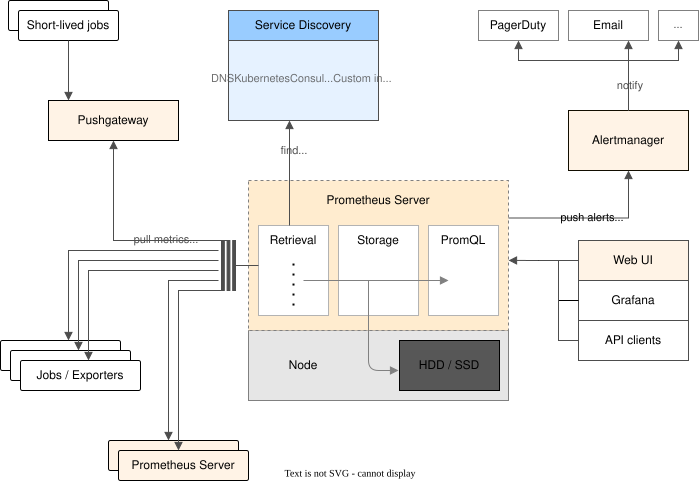
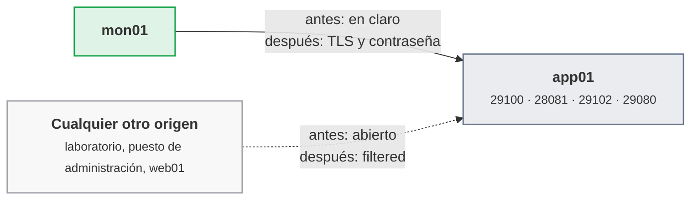
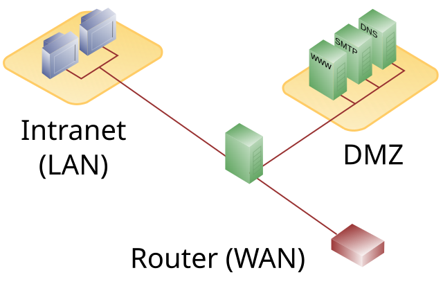
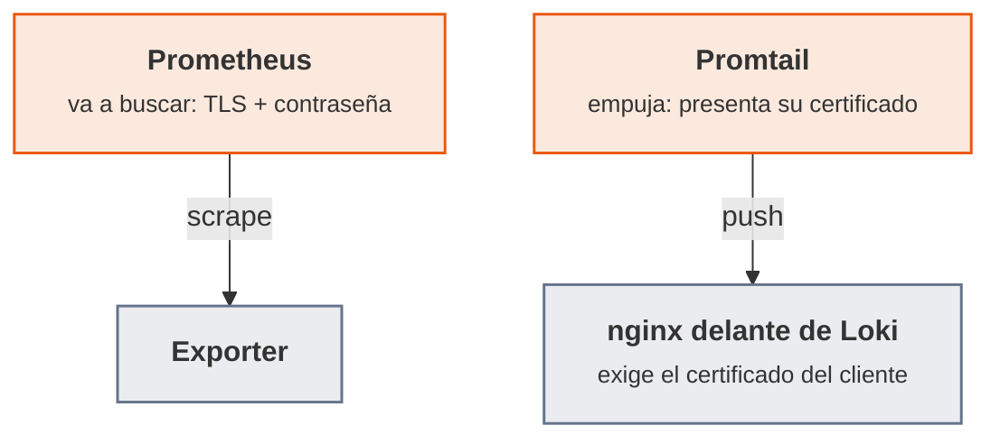

# UT3 · Seguridad de las comunicaciones de monitorización

<p class="ut-meta">6 h · Sesiones 16 a 18 · RA1 CE f, g</p>

Las dos primeras unidades conectaron el servicio del curso a la pila de mon01 (node_exporter, cAdvisor, postgres_exporter, el `/metrics` de la API, Promtail y Loki) y le pusieron alarmas encima. Todo funciona, pero en claro: cada exporter es un servidor HTTP sin contraseña, Promtail manda los logs a Loki por HTTP y Grafana está en el 23000 con la contraseña del primer día. Y la monitorización es la pieza que más conviene proteger, porque llega a todas las máquinas y sabe todo de ellas: quien entra en ella tiene el mapa de la infraestructura y puede apagar las alarmas antes de atacar.

La unidad sigue el orden de una empresa. Primero se audita: qué puertos hay abiertos, quién llega a ellos y qué se lleva, con una evidencia fechada de cada cosa (criterio f). Después se cierra lo que sobra por capas (cómo publica Docker, el cortafuegos de cada host y OPNsense), se cifra y se autentica lo que queda, y se documenta como una política comprobable (criterio g). Con ella se cierra la primera evaluación, con examen el 10 de diciembre. Se apoya en la [unidad de seguridad por capas de Despliegue](https://victor-educ.github.io/apuntes-5166/ut/ut3-seguridad-por-capas/), que se cursa a la vez: allí se montan OPNsense, sus zonas y la CA del curso.

## Sesión 16 · Auditoría inicial

<p class="ut-meta" markdown>26 de noviembre · Teoría y práctica · <span class="dur" tabindex="0" aria-label="Superficie de exposición de la monitorización · 10 min&#10;Auditar: saber qué hay antes de tocar nada · 10 min&#10;A3.1 Auditoría inicial · 90 min" data-dur="Superficie de exposición de la monitorización · 10 min&#10;Auditar: saber qué hay antes de tocar nada · 10 min&#10;A3.1 Auditoría inicial · 90 min">:material-school:<i class="dur-barra" style="--teoria:18%"></i>:material-flask:</span></p>

Antes de cerrar nada hay que saber qué hay abierto de verdad: lo que dicen los compose no siempre coincide con lo que escucha, y la evaluable pide demostrar con fecha cómo estaba la pila antes. La teoría va en este orden: qué regala un `/metrics` abierto, qué puertos debería haber, y las cuatro medidas que dicen lo que hay, juntas en una matriz. La hoja hace la auditoría y prepara los certificados y las reglas de OPNsense. Es el último día en que la pila se puede medir tal como se construyó: mañana, 27 de noviembre, la A3.2 de Despliegue traslada app01 y mon01 a la VPC, detrás de OPNsense.

### Superficie de exposición de la monitorización

**Qué es.** La superficie de exposición es el conjunto de puntos por los que alguien de fuera puede hablar con un sistema: cada puerto que escucha y cada servicio que responde. La primera regla de cualquier protección es reducirla: lo que no escucha no se puede atacar.

**Por qué la de la monitorización es tan grande.** Para que Prometheus llegase a todo (el scrape: la lectura periódica de cada `/metrics`), node_exporter quedó escuchando en todas las interfaces y se publicaron puertos como `28081:28081` o `29102:29102`, sin cifrado ni contraseña. El servicio, bien desplegado, expone un único 443 en web01; la monitorización expone cuatro puertos en app01, dos en db01 y siete en mon01, ninguno con contraseña.

<figure markdown="span">
  { width="640" }
  <figcaption>Arquitectura de Prometheus: cada flecha de scrape es una conexión HTTP que hay que proteger. Fuente: Proyecto Prometheus, Apache 2.0.</figcaption>
</figure>

#### Qué se ve en un /metrics abierto

**Las métricas no son «solo números».** Esto devuelve un node_exporter a cualquiera que llegue al 29100:

```text
node_uname_info{nodename="app01",release="6.12.22-amd64",sysname="Linux",version="#1 SMP PREEMPT_DYNAMIC Debian 6.12.22-1"} 1
node_os_info{id="debian",name="Debian GNU/Linux",version_id="13"} 1
node_network_address_info{address="10.10.2.10",device="ens18",netmask="24"} 1
node_filesystem_size_bytes{device="/dev/sda1",mountpoint="/var/lib/docker"} 2.1e+10
node_systemd_unit_state{name="ssh.service",state="active"} 1
node_boot_time_seconds 1.763979e+09
```

Con esas líneas un atacante sabe la versión exacta del kernel y de la distribución (y con ella qué vulnerabilidades publicadas le afectan), la dirección y la red, los discos montados, los servicios activos y cuánto lleva sin reiniciar, que suele ser cuánto lleva sin parches del kernel.

**Los demás también hablan.** cAdvisor dice qué imagen y qué versión corre cada contenedor (`app:1.4.2`); postgres_exporter, los nombres de las bases de datos y las conexiones por usuario; el `/metrics` de la API, todas las rutas que han recibido peticiones. Y los servidores de la pila son peores: la API de Prometheus da el mapa de todo lo monitorizado, Alertmanager acepta silencios de cualquiera (se silencia la alarma y después se ataca) y Loki deja leer todos los logs e inyectar líneas falsas.

#### Puertos del entorno del curso y quién debe llegar

**La referencia contra la que se audita.** Auditar es comparar lo que hay con lo que debería haber. Esta tabla es lo que debería haber, con el criterio de mínimo privilegio: cada puerto, solo para quien lo necesita. De ella salen la columna «esperado» de la matriz y las reglas de los cortafuegos.

| Componente | Puerto | Dónde corre | Quién debe llegar |
|------------|-------:|-------------|-------------------|
| node_exporter | 29100 | app01, db01, mon01 | Solo mon01 |
| cAdvisor | 28081 | app01 | Solo mon01 |
| /metrics de la app | 29102 | app01 | Solo mon01 |
| Promtail | 29080 | app01 | Solo mon01 |
| postgres_exporter | 29187 | db01 | Solo mon01 |
| Loki | 23100 | mon01 | Promtail de app01 y `logcli` del puesto de administración, con certificado de cliente |
| Grafana | 443 tras nginx | mon01 | Usuarios desde la red de gestión |
| Prometheus, Alertmanager, Mailpit | 29090, 29093, 28025 | mon01 | Administradores por túnel SSH |
| Gitea provisional | 23001 | mon01, hasta el 12 de febrero | La red de gestión y app01 |

Cada servicio escucha dentro de su contenedor en el mismo número con el que se publica, según la [convención de puertos del curso](https://victor-educ.github.io/apuntes-5166/laboratorio/#puertos). Todo lo demás, cerrado. Los administradores entran desde la red de gestión (10.10.0.0/24) con usuario nominal (una cuenta por persona, para que cada acción tenga autor).

**El scrape cruza el cortafuegos.** app01 y db01 no tienen pata en la red de gestión: app01 es la 10.10.2.10 en back, db01 la 10.10.3.10 en data y mon01 la 10.10.0.20 en gestión. Así que hay que permitir el paso justo en OPNsense y cerrar el resto en cada host.

**Las reglas de OPNsense.** Son las filas 11 a 13 de la matriz de reglas del laboratorio, escritas como las de Despliegue: en la pestaña de la interfaz por la que entra el tráfico y con alias. `srv_app` y `srv_db` ya existen; se añaden el host `srv_mon` (10.10.0.20) y los alias de puertos `p_mon_app` y `p_mon_db`.

| Fila | Pestaña | Acción | Origen | Destino | Puertos | Log | Descripción |
|-----:|---------|--------|--------|---------|---------|-----|-------------|
| 11 | MGMT | Pass | `srv_mon` | `srv_app` | `p_mon_app`: 29100, 28081, 29102, 29080 | sí | 11 Scrape de mon01 a app01 |
| 12 | MGMT | Pass | `srv_mon` | `srv_db` | `p_mon_db`: 29100, 29187 | sí | 12 Scrape de mon01 a db01 |
| 13 | DMZINT | Pass | `srv_app` | `srv_mon` | 23100 | sí | 13 Promtail de app01 hacia Loki |

Cualquier otro origen cae en la denegación por defecto, la fila 99 (app01 llega además al 23001 de la Gitea provisional por la fila 6, de Despliegue). Sin las filas 11 a 13, tras el traslado los targets de app01 y db01 quedan en DOWN y los logs no llegan a Loki: por eso la A3.1 las deja puestas el día antes.

### Auditar: saber qué hay antes de tocar nada

**Qué es auditar aquí.** Medir lo que hay, compararlo con lo esperado y dejar una prueba fechada de cada medida. Se hace antes de proteger nada, porque lo que se cambia ya no se puede medir como estaba. Hacen falta cuatro medidas porque cada una ve una parte: el inventario, lo que el host cree que expone; el escaneo, lo que se alcanza de verdad; la prueba de protocolo, qué se lleva quien llega; y la captura, qué viaja por la red.

!!! otra "Repaso"
    nmap y tcpdump se explicaron en Despliegue el 13 de noviembre, en [Cómo se prueba una red](https://victor-educ.github.io/apuntes-5166/ut/ut2-vpc/#como-se-prueba-una-red).

#### Inventario desde dentro

**Qué escucha cada host.** `ss` lista los puertos en escucha con el proceso que los abrió, y `docker ps`, lo que publica Docker (que no siempre aparece en `ss`):

```bash
sudo ss -tlnup                                   # -t tcp, -u udp, -l en escucha, -n números, -p proceso
docker ps --format '{{.Names}}\t{{.Ports}}'
```

**Qué se mira.** La dirección local: `0.0.0.0` o `*` es todas las interfaces; `127.0.0.1`, solo la propia máquina; `10.10.2.10`, solo esa tarjeta. En `docker ps`, `0.0.0.0:29102->29102/tcp` es un puerto publicado para todo el mundo, y `5432/tcp` sin flecha no está publicado (solo se alcanza desde la red de Docker). node_exporter no sale en `docker ps`: es un servicio del sistema, que viene en la plantilla de las VM.

#### Escaneo desde fuera

**Qué demuestra.** Lo que de verdad se alcanza desde otra máquina, con todo lo que hay por medio. Por eso se escanea desde varios orígenes, cada uno un tipo de cliente: **mon01**, el legítimo, que tiene que ver los exporters; **el puesto de administración** (10.10.0.50), de gestión pero sin motivo para leer métricas; **web01**, la más expuesta, que no debe ver nada; y **app01 hacia mon01**, que solo debe llegar a Loki y a la Gitea provisional. El 26 de noviembre, con web01 ya detrás de OPNsense, el origen «de fuera» es el puesto de administración.

```bash
sudo nmap -sS -p- --reason -T4 <IP de app01> <IP de mon01> -oN escaneo-desde-admin-$(date +%F).txt
```

`-sS` escanea sin completar la conexión, `-p-` recorre todos los puertos (sin él, nmap no mira los del 20000 al 29999 del curso), `--reason` dice por qué decidió cada estado y `-oN` guarda la salida, con la hora en la cabecera. Detrás de un cortafuegos hace falta además `-Pn`, porque si no responde al ping nmap da el host por caído y no escanea. Donde no hay nmap (app01), se usa `nc -zv -w 3 <IP> <puerto>`.

**Cómo se lee cada estado.** Es lo que se pregunta en el examen:

| Estado nmap | Qué ha pasado en la red | Qué significa aquí |
|-------------|-------------------------|--------------------|
| `open` | Llegó un SYN-ACK | Hay un servicio escuchando y nada lo filtra |
| `closed` | Llegó un RST | El paquete llegó, pero nadie escucha en ese puerto (o un cortafuegos rechaza con Reject) |
| `filtered` | No llegó nada | Un cortafuegos con `drop` lo ha tirado por el camino |

Con `nc`: `succeeded` es open, `refused` es closed y el tiempo agotado, filtered. Un escaneo que tarda minutos ya indica `drop`: nmap espera el tiempo máximo en cada puerto.

#### Protocolos y autenticación

**Qué entrega cada puerto.** `open` dice que alguien responde, no qué entrega. Se pide el `/metrics` sin credenciales y se mira el diálogo entero:

```bash
curl -sv http://<IP de app01>:29100/metrics 2>&1 | head -20
```

Las líneas con `>` las envía curl y las de `<` las contesta el servidor. Con cifrado aparecería antes una línea `SSL connection using TLSv1.3`; con contraseña, un `401 Unauthorized`. Un `200 OK` con métricas desde el puesto de administración son tres fallos a la vez, cada uno con su arreglo: alcanzable (cortafuegos), en claro (TLS) y sin autenticación (contraseña o certificado).

#### Tráfico real con tcpdump

**Qué viaja.** En los logs la conexión la abre app01: Promtail empuja a Loki. Para ver qué viaja se captura en app01 con el contenido como texto (`-A`):

```bash
sudo tcpdump -i <interfaz> -nn -A port 23100 -c 20
```

Antes de proteger se lee la petición `POST /loki/api/v1/push` con sus cabeceras y trozos de log (Promtail comprime, pero comprimir no es cifrar). Al final de la unidad no se leerá nada, y esa pareja de capturas es la evidencia de cifrado de la evaluable.

#### La matriz de exposición

**Para qué.** Ordena las medidas para leerlas de un vistazo: una fila por origen y destino, con lo esperado, lo obtenido y el fichero que lo demuestra. Estas son las ocho filas, las mismas el 26 de noviembre (direcciones de la red del laboratorio) y el 3 de diciembre (las de la VPC):

| Origen | Destino | Puertos | Esperado | Obtenido (antes) | Obtenido (después) | Evidencia |
|--------|---------|---------|----------|------------------|--------------------|-----------|
| mon01 | app01 | 29100, 28081, 29102, 29080 | open | | | escaneo-app01-desde-mon01-2026-11-26.txt |
| puesto de administración | app01 | 29100, 28081, 29102, 29080 | filtered | | | escaneo-desde-admin-2026-11-26.txt |
| puesto de administración | mon01 | 23000, 28025, 29090, 29093, 29100 | filtered | | | ídem |
| puesto de administración | mon01 | 443 | open | | | ídem |
| puesto de administración | mon01 | 23001, 23100 | open (23100 solo con certificado de cliente) | | | ídem |
| app01 | mon01 | 23100 | open y cifrado | | | tcpdump-app01-23100-2026-11-26.txt |
| app01 | mon01 | 23000, 28025, 29090, 29093 | filtered | | | nc-mon01-desde-app01-2026-11-26.txt |
| web01 | app01 y mon01 | todos los de la tabla de puertos | filtered | no se mide: web01 ya está detrás de OPNsense | | |

Las filas donde esperado y obtenido no coinciden se marcan en rojo: son la lista de trabajo del resto de la unidad.



<p class="pie" markdown>El objetivo de la unidad: que solo quede una flecha, y además autenticada.</p>

### A3.1 Auditoría inicial (sesión 16)

<span class="et et-obj">Objetivo</span> **Qué vas a conseguir:** una foto de quién puede llegar hoy a tu monitorización y qué se ve sin contraseña, con una prueba fechada de cada cosa. De paso dejas preparados los certificados y las reglas del cortafuegos que se usan después del traslado de mañana.

**Para qué sirve en un trabajo:** antes de proteger nada hay que saber qué está expuesto. Una auditoría con pruebas fechadas es lo que te piden para justificar un cambio de seguridad, y lo que demuestra después que el cambio ha servido.

<span class="et et-pre">Antes de empezar</span>

- app01 y mon01 con la pila de monitorización y alarmas funcionando (todos los targets en UP), todavía en la red del laboratorio y sin cortafuegos. Hoy se usan sus direcciones en la red del laboratorio.
- El puesto de administración (con tarjeta en la red del laboratorio además de la 10.10.0.50), que hoy hace de origen «de fuera».
- La consola de OPNsense, con los alias `srv_app` y `srv_db`, y la CA del curso (`Lab 5166 CA`, la autoridad que firma los certificados) en `~/ca/` del puesto de administración, tal como las dejó ayer la [A3.1 de Despliegue](https://victor-educ.github.io/apuntes-5166/ut/ut3-seguridad-por-capas/#a31-firewall-y-publicacion-de-la-web-sesion-15). Si la CA no existe, créala con su apartado de [Certificados](https://victor-educ.github.io/apuntes-5166/ut/ut3-seguridad-por-capas/#certificados) antes del paso 5.
- La teoría de hoy: [qué se ve en un /metrics abierto](#que-se-ve-en-un-metrics-abierto), la [tabla de puertos con las filas 11 a 13](#puertos-del-entorno-del-curso-y-quien-debe-llegar) y las [cuatro medidas con su matriz](#auditar-saber-que-hay-antes-de-tocar-nada). Para el paso 5, [Certificados con la CA del curso](#certificados-con-la-ca-del-curso): se explica el 1 de diciembre, pero hoy solo hace falta para firmar.

<span class="et et-pas">Pasos</span>

Trabajas en app01, mon01 y el puesto de administración. El recorrido: los cuatro primeros pasos son la auditoría, de dentro afuera (lo que dice cada máquina, lo que se alcanza desde fuera, lo que viaja por la red y la matriz que lo junta); los pasos 5 y 6 preparan el traslado de mañana. Guarda cada prueba en el directorio de trabajo de la máquina donde la sacas: en el paso 4 las juntas en mon01.

1. **Haz el inventario de app01 y de mon01.** *En app01, mon01 y el puesto de administración.*

    Primero apuntas lo que cada máquina dice que tiene abierto. Antes, instala en app01 lo que mañana ya no podrá descargar (tras el traslado pierde la salida a Internet), y nmap (el escáner de puertos) donde vas a escanear:

    ```bash
    # en app01
    sudo apt install -y tcpdump netcat-openbsd nftables
    # en mon01 y en el puesto de administración
    sudo apt install -y nmap
    # en app01 y después en mon01 (cambia <host>)
    { sudo ss -tlnup; docker ps --format '{{.Names}}\t{{.Ports}}'; } > inventario-<host>-$(date +%F).txt
    ```

    No hace falta anotar nada aparte: el fichero es la prueba y la matriz del paso 4 lo resume. De app01, la matriz solo recoge lo que sigue allí tras el traslado: la base de datos, nginx y postgres_exporter se van mañana.

    **Sale bien si:** el fichero de app01 lista el 29100 y, con `docker-proxy`, el 28081, el 29102 y el 29080.

2. **Escanea desde fuera y pide las métricas sin credenciales.** *En mon01 y en el puesto de administración.*

    Desde mon01 escaneas solo lo que tiene que estar abierto, porque mon01 es quien debe llegar. Desde el puesto de administración escaneas todo, que es lo que vería cualquiera de la red del laboratorio. Después pides los cuatro `/metrics` de app01 sin contraseña:

    ```bash
    # en mon01
    sudo nmap -sS -p 22,28081,29080,29100,29102 --reason <IP de app01> -oN escaneo-app01-desde-mon01-$(date +%F).txt
    # en el puesto de administración
    sudo nmap -sS -p- --reason -T4 <IP de app01> <IP de mon01> -oN escaneo-desde-admin-$(date +%F).txt
    for p in 29100 28081 29102 29080; do curl -sv http://<IP de app01>:$p/metrics 2>&1 | head -20; done > curl-app01-desde-admin-$(date +%F).txt
    ```

    **Sale bien si:** cada escaneo tiene la fecha en el nombre y la hora en la cabecera, y el fichero de curl tiene cuatro respuestas.

3. **Mira qué viaja por la red desde app01.** *En app01.*

    Con tcpdump (captura el tráfico de red) ves si los logs que Promtail manda a Loki se leen en claro: es la mitad «antes» de la pareja de capturas del cifrado. Con `nc` pruebas a qué puertos de mon01 llega app01, que es lo que alcanzaría quien entrase en la API:

    ```bash
    # en app01
    ip -br link                      # el nombre de la interfaz
    sudo tcpdump -i <interfaz> -nn -A port 23100 -c 20 > tcpdump-app01-23100-$(date +%F).txt
    for p in 23000 28025 29090 29093; do nc -zv -w 3 <IP de mon01> $p; done 2> nc-mon01-desde-app01-$(date +%F).txt
    ```

    `nc` escribe su resultado en la salida de error, por eso va `2>`.

    **Sale bien si:** en la captura se lee `POST /loki/api/v1/push`.

4. **Junta las medidas en la matriz.** *En app01, el puesto de administración y mon01.*

    La matriz de exposición es una tabla con lo que debería poder llegar a cada puerto y lo que de verdad llega. Copia todas las pruebas a `audit/antes/` del repositorio `monitoring` de mon01 (es repositorio Git desde la A2.2) y crea `audit/matriz.md` con la tabla de [La matriz de exposición](#la-matriz-de-exposicion). Copia la tabla tal cual, con la columna «esperado» ya hecha, y rellena solo «obtenido (antes)» con lo medido y las direcciones de hoy, deja «después» vacía y marca en rojo (en negrita o con una columna «estado») las filas donde esperado y obtenido no coinciden.

    ```bash
    # desde app01 y desde el puesto de administración: al directorio personal de mon01
    scp *-$(date +%F).txt ops@<IP de mon01>:
    # en mon01
    cd /opt/monitoring && mkdir -p audit/antes && mv ~/*-$(date +%F).txt audit/antes/
    nano audit/matriz.md
    git add audit && git commit -m "UT3: auditoría inicial"
    ```

    La fecha del commit es una prueba más de cuándo se midió.

    **Sale bien si:** `ls audit/antes/` enseña los siete ficheros.

5. **Emite de una vez los certificados de la unidad.** *En el puesto de administración.*

    Cada servicio que va a hablar cifrado (TLS) necesita su certificado firmado por la CA del curso. Hoy emites los cuatro que usan la A3.2 y la práctica evaluable, y después solo hay que copiarlos. Primero define `T`, `srv` y `cli` como en [Certificados con la CA del curso](#certificados-con-la-ca-del-curso), y después:

    ```bash
    cd ~/ca
    srv app01-node    DNS:app01.dev.lab,IP:10.10.2.10
    srv mon01-loki    DNS:mon01.lab,IP:10.10.0.20
    srv mon01-nginx   DNS:mon01.lab,DNS:grafana.lab,IP:10.10.0.20
    cli promtail-app01
    cp ca.crt $T/
    openssl x509 -in $T/app01-node.crt -noout -ext subjectAltName,extendedKeyUsage
    openssl x509 -in $T/promtail-app01.crt -noout -ext extendedKeyUsage
    ```

    Si una firma falla a medias, emite solo los que falten: `index.txt` apunta cada firma.

    **Sale bien si:** el de servidor lleva su lista de nombres y `serverAuth` (vale para un servidor), y el de cliente, `clientAuth` (vale para un cliente).

6. **Deja en OPNsense las reglas del traslado.** *En la consola web de OPNsense.*

    Hoy no se pueden probar, porque app01 y mon01 aún no pasan por OPNsense, pero desde mañana son las que dejan pasar la recogida de métricas y los logs. Un alias es un nombre para una lista de direcciones o puertos, que luego se usa en las reglas.

    - En Firewall, Aliases, crea `srv_mon` (tipo Host, 10.10.0.20), `p_mon_app` (tipo Port, 29100, 28081, 29102 y 29080) y `p_mon_db` (tipo Port, 29100 y 29187).
    - En Firewall, Rules, crea las filas 11 y 12 en la pestaña MGMT y la 13 en DMZINT, con los valores de la [tabla del apartado](#puertos-del-entorno-del-curso-y-quien-debe-llegar), el log activado y el número de fila al principio de la descripción. Pulsa Apply.

    Mañana, en la A3.2 de Despliegue, añade también las tres filas con su justificación a tu `matriz-reglas.md`.

    **Sale bien si:** las tres reglas aparecen por encima de la denegación por defecto.

<span class="et et-com">Comprobación</span>

- [ ] En `audit/antes/` hay un inventario por host, el escaneo desde mon01 y el del puesto de administración, con fecha en el nombre y en la cabecera.
- [ ] Están el fichero de curl con métricas, el de `nc` desde app01 y una captura donde se lee `POST /loki/api/v1/push` en claro.
- [ ] En la matriz, las filas del puesto de administración y de app01 hacia puertos de monitorización están en rojo, y la de mon01 no.
- [ ] En `~/tls-monitorizacion/` hay cuatro certificados con su clave y `ca.crt`.
- [ ] En OPNsense están los tres alias y las filas 11 a 13.

<span class="et et-ent">Para practicar</span>

- **Guarda** con commit `audit/antes/` y `audit/matriz.md` en el repositorio `monitoring` antes de salir: la práctica evaluable parte de esta matriz, y solo se puede medir hoy, porque mañana app01 y mon01 se van a la VPC.
- **Guarda** los certificados y sus claves fuera de cualquier repositorio: se quedan en `~/tls-monitorizacion/` del puesto, y de ahí los copiarás a cada host.
- **Piensa:** ¿qué podría sacar un atacante de lo que has leído en los `/metrics` sin contraseña?

<span class="et et-ext">Si te sobra tiempo</span> Para ver qué más se filtra sin contraseña: consulta `http://<IP de mon01>:29090/api/v1/targets` y `/api/v1/status/config` desde el puesto de administración y anota qué se sabe de la infraestructura sin ninguna credencial. Y emite, con las mismas funciones, los cuatro certificados que solo usan las tareas opcionales de la unidad (el nginx de cAdvisor, db01 y el node_exporter de mon01):

```bash
srv app01-nginx   DNS:app01.dev.lab,IP:10.10.2.10
srv db01-node     DNS:db01.dev.lab,IP:10.10.3.10
srv db01-postgres DNS:db01.dev.lab,IP:10.10.3.10
srv mon01-node    DNS:mon01.lab,IP:10.10.0.20
```

## Sesión 17 · Red, firewall y TLS

<p class="ut-meta" markdown>1 de diciembre · Teoría y práctica · <span class="dur" tabindex="0" aria-label="Por qué Docker se salta el firewall del host · 5 min&#10;Reducir: red Docker dedicada y firewall por host · 10 min&#10;Proteger: cifrado y autenticación · 10 min&#10;A3.2 Red, firewall y TLS · 85 min" data-dur="Por qué Docker se salta el firewall del host · 5 min&#10;Reducir: red Docker dedicada y firewall por host · 10 min&#10;Proteger: cifrado y autenticación · 10 min&#10;A3.2 Red, firewall y TLS · 85 min">:material-school:<i class="dur-barra" style="--teoria:23%"></i>:material-flask:</span></p>

La matriz de la A3.1 tiene filas en rojo de tres clases: puertos que se alcanzan desde donde no toca, tráfico en claro y servicios que contestan a cualquiera. Desde el 27 de noviembre app01 y mon01 están en la VPC, detrás de OPNsense, y se arreglan con dos capas que hacen falta juntas: **reducir**, para que solo llegue quien debe, y **proteger**, para que lo que llega vaya cifrado y con credenciales. La teoría va en el orden en que se aplica: por qué un cortafuegos no filtra lo que publica Docker, el nftables de cada host, y TLS con contraseña en los exporters. La hoja lo aplica a app01; mon01 se cierra en la práctica evaluable, el 3 de diciembre.

### Por qué Docker se salta el firewall del host

**El síntoma.** Se pone en el host una regla que cierra un puerto publicado por Docker, `nft list ruleset` la enseña, y desde otra máquina el puerto sigue abierto.

**La causa.** Docker publica un puerto reescribiendo el destino del paquete hacia la dirección interna del contenedor. Para el kernel ese paquete ya no va al propio host sino que se reenvía, así que pasa por la cadena `forward` y no por `input`, que es donde se suelen poner las reglas del host. (Docker reserva dentro de `forward` la cadena `DOCKER-USER` para las reglas del administrador; en el curso se usa la cadena `forward` de la tabla propia, que hace lo mismo.)

**La solución.** Tres medidas, que en el laboratorio se combinan:

1. **Publicar en una IP concreta**: `"10.10.2.10:29102:29102"` en lugar de `"29102:29102"`. Retira el puerto de `localhost` y de las redes de Docker, aunque no lo esconde de quien ya está en la misma zona.
2. **No publicar**: si el cliente está en la misma máquina, los contenedores comparten una red Docker y se hablan por nombre. Es lo que se hace en mon01.
3. **Regla en la cadena `forward`** del nftables del host, sobre el puerto original del paquete. Es la que protege aunque alguien publique mal un puerto, y por eso la exige la política.

!!! ojo "ufw y Docker"
    `ufw` solo escribe reglas en `input`, así que no cierra ningún puerto publicado por Docker. Si aparece en una máquina con Docker, hay que comprobar con nmap desde fuera.

### Reducir: red Docker dedicada y firewall por host

**El objetivo.** Que desde cualquier sitio que no sea mon01 los puertos de la monitorización den `filtered`, por dos capas independientes (el cortafuegos de cada host y OPNsense): es la defensa en profundidad.

<figure markdown="span">
  { width="560" }
  <figcaption>La monitorización cruza zonas (gestión hacia back y data) y por eso necesita regla en el cortafuegos central, además de en cada host. Fuente: Pbroks13, dominio público, vía Wikimedia Commons.</figcaption>
</figure>

#### Publicar solo donde hace falta

**En app01, publicar en su IP.** La red de Docker compartida ya existe (`obs`), pero Prometheus está en otra máquina, así que en app01 hay que publicar. Se cambian solo las líneas `ports`:

```yaml
# /opt/servicio/compose.yml, servicio app
    ports:
      - "10.10.2.10:28080:28080"   # la API, la que consume web01
      - "10.10.2.10:29102:29102"   # /metrics, solo para mon01
# /opt/agentes/compose.yml: cadvisor con "10.10.2.10:28081:28081" y promtail con "10.10.2.10:29080:29080"
```

En mon01 no se publica casi nada: la pila se habla por nombre dentro de `obs`. Se monta en la evaluable, con el fichero en [Cerrar mon01](#cerrar-mon01-publicacion-y-cortafuegos).

#### nftables por host: el fichero completo

**Por qué cada host lleva el suyo.** OPNsense no ve el tráfico dentro de una misma subred, y dos capas independientes son lo que pide la defensa en profundidad. En Debian el cortafuegos del host va en `/etc/nftables.conf`, que carga `nftables.service` al arrancar.

**Cómo se lee.** Una **tabla** (`inet fw`, para IPv4 e IPv6) agrupa lo propio. Cada **cadena** se engancha a un punto del camino del paquete (`input`, `forward`, `output`) y tiene una **política**, lo que se hace si ninguna regla decide. Un **conjunto** (`set`) es una lista con nombre que se usa con `@`. `ct state established,related accept` deja pasar las respuestas de conexiones ya aceptadas.

El de app01, completo:

```text
#!/usr/sbin/nft -f
table inet fw
flush table inet fw

table inet fw {
    set mon_ports {
        type inet_service
        elements = { 29100, 28081, 29102, 29080 }
    }

    chain input {
        type filter hook input priority filter; policy drop;

        iif lo accept
        ct state established,related accept
        ct state invalid drop
        ip protocol icmp accept
        ip6 nexthdr icmpv6 accept

        # gestión: SSH solo desde la red de gestión
        ip saddr 10.10.0.0/24 tcp dport 22 accept

        # monitorización: el exporter que escucha como servicio (node_exporter), solo desde mon01
        ip saddr 10.10.0.20 tcp dport @mon_ports accept
        tcp dport @mon_ports log prefix "mon-denegado: " drop
    }

    chain forward {
        type filter hook forward priority filter; policy accept;

        # puertos publicados por Docker: mismo criterio, con el puerto de antes de que Docker lo reescriba
        iifname "ens18" ip saddr != 10.10.0.20 meta l4proto tcp ct original proto-dst @mon_ports log prefix "mon-docker-denegado: " drop
        # el 28080 de la API no necesita regla: OPNsense solo deja llegar a él desde web01
    }

    chain output {
        type filter hook output priority filter; policy accept;
    }
}
```

- **Las dos primeras líneas** crean la tabla y la vacían, así que el fichero se recarga sin duplicar reglas. Nunca `flush ruleset`, que borraría también las tablas de Docker y dejaría los contenedores sin red.
- **`input` con política `drop`**: solo entra lo que la matriz justifica. El `log ... drop` deja rastro en `journalctl -k` de quién lo intenta.
- **`forward` con política `accept`** y `drop` solo para los puertos de monitorización: con `drop` cortaría también el tráfico de los contenedores hacia fuera (Promtail hacia Loki, la API hacia la base de datos). `ct original proto-dst` es el puerto tal como llegó, antes de que Docker lo reescriba.

**db01 y mon01.** El de db01 es el mismo con el conjunto `{ 29100, 29187 }`, una línea más `ip saddr 10.10.2.10 tcp dport 5432 accept` y sin cadena `forward` (no tiene Docker). El de mon01, con casi todo publicado por Docker, está en [Cerrar mon01](#cerrar-mon01-publicacion-y-cortafuegos).

#### Segunda capa en OPNsense

**Qué añade.** Las filas 11 a 13 de la A3.1 dicen lo mismo desde el cortafuegos central: si una capa falla, la otra sigue cerrando. En Firewall, Log Files, Live View aparece cada bloqueo con la regla que lo decidió, y su captura es la evidencia de la segunda capa.

### Proteger: cifrado y autenticación

**Lo que el cortafuegos no arregla.** Decide por dirección de origen: el scrape sigue en claro, y cualquier contenedor de mon01 sale con la 10.10.0.20 como si fuera Prometheus. Falta cifrar y que cada extremo demuestre quién es.

#### Qué resuelve TLS y qué resuelve la autenticación

**TLS** cifra la conexión y permite al cliente comprobar con quién habla. El servidor presenta su certificado («esta clave es de `app01.dev.lab` y de la 10.10.2.10»), firmado por una autoridad de certificación (CA); el cliente lo comprueba con el certificado de la CA, en el que confía, y comprueba que el nombre o la IP a la que se conecta está en el certificado. Resuelve la confidencialidad y la identidad del servidor.

**Lo que TLS no resuelve es quién es el cliente**: un servidor TLS normal cifra con cualquiera. Para eso hace falta autenticación, y en el curso se usa una forma en cada sentido:

- **Contraseña (basic auth) en los exporters**, a los que Prometheus va a buscar las métricas. El usuario y la contraseña viajan en una cabecera sin cifrar por sí misma, así que basic auth va siempre dentro de TLS.
- **Certificado de cliente (TLS mutuo) delante de Loki**, al que los hosts empujan sus logs. El cliente presenta también un certificado firmado por la CA, y lo comprueba un nginx puesto delante de Loki, que no trae autenticación propia.

Todos los servidores de la unidad exigen TLS 1.3, la versión actual, que hablan todos los clientes del curso.

#### Certificados con la CA del curso

**Qué hace falta.** Un certificado por servicio, con su nombre y su IP, firmado por la CA del curso (`Lab 5166 CA`), creada en la preparación de la [A3.1 de Despliegue](https://victor-educ.github.io/apuntes-5166/ut/ut3-seguridad-por-capas/#certificados), que vive en `~/ca/` del puesto de administración (`ca.key` no sale nunca de ahí). Con una CA propia, cada cliente confía en un solo fichero, `ca.crt`.

**Cómo se emiten.** Cada certificado de servidor lleva su nombre y su IP en la lista de nombres alternativos (SAN, *Subject Alternative Name*), que es lo que comprueban Prometheus y Promtail. Los de cliente no llevan SAN. Como se emiten varios seguidos, las dos órdenes van en dos funciones, que se definen en el shell del puesto de administración:

```bash
cd ~/ca && T=~/tls-monitorizacion && mkdir -p $T
srv() {   # srv <nombre> <SAN>: certificado de servidor
  openssl req -new -newkey ec -pkeyopt ec_paramgen_curve:prime256v1 -nodes \
    -keyout $T/$1.key -out $T/$1.csr -subj "/CN=$1" -addext "subjectAltName=$2"
  openssl ca -batch -notext -config ca.cnf -extensions server_cert -in $T/$1.csr -out $T/$1.crt
}
cli() {   # cli <nombre>: certificado de cliente
  openssl req -new -newkey ec -pkeyopt ec_paramgen_curve:prime256v1 -nodes \
    -keyout $T/$1.key -out $T/$1.csr -subj "/CN=$1"
  openssl ca -batch -notext -config ca.cnf -extensions client_cert -in $T/$1.csr -out $T/$1.crt
}
srv app01-node DNS:app01.dev.lab,IP:10.10.2.10    # ejemplo: el del node_exporter de app01
```

`openssl req` crea la clave y la petición; `openssl ca` la firma y la apunta en `index.txt`. `server_cert` marca el certificado como de servidor (`serverAuth`) y `client_cert`, como de cliente (`clientAuth`). Se copian a cada host con `scp`, con la clave en permisos 600 y del usuario que la lee.

#### TLS y basic auth en los exporters

**Un fichero para todos los exporters.** node_exporter, postgres_exporter y los demás exporters oficiales admiten `--web.config.file`, que apunta a un fichero con el certificado y los usuarios:

```yaml
# /etc/node_exporter/web.yml
tls_server_config:
  cert_file: /etc/node_exporter/app01-node.crt
  key_file: /etc/node_exporter/app01-node.key
  min_version: TLS13
basic_auth_users:
  prometheus: "$2y$10$Wb3l0jwVfM1xC5eYq7p0Ee2q1HkzFq4t1g1hA5m9Xn3uQ2Xv3q5Ki"
```

**La contraseña va como hash bcrypt**, un hash lento hecho para contraseñas: quien lea el fichero no la obtiene. Se genera con `htpasswd -nBC 10 prometheus` (paquete `apache2-utils`), que pide la contraseña y escribe `prometheus:<hash>`; al fichero va solo el hash, entre comillas dobles.

**Dónde se activa.** En el paquete de Debian, en la línea `ARGS` de `/etc/default/prometheus-node-exporter`. La plantilla ya trae `--web.listen-address=:29100`; se añade la IP delante y el fichero:

```bash
ARGS="--web.listen-address=10.10.2.10:29100 --web.config.file=/etc/node_exporter/web.yml"
```

El servicio corre con el usuario `prometheus`, que es quien tiene que poder leer la clave.

**Qué cambia en Prometheus.** El esquema (`https`), la CA y las credenciales son de cada job, así que app01 pasa a un job propio, `node-tls`, y mon01 y db01 siguen en `node`. La alarma `HostDown` pasa de `up{job="node"}` a `up{job=~"node|node-tls"}` para seguir cubriendo app01.

```yaml
  - job_name: node-tls
    scheme: https
    tls_config:
      ca_file: /etc/prometheus/tls/ca.crt
    basic_auth:
      username: prometheus
      password_file: /etc/prometheus/secrets/node_exporter.pass
    static_configs:
      - targets: ["10.10.2.10:29100"]
        labels: { host: app01 }
```

`password_file` mantiene la contraseña fuera de `prometheus.yml`, que va a Git. Los dos directorios se montan en Prometheus con un `compose.override.yml` junto al compose de mon01, que Docker Compose lee solo:

```yaml
# /opt/monitoring/compose.override.yml
services:
  prometheus:
    volumes:
      - ./tls:/etc/prometheus/tls:ro
      - ./secrets:/etc/prometheus/secrets:ro
```

`tls/` y `secrets/` van al `.gitignore`, y el fichero de la contraseña, con propietario 65534 (el usuario de Prometheus en su imagen) y permisos 600.

**cAdvisor y la API, con un nginx al lado.** No admiten `--web.config.file`. Se les pone delante un contenedor nginx en la red `obs` que termina TLS, pide contraseña y es el único que publica sus puertos. Es una tarea de «si sobra tiempo» de la evaluable:

```nginx
server {
    listen 28081 ssl;
    ssl_certificate     /etc/nginx/tls/app01-nginx.crt;
    ssl_certificate_key /etc/nginx/tls/app01-nginx.key;
    ssl_protocols TLSv1.3;
    auth_basic           "monitorizacion";
    auth_basic_user_file /etc/nginx/htpasswd;
    location / { proxy_pass http://cadvisor:28081; }
}
# El segundo bloque es igual cambiando dos líneas: listen 29102 ssl; y proxy_pass http://app:29102;
```

### Verificar que de verdad está protegido

!!! consulta "Material de consulta"
    No se explica en clase: lo usan la hoja de hoy (pasos 4 y 5) y la práctica evaluable.

**Por qué se prueba.** Un `web.yml` perfecto que el servicio no ha cargado no protege nada. Las comprobaciones quitan piezas de una en una para que cada fallo salga por su motivo. Las cuatro primeras se lanzan desde mon01 (con `ca.crt` en el directorio de trabajo), la quinta desde el puesto de administración con el certificado de `logcli` y la sexta desde una shell en mon01:

```bash
# 1. sin CA: el certificado no se puede validar
curl https://10.10.2.10:29100/metrics
# 2. con CA pero sin credenciales
curl --cacert ca.crt https://10.10.2.10:29100/metrics
# 3. con CA y credenciales: las métricas
curl --cacert ca.crt -u prometheus https://10.10.2.10:29100/metrics | head -3
# 4. el saludo TLS: versión, cadena y "Verify return code"
openssl s_client -connect 10.10.2.10:29100 -CAfile ca.crt </dev/null
# 5. Loki tras nginx, sin y con certificado de cliente
curl --cacert ca.crt https://10.10.0.20:23100/ready
curl --cacert ca.crt --cert logcli.crt --key logcli.key https://10.10.0.20:23100/ready
# 6. Prometheus sigue viendo los targets UP
curl -s localhost:29090/api/v1/targets | jq -r '.data.activeTargets[] | "\(.labels.job) \(.scrapeUrl) \(.health)"'
```

**La prueba en la red.** tcpdump con `-A` sobre el puerto del exporter durante un scrape ya no deja leer nada, y `nmap -sV -p 29100 10.10.2.10` desde mon01 dice en una línea qué protocolo habla el puerto. Esa diferencia con la matriz de antes es la evidencia de cifrado.

### A3.2 Red, firewall y TLS (sesión 17)

<span class="et et-obj">Objetivo</span> **Qué vas a conseguir:** que a los puertos de monitorización de app01 solo llegue mon01, cerrados por dos cortafuegos (el de la propia app01 y OPNsense), y que las métricas de su node_exporter viajen cifradas y con contraseña.

**Para qué sirve en un trabajo:** unas métricas abiertas cuentan a cualquiera qué máquinas hay y qué versiones corren. Cerrar y cifrar un exporter es una receta que se repite en cada servidor: aquí la haces en app01, y después sirve igual para db01 y mon01.

<span class="et et-pre">Antes de empezar</span>

- La matriz «antes» de la A3.1 con sus filas en rojo: es la lista de trabajo.
- app01 (10.10.2.10) y mon01 (10.10.0.20) en la VPC dev desde la A3.2 de Despliegue, y db01 (10.10.3.10) con PostgreSQL, su postgres_exporter y el node_exporter de la plantilla. A app01 se entra con salto por el puesto de administración: `ssh -J ops@<IP de admin01 en la red del laboratorio> ops@10.10.2.10`. Si el traslado no se hizo, es lo primero.
- Las filas 11 a 13 de OPNsense (de la A3.1, paso 6) y los certificados de `~/tls-monitorizacion/` (de la A3.1, paso 5; si faltan, emite al menos `app01-node`). En el puesto de administración, `htpasswd` (paquete `apache2-utils`).
- Desde el traslado, tu VM `puesto` ya no llega directa a mon01: la pila se abre con el primer túnel de [Cómo se llega a la pila](../laboratorio.md#como-se-llega-a-la-pila-desde-el-3-de-diciembre) del laboratorio, que salta por el puesto de administración, añadiendo `-L 23000:127.0.0.1:23000` para Grafana. Ese túnel deja además una shell en mon01.
- La teoría de hoy: [por qué Docker se salta el firewall del host](#por-que-docker-se-salta-el-firewall-del-host), [el fichero nftables](#nftables-por-host-el-fichero-completo) y [TLS y basic auth en los exporters](#tls-y-basic-auth-en-los-exporters). Para los pasos 4 y 5, [Verificar que de verdad está protegido](#verificar-que-de-verdad-esta-protegido).

<span class="et et-pas">Pasos</span>

Trabajas en mon01, app01 y el puesto de administración. El recorrido: recuperas la monitorización en las direcciones nuevas (paso 1), cierras app01 con su cortafuegos (paso 2), cifras su node_exporter (paso 3), haces que Prometheus lo lea así (paso 4) y lo mides desde fuera (paso 5).

1. **Recupera la monitorización en la VPC.** *En mon01 y en app01.*

    Prometheus y Promtail siguen apuntando a las direcciones de la red del laboratorio. Cámbialas por las de la VPC y añade db01, para partir de todo en UP:

    ```bash
    # en mon01
    cd /opt/monitoring
    sed -i 's/<IP vieja de app01>/10.10.2.10/g; s/<IP vieja de mon01>/10.10.0.20/g' prometheus.yml
    nano prometheus.yml     # job node: añade 10.10.3.10:29100; job postgres: el target pasa a 10.10.3.10:29187; los dos con host: db01
    docker compose restart prometheus
    # en app01
    sed -i 's#http://<IP vieja de mon01>:23100#http://10.10.0.20:23100#' /opt/agentes/promtail.yml
    cd /opt/agentes && docker compose restart promtail
    ```

    **Sale bien si:** la sexta orden de [Verificar](#verificar-que-de-verdad-esta-protegido), en la shell de mon01, da todos los targets en UP, incluidos los dos de db01. Eso prueba también que las filas 11 a 13 de OPNsense funcionan.

2. **Cierra app01 sin cortar lo legítimo.** *En mon01 y en app01.*

    Primero silencia las alarmas de app01, porque su target puede quedar en DOWN hasta el paso 4. Después haz que node_exporter escuche solo en la 10.10.2.10 y activa nftables (el cortafuegos del propio Linux) con el [fichero de app01](#nftables-por-host-el-fichero-completo), copiado tal cual:

    ```bash
    # en mon01
    cd /opt/monitoring && docker compose exec alertmanager amtool --alertmanager.url=http://localhost:29093 \
      silence add host=app01 --duration=2h --author=ops --comment="A3.2: cierre de app01"
    # en app01 (entrando por el puesto de administración: la regla de SSH solo admite la red de gestión)
    sudo sed -i 's/--web.listen-address=:29100/--web.listen-address=10.10.2.10:29100/' /etc/default/prometheus-node-exporter
    sudo systemctl restart prometheus-node-exporter
    sudo nano /etc/nftables.conf          # el fichero del apartado
    sudo nft -c -f /etc/nftables.conf     # valida sin cargar
    sudo systemctl enable nftables && sudo systemctl restart nftables
    ```

    Un cortafuegos que corta el servicio no está terminado: comprueba también la API y los logs.

    **Sale bien si:** `sudo nft list table inet fw` enseña la tabla, la API responde en `https://api.dev.lab/health` desde tu VM `puesto` y `docker compose logs --since 2m promtail` no muestra errores.

3. **Cifra el node_exporter y ponle contraseña.** *En el puesto de administración y en app01.*

    Activa TLS (cifrado) y basic auth (usuario y contraseña) con el certificado `app01-node` y el `web.yml` de [TLS y basic auth en los exporters](#tls-y-basic-auth-en-los-exporters). En el `web.yml` no va la contraseña, sino su hash bcrypt (una versión cifrada que no se puede deshacer), que saca `htpasswd`. Guarda la contraseña que elijas: Prometheus la necesita en el paso 4.

    ```bash
    # en el puesto de administración
    htpasswd -nBC 10 prometheus           # copia lo que va detrás de "prometheus:"
    scp ~/tls-monitorizacion/app01-node.{crt,key} ops@10.10.2.10:
    # en app01
    sudo mkdir -p /etc/node_exporter && sudo mv ~/app01-node.* /etc/node_exporter/
    sudo chown prometheus: /etc/node_exporter/app01-node.key && sudo chmod 600 /etc/node_exporter/app01-node.key
    sudo nano /etc/node_exporter/web.yml  # el del apartado, con tu hash
    sudo sed -i 's#--web.listen-address=10.10.2.10:29100#& --web.config.file=/etc/node_exporter/web.yml#' /etc/default/prometheus-node-exporter
    sudo systemctl restart prometheus-node-exporter
    ```

    Desde aquí el exporter ya no contesta por HTTP sin cifrar, y el target de app01 queda en DOWN hasta el paso siguiente.

    **Sale bien si:** `systemctl status prometheus-node-exporter` dice que el servicio sigue activo.

4. **Haz que Prometheus lo lea cifrado y con contraseña.** *En el puesto de administración y en mon01.*

    Prometheus tiene que fiarse de la CA (con `ca.crt`) y conocer la contraseña. Pasa el target de app01 del job `node` al job `node-tls` del apartado, monta la CA y la contraseña con el `compose.override.yml` y adapta la alarma `HostDown` al job nuevo:

    ```bash
    # en mon01, en /opt/monitoring
    mkdir -p tls secrets && printf 'tls/\nsecrets/\n' >> .gitignore
    # en el puesto de administración
    scp ~/tls-monitorizacion/ca.crt ops@10.10.0.20:/opt/monitoring/tls/
    # de nuevo en mon01, en /opt/monitoring
    printf '%s' '<la contraseña del paso 3>' > secrets/node_exporter.pass
    sudo chown 65534 secrets/node_exporter.pass && sudo chmod 600 secrets/node_exporter.pass
    nano prometheus.yml             # quita app01 del job node y añade el job node-tls
    nano compose.override.yml       # el del apartado
    sed -i 's/up{job="node"} == 0/up{job=~"node|node-tls"} == 0/' /opt/alerting/prometheus/alerts.yml
    docker compose up -d prometheus # recrea el contenedor: monta los volúmenes y relee reglas
    ```

    Después haz desde mon01, con `ca.crt` en el directorio de trabajo, las tres primeras comprobaciones de [Verificar](#verificar-que-de-verdad-esta-protegido): sin CA, sin credenciales y con las dos.

    **Sale bien si:** cada una de las tres falla o funciona por el motivo que dice el apartado, y el target de `node-tls` está en UP.

5. **Mide el resultado desde fuera.** *En el puesto de administración y en mon01.*

    Repite parte de la auditoría para demostrar que el cierre funciona. Deja en `/opt/monitoring/audit/despues/` dos escaneos con fecha: desde el puesto de administración, los cuatro puertos de monitorización de app01, y desde mon01, el protocolo del 29100:

    ```bash
    # en el puesto de administración (-Pn: detrás de un cortafuegos nmap no ve el host vivo)
    sudo nmap -Pn -sS -p 28081,29080,29100,29102 --reason 10.10.2.10 -oN escaneo-app01-desde-admin-$(date +%F).txt
    # en mon01
    sudo nmap -sV -p 29100 10.10.2.10 -oN /opt/monitoring/audit/despues/nmap-sv-app01-$(date +%F).txt
    ```

    Copia el primero a `audit/despues/` de mon01. Los demás orígenes, el Live View de OPNsense y el reinicio se miden sobre el estado final, en la [práctica evaluable](#sesion-18-practica-evaluable).

    **Sale bien si:** los dos escaneos están en `audit/despues/` con la fecha en el nombre.

<span class="et et-com">Comprobación</span>

- [ ] Todos los targets en UP, incluidos los dos de db01, y el de `node-tls` con un `scrapeUrl` que empieza por `https://`.
- [ ] En app01, `ss` muestra el 29100 solo en la 10.10.2.10.
- [ ] En app01, `nft list ruleset` enseña la tabla `inet fw` con sus dos cadenas y `systemctl is-enabled nftables` dice `enabled`.
- [ ] Las tres órdenes de `curl` se comportan como dice el apartado de verificación.
- [ ] La API sigue respondiendo en `https://api.dev.lab` y en Explore de Grafana hay líneas de app01 del último minuto.

<span class="et et-ent">Para practicar</span>

- **Guarda** con commit en `monitoring`: la copia del `nftables.conf` de app01 en `seguridad/nftables/app01.conf`, el `web.yml` en `seguridad/` con el hash sustituido por `<bcrypt>`, `prometheus.yml` con el job `node-tls`, `compose.override.yml` y los dos escaneos de hoy en `audit/despues/`. Y en `alerting`, el cambio de `HostDown`. Lo pide la práctica evaluable. Las órdenes:

    ```bash
    # en mon01
    mkdir -p /opt/monitoring/seguridad/nftables
    # en el puesto de administración: de app01 a mon01 en un solo paso
    scp -3 ops@10.10.2.10:/etc/nftables.conf ops@10.10.0.20:/opt/monitoring/seguridad/nftables/app01.conf
    scp -3 ops@10.10.2.10:/etc/node_exporter/web.yml ops@10.10.0.20:/opt/monitoring/seguridad/web.yml
    # en mon01
    cd /opt/monitoring && sed -i 's/"\$2y\$[^"]*"/"<bcrypt>"/' seguridad/web.yml
    git add seguridad prometheus.yml compose.override.yml audit .gitignore && git commit -m "A3.2: cierre y TLS de app01"
    cd /opt/alerting && git commit -am "A3.2: HostDown cubre node-tls"
    ```
- Deja vacía la columna «obtenido (después)» de la matriz: se rellena en la práctica evaluable, sobre el estado final.
- **Piensa:** si quitases nftables y dejases solo OPNsense, ¿quién podría seguir llegando al 29100 de app01?

<span class="et et-ext">Si te sobra tiempo</span> Para adelantar trabajo de la práctica evaluable, por este orden:

- Retira de `0.0.0.0` los tres puertos que publica Docker en app01, con las líneas `ports` de [Publicar solo donde hace falta](#publicar-solo-donde-hace-falta), y recrea los contenedores.
- Comprueba la capa del host sola: abre en la pestaña DMZEXT de OPNsense una fila temporal (Pass, `srv_web` a `srv_app`, puertos `p_mon_app`, descripción `TEMPORAL alta 01-12 baja 01-12 prueba de nftables`), escanea app01 desde web01 con `-Pn`, mira en app01 `sudo journalctl -k | grep mon-` y borra la fila.
- Cierra db01 igual que app01 en el paso 2: `--web.listen-address=10.10.3.10:29100` en `/etc/default/prometheus-node-exporter`, `--web.listen-address=10.10.3.10:29187` en `/etc/default/prometheus-postgres-exporter` y el `nftables.conf` de app01 con los cambios del apartado.

## Sesión 18 · Práctica evaluable

<p class="ut-meta" markdown>3 de diciembre · Práctica evaluable · <span class="dur" tabindex="0" aria-label="La política de protección entre contenedor y monitorización · 10 min&#10;Trabajo en la práctica · 100 min" data-dur="La política de protección entre contenedor y monitorización · 10 min&#10;Trabajo en la práctica · 100 min">:material-school:<i class="dur-barra" style="--teoria:9%"></i>:material-flask:</span></p>

Tras la A3.2, app01 está cerrado, pero mon01 sigue abierta: Grafana en HTTP, Prometheus, Alertmanager y Mailpit contestando a cualquiera de la red de gestión, y Loki aceptando logs de quien sea. Hoy se cierra mon01, se da a Promtail su certificado, se repite la auditoría y se completan la matriz y el documento de política. Los diez minutos de explicación son para el documento de política; los apartados anteriores son material de consulta con los ficheros que hay que copiar.

!!! examen "La unidad cierra la primera evaluación"
    El 10 de diciembre hay examen de la primera evaluación, con esta unidad y las dos anteriores. De esta se pregunta lo explicado en clase: [qué se ve en un `/metrics` abierto](#que-se-ve-en-un-metrics-abierto), [cómo se lee cada estado de nmap](#escaneo-desde-fuera), [por qué un puerto publicado por Docker no pasa por la cadena `input`](#por-que-docker-se-salta-el-firewall-del-host) y dónde va entonces la regla, y [qué resuelve TLS frente a qué resuelve la autenticación](#que-resuelve-tls-y-que-resuelve-la-autenticacion). La práctica evaluable se entrega por Aules antes del examen: el trabajo de laboratorio queda hecho el 3 de diciembre, y la matriz y el documento de política se pueden terminar hasta la víspera.

### Cerrar mon01: publicación y cortafuegos

!!! consulta "Material de consulta"
    No se explica en clase: lo necesita el primer bloque de la práctica evaluable.

**Qué se publica.** En mon01 se usa la segunda solución, no publicar: la pila se habla por nombre en la red `obs`. Lo que solo usan los administradores queda en `127.0.0.1` (se llega por túnel SSH); Grafana y Loki pasan detrás de un nginx que termina su TLS y, en Loki, exige certificado de cliente; la Gitea provisional, solo en la 10.10.0.20. Las opciones de escucha de cada servicio no se tocan.

| Servicio | Línea `ports` que queda |
|----------|-------------------------|
| `prometheus` | `["127.0.0.1:29090:29090"]` |
| `alertmanager` | `["127.0.0.1:29093:29093"]` |
| `mailpit` | `["127.0.0.1:28025:28025"]` |
| `grafana` | ninguna: se borra |
| `loki` | ninguna: se borra |
| `gitea` | `["10.10.0.20:23001:23001"]` |
| `nginx`, nuevo | `["10.10.0.20:443:443", "10.10.0.20:23100:23100"]` |

```yaml
# en /opt/monitoring/compose.yml, dentro de services
  nginx:
    image: nginx:1.28
    ports: ["10.10.0.20:443:443", "10.10.0.20:23100:23100"]
    volumes:
      - ./nginx/mon01.conf:/etc/nginx/conf.d/default.conf:ro
      - ./tls:/etc/nginx/tls:ro
    depends_on: [grafana, loki]
    restart: unless-stopped
```

`nginx/mon01.conf` lleva dos bloques `server`, el de [Grafana](#grafana-detras-de-nginx-con-tls-y-roles) y el de [Loki](#mtls-entre-promtail-y-loki). En `tls/` van `ca.crt` y los certificados `mon01-nginx` y `mon01-loki`, con las claves de root y en 600. Al levantar, `docker ps` enseña siete flechas y ninguna en `0.0.0.0`: cuatro en `127.0.0.1` (las tres de la tabla y el receptor de incidencias, que ya estaba ahí) y tres en la 10.10.0.20.

**El cortafuegos de mon01.** Las mismas dos cadenas que en app01: en `input`, SSH y node_exporter; en `forward`, un `accept` por cada origen legítimo de lo que publica Docker y un `drop` final. La primera regla de `forward` deja pasar las respuestas a conexiones que abren los contenedores (como Alertmanager hacia Telegram).

```text
#!/usr/sbin/nft -f
table inet fw
flush table inet fw

table inet fw {
    set mon_pub {
        type inet_service
        elements = { 443, 23100, 23001 }
    }

    chain input {
        type filter hook input priority filter; policy drop;

        iif lo accept
        ct state established,related accept
        ct state invalid drop
        ip protocol icmp accept
        ip6 nexthdr icmpv6 accept

        # gestión: SSH solo desde la red de gestión
        ip saddr 10.10.0.0/24 tcp dport 22 accept
        # node_exporter: Prometheus llega desde su contenedor
        ip saddr { 10.10.0.20, 172.16.0.0/12 } tcp dport 29100 accept
        tcp dport 29100 log prefix "mon-denegado: " drop
    }

    chain forward {
        type filter hook forward priority filter; policy accept;

        ct state established,related accept
        # Loki, tras nginx: el Promtail de app01 y logcli desde gestión
        iifname "ens18" ip saddr { 10.10.2.10, 10.10.0.0/24 } meta l4proto tcp ct original proto-dst 23100 accept
        # Grafana, tras nginx: solo la red de gestión
        iifname "ens18" ip saddr 10.10.0.0/24 meta l4proto tcp ct original proto-dst 443 accept
        # Gitea provisional: la red de gestión y app01, hasta el 12 de febrero
        iifname "ens18" ip saddr { 10.10.0.0/24, 10.10.2.10 } meta l4proto tcp ct original proto-dst 23001 accept
        # cualquier otro origen hacia lo que publica la pila
        iifname "ens18" meta l4proto tcp ct original proto-dst @mon_pub log prefix "mon-docker-denegado: " drop
    }

    chain output {
        type filter hook output priority filter; policy accept;
    }
}
```

Lo publicado en `127.0.0.1` no necesita regla. El 12 de febrero, cuando Gitea pase a gitea01, sobran su línea `ports`, el 23001 del conjunto y su `accept`.

#### Cómo se llega a la pila desde hoy

**Por túnel SSH.** `ssh -L puerto_local:destino:puerto` lleva lo que entra por un puerto local, dentro de la conexión SSH, hasta el destino visto desde el otro extremo (en un túnel hacia mon01, `127.0.0.1` es el de mon01). `-J` salta antes por el puesto de administración.

- **Prometheus, Alertmanager y Mailpit**, desde tu VM `puesto`: `ssh -L 29090:127.0.0.1:29090 -L 29093:127.0.0.1:29093 -L 28025:127.0.0.1:28025 -J ops@<IP de admin01 en la red del laboratorio> ops@10.10.0.20`, y después `http://localhost:29090`.
- **Grafana**, desde el puesto de administración, en `https://grafana.lab/`. Desde tu VM `puesto`, con `ssh -L 28443:10.10.0.20:443 ops@<IP de admin01 en la red del laboratorio>`, la línea `127.0.0.1 grafana.lab` en el fichero hosts y la CA del curso importada, en `https://grafana.lab:28443`.
- **Loki**, con `logcli` desde el puesto de administración: `LOKI_ADDR=https://10.10.0.20:23100`, y `LOKI_CA_CERT_PATH`, `LOKI_CLIENT_CERT_PATH` y `LOKI_CLIENT_KEY_PATH` apuntando a `ca.crt`, `logcli.crt` y `logcli.key`.

### mTLS entre Promtail y Loki

!!! consulta "Material de consulta"
    No se explica en clase: lo necesitan los bloques 1 y 2 de la práctica evaluable.

**El problema.** Loki tiene que saber que quien le envía logs es un Promtail legítimo, y no trae autenticación propia. La pone el nginx de mon01 con TLS mutuo (mTLS): presenta el certificado `mon01-loki`, exige un certificado de cliente firmado por la CA del curso y solo entonces reenvía a `loki:23100`. Grafana y Prometheus siguen hablando con Loki por dentro y no hay que tocarlos.



<p class="pie" markdown>En los dos sentidos el servidor se identifica con su certificado; lo que cambia es cómo se identifica el cliente.</p>

**El bloque de nginx.** `ssl_client_certificate` es la CA con la que se comprueban los clientes y `ssl_verify_client on` hace obligatorio presentar uno:

```nginx
# /opt/monitoring/nginx/mon01.conf, segundo bloque: Loki
server {
    listen 23100 ssl;
    server_name mon01.lab;
    ssl_certificate        /etc/nginx/tls/mon01-loki.crt;
    ssl_certificate_key    /etc/nginx/tls/mon01-loki.key;
    ssl_protocols          TLSv1.3;
    ssl_client_certificate /etc/nginx/tls/ca.crt;
    ssl_verify_client      on;
    client_max_body_size   10m;     # los lotes de Promtail llegan a 1 MB

    location / { proxy_pass http://loki:23100; }
}
```

**Qué cambia en Promtail.** En app01, la URL pasa a `https` y Promtail presenta su certificado. Los tres ficheros van en `/opt/agentes/tls/` (la clave en 600) y se montan con una línea más en los `volumes` del servicio `promtail` de `/opt/agentes/compose.yml`: `- ./tls:/etc/promtail/tls:ro`.

```yaml
# /opt/agentes/promtail.yml en app01: el bloque clients
clients:
  - url: https://10.10.0.20:23100/loki/api/v1/push
    tls_config:
      ca_file: /etc/promtail/tls/ca.crt
      cert_file: /etc/promtail/tls/promtail-app01.crt
      key_file: /etc/promtail/tls/promtail-app01.key
    # external_labels, batchwait, batchsize, backoff_config y timeout, igual que estaban
```

El certificado de `logcli` se emite en el puesto de administración con la función `cli` de [Certificados con la CA del curso](#certificados-con-la-ca-del-curso): `cli logcli`.

### Grafana detrás de nginx con TLS y roles

!!! consulta "Material de consulta"
    No se explica en clase: lo necesita el primer bloque de la práctica evaluable.

**Por qué detrás de nginx.** Grafana es lo que usan personas a diario, y en HTTP la contraseña viaja en claro al iniciar sesión. Se termina el TLS en el mismo nginx que protege Loki, que publica `10.10.0.20:443` y reenvía a `grafana:23000`:

```nginx
# /opt/monitoring/nginx/mon01.conf, primer bloque: Grafana
server {
    listen 443 ssl;
    http2 on;
    server_name grafana.lab mon01.lab;
    ssl_certificate     /etc/nginx/tls/mon01-nginx.crt;
    ssl_certificate_key /etc/nginx/tls/mon01-nginx.key;
    ssl_protocols TLSv1.3;

    location / {
        proxy_pass http://grafana:23000;
        proxy_set_header Host $http_host;          # con el puerto: el túnel del 28443 lo necesita
        proxy_set_header X-Forwarded-Proto https;
        proxy_set_header X-Forwarded-For $proxy_add_x_forwarded_for;
        # Grafana Live actualiza los paneles por una conexión que se queda abierta
        proxy_http_version 1.1;
        proxy_set_header Upgrade $http_upgrade;
        proxy_set_header Connection "upgrade";
    }
}
```

**Lo que se fija en Grafana**, con variables de entorno en su servicio del compose. Algunas ya valen eso de fábrica, pero se escriben para que la decisión quede en el repositorio:

```yaml
environment:
  GF_SERVER_HTTP_PORT: "23000"            # el puerto al que reenvía nginx; sin él, 502
  GF_SERVER_ROOT_URL: https://grafana.lab/
  GF_SECURITY_COOKIE_SECURE: "true"       # la cookie de sesión solo viaja por HTTPS
  GF_AUTH_ANONYMOUS_ENABLED: "false"      # nadie entra sin usuario
  GF_USERS_ALLOW_SIGN_UP: "false"         # los usuarios los da de alta un administrador
  GF_USERS_AUTO_ASSIGN_ORG_ROLE: Viewer   # un usuario nuevo solo mira
  GF_AUTH_BASIC_ENABLED: "false"          # la API no acepta usuario y contraseña: para automatizar, tokens
```

**Roles y usuarios.** Cada persona con su usuario nominal, Viewer por defecto, Editor para quien mantiene dashboards y un solo Admin, el `admin` de fábrica, que no se usa a diario. Su contraseña no se cambia con variables de entorno (solo cuentan en el primer arranque), sino con `docker compose exec grafana grafana cli admin reset-admin-password '<nueva>'`.

### Datos: redacción, retención y permisos

!!! consulta "Material de consulta"
    No se explica en clase: lo necesita el documento de política de la evaluable, y su «si sobra tiempo».

**Redactar: tachar los secretos antes de guardarlos.** Las aplicaciones registran a veces contraseñas, cabeceras `Authorization` o tokens, y en Loki los lee cualquiera que consulte logs. La primera defensa es la aplicación (registrar campos elegidos, nunca la petición entera); la segunda, Promtail, con etapas `replace` al principio de `pipeline_stages` del job `docker` de `/opt/agentes/promtail.yml`. Si la expresión tiene un grupo entre paréntesis, solo se sustituye ese grupo: `password=hunter2` queda `password=***`.

```yaml
    pipeline_stages:
      - replace:
          expression: '(?i)password=(\S+)'
          replace: '***'
      - replace:
          expression: 'Authorization: (?:Basic|Bearer) (\S+)'
          replace: '***'
      - replace:
          expression: '\b\d{4}(\d{8})\d{4}\b'
          replace: '********'
```

Se comprueba en Grafana con `{service="app"} |= "password="`, que no debe devolver nada sin asteriscos.

**Retención.** Cuanto más tiempo se guarda, más hay que robar. En Loki está en `loki.yml` (`retention_period: 168h`, con el compactor activo); en Prometheus, en `--storage.tsdb.retention.time` de su `command`, o 15 días si no se pone. La política dice el valor configurado de verdad.

**Permisos.** Los datos viven en volúmenes de `/var/lib/docker/volumes`, que solo lee root. Hay que vigilar quién está en el grupo `docker` (equivale a ser root) y que `tls/` y `secrets/` sigan con las claves en 600.

### La política de protección entre contenedor y monitorización

**Para qué sirve.** El criterio g pide configurar y documentar. La política dice cómo tiene que estar la pila siempre y cómo se comprueba, para que cualquiera la verifique sin preguntar: cada regla lleva su prueba.

**Cómo es.** Una o dos páginas en el repositorio `monitoring`, con cinco reglas:

1. **Los exporters solo son alcanzables desde mon01.** Publicados en la IP de la zona del host o en red interna, con regla en nftables del host (`input` y `forward`) y en OPNsense. Comprobación: escaneo desde el puesto de administración y desde web01 con `filtered`, y desde mon01 `open`.
2. **Todo tráfico de monitorización va cifrado y autenticado.** TLS 1.3 con certificados de la CA del curso, contraseña en los exporters, certificado de cliente para enviar a Loki y Grafana tras nginx con usuarios nominales. Comprobación: curl sin CA, sin credenciales y sin certificado de cliente fallan; tcpdump no muestra HTTP en claro.
3. **Desde las zonas de servicio solo se llega a lo imprescindible.** web01 no tiene ninguna regla hacia mon01, y app01 solo llega a Loki (23100, con certificado) y a la Gitea provisional (23001, hasta el 12 de febrero). Comprobación: escaneo desde web01 a mon01 todo `filtered`, y desde app01 todo `filtered` salvo esos dos.
4. **Los administradores acceden por la red de gestión, con usuario nominal.** Grafana sin acceso anónimo ni registro; Prometheus, Alertmanager y Mailpit solo en `127.0.0.1`, por túnel SSH. Comprobación: lista de usuarios de Grafana con roles y `docker ps` de mon01.
5. **Cualquier puerto nuevo requiere actualizar la matriz y las reglas.** Un exporter nuevo entra por un cambio en el repositorio que toca a la vez el compose, `nftables.conf`, las reglas de OPNsense y la matriz, y se prueba con el mismo escaneo.

Junto a cada regla van la fecha de la última comprobación y el fichero de evidencia. Una política que dice lo que falta vale más que una que declara lo que no está hecho.

### Enunciado

Toma la pila tal como la dejó la A3.2 y déjala conforme a la política de esta unidad, con evidencias de cada paso. Se entrega por Aules antes del examen del 10 de diciembre, como un directorio `monitoring/seguridad/` en el repositorio `monitoring` con un `README.md` que enlace cada evidencia.

Los tres primeros bloques son trabajo en las máquinas y ocupan los cien minutos de hoy, en este orden: el bloque 1 cierra mon01 y deja a Promtail sin poder enviar (el 23100 ya pide certificado), el bloque 2 se lo arregla y el bloque 3 mide el estado final. La matriz y el documento de política se terminan antes del examen.

1. **Cerrar mon01: publicación, nginx y nftables, 40 minutos.** Todo está en [Cerrar mon01](#cerrar-mon01-publicacion-y-cortafuegos) y en los apartados que lo siguen.
    - Publica la pila como dice la tabla, sin nada en `0.0.0.0`, con el servicio `nginx` y sus dos bloques `server`, y Grafana con las variables `GF_*`. Los certificados `mon01-nginx` y `mon01-loki` van con `ca.crt` en `/opt/monitoring/tls/`.
    - Cierra mon01 con su `nftables.conf`, validado y persistente, como el de app01 en la A3.2.
    - Cambia la contraseña del `admin` de Grafana, entra desde tu VM `puesto` en `https://grafana.lab:28443` con el túnel de [Cómo se llega a la pila](#como-se-llega-a-la-pila-desde-hoy) y crea tu usuario nominal con rol Editor. Con él, comprueba en Explore que las fuentes Prometheus y Loki siguen devolviendo datos.
2. **Certificado de cliente en Promtail, 20 minutos.** Haz que el Promtail de app01 vuelva a enviar con su certificado `promtail-app01`, con el bloque `clients` y el volumen de [mTLS entre Promtail y Loki](#mtls-entre-promtail-y-loki), hasta que en Explore vuelvan las líneas de app01 (un volumen nuevo exige recrear el contenedor, no basta `restart`). Emite también el certificado de `logcli`: lo usa la quinta comprobación del bloque 3.
3. **Auditoría final, 35 minutos.** Repite las medidas de la A3.1 sobre el estado final, ahora también desde web01, todo en `monitoring/audit/despues/` con la fecha en el nombre:
    - Las seis comprobaciones de [Verificar que de verdad está protegido](#verificar-que-de-verdad-esta-protegido), con su salida.
    - Los escaneos con los mismos doce puertos desde cada origen (`22,443,23000,23001,23100,28025,28081,29080,29090,29093,29100,29102`): app01 y mon01 desde el puesto de administración (`escaneo-desde-admin-<fecha>.txt`) y desde web01 (`escaneo-desde-web01-<fecha>.txt`), y desde app01, con `nc`, los puertos 443, 23000, 23001, 23100, 28025, 29090 y 29093 de mon01 (`nc-mon01-desde-app01-<fecha>.txt`).
    - La captura de tcpdump del 23100 en app01 (`tcpdump-app01-23100-<fecha>.txt`), la mitad «después» de la pareja.
    - La captura del Live View de OPNsense filtrada por el 29100 durante el escaneo desde web01.
    - Reinicia app01 y mon01 y comprueba al volver que sigue cargada la tabla `inet fw` en las dos, que `docker ps` de mon01 tiene las mismas siete flechas y que los targets siguen en UP.
4. **Matriz.** Las mismas ocho filas de la A3.1, ni una menos, con «obtenido (después)» y el fichero de evidencia en cada una. Las filas que sigan en rojo se explican en el documento de política.
5. **Documento de política.** Las cinco reglas adaptadas a tu entorno, con qué parte está hecha y con qué fichero se demuestra. Lo que quede sin cifrar (cAdvisor, el 29102 de la API, Promtail y los exporters de db01) o sin cerrar (db01, si no se hizo en la A3.2) se escribe como pendiente con fecha prevista, y con [Datos: redacción, retención y permisos](#datos-redaccion-retencion-y-permisos) se dice dónde se redactan los secretos y dónde están fijadas la retención y los permisos.

Si sobra tiempo, cierra lo que queda repitiendo recetas ya escritas (los certificados que falten se emiten como en el «Si te sobra tiempo» de la A3.1): el nginx de cAdvisor y del 29102 en app01, db01 con su `nftables.conf` y el TLS de sus dos exporters, el node_exporter de mon01 con su `web.yml`, y las etapas `replace` de [Datos](#datos-redaccion-retencion-y-permisos) en el Promtail de app01.

Entregables:

- [ ] Matriz de exposición antes y después, con las mismas ocho filas y la evidencia de cada una (de la A3.1, paso 4, y del bloque 4).
- [ ] `nftables.conf` de app01 y de mon01 (de la A3.2, paso 2, y del bloque 1), el de db01 si se hizo, y captura de las filas 11 a 13 de OPNsense con sus alias (de la A3.1, paso 6).
- [ ] Configuración de TLS y autenticación: el `web.yml` de app01 con el hash sustituido por `<bcrypt>` y el job `node-tls` (de la A3.2, pasos 3 y 4), `nginx/mon01.conf` y las variables `GF_*` (del bloque 1) y el bloque `clients` de Promtail (del bloque 2).
- [ ] Escaneos y pruebas de conexión con fecha desde el puesto de administración, web01 y app01, antes (de la A3.1, pasos 2 y 3) y después (de la A3.2, paso 5, y del bloque 3), que demuestran que solo mon01 llega a los exporters.
- [ ] Captura de tcpdump del 23100 antes (legible) y después (TLS), y salidas de las seis comprobaciones de curl y openssl (de la A3.1, paso 3, y del bloque 3).
- [ ] Documento de política adaptado a tu entorno, con las cinco reglas, su comprobación y la fecha de la última verificación (del bloque 5).

| Criterio | RA1 | Peso |
|----------|-----|-----:|
| Auditoría de comunicaciones: solo protocolos y puertos requeridos habilitados, con evidencias | f | 50 % |
| Reglas de protección configuradas (red, firewall, TLS y autenticación) y documentadas | g | 50 % |

Para el criterio f se valora que la matriz sea completa (todos los orígenes relevantes, no solo mon01), que los estados de nmap estén bien interpretados y que cada fila tenga evidencia con fecha. Para el criterio g se valora que las reglas estén en las dos capas, que la configuración sea persistente (sobrevive a reiniciar host y contenedores) y que el documento de política se corresponda con lo que de verdad hay configurado; una política que dice que Loki pide certificado con un 23100 que acepta peticiones sin él se corrige sobre la mitad de ese criterio. Del criterio g, el cierre de app01 y el TLS de su node_exporter vienen de la A3.2 y aquí solo se documentan; lo que se configura y se evalúa hoy es el cierre de mon01 (publicación, nginx y su `nftables.conf`), el certificado de cliente de Promtail y Grafana tras nginx con usuarios nominales.

## Errores frecuentes en el laboratorio

**El puerto sigue abierto después de poner la regla en nftables.** Es un puerto publicado por Docker y la regla está en `input`. Va en `forward` con `ct original proto-dst`, o se publica en la IP concreta.

**Al activar nftables en app01, la API o Promtail dejan de funcionar.** La cadena `forward` tiene política `drop`. Va con `accept` y `drop` solo para `@mon_ports`.

**nmap dice `Host seems down`.** Detrás de un cortafuegos no vuelve el ping: se escanea con `-Pn`. Si tarda minutos, es lo esperado con todo filtrado; para las evidencias, solo los doce puertos de la matriz.

**Prometheus marca el target en DOWN con `x509: certificate signed by unknown authority`.** No encuentra `ca.crt` (falta el `compose.override.yml` o la ruta no coincide) o el certificado es de otra CA. Se mira con `docker compose exec prometheus ls -l /etc/prometheus/tls/ca.crt` y `openssl verify -CAfile ca.crt app01-node.crt`.

**`x509: certificate is valid for app01.dev.lab, not 10.10.2.10`.** El certificado no lleva la IP en el SAN: se reemite con `IP:10.10.2.10`.

**El target da `401 Unauthorized` con la contraseña correcta.** El hash bcrypt ha perdido algún `$` por el camino. Va entre comillas dobles en el `web.yml`; se regenera con `htpasswd -nBC 10` y se pega tal cual.

**Promtail registra `400 Bad Request` contra Loki.** nginx no acepta su certificado: no lo presenta (falta `tls_config` o el volumen), es de otra CA o no es de cliente. `docker compose logs nginx` en mon01 dice cuál.

**nginx responde `502 Bad Gateway`.** El `proxy_pass` apunta a un puerto de fábrica en lugar de `grafana:23000` o `loki:23100`, o el servicio ha perdido su opción de escucha (`GF_SERVER_HTTP_PORT`, `http_listen_port`).

**Grafana redirige a `http://` o pierde la sesión.** Falta `GF_SERVER_ROOT_URL` con `https://` o la cabecera `X-Forwarded-Proto`. Un `origin not allowed` por el túnel del 28443 es `Host $host` en lugar de `Host $http_host`.

**`HostDown` de app01 salta tras el cambio a TLS.** Pasaron más de 2 minutos entre cambiar el exporter y el job de Prometheus. Se pone antes un silencio, como en la A3.2.
