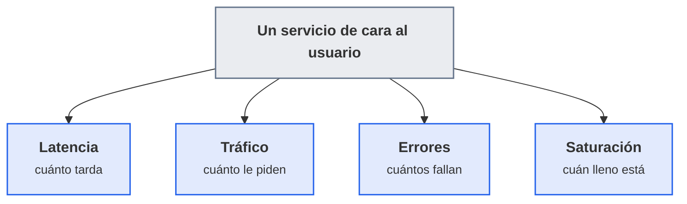
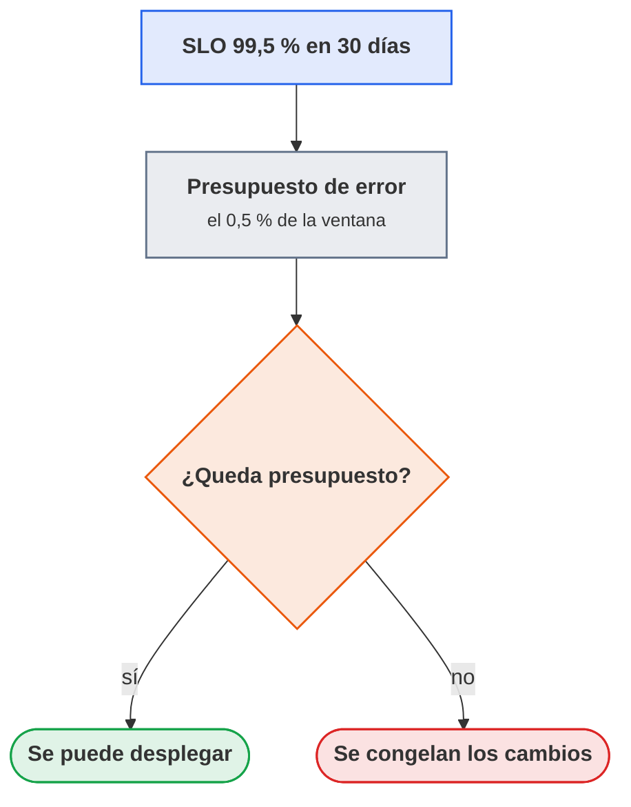
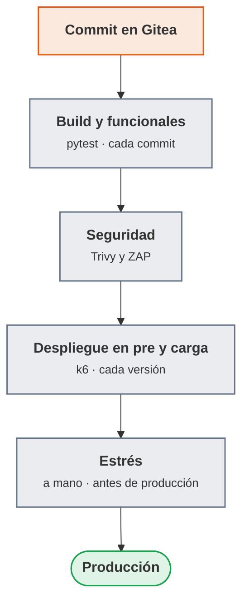
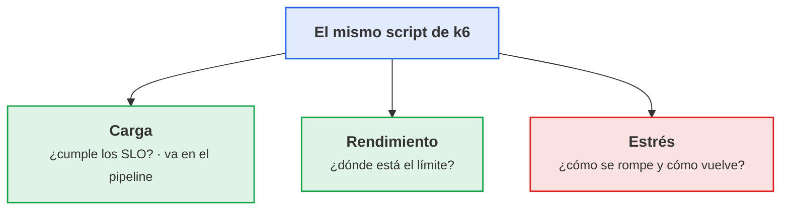
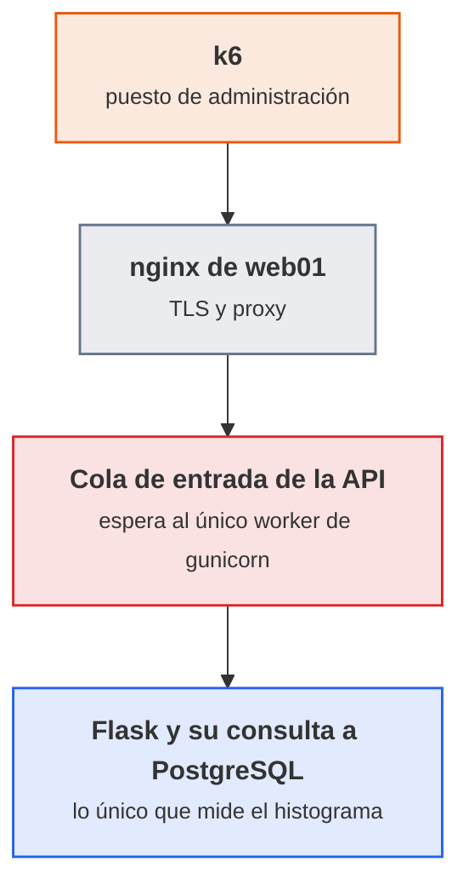
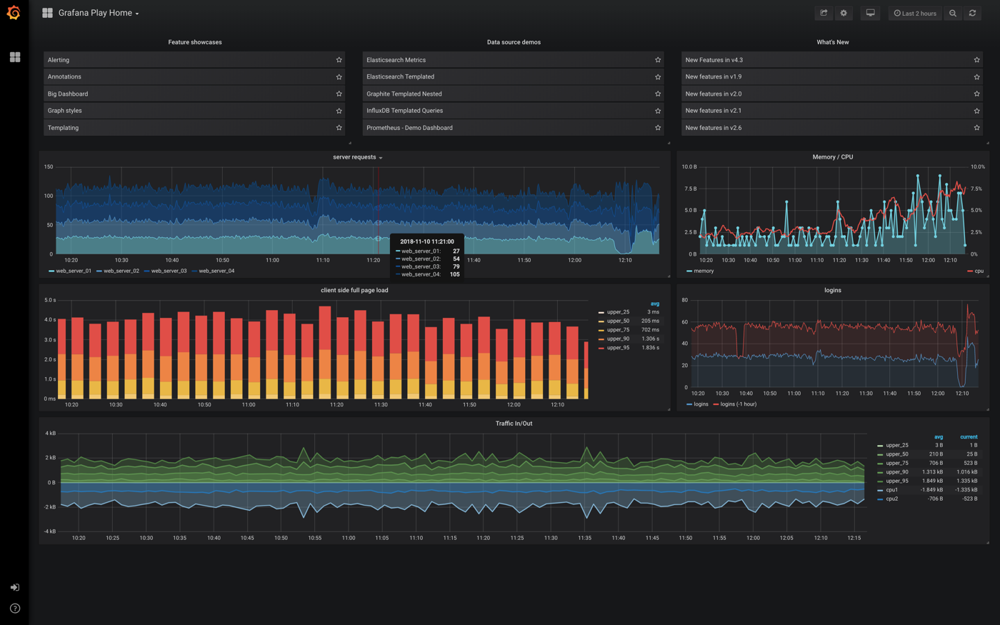
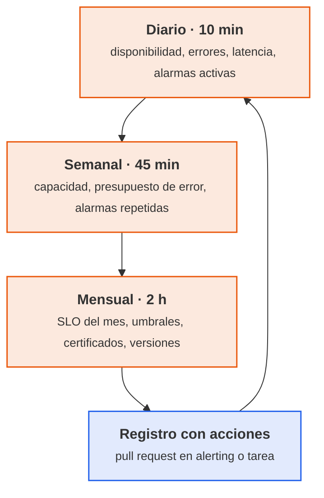

# UT4 · Indicadores, KPI y pruebas del servicio

<p class="ut-meta">16 h · Sesiones 20 a 27 · RA2 CE a, b, c, d, e, f</p>

Las tres primeras unidades pusieron el contenedor de referencia a exponer métricas, logs y eventos, convirtieron algunas métricas en alarmas y protegieron la pila de monitorización. Esta unidad ordena todo eso para que lo pueda operar alguien que no lo ha montado: qué mide cada métrica, qué indicadores resumen la salud del servicio y con qué umbral, qué hacer cuando salta cada alarma, y cómo se prueba el servicio (funcional, carga, estrés y seguridad) dejando evidencia. El resultado es el dossier de operación que pide una empresa antes de pasar un servicio a producción. La unidad abre la segunda evaluación, y buena parte entra en su examen, el 23 de marzo de 2027.

La primera mitad documenta el servicio tal como funciona hoy (sesiones 20 a 22); la segunda lo somete a pruebas (sesiones 23 a 25); el cierre documenta las pruebas, fija la revisión periódica de los indicadores y reúne el dossier.

## Sesión 20 · Fichas de métricas

<p class="ut-meta" markdown>15 de diciembre · Teoría y práctica · <span class="dur" tabindex="0" aria-label="Elegir qué medir antes de documentarlo · 10 min&#10;Documentar las métricas · 15 min&#10;A4.1 Fichas de métricas · 85 min" data-dur="Elegir qué medir antes de documentarlo · 10 min&#10;Documentar las métricas · 15 min&#10;A4.1 Fichas de métricas · 85 min">:material-school:<i class="dur-barra" style="--teoria:23%"></i>:material-flask:</span></p>

Prometheus recoge ya cientos de métricas, pero en ningún sitio está escrito cuáles importan, en qué unidad van ni de dónde salen. Quien recibe una alarma de madrugada no lo sabe. La sesión lo resuelve en dos pasos: primero se decide qué merece la pena documentar, con tres listas clásicas (las señales doradas, USE y RED); después se describe cada métrica elegida en una ficha y se clasifica como capacidad, rendimiento o calidad, que es lo que pide el criterio a del RA2. La hoja crea el repositorio `operacion`, donde vive toda la documentación de la unidad, y escribe en él las primeras diez fichas.

### Elegir qué medir antes de documentarlo

**No se puede documentar todo.** Solo cAdvisor publica más de cien métricas por contenedor, y un documento con cientos de fichas no lo lee nadie. Lo útil es partir de las preguntas que hay que poder responder sobre el servicio: las métricas que las responden son las que merecen ficha, indicador y, si hace falta, alarma. Tres listas clásicas dicen qué preguntas son.

#### Las cuatro señales doradas

**Qué son.** Las *golden signals* son el mínimo que hay que medir de cualquier servicio que atiende a usuarios:



<p class="pie" markdown>Si solo se pueden instrumentar cuatro cosas de un servicio, que sean estas.</p>

- **Latencia**: cuánto tarda en responder una petición. Conviene separar la de los errores: un 500 que se devuelve en 2 ms baja la media y disfraza el problema.
- **Tráfico**: cuánta demanda recibe. En una API, peticiones por segundo.
- **Errores**: proporción de peticiones que fallan (los 5xx).
- **Saturación**: cómo de lleno está el recurso que antes se va a agotar. En el contenedor `app` es la CPU, acotada por el límite `cpus` del compose; en `db01`, las conexiones o el disco.

Con estas cuatro ya hay un panel útil, y de ellas salen las alarmas de síntoma: latencia alta, errores altos, tráfico anómalo (cero tráfico también es síntoma) y saturación.

#### USE para recursos, RED para servicios

**Dos listas para dos tipos de cosa.** Para los recursos (CPU, memoria, disco, red) se usa **USE**: utilización (porcentaje de tiempo ocupado), saturación (trabajo en cola) y errores. Para los servicios se usa **RED**: tasa de peticiones por segundo, errores y duración. USE mira hacia dentro (la capacidad) y RED hacia el usuario (lo que recibe).

**En el laboratorio.** RED de la API sale de las métricas que se le [programaron](ut1-observabilidad.md#python-con-prometheus_client) (`app_http_requests_total` y `app_http_request_duration_seconds_bucket`). USE del contenedor sale de cAdvisor (`container_*`), USE del host de node_exporter (`node_*`) y USE de PostgreSQL de postgres_exporter (`pg_stat_activity_count`, `pg_stat_database_*`). En la A4.1 sirven de lista de comprobación: si faltan métricas de una categoría, recorrer USE y RED las hace aparecer.

### Documentar las métricas

**Qué es una ficha de métrica.** Cada métrica elegida se describe en una ficha: qué mide, quién la produce, en qué unidad, con qué etiquetas y para qué se usa. Obliga a responder lo que se pregunta quien la ve por primera vez: ¿sube y baja o solo sube?, ¿segundos o milisegundos?, ¿de dónde sale? El curso usa una ficha de ocho campos; esta es la del histograma de latencia de la API:

| Campo | Ejemplo |
|---|---|
| Nombre | `app_http_request_duration_seconds_bucket` |
| Tipo | histogram |
| Unidad | segundos |
| Etiquetas | `method`, `route`, `le` |
| Qué mide | Tiempo de respuesta de la API por petición |
| Referencia | Código: `api/metrics.py`; documentación del cliente Prometheus para Python |
| Categoría | Rendimiento |
| Uso | Indicador de latencia p95; alerta `AppHighLatency` |

Tres campos marcan la diferencia entre una ficha útil y una de relleno:

- **Tipo.** Uno de los [tipos de métrica](ut1-observabilidad.md#tipos-de-metrica): un counter solo sube, un gauge sube y baja, y un histogram reparte cada observación en cubos (la etiqueta `le` es el límite de cada cubo). El tipo decide qué funciones tienen sentido: `rate()` solo sobre counters y `histogram_quantile()` solo sobre los `_bucket`. No se adivina: Prometheus guarda el tipo y la descripción que declara cada exporter y los sirve en `/api/v1/metadata`.
- **Unidad.** Siempre la base (segundos, bytes), como manda la [convención de nombres](ut1-observabilidad.md#nombres-y-etiquetas-convenciones); la conversión a milisegundos o GiB se hace en Grafana.
- **Referencia.** El fichero del código propio o la página y la versión del exporter, porque los exporters cambian nombres de una versión a otra.

#### Las tres categorías con ejemplos del laboratorio

**Cada categoría responde a una pregunta.** Un servicio bien documentado tiene métricas de las tres; si solo hay de capacidad, se está mirando el contenedor y no el servicio. Las tablas son el punto de partida de la hoja.

**Capacidad** responde a "¿cuándo se llenará?". Casi siempre son gauges o un uso dividido entre su límite:

| Métrica | Tipo | Origen | Qué mide |
|---|---|---|---|
| `container_memory_working_set_bytes{service="app"}` | gauge | cAdvisor | Memoria que el kernel no puede liberar sin perjudicar al proceso; la que cuenta para que el kernel lo mate por falta de memoria |
| `container_spec_memory_limit_bytes{service="app"}` | gauge | cAdvisor | Límite `mem_limit` de compose; sin límite, 0 |
| `node_filesystem_avail_bytes{mountpoint="/data"}` | gauge | node_exporter en db01 | Bytes disponibles para usuarios no root en `/data`, el disco de datos de PostgreSQL |
| `pg_stat_activity_count{datname="servicio"}` | gauge | postgres_exporter | Conexiones abiertas por estado (`active`, `idle`) |
| `pg_settings_max_connections` | gauge | postgres_exporter | Valor de `max_connections` de PostgreSQL |

**Por qué `/data`.** Es el disco aparte donde vive PostgreSQL desde la [A3.2 de Despliegue](https://victor-educ.github.io/apuntes-5166/ut/ut3-seguridad-por-capas/#a32-aplicacion-y-datos-sesion-16), el 27 de noviembre. Medir `/` mezclaría los datos con los logs del sistema. Si `node_filesystem_avail_bytes{mountpoint="/data"}` no devuelve nada, lo que falta es el disco, no la consulta.

**Rendimiento** responde a "¿cuánto tarda y cuánto procesa?". Suelen ser histogramas o counters con `rate()`:

| Métrica | Tipo | Origen | Qué mide |
|---|---|---|---|
| `app_http_request_duration_seconds_bucket` | histogram | API, `api/metrics.py` | Distribución de la latencia por `method` y `route` |
| `app_http_requests_total` | counter | API | Peticiones por `method`, `route` y `status`; su `rate()` es el throughput (peticiones por segundo) |
| `pg_stat_database_xact_commit_total` | counter | postgres_exporter | Transacciones confirmadas; su `rate()` es la carga de la base de datos |
| `container_cpu_usage_seconds_total{service="app"}` | counter | cAdvisor | Segundos de CPU consumidos |

**Calidad** responde a "¿el resultado es correcto?", y es la que más se olvida:

| Métrica | Tipo | Origen | Qué mide |
|---|---|---|---|
| `app_http_requests_total{status=~"5.."}` | counter | API | Respuestas con error de servidor |
| `app_http_requests_total{status=~"4.."}` | counter | API | Errores del cliente (400, 401, 404, 422): no son culpa del servicio, pero un pico dice que algo ha cambiado en quien lo llama |
| `up{job="app"}` y `pg_up` | gauge | Prometheus y postgres_exporter | 1 si la API responde al scrape y si el exporter conecta con PostgreSQL; base de `AppDown` y `PgDown` |
| `pg_stat_database_deadlocks_total` | counter | postgres_exporter | Interbloqueos; cada uno es una transacción abortada |
| `app_items_invalid` | gauge | habría que programarla en la API | Items guardados con datos imposibles, como un precio negativo |

**La métrica que no existe.** La última fila es deliberada: ninguna herramienta mide si los datos son correctos. Alguien tiene que escribir la consulta que los cuenta y exponerla como gauge, y eso es lo que separa vigilar el servidor de vigilar el servicio.

### A4.1 Fichas de métricas (sesión 20)

<span class="et et-obj">Objetivo</span> Al terminar tienes el repositorio `operacion` publicado en la Gitea del laboratorio, con un `metricas.md` de al menos diez fichas de métrica, tres o más por categoría, cada una con su referencia. Es la primera pieza del dossier de operación: en un trabajo, es el documento que se le da a quien se incorpora al equipo de guardia.

<span class="et et-pre">Antes de empezar</span>

- Los túneles de [Cómo se llega a la pila](../laboratorio.md#como-se-llega-a-la-pila-desde-el-3-de-diciembre) abiertos: una shell en mon01 y Prometheus en `http://localhost:29090` de tu VM `puesto`.
- Una shell en el puesto de administración, donde nace hoy `operacion`, y tu usuario de la Gitea de mon01.
- `api/metrics.py` del repositorio `servicio`, para las referencias.
- Lo explicado al principio de la sesión: [las señales doradas, USE y RED](#elegir-que-medir-antes-de-documentarlo) y [la ficha de métrica con sus categorías](#documentar-las-metricas).

<span class="et et-pas">Pasos</span>

Primero creas el repositorio; después sacas de Prometheus lo que cada métrica declara de sí misma; con eso escribes las fichas, y al final compruebas que las tres categorías están cubiertas y publicas.

1. **Crea el repositorio `operacion`.** Toda la documentación de operación de la unidad va a un repositorio propio, separado del código, porque la mantiene quien opera el servicio. Gitea no crea el repositorio con el primer `push`: créalo antes en la web de `http://gitea.lab:23001`, con el botón **+ → Nuevo repositorio**, propietario `ops`, nombre `operacion` y sin inicializar. Después, en el puesto de administración:

    ```bash
    mkdir ~/operacion && cd ~/operacion
    git init -b main
    git remote add origin http://gitea.lab:23001/ops/operacion.git
    ```

    Comprueba: `git remote -v` muestra el remoto y la página `http://gitea.lab:23001/ops/operacion` existe, vacía.

2. **Saca de Prometheus el tipo y la descripción de cada métrica.** Escribir la ficha a partir de lo que declara el exporter, y no de memoria, es lo que garantiza que el tipo sea cierto. En la shell de mon01:

    ```bash
    curl -s http://localhost:29090/api/v1/metadata | jq -r '.data | to_entries[]
      | select(.key | test("^(app_|container_|pg_|node_filesystem)"))
      | [.key, .value[0].type, .value[0].help] | @tsv' > ~/metadatos.tsv
    ```

    Después consulta en `http://localhost:29090` cada métrica que vayas a documentar, para ver con qué etiquetas llega. De cAdvisor solo llegan las diez del `keep` de su job; si necesitas otra, añádela a la expresión regular del `keep` en `/opt/monitoring/prometheus.yml` y recarga con `curl -s -X POST http://localhost:29090/-/reload`.

    Comprueba: `wc -l ~/metadatos.tsv` da decenas de líneas, cada una con nombre, tipo y descripción.

3. **Escribe las fichas.** En `~/operacion/metricas.md`, diez fichas o más con los ocho campos de [Documentar las métricas](#documentar-las-metricas). Empieza por las de las tres tablas de categorías (menos `app_items_invalid`, que no existe) y copia el formato de la tabla de ejemplo. Tipo y descripción salen de `metadatos.tsv`; la Referencia, del fichero y la función para la API, y de la página y la versión para un exporter.

    Comprueba: cada ficha tiene las ocho filas y el tipo coincide con el de `metadatos.tsv`.

4. **Comprueba el reparto y publica.** Cierra `metricas.md` con una tabla resumen (nombre, categoría y Uso, que se completa en la A4.2) y cuenta las fichas por categoría. Si falta alguna, recorre USE y RED como en [el apartado](#use-para-recursos-red-para-servicios): la que suele quedarse corta es calidad, y los códigos de estado de la API, `up` y `pg_up` dan tres sin programar nada.

    ```bash
    git add metricas.md && git commit -m "Fichas de métricas"
    git push -u origin main
    ```

    Comprueba: `git ls-remote origin` muestra la rama `main`.

<span class="et et-com">Comprobación</span> Diez fichas o más con las ocho filas rellenas; tres o más por categoría; todas devuelven datos en Prometheus; el tipo coincide con el de `/api/v1/metadata`; `git ls-remote origin` muestra la rama `main` de `operacion`.

<span class="et et-ent">Para practicar</span> Empuja `metricas.md` del repositorio `operacion` a la Gitea del laboratorio: forma parte del dossier de la práctica evaluable.

## Sesión 21 · Indicadores

<p class="ut-meta" markdown>17 de diciembre · Teoría y práctica · <span class="dur" tabindex="0" aria-label="Indicadores: fórmulas y umbrales · 25 min&#10;A4.2 Indicadores · 85 min" data-dur="Indicadores: fórmulas y umbrales · 25 min&#10;A4.2 Indicadores · 85 min">:material-school:<i class="dur-barra" style="--teoria:23%"></i>:material-flask:</span></p>

Una métrica suelta no dice si el servicio va bien: 4.831.220 peticiones y 312 errores no responden a si cumple lo que promete ni cuánto margen le queda. Para eso las métricas se combinan en **indicadores**, cada uno con un umbral que separa lo normal de lo que no. La teoría va en este orden: el vocabulario de una promesa de servicio (SLO, SLA y presupuesto de error), los nueve indicadores del servicio del curso con su fórmula, y cómo se fija un umbral con datos. La hoja los graba como recording rules, los pinta en un panel de KPI y justifica cada umbral con el histórico de Prometheus.

### Indicadores: fórmulas y umbrales

**Qué es un indicador.** Un indicador o KPI (*key performance indicator*, indicador clave) combina métricas en un valor con significado para alguien que no conoce el código. "El contenedor lleva 1.234.567 segundos de CPU" no dice nada; "la API va al 62 % de su límite de CPU" sí. Algunos ya existen como [recording rules](ut2-alarmas.md#agregacion-y-correlacion-recording-rules) (el ratio de errores, el p95 de latencia); falta decidir cuáles describen el servicio entero y con qué valor se da por bueno cada uno.

**El vocabulario.** Una promesa de servicio se expresa con tres piezas:

- **SLO** (*service level objective*, objetivo de nivel de servicio): el valor que el equipo se compromete a cumplir para una medida en una ventana. Por ejemplo, disponibilidad (peticiones correctas entre peticiones totales) ≥ 99,5 % en 30 días.
- **SLA** (*service level agreement*, acuerdo de nivel de servicio): el contrato con el cliente, con penalizaciones si se incumple. Siempre menos exigente que el SLO, para tener margen de reaccionar antes de que la empresa pague.
- **Presupuesto de error**: lo que se puede fallar sin incumplir el SLO. Si queda presupuesto, se despliega; si no, se congelan los cambios y se arregla la fiabilidad.

**El SLO del curso.** La [documentación del servicio](ut2-alarmas.md#tabla-de-umbrales-del-contenedor-de-referencia) da un 99 % de disponibilidad, que es el SLA que cita la alarma `AppHighErrorRate`. El SLO interno se fija más exigente, en el 99,5 % en 30 días, y es el que usan los ejemplos de la unidad.

#### El presupuesto de error con números

**Fallar un poco está permitido.** Con un SLO del 99,5 % en 30 días, el presupuesto es el 0,5 % de la ventana:



<p class="pie" markdown>El presupuesto de error convierte «¿desplegamos el viernes?» en una pregunta con respuesta numérica.</p>

```text
30 días × 24 h × 60 min = 43.200 min
0,5 % de 43.200 min = 216 min = 3,6 h
```

En peticiones: con 20 peticiones/s de media, en 30 días son 51,84 millones, y el presupuesto son 259.200 peticiones fallidas. Da igual gastarlo en una caída de 3,6 h o en un 1 % de errores durante 15 días. Cada nueve más (99,9 %, 99,99 %) divide el presupuesto por diez y cuesta mucho más en infraestructura, así que el SLO se negocia con quien paga.

**El burn rate.** Es el ritmo al que se gasta el presupuesto. Con burn rate 1, se agota justo al final de los 30 días:

```text
burn rate = tasa de errores observada / (1 - SLO) = tasa de errores / 0,005

errores del 0,5 %  → burn rate 1    → presupuesto agotado en 30 días
errores del 3 %    → burn rate 6    → agotado en 5 días
errores del 7,2 %  → burn rate 14,4 → agotado en 50 horas (el 2 % del mes en 1 h)
```

Las alarmas basadas en el SLO miran el burn rate en dos ventanas a la vez: la larga evita el ruido y la corta confirma que el problema sigue activo. Por eso la A4.2 graba `app:errors:ratio1h` además del `ratio5m` que ya existe:

```promql
# 2 % del presupuesto mensual consumido en 1 h, y el problema sigue vivo
(app:errors:ratio1h > (14.4 * 0.005)) and (app:errors:ratio5m > (14.4 * 0.005))
```

#### Los nueve indicadores del servicio

**Por qué estos nueve.** Salen de cruzar las señales doradas con las tres categorías: latencia, tráfico y errores de la API (rendimiento y calidad), y la saturación de lo que se puede agotar (capacidad): CPU y memoria del contenedor, disco y conexiones de la base de datos. Cada uno lleva fórmula, categoría y dos umbrales, aviso y crítico. El p95 es el [percentil 95](ut1-observabilidad.md#tipos-de-metrica): el valor que no supera el 95 % de las peticiones.

| Indicador | Fórmula (PromQL) | Categoría | Umbral aviso | Umbral crítico |
|---|---|---|---|---|
| Disponibilidad | `sum(rate(app_http_requests_total{status!~"5.."}[30d])) / sum(rate(app_http_requests_total[30d]))` | Calidad | < 99,7 % | < 99,5 % |
| Latencia p95 | `histogram_quantile(0.95, sum by(le)(rate(app_http_request_duration_seconds_bucket[5m])))` | Rendimiento | > 300 ms | > 500 ms |
| Throughput | `sum(rate(app_http_requests_total[5m]))` | Rendimiento | informativo | ninguno |
| Tasa de errores | `app:errors:ratio5m` | Calidad | > 0,5 % | > 1 % |
| Saturación CPU | `sum by (service)(rate(container_cpu_usage_seconds_total{service="app"}[5m])) / sum by (service)(container_spec_cpu_quota{service="app"} / container_spec_cpu_period{service="app"})` | Capacidad | > 70 % | > 90 % |
| Memoria | `container_memory_working_set_bytes{service="app"} / container_spec_memory_limit_bytes{service="app"}` | Capacidad | > 80 % | > 90 % |
| Disco BD | `node_filesystem_avail_bytes{mountpoint="/data"} / node_filesystem_size_bytes{mountpoint="/data"}` | Capacidad | < 20 % | < 10 % |
| Días hasta disco lleno | `predict_linear(node_filesystem_avail_bytes{mountpoint="/data"}[7d], 30*86400) < 0` | Capacidad | 30 días | 7 días |
| Conexiones BD | `sum by (service)(pg_stat_activity_count) / on(service) group_left pg_settings_max_connections` | Capacidad | > 70 % | > 85 % |

Cada fórmula tiene una trampa que conviene conocer: en la A4.2 se implementan y entran en el examen.

**Disponibilidad.** Los 4xx cuentan como correctos: un 404 es una respuesta correcta a una petición incorrecta. La trampa es la ventana: `rate(...[30d])` sobre la métrica cruda lee treinta días de muestras de todas sus series y tarda segundos. Lo correcto es grabar `app:requests:rate5m` y `app:errors:rate5m` como reglas y calcular la mensual sobre ellas con `sum_over_time`, que suma las muestras de una serie en la ventana. Además, Prometheus tiene que guardar más de 30 días: en mon01 la retención es de 45.

**Latencia p95.** `histogram_quantile` no da el percentil exacto: lo estima dentro del cubo donde cae. Con los cubos de `api/metrics.py` (…, 0,25, 0,5, 1 s…), un p95 real de 320 ms puede salir como cualquier valor entre 250 y 500 ms; la comparación solo es exacta cuando hay un cubo justo en el umbral. Y el `sum by(le)` es obligatorio: sin `le`, la función devuelve NaN.

**Throughput.** No tiene umbral, pero da contexto: un p95 de 800 ms no es el mismo problema con 200 peticiones/s que con 2.

**Tasa de errores.** Se usa la regla grabada para que panel, alarma e informe den lo mismo. El crítico del 1 % es burn rate 2, y el aviso del 0,5 %, burn rate 1. Dos trampas. Con poco tráfico el cociente es ruidoso (1 error entre 50 peticiones es un 2 %). Y si la API no ha devuelto ningún 5xx desde que arrancó, la serie de errores no existe y el cociente sale vacío ("No data" en el panel). Se arregla completando el numerador con `or` y la tasa total multiplicada por 0, en `app:errors:ratio5m` y en `app:errors:rate5m`:

```promql
# numerador que vale 0, y no vacío, cuando no ha habido ningún 5xx
sum by (service)(rate(app_http_requests_total{status=~"5.."}[5m]))
  or sum by (service)(rate(app_http_requests_total[5m])) * 0
```

**Saturación de CPU.** cAdvisor publica el límite como cuota y periodo: `cpus: "1.5"` es cuota 150.000 y periodo 100.000, y su cociente da 1,5. Las dos sumas `by (service)` son necesarias: el consumo lleva una etiqueta `cpu` que la cuota no tiene, y sin agregar la división sale vacía (el [problema de etiquetas de los operadores](ut2-alarmas.md#operadores-con-etiquetas)). Sin `cpus` en el compose, el indicador no devuelve nada. Y como gunicorn corre con un solo worker, que no usa más de un núcleo, el límite tiene que ser de 1 o menos para que el indicador llegue a sus umbrales.

**Memoria.** Se usa el working set y no `usage`, que incluye caché que el kernel puede soltar ([la comparación](ut1-observabilidad.md#memory-usage-frente-a-working-set)). Sin `mem_limit` en el compose, el límite es 0 y el indicador da `+Inf`.

**Disco de la base de datos.** Se usa `avail` y no `free`, porque el sistema de ficheros reserva un 5 % para root y PostgreSQL no corre como root. El crítico del 10 % es agresivo a propósito: con el disco lleno, PostgreSQL deja de escribir.

**Días hasta disco lleno.** `predict_linear` ajusta una recta a los últimos 7 días y la prolonga 30 (30 × 86.400 s): si el valor previsto es negativo, el disco se llena antes de un mes. Siete días absorben los ciclos semanales; un cambio brusco (un borrado grande, una ampliación) la deja ciega una semana.

**Conexiones de la base de datos.** El `sum by (service)` junta los estados y el `group_left` empareja la suma con la única serie de `max_connections`, como en la regla `db:connections:ratio`. Los umbrales son bajos porque el agotamiento es brusco: con muchos workers, se pasa de 40 a 100 conexiones en segundos.

#### Cómo fijar umbrales

**Cada categoría, su lógica.** Un umbral responde a qué hay que hacer cuando se cruza:

- Capacidad: por el tiempo que se necesita para reaccionar. Días si hay que ampliar disco o pedir una VM más grande; minutos si basta con reiniciar un contenedor.
- Rendimiento: por el SLO más un margen. Si el SLO es p95 < 500 ms, el aviso va en 300 ms.
- Calidad: por el presupuesto de error. Crítico en burn rate 2; aviso en burn rate 1. En la disponibilidad mensual, el aviso del 99,7 % salta con el 60 % del presupuesto gastado.

**Ningún umbral sin mirar los datos.** Un umbral de CPU al 70 % cuando el servicio vive al 75 % es una alarma permanente, y una alarma permanente se ignora: es la [fatiga de alertas](ut2-alarmas.md#fatiga-de-alertas). Antes de fijarlo se mira el histórico con las funciones `_over_time`: `min_over_time` y `max_over_time` dan los extremos y `quantile_over_time(0.5, ...)`, el valor habitual.

### A4.2 Indicadores (sesión 21)

<span class="et et-obj">Objetivo</span> Al terminar, los nueve indicadores del servicio están grabados como recording rules en el Prometheus de mon01, un panel de KPI en Grafana los muestra con sus umbrales como colores, e `indicadores.md` en `operacion` da la fórmula, la categoría y los umbrales de cada uno, justificados con datos. Es el criterio b del RA2: en un trabajo, es la tabla que se negocia con quien paga el servicio.

<span class="et et-pre">Antes de empezar</span>

- `alerting` en `/opt/alerting` de mon01, con las recording rules de la A2.2 en `prometheus/rules.yml`.
- Prometheus guardando 45 días: compruébalo en `http://localhost:29090/flags` (`storage.tsdb.retention.time`) y, si no, ajústalo en el `command` de Prometheus.
- `cpus` (de 1 o menos) y `mem_limit` en el servicio `app` de `/opt/servicio/compose.yml` en app01.
- En el `keep` de cAdvisor de `/opt/monitoring/prometheus.yml`, añadidas a la expresión regular `spec_cpu_(quota|period)` y `cpu_cfs_throttled_periods_total` (la última la usa la A4.5), y Prometheus recargado.
- db01 con su disco en `/data`, node_exporter y postgres_exporter (de la [A3.2 de Despliegue](https://victor-educ.github.io/apuntes-5166/ut/ut3-seguridad-por-capas/#a32-aplicacion-y-datos-sesion-16)) recogidos por Prometheus.
- El bucle de tráfico de la A2.1 corriendo en el puesto de administración contra `https://api.dev.lab/items`, para que los cocientes no den `NaN`. Por su `-s`, falla en silencio si `curl` no confía en la CA del curso: instala `~/ca/ca.crt` en el sistema si hace falta.
- Lo explicado al principio de la sesión: [SLO y presupuesto de error](#indicadores-formulas-y-umbrales), [los nueve indicadores](#los-nueve-indicadores-del-servicio) y [cómo fijar umbrales](#como-fijar-umbrales).

<span class="et et-pas">Pasos</span>

Construyes los indicadores de dentro afuera: primero las reglas que los calculan, después el panel que los enseña, y con el histórico delante decides los umbrales. Luego calculas el presupuesto de error y versionas el panel.

1. **Graba los indicadores que faltan.** Cinco de los nueve ya existen (`app:requests:rate5m`, `app:errors:ratio5m`, `app:latency_p95:5m`, `app:memory:ratio` y `db:connections:ratio`). Añade al final de `/opt/alerting/prometheus/rules.yml` este grupo con las seis reglas que faltan, con los nombres que usan la A4.3 y la A4.7:

    ```yaml
      - name: app-kpi
        interval: 30s
        rules:
          - record: app:errors:rate5m
            expr: |
              sum by (service)(rate(app_http_requests_total{status=~"5.."}[5m]))
                or sum by (service)(rate(app_http_requests_total[5m])) * 0
          - record: app:errors:ratio1h
            expr: |
              (sum by (service)(rate(app_http_requests_total{status=~"5.."}[1h]))
                or sum by (service)(rate(app_http_requests_total[1h])) * 0)
              / sum by (service)(rate(app_http_requests_total[1h]))
          - record: app:availability:30d
            expr: 1 - sum_over_time(app:errors:rate5m[30d]) / sum_over_time(app:requests:rate5m[30d])
          - record: app:cpu:ratio5m
            expr: |
              sum by (service)(rate(container_cpu_usage_seconds_total{service="app"}[5m]))
              / sum by (service)(container_spec_cpu_quota{service="app"} / container_spec_cpu_period{service="app"})
          - record: db:disk_avail:ratio
            expr: node_filesystem_avail_bytes{mountpoint="/data"} / node_filesystem_size_bytes{mountpoint="/data"}
          - record: db:disk_full:predict30d
            expr: predict_linear(node_filesystem_avail_bytes{mountpoint="/data"}[7d], 30*86400)
    ```

    Cambia también el numerador de `app:errors:ratio5m` en el grupo `app_rules` por el de la [tasa de errores](#los-nueve-indicadores-del-servicio), con el `or`. Valida y recarga en mon01:

    ```bash
    cd /opt/alerting/prometheus
    docker run --rm -v "$PWD:/w" --entrypoint promtool prom/prometheus:v3.5.0 check rules /w/rules.yml /w/alerts.yml
    curl -s -X POST http://localhost:29090/-/reload
    ```

    Comprueba: `promtool` dice `SUCCESS` y `http://localhost:29090/rules` muestra el grupo `app-kpi` sin errores.

2. **Monta el panel de KPI.** Es la vista de la revisión diaria y la que capturas en las pruebas de la A4.5 y la A4.6, así que cada panel tiene que leerse sin explicación: un número, su unidad y un color. En Grafana, crea el dashboard "KPI app" (**Dashboards → New → New dashboard → Add visualization**, fuente Prometheus) y haz el primer panel:

    - Consulta: `app:availability:30d`. Tipo de visualización: **Stat**.
    - **Standard options → Unit**: `Percent (0.0-1.0)`.
    - **Thresholds**: los dos umbrales de la tabla; en **Stat styles → Color mode**, `Background solid`.

    Después duplícalo (menú del panel → **More → Duplicate**) para los otros ocho: solo cambian la consulta (la regla grabada de cada indicador), la unidad (`Percent (0.0-1.0)`, `seconds`, `bytes`) y los umbrales. Guarda el dashboard.

    Comprueba: nueve paneles con valor; ninguno en `NaN`, `+Inf` ni "No data".

3. **Decide los umbrales con datos.** Una recording rule no tiene datos de antes de cargarse, así que el histórico se mira con la expresión completa de la tabla. En la shell de mon01, por cada indicador:

    ```bash
    q() { curl -sG http://localhost:29090/api/v1/query --data-urlencode "query=$1" | jq -r '.data.result[0].value[1] // "n/a"'; }
    E='<expresión completa del indicador>'
    q "min_over_time(($E)[7d:5m])"
    q "quantile_over_time(0.5, ($E)[7d:5m])"
    q "max_over_time(($E)[7d:5m])"
    ```

    Con eso escribe `~/operacion/indicadores.md`: indicador, regla, categoría y umbrales, y una línea por umbral con lo que has visto y por qué ese valor. Un umbral por debajo del valor habitual sería una alarma permanente.

    Comprueba: cada umbral de `indicadores.md` tiene al lado sus tres cifras.

4. **Calcula el presupuesto de error.** Saca el tráfico medio de los dos últimos días con `q 'avg_over_time(app:requests:rate5m[2d])'` y calcula, con tu SLO, el presupuesto mensual en minutos y en peticiones, como en [El presupuesto de error con números](#el-presupuesto-de-error-con-numeros). Añádelo a `indicadores.md` con las cuentas a la vista: es la cifra contra la que la revisión semanal de la A4.7 compara lo gastado.

    Comprueba: las cuentas dan el mismo resultado si se rehacen a mano.

5. **Versiona el panel y publica.** Un panel que solo vive en la base de datos de Grafana se pierde con ella. Exporta el dashboard (**Export → Export as JSON → Download file**): se descarga en tu VM `puesto`. Desde ella, súbelo al puesto de administración y empuja los dos repositorios:

    ```bash
    # en tu VM puesto
    ssh ops@<admin01> mkdir -p operacion/grafana
    scp <ruta del JSON descargado> ops@<admin01>:operacion/grafana/kpi.json
    # en el puesto de administración
    cd ~/operacion && git add indicadores.md grafana/kpi.json && git commit -m "Indicadores y panel de KPI" && git push
    # en mon01
    cd /opt/alerting && git add prometheus/rules.yml && git commit -m "Indicadores de la UT4" && git push
    ```

    Comprueba: los tres ficheros se ven en la Gitea.

<span class="et et-com">Comprobación</span> `promtool check rules` sin errores; los nueve indicadores devuelven valor (ninguno `NaN` ni `+Inf`); el panel los muestra con colores según umbral; cada umbral tiene su justificación con datos.

<span class="et et-ent">Para practicar</span> Empuja a la Gitea del laboratorio `prometheus/rules.yml` en `alerting`, e `indicadores.md` y `grafana/kpi.json` en `operacion`: forman parte del dossier de la práctica evaluable.

<span class="et et-ext">Si te sobra tiempo</span> Añade a `alerts.yml` la alerta de burn rate en dos ventanas del apartado y fuérzala parando PostgreSQL en db01 un par de minutos.

## Sesión 22 · Catálogo de alarmas

<p class="ut-meta" markdown>12 de enero · Teoría y práctica · <span class="dur" tabindex="0" aria-label="Catálogo de alarmas y runbooks · 15 min&#10;A4.3 Catálogo de alarmas · 95 min" data-dur="Catálogo de alarmas y runbooks · 15 min&#10;A4.3 Catálogo de alarmas · 95 min">:material-school:<i class="dur-barra" style="--teoria:14%"></i>:material-flask:</span></p>

Hay diez alarmas que llegan por correo, por Telegram y como incidencia de Gitea, y la A4.2 ha fijado umbrales para indicadores que todavía no avisan a nadie. Falta lo que pasa después del aviso: quien lo recibe tiene que saber qué significa y qué hacer, y hoy eso solo lo sabe quien escribió la regla (la anotación `runbook` apunta a una wiki que no existe). La teoría da la ficha de una alarma, lo que hace bueno a un runbook y dos ejemplos más; la hoja añade cinco alarmas, escribe el catálogo y cinco runbooks, y enlaza cada regla con su documento.

### Catálogo de alarmas y runbooks

**Para quién se escribe.** Para quien recibe la alarma sin contexto, a las 3 de la mañana. Necesita seis respuestas, que son los seis campos de la ficha: de dónde sale el aviso (Origen), qué puede estar fallando (Posible fallo), a quién afecta (Impacto), cómo se averigua la causa (Análisis), qué se hace en cada caso (Resolución) y a quién se pasa si no se arregla (Escalado). El **catálogo** es la tabla de todas las alarmas con los tres primeros campos; el **runbook** es la ficha completa, para las alarmas que más lo necesitan. Entre los dos cubren el criterio c del RA2. La ficha de `AppHighErrorRate` sirve de modelo:

| Campo | AppHighErrorRate |
|---|---|
| Origen | `app:errors:ratio5m > 1 %` durante 5 min |
| Posible fallo | BD no responde; despliegue con bug; dependencia externa caída |
| Impacto | Usuarios reciben errores 5xx; afecta al SLO de disponibilidad |
| Análisis | 1. Panel "KPI app" en Grafana: ¿coincide con un despliegue? 2. En app01: `docker compose -f /opt/servicio/compose.yml logs --since 10m app \| grep -ci error` 3. En app01: `nc -zv 10.10.3.10 5432` 4. Loki: `{service="app", level="error"}` |
| Resolución | Si es despliegue: rollback (`docker compose up -d` con la imagen de la versión anterior). Si es BD: ver alarma PgDown. Si es externo: activar el modo degradado (seguir sirviendo lo que no depende de lo caído) |
| Escalado | Desarrollador de guardia si persiste más de 15 min |

#### Qué hace bueno a un runbook

**La prueba.** Alguien que no conoce el servicio puede seguirlo sin preguntar. Para eso:

1. El análisis va de lo más rápido y frecuente a lo más raro, y cada paso dice qué significa el resultado ("si `nc` falla, salta a PgDown").
2. Los comandos son exactos y copiables, con el host donde se ejecutan. "Mirar los logs" no vale.
3. La resolución va de lo reversible (reiniciar un contenedor) a lo que tiene coste (rollback); lo destructivo, solo con escalado.
4. El escalado dice tiempo y rol, no "avisar a alguien".
5. Se enlaza desde la anotación `runbook` de la regla, y cambiar la alarma obliga a revisar su runbook en el mismo pull request (la propuesta de cambio desde una rama que otra persona revisa antes de aceptarla).

**Un runbook se mantiene.** Si una alarma salta y el runbook no resuelve el caso, cerrar la incidencia incluye actualizarlo.

#### Dos runbooks más

Uno de fallo brusco y otro de aviso con margen, con el mismo esquema:

| Campo | PgDown |
|---|---|
| Origen | `pg_up == 0` durante 1 min (postgres_exporter no consigue conectar) |
| Posible fallo | El servicio `postgresql` de db01 parado o reiniciándose (falta de memoria, disco lleno, corrupción); `max_connections` agotadas y el exporter no entra; red entre mon01 y la subred data cortada por una regla de OPNsense |
| Impacto | Toda escritura y la mayoría de lecturas de la API fallan con 5xx; salta AppHighErrorRate a los 5 min. Inhibida por HostDown de db01 |
| Análisis | 1. Desde app01, que es la única máquina con paso al 5432: `nc -zv 10.10.3.10 5432` (si falla, red o proceso caído). 2. En db01: `systemctl status postgresql@17-main` y `journalctl -k \| grep -i 'out of memory'`. 3. `df -h /data` (disco lleno es la causa más frecuente en el laboratorio). 4. `sudo tail -50 /var/log/postgresql/postgresql-17-main.log` buscando `FATAL`, `PANIC` o `could not write`. 5. Si el servicio está arriba: `sudo -u postgres psql -c "select count(*) from pg_stat_activity"` para descartar conexiones agotadas |
| Resolución | Proceso muerto por falta de memoria: `sudo systemctl restart postgresql@17-main` y subir la memoria de la VM en el mismo turno. Disco lleno: liberar espacio en `/data` (volcados locales antiguos, WAL archivado ya copiado) y reiniciar; nunca borrar dentro de `/data/postgresql`. Conexiones agotadas: `pg_terminate_backend` de las sesiones `idle` más antiguas y revisar el pool de la API. Corrupción (`PANIC` en los logs): no tocar, escalar y preparar restauración de la copia |
| Escalado | Inmediato al responsable de datos si hay `PANIC` o si no arranca en 10 min; en horario, aviso al equipo de desarrollo si la causa es el pool |

| Campo | DiskWillFillIn7d |
|---|---|
| Origen | `predict_linear(node_filesystem_avail_bytes{mountpoint="/data"}[7d], 7*86400) < 0` durante 1 h |
| Posible fallo | Crecimiento normal de datos sin plan de capacidad; logs de PostgreSQL o de la aplicación sin rotación; copias locales (`pg_dump`) acumuladas en el mismo volumen; tabla con mucho espacio ocupado por filas ya borradas |
| Impacto | Ninguno inmediato. Si no se actúa, en menos de una semana PostgreSQL deja de escribir y salta PgDown |
| Análisis | 1. Panel "KPI app", indicador de días hasta disco lleno: pendiente de la gráfica de 30 días y fecha estimada. 2. `du -xsh /data/* \| sort -h \| tail` para ver qué crece. 3. `sudo -u postgres psql -c "select relname, pg_size_pretty(pg_total_relation_size(oid)) from pg_class order by pg_total_relation_size(oid) desc limit 10"`. 4. `ls -la /data/copias` (¿hay volcados que ya están copiados fuera de la máquina?). 5. Si el crecimiento está fuera de `/data`, `du -xsh /var/log/*` en db01: casi siempre son los logs de PostgreSQL sin rotar |
| Resolución | Volcados locales ya replicados: borrar los de más de 7 días. Logs: revisar la rotación de `/var/log/postgresql` en `/etc/logrotate.d/postgresql-common`. Tabla con espacio muerto: `VACUUM (VERBOSE)` en ventana de baja carga. Crecimiento legítimo: abrir tarea de ampliación del disco virtual en Proxmox (pestaña Hardware de la VM, **Disk Action → Resize**) y `resize2fs`, con copia previa |
| Escalado | Si la fecha estimada es inferior a 3 días, tratar como crítico y avisar al responsable de infraestructura en el día |

**El catálogo, vivo.** Se versiona con los runbooks, y parte del mantenimiento es retirar las alarmas que nunca saltan o que saltan sin que haya nada que hacer.

### A4.3 Catálogo de alarmas (sesión 22)

<span class="et et-obj">Objetivo</span> Al terminar, `operacion` tiene en `alarmas/` el catálogo de todas las alarmas del laboratorio y un runbook completo para cinco de ellas, y cada regla enlaza desde su anotación `runbook` a su documento. Es el criterio c del RA2: que quien reciba un aviso llegue con un clic a lo que tiene que hacer.

<span class="et et-pre">Antes de empezar</span>

- `alerting` en mon01, con las diez alarmas de la A2.2 (siete en `prometheus/alerts.yml` y tres en `loki/loki-alerts.yml`) y las reglas grabadas de la A4.2.
- `operacion` en el puesto de administración y `indicadores.md`, con tus umbrales.
- Los túneles de [Cómo se llega a la pila](../laboratorio.md#como-se-llega-a-la-pila-desde-el-3-de-diciembre).
- Lo explicado al principio de la sesión: [la ficha de alarma](#catalogo-de-alarmas-y-runbooks), [qué hace bueno a un runbook](#que-hace-bueno-a-un-runbook) y [los dos ejemplos completos](#dos-runbooks-mas).

<span class="et et-pas">Pasos</span>

Primero completas las alarmas, para que el catálogo nazca con todas; después escribes el catálogo y los cinco runbooks, y al final enlazas cada regla con su documento, que va el último porque la URL no existe hasta que el fichero está empujado.

1. **Convierte los indicadores nuevos en alarmas.** Añade al grupo `app_alerts` de `/opt/alerting/prometheus/alerts.yml` estas cinco reglas, con los umbrales de tu `indicadores.md` donde dice `<...>`:

    ```yaml
          - alert: AppLowAvailability
            expr: app:availability:30d < <tu SLO, en tanto por uno>
            for: 15m
            labels: { severity: critical, team: ops, service: app, origen: prometheus, env: dev }
            annotations:
              summary: "Disponibilidad a 30 días del {{ $value | humanizePercentage }}"
          - alert: AppCpuSaturated
            expr: app:cpu:ratio5m > <tu umbral crítico>
            for: 10m
            labels: { severity: critical, team: dev, service: app, origen: cadvisor, env: dev }
            annotations:
              summary: "CPU de app al {{ $value | humanizePercentage }} de su límite"
          - alert: DbDiskLow
            expr: db:disk_avail:ratio < <tu umbral de aviso>
            for: 5m
            labels: { severity: warning, team: ops, service: db, origen: prometheus, env: dev }
            annotations:
              summary: "Queda un {{ $value | humanizePercentage }} libre en /data de db01"
          - alert: PgDown
            expr: pg_up == 0
            for: 1m
            labels: { severity: critical, team: ops, service: db, origen: prometheus, env: dev }
            annotations:
              summary: "postgres_exporter no consigue conectar con PostgreSQL"
          - alert: DiskWillFillIn7d
            expr: predict_linear(node_filesystem_avail_bytes{mountpoint="/data"}[7d], 7*86400) < 0
            for: 1h
            labels: { severity: warning, team: ops, service: db, origen: prometheus, env: dev }
            annotations:
              summary: "/data de db01 se llenará en menos de 7 días a este ritmo"
    ```

    Valida y recarga como en la A4.2. Comprueba: *Alerts* de `http://localhost:29090` muestra doce reglas de Prometheus, las cinco nuevas en `inactive`.

2. **Escribe el catálogo.** En `~/operacion/alarmas/README.md`, una tabla con una fila por alarma, las diez que ya había y las cinco de hoy, con estas columnas:

    ```markdown
    | Alarma | Origen | Posible fallo | Impacto | Runbook |
    |---|---|---|---|---|
    | AppHighErrorRate | `app:errors:ratio5m > 0.01` durante 5m | ... | ... | (paso 4) |
    ```

    Origen es la `expr` con su `for`, copiada de `alerts.yml` y `loki-alerts.yml`; Posible fallo e Impacto, una frase cada uno. Comprueba: quince filas, una por regla.

3. **Escribe los cinco runbooks.** Uno por fichero en `alarmas/<Alarma>.md`, con las seis filas del esquema y las cinco propiedades de [Qué hace bueno a un runbook](#que-hace-bueno-a-un-runbook): `AppHighErrorRate`, `PgDown` y `DiskWillFillIn7d` a partir de los ejemplos del apartado, y otras dos de las diez que ya había, a tu elección. En los tres primeros, revisa que hosts, rutas y nombres son los de tu laboratorio. En los dos tuyos, ejecuta una vez cada comando de Análisis: un comando que nadie ha probado es el que falla a las 3 de la mañana. Los de Resolución no se ejecutan.

    Comprueba: cinco ficheros con las seis filas, y los comandos de Análisis de los dos tuyos probados.

4. **Enlaza cada regla con su documento.** Empuja `operacion` y pon en la anotación `runbook` de cada regla de `alerts.yml` y `loki-alerts.yml` la URL de su documento: las cinco del paso 3, a su fichero, y el resto, al catálogo. Usa `gitea.lab` y no la IP: el 12 de febrero Gitea se muda a gitea01 y solo cambiará el principio de la URL.

    ```yaml
            runbook: "http://gitea.lab:23001/ops/operacion/src/branch/main/alarmas/AppHighErrorRate.md"
    ```

    Cambia también la URL esperada en `prometheus/tests/alerts_test.yml` de la A2.2, o `promtool test rules` dejará de pasar. Rellena la columna Runbook del catálogo, empuja los dos repositorios y recarga Prometheus y Loki.

    Comprueba: cada URL abre su documento en el navegador, y `promtool test rules` sigue en `SUCCESS`.

<span class="et et-com">Comprobación</span> `promtool check rules` sin errores con las cinco alarmas nuevas; el catálogo tiene una fila por cada regla de `alerts.yml` y `loki-alerts.yml`; cinco runbooks con las seis filas; cada regla tiene anotación `runbook` con una URL que responde.

<span class="et et-ent">Para practicar</span> Empuja a la Gitea del laboratorio `alarmas/` en `operacion`, y `alerts.yml` y `loki-alerts.yml` en `alerting`: forman parte del dossier de la práctica evaluable.

<span class="et et-ext">Si te sobra tiempo</span> Prueba cruzada: dale uno de tus runbooks a un compañero que no lo haya escrito y provoca su alarma (parando PostgreSQL en db01 para `PgDown`, o con `sudo fallocate -l 4G /data/relleno` para `DbDiskLow`, que con el disco de 5 GB de db01 deja un 13 % disponible sin llenarlo; bórralo en cuanto salte). Cada pregunta que te haga el compañero es una línea que falta en la ficha.

## Sesión 23 · Pruebas funcionales

<p class="ut-meta" markdown>14 de enero · Teoría y práctica · <span class="dur" tabindex="0" aria-label="Pruebas del servicio · 20 min&#10;A4.4 Pruebas funcionales · 90 min" data-dur="Pruebas del servicio · 20 min&#10;A4.4 Pruebas funcionales · 90 min">:material-school:<i class="dur-barra" style="--teoria:18%"></i>:material-flask:</span></p>

Hasta aquí la unidad ha mirado el servicio con el tráfico que tiene. En mantenimiento la pregunta habitual es otra: si se cambia algo (una versión, una dependencia, la imagen base), ¿seguirá funcionando? Eso no lo dice ningún panel; lo dicen las **pruebas**, que provocan a propósito las situaciones que interesan y comprueban el resultado. La sesión da el mapa de los tipos de prueba y empieza por las funcionales, las más rápidas. La hoja escribe la suite funcional de la API con pytest, comprueba que detecta un fallo y deja escrito cómo la ejecutará Jenkins.

### Pruebas del servicio

**Monitorizar y probar.** Monitorizar dice cómo se comporta el servicio con el tráfico que hay; probar, cómo se comportará con el que habrá. Cada tipo de prueba responde a una pregunta y se lanza en un momento distinto:

| Tipo | Qué comprueba | Herramienta en el curso | Cuándo |
|---|---|---|---|
| Funcionales | Que cada función hace lo que debe (y falla como debe) | pytest | Cada cambio |
| Calidad de servicio | Que cumple los SLO con la carga normal | k6 con umbrales | Cada versión |
| Rendimiento | Cómo crece la latencia con la carga | k6 con rampas | Cada versión |
| Estrés | Dónde y cómo se rompe; cómo se recupera | k6 hasta el fallo | Antes de producción y al cambiar la capacidad |
| Seguridad | Vulnerabilidades en la aplicación y en la imagen | ZAP y Trivy | Cada versión |



<p class="pie" markdown>Las funcionales, en cada commit; las de carga, en cada versión; el estrés, solo antes de producción, porque puede tumbar el entorno.</p>

**Quién las lanza.** La cadena del diagrama es un **pipeline**: las etapas automáticas que construyen, prueban y despliegan cada versión. En el laboratorio lo ejecutará Jenkins, el servidor de integración continua. Hasta que exista, las pruebas se lanzan a mano desde el puesto de administración, con los mismos comandos que usará el pipeline. Jenkins llega al laboratorio el 5 de febrero, con la unidad de integración continua de Despliegue (UT6).

#### Pruebas funcionales con pytest

**Qué es una prueba funcional.** Una petición HTTP y unas afirmaciones sobre la respuesta: el código de estado, las cabeceras y el contenido. Escritas en un fichero, se repiten igual cada vez.

**Las herramientas.** **pytest** ejecuta las funciones `test_*` de los ficheros `test_*.py` y da por fallida la que lanza una excepción; `assert` la lanza cuando algo no es lo esperado. **requests** hace las peticiones HTTP. Lo que una prueba necesita preparado (aquí, un token de sesión) se escribe como **fixture**: una función que pytest ejecuta antes de cada prueba que la pide como parámetro; con `scope="session"`, una sola vez para toda la suite.

La suite de partida. El fixture `token` inicia sesión con el usuario de prueba `test`, cuya contraseña llega en una variable de entorno, y los errores de la API llegan en JSON con la forma `{"error": "..."}`:

```python
# tests/functional/test_items.py
import os
import requests
import pytest

BASE = os.environ.get("API_URL", "https://api.dev.lab")

@pytest.fixture(scope="session")
def token():
    r = requests.post(f"{BASE}/login", json={"user": "test", "password": os.environ["API_TEST_PASS"]}, timeout=5)
    assert r.status_code == 200
    return r.json()["token"]

def test_health():
    assert requests.get(f"{BASE}/health", timeout=5).status_code == 200

def test_list_items_ok(token):
    r = requests.get(f"{BASE}/items", headers={"Authorization": f"Bearer {token}"}, timeout=5)
    assert r.status_code == 200
    assert r.headers["Content-Type"].startswith("application/json")
    assert isinstance(r.json(), list)

def test_create_item_requires_auth():
    r = requests.post(f"{BASE}/items", json={"name": "x", "price": 1}, timeout=5)
    assert r.status_code == 401
    assert "error" in r.json()

def test_create_item_validates_price(token):
    r = requests.post(f"{BASE}/items", json={"name": "x", "price": -3},
                      headers={"Authorization": f"Bearer {token}"}, timeout=5)
    assert r.status_code == 422
    assert "error" in r.json()

def test_unknown_item_is_404(token):
    r = requests.get(f"{BASE}/items/999999", headers={"Authorization": f"Bearer {token}"}, timeout=5)
    assert r.status_code == 404
```

**Qué cubre.** Casos correctos, uno de autenticación, uno de validación y uno de recurso inexistente. Una suite que solo comprueba `status == 200` no prueba que el servicio falle bien, y fallar bien es la mitad del trabajo de una API: un 401 claro en lugar de un 500, un 422 en lugar de guardar un dato imposible. La contraseña va en variable de entorno (en Jenkins, una credencial), nunca en el fichero.

**El informe y el código de salida.** Un pipeline no lee la pantalla: necesita un código de salida (0 si todo pasa, 1 si algo falla) y un informe que se pueda archivar. Con `--junitxml`, pytest escribe un informe **JUnit**, un XML con un resultado por caso, que es el formato que entiende Jenkins:

=== "pytest"

    ```bash
    export REQUESTS_CA_BUNDLE=~/ca/ca.crt
    API_URL=https://api.dev.lab python3 -m pytest tests/functional -v --junitxml=reports/pytest.xml
    ```

    `REQUESTS_CA_BUNDLE` apunta a la CA del curso porque `requests` no usa el almacén de certificados del sistema: sin ella, el fixture `token` muere con `SSLError`.

=== "newman"

    newman es el ejecutor de línea de comandos de Postman, y produce el mismo informe JUnit. Se usa cuando el equipo ya documenta la API en Postman; `NODE_EXTRA_CA_CERTS` es su equivalente de `REQUESTS_CA_BUNDLE`:

    ```bash
    docker run --rm -v "$PWD/tests/postman:/etc/newman" -v ~/ca/ca.crt:/ca.crt:ro \
      -e NODE_EXTRA_CA_CERTS=/ca.crt postman/newman \
      run api-curso.json --env-var base=https://api.dev.lab --env-var token="$API_TOKEN" \
      --reporters cli,junit --reporter-junit-export /etc/newman/newman.xml
    ```

**Cuál se usa.** En el laboratorio, pytest: cuando hay que preparar datos antes de cada caso, los fixtures lo hacen limpio, y en Postman acaba siendo JavaScript incrustado en un JSON.

#### La suite en Jenkins

**Por qué se escribe ya.** Jenkins no existe hasta el 5 de febrero, pero si se deja para entonces nadie recordará con qué variables se lanzaba la suite. Por eso hoy se escribe el fichero con el que la ejecutará, con el mismo comando que se ha lanzado a mano.

**Cómo se lee un Jenkinsfile.** Jenkins lee el pipeline del fichero `Jenkinsfile` del repositorio. Se escribe por bloques: `agent` (en qué máquina corre), `environment` (variables), `stages` con sus `steps`, y `post` (qué se hace al terminar):

```groovy
pipeline {
  agent any
  environment {
    API_URL = 'https://api.dev.lab'
    API_TEST_PASS = credentials('api-test-pass')
    REQUESTS_CA_BUNDLE = '/usr/local/share/ca-certificates/lab5166.crt'   // la CA del curso en el agente
  }
  stages {
    stage('Funcionales') {
      steps { sh 'python3 -m pytest tests/functional -v --junitxml=reports/pytest.xml' }
    }
  }
  post { always { junit 'reports/*.xml' } }
}
```

`credentials('api-test-pass')` saca la contraseña del almacén de credenciales de Jenkins (se creará como *Secret text*). El `sh` es el mismo comando que a mano. Y `junit` va en `post { always }` para publicar el informe aunque la etapa falle, que es cuando más falta hace.

### A4.4 Pruebas funcionales (sesión 23)

<span class="et et-obj">Objetivo</span> Al terminar tienes una suite de ocho casos funcionales con pytest sobre la API de dev, que genera un informe JUnit y sale con código distinto de cero cuando falla un caso, y el `Jenkinsfile` que la ejecutará, escrito y comprobado contra el comando real. En un trabajo es la prueba que más se repite: se pasa contra cada versión nueva.

<span class="et et-pre">Antes de empezar</span>

- Una shell en el puesto de administración, que llega a `https://api.dev.lab` y confía en la CA del curso desde la A4.2.
- Un clon de `servicio` en `~/servicio` del puesto de administración, donde se escriben las pruebas y se guardan sus evidencias. La copia de app01 sigue siendo la del despliegue.
- pytest y requests (`python3-pytest` y `python3-requests`), y la contraseña del usuario `test` de la API, que irá en `API_TEST_PASS` y nunca en el repositorio.
- Nada de Jenkins hasta el 5 de febrero: hoy la suite se lanza a mano y el pipeline se deja escrito.
- Lo explicado al principio de la sesión: [los tipos de prueba](#pruebas-del-servicio), [pytest](#pruebas-funcionales-con-pytest) y [la suite en Jenkins](#la-suite-en-jenkins).

<span class="et et-pas">Pasos</span>

Primero escribes los casos, después demuestras que la suite pasa cuando todo está bien y avisa cuando algo se rompe, y al final la dejas preparada para el pipeline.

1. **Escribe los ocho casos.** Copia en `~/servicio/tests/functional/test_items.py` la suite de [pytest](#pruebas-funcionales-con-pytest), que trae cinco, y añade al final los tres que faltan para cubrir los tres grupos (correctos, errores esperados y validación):

    ```python
    def test_create_and_read(token):
        h = {"Authorization": f"Bearer {token}"}
        r = requests.post(f"{BASE}/items", json={"name": "prueba", "price": 2.5}, headers=h, timeout=5)
        assert r.status_code == 201
        r = requests.get(f"{BASE}/items/{r.json()['id']}", headers=h, timeout=5)
        assert r.status_code == 200
        assert r.json()["name"] == "prueba"

    def test_login_wrong_password():
        r = requests.post(f"{BASE}/login", json={"user": "test", "password": "no-es-esta"}, timeout=5)
        assert r.status_code == 401

    def test_create_item_rejects_non_json(token):
        r = requests.post(f"{BASE}/items", data="esto no es JSON",
                          headers={"Authorization": f"Bearer {token}", "Content-Type": "text/plain"}, timeout=5)
        assert r.status_code == 422
    ```

    Comprueba: `python3 -m pytest tests/functional --collect-only -q` lista ocho casos.

2. **Ejecútala y guarda la evidencia.** En `~/servicio`:

    ```bash
    export REQUESTS_CA_BUNDLE=~/ca/ca.crt
    read -s API_TEST_PASS && export API_TEST_PASS      # escribe la contraseña de test y pulsa Intro
    API_URL=https://api.dev.lab python3 -m pytest tests/functional -v --junitxml=reports/pytest.xml
    mkdir -p tests/evidence/1.4.2 && cp reports/pytest.xml tests/evidence/1.4.2/pytest.xml
    ```

    La carpeta lleva la versión que corre en app01 (en estos apuntes, la 1.4.2). Comprueba: ocho `PASSED`.

3. **Comprueba que la suite detecta un fallo.** Una suite que no ha fallado nunca delante de ti no ha demostrado nada. Cambia en `test_unknown_item_is_404` el `404` por `200`, vuelve a lanzar el comando de pytest del paso 2 y mira las dos señales que usará el pipeline:

    ```bash
    echo "código de salida: $?"
    grep -c "<failure" reports/pytest.xml
    ```

    Comprueba: el código ya no es 0 y el XML trae un `<failure>`. Deshaz el cambio y vuelve a pasar la suite en verde.

4. **Deja la suite lista para Jenkins.** Guarda en `ci/Jenkinsfile.pruebas` el Jenkinsfile de [La suite en Jenkins](#la-suite-en-jenkins), con el `sh` idéntico al comando del paso 2. En `ci/README.md`, apunta lo que habrá que crear en febrero: la credencial `api-test-pass` como Secret text, la CA del curso en el agente y el job Pipeline "app-pruebas-funcionales" apuntando a este fichero. Después:

    ```bash
    git add tests/functional ci tests/evidence/1.4.2/pytest.xml
    git commit -m "Suite funcional y Jenkinsfile de pruebas" && git push
    ```

    Comprueba: los ficheros se ven en la Gitea y `reports/` no está entre ellos.

<span class="et et-com">Comprobación</span> Ocho casos que pasan contra dev, repartidos en los tres grupos; con un caso roto, código de salida 1 y `<failure>` en el XML; `ci/Jenkinsfile.pruebas` y `ci/README.md` escritos, con el comando idéntico al que has ejecutado.

<span class="et et-ent">Para practicar</span> Empuja a la Gitea del laboratorio `tests/functional/`, `ci/` y `tests/evidence/1.4.2/pytest.xml` del repositorio `servicio`: en la A4.7 le pondrás su ficha de caso.

## Sesión 24 · Calidad de servicio y rendimiento

<p class="ut-meta" markdown>19 de enero · Teoría y práctica · <span class="dur" tabindex="0" aria-label="Carga, rendimiento y estrés no son lo mismo · 5 min&#10;Calidad de servicio y rendimiento con k6 · 15 min&#10;Leer los resultados junto a Grafana · 5 min&#10;A4.5 Calidad de servicio y rendimiento · 85 min" data-dur="Carga, rendimiento y estrés no son lo mismo · 5 min&#10;Calidad de servicio y rendimiento con k6 · 15 min&#10;Leer los resultados junto a Grafana · 5 min&#10;A4.5 Calidad de servicio y rendimiento · 85 min">:material-school:<i class="dur-barra" style="--teoria:23%"></i>:material-flask:</span></p>

La suite de la A4.4 comprueba cada función con una petición detrás de otra. El SLO habla de otra cosa: que el 95 % de las peticiones tarde menos de 500 ms con mucha gente usando el servicio a la vez. Para saberlo hay que fabricar esa gente: un programa que lance peticiones en paralelo y mida lo que tarda cada una. La sesión lo hace con k6: primero qué distingue carga, rendimiento y estrés; después cómo se describe la carga en k6 y cómo se le dan los SLO como umbrales; y al final cómo se leen sus resultados junto a Grafana. La hoja lanza rampas de 10, 50 y 100 usuarios y responde a partir de cuántos se incumple el SLO y qué lo limita.

### Carga, rendimiento y estrés no son lo mismo

**Misma herramienta, tres preguntas.** Las tres usan k6 y casi el mismo script, pero buscan cosas distintas:



<p class="pie" markdown>Lo que cambia es la pregunta, y por eso el resultado se lee distinto.</p>

- **Carga o calidad de servicio.** La carga esperada (50 usuarios) y una respuesta de sí o no: ¿cumple los SLO? Es la que va en el pipeline.
- **Rendimiento.** La carga sube por escalones (10, 50 y 100 usuarios en la A4.5) y el resultado es un número: "el SLO se incumple a partir de 80 usuarios". Sirve para dimensionar y para comparar versiones.
- **Estrés.** Sube hasta romper y luego baja. Busca el punto de rotura, el modo de fallo (¿errores limpios o cuelgue?) y el tiempo de recuperación. Un servicio que se rompe a 300 usuarios y vuelve solo en 20 s es mejor que uno que aguanta 400 y necesita un reinicio manual. Su script se escribe en la A4.6 cambiando la rampa del básico.

### Calidad de servicio y rendimiento con k6

**Qué es k6.** Un generador de carga libre, mantenido por la empresa de Grafana. Los escenarios se escriben en JavaScript, pero es un binario único. Sale con un código distinto de cero si no se cumple un umbral, así que sirve de puerta en un pipeline. En el laboratorio se lanza desde el puesto de administración: si corriera en una máquina vigilada, su consumo falsearía las métricas.

**El script básico.** Tiene dos partes: `options`, cuánta carga se genera y qué se exige, y la función por defecto, lo que hace cada usuario simulado:

```javascript
import http from 'k6/http';
import { check, sleep } from 'k6';

export const options = {
  stages: [
    { duration: '2m', target: 50 },
    { duration: '5m', target: 50 },
    { duration: '2m', target: 0 },
  ],
  thresholds: {
    http_req_duration: ['p(95)<500'],
    http_req_failed: ['rate<0.01'],
  },
};

export default function () {
  const r = http.get('https://api.dev.lab/items');
  check(r, { 'status 200': (r) => r.status === 200 });
  sleep(1);
}
```

- `stages` es la rampa en usuarios virtuales (VU): 2 min subiendo a 50, 5 min estables y 2 min bajando. Cada VU repite la función una y otra vez; el `sleep(1)` es la pausa de una persona entre petición y petición.
- `thresholds` son los SLO: `http_req_duration` es lo que tarda cada petición y `http_req_failed`, la proporción de respuestas 4xx y 5xx. Si un umbral no se cumple, k6 sale con código 99.
- `check` es una afirmación que no detiene la prueba: cuenta cuántas veces se cumplió, en la métrica `checks`. Un `check` fallido no cuenta en `http_req_failed`, así que conviene umbral en los dos.

**El script de la A4.5.** Más cercano a un servicio real: mezcla lecturas en escalones y escrituras a ritmo fijo, pone umbrales por tipo de petición y corta la prueba si el SLO se incumple claramente:

```javascript
import http from 'k6/http';
import { check, sleep } from 'k6';

export const options = {
  scenarios: {
    navegacion: {
      executor: 'ramping-vus',
      startVUs: 0,
      stages: [
        { duration: '1m', target: 10 },
        { duration: '3m', target: 10 },
        { duration: '1m', target: 50 },
        { duration: '3m', target: 50 },
        { duration: '1m', target: 100 },
        { duration: '3m', target: 100 },
        { duration: '1m', target: 0 },
      ],
      gracefulRampDown: '30s',
    },
    escrituras: {
      executor: 'constant-arrival-rate',
      rate: 5, timeUnit: '1s',
      duration: '13m',
      preAllocatedVUs: 10, maxVUs: 30,
      exec: 'crear',
    },
  },
  thresholds: {
    'http_req_duration{name:items}': ['p(95)<500', 'p(99)<1000'],
    'http_req_duration{name:crear}': [{ threshold: 'p(95)<800', abortOnFail: true, delayAbortEval: '1m' }],
    http_req_failed: ['rate<0.01'],
    checks: ['rate>0.99'],
  },
  tags: { version: __ENV.APP_VERSION || 'desconocida' },
};

const BASE = __ENV.API_URL || 'https://api.dev.lab';
const params = { headers: { Authorization: `Bearer ${__ENV.API_TOKEN}` } };

export default function () {
  const r = http.get(`${BASE}/items`, { ...params, tags: { name: 'items' } });
  check(r, {
    'status 200': (r) => r.status === 200,
    'lista no vacía': (r) => r.json().length > 0,
  });
  sleep(1);
}

export function crear() {
  const r = http.post(`${BASE}/items`, JSON.stringify({ name: 'k6', price: 9.5 }),
    { ...params, headers: { ...params.headers, 'Content-Type': 'application/json' }, tags: { name: 'crear' } });
  check(r, { 'creado': (r) => r.status === 201 });
}
```

- **Escenarios.** `navegacion` sube las lecturas por escalones (`ramping-vus`); `escrituras` crea 5 items por segundo a ritmo fijo (`constant-arrival-rate`), con VU de reserva por si las respuestas se alargan.
- **Etiquetas por petición.** `tags: { name }` permite un umbral por tipo de petición: un SLO global esconde que leer va bien y crear va mal.
- **Abortar a tiempo.** `abortOnFail` corta la prueba si el p95 de escritura pasa de 800 ms, tras un primer minuto de margen (`delayAbortEval`).
- **La versión.** La etiqueta `version` va en todas las métricas y permite comparar versiones.

**Ejecución.** Con sus variables delante, y el resumen en la carpeta de evidencias de la versión:

```bash
API_URL=https://api.dev.lab API_TOKEN=... APP_VERSION=1.4.2 \
k6 run --summary-export=tests/evidence/1.4.2/k6-resumen.json tests/k6/carga.js
echo "código de salida: $?"
```

`--summary-export` escribe un JSON pequeño con los agregados, que se consulta con `jq`: `jq '.metrics.http_req_duration["p(95)"]'`. Ojo: en este fichero cada métrica lleva sus valores directamente, sin un nivel `values` como en otros ejemplos de la documentación de k6, y cada umbral vale `true` cuando ha fallado.

**Las métricas de k6 en Prometheus.** k6 puede escribir sus métricas en Prometheus por [remote write](ut1-observabilidad.md#enviar-las-metricas-a-un-sistema-remoto-scrape-y-remote_write), para verlas en Grafana junto a las del servicio:

```bash
K6_PROMETHEUS_RW_SERVER_URL=http://localhost:29090/api/v1/write \
K6_PROMETHEUS_RW_TREND_STATS="p(95),p(99)" \
k6 run --out experimental-prometheus-rw tests/k6/carga.js
```

Prometheus tiene que arrancar con `--web.enable-remote-write-receiver`, y k6 le escribe por un túnel abierto en la máquina que lanza la prueba (`ssh -fNL 29090:127.0.0.1:29090 ops@10.10.0.20`). Llega `k6_http_req_duration_p95`, que se pinta al lado de `app:latency_p95:5m`.

### Leer los resultados junto a Grafana

**Dos puntos de vista.** El resumen de k6 dice qué vio el cliente; Grafana, qué le pasó al servidor. No miden lo mismo: k6 cuenta el camino entero y el histograma de la API solo el tiempo dentro de Flask, tal como se [instrumentó](ut1-observabilidad.md#python-con-prometheus_client):



<p class="pie" markdown>k6 cuenta el camino entero; `app:latency_p95:5m`, solo la última caja. La diferencia es el proxy, la red, la cola y la transferencia.</p>

**Qué mirar y en qué orden.** Con el panel de KPI abierto en la ventana de tiempo de la prueba:

1. El p95 del servidor (`app:latency_p95:5m`) frente al de k6. Si k6 ve 800 ms y el servidor 200 ms, el tiempo se va fuera de Flask, casi siempre en la cola de entrada: gunicorn tiene un solo worker y las demás peticiones esperan sin que el histograma las cuente. La regla mira 5 minutos, así que al final de un escalón arrastra parte del anterior.
2. La CPU del contenedor `app` y `container_cpu_cfs_throttled_periods_total`. Si la latencia sube justo cuando aparece el frenado por cuota, el límite es `cpus`. Si la CPU se queda baja, el límite es la cola.
3. Las conexiones de PostgreSQL: pegadas a `max_connections` significa que la API abre demasiadas.
4. La memoria: si sube y no baja al retirar la carga, es una fuga.
5. Los errores y los logs del intervalo: Loki para la API y el `error.log` de nginx en web01 para el proxy. El primer error suele decir qué se rompió.

<figure markdown="span">
  { width="640" }
  <figcaption>Panel de Grafana con métricas de servicio. Durante una prueba de carga se captura con la ventana de tiempo ajustada a la prueba y se guarda como evidencia. Fuente: Joel Kennedy, dominio público, vía Wikimedia Commons.</figcaption>
</figure>

**La captura como evidencia.** La captura del panel es evidencia obligatoria en la A4.5 y la A4.6, y tiene que llevar el rango de tiempo visible, para saber a qué ejecución corresponde.

### A4.5 Calidad de servicio y rendimiento (sesión 24)

<span class="et et-obj">Objetivo</span> Al terminar tienes un script k6 con tus SLO como umbrales, ejecutado con rampas de 10, 50 y 100 usuarios contra dev, las capturas de Grafana de cada escalón y una respuesta escrita, con datos, a dos preguntas: a partir de cuántos usuarios se incumple el SLO y qué recurso lo limita. En un trabajo, es la prueba que dice cuánta gente aguanta el servicio antes de que se note.

<span class="et et-pre">Antes de empezar</span>

- k6 y `jq` en el puesto de administración. k6 es un binario único, de su [página de versiones](https://github.com/grafana/k6/releases).
- El clon de `servicio` y `API_TEST_PASS`, como en la A4.4.
- `app` con los límites de la A4.2, y el panel de KPI abierto en el navegador de tu VM `puesto`.
- Lo explicado al principio de la sesión: [carga, rendimiento y estrés](#carga-rendimiento-y-estres-no-son-lo-mismo), [k6, options, stages, thresholds y checks](#calidad-de-servicio-y-rendimiento-con-k6) y [leer los resultados junto a Grafana](#leer-los-resultados-junto-a-grafana).

<span class="et et-pas">Pasos</span>

Primero preparas el token y el script; después lanzas la prueba y capturas el panel en cada escalón, porque lo que le pasa al servidor solo se ve mientras ocurre; y al final cruzas lo que vio k6 con lo que vio Grafana. La prueba dura trece minutos: lánzala pronto.

1. **Prepara el script y su token.** El token va en un script aparte porque también lo usan el estrés de la A4.6 y la puerta de la A4.7. Crea `~/servicio/tests/token.sh`:

    ```bash
    #!/bin/sh
    # imprime un token de /login para el usuario test; usa API_URL si está definida
    curl -s -X POST "${API_URL:-https://api.dev.lab}/login" -H 'Content-Type: application/json' \
      -d "{\"user\":\"test\",\"password\":\"$API_TEST_PASS\"}" | jq -r .token
    ```

    Dale permiso con `chmod +x tests/token.sh` y copia a `tests/k6/carga.js` el [script de la A4.5](#calidad-de-servicio-y-rendimiento-con-k6), con los umbrales de tus SLO si son distintos. Comprueba: `tests/token.sh` imprime una cadena larga, no `null`.

2. **Lanza la prueba y captura cada escalón.** En `~/servicio`:

    ```bash
    export API_TOKEN=$(tests/token.sh)
    API_URL=https://api.dev.lab APP_VERSION=1.4.2 \
    k6 run --summary-export=tests/evidence/1.4.2/k6-resumen.json tests/k6/carga.js
    echo "código de salida: $?"
    ```

    Al final de cada escalón (minutos 4, 8 y 12) captura el panel de KPI con el rango de tiempo visible: `grafana-carga-10.png`, `grafana-carga-50.png` y `grafana-carga-100.png`. Las capturas se quedan en tu VM `puesto`; llévalas al clon con `scp grafana-carga-*.png ops@<admin01>:servicio/tests/evidence/1.4.2/`.

    Comprueba: existe `k6-resumen.json`, tienes el código de salida apuntado y las tres capturas están en la carpeta.

3. **Responde con los datos.** Saca las cifras del resumen:

    ```bash
    jq '.metrics["http_req_duration{name:items}"]["p(95)"]' tests/evidence/1.4.2/k6-resumen.json
    jq '.metrics.http_req_failed.value' tests/evidence/1.4.2/k6-resumen.json
    ```

    Escribe `tests/evidence/1.4.2/rendimiento.md` con tres respuestas: a partir de cuántos usuarios se incumple el SLO de p95, qué recurso limita (en el orden de [Leer los resultados junto a Grafana](#leer-los-resultados-junto-a-grafana)) y por qué difieren el p95 de k6 y el del servidor. Cada respuesta se apoya en una cifra o en una captura. Empuja `tests/` con `git add tests && git commit -m "Prueba de carga 1.4.2" && git push`.

    Comprueba: cada respuesta cita su cifra o su captura.

<span class="et et-com">Comprobación</span> `k6-resumen.json` con los umbrales evaluados (código de salida 0 si se cumplen, 99 si no); tres capturas con el rango visible; `rendimiento.md` con las tres respuestas.

<span class="et et-ent">Para practicar</span> Empuja a la Gitea del laboratorio, en `servicio`, `tests/token.sh`, `tests/k6/carga.js` y, en `tests/evidence/1.4.2/`, el resumen, las capturas y `rendimiento.md`: en la A4.7 le pondrás sus fichas de caso. La A4.6 usa la imagen de ZAP, que pesa unos 1,5 GB: si puedes, déjala descargada en mon01 al terminar (`docker pull ghcr.io/zaproxy/zaproxy:stable`).

<span class="et et-ext">Si te sobra tiempo</span> Activa el remote write en el Prometheus de mon01 y repite un escalón con `--out experimental-prometheus-rw`, por el túnel del apartado, para ver `k6_http_req_duration_p95` al lado de `app:latency_p95:5m`.

## Sesión 25 · Estrés y seguridad

<p class="ut-meta" markdown>21 de enero · Teoría y práctica · <span class="dur" tabindex="0" aria-label="Seguridad: ZAP baseline y trivy image · 15 min&#10;A4.6 Estrés y seguridad · 95 min" data-dur="Seguridad: ZAP baseline y trivy image · 15 min&#10;A4.6 Estrés y seguridad · 95 min">:material-school:<i class="dur-barra" style="--teoria:14%"></i>:material-flask:</span></p>

La A4.5 midió a partir de cuántos usuarios se incumple el SLO, pero no qué pasa más allá: si el servicio se degrada o se cae, y si vuelve solo. Eso lo dice la prueba de estrés, que no necesita teoría nueva: su script sale del básico de k6 cambiando la rampa. La teoría de hoy es la de las dos pruebas de seguridad que caben en un pipeline: ZAP, que mira lo que la API responde desde fuera, y Trivy, que mira lo que lleva dentro la imagen. La hoja empieza por el estrés, que es lo que más tarda, y sigue con ZAP y Trivy.

### Seguridad: ZAP baseline y trivy image

**Dos sitios donde mirar.** Un servicio rápido y correcto puede dejar puertas abiertas en dos sitios. Uno es lo que responde por HTTP: cabeceras de seguridad que faltan, cookies mal marcadas, versiones a la vista. Eso lo ve cualquiera desde fuera, y lo mira ZAP. El otro es lo que va dentro de la imagen: paquetes y librerías con vulnerabilidades conocidas. Eso lo mira Trivy. Las dos corren solas y en minutos, así que caben en un pipeline.

**ZAP en modo baseline.** ZAP es un escáner libre de aplicaciones web. En modo *baseline* recorre el sitio durante un minuto y solo observa las respuestas, sin atacar, así que es seguro incluso contra producción. Detecta cabeceras de seguridad ausentes, cookies sin `Secure` o `HttpOnly` y versiones en la cabecera `Server`.

**Dónde corre.** Se distribuye como imagen de contenedor; en el laboratorio corre en mon01, que tiene Docker y resuelve `api.dev.lab`:

```bash
mkdir -p zap && chmod 777 zap
docker run --rm --network host -v "$PWD/zap:/zap/wrk:rw" ghcr.io/zaproxy/zaproxy:stable \
  zap-baseline.py -t https://api.dev.lab -r zap.html -J zap.json -c zap-rules.conf -I
echo "código de salida: $?"
```

- `--network host`: el contenedor usa el DNS de mon01, que conoce `api.dev.lab`.
- `-v ...:/zap/wrk`: la carpeta donde ZAP lee las reglas y escribe los informes; sin ella, desaparecen con el contenedor. El `chmod` es porque escribe con el usuario `zap` del contenedor.
- `-r` y `-J`: informe HTML para leer y JSON para procesar.
- `-c zap-rules.conf` e `-I`: deciden qué para la versión (ver abajo).

**Qué debe parar una versión.** ZAP sale con 0 si no hay hallazgos, 1 si hay alguno FAIL, 2 si solo hay WARN y 3 si no ha podido ejecutarse. Por defecto todo es WARN, y un pipeline pararía la versión por cualquier aviso. Por eso el fichero `zap-rules.conf` (separado por tabuladores) marca por su id qué reglas son FAIL, y `-I` hace que los WARN no cuenten:

```text
10020	FAIL	(Anti-clickjacking Header)
10021	FAIL	(X-Content-Type-Options Header Missing)
10038	FAIL	(Content Security Policy (CSP) Header Not Set)
10054	WARN	(Cookie without SameSite Attribute)
10096	IGNORE	(Timestamp Disclosure)
```

**Dónde se arregla.** Cada alerta del informe trae su riesgo, las URL afectadas y una solución. Los hallazgos de cabeceras se arreglan en el nginx de web01 (`add_header X-Content-Type-Options nosniff always;`), no en la aplicación.

**Trivy: lo que va dentro de la imagen.** Trivy es un escáner libre de vulnerabilidades. Abre la imagen, hace inventario de los paquetes del sistema y las librerías de la aplicación, y compara cada versión con una base de datos de vulnerabilidades conocidas (las CVE, cada una con su identificador y su severidad: LOW, MEDIUM, HIGH o CRITICAL). La base se descarga la primera vez. Se instala en el puesto de administración. Como todavía no hay registry, la imagen `app:<versión>` viaja desde app01 como fichero:

```bash
ssh ops@10.10.2.10 docker save app:1.4.2 > /tmp/app.tar
trivy image --input /tmp/app.tar --format json -o tests/evidence/1.4.2/trivy.json            # informe completo: el que se archiva
trivy image --input /tmp/app.tar --severity HIGH,CRITICAL --ignore-unfixed --exit-code 1     # tabla de trabajo y puerta
echo "código de salida: $?"
```

**Dos comandos, dos propósitos.** El JSON va sin filtros: es el inventario de ese día, el que se compara con la versión siguiente. El segundo es para trabajar: `--severity` se queda con lo grave, `--ignore-unfixed` quita las CVE sin corrección publicada (no se puede hacer nada con ellas) y `--exit-code 1` hace que Trivy falle si queda algo. Eso es una **puerta**: un paso que, si falla, impide que la versión avance.

**Cómo se lee la tabla.** Las columnas que importan son `Library`, `Vulnerability`, `Severity`, `Installed Version` y `Fixed Version`; la última dice si basta con reconstruir la imagen o hay que subir una dependencia. Cuanto más pequeña la imagen base, menos hallazgos: por eso la API se construye sobre `python:3.12-slim`. De dónde sale la severidad de cada CVE se ve el 4 de febrero, en la unidad de actualización y gestión de vulnerabilidades (UT7).

### A4.6 Estrés y seguridad (sesión 25)

<span class="et et-obj">Objetivo</span> Al terminar sabes cómo se rompe el servicio y cómo vuelve (punto de rotura, modo de fallo y tiempo de recuperación, con su evidencia), y tienes los informes de ZAP y de Trivy con la lista de hallazgos y dónde se corrige cada uno. Son las dos pruebas que faltaban para el criterio d del RA2, y las que más dicen de si una versión está lista para producción.

<span class="et et-pre">Antes de empezar</span>

- Un snapshot `antes-estres` de app01 (120) y db01 (130), por la regla de [Cuando algo se rompe](../laboratorio.md#cuando-algo-se-rompe).
- k6, `tests/token.sh` y `API_TOKEN` como en la A4.5.
- La imagen de ZAP en mon01. Si no la dejaste descargada, lanza su `docker pull` al empezar: son 1,5 GB y bajan mientras haces el estrés.
- Trivy en el puesto de administración, donde se queda para el resto del curso. Su primera ejecución descarga la base de vulnerabilidades.
- Panel de KPI y Loki (`{service="app"}`) abiertos en Grafana.
- Lo explicado: [carga, rendimiento y estrés](#carga-rendimiento-y-estres-no-son-lo-mismo), en la sesión 24, y hoy [ZAP baseline y trivy image](#seguridad-zap-baseline-y-trivy-image).

<span class="et et-pas">Pasos</span>

El estrés va primero porque es lo que más tarda y lo único que puede dejar el entorno tocado: por eso el snapshot. Mientras sube la carga observas la rotura; mientras baja, la recuperación. Después pasas ZAP y Trivy, y al final reúnes sus hallazgos en una sola lista de trabajo.

1. **Prepara y lanza el estrés.** Copia el script básico de [k6](#calidad-de-servicio-y-rendimiento-con-k6) a `tests/k6/estres.js` y cambia tres cosas: la rampa, el umbral (solo informativo: aquí se quiere ver el fallo entero) y la petición, que lleva el token como en `carga.js`:

    ```javascript
      stages: [
        { duration: '2m', target: 50 },
        { duration: '2m', target: 100 },
        { duration: '2m', target: 200 },
        { duration: '3m', target: 0 },
      ],
      thresholds: { http_req_failed: ['rate<0.10'] },
    ```

    ```javascript
      const r = http.get('https://api.dev.lab/items', { headers: { Authorization: `Bearer ${__ENV.API_TOKEN}` } });
    ```

    Lánzalo en `~/servicio`:

    ```bash
    export API_TOKEN=$(tests/token.sh)
    k6 run --summary-export=tests/evidence/1.4.2/k6-estres.json tests/k6/estres.js
    ```

    Comprueba: en el panel de KPI la latencia y los errores empiezan a subir.

2. **Observa la rotura.** Durante la subida, anota el punto de rotura (minuto y usuarios en que los errores pasan del 10 % o aparecen timeouts), el modo de fallo (errores limpios o cuelgue) y la primera línea de error, con su hora. Mira los dos sitios donde aparece:

    ```bash
    ssh -t ops@10.10.1.10 sudo tail -f /var/log/nginx/error.log     # el proxy; no llega a Loki
    ```

    y en Grafana, la consulta de Loki `{service="app", level="error"}`. La primera línea de error suele nombrar la pieza que ha cedido. Comprueba: tienes los tres datos apuntados con su hora.

3. **Mide la recuperación.** Durante la bajada, mide cuánto tardan la latencia y los errores en volver a lo normal. Mira los errores con una ventana corta, porque la regla de 5 minutos tarda en bajar; en **Explore** de Grafana:

    ```promql
    sum(rate(app_http_requests_total{status=~"5.."}[1m])) / sum(rate(app_http_requests_total[1m]))
    ```

    Si algo no vuelve solo, anótalo y vuelve al snapshot. Captura el panel con toda la prueba (`grafana-estres.png`) y escribe `tests/evidence/1.4.2/estres.md` con los tres datos y lo que demuestra cada uno. Comprueba: el panel vuelve a los valores de antes de la prueba.

4. **Mira la API desde fuera con ZAP.** En el puesto de administración, crea `tests/zap-rules.conf` con las tres reglas de cabeceras en FAIL y cópialo a mon01:

    ```bash
    printf '10020\tFAIL\t(Anti-clickjacking Header)\n10021\tFAIL\t(X-Content-Type-Options Header Missing)\n10038\tFAIL\t(Content Security Policy (CSP) Header Not Set)\n' > tests/zap-rules.conf
    ssh ops@10.10.0.20 'mkdir -p zap && chmod 777 zap'
    scp tests/zap-rules.conf ops@10.10.0.20:zap/
    ```

    En mon01, desde tu carpeta personal, lanza el `docker run` de [ZAP baseline](#seguridad-zap-baseline-y-trivy-image) y apunta su código de salida. Después trae los informes al clon:

    ```bash
    mkdir -p tests/evidence/1.4.2/zap
    scp 'ops@10.10.0.20:zap/zap.*' tests/evidence/1.4.2/zap/
    ```

    Comprueba: `zap.html` se abre en el navegador y lista alertas.

5. **Mira dentro de la imagen con Trivy.** Averigua la etiqueta de la imagen que corre en app01 y escanéala con los dos comandos del apartado, cambiando `1.4.2` si la tuya es otra:

    ```bash
    ssh ops@10.10.2.10 docker compose -f /opt/servicio/compose.yml images
    ```

    Apunta el código de salida del segundo comando: es el de la puerta. Comprueba: `tests/evidence/1.4.2/trivy.json` existe y no está vacío.

6. **Reúne los hallazgos.** Saca la lista de cada informe:

    ```bash
    jq -r '.site[].alerts[] | [.pluginid, .alert, .riskdesc] | @tsv' tests/evidence/1.4.2/zap/zap.json
    jq -r '.Results[].Vulnerabilities[]? | select(.Severity=="HIGH" or .Severity=="CRITICAL") | select(.FixedVersion)
      | [.PkgName, .VulnerabilityID, .Severity, .FixedVersion] | @tsv' tests/evidence/1.4.2/trivy.json
    ```

    Escribe `tests/evidence/1.4.2/seguridad.md` con una tabla: hallazgo, herramienta, severidad y dónde se corrige (nginx de web01, imagen base, dependencia o código), agrupando por paquete si pasan de diez. Decir dónde se corrige cada uno es lo que convierte dos informes en una lista de trabajo. Empuja `tests/`.

    Comprueba: cada hallazgo FAIL o WARN de ZAP y cada HIGH o CRITICAL con corrección de Trivy tiene su fila.

<span class="et et-com">Comprobación</span> `estres.md` con los tres datos y su evidencia; `grafana-estres.png` con el rango visible; `zap.html` y `zap.json` en la carpeta; `trivy.json` sin filtrar y el código de salida de la puerta anotado; `seguridad.md` con los hallazgos y dónde se corrige cada uno.

<span class="et et-ent">Para practicar</span> Empuja a la Gitea del laboratorio, en `servicio`, `tests/k6/estres.js`, `tests/zap-rules.conf` y, en `tests/evidence/1.4.2/`, `k6-estres.json`, `grafana-estres.png`, `estres.md`, `zap/`, `trivy.json` y `seguridad.md`.

<span class="et et-ext">Si te sobra tiempo</span> Corrige uno de los hallazgos de cabeceras en el nginx de web01 (`add_header X-Content-Type-Options nosniff always;` en el bloque `server` del 443) y vuelve a pasar ZAP: la alerta tiene que desaparecer del informe.

## Sesión 26 · Documentación de pruebas y seguimiento

<p class="ut-meta" markdown>26 de enero · Teoría y práctica · <span class="dur" tabindex="0" aria-label="Documentar las pruebas · 10 min&#10;Seguimiento periódico · 10 min&#10;A4.7 Documentación de pruebas y seguimiento · 90 min" data-dur="Documentar las pruebas · 10 min&#10;Seguimiento periódico · 10 min&#10;A4.7 Documentación de pruebas y seguimiento · 90 min">:material-school:<i class="dur-barra" style="--teoria:18%"></i>:material-flask:</span></p>

`tests/evidence/1.4.2/` está lleno de ficheros que, para quien no los generó, no dicen qué se probó, con qué resultado ni si la versión puede pasar a producción. Y los indicadores están en un panel que nadie está obligado a mirar. La sesión resuelve las dos cosas, que son los criterios e y f del RA2: primero, cómo se documentan las pruebas (ficha de caso, carpeta de evidencias, informe de versión y puerta del pipeline); después, el ciclo de revisión periódica de los indicadores. La hoja aplica las dos partes a la versión 1.4.2 y a las dos últimas semanas.

### Documentar las pruebas

**La ficha de caso.** Una prueba sin documentar no sirve para auditar ni para comparar versiones. Por cada ejecución relevante se rellena una ficha; su identificador lleva el tipo (PF funcional, PC calidad de servicio, PR rendimiento, PE estrés, PS seguridad) y un número:

| Campo | Contenido |
|---|---|
| Id y nombre | PC-01 Calidad de servicio con 50 usuarios |
| Versión probada | `app:1.4.2`, commit `abc1234` |
| Entorno | dev |
| Fecha y ejecutor | 2027-01-19 · a mano desde el puesto de administración (ops) |
| Procedimiento | `k6 run --summary-export=... tests/k6/carga.js` con `API_URL=https://api.dev.lab`, `APP_VERSION=1.4.2` |
| Resultado esperado | p95 < 500 ms, errores < 1 % |
| Resultado obtenido | p95 = 412 ms, errores 0,2 % |
| Veredicto | OK |
| Evidencias | `k6-resumen.json`, `grafana-carga-50.png` |

Lo que la hace verificable es que el procedimiento permite repetir la prueba exactamente y que las evidencias están donde dice. El commit identifica el código exacto aunque una etiqueta de imagen se reutilice.

**La carpeta de evidencias.** Una por versión, en un sitio fijo del repositorio del servicio, y se conserva mientras esa versión pueda desplegarse:

```text
tests/
├── functional/            # pytest
├── k6/                    # carga.js, estres.js
├── token.sh
├── zap-rules.conf
└── evidence/
    └── 1.4.2/
        ├── INFORME.md         # informe de pruebas de la versión
        ├── casos/             # PF-01, PC-01, PR-01, PE-01 y PS-01
        ├── pytest.xml
        ├── k6-resumen.json, k6-estres.json
        ├── grafana-carga-10.png, grafana-carga-50.png, grafana-carga-100.png
        ├── rendimiento.md, estres.md, grafana-estres.png
        ├── zap/zap.html, zap/zap.json
        ├── trivy.json
        └── seguridad.md
```

**El informe de versión.** Una página que enlaza los casos y da un veredicto único: quien decide el paso a producción no tiene que interpretar cinco tablas, y un solo bloque en KO basta para parar la versión.

```markdown
# Informe de pruebas · app 1.4.2 · commit abc1234 · dev · 2027-01-26

| Bloque | Casos | OK | KO | Veredicto |
|---|---|---|---|---|
| Funcionales (pytest, 8 casos) | PF-01 | 8 | 0 | OK |
| Calidad de servicio (k6, 50 VU) | PC-01 | 1 | 0 | OK |
| Rendimiento (rampas 10, 50, 100) | PR-01 | informativo | | SLO se incumple a partir de 85 VU |
| Estrés | PE-01 | informativo | | rotura a 160 VU (timeouts del proxy); recuperación 40 s |
| Seguridad (ZAP y trivy) | PS-01 | 1 | 1 | KO: CVE-2026-XXXXX HIGH en libssl, corregida en 3.5.2-1 |

Veredicto de la versión: NO APTA para producción hasta reconstruir con base actualizada (PS-01).
Firmado: ops · Revisado: ...
```

#### La puerta de pruebas en el pipeline de Jenkins

**Qué es.** Una etapa del pipeline que decide si la versión sigue: si una prueba falla, el pipeline se para y la versión no llega al entorno siguiente. Nadie tiene que acordarse de mirar los resultados.

**Dónde va en el curso.** Justo detrás del despliegue en pre, donde la API se prueba en el 28080 de app01-pre, sin proxy ni certificado. Hoy no hay Jenkins: se escribe la etapa y se comprueba que cada `sh` es el comando que ya se ha lanzado a mano. El pipeline de `jenkins01` lo monta Despliegue en su [unidad de integración continua](https://victor-educ.github.io/apuntes-5166/ut/ut6-ci/) (UT6), y la etapa que lleva cada versión a app01-pre es del 26 de febrero.

```groovy
stage('Pruebas en pre') {
  environment {
    API_URL = 'http://10.20.2.10:28080'           // app01-pre, sin proxy ni certificado
    API_TEST_PASS = credentials('api-test-pass')
    APP_VERSION = '1.4.2'                         // en febrero, la versión que despliega el pipeline
  }
  steps {
    sh 'python3 -m pytest tests/functional -v --junitxml=reports/pytest.xml'
    sh 'docker run --rm -v "$WORKSPACE:/zap/wrk:rw" ghcr.io/zaproxy/zaproxy:stable zap-baseline.py -t "$API_URL" -r reports/zap.html -J reports/zap.json -c tests/zap-rules.conf -I'
    sh 'API_TOKEN=$(tests/token.sh) k6 run --summary-export=reports/k6-resumen.json tests/k6/carga.js'
  }
  post {
    always {
      junit 'reports/*.xml'
      archiveArtifacts artifacts: 'reports/**', fingerprint: true
    }
  }
}
```

**Qué hace cada pieza.** La puerta la hacen los códigos de salida: si pytest falla, el `sh` falla, la etapa se para (ZAP y k6 ya no se lanzan) y el build queda en rojo. `junit` y `archiveArtifacts`, en `post { always }`, publican el informe y guardan las evidencias con el número de build aunque la etapa falle. Si `junit` encuentra casos KO marca el build como inestable (amarillo), y por defecto las etapas siguientes se ejecutan igual: la opción `skipStagesAfterUnstable()` lo evita. El estrés no va en la etapa: se lanza a mano, porque tumbar el entorno en cada commit no es aceptable para el resto del equipo.

!!! ojo "El orden importa"
    Trivy no está en esta etapa porque va antes: entre construir la imagen y subirla al registry, en una etapa de escaneo propia. Es la prueba más barata (segundos) y la que más veces falla, y no tiene sentido desplegar ni gastar minutos de carga en una imagen que no va a pasar a producción por una CVE crítica.

### Seguimiento periódico

**Lo que una alarma no dice.** Una alarma avisa de que algo ha cruzado el umbral; la revisión periódica detecta lo que se acerca despacio, lo que el umbral no cubre y los umbrales mal puestos. Es el criterio f del RA2: revisar los indicadores frente a sus umbrales con una periodicidad y dejar constancia.



<p class="pie" markdown>Cada revisión acaba en un registro: una revisión que no deja rastro escrito no se puede auditar ni mejorar.</p>

- **Diario**: un vistazo al panel al empezar el día, para ver lo que pasó de noche sin llegar a alarma (un pico de 4 minutos que no llegó a los 5 del `for`).
- **Semanal**: tendencias de capacidad, presupuesto de error gastado y alarmas repetidas. Una alarma que salta cuatro veces y se cierra sola es un umbral mal puesto o un problema intermitente; en los dos casos hay que decidir algo.
- **Mensual**: cumplimiento del SLO con el mes cerrado, cada umbral frente a los datos del mes, caducidad de certificados (`openssl x509 -noout -enddate -in <certificado>`) y versiones desplegadas frente a las publicadas.

**El registro.** Las semanales van en `revisiones/AAAA-Wnn.md` del repositorio `operacion`, con el año y el número de semana (`2027-W03`):

```markdown
# Revisión semanal · 2027-W03 · 2027-01-22 · ops

## Estado
- Disponibilidad 30 d: 99,71 % (SLO 99,5 %). Presupuesto consumido: 58 %, casi todo en la incidencia del día 19; queda un 42 %.
- p95 semana: 340 ms (aviso 300). Subida desde 280 la semana anterior; coincide con despliegue 1.4.2 el día 19.
- Disco /data: 71 % usado, predict_linear a 30 d: 84 %. Sin riesgo.
- Conexiones BD: pico 3 de 100 el martes 10:15.

## Alarmas de la semana
| Alarma | Veces | Duración media | Causa | ¿Acción? |
|---|---|---|---|---|
| AppHighErrorRate | 1 | 8 min | despliegue 1.4.2, rollback | no (funcionó el runbook) |
| AppHighLatency | 4 | 12 min | picos de 10:00 | sí: for 10m → 15m |

## Hallazgos
1. AppHighLatency salta cada mañana con la carga de las 10:00 y se cierra sola. Ruido.
2. El presupuesto de error va rápido por la incidencia del día 19; no hay margen para otro despliegue fallido este mes.

## Acciones
- [ ] PR ops/alerting#42: AppHighLatency for 10m → 15m. Responsable ops. Antes del 26.
- [ ] Congelar despliegues no urgentes hasta el cierre del mes (queda menos del 50 % del presupuesto). Comunicado a dev.
```

Las acciones con responsable y fecha son lo que distingue una revisión de una lectura del panel. Un ajuste de umbral se hace con un pull request sobre `alerting`, revisado por otra persona, para que el porqué de cada umbral quede en Git.

**De dónde salen las cifras.** Las de Estado, de la API de Prometheus, con una función de shell en mon01:

```bash
q() { curl -sG http://localhost:29090/api/v1/query --data-urlencode "query=$1" | jq -r '.data.result[0].value[1] // "n/a"'; }
q 'quantile_over_time(0.95, app:latency_p95:5m[7d])'    # p95 de la semana
q 'sum(changes(ALERTS_FOR_STATE[7d]))'                   # alarmas disparadas en 7 días (aproximado)
```

La cuenta exacta de alarmas, con fechas y duraciones, está en `ops/incidencias`: el [receptor de incidencias](ut2-alarmas.md#receptor-flask-que-abre-y-cierra-incidencias-en-gitea) abre una por cada alerta que salta y la cierra al resolverse.

### A4.7 Documentación de pruebas y seguimiento (sesión 26)

<span class="et et-obj">Objetivo</span> Al terminar, las pruebas de las A4.4 a A4.6 son evidencia que otro puede verificar: cinco fichas de caso, una por tipo de prueba, y el informe de la versión con un veredicto único. La puerta de pruebas queda escrita para el pipeline y comprobada a mano con un fallo provocado, y el ciclo de revisión de los indicadores, diseñado y estrenado con una revisión semanal que termina en un pull request de ajuste de umbral. En un trabajo, es lo que se enseña en una auditoría.

<span class="et et-pre">Antes de empezar</span>

- Las evidencias de la A4.4 a la A4.6 en `tests/evidence/1.4.2/` del clon de `servicio`, y `operacion`, en el puesto de administración.
- `ci/Jenkinsfile.pruebas` y `ci/README.md` de la A4.4.
- El histórico de Prometheus (las pruebas de las sesiones anteriores cuentan como tráfico), la shell de mon01 del túnel, con `jq`, y las incidencias de `ops/incidencias` en la Gitea.
- Lo explicado al principio de la sesión: [la ficha de caso y el informe de versión](#documentar-las-pruebas), [la puerta de pruebas en Jenkins](#la-puerta-de-pruebas-en-el-pipeline-de-jenkins) y [el ciclo de revisión](#seguimiento-periodico).

<span class="et et-pas">Pasos</span>

La hoja tiene dos mitades. En la primera (pasos 1 a 3) conviertes la carpeta de evidencias en documentación: fichas, informe con veredicto y la puerta que repetirá ese veredicto. En la segunda (pasos 4 a 6) montas el seguimiento: el diseño del ciclo, una revisión real de las dos últimas semanas y la acción que sale de ella.

1. **Escribe las fichas de caso.** Una ficha hace repetible una prueba: alguien que no estuvo tiene que poder lanzarla igual y encontrar sus evidencias. Saca primero el commit desplegado y crea la carpeta:

    ```bash
    ssh ops@10.10.2.10 git -C /opt/servicio log -1 --format=%h
    mkdir -p ~/servicio/tests/evidence/1.4.2/casos
    ```

    Copia la tabla de [la ficha de caso](#documentar-las-pruebas) en cinco ficheros, uno por tipo: `PF-01.md` (funcionales), `PC-01.md` (calidad de servicio: el escalón de 50 usuarios), `PR-01.md` (rendimiento: las tres rampas), `PE-01.md` (estrés) y `PS-01.md` (seguridad). En Procedimiento va el comando exacto que lanzaste.

    Comprueba: cada fichero de Evidencias existe en la carpeta.

2. **Escribe el informe y su veredicto.** Copia el [informe de versión](#documentar-las-pruebas) en `tests/evidence/1.4.2/INFORME.md` y rellénalo con tus resultados y tu firma. Un hallazgo FAIL de ZAP o un código 1 en la puerta de Trivy hace la versión NO APTA aunque el resto pase.

    Comprueba: los cinco casos están en la tabla y hay una sola línea de veredicto.

3. **Prepara la puerta y pruébala con un fallo.** Añade a `ci/Jenkinsfile.pruebas` la etapa `Pruebas en pre` de [la puerta de pruebas](#la-puerta-de-pruebas-en-el-pipeline-de-jenkins), y a `ci/README.md` lo pendiente para febrero: pytest y k6 en el agente, quién lanza la etapa y la opción `skipStagesAfterUnstable()`. Como Jenkins todavía no existe, comprueba la lógica a mano con `ci/puerta-pruebas.sh`:

    ```bash
    #!/bin/sh
    # la misma cadena que la etapa de Jenkins: si una prueba falla, no se llega al final
    python3 -m pytest tests/functional -q --junitxml=reports/pytest.xml &&
    API_TOKEN=$(tests/token.sh) k6 run --vus 10 --duration 1m tests/k6/carga.js &&
    echo "PUERTA SUPERADA: la versión pasa"
    ```

    Pon en `carga.js` un umbral imposible (`'p(95)<1'` en `http_req_duration{name:items}`), exporta las variables de la A4.4 y lanza:

    ```bash
    sh ci/puerta-pruebas.sh > ci/puerta-fallo.txt 2>&1; echo "código de salida: $?" >> ci/puerta-fallo.txt
    ```

    Comprueba: `tail ci/puerta-fallo.txt` muestra el umbral de k6 incumplido, el código 99 y ningún "PUERTA SUPERADA". Deshaz el umbral y empuja `tests/evidence/1.4.2/` y `ci/`.

4. **Diseña el ciclo de revisión.** Escribe `~/operacion/revisiones/README.md` con el ciclo de [Seguimiento periódico](#seguimiento-periodico) adaptado a tu servicio, con tus indicadores y alarmas en lugar de los ejemplos:

    ```markdown
    | Revisión | Duración | Qué se mira | Quién |
    |---|---|---|---|
    | Diaria | 10 min | ... | ... |
    | Semanal | 45 min | ... | ... |
    | Mensual | 2 h | ... | ... |
    ```

    Comprueba: cada fila nombra indicadores y alarmas que existen en tu `indicadores.md` y tu catálogo.

5. **Haz la revisión semanal.** Revisa las dos últimas semanas en `revisiones/AAAA-Wnn.md` con la [plantilla del apartado](#seguimiento-periodico). Las cifras de Estado, en la shell de mon01, con la función `q` y estas consultas:

    ```bash
    q 'app:availability:30d'
    q 'quantile_over_time(0.95, app:latency_p95:5m[14d])'
    q 'db:disk_avail:ratio'
    q 'max_over_time(sum(pg_stat_activity_count)[14d:5m])'
    ```

    Las alarmas, de las incidencias abiertas y cerradas en `http://gitea.lab:23001/ops/incidencias/issues?state=all`. Cada hallazgo acaba en una acción con responsable y fecha o en un "no procede" razonado. Comprueba: el apartado Acciones no está vacío.

6. **Propón el ajuste de umbral.** Elige un umbral que los datos de la revisión digan que está mal y propón el cambio en `alerting` desde una rama. En mon01:

    ```bash
    cd /opt/alerting
    git switch -c ajuste-<alarma>
    # cambia el umbral o el for en prometheus/alerts.yml y valídalo con promtool como en la A4.2
    git commit -am "<Alarma>: <cambio>. Datos: <cifras de la revisión>"
    git push -u origin ajuste-<alarma>
    ```

    En la Gitea, abre el pull request de la rama contra `main` (**Pull requests → Nuevo pull request**) con las cifras en la descripción, y deja el enlace en las Acciones de la revisión. Se queda abierto hasta que alguien lo revise. Empuja `revisiones/`.

    Comprueba: el pull request aparece abierto en `ops/alerting`.

<span class="et et-com">Comprobación</span> Cinco fichas, una por tipo de prueba, cuyas evidencias existen en la carpeta; `INFORME.md` con veredicto y con todas las pruebas en su tabla; `ci/Jenkinsfile.pruebas` y `ci/README.md` completos, y `ci/puerta-fallo.txt` con la cadena detenida en k6; `revisiones/README.md` y un registro semanal con acciones; el pull request de `alerting` con el umbral ajustado y su justificación.

<span class="et et-ent">Para practicar</span> Empuja a la Gitea del laboratorio `tests/evidence/1.4.2/` y `ci/` en `servicio`, `revisiones/` en `operacion`, y en `alerting`, la rama con su pull request: es el grueso del dossier de la práctica evaluable.

## Sesión 27 · Práctica evaluable

<p class="ut-meta" markdown>28 de enero · Práctica evaluable · <span class="dur" tabindex="0" aria-label="Explicación · 10 min&#10;Trabajo en la práctica · 100 min" data-dur="Explicación · 10 min&#10;Trabajo en la práctica · 100 min">:material-school:<i class="dur-barra" style="--teoria:9%"></i>:material-flask:</span></p>

Las hojas de la unidad han dejado cada pieza del dossier de operación en su repositorio: fichas, indicadores, catálogo y revisiones en `operacion`; reglas en `alerting`; pruebas y evidencias en `servicio`. Falta que alguien de fuera pueda recorrerlo sin saber dónde está cada cosa. La sesión se dedica a eso: el arranque, a aclarar dudas del enunciado, y el resto, a trabajar sobre lo ya hecho. No hay teoría nueva.

**Práctica evaluable UT4 (sesión 27, 28 de enero de 2027).** Entrega el dossier de operación del servicio: fichas de métricas, tabla de indicadores con fórmulas y umbrales, catálogo de alarmas con runbooks, informe de pruebas de la versión con casos y evidencias, y el registro de la revisión periódica. No se pide nada que no salga de las hojas: revisa, completa lo que falte y escribe en la raíz de `operacion` un `README` que enlace cada parte, también las que viven en `servicio` y `alerting`. Ese README es la primera página que abre quien evalúa el dossier o quien hereda el servicio: recorre los entregables en orden y abre cada enlace como lo haría esa persona, porque lo que no se encuentra desde ahí, a efectos prácticos, no está.

Entregables:

- [ ] `operacion/metricas.md`: mínimo diez fichas, tres o más por categoría (de la A4.1, pasos 3 y 4).
- [ ] `operacion/indicadores.md`, `operacion/grafana/kpi.json` y `alerting/prometheus/rules.yml`: nueve indicadores con fórmula, categoría, umbrales y justificación, con las recording rules cargadas en el Prometheus de mon01 (de la A4.2, pasos 1 a 5).
- [ ] `operacion/alarmas/`: catálogo con todas las alarmas y cinco runbooks completos, enlazados desde la anotación `runbook` de `alerting` (de la A4.3, pasos 2 a 4).
- [ ] `servicio/tests/`: la suite funcional, los scripts de k6 y el fichero de reglas de ZAP (de las A4.4, A4.5 y A4.6), y `tests/evidence/<versión>/` con las evidencias de cada prueba, las cinco fichas de caso y el `INFORME.md` (de la A4.7, pasos 1 y 2).
- [ ] `servicio/ci/`: `Jenkinsfile.pruebas` con la etapa de pruebas, `README.md` con lo que queda pendiente de crear en Jenkins y `puerta-fallo.txt` (de la A4.4, paso 4, y la A4.7, paso 3).
- [ ] `operacion/revisiones/`: diseño del ciclo y un registro de revisión semanal con acciones, y el pull request de `alerting` con el umbral ajustado y su justificación (de la A4.7, pasos 4 a 6).

| Criterio | RA2 | Peso |
|---|---|---|
| Métricas documentadas con contador, referencia y las tres categorías (A4.1) | a | 15 % |
| Indicadores implementados con fórmulas y umbrales por tipo (A4.2) | b | 20 % |
| Catálogo de alarmas con origen, fallo, impacto y pasos de resolución (A4.3) | c | 15 % |
| Pruebas funcionales, de calidad de servicio, rendimiento, seguridad y estrés ejecutadas (A4.4 a A4.6) | d | 25 % |
| Pruebas documentadas con evidencias, indicadores y registros (A4.7) | e | 15 % |
| Indicadores monitorizados y revisados periódicamente frente a umbrales (A4.7) | f | 10 % |

Este dossier es el punto de partida de la unidad de actualización y gestión de vulnerabilidades (UT7), en febrero: cuando se actualicen la aplicación y PostgreSQL, la verificación consistirá en volver a pasar exactamente estas pruebas y comparar el informe de la versión nueva con el de la 1.4.2.

## Errores frecuentes en el laboratorio

**`histogram_quantile` devuelve NaN o una línea plana.** Falta `le` en el `sum by()`, o el `rate` está sobre `_count` en vez de `_bucket`. Si devuelve siempre 5, el último cubo de `api/metrics.py`, más del 5 % de las peticiones tarda más que eso.

**La disponibilidad a 30 días tarda 20 s o da timeout.** Se está calculando sobre la métrica cruda. Se calcula con `sum_over_time` sobre las reglas grabadas, como en la A4.2.

**La tasa de errores o la disponibilidad salen vacías ("No data") con la API respondiendo.** La API no ha devuelto ningún 5xx y la serie de errores no existe. Se completa el numerador con `or` y la tasa total multiplicada por 0, como en [los nueve indicadores](#los-nueve-indicadores-del-servicio).

**Una regla grabada nueva no enseña nada del pasado.** Prometheus no rellena hacia atrás las recording rules. Para el histórico de una regla recién creada se usa la expresión completa.

**pytest falla en todos los casos con `SSLError`.** Falta `REQUESTS_CA_BUNDLE` con la ruta de `ca.crt`, también en Jenkins; en newman, `NODE_EXTRA_CA_CERTS`.

**`pg_up` o `node_filesystem_avail_bytes{mountpoint="/data"}` no devuelven nada en Prometheus.** Falta el target de db01 en `prometheus.yml`, que se añade en la [A3.2](ut3-seguridad-monitorizacion.md#a32-red-firewall-y-tls-sesion-17), o su regla en OPNsense, la fila 12. Sin ellos se quedan sin datos tres indicadores y las alarmas `PgDown`, `DbDiskLow` y `DiskWillFillIn7d`.

**La saturación de CPU no devuelve nada o la memoria da `+Inf`.** El servicio no tiene `cpus` o `mem_limit` en `/opt/servicio/compose.yml`, o el `keep` de cAdvisor no deja pasar `container_spec_cpu_quota` y `container_spec_cpu_period`. Si todo eso está, falta el `sum by (service)` en los dos lados de la división.

**La saturación de CPU se queda lejos del 100 % aunque la API no dé más de sí.** `cpus` es mayor que 1 y gunicorn tiene un solo worker, que no usa más de un núcleo. Se baja `cpus` a 1 o menos.

**k6 termina con código 99 pero todos los `check` están en verde.** Los `check` y los `thresholds` son independientes. El resumen final marca con una cruz el umbral incumplido; se lee antes de tocar el script.

**`jq` devuelve `null` al leer el resumen de k6.** En `--summary-export` cada métrica lleva sus valores sin `values` (`.metrics.http_req_duration["p(95)"]`), la tasa de `http_req_failed` está en `.value` y cada umbral vale `true` cuando ha fallado.

**k6 alcanza 100 VU pero el throughput no pasa de 30 peticiones/s y la API está al 20 % de CPU.** El cuello es la cola del único worker de gunicorn, que espera a PostgreSQL con la CPU parada; un p95 de k6 muy por encima de `app:latency_p95:5m` lo confirma. Si no, puede ser el propio puesto de administración (1 GB): si `top` muestra k6 al límite, se está midiendo el generador.

**ZAP no escribe el informe.** Falta el volumen en `/zap/wrk` o la carpeta no admite escritura del usuario `zap` (uid 1000). `chmod 777` vale en el laboratorio; en la empresa se crea la carpeta con el uid correcto.

**ZAP baseline devuelve 3 al instante.** No llega a la URL: sin `--network host`, el contenedor no resuelve `api.dev.lab`. Se añade `--network host` o `--add-host api.dev.lab:10.10.1.10`.

**ZAP devuelve 2 y para la cadena aunque no haya ningún FAIL.** Falta `-I`.

**`trivy image app:1.4.2` en el puesto de administración no encuentra la imagen.** La imagen está en el Docker de app01 y el puesto no tiene Docker ni registry hasta el 19 de febrero. Se lleva como fichero con `docker save` y se escanea con `--input`, como en la A4.6.

**Trivy tarda minutos o falla al descargar la base de datos.** La primera ejecución la descarga de Internet. Se conserva `~/.cache/trivy` en la máquina que lo lanza (y en el agente de Jenkins, cuando exista).

**`predict_linear` da un valor absurdo la semana después de ampliar el disco.** La recta incluye el salto de la ampliación. Durante esa semana se mira el indicador de porcentaje.

**La suite de pytest pasa a mano y falla en Jenkins con 401.** La credencial `api-test-pass` tiene la contraseña de otro entorno, o alguien ha cambiado el fixture por un token guardado, que caduca. El fixture pide su propio token en cada ejecución.

**El pipeline se pone en amarillo (inestable) pero sigue con las etapas siguientes.** Falta `skipStagesAfterUnstable()` en `options`.

Los enlaces para ampliar y los apartados que van más allá de lo que se hace en clase están en [Para ampliar](../ampliacion.md#ut4-indicadores-kpi-y-pruebas-del-servicio).
