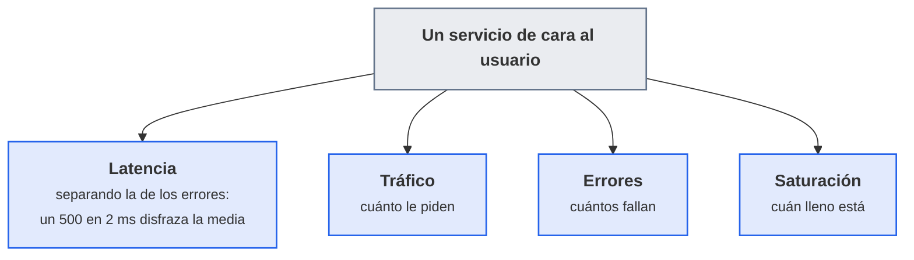
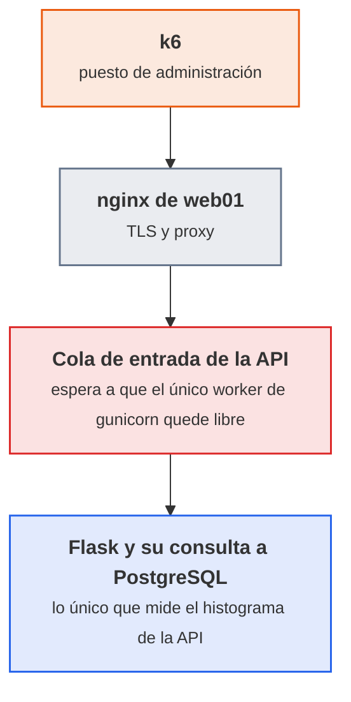
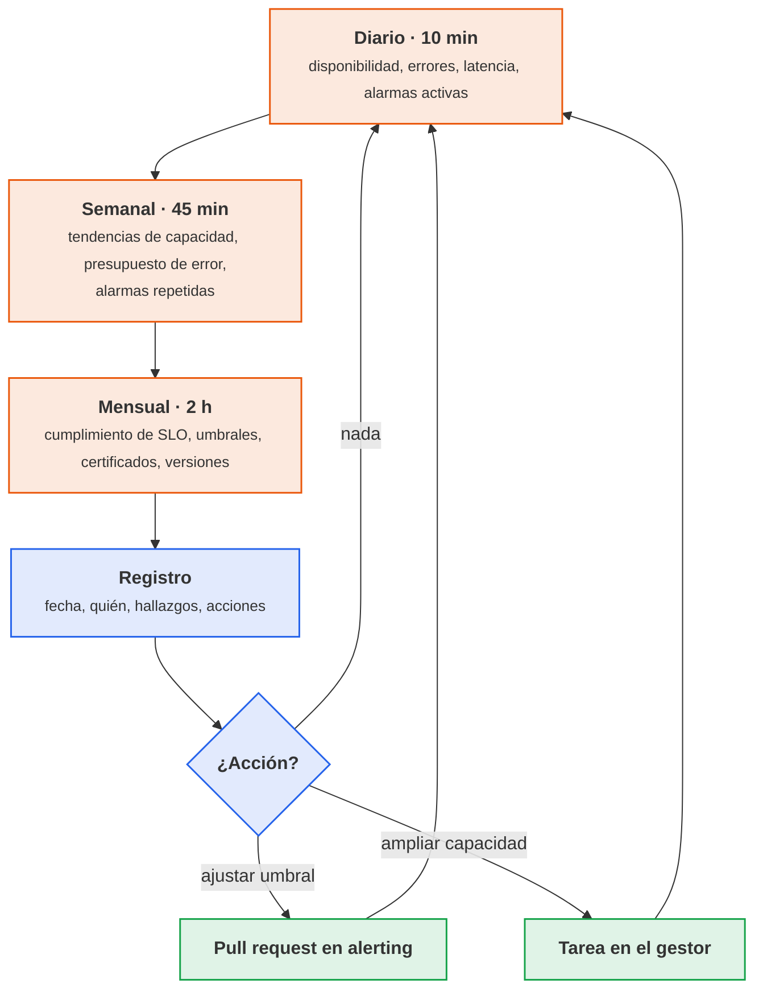

# UT4 · Indicadores, KPI y pruebas del servicio

<p class="ut-meta">16 h · Sesiones 20 a 27 · RA2 CE a, b, c, d, e, f</p>

Las tres primeras unidades pusieron el contenedor de referencia a exponer métricas, logs y eventos, convirtieron algunas de esas métricas en alarmas con Alertmanager y protegieron la pila de monitorización. Ahora toca ordenar todo eso para que sirva a alguien ajeno al trabajo: documentar qué mide cada contador, definir con fórmula y umbral los indicadores que de verdad describen el servicio, escribir el runbook de cada alarma (la guía de qué hacer cuando salta) y, sobre todo, probar el servicio de forma repetible (funcional, carga, estrés, seguridad) y dejar evidencia de cada prueba. Lo que salga de aquí es el dossier de operación que pide cualquier empresa antes de pasar un servicio a producción. Esta unidad abre la segunda evaluación, y buena parte de lo que se hace aquí entra en su examen, el 23 de marzo de 2027.

La unidad tiene dos mitades y un cierre. La primera mira el servicio tal como funciona hoy y escribe lo necesario para operarlo: qué significa cada métrica, qué números resumen su salud y dónde está la raya entre bien y mal, y qué hacer cuando una alarma la cruza. La segunda lo somete a pruebas para saber cómo se comportará con lo que todavía no ha pasado: si cada función responde como debe, si aguanta la carga prevista y lo que venga detrás, y si deja expuesto algo que no debería. El cierre junta las dos mitades: documenta las pruebas para que sirvan de evidencia, fija quién revisa los indicadores y cada cuánto, y reúne el dossier en la práctica evaluable.

## Sesión 20 · Fichas de métricas

<p class="ut-meta" markdown>15 de diciembre · Teoría y práctica · <span class="dur" tabindex="0" aria-label="Elegir qué medir antes de documentarlo · 10 min&#10;Documentar las métricas · 15 min&#10;A4.1 Fichas de métricas · 85 min" data-dur="Elegir qué medir antes de documentarlo · 10 min&#10;Documentar las métricas · 15 min&#10;A4.1 Fichas de métricas · 85 min">:material-school:<i class="dur-barra" style="--teoria:23%"></i>:material-flask:</span></p>

Después de tres unidades, Prometheus recoge varios cientos de métricas distintas: las de cAdvisor, node_exporter y postgres_exporter, las de la propia pila de monitorización y las que se programaron en la API. Cada una se añadió por un motivo, pero ese motivo no está escrito en ningún sitio: quien llegue nuevo al equipo, o quien reciba una alarma de madrugada, no sabe cuáles importan, en qué unidad van ni de dónde salen cuando dan un valor raro. Esta sesión pone orden en dos pasos. Primero se decide qué merece la pena documentar, con tres listas clásicas de lo que hay que vigilar en un servicio (las señales doradas, USE y RED); después se describe cada métrica elegida en una ficha de ocho campos y se clasifica como capacidad, rendimiento o calidad, que es lo que pide el criterio a del RA2. La hoja crea el repositorio `operacion`, donde va a vivir toda la documentación de operación de la unidad, y escribe en él las primeras diez fichas.

### Elegir qué medir antes de documentarlo

**No se puede documentar todo.** El primer impulso es documentar todo lo que llega a Prometheus, y no sirve: solo cAdvisor publica más de cien métricas por contenedor (el `keep` que se le puso por la [cardinalidad](ut1-observabilidad.md#etiquetas-y-cardinalidad) deja pasar diez), y un documento con cientos de fichas no lo lee nadie. Lo que hace falta es saber qué preguntas hay que poder responder sobre el servicio: las métricas que las responden son las que merecen ficha, indicador y, si hace falta, alarma. Para eso hay tres listas clásicas, que dicen casi lo mismo desde puntos de vista distintos.

#### Las cuatro señales doradas

**De dónde salen.** Vienen del capítulo de monitorización del libro de SRE de Google, el mismo del que sale el principio de [alertar por síntomas](ut2-alarmas.md#alertar-por-sintomas-no-por-causas). Allí se llaman *golden signals* y se presentan como el mínimo que hay que medir de cualquier servicio que atiende a usuarios:



<p class="pie" markdown>Las cuatro señales doradas son el mínimo. Si solo se pueden instrumentar cuatro cosas de un servicio, que sean estas.</p>

- **Latencia**: cuánto tarda en responder una petición. Conviene separar la latencia de las respuestas correctas de la de los errores, porque un 500 que se devuelve en 2 ms baja la media y disfraza el problema.
- **Tráfico**: cuánta demanda recibe el servicio. En una API, peticiones por segundo; en una base de datos, transacciones o sesiones; en un proxy, bytes y conexiones.
- **Errores**: proporción de peticiones que fallan, de forma explícita (5xx), implícita (200 con contenido incorrecto) o por política (más de 1 s de respuesta cuenta como fallo).
- **Saturación**: cómo de lleno está el recurso que antes se va a agotar. En el contenedor `app` es la CPU, acotada por el límite `cpus` del compose; en `db01` suelen ser las conexiones o el disco.

**Para qué sirven en el curso.** Con estas cuatro señales del servicio del curso ya hay un panel útil, y las alarmas de síntoma caen de forma natural: latencia alta, errores altos, tráfico anómalo (cero tráfico también es síntoma) y saturación.

#### USE para recursos, RED para servicios

**Dos listas para dos tipos de cosa.** Las señales doradas piensan en un servicio que atiende peticiones, pero por debajo hay recursos (CPU, memoria, disco, red) que se agotan de otra manera. Para ellos se usa el método **USE**, que nació para diagnosticar el rendimiento de servidores: para cada recurso se miran su utilización (*utilization*, el porcentaje de tiempo que está ocupado), su saturación (*saturation*, el trabajo que espera en cola) y sus errores (*errors*). Su equivalente para servicios es el método **RED**, pensado después para los microservicios: la tasa de peticiones (*rate*, por segundo), los errores (*errors*, peticiones fallidas por segundo) y la duración (*duration*, la distribución de la latencia). Son la misma idea que las señales doradas vista desde dos lados: USE mira hacia dentro (la infraestructura y su capacidad) y RED mira hacia el usuario (la calidad y el rendimiento que recibe).

**Para qué sirven en el curso.** En el laboratorio la correspondencia es directa. RED de la API sale del contador y del histograma que se le [programaron](ut1-observabilidad.md#python-con-prometheus_client) (`app_http_requests_total` y `app_http_request_duration_seconds_bucket`). USE del contenedor sale de cAdvisor (`container_cpu_usage_seconds_total`, `container_memory_working_set_bytes`, `container_fs_*`, `container_network_*`), y USE del host, de node_exporter (`node_*`). USE de PostgreSQL sale de `postgres_exporter` (`pg_stat_activity_count` como saturación de conexiones, `pg_stat_database_*` como tasa y errores). En la A4.1 sirven de lista de comprobación: cuando falten métricas de una categoría, recorrer USE y RED las hace aparecer.

### Documentar las métricas

**Qué es una ficha de métrica.** Elegidas las métricas, cada una se describe en una ficha: qué mide, quién la produce, en qué unidad, con qué etiquetas y para qué se usa. Es la respuesta escrita a lo que se pregunta quien la ve por primera vez en un panel, y su valor está en que obliga a responder preguntas que de otro modo nadie se hace: ¿es un gauge o un counter?, ¿va en segundos o en milisegundos?, ¿quién la mantiene si cambia el código? Por eso el criterio a del RA2 pide documentar cada métrica con su contador, su referencia y su categoría. El curso usa una ficha de ocho campos; esta es la del histograma de latencia de la API:

| Campo | Ejemplo |
|---|---|
| Nombre | `app_http_request_duration_seconds_bucket` |
| Tipo | histogram |
| Unidad | segundos |
| Etiquetas | `method`, `route`, `le` |
| Qué mide | Tiempo de respuesta de la API por petición |
| Referencia | Código: `api/metrics.py`; documentación del cliente Prometheus para Python |
| Categoría | Rendimiento |
| Uso | Indicador de latencia p95; alerta `AppHighLatency` |

Tres campos marcan la diferencia entre una ficha útil y una de relleno:

- **Tipo.** Dice cómo se comporta el valor, según los [tipos de métrica](ut1-observabilidad.md#tipos-de-metrica) de Prometheus: un counter solo sube (como un cuentakilómetros), un gauge sube y baja (como un termómetro) y un histogram reparte cada observación en cubos según su valor, con la etiqueta `le` como límite de cada cubo. El tipo decide qué funciones de PromQL tienen sentido: `rate()` solo sobre counters, `histogram_quantile()` solo sobre los `_bucket` de un histogram, y sobre un gauge, funciones como `avg_over_time()` (su media en una ventana) o `predict_linear()` (su tendencia). El tipo no se adivina mirando los valores: cada `/metrics` lo declara en una línea `# TYPE`, y la descripción, en una `# HELP`. Prometheus guarda las dos cosas y las sirve en su API, en `/api/v1/metadata`.
- **Unidad.** Va en la unidad base (segundos, bytes), como manda la [convención de nombres](ut1-observabilidad.md#nombres-y-etiquetas-convenciones) de Prometheus, y la conversión a milisegundos o GiB se hace al pintar, en Grafana. Así nadie tiene que adivinar si un 300 son milisegundos o segundos.
- **Referencia.** Es lo que permite ir al origen cuando la métrica se comporta raro: el fichero y la función del código propio, o la página del exporter y su versión, porque los exporters cambian nombres y significados de una versión a otra.

#### Las tres categorías con ejemplos del laboratorio

**Por qué tres categorías.** Cada categoría responde a una pregunta distinta sobre el servicio, y cada pregunta se vigila a su manera, con umbrales que se fijan con su propia lógica. Un servicio bien documentado tiene métricas de las tres; si al terminar la A4.1 solo hay de capacidad, es que se está mirando el contenedor y no el servicio. Las tablas que siguen son el punto de partida de la hoja: métricas reales del laboratorio, ya clasificadas.

**Capacidad** responde a "¿cuándo se llenará?" y son casi siempre gauges o cocientes entre un uso y un límite:

| Métrica | Tipo | Origen | Qué mide |
|---|---|---|---|
| `container_memory_working_set_bytes{service="app"}` | gauge | cAdvisor | Memoria que el kernel no puede reclamar sin perjudicar al proceso; es la que cuenta para el OOM killer (el mecanismo del kernel que mata un proceso cuando se agota la memoria) |
| `container_spec_memory_limit_bytes{service="app"}` | gauge | cAdvisor | Límite `mem_limit` de compose; sin límite, cAdvisor publica 0 |
| `node_filesystem_avail_bytes{mountpoint="/data"}` | gauge | node_exporter en db01 | Bytes disponibles para usuarios no root (distinto de `_free_bytes`, que incluye la reserva del 5 %) en `/data`, el disco de datos donde vive el clúster de PostgreSQL |
| `pg_stat_activity_count{datname="servicio"}` | gauge | postgres_exporter | Conexiones abiertas por estado (`state="active"`, `"idle"`) |
| `pg_settings_max_connections` | gauge | postgres_exporter | Valor de `max_connections` en `postgresql.conf` |

**Por qué `/data`.** `/data` no es la raíz de `db01`: es un disco aparte montado ahí, donde vive el clúster de PostgreSQL desde que lo separa la [A3.3 de Despliegue](https://victor-educ.github.io/apuntes-5166/ut/ut3-seguridad-por-capas/) el 27 de noviembre. Medir la capacidad de la base de datos sobre `/` mezclaría los datos con los logs del sistema, y llenar el sistema de ficheros a propósito, como hace la prueba cruzada de la A4.3, dejaría la máquina sin PostgreSQL, sin journald y sin SSH. Dos de los nueve indicadores de la A4.2 y dos de las alarmas de la A4.3 miden ese punto de montaje: si `node_filesystem_avail_bytes{mountpoint="/data"}` no devuelve nada en Prometheus, lo que falta es el disco, no la consulta.

**Rendimiento** responde a "¿cuánto tarda y cuánto procesa?" y suelen ser histogramas o counters derivados en el tiempo:

| Métrica | Tipo | Origen | Qué mide |
|---|---|---|---|
| `app_http_request_duration_seconds_bucket` | histogram | API, `api/metrics.py` | Distribución de la latencia por `method` y `route` |
| `app_http_requests_total` | counter | API | Peticiones atendidas por `method`, `route` y `status`; su `rate()` es el throughput (las peticiones atendidas por segundo) |
| `pg_stat_database_xact_commit_total` | counter | postgres_exporter | Transacciones confirmadas; su `rate()` es la carga real de la BD |
| `container_cpu_usage_seconds_total{service="app"}` | counter | cAdvisor | Segundos de CPU consumidos; en rendimiento cuando se compara con la latencia, en capacidad cuando se divide por la cuota |

**Calidad** responde a "¿el resultado es correcto?" y es la parte que más se olvida, porque hay que construirla:

| Métrica | Tipo | Origen | Qué mide |
|---|---|---|---|
| `app_http_requests_total{status=~"5.."}` | counter | API | Respuestas con error de servidor |
| `app_http_requests_total{status=~"4.."}` | counter | API | Respuestas de error del cliente (400, 401, 404, 422): no son culpa del servicio, pero un pico dice que algo ha cambiado en quien lo llama |
| `up{job="app"}` y `pg_up` | gauge | Prometheus y postgres_exporter | 1 si el último scrape de la API funcionó y si el exporter consigue conectar con PostgreSQL; base de las alarmas `AppDown` y `PgDown` |
| `pg_stat_database_deadlocks_total` | counter | postgres_exporter | Interbloqueos; cada uno es una transacción abortada |
| `app_items_invalid` | gauge | habría que programarla en la API | Items guardados con datos imposibles, como un precio negativo; ejemplo de métrica de negocio que no existe hasta que alguien la escribe |

`up` y `pg_up` dicen si el servicio está vivo visto desde Prometheus. La disponibilidad vista desde fuera, como la ve un cliente, pediría una sonda externa que llame a `/health` (el blackbox_exporter), y el laboratorio no la monta.

**La métrica que no existe.** La última fila es deliberada. Ninguna herramienta da la calidad del dato: si un item guardado con precio negativo es un fallo del servicio, alguien tiene que escribir la consulta que lo cuenta y exponerla como gauge. En una empresa, eso es lo que separa vigilar el servidor de vigilar el servicio.

### A4.1 Fichas de métricas (sesión 20)

<span class="et et-obj">Objetivo</span> Al terminar tienes el repositorio `operacion` creado y publicado en la Gitea del laboratorio, con un `metricas.md` de al menos diez fichas de métrica, tres o más por categoría, cada una con su referencia al código o al exporter. Es la primera pieza del dossier de operación: los indicadores de la A4.2 y las alarmas de la A4.3 se construyen sobre estas métricas, y la columna Uso de cada ficha se completa con ellos.

<span class="et et-pre">Antes de empezar</span>

- Los túneles de [Cómo se llega a la pila](../laboratorio.md#como-se-llega-a-la-pila-desde-el-3-de-diciembre) abiertos y una shell en el puesto de administración, donde nace hoy `operacion`.
- `api/metrics.py` del repositorio `servicio`, para las referencias, y tu usuario de la Gitea de mon01.
- Lo explicado al principio de la sesión: [las señales doradas, USE y RED](#elegir-que-medir-antes-de-documentarlo) y [la ficha de métrica con sus categorías](#documentar-las-metricas).

<span class="et et-pas">Pasos</span>

Vas de lo que hay a lo que se documenta: primero preparas el sitio donde vive la documentación, después sacas de Prometheus lo que cada métrica dice de sí misma, con eso escribes las fichas y al final compruebas que las tres categorías están cubiertas. Escribir la ficha a partir de lo que declara Prometheus, y no de memoria, es lo que hace que el tipo y las etiquetas sean ciertos.

1. **Crea el repositorio `operacion`.** Toda la documentación de operación de la unidad (fichas, indicadores, catálogo de alarmas y revisiones) va a un repositorio propio, separado del código del servicio y de las reglas de `alerting`, porque la lee y la mantiene quien opera el servicio, no quien lo programa. Créalo en el puesto de administración, con la rama `main` y el remoto `http://gitea.lab:23001/ops/operacion.git`.

    *Pista:* Gitea no crea el repositorio con el primer `push`. Créalo antes, vacío, desde la web o con un `POST` a `/api/v1/orgs/ops/repos`.

2. **Saca de Prometheus lo que dice cada métrica de sí misma.** Para las métricas `app_`, `container_`, `pg_` y `node_filesystem`, consigue su tipo y su descripción tal como los declara quien las produce, y comprueba con una consulta que cada una llega con las etiquetas que crees. Es la materia prima de los campos Tipo, Etiquetas y Qué mide: si el tipo de la ficha no coincide con el declarado, las funciones que se le apliquen después estarán mal.

    *Pista:* Prometheus sirve el `# TYPE` y el `# HELP` de todo lo que recoge en `/api/v1/metadata`. De cAdvisor solo llegan las diez métricas del `keep` de su job: si necesitas otra, amplía el `keep` y recarga.

3. **Escribe las fichas.** En `metricas.md`, diez fichas o más con los ocho campos de [Documentar las métricas](#documentar-las-metricas), empezando por las de las tres tablas de categorías, menos `app_items_invalid`, que no existe. Cuida sobre todo la Referencia, que es lo que permite ir al origen cuando una métrica da un valor raro: el fichero y la función para la API, y la página y la versión para un exporter.

4. **Comprueba el reparto y publica.** Revisa que hay tres fichas o más por categoría; si falta alguna, recorre USE y RED como en [el apartado](#use-para-recursos-red-para-servicios). Cierra `metricas.md` con una tabla resumen (nombre, categoría y en qué indicador o alarma se usa; la columna Uso se completa en la A4.2) y publica `operacion` en la Gitea.

    *Pista:* la que suele quedarse corta es calidad. Los códigos de estado de la API, `up` y `pg_up` dan tres sin programar nada.

<span class="et et-com">Comprobación</span> Diez fichas o más con las ocho filas rellenas; tres o más por categoría; todas devuelven datos en Prometheus; el tipo coincide con el de `/api/v1/metadata`; `git ls-remote origin` muestra la rama `main` de `operacion`.

<span class="et et-ent">Para practicar</span> Empuja `metricas.md` del repositorio `operacion` a la Gitea del laboratorio: forma parte del dossier de la práctica evaluable.

## Sesión 21 · Indicadores

<p class="ut-meta" markdown>17 de diciembre · Teoría y práctica · <span class="dur" tabindex="0" aria-label="Indicadores: fórmulas y umbrales · 25 min&#10;A4.2 Indicadores · 85 min" data-dur="Indicadores: fórmulas y umbrales · 25 min&#10;A4.2 Indicadores · 85 min">:material-school:<i class="dur-barra" style="--teoria:23%"></i>:material-flask:</span></p>

La A4.1 dejó escrito qué mide cada métrica, pero una métrica suelta todavía no dice si el servicio va bien. Que la API lleve 4.831.220 peticiones atendidas y 312 errores no responde a lo que preguntan quien opera el servicio y quien lo paga: si cumple lo que promete y cuánto margen le queda. Para eso las métricas se combinan en **indicadores** con significado propio, y cada indicador lleva un umbral que separa lo normal de lo que no. La teoría va en ese orden: primero el vocabulario con el que se expresa una promesa de servicio (SLI, SLO, SLA y presupuesto de error), después los nueve indicadores del servicio del curso, con la fórmula de cada uno y su trampa, y al final cómo se fija un umbral sin inventárselo. La hoja los graba como recording rules, igual que las que ya hay en `alerting`, los pinta en un panel de KPI y justifica cada umbral con el histórico de Prometheus.

### Indicadores: fórmulas y umbrales

**Qué es un indicador.** Un indicador o KPI (*key performance indicator*, indicador clave) combina contadores en un valor con significado para alguien que no conoce el código. "El contenedor lleva 1.234.567 segundos de CPU" no dice nada; "la API va al 62 % de su límite de CPU" sí. Los primeros ya existen: son [recording rules](ut2-alarmas.md#agregacion-y-correlacion-recording-rules) como el ratio de errores o el p95 de latencia. Lo que falta es decidir cuáles describen el servicio entero y con qué valor se da por bueno cada uno.

**De dónde sale el vocabulario.** Los contratos de servicio con penalizaciones existen desde hace décadas, pero la forma de hablar de indicadores que se usa hoy la popularizó el mismo libro de SRE de Google del que salen las señales doradas. Distingue cuatro piezas:

- SLI (*service level indicator*): la medida, expresada normalmente como cociente de eventos buenos entre eventos totales. Disponibilidad = peticiones correctas / peticiones totales.
- SLO (*service level objective*): el valor comprometido internamente para ese SLI en una ventana. Disponibilidad ≥ 99,5 % en 30 días.
- SLA (*service level agreement*): el contrato con el cliente, con consecuencias (penalizaciones) si se incumple. Siempre menos exigente que el SLO, para que el equipo tenga margen de reaccionar antes de que la empresa pague.
- Presupuesto de error (*error budget*): lo que se puede fallar sin incumplir el SLO. Es la herramienta que convierte el SLO en decisiones: si queda presupuesto, se despliega; si no queda, se congela el despliegue y se arregla la fiabilidad.

**El SLO del curso.** La [documentación del servicio](ut2-alarmas.md#tabla-de-umbrales-del-contenedor-de-referencia) con la que se fijaron los umbrales de las alarmas daba un objetivo de disponibilidad del 99 %, y con él se puso la alarma de errores en el 1 %: es la cifra que la descripción de `AppHighErrorRate` llama SLA, lo que el servicio promete hacia fuera. El SLO interno se fija más exigente, en el 99,5 % en 30 días, para que el equipo se entere y reaccione antes de romper esa promesa, que es justo la relación entre SLO y SLA de la lista. Es el SLO que usan los ejemplos de la unidad.

#### El presupuesto de error con números

**Fallar un poco está permitido.** Ningún servicio está disponible el 100 % del tiempo, y perseguirlo saldría carísimo. El SLO dice cuánto se puede fallar, y ese margen se gasta como un presupuesto. Con un SLO de disponibilidad del 99,5 % en 30 días, el presupuesto es el 0,5 % de la ventana:


<p class="pie" markdown>El presupuesto de error convierte «¿desplegamos el viernes?» en una pregunta con respuesta numérica en lugar de una discusión de opiniones.</p>

```text
30 días × 24 h × 60 min = 43.200 min
0,5 % de 43.200 min = 216 min = 3,6 h
```

Si el servicio recibe de media 20 peticiones/s, en 30 días son 51,84 millones de peticiones y el presupuesto son 259.200 peticiones fallidas. Da igual si esas 3,6 h son una caída completa o un 1 % de errores repartido durante 15 días: el presupuesto se consume igual, y esa es la gracia del modelo. Un SLO del 99,9 % deja 43 min al mes; uno del 99,99 %, 4,3 min. Cada nueve más cuesta un orden de magnitud en infraestructura y en guardias, así que el SLO se negocia con quien paga, no se pone el máximo por defecto.

**A qué ritmo se gasta: el burn rate.** El ritmo al que se gasta el presupuesto es el *burn rate*. Un burn rate de 1 significa que, al ritmo actual de errores, el presupuesto se agota justo al final de la ventana de 30 días. Con SLO 99,5 %:

```text
burn rate = tasa de errores observada / (1 - SLO)
          = tasa de errores observada / 0,005

Tasa de errores del 0,5 %  → burn rate 1   → presupuesto agotado en 30 días
Tasa de errores del 3 %    → burn rate 6   → presupuesto agotado en 5 días
Tasa de errores del 7,2 %  → burn rate 14,4 → presupuesto agotado en 50 horas
```

Por eso las alarmas basadas en SLO no se disparan por "errores > 1 %" a secas, sino por burn rate en dos ventanas a la vez (por ejemplo, burn rate 14,4 sostenido en la última hora y también en los últimos 5 minutos): la ventana larga evita el ruido y la corta comprueba que el problema sigue activo. El 14,4 no es un número mágico: es el ritmo al que en una hora se gasta el 2 % del presupuesto del mes, porque la ventana de 30 días tiene 720 horas y 0,02 × 720 = 14,4. En PromQL, sobre las reglas grabadas de la tasa de errores:

```promql
# 2 % del presupuesto mensual consumido en 1 h y el problema sigue vivo
(app:errors:ratio1h > (14.4 * 0.005)) and (app:errors:ratio5m > (14.4 * 0.005))
```

Hace falta grabar `app:errors:ratio1h` además del `ratio5m` que ya existe. El capítulo "Alerting on SLOs" del *SRE Workbook* (enlazado en [Para ampliar](../ampliacion.md#ut4-indicadores-kpi-y-pruebas-del-servicio)) tiene la tabla completa de ventanas y burn rates; no hace falta memorizarla, sí entender por qué existe.

#### Los nueve indicadores del servicio

**Por qué estos nueve.** Salen de cruzar las señales doradas con las tres categorías de métrica: la latencia, el tráfico y los errores del lado de la API (rendimiento y calidad), y la saturación de cada recurso que se puede agotar (capacidad): la CPU y la memoria del contenedor, y el disco y las conexiones de la base de datos. Esta tabla es el núcleo de la unidad: cada indicador lleva la fórmula que lo calcula, su categoría y dos umbrales, aviso y crítico. El p95 es el [percentil 95](ut1-observabilidad.md#tipos-de-metrica): el valor que el 95 % de las peticiones no supera.

| Indicador | Fórmula (PromQL) | Categoría | Umbral aviso | Umbral crítico |
|---|---|---|---|---|
| Disponibilidad | `sum(rate(app_http_requests_total{status!~"5.."}[30d])) / sum(rate(app_http_requests_total[30d]))` | Calidad | < 99,7 % | < 99,5 % |
| Latencia p95 | `histogram_quantile(0.95, sum by(le)(rate(app_http_request_duration_seconds_bucket[5m])))` | Rendimiento | > 300 ms | > 500 ms |
| Throughput | `sum(rate(app_http_requests_total[5m]))` | Rendimiento | informativo | ninguno |
| Tasa de errores | `app:errors:ratio5m` | Calidad | > 0,5 % | > 1 % |
| Saturación CPU | `sum by (service)(rate(container_cpu_usage_seconds_total{service="app"}[5m])) / sum by (service)(container_spec_cpu_quota{service="app"} / container_spec_cpu_period{service="app"})` | Capacidad | > 70 % | > 90 % |
| Memoria | `container_memory_working_set_bytes{service="app"} / container_spec_memory_limit_bytes{service="app"}` | Capacidad | > 80 % | > 90 % |
| Disco BD | `node_filesystem_avail_bytes{mountpoint="/data"} / node_filesystem_size_bytes{mountpoint="/data"}` | Capacidad | < 20 % | < 10 % |
| Días hasta disco lleno | `predict_linear(node_filesystem_avail_bytes{mountpoint="/data"}[7d], 30*86400) < 0` | Capacidad | 30 días | 7 días |
| Conexiones BD | `sum by (service)(pg_stat_activity_count) / on(service) group_left pg_settings_max_connections` | Capacidad | > 70 % | > 85 % |

Cada fórmula tiene un porqué y al menos una trampa. Conviene repasarlas una a una: en la A4.2 se implementan como recording rules y entran en el examen.

**Disponibilidad.** El cociente excluye del numerador los 5xx pero mantiene los 4xx, porque un 404 o un 401 es una respuesta correcta a una petición incorrecta y no es culpa del servicio. La trampa es la ventana: `rate(...[30d])` obliga a Prometheus a leer, cada vez que se evalúa, treinta días de muestras de todas las series de `app_http_requests_total`, una por cada combinación de método, ruta y código (con un scrape cada 15 s, son 172.800 muestras por serie), y eso tarda segundos. Lo correcto es grabar `app:requests:rate5m` y `app:errors:rate5m` como reglas y calcular la disponibilidad mensual sobre ellas con `sum_over_time`, que suma todas las muestras de una serie dentro de la ventana: como las dos reglas se evalúan al mismo ritmo, el cociente de sus sumas es, a efectos prácticos, el cociente entre los errores y las peticiones del mes. Cualquier ventana de 30 días exige además que Prometheus guarde más de 30 días: en mon01 la retención es de 45 días por esta razón, y la A4.2 lo comprueba antes de empezar.

**Latencia p95.** `histogram_quantile` no calcula el percentil real, porque el histograma no guarda cada duración: busca el cubo en el que cae el 95 % acumulado y hace una interpolación lineal dentro de ese cubo. Con los cubos de `api/metrics.py` (0,005, 0,01, 0,025, 0,05, 0,1, 0,25, 0,5, 1, 2,5 y 5 s), si el p95 real está en 320 ms el resultado será cualquier valor entre 250 y 500 ms, según cómo se repartan las peticiones dentro de ese cubo. De ahí sale cómo se eligen los cubos: conviene que haya uno justo en cada umbral, porque entonces la comparación es exacta (el p95 estimado pasa de 0,5 s exactamente cuando más del 5 % de las peticiones tarda más de 0,5 s). Los cubos actuales lo cumplen para el crítico de 500 ms, pero no para el aviso de 300 ms; una lista pensada para estos umbrales sería 0,1, 0,2, 0,3, 0,4, 0,5, 0,75, 1, 2 y 5. La segunda trampa es el `sum by(le)`: si se agrega quitando `le`, la función no tiene con qué trabajar y devuelve NaN. Y si el p95 queda por encima del último cubo finito, el resultado es el límite de ese cubo (5 s), no un valor mayor. Por último, conviene leer bien el número: con 20 peticiones/s, un p95 de 400 ms significa que 60 peticiones por minuto tardan más que eso.

**Throughput.** No tiene umbral porque no es bueno ni malo en sí, pero es contexto imprescindible: un p95 de 800 ms con 200 peticiones/s no es el mismo problema que con 2 peticiones/s. Sí vale la pena una alarma de "tráfico cero durante 10 min en horario laboral", que casi siempre significa que el proxy de web01 ha dejado de enviar peticiones.

**Tasa de errores.** Se usa la regla grabada `app:errors:ratio5m` y no la consulta cruda, para que el panel, la alerta y el informe mensual coincidan al céntimo. El umbral crítico del 1 % es el doble del presupuesto de error (0,5 %), es decir, burn rate 2, y el aviso del 0,5 % es burn rate 1. Tiene dos trampas. Con poco tráfico el cociente es ruidoso: 1 error entre 50 peticiones ya es un 2 %, así que, si el servicio tiene horas de tráfico bajo, conviene añadir a la expresión de la alerta una condición de tráfico mínimo (`and app:requests:rate5m > 1`). Y si la API no ha devuelto ni un 5xx desde que arrancó, la serie de errores no existe todavía, porque la librería de la API crea cada combinación de etiquetas la primera vez que la usa: el cociente sale vacío en lugar de 0, y en el panel se ve "No data". Se arregla en la propia regla, completando el numerador con `or` y la tasa total multiplicada por 0, que vale 0 cuando no hay errores. Va en `app:errors:ratio5m` y en `app:errors:rate5m`, que es el numerador de la disponibilidad:

```promql
# numerador que vale 0, y no vacío, cuando no ha habido ningún 5xx
sum by (service)(rate(app_http_requests_total{status=~"5.."}[5m]))
  or sum by (service)(rate(app_http_requests_total[5m])) * 0
```

**Saturación de CPU.** cAdvisor publica el límite de CPU del contenedor como dos números: la cuota (`container_spec_cpu_quota`, microsegundos de CPU que el contenedor puede gastar en cada periodo) y el periodo (`container_spec_cpu_period`, normalmente 100.000 µs). `cpus: "1.5"` en compose se traduce en cuota 150.000 y periodo 100.000, y su cociente devuelve el 1,5. La fórmula divide los segundos de CPU gastados por segundo (1,5 si el contenedor usa un núcleo y medio) entre ese límite. Las dos sumas `by (service)` no son decoración: `container_cpu_usage_seconds_total` lleva una etiqueta `cpu` (con valor `total`) que la cuota no tiene, y sin agregar las dos partes la división no empareja ninguna serie y sale vacía, el [problema de etiquetas de los operadores](ut2-alarmas.md#operadores-con-etiquetas). Sin límite de CPU, cAdvisor ni siquiera publica la cuota y el indicador tampoco devuelve nada: solo tiene sentido si el servicio tiene `cpus` fijado, que es una de las razones por las que se fija. Superar el 100 % es imposible de forma sostenida, porque el kernel frena al contenedor en cuanto agota su cuota (es el *throttling*, que cuenta `container_cpu_cfs_throttled_periods_total`), y esa métrica es mejor señal de saturación que el porcentaje. Una particularidad del servicio del curso: gunicorn corre con un solo worker, que atiende las peticiones de una en una, en un solo proceso, y no puede usar más de un núcleo. Con `cpus` por encima de 1 el indicador nunca llegaría a sus umbrales (con `cpus: "1.5"` no pasa del 67 %), así que en el laboratorio conviene un límite de 1 o menos.

**Memoria.** Se usa el working set y no `usage`, por lo que se vio al [compararlos](ut1-observabilidad.md#memory-usage-frente-a-working-set): `usage` incluye la caché de páginas, que el kernel puede soltar sin afectar al proceso. Cuando el contenedor llega a su límite, el kernel recupera primero esa caché y, si no basta, entra el OOM killer y mata uno de sus procesos; por eso el 90 % del límite en working set es un aviso real de que un pico más puede tumbarlo. Sin `mem_limit` en compose, cAdvisor publica el límite como 0 y el indicador da `+Inf`: no es un fallo de la fórmula, es que el contenedor no tiene límite contra el que medirse.

**Disco de la base de datos.** Se usa `avail` y no `free`: ext4 reserva por defecto un 5 % del disco para root, y PostgreSQL no corre como root. En el disco de 5 GB de db01 esa reserva son unos 250 MB: cuando `free` todavía marca 250 MB, PostgreSQL ya no puede escribir. El umbral crítico del 10 % es agresivo a propósito: con el disco lleno PostgreSQL deja de aceptar escrituras y, si el WAL (el diario donde PostgreSQL apunta cada cambio antes de aplicarlo a las tablas) no puede crecer, se para entero.

**Días hasta disco lleno.** `predict_linear` ajusta una recta por mínimos cuadrados sobre los últimos 7 días de la serie y la extrapola 30 días (30 × 86.400 s): dice cuántos bytes libres quedarán si se sigue al mismo ritmo, y si el valor previsto es negativo, el disco se llena antes de un mes. La ventana de 7 días absorbe los ciclos semanales (las copias del domingo, el `VACUUM` de cada noche, que es la limpieza interna de PostgreSQL); una ventana de 1 h daría avisos con cada carga masiva. Para pintar directamente los días que quedan en un panel se puede dividir lo libre entre lo que se gasta por segundo, que es la pendiente de esa misma recta (`deriv`), y pasarlo a días: `node_filesystem_avail_bytes{mountpoint="/data"} / -deriv(node_filesystem_avail_bytes{mountpoint="/data"}[7d]) / 86400`. Da un valor sin sentido (negativo) cuando el disco está vaciándose: en Grafana se limita el eje a valores positivos. La trampa de cualquier predicción lineal es que un cambio brusco, como un borrado grande o una ampliación del disco, la deja ciega durante una semana.

**Conexiones de la base de datos.** `pg_stat_activity_count` viene desglosado por estado y base de datos, de ahí el `sum by (service)`, y el `group_left` empareja esa suma con la única serie de `max_connections`, como en la regla `db:connections:ratio` que ya existe. El límite es `max_connections`, 100 por defecto. Los umbrales del 70 y el 85 % son bajos porque el agotamiento de conexiones es brusco: una API con un pool de conexiones grande (un conjunto de conexiones abiertas que reutiliza entre peticiones) o con muchos workers puede pasar de 40 a 100 conexiones en segundos cuando la base de datos se ralentiza, y a partir de ahí todo son `FATAL: too many clients`. En el servicio del curso el riesgo hoy es pequeño, porque su único worker abre una conexión por petición y atiende una petición cada vez, pero el indicador se vigila igual: es el primero que se dispara el día que la API pase a varios workers.

#### Cómo fijar umbrales

**Cada categoría, su lógica.** Un umbral no se elige porque suene bien: tiene que responder a qué pasa cuando se cruza, y eso depende de la categoría.

- Capacidad: por margen restante, es decir, por el tiempo disponible para reaccionar. El aviso tiene que llegar con días de margen si la acción es comprar disco o pedir una VM más grande, y con minutos si la acción es un `docker compose restart`. Por eso "días hasta disco lleno" avisa a 30 días y "memoria" al 80 %.
- Rendimiento: por el SLO más un margen. Si el SLO de latencia es p95 < 500 ms, el aviso va en 300 ms para dar tiempo a mirar antes de incumplir.
- Calidad: por el presupuesto de error, con burn rate. El crítico es burn rate 2 o superior; el aviso, burn rate 1 sostenido. En la disponibilidad mensual, el aviso del 99,7 % salta cuando ya se ha gastado el 60 % del presupuesto, con tiempo de frenar los despliegues antes de llegar al 99,5 %.

**Ningún umbral sin mirar los datos.** Antes de fijar un umbral se mira la distribución real del indicador. Un umbral de CPU al 70 % cuando el servicio vive al 75 % en horas punta es una alarma permanente, y una alarma permanente es una alarma ignorada: es la [fatiga de alertas](ut2-alarmas.md#fatiga-de-alertas). En la A4.2 se mira el histórico que ya guarda Prometheus de las sesiones anteriores con las funciones `_over_time` sobre la ventana que interese: `min_over_time` y `max_over_time` dan los extremos, y `quantile_over_time(0.5, ...)`, el valor habitual. Y `quantile_over_time(0.99, ...)` da el valor que solo se supera el 1 % del tiempo.

### A4.2 Indicadores (sesión 21)

<span class="et et-obj">Objetivo</span> Al terminar, los nueve indicadores del servicio están grabados como recording rules en el Prometheus de `mon01`, un panel de KPI en Grafana los muestra con sus umbrales como colores, y `indicadores.md` en `operacion` da la fórmula, la categoría y los umbrales de cada uno, con los datos que justifican cada umbral. Es el criterio b del RA2, y la base de las alarmas de la A4.3 y de la revisión periódica de la A4.7.

<span class="et et-pre">Antes de empezar</span>

- `alerting` en mon01, con las recording rules de la A2.3 en `prometheus/rules.yml`.
- Prometheus guardando 45 días, que es lo que pide la disponibilidad mensual: compruébalo en `http://localhost:29090/flags` (`storage.tsdb.retention.time`) y, si no, ajústalo en el `command` de Prometheus.
- `cpus` (de 1 o menos, por lo que explica la saturación de CPU en [los nueve indicadores](#los-nueve-indicadores-del-servicio)) y `mem_limit` en el servicio `app` de app01. El `keep` de cAdvisor no deja pasar `container_spec_cpu_quota`, `container_spec_cpu_period` ni `container_cpu_cfs_throttled_periods_total`, que usa la A4.5: añádelas como en la A4.1. Sin todo eso, la CPU no devuelve nada y la memoria da `+Inf`.
- db01 con su disco de datos en `/data`, node_exporter y postgres_exporter (de la [A3.3 de Despliegue](https://victor-educ.github.io/apuntes-5166/ut/ut3-seguridad-por-capas/)), recogidos por Prometheus: de ahí salen tres indicadores.
- El bucle de tráfico de la A2.1 contra `https://api.dev.lab/items` en el puesto de administración, para que los cocientes no den `NaN`. Por su `-s`, falla en silencio si `curl` no confía en la CA del curso: compruébalo antes e instala `~/ca/ca.crt` en el sistema si hace falta.
- Lo explicado al principio de la sesión: [SLI, SLO y presupuesto de error](#indicadores-formulas-y-umbrales), [los nueve indicadores](#los-nueve-indicadores-del-servicio) y [cómo fijar umbrales](#como-fijar-umbrales).

<span class="et et-pas">Pasos</span>

Construyes los indicadores de dentro afuera: primero los cálculos, como reglas que Prometheus evalúa solo; después el panel que los enseña; y solo con el panel y su histórico delante decides los umbrales, porque un umbral sin datos es una opinión. El presupuesto de error va detrás porque necesita el tráfico real de los últimos días, y la exportación cierra la hoja para que el panel quede versionado con lo demás.

1. **Graba los indicadores que faltan.** Cinco de los nueve ya existen (`app:requests:rate5m`, `app:errors:ratio5m`, `app:latency_p95:5m`, `app:memory:ratio` y `db:connections:ratio`). Graba en `prometheus/rules.yml`, en un grupo `app-kpi` con `interval: 30s`, las seis reglas que faltan para los [nueve indicadores](#los-nueve-indicadores-del-servicio), con los nombres que usan la A4.3 y la A4.7: `app:errors:rate5m`, `app:errors:ratio1h`, `app:availability:30d`, `app:cpu:ratio5m`, `db:disk_avail:ratio` y `db:disk_full:predict30d`. Grabarlas hace que el panel, las alarmas y los informes lean la misma serie. Valida, recarga y comprueba en `http://localhost:29090/rules` que se evalúan sin errores.

    *Pista:* la disponibilidad es `1 -` el cociente de los `sum_over_time(...[30d])` de `app:errors:rate5m` y `app:requests:rate5m`, y la predicción se graba sin el `< 0`. Si los errores salen vacíos, no es la fórmula: es la segunda trampa de la tasa de errores.

2. **Monta el panel de KPI.** Crea en Grafana el dashboard "KPI app", con un panel Stat por indicador sobre su regla grabada, en su unidad y con los umbrales como colores de fondo. Es la vista que se abre en la revisión diaria y la que capturas como evidencia en las pruebas de la A4.5 y la A4.6, así que cada panel tiene que leerse sin explicación: un número, su unidad y un color.

    *Pista:* haz uno y duplícalo: solo cambian la consulta, la unidad (`percent (0.0-1.0)`, `seconds`, `bytes`) y los umbrales.

3. **Decide los umbrales con datos.** Saca del histórico de Prometheus el mínimo, el máximo y el valor habitual de cada indicador, como en [Cómo fijar umbrales](#como-fijar-umbrales), y con eso escribe `indicadores.md` en `operacion`: indicador, regla, categoría y umbrales, y una línea por umbral con lo que has visto y por qué ese valor. Un umbral por debajo del valor habitual sería una alarma permanente, y este paso es el que lo evita.

    *Pista:* una recording rule no tiene datos de antes de cargarse, así que el histórico de las de hoy se mira con la expresión completa de la tabla.

4. **Calcula el presupuesto de error.** Con tu SLO y el tráfico medio de los dos últimos días, calcula el presupuesto de error mensual en minutos y en peticiones, como en [El presupuesto de error con números](#el-presupuesto-de-error-con-numeros), y añádelo a `indicadores.md` con las cuentas a la vista. Es la cifra contra la que la revisión semanal de la A4.7 compara lo gastado.

5. **Versiona el panel y publica.** Exporta el dashboard a `grafana/kpi.json` de `operacion` y empuja `alerting` y `operacion`. Un panel que solo vive en la base de datos de Grafana se pierde con ella; en el repositorio queda junto a los indicadores que explica.

    *Pista:* el JSON se descarga en tu VM `puesto`, y `operacion` está en el puesto de administración.

<span class="et et-com">Comprobación</span> `promtool check rules` sin errores; los nueve indicadores devuelven valor (ninguno `NaN` ni `+Inf`); el panel los muestra con colores según umbral; cada umbral tiene su justificación con datos.

<span class="et et-ent">Para practicar</span> Empuja a la Gitea del laboratorio `prometheus/rules.yml` en `alerting`, e `indicadores.md` y `grafana/kpi.json` en `operacion`: forman parte del dossier de la práctica evaluable.

<span class="et et-ext">Si te sobra tiempo</span> Añade a `alerts.yml` la alerta de burn rate en dos ventanas del apartado y fuérzala parando PostgreSQL en db01 un par de minutos.

## Sesión 22 · Catálogo de alarmas

<p class="ut-meta" markdown>12 de enero · Teoría y práctica · <span class="dur" tabindex="0" aria-label="Catálogo de alarmas y runbooks · 15 min&#10;A4.3 Catálogo de alarmas · 95 min" data-dur="Catálogo de alarmas y runbooks · 15 min&#10;A4.3 Catálogo de alarmas · 95 min">:material-school:<i class="dur-barra" style="--teoria:14%"></i>:material-flask:</span></p>

Desde noviembre hay diez alarmas que saltan solas y llegan por correo, por Telegram y como incidencia de Gitea, y la A4.2 acaba de fijar umbrales para indicadores que todavía no avisan a nadie. Falta lo que pasa después de que suene el aviso: quien lo recibe tiene que saber qué significa, qué puede estar fallando y qué hacer, y hoy eso solo lo sabe quien escribió la regla. La anotación `runbook` de algunas reglas apunta a una wiki de ejemplo que no existe. Esta sesión escribe lo que falta en tres capas: una ficha por alarma con su origen, su posible fallo y su impacto, que juntas forman el catálogo; un runbook con los pasos de análisis, resolución y escalado para las alarmas que más lo necesitan; y el enlace desde cada regla hasta su documento. La teoría da el esquema de la ficha con un ejemplo, las propiedades que distinguen un runbook bueno y dos ejemplos más; la hoja añade las cinco alarmas de los indicadores nuevos, escribe el catálogo entero y cinco runbooks, y deja cada regla apuntando al suyo.

### Catálogo de alarmas y runbooks

**Para quién se escribe.** Esta documentación no es para quien escribió la alarma, sino para quien la recibe sin contexto, a las 3 de la mañana, medio dormido y con un cliente esperando. Esa persona necesita respuesta a seis preguntas, que son los seis campos de la ficha: de dónde sale el aviso (Origen), qué puede estar fallando (Posible fallo), a quién afecta (Impacto), cómo se averigua cuál de las causas es (Análisis), qué se hace en cada caso (Resolución) y a quién se pasa el problema si no se arregla, con su plazo (Escalado). El **catálogo** es la tabla de todas las alarmas con los tres primeros campos; el **runbook** es la ficha completa, con los pasos, y se escribe para las alarmas que más lo necesitan. Entre los dos cubren lo que pide el criterio c del RA2: origen, fallo, impacto y pasos de resolución. La ficha de `AppHighErrorRate`, que sirve de modelo:

| Campo | AppHighErrorRate |
|---|---|
| Origen | `app:errors:ratio5m > 1 %` durante 5 min |
| Posible fallo | BD no responde; despliegue con bug; dependencia externa caída |
| Impacto | Usuarios reciben errores 5xx; afecta al SLO de disponibilidad |
| Análisis | 1. Panel "KPI app" en Grafana: ¿coincide con un despliegue? 2. En app01: `docker compose -f /opt/servicio/compose.yml logs --since 10m app \| grep -ci error` 3. En app01: `nc -zv 10.10.3.10 5432` 4. Loki: `{service="app", level="error"}` |
| Resolución | Si es despliegue: rollback (`docker compose up -d` con la imagen de la versión anterior). Si es BD: ver alarma PgDown. Si es externo: activar el modo degradado (seguir sirviendo lo que no depende de lo caído) |
| Escalado | Desarrollador de guardia si persiste más de 15 min |

#### Qué hace bueno a un runbook

**La prueba.** Un runbook bueno se reconoce porque alguien que no conoce el servicio puede seguirlo sin preguntar. Eso se traduce en cinco propiedades:

1. Los pasos de análisis van del más rápido y frecuente al más lento y raro, y cada uno dice qué significa el resultado ("si `nc` falla, el problema es de red o de PostgreSQL: salta a PgDown").
2. Los comandos son exactos, copiables, con el host desde el que se ejecutan. "Mirar los logs" no vale; `ssh ops@10.10.2.10 docker compose -f /opt/servicio/compose.yml logs --since 10m app | grep -ci error` sí.
3. Las acciones de resolución están ordenadas por reversibilidad: primero lo que no rompe nada (reiniciar un contenedor), luego lo que tiene coste (rollback), y lo destructivo (borrar datos, ampliar disco en caliente) solo con escalado.
4. Hay un criterio de escalado con tiempo y persona o rol, no "avisar a alguien".
5. Se enlaza desde la anotación `runbook` de la regla de alerta (como en la A2.4), y cambiar la alarma obliga a revisar su runbook en el mismo turno: en el laboratorio las reglas viven en `alerting` y los runbooks en `operacion`, así que el pull request que toca la regla (la propuesta de cambio, hecha desde una rama, que otra persona revisa antes de aceptarla) enlaza el cambio del runbook.

**Un runbook se mantiene.** Cada vez que una alarma salta y el runbook no resuelve el caso, el cierre de la incidencia incluye actualizar el runbook. Un runbook que no cambia en un año es un runbook que nadie usa.

#### Dos runbooks más

Dos fichas más, escritas con el mismo esquema, para ver cómo cambia el contenido según la alarma: una de fallo brusco (la base de datos deja de responder) y una de aviso con margen (el disco se llenará en una semana).

| Campo | PgDown |
|---|---|
| Origen | `pg_up == 0` durante 1 min (postgres_exporter no consigue conectar) |
| Posible fallo | El servicio `postgresql` de db01 parado o reiniciándose (falta de memoria, disco lleno, corrupción); `max_connections` agotadas y el exporter no entra; red entre mon01 y la subred data cortada por una regla de OPNsense |
| Impacto | Toda escritura y la mayoría de lecturas de la API fallan con 5xx; salta AppHighErrorRate a los 5 min. Inhibida por HostDown de db01 |
| Análisis | 1. Desde app01, que es la única máquina con paso al 5432: `nc -zv 10.10.3.10 5432` (si falla, red o proceso caído). 2. En db01: `systemctl status postgresql@17-main` y `journalctl -k \| grep -i 'out of memory'`. 3. `df -h /data` (disco lleno es la causa más frecuente en el laboratorio). 4. `sudo tail -50 /var/log/postgresql/postgresql-17-main.log` buscando `FATAL`, `PANIC` o `could not write`. 5. Si el servicio está arriba: `sudo -u postgres psql -c "select count(*) from pg_stat_activity"` para descartar conexiones agotadas |
| Resolución | Proceso muerto por falta de memoria: `sudo systemctl restart postgresql@17-main` y subir la memoria de la VM en el mismo turno. Disco lleno: liberar espacio en `/data` (volcados locales antiguos, WAL archivado ya copiado) y reiniciar; nunca borrar dentro de `/data/postgresql`. Conexiones agotadas: `pg_terminate_backend` de las sesiones `idle` más antiguas y revisar el pool de la API. Corrupción (`PANIC` en los logs): no tocar, escalar y preparar restauración de la copia |
| Escalado | Inmediato al responsable de datos si hay `PANIC` o si no arranca en 10 min; en horario, aviso al equipo de desarrollo si la causa es el pool |

| Campo | DiskWillFillIn7d |
|---|---|
| Origen | `predict_linear(node_filesystem_avail_bytes{mountpoint="/data"}[7d], 7*86400) < 0` durante 1 h |
| Posible fallo | Crecimiento normal de datos sin plan de capacidad; logs de PostgreSQL o de la aplicación sin rotación; copias locales (`pg_dump`) acumuladas en el mismo volumen; tabla sin `VACUUM` con bloat (espacio que siguen ocupando filas ya borradas) |
| Impacto | Ninguno inmediato. Si no se actúa, en menos de una semana PostgreSQL deja de escribir y salta PgDown |
| Análisis | 1. Panel "KPI app", indicador de días hasta disco lleno: pendiente de la gráfica de 30 días y fecha estimada. 2. `du -xsh /data/* \| sort -h \| tail` para ver qué crece. 3. `sudo -u postgres psql -c "select relname, pg_size_pretty(pg_total_relation_size(oid)) from pg_class order by pg_total_relation_size(oid) desc limit 10"`. 4. `ls -la /data/copias` (¿hay volcados que ya están copiados fuera de la máquina?). 5. Si el crecimiento está fuera de `/data`, `du -xsh /var/log/*` en db01: casi siempre son los logs de PostgreSQL sin rotar |
| Resolución | Volcados locales ya replicados: borrar los de más de 7 días. Logs: revisar la rotación de `/var/log/postgresql` en `/etc/logrotate.d/postgresql-common`. Bloat: `VACUUM (VERBOSE)` de la tabla en ventana de baja carga. Crecimiento legítimo: abrir tarea de ampliación del disco virtual en Proxmox (pestaña Hardware de la VM, **Disk Action → Resize**) y `resize2fs`, con copia previa |
| Escalado | Si la fecha estimada es inferior a 3 días, tratar como crítico y avisar al responsable de infraestructura en el día |

**El catálogo, vivo.** El catálogo es la tabla de todas las alarmas, versionada junto a sus runbooks y enlazada desde la anotación `runbook` de cada regla. La A4.3 pide el catálogo entero y cinco runbooks completos. En una empresa, un servicio mediano acumula decenas de alarmas, y parte del mantenimiento es retirar las que nunca saltan o las que saltan sin que haya nada que hacer: es una de las cosas que miran las revisiones periódicas.

### A4.3 Catálogo de alarmas (sesión 22)

<span class="et et-obj">Objetivo</span> Al terminar, `operacion` tiene en `alarmas/` el catálogo de todas las alarmas del laboratorio y un runbook completo para cinco de ellas, y cada regla de alerta enlaza desde su anotación `runbook` a su runbook o al catálogo. Es el criterio c del RA2: que quien reciba un aviso llegue con un clic a lo que tiene que hacer.

<span class="et et-pre">Antes de empezar</span>

- `alerting` en mon01, con las diez alarmas de la A2.4 (siete en `prometheus/alerts.yml` y tres en `loki/loki-alerts.yml`) y las reglas grabadas de la A4.2.
- `operacion` en el puesto de administración y los túneles de [Cómo se llega a la pila](../laboratorio.md#como-se-llega-a-la-pila-desde-el-3-de-diciembre).
- Lo explicado al principio de la sesión: [la ficha de alarma](#catalogo-de-alarmas-y-runbooks), [qué hace bueno a un runbook](#que-hace-bueno-a-un-runbook) y [los dos ejemplos completos](#dos-runbooks-mas).

<span class="et et-pas">Pasos</span>

Primero completas las alarmas, para que el catálogo nazca con todas; después escribes el catálogo, que es corto y da la vista de conjunto; luego los cinco runbooks, que es donde está el trabajo; y al final enlazas cada regla con su documento, que va el último porque la URL no existe hasta que el fichero está escrito y empujado.

1. **Convierte los indicadores nuevos en alarmas.** Añade a `prometheus/alerts.yml` las cinco alarmas nuevas, con las etiquetas de la A2.4 y los umbrales de tu `indicadores.md`. Son las que vigilan los indicadores que grabaste en la A4.2; sin ellas, el catálogo estaría incompleto desde el primer día:

    - `AppLowAvailability`, crítica: `app:availability:30d` por debajo del SLO durante 15 min.
    - `AppCpuSaturated`, crítica: `app:cpu:ratio5m` por encima del umbral crítico durante 10 min.
    - `DbDiskLow`, aviso: `db:disk_avail:ratio` por debajo del umbral de aviso durante 5 min.
    - `PgDown`, crítica, y `DiskWillFillIn7d`, aviso: el Origen de sus fichas en [Dos runbooks más](#dos-runbooks-mas).

    *Pista:* `AppCpuSaturated` lleva `team: dev` y `origen: cadvisor`, como `AppMemoryHigh`; las otras cuatro, `team: ops` y `origen: prometheus`.

2. **Escribe el catálogo.** En `alarmas/README.md` de `operacion`, una fila por alarma, las diez que ya había y las cinco de hoy, con Alarma, Origen (la `expr` con su `for`), Posible fallo e Impacto (una frase cada uno) y Runbook, que se rellena en el paso 4. Es la vista de conjunto: quien la lea tiene que saber de un vistazo qué vigila el laboratorio y qué pasa cuando salta cada cosa.

3. **Escribe los cinco runbooks.** Uno por fichero en `alarmas/<Alarma>.md`, con las seis filas del esquema y las cinco propiedades de [Qué hace bueno a un runbook](#que-hace-bueno-a-un-runbook): `AppHighErrorRate`, `PgDown` y `DiskWillFillIn7d` a partir de los ejemplos del apartado, y otras dos de las diez que ya había, a tu elección. En los tres primeros, revisa que hosts, rutas y nombres son los de tu laboratorio; en los dos tuyos, ejecuta una vez los comandos de Análisis, porque un comando que nadie ha probado es el que falla a las 3 de la mañana. Los de Resolución no se ejecutan.

4. **Enlaza cada regla con su documento.** Pon en la anotación `runbook` de cada regla de `alerts.yml` y `loki-alerts.yml` la URL de su documento: las cinco del paso 3, a su fichero, y el resto, al catálogo, con URL como `http://gitea.lab:23001/ops/operacion/src/branch/main/alarmas/AppHighErrorRate.md`. Así el aviso que llega por Telegram, y la incidencia que abre en Gitea, llevan el enlace dentro. Rellena la columna Runbook, empuja los dos repositorios y recarga.

    *Pista:* usa `gitea.lab` y no la IP de mon01: el 12 de febrero Gitea se muda a gitea01, y ese día solo cambia el principio de la URL, de `http://gitea.lab:23001` a `https://gitea.lab`. Cambia también la URL esperada en `prometheus/tests/alerts_test.yml` de la A2.4, o `promtool test rules` dejará de pasar.

<span class="et et-com">Comprobación</span> `promtool check rules` sin errores con las cinco alarmas nuevas; el catálogo tiene una fila por cada regla de `alerts.yml` y `loki-alerts.yml`; cinco runbooks con las seis filas; cada regla tiene anotación `runbook` con una URL que responde.

<span class="et et-ent">Para practicar</span> Empuja a la Gitea del laboratorio `alarmas/` en `operacion`, y `alerts.yml` y `loki-alerts.yml` en `alerting`: forman parte del dossier de la práctica evaluable.

<span class="et et-ext">Si te sobra tiempo</span> Prueba cruzada: dale uno de tus runbooks a un compañero que no lo haya escrito y provoca su alarma (parando PostgreSQL en db01 para `PgDown`, o con `sudo fallocate -l 4G /data/relleno` para `DbDiskLow`, que con el disco de 5 GB de db01 deja un 13 % disponible sin llenarlo; bórralo en cuanto salte). Cada pregunta que te haga el compañero es una línea que falta en la ficha.

## Sesión 23 · Pruebas funcionales

<p class="ut-meta" markdown>14 de enero · Teoría y práctica · <span class="dur" tabindex="0" aria-label="Pruebas del servicio · 20 min&#10;A4.4 Pruebas funcionales · 90 min" data-dur="Pruebas del servicio · 20 min&#10;A4.4 Pruebas funcionales · 90 min">:material-school:<i class="dur-barra" style="--teoria:18%"></i>:material-flask:</span></p>

Hasta aquí la unidad ha mirado el servicio tal como funciona hoy, con el tráfico que tiene. Pero en mantenimiento la pregunta más frecuente es otra: si se cambia algo (una versión nueva, una dependencia actualizada, otra imagen base), ¿seguirá funcionando? Eso no lo dice ningún panel, porque el problema todavía no ha pasado; lo dicen las **pruebas**, que provocan a propósito las situaciones que interesan y comprueban el resultado. Esta sesión abre la segunda mitad de la unidad con el mapa de los tipos de prueba (qué pregunta responde cada uno y en qué momento se lanza) y empieza por el primero, las pruebas funcionales: son las más rápidas, y no tiene sentido medir cuánto tarda una función que no hace lo que debe. La hoja escribe la suite funcional de la API con pytest, comprueba que de verdad detecta un fallo y deja escrito cómo la ejecutará Jenkins cuando exista.

### Pruebas del servicio

**Monitorizar y probar.** Monitorizar dice cómo se comporta el servicio con el tráfico que hay; probar dice cómo se comportará con el tráfico que habrá, o con el que no debería haber. Cada tipo de prueba responde a una pregunta distinta y se lanza en un momento distinto de la vida de una versión, desde que alguien sube un cambio hasta que llega a producción:

| Tipo | Qué comprueba | Herramientas | Cuándo |
|---|---|---|---|
| Funcionales | Que cada función hace lo que debe (y falla como debe) | pytest, Postman/newman, curl con asserts | Cada cambio |
| Calidad de servicio | Que cumple los SLO con carga normal | k6 con umbrales (`thresholds`) | Cada versión |
| Rendimiento | Latencia y throughput bajo carga creciente | k6, JMeter, Locust | Cada versión, cambios de infraestructura |
| Estrés | Dónde y cómo se rompe; cómo se recupera | k6 con rampas hasta fallo | Antes de producción, tras cambios de capacidad |
| Seguridad | Vulnerabilidades en la aplicación y sus componentes | OWASP ZAP (baseline), `trivy image`, nikto | Cada versión |


<p class="pie" markdown>Cada prueba tiene su frecuencia: las funcionales en cada commit, las de carga en cada versión, las de estrés solo antes de producción o al cambiar la capacidad.</p>

**Por qué cada una va en su momento.** Las pruebas funcionales son rápidas (segundos) y se lanzan en cada commit. Las de calidad y rendimiento necesitan un entorno desplegado y varios minutos, así que van por versión. El estrés puede tumbar el entorno, por lo que no se automatiza en cada versión: se lanza a mano, en un entorno de preproducción (en esta unidad, dev), antes de la primera puesta en producción y cuando cambia la capacidad (más CPU, más workers, otra VM). La seguridad va en cada versión porque una imagen base nueva puede traer CVE nuevas (vulnerabilidades conocidas, publicadas con un identificador) sin que el código cambie.

**Quién las lanza en el curso.** La cadena del diagrama es un **pipeline**: la secuencia de etapas automáticas que construye, prueba y despliega cada versión. En el laboratorio lo ejecutará Jenkins, el servidor de integración continua (el que construye y prueba solo cada cambio que se sube). Hasta que exista, las pruebas de esta unidad se lanzan a mano, casi todas desde el puesto de administración, con los mismos comandos que después usará el pipeline. Jenkins llega al laboratorio el 5 de febrero, cuando lo instala Despliegue en su unidad de integración continua (UT6).

#### Pruebas funcionales con pytest

**Qué es una prueba funcional.** Una prueba funcional contra la API es una petición HTTP y una serie de afirmaciones sobre la respuesta: el código de estado, las cabeceras y el contenido que tienen que llegar. Escritas en un fichero, se repiten igual cada vez y responden en segundos a la pregunta de si la versión hace lo que debe.

**Las herramientas.** En Python se escriben con **pytest**, el ejecutor de pruebas más extendido del lenguaje, y **requests**, la librería con la que se hacen peticiones HTTP. pytest busca en los ficheros `test_*.py` las funciones cuyo nombre empieza por `test`, ejecuta cada una y da por fallida la que lanza una excepción; `assert` es la forma de lanzarla cuando algo no es lo esperado, y pytest enseña entonces los valores que no cuadraban. Lo que una prueba necesita preparado de antes (aquí, un token de sesión) se escribe como **fixture**: una función que pytest ejecuta antes de cada prueba que la pide (basta con poner su nombre como parámetro) y cuyo resultado le pasa en ese parámetro. Con `scope="session"`, se ejecuta una sola vez para toda la suite.

Así queda la suite de partida. El fixture `token` inicia sesión con el usuario de prueba `test` de la API, cuya contraseña llega en una variable de entorno, y cada función prueba una sola cosa; los errores de la API llegan en JSON con la forma `{"error": "..."}`:

```python
# tests/functional/test_items.py
import os
import requests
import pytest

BASE = os.environ.get("API_URL", "https://api.dev.lab")

@pytest.fixture(scope="session")
def token():
    r = requests.post(f"{BASE}/login", json={"user": "test", "password": os.environ["API_TEST_PASS"]}, timeout=5)
    assert r.status_code == 200
    return r.json()["token"]

def test_health():
    assert requests.get(f"{BASE}/health", timeout=5).status_code == 200

def test_list_items_ok(token):
    r = requests.get(f"{BASE}/items", headers={"Authorization": f"Bearer {token}"}, timeout=5)
    assert r.status_code == 200
    assert r.headers["Content-Type"].startswith("application/json")
    assert isinstance(r.json(), list)

def test_create_item_requires_auth():
    r = requests.post(f"{BASE}/items", json={"name": "x", "price": 1}, timeout=5)
    assert r.status_code == 401
    assert "error" in r.json()

def test_create_item_validates_price(token):
    r = requests.post(f"{BASE}/items", json={"name": "x", "price": -3},
                      headers={"Authorization": f"Bearer {token}"}, timeout=5)
    assert r.status_code == 422
    assert "error" in r.json()

def test_unknown_item_is_404(token):
    r = requests.get(f"{BASE}/items/999999", headers={"Authorization": f"Bearer {token}"}, timeout=5)
    assert r.status_code == 404
```

**Qué cubre.** Conviene fijarse en el reparto: dos casos correctos, uno de autenticación, uno de validación y uno de recurso inexistente. Los ocho casos que pide la A4.4 cubren los tres grupos (correctos, errores esperados, validación). Una suite que solo comprueba `status == 200` no prueba que el servicio falle bien, y fallar bien es la mitad del trabajo de una API: un 401 claro en lugar de un 500, un 422 que dice qué está mal en lugar de guardar un dato imposible. La contraseña de prueba va en variable de entorno (en Jenkins, una credencial), nunca en el fichero.

**El informe y el código de salida.** Un pipeline no lee la pantalla: de cada prueba necesita un código de salida que diga si ha ido bien y un informe que se pueda archivar. pytest da las dos cosas: sale con 0 si todo pasa y con 1 si algo falla, y con `--junitxml` escribe un informe **JUnit**, un XML con un resultado por caso. El formato lo popularizó JUnit, el marco de pruebas de Java, y es el que entienden Jenkins y casi cualquier herramienta de integración continua. newman, el ejecutor de Postman, que es la otra herramienta habitual para probar APIs, produce el mismo informe. Esta es la ejecución con cada uno:

=== "pytest"

    ```bash
    export REQUESTS_CA_BUNDLE=~/ca/ca.crt
    API_URL=https://api.dev.lab python3 -m pytest tests/functional -v --junitxml=reports/pytest.xml
    ```

    `REQUESTS_CA_BUNDLE` apunta a la CA del curso porque `requests` instalado con pip no lee el almacén de certificados del sistema, sino el suyo propio (el paquete certifi), que no conoce esa CA: sin la variable, el fixture `token` muere con `SSLError` antes del primer caso. Se pone siempre, también en Jenkins, para que la suite no dependa de cómo se instaló.

=== "newman"

    Postman es cómodo para diseñar la petición con la interfaz gráfica, y newman es su ejecutor de línea de comandos. Una colección exportada es un JSON con, por cada petición, su método, sus cabeceras, su cuerpo y su URL; lo propio de las pruebas es el bloque `event` de cada petición, con las afirmaciones escritas en JavaScript con `pm.test`, equivalentes a los `assert` de pytest:

    ```json
    "event": [{
      "listen": "test",
      "script": { "exec": [
        "pm.test('status 200', () => pm.response.to.have.status(200));",
        "pm.test('devuelve una lista', () => pm.expect(pm.response.json()).to.be.an('array'));"
      ] }
    }]
    ```

    La colección entera de la que sale este fragmento está en [Para ampliar](../ampliacion.md#una-coleccion-de-postman-entera). Se ejecuta con la imagen oficial, sin instalar nada más que Docker; `NODE_EXTRA_CA_CERTS` es el equivalente de `REQUESTS_CA_BUNDLE` para newman:

    ```bash
    docker run --rm -v "$PWD/tests/postman:/etc/newman" -v ~/ca/ca.crt:/ca.crt:ro \
      -e NODE_EXTRA_CA_CERTS=/ca.crt postman/newman \
      run api-curso.json --env-var base=https://api.dev.lab --env-var token="$API_TOKEN" \
      --reporters cli,junit --reporter-junit-export /etc/newman/newman.xml
    ```

**Cuál elegir.** El criterio es sencillo: si el equipo ya documenta la API en Postman, newman; si hay que preparar datos antes de cada caso (crear un usuario, un item), pytest, porque los fixtures lo hacen limpio y en Postman acaba siendo JavaScript incrustado en un JSON. En el laboratorio la suite se escribe con pytest.

#### La suite en Jenkins

**Por qué se escribe ya.** Jenkins no existe en el laboratorio hasta el 5 de febrero, pero la suite tiene que acabar ejecutándose ahí. Si se deja para entonces, nadie recordará con qué variables se lanzaba ni qué certificado necesitaba. Por eso se escribe hoy el fichero con el que Jenkins la ejecutará, y se comprueba que su comando es exactamente el que se ha lanzado a mano.

**Cómo se lee un Jenkinsfile.** Jenkins lee la definición del pipeline de un fichero del propio repositorio, el `Jenkinsfile`. En su forma declarativa se escribe por bloques: `agent` dice en qué máquina se ejecuta (`any`, en cualquiera disponible), `environment` fija variables para todas las etapas, `stages` lista las etapas con sus pasos (`steps`) y `post` dice qué se hace al terminar. Este es el mínimo para la suite:

```groovy
pipeline {
  agent any
  environment {
    API_URL = 'https://api.dev.lab'
    API_TEST_PASS = credentials('api-test-pass')
    REQUESTS_CA_BUNDLE = '/usr/local/share/ca-certificates/lab5166.crt'   // la CA del curso en el agente
  }
  stages {
    stage('Funcionales') {
      steps { sh 'python3 -m pytest tests/functional -v --junitxml=reports/pytest.xml' }
    }
  }
  post { always { junit 'reports/*.xml' } }
}
```

Tres detalles hacen que funcione igual que a mano. `credentials('api-test-pass')` saca la contraseña del almacén de credenciales de Jenkins, donde habrá que crearla como *Secret text*, en lugar de escribirla en el fichero. El `sh` es el mismo comando que se lanza en el puesto de administración, y la CA del curso tiene que estar en el agente, en la ruta que dice `REQUESTS_CA_BUNDLE`. Y `junit` va en `post { always }` para publicar el informe aunque la etapa haya fallado, que es justo cuando más falta hace. Para que Jenkins use el fichero hará falta además un job de tipo *Pipeline* que apunte a él; hoy basta con dejar escrito cuál.

### A4.4 Pruebas funcionales (sesión 23)

<span class="et et-obj">Objetivo</span> Al terminar tienes una suite de ocho casos funcionales con pytest sobre la API de dev, que genera un informe JUnit y sale con código distinto de cero cuando falla un caso, y el `Jenkinsfile` que la ejecutará en el pipeline, escrito y comprobado contra el comando real, a la espera de que exista Jenkins. Es la primera prueba del dossier y la que más se repite: se vuelve a pasar contra cada versión nueva.

<span class="et et-pre">Antes de empezar</span>

- Una shell en el puesto de administración, que llega a `https://api.dev.lab` y confía en la CA del curso desde la A4.2.
- Un clon de `servicio` en `~/servicio` del puesto de administración, donde se escriben las pruebas y se guardan sus evidencias. La copia de app01 sigue siendo la del despliegue.
- pytest y requests (`python3-pytest` y `python3-requests`), y la contraseña del usuario `test` de la API en `API_TEST_PASS`, nunca en el repositorio.
- Nada de Jenkins hasta el 5 de febrero: hoy la suite se lanza a mano y el pipeline se deja escrito.
- Lo explicado al principio de la sesión: [los tipos de prueba](#pruebas-del-servicio), [pytest](#pruebas-funcionales-con-pytest) y [la suite en Jenkins](#la-suite-en-jenkins).

<span class="et et-pas">Pasos</span>

Primero escribes los casos, después demuestras que la suite sirve para algo (pasa cuando todo está bien y avisa cuando algo se rompe) y al final la dejas preparada para el pipeline. El orden importa: un Jenkinsfile que lanza una suite que nunca ha fallado delante de ti no garantiza nada.

1. **Escribe los ocho casos.** En `tests/functional/test_items.py`, parte de la suite de [pytest](#pruebas-funcionales-con-pytest), que trae cinco, y llega a ocho repartidos en los tres grupos: correctos (salud, listar, crear y leer lo creado), errores esperados (401 sin token, 401 con contraseña equivocada, 404 con id inexistente) y validación (422 con precio negativo y con un cuerpo que no es JSON). Los dos últimos grupos son los que demuestran que la API falla bien.

    *Pista:* crear devuelve 201 con el `id` nuevo en el JSON. La API trata un cuerpo que no es JSON como vacío, y lo rechaza la validación.

2. **Comprueba que la suite detecta un fallo.** Ejecútala contra dev con el comando de [pytest](#pruebas-funcionales-con-pytest), que deja el informe JUnit en `reports/`, y copia el de esa ejecución a `tests/evidence/1.4.2/pytest.xml`, la carpeta de la versión que corre en app01 (en estos apuntes, la 1.4.2). Después rompe un caso y comprueba las dos señales que mirará el pipeline: el código de salida pasa a 1 y el XML trae un `<failure>`. Una suite que no ha fallado nunca delante de ti no ha demostrado nada. Deshaz el cambio.

3. **Deja la suite lista para Jenkins.** Guarda en `ci/Jenkinsfile.pruebas` el Jenkinsfile de [La suite en Jenkins](#la-suite-en-jenkins), con el `sh` idéntico al comando que has lanzado a mano, y en `ci/README.md` lo que habrá que hacer cuando haya Jenkins: la credencial `api-test-pass` como Secret text, la CA del curso en el agente y el job Pipeline "app-pruebas-funcionales" apuntando a este fichero. Así, en febrero el trabajo será crear tres cosas en Jenkins, no recordar cómo se lanzaba la suite. Empuja `tests/` y `ci/`.

<span class="et et-com">Comprobación</span> Ocho casos que pasan contra dev, repartidos en los tres grupos; con un caso roto, código de salida 1 y `<failure>` en el XML; `ci/Jenkinsfile.pruebas` y `ci/README.md` escritos, con el comando idéntico al que has ejecutado.

<span class="et et-ent">Para practicar</span> Empuja a la Gitea del laboratorio `tests/functional/`, `ci/` y `tests/evidence/1.4.2/pytest.xml` del repositorio `servicio`: en la A4.7 le pondrás su ficha de caso.

## Sesión 24 · Calidad de servicio y rendimiento

<p class="ut-meta" markdown>19 de enero · Teoría y práctica · <span class="dur" tabindex="0" aria-label="Carga, rendimiento y estrés no son lo mismo · 5 min&#10;Calidad de servicio y rendimiento con k6 · 15 min&#10;Leer los resultados junto a Grafana · 5 min&#10;A4.5 Calidad de servicio y rendimiento · 85 min" data-dur="Carga, rendimiento y estrés no son lo mismo · 5 min&#10;Calidad de servicio y rendimiento con k6 · 15 min&#10;Leer los resultados junto a Grafana · 5 min&#10;A4.5 Calidad de servicio y rendimiento · 85 min">:material-school:<i class="dur-barra" style="--teoria:23%"></i>:material-flask:</span></p>

La suite de la A4.4 dice que cada función responde bien, pero lo comprueba con una petición detrás de otra, sin prisa. El SLO del servicio habla de otra cosa: de que el 95 % de las peticiones tarde menos de 500 ms y falle menos del 1 %, con mucha gente usando el servicio a la vez. Para saber si se cumple antes de que lo descubran los usuarios hay que fabricar esa gente: un programa que lance peticiones en paralelo, como harían muchos clientes, y mida lo que tarda cada una. Esta sesión lo hace con k6, en tres pasos: primero, qué distingue una prueba de carga, una de rendimiento y una de estrés, que se hacen con la misma herramienta pero buscan cosas distintas; después, cómo se describe en k6 la carga y cómo se le dan los SLO como umbrales; y por último, cómo se leen sus resultados junto a Grafana, porque k6 solo ve lo que ve el cliente. La hoja lanza la prueba con rampas de 10, 50 y 100 usuarios y responde a partir de cuántos se incumple el SLO y qué lo limita.

### Carga, rendimiento y estrés no son lo mismo

**Misma herramienta, tres preguntas.** Las tres usan k6 y a menudo el mismo script, pero buscan cosas distintas y se leen de forma distinta:


<p class="pie" markdown>Se confunden porque comparten herramienta. Lo que cambia es la pregunta, y por eso el resultado se lee distinto.</p>

- **Carga o calidad de servicio.** Somete al servicio a la carga esperada (los 50 usuarios del script básico del apartado siguiente) y responde a una pregunta binaria: ¿cumple los SLO o no? Es la que va en el pipeline y la que verificará cada actualización. Su resultado es el veredicto de los `thresholds`.
- **Rendimiento.** Sube la carga por escalones (10, 50 y 100 usuarios en la A4.5) y busca la curva: cómo crece la latencia con la carga y a partir de qué punto se incumple el SLO. Su resultado es un número ("el SLO se incumple a partir de 80 usuarios") y una gráfica. Sirve para planificar capacidad y para comparar versiones: si la 1.4.2 aguanta 80 y la 1.5.0 aguanta 60, alguien tiene que explicar por qué.
- **Estrés.** Sube hasta romper y luego baja. Busca tres datos: el punto de rotura (errores > 10 % o timeouts), el modo de fallo (¿la API devuelve 503 limpios o se cuelga? ¿muere PostgreSQL por conexiones o la API por memoria?) y el tiempo de recuperación al retirar la carga. Un servicio que se rompe a 300 usuarios pero se recupera solo en 20 s es mejor que uno que aguanta 400 y luego necesita un reinicio manual. Para el estrés no se usan `thresholds` que aborten: interesa ver el fallo entero. El script de estrés, `estres.js`, se escribe en la A4.6 a partir del básico del apartado siguiente, cambiando la rampa.

### Calidad de servicio y rendimiento con k6

**Qué es k6.** k6 es un generador de carga libre que hoy mantiene Grafana Labs, la empresa de Grafana y Loki. Los escenarios se escriben en JavaScript, pero el programa es un binario único que no necesita nada más instalado. Tiene dos propiedades que lo hacen útil aquí: sale con un código distinto de cero cuando no se cumple un umbral, lo que lo convierte en herramienta de pipeline y no solo de laboratorio, y sabe mandar sus métricas a Prometheus. En el laboratorio se instala en el puesto de administración, desde donde se lanzan las pruebas de carga: si el generador corriera en una máquina vigilada, su propio consumo falsearía las métricas que se quieren medir.

**El script básico.** Un script de k6 tiene dos partes: `options`, que describe cuánta carga se genera y qué se exige, y la función por defecto, que es lo que hace cada usuario simulado:

```javascript
import http from 'k6/http';
import { check, sleep } from 'k6';

export const options = {
  stages: [
    { duration: '2m', target: 50 },
    { duration: '5m', target: 50 },
    { duration: '2m', target: 0 },
  ],
  thresholds: {
    http_req_duration: ['p(95)<500'],
    http_req_failed: ['rate<0.01'],
  },
};

export default function () {
  const r = http.get('https://api.dev.lab/items');
  check(r, { 'status 200': (r) => r.status === 200 });
  sleep(1);
}
```

Cada pieza tiene su función:

- `options.stages` define la rampa en usuarios virtuales (VU): 2 min subiendo de 0 a 50, 5 min estables en 50 y 2 min bajando. Un VU es un bucle que ejecuta la función por defecto una y otra vez. El `sleep(1)` es la pausa entre peticiones, como la de una persona que lee la respuesta antes de pedir otra cosa; sin él, cada VU lanzaría peticiones sin respiro. Con `sleep(1)` y una respuesta de 100 ms, cada VU genera algo menos de 1 petición/s, así que 50 VU son unas 45 peticiones/s. Para controlar el ritmo en peticiones por segundo y no en usuarios, el ejecutor `constant-arrival-rate` que viene más abajo es el adecuado.
- `thresholds` son los SLO del servicio expresados sobre las métricas internas de k6. `http_req_duration` es lo que tarda cada petición desde que k6 empieza a enviarla hasta que recibe el último byte de la respuesta, sin contar la resolución DNS ni el establecimiento de la conexión; `http_req_failed` es la proporción de respuestas que k6 considera fallidas (4xx y 5xx por defecto). Si un umbral no se cumple al terminar, k6 lo marca en rojo y sale con código 99.
- `check` es una afirmación que no detiene la prueba: cuenta cuántas veces se cumplió. Se refleja en la métrica `checks` y se puede poner umbral sobre ella (`checks: ['rate>0.99']`). Un `check` que falla no cuenta como `http_req_failed`; son dos cosas distintas y conviene tener umbral en ambas.

**Un script más cercano a un servicio real.** El que se usa en la A4.5 separa escenarios, etiqueta peticiones y aborta si el SLO se incumple de forma clara, para no gastar el resto de la prueba en un resultado que ya se conoce:

```javascript
import http from 'k6/http';
import { check, sleep } from 'k6';

export const options = {
  scenarios: {
    navegacion: {
      executor: 'ramping-vus',
      startVUs: 0,
      stages: [
        { duration: '1m', target: 10 },
        { duration: '3m', target: 10 },
        { duration: '1m', target: 50 },
        { duration: '3m', target: 50 },
        { duration: '1m', target: 100 },
        { duration: '3m', target: 100 },
        { duration: '1m', target: 0 },
      ],
      gracefulRampDown: '30s',
    },
    escrituras: {
      executor: 'constant-arrival-rate',
      rate: 5, timeUnit: '1s',
      duration: '13m',
      preAllocatedVUs: 10, maxVUs: 30,
      exec: 'crear',
    },
  },
  thresholds: {
    'http_req_duration{name:items}': ['p(95)<500', 'p(99)<1000'],
    'http_req_duration{name:crear}': [{ threshold: 'p(95)<800', abortOnFail: true, delayAbortEval: '1m' }],
    http_req_failed: ['rate<0.01'],
    checks: ['rate>0.99'],
  },
  tags: { version: __ENV.APP_VERSION || 'desconocida' },
};

const BASE = __ENV.API_URL || 'https://api.dev.lab';
const params = { headers: { Authorization: `Bearer ${__ENV.API_TOKEN}` } };

export default function () {
  const r = http.get(`${BASE}/items`, { ...params, tags: { name: 'items' } });
  check(r, {
    'status 200': (r) => r.status === 200,
    'lista no vacía': (r) => r.json().length > 0,
  });
  sleep(1);
}

export function crear() {
  const r = http.post(`${BASE}/items`, JSON.stringify({ name: 'k6', price: 9.5 }),
    { ...params, headers: { ...params.headers, 'Content-Type': 'application/json' }, tags: { name: 'crear' } });
  check(r, { 'creado': (r) => r.status === 201 });
}
```

Lo que aporta cada novedad:

- **Escenarios.** `scenarios` permite mezclar en la misma prueba una carga de lectura que crece por escalones (ejecutor `ramping-vus`) y una carga de escritura constante de 5 peticiones/s (`constant-arrival-rate`), que es lo que se parece a un servicio real. Como el ritmo de escritura es fijo, k6 necesita VU de reserva por si las respuestas se alargan: empieza con 10 (`preAllocatedVUs`) y puede llegar a 30 (`maxVUs`). `gracefulRampDown` da 30 s a las iteraciones en curso para terminar cuando la rampa baja, en lugar de cortarlas.
- **Etiquetas por petición.** Las `tags: { name }` hacen que los umbrales se puedan fijar por tipo de petición, porque un SLO global esconde que leer va bien y crear va mal.
- **Abortar a tiempo.** `abortOnFail` con `delayAbortEval` corta la prueba si el p95 de escritura supera 800 ms una vez pasado el primer minuto, para no abortar por el arranque en frío.
- **La versión en todas las métricas.** La etiqueta global `version` se propaga a todas las métricas y, cuando se mandan a Prometheus, permite comparar dos versiones en el mismo panel.

**Ejecución y salidas.** La prueba se lanza con sus variables delante, y el resumen se guarda en la carpeta de evidencias de la versión:

```bash
API_URL=https://api.dev.lab API_TOKEN=... APP_VERSION=1.4.2 \
k6 run --summary-export=tests/evidence/1.4.2/k6-resumen.json tests/k6/carga.js
echo "código de salida: $?"
```

`--summary-export` escribe un JSON pequeño con los agregados por métrica y umbral, que es el que se adjunta al informe y el que un script puede consultar con `jq`, el filtro de línea de comandos para JSON: `jq '.metrics.http_req_duration["p(95)"]'`. Ojo con la forma de ese fichero, que no es la de los datos de `handleSummary()` que aparecen en buena parte de la documentación de k6: cada métrica lleva sus valores directamente, sin un nivel `values`, y cada umbral vale `true` cuando ha fallado. Existe también `--out json`, que escribe una línea por cada muestra: con 100 VU durante 13 min son cientos de MB que nadie lee, así que en el laboratorio no se guarda.

**Las métricas de k6 en Prometheus.** Para tener las métricas de k6 al lado de las del servicio en Grafana, que es lo que de verdad interesa, k6 puede escribir directamente en Prometheus por *remote write*: el [envío de series por HTTP](ut1-observabilidad.md#enviar-las-metricas-a-un-sistema-remoto-scrape-y-remote_write) a otro sistema, esta vez con Prometheus como receptor:

```bash
K6_PROMETHEUS_RW_SERVER_URL=http://localhost:29090/api/v1/write \
K6_PROMETHEUS_RW_TREND_STATS="p(95),p(99)" \
k6 run --out experimental-prometheus-rw tests/k6/carga.js
```

Para que funcione, el Prometheus de mon01 debe arrancar con `--web.enable-remote-write-receiver`, y como solo escucha en el `127.0.0.1` de mon01, k6 le escribe a través de un túnel abierto en la máquina que lanza la prueba (`ssh -fNL 29090:127.0.0.1:29090 ops@10.10.0.20`). El nombre del output ha cambiado entre versiones de k6: si la instalada no reconoce `experimental-prometheus-rw`, su documentación da el actual. Las métricas llegan con el prefijo `k6_` y las etiquetas del escenario. De cada duración, k6 manda las estadísticas que pide `K6_PROMETHEUS_RW_TREND_STATS` (por defecto, solo el `p(99)`); con `p(95)` en la lista aparece `k6_http_req_duration_p95`, que se puede pintar al lado de `app:latency_p95:5m`, y el total de peticiones llega como `k6_http_reqs_total`. En Grafana se importa el panel oficial de k6 para Prometheus o se hace uno propio con esas dos.

### Leer los resultados junto a Grafana

**Dos puntos de vista.** El resumen de k6 dice qué vio el cliente; Grafana dice qué le pasó al servidor mientras tanto. Y no miden lo mismo: el `http_req_duration` de k6 cuenta el camino entero, mientras que el histograma de la API solo mide el tiempo que la petición pasa dentro de Flask, entre el `before_request` y el `after_request` con los que se [instrumentó](ut1-observabilidad.md#python-con-prometheus_client). Lo que queda fuera de ese tramo es lo que separa los dos p95:



<p class="pie" markdown>k6 cuenta el camino entero, ida y vuelta; `app:latency_p95:5m`, solo la última caja. La diferencia entre los dos es el proxy, la red, la cola y la transferencia de la respuesta.</p>

**Qué mirar y en qué orden.** Durante cada rampa conviene tener abierto el panel del servicio con la ventana de tiempo de la prueba y mirar, en este orden:

1. Latencia p95 del servidor (`app:latency_p95:5m`) frente al `p(95)` de k6. Si k6 ve 800 ms y el servidor ve 200 ms, el tiempo se va fuera de Flask: en el proxy de web01 y la red, en la transferencia de la respuesta (la de `/items` es la lista completa de artículos) o en la cola de entrada de la API. Esta última es la sospechosa habitual en el laboratorio: gunicorn corre con un solo worker que atiende las peticiones de una en una, y mientras está ocupado las demás esperan sin que el histograma las cuente. Hay que tener en cuenta, además, que la regla calcula el p95 de los últimos 5 minutos, así que al final de un escalón de 3 todavía arrastra parte del anterior.
2. Saturación de CPU del contenedor `app` y `container_cpu_cfs_throttled_periods_total`. Si la latencia sube justo cuando aparece el throttling, la cuota de `cpus` es el límite y la solución es cambiarla, no optimizar código. Si la CPU se queda baja mientras la latencia de k6 se dispara, el límite no es la CPU, sino la cola del punto 1.
3. Conexiones de PostgreSQL. Si se pegan a `max_connections` antes de que suba la latencia, la API abre más conexiones de las que la base de datos admite, por un pool demasiado grande o por demasiados workers.
4. Memoria working set. Una subida lineal que no baja al retirar la carga es una fuga; el estrés es la mejor manera de encontrarlas.
5. Tasa de errores y logs filtrados por el intervalo: Loki para los de la API y el `error.log` de nginx en web01 para los del proxy, que no llegan a Loki. El primer error que aparece suele decir qué se rompió (`too many clients`, `upstream timed out`, `OOMKilled`).

<figure markdown="span">
  { width="640" }
  <figcaption>Panel de Grafana con métricas de servicio. Durante una prueba de carga se captura con la ventana de tiempo ajustada a la prueba y se guarda como evidencia. Fuente: Joel Kennedy, dominio público, vía Wikimedia Commons.</figcaption>
</figure>

**La captura como evidencia.** La captura del panel es evidencia obligatoria en la A4.5 y la A4.6, y tiene que llevar el rango de tiempo visible, para que quien la lea después sepa a qué ejecución corresponde. Mejor todavía: una anotación en Grafana al inicio y al final de cada prueba (se pueden crear desde el propio script de k6 con una llamada a la API de anotaciones de Grafana en las funciones `setup()` y `teardown()`).

### A4.5 Calidad de servicio y rendimiento (sesión 24)

<span class="et et-obj">Objetivo</span> Al terminar tienes un script k6 con tus SLO como umbrales, ejecutado con rampas de 10, 50 y 100 usuarios contra dev, las capturas de Grafana de cada escalón y una respuesta escrita, con datos, a dos preguntas: a partir de cuántos usuarios se incumple el SLO y qué recurso lo limita. Es la prueba de calidad de servicio que irá en el pipeline y la de rendimiento con la que se compararán versiones.

<span class="et et-pre">Antes de empezar</span>

- k6 y `jq` en el puesto de administración. k6 es un binario único, de su [página de versiones](https://github.com/grafana/k6/releases).
- El clon de `servicio` y `API_TEST_PASS`, como en la A4.4.
- `app` con los límites de la A4.2, y el panel de KPI abierto en el navegador de tu VM `puesto`.
- Lo explicado al principio de la sesión: [carga, rendimiento y estrés](#carga-rendimiento-y-estres-no-son-lo-mismo), [k6, options, stages, thresholds y checks](#calidad-de-servicio-y-rendimiento-con-k6) y [leer los resultados junto a Grafana](#leer-los-resultados-junto-a-grafana).

<span class="et et-pas">Pasos</span>

Primero preparas lo que la prueba necesita para ir sola (el token y el script); después la lanzas entera y capturas el panel en cada escalón, porque lo que le pasa al servidor solo se puede mirar mientras ocurre; y al final cruzas lo que vio k6 con lo que vio Grafana para responder. La prueba dura trece minutos: lanzarla pronto deja tiempo para leerla.

1. **Prepara el script y su token.** Escribe `tests/token.sh`, que imprime un token de `/login` para el usuario `test`, y copia a `tests/k6/carga.js` el script completo de [k6](#calidad-de-servicio-y-rendimiento-con-k6) con los umbrales de tus SLO. El token va en un script aparte porque también lo necesitan el estrés de la A4.6 y la etapa de Jenkins de la A4.7.

    *Pista:* que `token.sh` use `API_URL` cuando esté definida, porque la etapa de Jenkins de la A4.7 lo llamará contra pre.

2. **Lanza la prueba y captura cada escalón.** Exporta `API_TOKEN` con la salida de `token.sh` y lanza la prueba completa como en el apartado, con `APP_VERSION=1.4.2` y el resumen en `tests/evidence/1.4.2/k6-resumen.json`. Al final de cada escalón (minutos 4, 8 y 12) captura el panel de KPI con el rango de tiempo visible: `grafana-carga-10.png`, `grafana-carga-50.png` y `grafana-carga-100.png`. Son la mitad de la respuesta del paso 3: lo que le pasaba al servidor mientras k6 medía.

    *Pista:* las capturas se quedan en tu VM `puesto`; llévalas después a `tests/evidence/1.4.2/` del clon.

3. **Responde con los datos.** Escribe `tests/evidence/1.4.2/rendimiento.md` con tres respuestas: a partir de cuántos usuarios se incumple el SLO de p95, qué recurso limita (en el orden de [Leer los resultados junto a Grafana](#leer-los-resultados-junto-a-grafana)) y por qué difieren el p95 de k6 y el del servidor. Cada respuesta se apoya en una cifra del resumen o en una captura. Empuja `tests/`.

    *Pista:* el p95 de lectura del resumen está en `.metrics["http_req_duration{name:items}"]["p(95)"]`.

<span class="et et-com">Comprobación</span> `k6-resumen.json` con los umbrales evaluados (código de salida 0 si se cumplen, 99 si no); tres capturas con el rango visible; `rendimiento.md` con las tres respuestas.

<span class="et et-ent">Para practicar</span> Empuja a la Gitea del laboratorio, en `servicio`, `tests/token.sh`, `tests/k6/carga.js` y, en `tests/evidence/1.4.2/`, el resumen, las capturas y `rendimiento.md`: en la A4.7 le pondrás sus fichas de caso. La A4.6 usa la imagen de ZAP, que pesa unos 1,5 GB: si puedes, déjala descargada en mon01 al terminar (`docker pull ghcr.io/zaproxy/zaproxy:stable`).

<span class="et et-ext">Si te sobra tiempo</span> Activa el remote write en el Prometheus de mon01 y repite un escalón con `--out experimental-prometheus-rw`, por el túnel del apartado, para ver `k6_http_req_duration_p95` al lado de `app:latency_p95:5m`.

## Sesión 25 · Estrés y seguridad

<p class="ut-meta" markdown>21 de enero · Teoría y práctica · <span class="dur" tabindex="0" aria-label="Seguridad: ZAP baseline y trivy image · 15 min&#10;A4.6 Estrés y seguridad · 95 min" data-dur="Seguridad: ZAP baseline y trivy image · 15 min&#10;A4.6 Estrés y seguridad · 95 min">:material-school:<i class="dur-barra" style="--teoria:14%"></i>:material-flask:</span></p>

La A4.5 dejó medido a partir de cuántos usuarios se incumple el SLO, pero no qué pasa más allá: si el servicio se degrada poco a poco o se cae de golpe, qué pieza se rompe primero y si vuelve sola cuando baja la carga. Eso lo responde la prueba de estrés, que ya se distinguió de la de carga y la de rendimiento y cuyo script sale del básico de k6 cambiando la rampa, así que hoy no necesita teoría nueva. Lo que queda por probar es otra cosa: que un servicio rápido y correcto no deje nada expuesto. La teoría de hoy es la de las dos pruebas de seguridad que caben en un pipeline, ZAP, que mira lo que la API responde desde fuera, y Trivy, que mira lo que lleva dentro la imagen, con sus códigos de salida y qué informe se archiva de cada una. Es la sesión en la que Trivy se explica a fondo. La hoja empieza por el estrés, que es lo que más tarda y lo que puede dejar el entorno tocado, y sigue con ZAP y con Trivy.

### Seguridad: ZAP baseline y trivy image

**Dos sitios donde mirar.** Un servicio puede ser rápido y correcto y aun así dejar puertas abiertas, y hay dos sitios donde buscarlas. Uno es lo que el servicio responde por HTTP: cabeceras de seguridad que faltan, cookies mal marcadas, versiones a la vista. Eso se ve desde fuera, como lo vería un atacante, y lo mira ZAP. El otro es lo que va dentro de la imagen: paquetes del sistema y librerías con vulnerabilidades conocidas, que desde fuera no se ven pero están ahí. Eso lo mira Trivy. Las dos pruebas tienen algo en común que las hace adecuadas para esta unidad: corren solas, en minutos y sin intervención humana, así que caben en un pipeline. El análisis activo, el que intenta atacar de verdad (las pruebas de intrusión o el escaneo activo de ZAP), queda fuera del curso.

**ZAP en modo baseline.** ZAP (Zed Attack Proxy) es un escáner libre de aplicaciones web que nació como proyecto de la fundación OWASP, dedicada a la seguridad de aplicaciones web. En modo *baseline* recorre el sitio con su araña (el rastreador que sigue los enlaces de cada página) durante un minuto y aplica solo las reglas pasivas: no envía ataques, solo observa las respuestas, así que es seguro contra un entorno de pruebas e incluso contra producción. Detecta cabeceras de seguridad ausentes, cookies sin `Secure` o `HttpOnly`, información de versión en la cabecera `Server`, formularios sin protección CSRF (falsificación de peticiones desde otro sitio) o contenido mixto (recursos que se piden por HTTP desde una página HTTPS).

**Dónde corre.** ZAP se distribuye como imagen de contenedor, así que necesita una máquina con Docker. En el laboratorio corre en mon01, que tiene Docker y resuelve `api.dev.lab` con el DNS de OPNsense; `--network host` hace que el contenedor use ese mismo DNS. Las opciones `-c` e `-I` se explican justo debajo:

```bash
mkdir -p zap && chmod 777 zap
docker run --rm --network host -v "$PWD/zap:/zap/wrk:rw" ghcr.io/zaproxy/zaproxy:stable \
  zap-baseline.py -t https://api.dev.lab -r zap.html -J zap.json -c zap-rules.conf -I
echo "código de salida: $?"
```

El volumen en `/zap/wrk` es imprescindible: sin él, el informe se escribe dentro del contenedor y desaparece, y la carpeta tiene que admitir escritura del usuario `zap` del contenedor, de ahí el `chmod`.

**Los códigos de salida, y qué debe parar una versión.** ZAP sale con 0 si no hay hallazgos, con 1 si hay alguno marcado como FAIL, con 2 si solo hay WARN y con 3 si no ha podido ejecutarse (casi siempre porque no llega a la URL). Por defecto todas las alertas son WARN, así que basta un aviso cualquiera para que salga con 2, y un pipeline, que da por fallido cualquier código distinto de cero, pararía la versión por cualquier aviso. Por eso se combinan dos cosas. El fichero de reglas que se pasa con `-c`, `zap-rules.conf`, decide por el id de cada regla cuáles son FAIL, cuáles WARN y cuáles se ignoran. Y la opción `-I` hace que los WARN no cuenten como fallo. Con las dos, el código de salida solo es 1 cuando aparece algo que de verdad debe parar la versión:

```text
10020	FAIL	(Anti-clickjacking Header)
10021	FAIL	(X-Content-Type-Options Header Missing)
10038	FAIL	(Content Security Policy (CSP) Header Not Set)
10054	WARN	(Cookie without SameSite Attribute)
10096	IGNORE	(Timestamp Disclosure)
```

**Cómo se lee el informe.** Al leer `zap.html`, cada alerta trae su riesgo (High, Medium, Low, Informational), la confianza, las URL afectadas y una solución genérica. En el laboratorio, los hallazgos de cabeceras se resuelven en la configuración de nginx en web01 (`add_header X-Content-Type-Options nosniff always;`), no en la aplicación, y esa es la primera lección: buena parte de lo que ZAP encuentra se arregla en el proxy.

**Trivy: lo que va dentro de la imagen.** Trivy es un escáner libre de vulnerabilidades que mantiene la empresa Aqua Security. No ataca nada: abre la imagen, hace inventario de lo que lleva instalado (los paquetes del sistema operativo base y las librerías de la aplicación, los de `requirements.txt` que quedaron dentro) y compara cada versión con una base de datos de vulnerabilidades conocidas, que descarga la primera vez que se ejecuta y actualiza cuando se queda vieja. Por defecto busca además secretos incrustados, como contraseñas o claves que se quedaron en alguna capa. Cada hallazgo es una CVE con su severidad (LOW, MEDIUM, HIGH o CRITICAL). Es un binario único y en el laboratorio se instala en el puesto de administración, donde se queda para el resto del curso. Todavía no hay registry: la imagen es la `app:<versión>` que app01 construye desde `api/Dockerfile`, así que viaja al puesto como fichero con `docker save` y Trivy la lee con `--input`:

```bash
ssh ops@10.10.2.10 docker save app:1.4.2 > /tmp/app.tar
trivy image --input /tmp/app.tar --format json -o tests/evidence/1.4.2/trivy.json            # informe completo: el que se archiva
trivy image --input /tmp/app.tar --severity HIGH,CRITICAL --ignore-unfixed --exit-code 1     # tabla de trabajo y puerta
echo "código de salida: $?"
```

**Dos comandos, dos propósitos.** El JSON que se archiva va sin filtros: es el inventario completo de lo que traía la imagen ese día, y es lo que se compara cuando llega una versión nueva. Los filtros son para trabajar: `--severity` se queda con lo grave, `--ignore-unfixed` descarta las CVE que no tienen corrección publicada (no se puede hacer nada con ellas salvo cambiar de imagen base, así que en la lista de trabajo solo estorban) y `--exit-code 1` hace que Trivy falle si queda algún hallazgo tras los filtros. Eso es lo que necesita una **puerta** del pipeline: un paso que, si falla, impide que la versión avance.

**Cómo se lee la tabla.** Las columnas que importan son `Library`, `Vulnerability` (el id CVE), `Severity`, `Installed Version` y `Fixed Version`: la última dice si basta con reconstruir la imagen (la corrección está en el repositorio de Debian) o si hay que subir la versión de una dependencia en el código. El tamaño de la imagen base pesa mucho en el resultado: la imagen completa `python:3.12` trae muchos más paquetes que `python:3.12-slim`, y con ellos muchos más hallazgos. Por eso la API del curso se construye sobre la `slim`. De dónde sale la severidad de cada CVE se explica el 4 de febrero, en la unidad de actualización y gestión de vulnerabilidades (UT7).

### A4.6 Estrés y seguridad (sesión 25)

<span class="et et-obj">Objetivo</span> Al terminar sabes cómo se rompe el servicio y cómo vuelve (punto de rotura, modo de fallo y tiempo de recuperación, anotados con su evidencia), y tienes los informes de ZAP baseline y de Trivy sobre la imagen del servicio con la lista de hallazgos y dónde se corrige cada uno. Son las dos pruebas que faltaban para el criterio d del RA2, y las que más dicen de si la versión está lista para producción.

<span class="et et-pre">Antes de empezar</span>

- Un snapshot `antes-estres` de app01 (120) y db01 (130), por la regla de [Cuando algo se rompe](../laboratorio.md#cuando-algo-se-rompe).
- k6, `tests/token.sh` y `API_TOKEN` como en la A4.5.
- La imagen de ZAP en mon01. Si no la dejaste descargada, lanza su `docker pull` al empezar: son 1,5 GB y bajan mientras haces el estrés.
- Trivy en el puesto de administración, donde se queda para el resto del curso. Su primera ejecución descarga la base de vulnerabilidades.
- Panel de KPI y Loki (`{service="app"}`) abiertos en Grafana.
- Lo explicado: [carga, rendimiento y estrés](#carga-rendimiento-y-estres-no-son-lo-mismo), en la sesión 24, y hoy [ZAP baseline y trivy image](#seguridad-zap-baseline-y-trivy-image).

<span class="et et-pas">Pasos</span>

El estrés va primero porque es lo que más tarda y lo único que puede dejar el entorno tocado: por eso el snapshot, y por eso lo lanzas cuando todavía queda tiempo para volver atrás. Mientras sube la carga observas la rotura, y mientras baja, la recuperación. Después, con el entorno ya tranquilo, pasas las dos pruebas de seguridad, primero la que mira desde fuera (ZAP) y luego la que mira dentro de la imagen (Trivy), y al final reúnes sus hallazgos en una sola lista de trabajo.

1. **Prepara y lanza el estrés.** Escribe `tests/k6/estres.js` a partir del script básico de [k6](#calidad-de-servicio-y-rendimiento-con-k6), con la autenticación de `carga.js`: escalones de 2 min a 50, 100 y 200 usuarios, bajada a 0 en 3 min y `http_req_failed: ['rate<0.10']` como umbral solo informativo, porque aquí no se quiere abortar sino ver el fallo entero. Lánzalo con el resumen en `tests/evidence/1.4.2/k6-estres.json`.

2. **Observa la rotura.** Durante la subida, anota el punto de rotura (minuto y usuarios en que los errores pasan del 10 % o aparecen timeouts), el modo de fallo (503 limpios o cuelgue) y la primera línea de error, con su hora. La primera línea de error suele nombrar la pieza que ha cedido, y es la que irá al informe.

    *Pista:* el `upstream timed out` del proxy no llega a Loki: está en `/var/log/nginx/error.log` de web01.

3. **Mide la recuperación.** Durante la bajada, mide cuánto tardan la latencia y los errores en volver a lo normal; si algo no vuelve solo, anótalo y vuelve al snapshot. Este dato es el que distingue un servicio que se degrada de uno que hay que rescatar a mano. Captura el panel con toda la prueba (`grafana-estres.png`) y escribe `tests/evidence/1.4.2/estres.md` con los tres datos y lo que demuestra cada uno.

    *Pista:* mira los errores con una ventana de `[1m]`: la regla de 5 minutos tarda en bajar.

4. **Mira la API desde fuera con ZAP.** Pasa ZAP baseline contra `https://api.dev.lab` desde mon01, como en [ZAP baseline y trivy image](#seguridad-zap-baseline-y-trivy-image), con `tests/zap-rules.conf` (las tres reglas de cabeceras del apartado en FAIL), y trae `zap.html` y `zap.json` a `tests/evidence/1.4.2/zap/`. Es lo que vería cualquiera que llegue a la API.

    *Pista:* `zap-rules.conf` tiene que estar dentro de la carpeta de mon01 que montas en `/zap/wrk`.

5. **Mira dentro de la imagen con Trivy.** Escanea con Trivy la imagen que corre en app01, como en el apartado: el informe completo en `tests/evidence/1.4.2/trivy.json`, que es el inventario contra el que se comparará la versión siguiente, y la tabla de trabajo con la puerta, anotando su código de salida.

    *Pista:* la etiqueta exacta (en estos apuntes, `app:1.4.2`) la da `docker compose images` en app01.

6. **Reúne los hallazgos.** Escribe `tests/evidence/1.4.2/seguridad.md`: hallazgo, herramienta, severidad y dónde se corrige (proxy nginx de web01, imagen base, dependencia o código), con los FAIL y WARN de ZAP y los HIGH y CRITICAL con corrección de Trivy, agrupados por paquete si pasan de diez. Decir dónde se corrige cada uno es lo que convierte dos informes en una lista de trabajo. Empuja `tests/`.

<span class="et et-com">Comprobación</span> `estres.md` con los tres datos y su evidencia; `grafana-estres.png` con el rango visible; `zap.html` y `zap.json` en la carpeta; `trivy.json` sin filtrar y el código de salida de la puerta anotado; `seguridad.md` con los hallazgos y dónde se corrige cada uno.

<span class="et et-ent">Para practicar</span> Empuja a la Gitea del laboratorio, en `servicio`, `tests/k6/estres.js`, `tests/zap-rules.conf` y, en `tests/evidence/1.4.2/`, `k6-estres.json`, `grafana-estres.png`, `estres.md`, `zap/`, `trivy.json` y `seguridad.md`.

<span class="et et-ext">Si te sobra tiempo</span> Corrige uno de los hallazgos de cabeceras en el nginx de web01 (`add_header X-Content-Type-Options nosniff always;` en el bloque `server` del 443) y vuelve a pasar ZAP: la alerta tiene que desaparecer del informe.

## Sesión 26 · Documentación de pruebas y seguimiento

<p class="ut-meta" markdown>26 de enero · Teoría y práctica · <span class="dur" tabindex="0" aria-label="Documentar las pruebas · 10 min&#10;Seguimiento periódico · 10 min&#10;A4.7 Documentación de pruebas y seguimiento · 90 min" data-dur="Documentar las pruebas · 10 min&#10;Seguimiento periódico · 10 min&#10;A4.7 Documentación de pruebas y seguimiento · 90 min">:material-school:<i class="dur-barra" style="--teoria:18%"></i>:material-flask:</span></p>

Las A4.4 a A4.6 han dejado `tests/evidence/1.4.2/` lleno de ficheros: un XML de pytest, dos resúmenes de k6, capturas y los informes de ZAP y de Trivy. Para quien los generó tienen sentido; para cualquier otro son ficheros sueltos que no dicen qué se probó, contra qué versión, con qué resultado ni, sobre todo, si la versión puede pasar a producción. Y los indicadores están en un panel que nadie está obligado a mirar mientras no salte una alarma. Esta sesión resuelve las dos cosas, que son las que piden los criterios e y f del RA2. Primero, cómo se documentan las pruebas: una ficha por caso, una carpeta de evidencias con sitio fijo, un informe por versión con un veredicto único y la etapa de Jenkins que repetirá ese veredicto en cada versión. Después, el ciclo de revisión periódica de los indicadores, con su plantilla. La hoja aplica las dos partes a la versión 1.4.2 y a las dos últimas semanas del servicio.

### Documentar las pruebas

**La ficha de caso.** Una prueba que no se documenta no existe a efectos de auditoría, y tampoco sirve para comparar versiones: cuando llegue la siguiente, habrá que demostrar qué pasaba la anterior y qué pasa la nueva. Por cada ejecución relevante se rellena una ficha de caso de prueba. Su identificador lleva el tipo en las letras (PF funcional, PC calidad de servicio, PR rendimiento, PE estrés y PS seguridad) y un número, para poder citarla desde el informe:

| Campo | Contenido |
|---|---|
| Id y nombre | PC-01 Calidad de servicio con 50 usuarios |
| Versión probada | `app:1.4.2`, commit `abc1234` |
| Entorno | dev |
| Fecha y ejecutor | 2027-01-19 · a mano desde el puesto de administración (ops) |
| Procedimiento | `k6 run --summary-export=... tests/k6/carga.js` con `API_URL=https://api.dev.lab`, `APP_VERSION=1.4.2` |
| Resultado esperado | p95 < 500 ms, errores < 1 % |
| Resultado obtenido | p95 = 412 ms, errores 0,2 % |
| Veredicto | OK |
| Evidencias | `k6-resumen.json`, `grafana-carga-50.png` |

La ficha es corta a propósito. Lo que la hace verificable es que el procedimiento permite repetir la prueba exactamente y que las evidencias están donde dice que están. La versión es la etiqueta de la imagen que corre en app01, y el commit, el del repositorio `servicio` desplegado, que identifica el código exacto aunque una etiqueta se reutilice.

**La carpeta de evidencias.** Cada prueba deja sus ficheros en un sitio fijo del repositorio del servicio, una carpeta por versión:

```text
tests/
├── functional/            # pytest
├── k6/                    # carga.js, estres.js
├── token.sh
├── zap-rules.conf
└── evidence/
    └── 1.4.2/
        ├── INFORME.md         # informe de pruebas de la versión
        ├── casos/             # PF-01, PC-01, PR-01, PE-01 y PS-01
        ├── pytest.xml
        ├── k6-resumen.json, k6-estres.json
        ├── grafana-carga-10.png, grafana-carga-50.png, grafana-carga-100.png
        ├── rendimiento.md, estres.md, grafana-estres.png
        ├── zap/zap.html, zap/zap.json
        ├── trivy.json
        └── seguridad.md
```

Las evidencias se guardan en el repositorio o en un almacén con la misma retención que las versiones: mientras la versión 1.4.2 pueda desplegarse, sus pruebas siguen disponibles. Si el repositorio Git empieza a pesar, lo grande se mueve a un bucket con la misma política y el `INFORME.md` enlaza a la ruta externa.

**El informe de versión.** El informe de pruebas de una versión es un documento de una página que enlaza todos sus casos y da un veredicto único:

```markdown
# Informe de pruebas · app 1.4.2 · commit abc1234 · dev · 2027-01-26

| Bloque | Casos | OK | KO | Veredicto |
|---|---|---|---|---|
| Funcionales (pytest, 8 casos) | PF-01 | 8 | 0 | OK |
| Calidad de servicio (k6, 50 VU) | PC-01 | 1 | 0 | OK |
| Rendimiento (rampas 10, 50, 100) | PR-01 | informativo | | SLO se incumple a partir de 85 VU |
| Estrés | PE-01 | informativo | | rotura a 160 VU (timeouts del proxy); recuperación 40 s |
| Seguridad (ZAP y trivy) | PS-01 | 1 | 1 | KO: CVE-2026-XXXXX HIGH en libssl, corregida en 3.5.2-1 |

Veredicto de la versión: NO APTA para producción hasta reconstruir con base actualizada (PS-01).
Firmado: ops · Revisado: ...
```

El veredicto es único a propósito: quien decide el paso a producción no tiene que interpretar cinco tablas, y un solo bloque en KO basta para parar la versión.

#### La puerta de pruebas en el pipeline de Jenkins

**Qué es una puerta.** Como se adelantó con Trivy, una puerta es una etapa del pipeline que decide si la versión sigue adelante: si alguna de sus pruebas falla, el pipeline se para y la versión no llega al entorno siguiente. Así nadie tiene que acordarse de mirar los resultados antes de desplegar.

**Dónde va en el curso.** Hoy no hay ningún Jenkins donde lanzar nada, así que lo que se escribe aquí es la etapa que irá en el pipeline justo detrás del despliegue en pre: solo da la versión por buena si todos los códigos de salida son cero, y archiva las evidencias con el número de build (cada ejecución del pipeline lleva el suyo). En pre no hay proxy ni certificado, así que la API se prueba en el 28080 de app01-pre. Es trabajo preparado, no ejecutado: su comprobación de hoy es que cada `sh` sea exactamente el comando que ya se ha lanzado a mano, con el mismo código de salida. El pipeline de `jenkins01` lo monta la asignatura de despliegue en febrero, en su [unidad de integración continua](https://victor-educ.github.io/apuntes-5166/ut/ut6-ci/) (UT6), y su etapa Deploy, que lleva cada versión a app01-pre, es del 26 de febrero.

```groovy
stage('Pruebas en pre') {
  environment {
    API_URL = 'http://10.20.2.10:28080'           // app01-pre, sin proxy ni certificado
    API_TEST_PASS = credentials('api-test-pass')
    APP_VERSION = '1.4.2'                         // en febrero, la versión que despliega el pipeline
  }
  steps {
    sh 'python3 -m pytest tests/functional -v --junitxml=reports/pytest.xml'
    sh 'docker run --rm -v "$WORKSPACE:/zap/wrk:rw" ghcr.io/zaproxy/zaproxy:stable zap-baseline.py -t "$API_URL" -r reports/zap.html -J reports/zap.json -c tests/zap-rules.conf -I'
    sh 'API_TOKEN=$(tests/token.sh) k6 run --summary-export=reports/k6-resumen.json tests/k6/carga.js'
  }
  post {
    always {
      junit 'reports/*.xml'
      archiveArtifacts artifacts: 'reports/**', fingerprint: true
    }
  }
}
```

**Qué hace cada pieza.** La puerta la hacen los propios códigos de salida: si falla una prueba, pytest sale con un código distinto de cero, el `sh` falla, la etapa se para ahí (ZAP y k6 ya no se lanzan) y la ejecución queda en rojo, que es lo que debe pasar con una versión que no cumple. El paso `junit`, en `post { always }`, se ejecuta igual aunque la etapa haya fallado: recoge el informe, pinta qué casos han fallado y la tendencia de casos OK/KO entre builds. `archiveArtifacts` guarda las evidencias unidas al número de build, que es lo que después se copia a `tests/evidence/<versión>/` (o se enlaza desde el informe, si se prefiere que las evidencias vivan en Jenkins). Si alguna vez interesara que una prueba roja dejara la ejecución en amarillo (UNSTABLE) y siguiera, haría falta un `|| true` detrás del pytest para que el `sh` no fallara, y la opción `skipStagesAfterUnstable()` para que las etapas siguientes no se ejecutaran; en una puerta de paso a producción, el rojo es lo correcto. ZAP monta el espacio de trabajo entero para leer `tests/zap-rules.conf` y escribir en `reports/`, y lleva `-I` para que solo los FAIL de ese fichero paren la versión. El estrés no está en la etapa: se lanza a mano con otro job parametrizado, porque tumbar el entorno cada vez que alguien hace un commit no es aceptable para el resto del equipo que también lo usa.

!!! ojo "El orden importa"
    Trivy no está en esta etapa porque va antes: entre construir la imagen y subirla al registry, en una etapa de escaneo propia. Es la prueba más barata (segundos) y la que más veces falla, y no tiene sentido desplegar ni gastar minutos de carga en una imagen que no va a pasar a producción por una CVE crítica.

### Seguimiento periódico

**Lo que una alarma no dice.** Los indicadores se revisan en un ciclo fijo, no solo cuando salta una alarma. Una alarma avisa de que algo ha pasado el umbral; la revisión detecta lo que se acerca al umbral despacio, lo que el umbral no cubre y los umbrales que están mal puestos, que son cosas que una alarma nunca dice. Es lo que pide el criterio f del RA2: revisar los indicadores frente a sus umbrales con una periodicidad y dejar constancia.



<p class="pie" markdown>El ciclo se cierra siempre en el registro: una revisión que no deja rastro escrito no se puede auditar ni mejorar.</p>

**Tres ritmos, tres preguntas.** Cada revisión mira a una distancia distinta:

- Diario: panel de estado (disponibilidad, errores, latencia, alarmas activas). Es un vistazo de 10 minutos al empezar el día y su valor es detectar lo que pasó de noche sin llegar a alarma: un pico de errores a las 3:00 que duró 4 minutos y no llegó a los 5 del `for`.
- Semanal: tendencias de capacidad (disco, memoria, conexiones), presupuesto de error consumido en lo que va de mes, alarmas repetidas. Una alarma que ha saltado cuatro veces en la semana y se ha cerrado sola las cuatro es o un umbral mal puesto o un problema real intermitente; en ambos casos hay que decidir algo.
- Mensual: cumplimiento de SLO con el dato cerrado del mes, revisión de cada umbral contra la distribución real de ese mes (¿sigue teniendo sentido el umbral del 70 % de CPU tras el crecimiento de tráfico?), caducidad de certificados (`openssl x509 -noout -enddate -in <certificado>` sobre los que firmó la CA del curso), y versiones desplegadas frente a las publicadas.

**El registro.** Cada revisión deja un registro breve. La plantilla de las semanales va en `revisiones/AAAA-Wnn.md` del repositorio `operacion`, con el año y el número de semana ISO en el nombre (`2027-W03`, por ejemplo):

```markdown
# Revisión semanal · 2027-W03 · 2027-01-22 · ops

## Estado
- Disponibilidad 30 d: 99,71 % (SLO 99,5 %). Presupuesto consumido: 58 %, casi todo en la incidencia del día 19; queda un 42 %.
- p95 semana: 340 ms (aviso 300). Subida desde 280 la semana anterior; coincide con despliegue 1.4.2 el día 19.
- Disco /data: 71 % usado, predict_linear a 30 d: 84 %. Sin riesgo.
- Conexiones BD: pico 3 de 100 el martes 10:15.

## Alarmas de la semana
| Alarma | Veces | Duración media | Causa | ¿Acción? |
|---|---|---|---|---|
| AppHighErrorRate | 1 | 8 min | despliegue 1.4.2, rollback | no (funcionó el runbook) |
| AppHighLatency | 4 | 12 min | picos de 10:00 | sí: for 10m → 15m |

## Hallazgos
1. AppHighLatency salta cada mañana con la carga de las 10:00 y se cierra sola. Ruido.
2. El presupuesto de error va rápido por la incidencia del día 19; no hay margen para otro despliegue fallido este mes.

## Acciones
- [ ] PR ops/alerting#42: AppHighLatency for 10m → 15m. Responsable ops. Antes del 26.
- [ ] Congelar despliegues no urgentes hasta el cierre del mes (queda menos del 50 % del presupuesto). Comunicado a dev.
```

La parte de acciones con responsable y fecha es la que distingue una revisión de una lectura del panel. Y conviene fijarse en la primera acción: el ajuste de umbral es un pull request sobre el repositorio `alerting`, revisado por otra persona antes de aceptarse, con lo que el histórico de por qué un umbral vale lo que vale queda en Git y no en la memoria de quien lo cambió.

**De dónde salen las cifras.** Las del apartado Estado salen de consultas a la API de Prometheus. Una función de shell de una línea basta para pedirlas desde mon01, donde Prometheus escucha en `localhost`:

```bash
q() { curl -sG http://localhost:29090/api/v1/query --data-urlencode "query=$1" | jq -r '.data.result[0].value[1] // "n/a"'; }
q 'quantile_over_time(0.95, app:latency_p95:5m[7d])'    # p95 de la semana
q 'sum(changes(ALERTS_FOR_STATE[7d]))'                   # alarmas disparadas en 7 días
```

La primera da el valor que el p95 de cinco minutos no superó el 95 % del tiempo de la semana. La segunda usa `ALERTS_FOR_STATE`, una serie interna de Prometheus que existe mientras una alerta está en `pending` o `firing` y vale la hora en que se activó: contar sus cambios es una forma barata de estimar cuántas veces ha saltado algo, pero solo aproximada, porque la primera activación de cada alerta no cuenta como cambio y sí cuentan las que se quedaron en `pending`. La cuenta exacta, con fechas y duraciones, está en las incidencias de `ops/incidencias`: el [receptor de incidencias](ut2-alarmas.md#receptor-flask-que-abre-y-cierra-incidencias-en-gitea) abre una por cada alerta que pasa a `firing` y la cierra al resolverse, y de ahí sale la tabla de alarmas de la plantilla. Los informes automáticos (el PDF programado de Grafana, que la edición libre no trae, y un script que cada lunes exporta los KPI a Markdown y los confirma en Git) están en [Para ampliar](../ampliacion.md#informes-automaticos-de-kpi); en el laboratorio las capturas de la A4.5 y la A4.6 se hacen a mano, con el rango de tiempo visible.

### A4.7 Documentación de pruebas y seguimiento (sesión 26)

<span class="et et-obj">Objetivo</span> Al terminar, las pruebas de las A4.4 a A4.6 son evidencia que otro puede verificar: cinco fichas de caso con sus evidencias, una por tipo de prueba, y el informe de la versión con un veredicto único. La puerta de pruebas queda escrita para el pipeline y comprobada a mano con un fallo provocado, y el ciclo de revisión de los indicadores, diseñado y estrenado con una revisión semanal que termina en un pull request de ajuste de umbral. Documentar las pruebas y montar el ciclo comparten sesión porque se complementan: lo primero deja las evidencias en su sitio, lo segundo decide quién las mira y cuándo.

<span class="et et-pre">Antes de empezar</span>

- Las evidencias de la A4.4 a la A4.6 en `tests/evidence/1.4.2/` del clon de `servicio`, y `operacion`, en el puesto de administración.
- `ci/Jenkinsfile.pruebas` y `ci/README.md` de la A4.4.
- El histórico de Prometheus (las pruebas de las sesiones anteriores cuentan como tráfico), la shell de mon01 del túnel, con `jq`, y las incidencias de `ops/incidencias` en la Gitea.
- Lo explicado al principio de la sesión: [la ficha de caso y el informe de versión](#documentar-las-pruebas), [la puerta de pruebas en Jenkins](#la-puerta-de-pruebas-en-el-pipeline-de-jenkins) y [el ciclo de revisión](#seguimiento-periodico).

<span class="et et-pas">Pasos</span>

La hoja tiene dos mitades. En la primera (pasos 1 a 3) conviertes la carpeta de evidencias en documentación: primero las fichas de cada prueba, después el informe que las resume con un veredicto y al final la puerta que repetirá ese veredicto en cada versión. En la segunda (pasos 4 a 6) montas el seguimiento: el diseño del ciclo, una revisión real con los datos de las dos últimas semanas y la acción que sale de ella. Cada paso usa lo que deja el anterior.

1. **Escribe las fichas de caso.** Rellena en `tests/evidence/1.4.2/casos/` la ficha de caso del apartado para cinco pruebas, una por tipo: PF-01 (funcionales), PC-01 (calidad de servicio: el escalón de 50 usuarios), PR-01 (rendimiento: las tres rampas), PE-01 (estrés) y PS-01 (seguridad), con el comando exacto en Procedimiento. La ficha es lo que hace repetible una prueba: alguien que no estuvo tiene que poder lanzarla igual y encontrar sus evidencias donde dice.

2. **Escribe el informe y su veredicto.** Escribe `tests/evidence/1.4.2/INFORME.md` con la tabla por bloque del apartado y el veredicto único de la versión, firmado. Es lo que lee quien decide si la versión pasa a producción, y lo que se comparará con el de la versión siguiente. Un hallazgo en FAIL de ZAP o de Trivy hace la versión NO APTA aunque el resto pase.

3. **Prepara la puerta y pruébala con un fallo.** Añade a `ci/Jenkinsfile.pruebas` la etapa `Pruebas en pre` del apartado, y a `ci/README.md` lo pendiente para febrero: la credencial, pytest y k6 en el agente, quién lanza la etapa y la opción `skipStagesAfterUnstable()`. Como Jenkins todavía no existe, comprueba la lógica de la puerta a mano: con un umbral imposible en `carga.js`, encadena con `&&` en `ci/puerta-pruebas.sh` pytest, una rampa corta de k6 y un `echo` de que la versión pasa, y guarda la salida en `ci/puerta-fallo.txt`. La cadena tiene que pararse en k6 con código 99, antes del `echo`, que es lo mismo que hará Jenkins con una versión que no cumpla el SLO. Deshaz el umbral.

    *Pista:* `p(95)<1` es imposible y `--vus 10 --duration 1m` basta como rampa. Exporta antes las variables de la A4.4, o la cadena se parará en pytest.

4. **Diseña el ciclo de revisión.** Escribe `revisiones/README.md` en `operacion` con el ciclo de [Seguimiento periódico](#seguimiento-periodico) adaptado a tu servicio: las tres revisiones con su duración, tus indicadores y tus alarmas en lugar de los ejemplos, y quién hace cada una. Tres líneas por revisión bastan: es el compromiso de quién mira qué y cada cuánto, sin el que los indicadores solo se miran cuando ya ha saltado algo.

5. **Haz la revisión semanal.** Revisa las dos últimas semanas en `revisiones/AAAA-Wnn.md` con la plantilla del apartado: las cifras de Estado, con la función `q` en mon01, y las alarmas, de las incidencias que el receptor ha ido abriendo en `ops/incidencias`. Cada hallazgo acaba en una acción con responsable y fecha o en un "no procede" razonado: una revisión sin acciones es solo una lectura del panel.

    *Pista:* el pico semanal de conexiones es una subconsulta: `max_over_time(sum(pg_stat_activity_count)[7d:5m])`.

6. **Propón el ajuste de umbral.** Elige un umbral que los datos de la revisión digan que está mal y propón el cambio en `alerting` con un pull request desde una rama, con la regla validada y las cifras que lo justifican en el mensaje del commit. Así el porqué de cada umbral queda en el historial de Git. El pull request se queda abierto hasta que alguien lo revise.

<span class="et et-com">Comprobación</span> Cinco fichas, una por tipo de prueba, cuyas evidencias existen en la carpeta; `INFORME.md` con veredicto y con todas las pruebas en su tabla; `ci/Jenkinsfile.pruebas` y `ci/README.md` completos, y `ci/puerta-fallo.txt` con la cadena detenida en k6; `revisiones/README.md` y un registro semanal con acciones; el pull request de `alerting` con el umbral ajustado y su justificación.

<span class="et et-ent">Para practicar</span> Empuja a la Gitea del laboratorio `tests/evidence/1.4.2/` y `ci/` en `servicio`, `revisiones/` en `operacion`, y en `alerting`, la rama con su pull request: es el grueso del dossier de la práctica evaluable.

## Sesión 27 · Práctica evaluable

<p class="ut-meta" markdown>28 de enero · Práctica evaluable · <span class="dur" tabindex="0" aria-label="Explicación · 10 min&#10;Trabajo en la práctica · 100 min" data-dur="Explicación · 10 min&#10;Trabajo en la práctica · 100 min">:material-school:<i class="dur-barra" style="--teoria:9%"></i>:material-flask:</span></p>

Las hojas de la unidad han ido dejando cada pieza del dossier de operación en su repositorio: las fichas, los indicadores, el catálogo y las revisiones en `operacion`, las reglas en `alerting`, y las pruebas con sus evidencias en `servicio`. Lo que falta es que alguien de fuera pueda recorrerlo sin saber dónde está cada cosa, y comprobar que no queda ningún hueco. La sesión se dedica a eso: el arranque es para aclarar dudas del enunciado y el resto, para trabajar sobre lo ya hecho. No hay teoría nueva: lo que haga falta está en los apartados de las sesiones anteriores.

**Práctica evaluable UT4 (sesión 27, 28 de enero de 2027).** Entrega el dossier de operación del servicio: fichas de métricas, tabla de indicadores con fórmulas y umbrales, catálogo de alarmas con runbooks, informe de pruebas de la versión con casos y evidencias, y el registro de la revisión periódica. No se pide nada que no salga de las hojas: la sesión es para revisar, completar lo que falte y escribir en la raíz de `operacion` un `README` que enlace cada parte, también las que viven en `servicio` y `alerting`. Ese README es la primera página que abre quien evalúa el dossier o quien hereda el servicio: recorre la lista de entregables en orden y abre cada enlace como lo haría esa persona, porque lo que no se encuentra desde ahí, a efectos prácticos, no está.

Entregables:

- [ ] `operacion/metricas.md`: mínimo diez fichas, tres o más por categoría (de la A4.1, pasos 3 y 4).
- [ ] `operacion/indicadores.md`, `operacion/grafana/kpi.json` y `alerting/prometheus/rules.yml`: nueve indicadores con fórmula, categoría, umbrales y justificación, con las recording rules cargadas en el Prometheus de mon01 (de la A4.2, pasos 1 a 5).
- [ ] `operacion/alarmas/`: catálogo con todas las alarmas y cinco runbooks completos, enlazados desde la anotación `runbook` de `alerting` (de la A4.3, pasos 2 a 4).
- [ ] `servicio/tests/`: la suite funcional, los scripts de k6 y el fichero de reglas de ZAP (de las A4.4, A4.5 y A4.6), y `tests/evidence/<versión>/` con las evidencias de cada prueba, las cinco fichas de caso y el `INFORME.md` (de la A4.7, pasos 1 y 2).
- [ ] `servicio/ci/`: `Jenkinsfile.pruebas` con la etapa de pruebas, `README.md` con lo que queda pendiente de crear en Jenkins y `puerta-fallo.txt` (de la A4.4, paso 3, y la A4.7, paso 3).
- [ ] `operacion/revisiones/`: diseño del ciclo y un registro de revisión semanal con acciones, y el pull request de `alerting` con el umbral ajustado y su justificación (de la A4.7, pasos 4 a 6).

| Criterio | RA2 | Peso |
|---|---|---|
| Métricas documentadas con contador, referencia y las tres categorías (A4.1) | a | 15 % |
| Indicadores implementados con fórmulas y umbrales por tipo (A4.2) | b | 20 % |
| Catálogo de alarmas con origen, fallo, impacto y pasos de resolución (A4.3) | c | 15 % |
| Pruebas funcionales, de calidad de servicio, rendimiento, seguridad y estrés ejecutadas (A4.4 a A4.6) | d | 25 % |
| Pruebas documentadas con evidencias, indicadores y registros (A4.7) | e | 15 % |
| Indicadores monitorizados y revisados periódicamente frente a umbrales (A4.7) | f | 10 % |

Este dossier es el punto de partida de la unidad de actualización y gestión de vulnerabilidades (UT7), en febrero: cuando se actualicen la aplicación y PostgreSQL, la verificación consistirá en volver a pasar exactamente estas pruebas y comparar el informe de la versión nueva con el de la 1.4.2.

## Errores frecuentes en el laboratorio

**`histogram_quantile` devuelve NaN o una línea plana.** Casi siempre falta `le` en el `sum by()`, o el `rate` está sobre `app_http_request_duration_seconds_count` en vez de `_bucket`. Si devuelve siempre 5, el límite del último cubo finito de `api/metrics.py`, es que más del 5 % de las peticiones tarda más que eso: o la API va muy lenta, o los cubos no cubren el rango en que se mueve y hay que revisarlos.

**La disponibilidad a 30 días tarda 20 s o da timeout.** `rate(app_http_requests_total[30d])` sobre la métrica cruda, que tiene una serie por cada método, ruta y código. Se graban las tasas a 5 min como reglas y se calcula la mensual con `sum_over_time` sobre ellas; el timeout de la fuente de datos de Grafana solo se sube si no hay más remedio.

**La tasa de errores o la disponibilidad salen vacías ("No data") con la API respondiendo.** La API no ha devuelto ningún 5xx desde que arrancó, así que la serie de errores todavía no existe y el cociente se queda sin numerador. Se completa el numerador con `or` y la tasa total multiplicada por 0, como en la tasa de errores de [los nueve indicadores](#los-nueve-indicadores-del-servicio).

**Una regla grabada nueva no enseña nada del pasado.** Una recording rule empieza a guardar su serie cuando se carga, y Prometheus no la rellena hacia atrás: el día que se crea `app:cpu:ratio5m`, su gráfica de ayer está vacía aunque la CPU sí se midiera. Para mirar el histórico de una regla recién creada se usa la expresión completa, que sí se calcula sobre los datos crudos guardados.

**pytest falla en todos los casos con `SSLError`.** `requests` instalado con pip no lee el almacén de certificados del sistema, sino su propio paquete certifi, que no conoce la CA del curso: el fixture que pide el token muere antes del primer caso. Se exporta `REQUESTS_CA_BUNDLE` con la ruta de `ca.crt`, y lo mismo en Jenkins; el equivalente para newman es `NODE_EXTRA_CA_CERTS`.

**`pg_up` o `node_filesystem_avail_bytes{mountpoint="/data"}` no devuelven nada en Prometheus.** Falta el target de db01 en `prometheus.yml`, que se añade en la [A3.2](ut3-seguridad-monitorizacion.md#a32-red-firewall-y-tls-sesion-17), o su regla en OPNsense, la fila 12. Sin ellos se quedan sin datos tres de los nueve indicadores y las alarmas `PgDown`, `DbDiskLow` y `DiskWillFillIn7d`.

**La saturación de CPU no devuelve nada o la memoria da `+Inf`.** El servicio no tiene `cpus` o `mem_limit` en `/opt/servicio/compose.yml`. Sin límite de CPU, cAdvisor no publica `container_spec_cpu_quota` y la división se queda sin serie con la que emparejar; sin límite de memoria, publica el límite como 0 y la división da `+Inf`. No es un fallo de la fórmula: es que el contenedor no tiene límites y por tanto no puede saturarse "respecto a" nada. Hay que poner límites; hacen falta igualmente para el estrés. Si los límites están y la CPU sigue sin devolver nada, falta el `sum by (service)` en los dos lados de la división: la etiqueta `cpu` del consumo no está en la cuota.

**La saturación de CPU se queda lejos del 100 % aunque la API no dé más de sí.** El límite `cpus` es mayor que 1 y la API corre con un solo worker de gunicorn, que no puede usar más de un núcleo. Con `cpus` de 1 o menos, el indicador llega al 100 % cuando la CPU es de verdad el límite.

**k6 termina con código 99 pero todos los `check` están en verde.** Los `check` y los `thresholds` son independientes. El umbral que falla suele ser `http_req_duration`, que incluye el tiempo de las peticiones con error, o `http_req_failed` por redirecciones 3xx que k6 no sigue si `redirects: 0`. El resumen final marca con una cruz el umbral incumplido; conviene leerlo antes de tocar el script.

**`jq` devuelve `null` al leer el resumen de k6.** El fichero de `--summary-export` no tiene la forma de los datos de `handleSummary()` que aparecen en buena parte de la documentación de k6: cada métrica lleva sus valores directamente, sin `values` (`.metrics.http_req_duration["p(95)"]`), la tasa de `http_req_failed` está en `.value` y cada umbral vale `true` cuando ha fallado.

**k6 alcanza 100 VU pero el throughput no pasa de 30 peticiones/s y la API está al 20 % de CPU.** El cuello no es la CPU. En el servicio del curso, lo primero que hay que sospechar es la cola del único worker de gunicorn: atiende las peticiones de una en una y, mientras espera a PostgreSQL, la CPU está parada; un p95 de k6 muy por encima del de `app:latency_p95:5m` lo confirma. Si no es eso, el cuello está en el camino o en el generador: un `worker_connections` bajo en el nginx de web01, o la propia máquina que lanza k6. El puesto de administración tiene 1 GB, y si `top` muestra la CPU o la memoria de k6 al límite mientras corre la prueba, lo que se está midiendo es el generador y no la API.

**ZAP no escribe el informe.** Falta el volumen en `/zap/wrk` o la carpeta no tiene permisos de escritura para el usuario `zap` (uid 1000) del contenedor. `chmod 777` en la carpeta es aceptable en el laboratorio; en la empresa se crea la carpeta con el uid correcto.

**ZAP baseline devuelve 3 al instante.** No llega a la URL. Casi siempre es el nombre: `api.dev.lab` se resuelve en mon01 pero no dentro del contenedor, que no usa el DNS del host si no lleva `--network host`. Se prueba con `--network host` o con `--add-host api.dev.lab:10.10.1.10`. El certificado de la CA del curso no es el problema: ZAP no valida el certificado del servidor.

**ZAP devuelve 2 y para la cadena aunque no haya ningún FAIL.** Sin `-I`, cualquier aviso (WARN) da código 2, y un pipeline lo trata como un fallo. Se añade `-I` y se deja en FAIL, en `zap-rules.conf`, solo lo que de verdad debe parar la versión.

**`trivy image app:1.4.2` en el puesto de administración no encuentra la imagen.** La imagen vive en el Docker de app01 y el puesto no tiene Docker ni registry hasta el 19 de febrero. Se lleva como fichero con `ssh ops@10.10.2.10 docker save app:1.4.2 > /tmp/app.tar` y se escanea con `trivy image --input /tmp/app.tar`.

**Trivy tarda minutos o falla al descargar la base de datos.** La primera ejecución descarga la base de vulnerabilidades por la salida a Internet de la red de gestión, y tarda. Conviene conservar `~/.cache/trivy` en la máquina desde la que se lanza (y, cuando exista el pipeline, en el agente de Jenkins) o levantar un `trivy server` y usar `--server`.

**`predict_linear` da un valor absurdo la semana después de ampliar el disco.** La recta se ajusta sobre 7 días que incluyen el salto de la ampliación, así que predice que el disco se vacía. No es un fallo: es la ventana. Durante esa semana conviene mirar el indicador de porcentaje.

**La suite de pytest pasa a mano y falla en Jenkins con 401.** La credencial `api-test-pass` guarda la contraseña de otro entorno, o alguien ha sustituido el fixture por un token guardado, que deja de valer en cuanto cambia `API_SECRET`, el secreto con el que la API firma los tokens (y que no tiene por qué ser el mismo en cada entorno). Las pruebas funcionales obtienen su propio token en el fixture de sesión con el usuario de prueba, como en el apartado, y no reutilizan uno guardado.

**El pipeline se pone en amarillo (inestable) pero sigue con las etapas siguientes.** `junit` marca el build como UNSTABLE si hay casos KO, y por defecto las etapas siguientes se ejecutan con UNSTABLE. Se añade `skipStagesAfterUnstable()` en `options` o se comprueba `currentBuild.result` antes de la etapa que no debe correr.

Los enlaces para ampliar y los apartados que van más allá de lo que se hace en clase están en [Para ampliar](../ampliacion.md#ut4-indicadores-kpi-y-pruebas-del-servicio).
