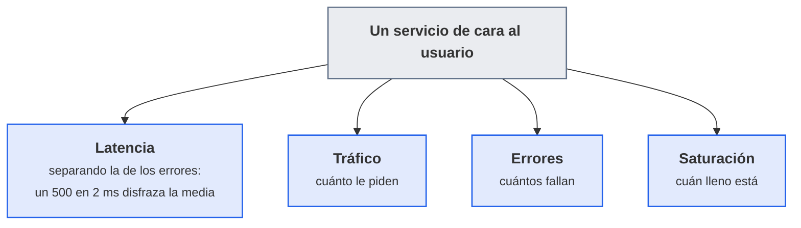
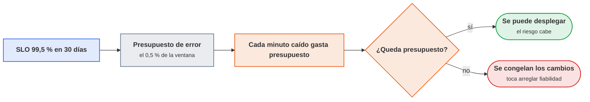
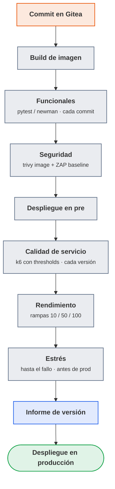
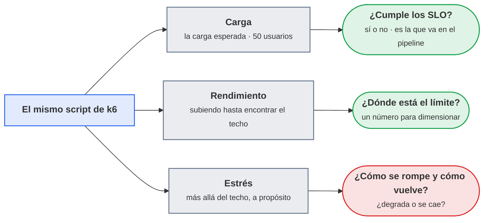
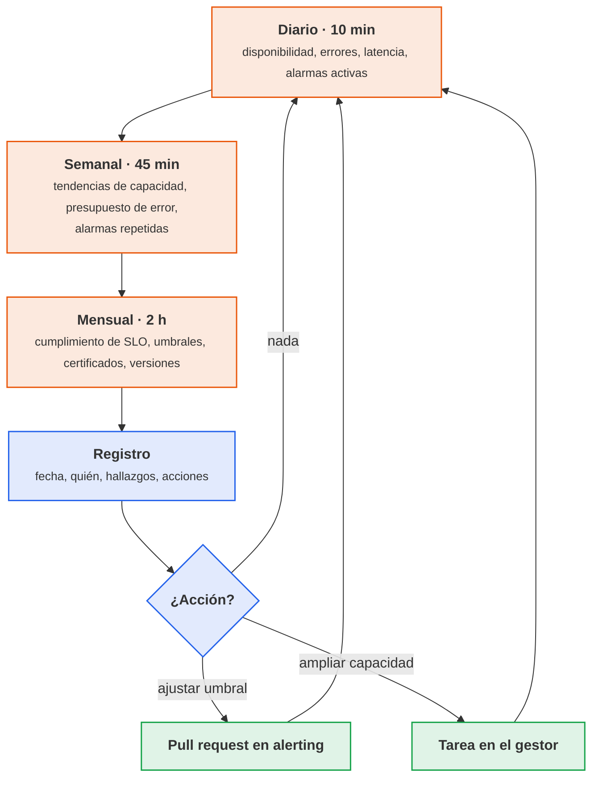

# UT4 · Indicadores, KPI y pruebas del servicio

<p class="ut-meta">16 h · Sesiones 20 a 27 · RA2 CE a, b, c, d, e, f</p>

La UT1 puso el contenedor de referencia a exponer métricas, logs y eventos; la UT2 convirtió algunas de esas métricas en alarmas con Alertmanager; la UT3 protegió la pila de monitorización. Ahora toca ordenar todo eso para que sirva a alguien ajeno al trabajo: documentar qué mide cada contador, definir con fórmula y umbral los indicadores que de verdad describen el servicio, escribir el runbook de cada alarma (la guía de qué hacer cuando salta) y, sobre todo, probar el servicio de forma repetible (funcional, carga, estrés, seguridad) y dejar evidencia de cada prueba. Lo que salga de aquí es el dossier de operación que pide cualquier empresa antes de pasar un servicio a producción. En la UT7 estas mismas pruebas serán la verificación de cada actualización. La primera evaluación se cerró en diciembre con las UT1, UT2 y UT3, así que esta unidad abre la segunda: buena parte de lo que se hace aquí entra en su examen, el 23 de marzo de 2027, junto con la UT7 y la UT8.

## Sesión 20 · Fichas de métricas

<p class="ut-meta" markdown>15 de diciembre · Teoría y práctica · <span class="dur" tabindex="0" aria-label="Elegir qué medir antes de documentarlo · 10 min&#10;Documentar las métricas · 15 min&#10;A4.1 Fichas de métricas · 85 min" data-dur="Elegir qué medir antes de documentarlo · 10 min&#10;Documentar las métricas · 15 min&#10;A4.1 Fichas de métricas · 85 min">:material-school:<i class="dur-barra" style="--teoria:23%"></i>:material-flask:</span></p>

Al acabar la sesión existe el repositorio `operacion`, que recoge la documentación de operación de toda la unidad, y en él hay al menos diez métricas del contenedor de referencia documentadas en fichas y clasificadas en capacidad, rendimiento o calidad. Para la hoja A4.1 hacen falta los dos apartados que siguen: el criterio para elegir qué medir (señales doradas, USE y RED) y la ficha de métrica con sus tres categorías.

### Elegir qué medir antes de documentarlo

El error habitual al empezar es documentar los 400 contadores que expone cAdvisor (el exporter que publica las métricas de cada contenedor). No se puede vigilar todo y tampoco hace falta. Hay dos métodos clásicos para decidir qué métricas merecen ficha, indicador y alarma.

#### Las cuatro señales doradas

El libro de SRE de Google (*Site Reliability Engineering*, la forma de operar servicios que Google publicó como libro) las llama *golden signals* y son el mínimo que hay que tener de cualquier servicio de cara al usuario:



<p class="pie" markdown>Las cuatro señales doradas son el mínimo. Si solo se pueden instrumentar cuatro cosas de un servicio, que sean estas.</p>


- Latencia: cuánto tarda en responder una petición. Conviene separar la latencia de las respuestas correctas de la de los errores, porque un 500 que se devuelve en 2 ms baja la media y disfraza el problema.
- Tráfico: cuánta demanda recibe el servicio. En una API, peticiones por segundo; en una base de datos, transacciones o sesiones; en un proxy, bytes y conexiones.
- Errores: proporción de peticiones que fallan, de forma explícita (5xx), implícita (200 con contenido incorrecto) o por política (más de 1 s de respuesta cuenta como fallo).
- Saturación: cómo de lleno está el recurso que antes se va a agotar. En el contenedor `app` es la CPU limitada por la cuota de compose; en `db01` suelen ser las conexiones o el disco.

Con estas cuatro señales del servicio del curso ya hay un panel útil y las alarmas de síntoma de la UT2 caen de forma natural: latencia alta, errores altos, tráfico anómalo (cero tráfico también es síntoma) y saturación.

#### USE para recursos, RED para servicios

Brendan Gregg propuso el método USE para diagnosticar recursos físicos: para cada recurso (CPU, memoria, disco, red) se miran Utilization (porcentaje de tiempo ocupado), Saturation (cola de trabajo pendiente) y Errors. Tom Wilkie hizo el equivalente para servicios con el método RED: Rate (peticiones por segundo), Errors (peticiones fallidas por segundo) y Duration (distribución de la latencia). Son la misma idea que las señales doradas vista desde dos lados: USE mira hacia dentro (infraestructura, capacidad), RED mira hacia el usuario (calidad, rendimiento).

En el laboratorio la correspondencia es directa. RED de la API sale de las dos métricas añadidas en la UT1 (`app_http_requests_total` y `app_http_request_duration_seconds_bucket`). USE del contenedor sale de cAdvisor (`container_cpu_usage_seconds_total`, `container_memory_working_set_bytes`, `container_fs_*`, `container_network_*`) y del nodo (`node_*`, que publica node_exporter). USE de PostgreSQL sale de `postgres_exporter` (`pg_stat_activity_count` como saturación de conexiones, `pg_stat_database_*` como tasa y errores). Cuando en la actividad A4.1 falten métricas de una categoría, conviene recorrer USE y RED: aparecen.

### Documentar las métricas

Antes de vigilar un sistema hay que saber qué mide cada contador, quién lo produce, con qué unidad y para qué se usa. Eso es la ficha de métrica. Su valor no está en la ficha en sí, sino en que obliga a responder preguntas que de otro modo nadie se hace: ¿esta métrica es un gauge o un counter? ¿En segundos o en milisegundos? ¿Quién la mantiene si cambia el código?

| Campo | Ejemplo |
|---|---|
| Nombre | `app_http_request_duration_seconds_bucket` |
| Tipo | histogram |
| Unidad | segundos |
| Etiquetas | `method`, `route`, `le` |
| Qué mide | Tiempo de respuesta de la API por petición |
| Referencia | Código: `api/metrics.py`; documentación del cliente Prometheus para Python |
| Categoría | Rendimiento |
| Uso | Latencia p95 (KPI 2); alerta `AppHighLatency` |

Sobre los campos hay tres detalles que marcan la diferencia entre una ficha útil y una de relleno. El tipo dice cómo se comporta el valor: un counter solo sube (como un cuentakilómetros), un gauge sube y baja (como un termómetro) y un histogram reparte cada observación en cubos por rango de valor. El tipo determina qué funciones de PromQL (el lenguaje de consultas de Prometheus) tienen sentido: `rate()` solo sobre counters, `histogram_quantile()` solo sobre los `_bucket` de un histogram, y a un gauge se le aplica `avg_over_time()` o `predict_linear()`. La unidad debe ser la base (segundos, bytes), como manda la convención de nombres de Prometheus, y la conversión a ms o GiB se hace en Grafana. La referencia es lo que permite ir al origen cuando la métrica se comporta raro: fichero y función del código propio, o la página del exporter y su versión.

#### Las tres categorías con ejemplos del laboratorio

Las métricas se agrupan en tres categorías y un servicio bien documentado tiene indicadores de las tres. Si al terminar la A4.1 solo hay indicadores de capacidad, es que se está mirando el contenedor y no el servicio.

Capacidad responde a "¿cuándo se llenará?" y son casi siempre gauges o cocientes entre un uso y un límite:

| Métrica | Tipo | Origen | Qué mide |
|---|---|---|---|
| `container_memory_working_set_bytes{service="app"}` | gauge | cAdvisor | Memoria que el kernel no puede reclamar; es la que cuenta para el OOM killer (el mecanismo del kernel que mata un proceso cuando se agota la memoria) |
| `container_spec_memory_limit_bytes{service="app"}` | gauge | cAdvisor | Límite `mem_limit` de compose; sin límite cAdvisor devuelve un número enorme, no cero |
| `node_filesystem_avail_bytes{mountpoint="/data"}` | gauge | node_exporter en db01 | Bytes disponibles para usuarios no root (distinto de `_free_bytes`, que incluye la reserva del 5 %) en `/data`, el disco de datos donde vive el clúster de PostgreSQL |
| `pg_stat_activity_count{datname="servicio"}` | gauge | postgres_exporter | Conexiones abiertas por estado (`state="active"`, `"idle"`) |
| `pg_settings_max_connections` | gauge | postgres_exporter | Valor de `max_connections` en `postgresql.conf` |

`/data` no es la raíz de `db01`: es un disco aparte montado ahí, donde vive el clúster de PostgreSQL desde que lo separa la [A3.3 de Despliegue](https://victor-educ.github.io/apuntes-5166/ut/ut3-seguridad-por-capas/) el 27 de noviembre. Medir la capacidad de la base de datos sobre `/` mezclaría los datos con los logs del sistema, y llenar el sistema de ficheros a propósito, como hace la prueba cruzada de la A4.3, dejaría la máquina sin PostgreSQL, sin journald y sin SSH. Dos de los nueve indicadores de la A4.2 y dos de las alarmas de la A4.3 miden ese punto de montaje: si `node_filesystem_avail_bytes{mountpoint="/data"}` no devuelve nada en Prometheus, lo que falta es el disco, no la consulta.

Rendimiento responde a "¿cuánto tarda y cuánto procesa?" y suelen ser histogramas o counters derivados en el tiempo:

| Métrica | Tipo | Origen | Qué mide |
|---|---|---|---|
| `app_http_request_duration_seconds_bucket` | histogram | API, `api/metrics.py` | Distribución de la latencia por `method` y `route` |
| `app_http_requests_total` | counter | API | Peticiones atendidas por `method`, `route` y `status`; su `rate()` es el throughput |
| `pg_stat_database_xact_commit_total` | counter | postgres_exporter | Transacciones confirmadas; su `rate()` es la carga real de la BD |
| `container_cpu_usage_seconds_total{service="app"}` | counter | cAdvisor | Segundos de CPU consumidos; en rendimiento cuando se compara con la latencia, en capacidad cuando se divide por la cuota |

Calidad responde a "¿el resultado es correcto?" y son la parte que más se olvida porque hay que construirla:

| Métrica | Tipo | Origen | Qué mide |
|---|---|---|---|
| `app_http_requests_total{status=~"5.."}` | counter | API | Respuestas con error de servidor |
| `app_http_requests_total{status=~"4.."}` | counter | API | Respuestas de error del cliente (400, 401, 404, 422): no son culpa del servicio, pero un pico dice que algo ha cambiado en quien lo llama |
| `up{job="app"}` y `pg_up` | gauge | Prometheus y postgres_exporter | 1 si el último scrape de la API funcionó y si el exporter consigue conectar con PostgreSQL; base de las alarmas `AppDown` y `PgDown` |
| `pg_stat_database_deadlocks_total` | counter | postgres_exporter | Interbloqueos; cada uno es una transacción abortada |
| `app_items_invalid` | gauge | habría que programarla en la API | Items guardados con datos imposibles, como un precio negativo; ejemplo de métrica de negocio que no existe hasta que alguien la escribe |

`up` y `pg_up` dicen si el servicio está vivo visto desde Prometheus. La disponibilidad vista desde fuera, como la ve un cliente, pediría una sonda externa que llame a `/health` (el blackbox_exporter), y el laboratorio no la monta.

La última fila es deliberada. Ninguna herramienta da la calidad del dato: si un item guardado con precio negativo es un fallo del servicio, alguien tiene que escribir la consulta que lo cuenta y exponerla como gauge. En una empresa esto es lo que distingue "monitorizamos el servidor" de "monitorizamos el servicio".

### A4.1 Fichas de métricas (sesión 20)

<span class="et et-obj">Objetivo</span> El repositorio `operacion` creado y publicado en la Gitea del laboratorio, con un `metricas.md` de al menos diez fichas de métrica, tres o más por categoría, y cada una con su referencia al código o al exporter.

<span class="et et-pre">Antes de empezar</span>

- Los túneles de [Cómo se llega a la pila](../laboratorio.md#como-se-llega-a-la-pila-desde-el-3-de-diciembre) abiertos y una shell en el puesto de administración, donde nace hoy `operacion`.
- `api/metrics.py` del repositorio `servicio`, para las referencias, y tu usuario de la Gitea de mon01.
- Lo explicado al principio de la sesión: [las señales doradas, USE y RED](#elegir-que-medir-antes-de-documentarlo) y [la ficha de métrica con sus categorías](#documentar-las-metricas).

<span class="et et-pas">Pasos</span>

1. Crea en el puesto de administración el repositorio `operacion`, con la rama `main` y el remoto `http://gitea.lab:3001/ops/operacion.git`. Recoge la documentación de operación de toda la unidad.

    *Pista:* Gitea no crea el repositorio con el primer `push`. Créalo antes, vacío, desde la web o con un `POST` a `/api/v1/orgs/ops/repos`.

2. Saca de Prometheus las métricas `app_`, `container_`, `pg_` y `node_filesystem` con su tipo y su descripción, y comprueba que cada una llega con las etiquetas que crees.

    *Pista:* Prometheus sirve el `# TYPE` y el `# HELP` de todo lo que recoge en `/api/v1/metadata`. De cAdvisor solo llegan las diez métricas del `keep` de la UT1: si necesitas otra, amplía el `keep` y recarga.

3. Escribe en `metricas.md` diez fichas o más con los ocho campos de [Documentar las métricas](#documentar-las-metricas), empezando por las de las tres tablas de categorías, menos `app_items_invalid`, que no existe. En Referencia va el fichero y la función para la API, y la página y la versión para un exporter.

4. Comprueba que hay tres fichas o más por categoría, cierra con una tabla resumen (nombre, categoría y en qué indicador o alarma se usa; la columna Uso se completa en la A4.2) y publica `operacion`.

    *Pista:* la que suele quedarse corta es calidad. Los códigos de estado de la API, `up` y `pg_up` dan tres sin programar nada.

<span class="et et-com">Comprobación</span> Diez fichas o más con las ocho filas rellenas; tres o más por categoría; todas devuelven datos en Prometheus; el tipo coincide con el de `/api/v1/metadata`; `git ls-remote origin` muestra la rama `main` de `operacion`.

<span class="et et-ent">Entrega</span> `metricas.md` en el repositorio `operacion`, empujado a la Gitea del laboratorio. Forma parte del dossier de la práctica evaluable.

## Sesión 21 · Indicadores

<p class="ut-meta" markdown>17 de diciembre · Teoría y práctica · <span class="dur" tabindex="0" aria-label="Indicadores: fórmulas y umbrales · 25 min&#10;A4.2 Indicadores · 85 min" data-dur="Indicadores: fórmulas y umbrales · 25 min&#10;A4.2 Indicadores · 85 min">:material-school:<i class="dur-barra" style="--teoria:23%"></i>:material-flask:</span></p>

Esta sesión convierte las métricas documentadas en los nueve indicadores del servicio, cargados como recording rules y visibles en un panel de KPI con umbrales justificados con datos. La hoja A4.2 se apoya en todo el apartado siguiente: el marco de SLI, SLO y presupuesto de error, la tabla de los nueve indicadores con sus trampas y las reglas para fijar umbrales.

### Indicadores: fórmulas y umbrales

Un indicador (KPI, *key performance indicator*) combina contadores en un valor con significado para alguien que no conoce el código. "El contenedor lleva 1.234.567 segundos de CPU" no dice nada; "la API va al 62 % de su cuota de CPU" sí. El marco que se usa en la industria para hablar de indicadores es el de SLI, SLO y SLA:

- SLI (*service level indicator*): la medida, expresada normalmente como cociente de eventos buenos entre eventos totales. Disponibilidad = peticiones correctas / peticiones totales.
- SLO (*service level objective*): el valor comprometido internamente para ese SLI en una ventana. Disponibilidad ≥ 99,5 % en 30 días.
- SLA (*service level agreement*): el contrato con el cliente, con consecuencias (penalizaciones) si se incumple. Siempre menos exigente que el SLO, para que el equipo tenga margen de reaccionar antes de que la empresa pague.
- Presupuesto de error (*error budget*): lo que se puede fallar sin incumplir el SLO. Es la herramienta que convierte el SLO en decisiones: si queda presupuesto, se despliega; si no queda, se congela el despliegue y se arregla la fiabilidad.

#### El presupuesto de error con números

Con un SLO de disponibilidad del 99,5 % en 30 días el presupuesto es el 0,5 % de la ventana:



<p class="pie" markdown>El presupuesto de error convierte «¿desplegamos el viernes?» en una pregunta con respuesta numérica en lugar de una discusión de opiniones.</p>


```text
30 días × 24 h × 60 min = 43.200 min
0,5 % de 43.200 min = 216 min = 3,6 h
```

Si el servicio recibe de media 20 peticiones/s, en 30 días son 51,84 millones de peticiones y el presupuesto son 259.200 peticiones fallidas. Da igual si esas 3,6 h son una caída completa o un 1 % de errores repartido durante 15 días: el presupuesto se consume igual, y esa es la gracia del modelo. Un SLO del 99,9 % deja 43 min al mes; uno del 99,99 %, 4,3 min. Cada nueve más cuesta un orden de magnitud en infraestructura y en guardias, así que el SLO se negocia con quien paga, no se pone el máximo por defecto.

El ritmo al que se gasta el presupuesto es el *burn rate*. Un burn rate de 1 significa que, al ritmo actual de errores, el presupuesto se agota justo al final de la ventana de 30 días. Con SLO 99,5 %:

```text
burn rate = tasa de errores observada / (1 - SLO)
          = tasa de errores observada / 0,005

Tasa de errores del 0,5 %  → burn rate 1   → presupuesto agotado en 30 días
Tasa de errores del 3 %    → burn rate 6   → presupuesto agotado en 5 días
Tasa de errores del 7,2 %  → burn rate 14,4 → presupuesto agotado en 50 horas
```

Por eso las alarmas basadas en SLO no se disparan por "errores > 1 %" a secas, sino por burn rate en dos ventanas a la vez (por ejemplo, burn rate 14,4 sostenido en la última hora y también en los últimos 5 minutos): la ventana larga evita el ruido y la corta comprueba que el problema sigue activo. En PromQL, con las reglas grabadas de la UT2 (recording rules: consultas que Prometheus evalúa cada poco y guarda como una serie nueva):

```promql
# 2 % del presupuesto mensual consumido en 1 h y el problema sigue vivo
(app:errors:ratio1h > (14.4 * 0.005)) and (app:errors:ratio5m > (14.4 * 0.005))
```

Hace falta grabar `app:errors:ratio1h` además del `ratio5m` que ya existe. El capítulo "Alerting on SLOs" del *SRE Workbook* (enlazado en [Para ampliar](../ampliacion.md#ut4-indicadores-kpi-y-pruebas-del-servicio)) tiene la tabla completa de ventanas y burn rates; no hace falta memorizarla, sí entender por qué existe.

#### Los nueve indicadores del servicio

Esta tabla es el núcleo de la unidad: los nueve números que describen el servicio del curso, cada uno con la fórmula que lo calcula, la categoría a la que pertenece y los dos umbrales (aviso y crítico) que después se convierten en alarmas. p95 es el percentil 95: el valor que el 95 % de las peticiones no supera.

| Indicador | Fórmula (PromQL) | Categoría | Umbral aviso | Umbral crítico |
|---|---|---|---|---|
| Disponibilidad | `sum(rate(app_http_requests_total{status!~"5.."}[30d])) / sum(rate(app_http_requests_total[30d]))` | Calidad | < 99,7 % | < 99,5 % |
| Latencia p95 | `histogram_quantile(0.95, sum by(le)(rate(app_http_request_duration_seconds_bucket[5m])))` | Rendimiento | > 300 ms | > 500 ms |
| Throughput | `sum(rate(app_http_requests_total[5m]))` | Rendimiento | informativo | ninguno |
| Tasa de errores | `app:errors:ratio5m` | Calidad | > 0,5 % | > 1 % |
| Saturación CPU | `rate(container_cpu_usage_seconds_total{service="app"}[5m]) / container_spec_cpu_quota{service="app"} * container_spec_cpu_period{service="app"}` | Capacidad | > 70 % | > 90 % |
| Memoria | `container_memory_working_set_bytes{service="app"} / container_spec_memory_limit_bytes{service="app"}` | Capacidad | > 80 % | > 90 % |
| Disco BD | `node_filesystem_avail_bytes{mountpoint="/data"} / node_filesystem_size_bytes{mountpoint="/data"}` | Capacidad | < 20 % | < 10 % |
| Días hasta disco lleno | `predict_linear(node_filesystem_avail_bytes{mountpoint="/data"}[7d], 30*86400) < 0` | Capacidad | 30 días | 7 días |
| Conexiones BD | `sum by (service)(pg_stat_activity_count) / on(service) group_left pg_settings_max_connections` | Capacidad | > 70 % | > 85 % |

Cada fórmula tiene un porqué y al menos una trampa. Conviene repasarlas una a una: en la A4.2 se implementan como recording rules y entran en el examen.

**Disponibilidad.** El cociente excluye del numerador los 5xx pero mantiene los 4xx, porque un 404 o un 401 es una respuesta correcta a una petición incorrecta y no es culpa del servicio. La trampa es la ventana: `rate(...[30d])` obliga a Prometheus a leer 30 días de muestras de todas las series de `app_http_requests_total` cada vez que se evalúa, y con una etiqueta `route` de alta cardinalidad (muchos valores distintos, una serie por cada uno) eso tarda segundos. Lo correcto es grabar `app:requests:rate5m` y `app:errors:rate5m` como reglas y calcular la disponibilidad mensual sobre ellas con `sum_over_time`, o usar directamente `increase()` sobre la regla grabada. `rate` sobre 30 días exige que la retención de Prometheus supere 30 días: en mon01 se fija en 45 días por esta razón, y la A4.2 lo comprueba antes de empezar.

**Latencia p95.** `histogram_quantile` no calcula el percentil real: estima en qué cubo cae el 95 % acumulado y hace una interpolación lineal dentro de ese cubo. Con los cubos por defecto del cliente Python (0,005, 0,01, 0,025, 0,05, 0,075, 0,1, 0,25, 0,5, 0,75, 1, 2,5, 5, 7,5, 10 s), si el p95 real está en 320 ms el resultado será cualquier valor entre 250 y 500 ms según el reparto, y con pocos cubos en la zona de interés la gráfica da saltos. Dos consecuencias prácticas: los cubos se definen en `api/metrics.py` alrededor del SLO (por ejemplo 0,1, 0,2, 0,3, 0,4, 0,5, 0,75, 1, 2, 5), y no se pone un umbral de 500 ms si hay un cubo en 500 ms, porque el valor estimado se pegará al borde. La segunda trampa es el `sum by(le)`: si se agrega quitando `le`, la función no tiene con qué trabajar y devuelve NaN. Si el 95 % de las peticiones supera el último cubo finito, el resultado es el límite de ese cubo (10 s), no un valor mayor. Un p95 es la latencia que el 5 % de peticiones más lentas supera: con 20 peticiones/s son 60 usuarios por minuto viendo algo peor que el número del panel.

**Throughput.** No tiene umbral porque no es bueno ni malo en sí, pero es contexto imprescindible: un p95 de 800 ms con 200 peticiones/s no es el mismo problema que con 2 peticiones/s. Sí vale la pena una alarma de "tráfico cero durante 10 min en horario laboral", que casi siempre significa que el proxy de web01 ha dejado de enviar peticiones.

**Tasa de errores.** Se usa la regla grabada `app:errors:ratio5m` de la UT2 y no la consulta cruda, para que el panel, la alerta y el informe mensual coincidan al céntimo. El umbral crítico del 1 % es el doble del presupuesto de error (0,5 %), es decir, burn rate 2. Con poco tráfico el cociente es ruidoso: 1 error entre 50 peticiones ya es un 2 %. Si el servicio tiene picos de tráfico bajo, conviene añadir al numerador de la alerta una condición de tráfico mínimo (`and app:requests:rate5m > 1`).

**Saturación de CPU.** cAdvisor expone la cuota (`container_spec_cpu_quota`, en microsegundos por periodo) y el periodo (`container_spec_cpu_period`, normalmente 100.000 µs). `cpus: "1.5"` en compose se traduce en cuota 150.000, periodo 100.000. La fórmula divide los segundos de CPU consumidos por segundo (que pueden ser 1,5 si el contenedor usa un núcleo y medio) entre la cuota normalizada. Sin límite de CPU la cuota vale 0 y el cociente da `+Inf`; el indicador solo tiene sentido si el servicio tiene `cpus` fijado, que es una de las razones por las que se fija. Superar el 100 % es imposible de forma sostenida: el kernel estrangula (`container_cpu_cfs_throttled_periods_total`), y esa métrica de throttling es mejor señal de saturación que el porcentaje.

**Memoria.** Se usa `working_set` y no `usage` porque `usage` incluye la caché de páginas, que el kernel puede liberar sin afectar al proceso. El OOM killer actúa cuando el working set alcanza el límite, así que el 90 % del límite es un aviso real de que un pico más provoca el reinicio. Igual que con la CPU, sin `mem_limit` en compose el denominador es un número enorme y el indicador queda en 0 % para siempre, lo que da falsa tranquilidad.

**Disco de la base de datos.** Se usa `avail` y no `free`: ext4 reserva por defecto un 5 % para root, y PostgreSQL no corre como root. Con 100 GiB de volumen, cuando `free` marca 5 GiB, PostgreSQL ya no puede escribir. El umbral del 10 % es agresivo a propósito: PostgreSQL con el disco lleno no responde a las escrituras y, si el WAL (el diario de escrituras que PostgreSQL guarda antes de tocar las tablas) no puede crecer, se para entero.

**Días hasta disco lleno.** `predict_linear` ajusta una recta por mínimos cuadrados sobre los últimos 7 días de la serie y la extrapola 30 días (30 × 86.400 s). Si el valor previsto es negativo, el disco se llena antes de un mes. La ventana de 7 días absorbe los ciclos semanales (las copias del domingo, los `VACUUM` de la noche, la limpieza interna de PostgreSQL); una ventana de 1 h daría avisos con cada carga masiva. Para pintar directamente los días que quedan en un panel se puede usar `node_filesystem_avail_bytes{mountpoint="/data"} / -deriv(node_filesystem_avail_bytes{mountpoint="/data"}[7d]) / 86400`, que da un valor sin sentido (negativo) cuando el disco está vaciándose: en Grafana se limita el eje a valores positivos. La trampa de cualquier predicción lineal es que un borrado grande la deja ciega durante una semana.

**Conexiones de la base de datos.** `pg_stat_activity_count` viene desglosado por estado y base de datos, de ahí el `sum by (service)`, y el `group_left` empareja esa suma con la única serie de `max_connections`, como en la regla `db:connections:ratio` de la UT2. El límite es `max_connections`, 100 por defecto. Los umbrales del 70 y el 85 % son relativamente bajos porque el agotamiento de conexiones es brusco: un pool mal dimensionado en la API pasa de 40 a 100 en segundos cuando la BD se ralentiza, y a partir de ahí todo son `FATAL: too many clients`. Este indicador es el candidato natural para probar el estrés en la A4.6.

#### Cómo fijar umbrales

La regla general es que cada categoría tiene su propia lógica y no se mezclan:

- Capacidad: por margen restante, es decir, por el tiempo disponible para reaccionar. El aviso tiene que llegar con días de margen si la acción es comprar disco o pedir una VM más grande, y con minutos si la acción es un `docker compose restart`. Por eso "días hasta disco lleno" avisa a 30 días y "memoria" al 80 %.
- Rendimiento: por el SLO más un margen. Si el SLO de latencia es p95 < 500 ms, el aviso va en 300 ms para dar tiempo a mirar antes de incumplir.
- Calidad: por el presupuesto de error, con burn rate. El crítico es burn rate 2 o superior; el aviso, burn rate 1 sostenido.

Y una regla práctica: ningún umbral se fija sin haber mirado antes la distribución real. En la A4.2 se mira el histórico que ya guarda Prometheus de las sesiones anteriores; un umbral de CPU al 70 % cuando el servicio vive al 75 % en horas punta es una alarma permanente, y una alarma permanente es una alarma ignorada.

### A4.2 Indicadores (sesión 21)

<span class="et et-obj">Objetivo</span> Los nueve indicadores cargados como recording rules en el Prometheus de `mon01`, un panel de KPI en Grafana que los muestra, e `indicadores.md` en `operacion` con fórmula, categoría, umbrales y la justificación de cada umbral.

<span class="et et-pre">Antes de empezar</span>

- `alerting` en mon01, con las recording rules de la A2.3 en `prometheus/rules.yml`.
- Prometheus guardando 45 días, que es lo que pide la disponibilidad mensual: compruébalo en `http://localhost:9090/flags` (`storage.tsdb.retention.time`) y, si no, ajústalo en el `command` de Prometheus.
- `cpus` y `mem_limit` en el servicio `app` de app01. El `keep` de cAdvisor no deja pasar `container_spec_cpu_quota` ni `container_spec_cpu_period`: añádelas como en la A4.1. Sin todo eso, la CPU y la memoria dan `+Inf`, 0 % o nada.
- db01 con su disco de datos en `/data`, node_exporter y postgres_exporter (de la [A3.3 de Despliegue](https://victor-educ.github.io/apuntes-5166/ut/ut3-seguridad-por-capas/)), recogidos por Prometheus: de ahí salen tres indicadores.
- El bucle de tráfico de la A2.1 contra `https://api.dev.lab/items` en el puesto de administración, para que los cocientes no den `NaN`. Por su `-s`, falla en silencio si `curl` no confía en la CA del curso: compruébalo antes e instala `~/ca/ca.crt` en el sistema si hace falta.
- Lo explicado al principio de la sesión: [SLI, SLO y presupuesto de error](#indicadores-formulas-y-umbrales), [los nueve indicadores](#los-nueve-indicadores-del-servicio) y [cómo fijar umbrales](#como-fijar-umbrales).

<span class="et et-pas">Pasos</span>

1. Graba en `prometheus/rules.yml`, en un grupo `app-kpi` con `interval: 30s`, las seis reglas que faltan para los [nueve indicadores](#los-nueve-indicadores-del-servicio), con los nombres que usan la A4.3 y la A4.7: `app:errors:rate5m`, `app:errors:ratio1h`, `app:availability:30d`, `app:cpu:ratio5m`, `db:disk_avail:ratio` y `db:disk_full:predict30d`. Valida, recarga y comprueba en `http://localhost:9090/rules` que se evalúan sin errores.

    *Pista:* la disponibilidad no es un `rate(...[30d])`, sino `1 -` el cociente de los `sum_over_time(...[30d])` de `app:errors:rate5m` y `app:requests:rate5m`. La predicción se graba sin el `< 0`.

2. Monta en Grafana el dashboard "KPI app", con un panel Stat por indicador sobre su regla grabada, su unidad y los umbrales como colores de fondo.

    *Pista:* haz uno y duplícalo: solo cambian la consulta, la unidad (`percent (0.0-1.0)`, `seconds`, `bytes`) y los umbrales.

3. Anota mínimo, máximo y valor habitual del histórico de cada indicador, y con eso escribe `indicadores.md` en `operacion`: indicador, regla, categoría y umbrales, y una línea por umbral con lo que has visto y por qué ese valor.

    *Pista:* una recording rule no tiene datos de antes de cargarse, así que el histórico de las de hoy se mira con la expresión completa de la tabla.

4. Calcula el presupuesto de error mensual con tu SLO y el tráfico medio de los dos últimos días, en minutos y en peticiones, y añádelo a `indicadores.md` con las cuentas a la vista.

5. Exporta el dashboard a `grafana/kpi.json` de `operacion` y empuja `alerting` y `operacion`.

    *Pista:* el JSON se descarga en el puesto del aula, y `operacion` está en el puesto de administración.

<span class="et et-com">Comprobación</span> `promtool check rules` sin errores; los nueve indicadores devuelven valor (ninguno `NaN` ni `+Inf`); el panel los muestra con colores según umbral; cada umbral tiene su justificación con datos.

<span class="et et-ent">Entrega</span> `prometheus/rules.yml` en `alerting`, e `indicadores.md` y `grafana/kpi.json` en `operacion`, empujados a la Gitea del laboratorio. Forma parte del dossier de la práctica evaluable.

<span class="et et-ext">Si te sobra tiempo</span> Añade a `alerts.yml` la alerta de burn rate en dos ventanas del apartado y fuérzala parando PostgreSQL en db01 un par de minutos.

## Sesión 22 · Catálogo de alarmas

<p class="ut-meta" markdown>12 de enero · Teoría y práctica · <span class="dur" tabindex="0" aria-label="Catálogo de alarmas y runbooks · 15 min&#10;A4.3 Catálogo de alarmas · 95 min" data-dur="Catálogo de alarmas y runbooks · 15 min&#10;A4.3 Catálogo de alarmas · 95 min">:material-school:<i class="dur-barra" style="--teoria:14%"></i>:material-flask:</span></p>

Al terminar hay un catálogo con todas las alarmas y un runbook completo para cinco de ellas, enlazados desde la anotación `runbook` de cada regla de alerta. Para la hoja A4.3 hacen falta el esquema de la ficha, las cinco propiedades de un buen runbook y los ejemplos completos del apartado siguiente.

### Catálogo de alarmas y runbooks

Cada alarma posible tiene una ficha con lo que un operador necesita a las 3 de la mañana. No es documentación para quien escribió la alarma, es documentación para quien la recibe sin contexto, medio dormido y con un cliente esperando. La ficha de `AppHighErrorRate`, que sirve de modelo:

| Campo | AppHighErrorRate |
|---|---|
| Origen | `app:errors:ratio5m > 1 %` durante 5 min |
| Posible fallo | BD no responde; despliegue con bug; dependencia externa caída |
| Impacto | Usuarios reciben errores 5xx; afecta al SLO de disponibilidad |
| Análisis | 1. Panel "KPI app" en Grafana: ¿coincide con un despliegue? 2. En app01: `docker compose -f /opt/servicio/compose.yml logs --since 10m app \| grep -ci error` 3. En app01: `nc -zv 10.10.3.10 5432` 4. Loki: `{service="app", level="error"}` |
| Resolución | Si es despliegue: rollback (`docker compose up -d` con la imagen de la versión anterior). Si es BD: ver alarma PgDown. Si es externo: activar modo degradado |
| Escalado | Desarrollador de guardia si persiste más de 15 min |

#### Qué hace bueno a un runbook

Un runbook bueno se reconoce porque alguien que no conoce el servicio puede seguirlo sin preguntar. Eso se traduce en cinco propiedades:

1. Los pasos de análisis van del más rápido y frecuente al más lento y raro, y cada uno dice qué significa el resultado ("si `nc` falla, el problema es de red o de PostgreSQL: salta a PgDown").
2. Los comandos son exactos, copiables, con el host desde el que se ejecutan. "Mirar los logs" no vale; `ssh ops@10.10.2.10 docker compose -f /opt/servicio/compose.yml logs --since 10m app | grep -ci error` sí.
3. Las acciones de resolución están ordenadas por reversibilidad: primero lo que no rompe nada (reiniciar un contenedor), luego lo que tiene coste (rollback), y lo destructivo (borrar datos, ampliar disco en caliente) solo con escalado.
4. Hay un criterio de escalado con tiempo y persona o rol, no "avisar a alguien".
5. Se enlaza desde la anotación `runbook` de la regla de alerta (como en la A2.4), y cambiar la alarma obliga a revisar su runbook en el mismo turno: en el laboratorio las reglas viven en `alerting` y los runbooks en `operacion`, así que el pull request que toca la regla enlaza el cambio del runbook.

Y una regla de higiene: cada vez que una alarma salta y el runbook no resuelve el caso, el cierre de la incidencia incluye actualizar el runbook. Un runbook que no cambia en un año es un runbook que nadie usa.

#### Dos runbooks más

Dos fichas más, escritas con el mismo esquema, para ver cómo cambia el contenido según la alarma: una de fallo brusco (la base de datos deja de responder) y una de aviso con margen (el disco se llenará en una semana).

| Campo | PgDown |
|---|---|
| Origen | `pg_up == 0` durante 1 min (postgres_exporter no consigue conectar) |
| Posible fallo | El servicio `postgresql` de db01 parado o reiniciándose (falta de memoria, disco lleno, corrupción); `max_connections` agotadas y el exporter no entra; red entre mon01 y la subred data cortada por una regla de OPNsense |
| Impacto | Toda escritura y la mayoría de lecturas de la API fallan con 5xx; salta AppHighErrorRate a los 5 min. Inhibida por HostDown de db01 (UT2) |
| Análisis | 1. Desde app01, que es la única máquina con paso al 5432: `nc -zv 10.10.3.10 5432` (si falla, red o proceso caído). 2. En db01: `systemctl status postgresql@17-main` y `journalctl -k \| grep -i 'out of memory'`. 3. `df -h /data` (disco lleno es la causa más frecuente en el laboratorio). 4. `sudo tail -50 /var/log/postgresql/postgresql-17-main.log` buscando `FATAL`, `PANIC` o `could not write`. 5. Si el servicio está arriba: `sudo -u postgres psql -c "select count(*) from pg_stat_activity"` para descartar conexiones agotadas |
| Resolución | Proceso muerto por falta de memoria: `sudo systemctl restart postgresql@17-main` y subir la memoria de la VM en el mismo turno. Disco lleno: liberar espacio en `/data` (volcados locales antiguos, WAL archivado ya copiado) y reiniciar; nunca borrar dentro de `/data/postgresql`. Conexiones agotadas: `pg_terminate_backend` de las sesiones `idle` más antiguas y revisar el pool de la API. Corrupción (`PANIC` en los logs): no tocar, escalar y preparar restauración de la copia (UT6) |
| Escalado | Inmediato al responsable de datos si hay `PANIC` o si no arranca en 10 min; en horario, aviso al equipo de desarrollo si la causa es el pool |

| Campo | DiskWillFillIn7d |
|---|---|
| Origen | `predict_linear(node_filesystem_avail_bytes{mountpoint="/data"}[7d], 7*86400) < 0` durante 1 h |
| Posible fallo | Crecimiento normal de datos sin plan de capacidad; logs de PostgreSQL o de la aplicación sin rotación; copias locales (`pg_dump`) acumuladas en el mismo volumen; tabla sin `VACUUM` con bloat (espacio que siguen ocupando filas ya borradas) |
| Impacto | Ninguno inmediato. Si no se actúa, en menos de una semana PostgreSQL deja de escribir y salta PgDown |
| Análisis | 1. Panel "KPI app", indicador de días hasta disco lleno: pendiente de la gráfica de 30 días y fecha estimada. 2. `du -xsh /data/* \| sort -h \| tail` para ver qué crece. 3. `sudo -u postgres psql -c "select relname, pg_size_pretty(pg_total_relation_size(oid)) from pg_class order by pg_total_relation_size(oid) desc limit 10"`. 4. `ls -la /data/copias` (¿hay volcados que ya están copiados fuera de la máquina?). 5. Si el crecimiento está fuera de `/data`, `du -xsh /var/log/*` en db01: casi siempre son los logs de PostgreSQL sin rotar |
| Resolución | Volcados locales ya replicados: borrar los de más de 7 días. Logs: revisar la rotación de `/var/log/postgresql` en `/etc/logrotate.d/postgresql-common`. Bloat: `VACUUM (VERBOSE)` de la tabla en ventana de baja carga. Crecimiento legítimo: abrir tarea de ampliación del disco virtual en Proxmox (`qm resize`) y `resize2fs`, con copia previa |
| Escalado | Si la fecha estimada es inferior a 3 días, tratar como crítico y avisar al responsable de infraestructura en el día |

El catálogo es la tabla de todas las alarmas, versionada junto a sus runbooks y enlazada desde la anotación `runbook` de cada regla. La A4.3 pide el catálogo entero y cinco runbooks completos; en la empresa lo normal es que haya entre 30 y 80 alarmas para un servicio mediano, y que la mitad se retiren al cabo de un año por no haber saltado nunca o por saltar sin acción posible.

### A4.3 Catálogo de alarmas (sesión 22)

<span class="et et-obj">Objetivo</span> El catálogo de alarmas en `alarmas/` del repositorio `operacion`: una tabla con todas las alarmas y un runbook completo para cinco de ellas, y cada regla de alerta enlazando a su runbook o al catálogo desde la anotación `runbook`.

<span class="et et-pre">Antes de empezar</span>

- `alerting` en mon01, con las diez alarmas de la A2.4 (siete en `prometheus/alerts.yml` y tres en `loki/loki-alerts.yml`) y las reglas grabadas de la A4.2.
- `operacion` en el puesto de administración y los túneles de [Cómo se llega a la pila](../laboratorio.md#como-se-llega-a-la-pila-desde-el-3-de-diciembre).
- Lo explicado al principio de la sesión: [la ficha de alarma](#catalogo-de-alarmas-y-runbooks), [qué hace bueno a un runbook](#que-hace-bueno-a-un-runbook) y [los dos ejemplos completos](#dos-runbooks-mas).

<span class="et et-pas">Pasos</span>

1. Añade a `prometheus/alerts.yml` las cinco alarmas nuevas, con las etiquetas de la A2.4 y los umbrales de tu `indicadores.md`:

    - `AppLowAvailability`, crítica: `app:availability:30d` por debajo del SLO durante 15 min.
    - `AppCpuSaturated`, crítica: `app:cpu:ratio5m` por encima del umbral crítico durante 10 min.
    - `DbDiskLow`, aviso: `db:disk_avail:ratio` por debajo del umbral de aviso durante 5 min.
    - `PgDown`, crítica, y `DiskWillFillIn7d`, aviso: el Origen de sus fichas en [Dos runbooks más](#dos-runbooks-mas).

    *Pista:* `AppCpuSaturated` lleva `team: dev` y `origen: cadvisor`, como `AppMemoryHigh`; las otras cuatro, `team: ops` y `origen: prometheus`.

2. Escribe el catálogo en `alarmas/README.md` de `operacion`: una fila por alarma, las diez de la UT2 y las cinco de hoy, con Alarma, Origen (la `expr` con su `for`), Posible fallo e Impacto (una frase cada uno) y Runbook, que se rellena en el paso 4.

3. Escribe cinco runbooks, uno por fichero en `alarmas/<Alarma>.md`, con las seis filas del esquema y las cinco propiedades de [Qué hace bueno a un runbook](#que-hace-bueno-a-un-runbook): `AppHighErrorRate`, `PgDown` y `DiskWillFillIn7d` a partir de los ejemplos del apartado, y dos de la UT2 a tu elección. En los tres primeros, revisa que hosts, rutas y nombres son los de tu laboratorio; en los dos tuyos, ejecuta una vez los comandos de Análisis. Los de Resolución no se ejecutan.

4. Enlaza cada regla de `alerts.yml` y `loki-alerts.yml` desde su anotación `runbook`, las cinco del paso 3 a su fichero y el resto al catálogo, con URL como `http://gitea.lab:3001/ops/operacion/src/branch/main/alarmas/AppHighErrorRate.md`. Rellena la columna Runbook, empuja los dos repositorios y recarga.

    *Pista:* usa `gitea.lab` y no la IP de mon01: el 12 de febrero Gitea se muda a gitea01, y ese día solo cambia el principio de la URL, de `http://gitea.lab:3001` a `https://gitea.lab`. Cambia también la URL esperada en `prometheus/tests/alerts_test.yml` de la A2.4, o `promtool test rules` dejará de pasar.

<span class="et et-com">Comprobación</span> `promtool check rules` sin errores con las cinco alarmas nuevas; el catálogo tiene una fila por cada regla de `alerts.yml` y `loki-alerts.yml`; cinco runbooks con las seis filas; cada regla tiene anotación `runbook` con una URL que responde.

<span class="et et-ent">Entrega</span> `alarmas/` en `operacion`, y `alerts.yml` y `loki-alerts.yml` en `alerting`, empujados a la Gitea del laboratorio. Forma parte del dossier de la práctica evaluable.

<span class="et et-ext">Si te sobra tiempo</span> Prueba cruzada: dale uno de tus runbooks a un compañero que no lo haya escrito y provoca su alarma (parando PostgreSQL en db01 para `PgDown`, o con `sudo fallocate -l 4G /data/relleno` para `DbDiskLow`, que con el disco de 5 GB de db01 deja un 13 % disponible sin llenarlo; bórralo en cuanto salte). Cada pregunta que te haga el compañero es una línea que falta en la ficha.

## Sesión 23 · Pruebas funcionales

<p class="ut-meta" markdown>14 de enero · Teoría y práctica · <span class="dur" tabindex="0" aria-label="Pruebas del servicio · 20 min&#10;A4.4 Pruebas funcionales · 90 min" data-dur="Pruebas del servicio · 20 min&#10;A4.4 Pruebas funcionales · 90 min">:material-school:<i class="dur-barra" style="--teoria:18%"></i>:material-flask:</span></p>

Aquí empieza el bloque de pruebas: al acabar hay una suite de ocho casos funcionales sobre la API de dev que genera un informe JUnit y sale con código distinto de cero cuando falla un caso. Para la hoja A4.4 hacen falta la tabla de tipos de prueba, que sitúa cada uno en el ciclo de vida, y el apartado de pytest, con newman como alternativa en su pestaña.

### Pruebas del servicio

Monitorizar dice cómo se comporta el servicio con el tráfico que hay; probar dice cómo se comportará con el tráfico que habrá, o con el que no debería haber. Cada tipo de prueba responde a una pregunta distinta y se ejecuta en un momento distinto del ciclo de vida.

| Tipo | Qué comprueba | Herramientas | Cuándo |
|---|---|---|---|
| Funcionales | Que cada función hace lo que debe (y falla como debe) | pytest, Postman/newman, curl con asserts | Cada cambio |
| Calidad de servicio | Que cumple los SLO con carga normal | k6 con umbrales (`thresholds`) | Cada versión |
| Rendimiento | Latencia y throughput bajo carga creciente | k6, JMeter, Locust | Cada versión, cambios de infraestructura |
| Estrés | Dónde y cómo se rompe; cómo se recupera | k6 con rampas hasta fallo | Antes de producción, tras cambios de capacidad |
| Seguridad | Vulnerabilidades en la aplicación y sus componentes | OWASP ZAP (baseline), `trivy image`, nikto | Cada versión |



<p class="pie" markdown>Cada prueba tiene su frecuencia: las funcionales en cada commit, las de carga en cada versión, las de estrés solo antes de producción o al cambiar la capacidad.</p>

Las pruebas funcionales son rápidas (segundos) y se lanzan en cada commit. Las de calidad y rendimiento necesitan un entorno desplegado y varios minutos, así que van por versión. El estrés puede tumbar el entorno, por lo que no se automatiza en cada versión: se lanza a mano, en un entorno de preproducción (en esta unidad, dev), antes de la primera puesta en producción y cuando cambia la capacidad (más CPU, otro tamaño de pool, otra VM). La seguridad va en cada versión porque una imagen base nueva puede traer CVE nuevas (vulnerabilidades conocidas, publicadas con un identificador) sin que el código cambie.

#### Pruebas funcionales con pytest

Una prueba funcional contra la API es una petición HTTP y una serie de afirmaciones sobre la respuesta. Con `pytest` (el ejecutor de pruebas de Python) y `requests` (su librería para hacer peticiones HTTP), el fichero queda así. El fixture `token` inicia sesión una sola vez con el usuario de prueba `test` de la API, y cada función prueba una cosa con `assert`; los errores de la API llegan en JSON con la forma `{"error": "..."}`:

```python
# tests/functional/test_items.py
import os
import requests
import pytest

BASE = os.environ.get("API_URL", "https://api.dev.lab")

@pytest.fixture(scope="session")
def token():
    r = requests.post(f"{BASE}/login", json={"user": "test", "password": os.environ["API_TEST_PASS"]}, timeout=5)
    assert r.status_code == 200
    return r.json()["token"]

def test_health():
    assert requests.get(f"{BASE}/health", timeout=5).status_code == 200

def test_list_items_ok(token):
    r = requests.get(f"{BASE}/items", headers={"Authorization": f"Bearer {token}"}, timeout=5)
    assert r.status_code == 200
    assert r.headers["Content-Type"].startswith("application/json")
    assert isinstance(r.json(), list)

def test_create_item_requires_auth():
    r = requests.post(f"{BASE}/items", json={"name": "x", "price": 1}, timeout=5)
    assert r.status_code == 401
    assert "error" in r.json()

def test_create_item_validates_price(token):
    r = requests.post(f"{BASE}/items", json={"name": "x", "price": -3},
                      headers={"Authorization": f"Bearer {token}"}, timeout=5)
    assert r.status_code == 422
    assert "error" in r.json()

def test_unknown_item_is_404(token):
    r = requests.get(f"{BASE}/items/999999", headers={"Authorization": f"Bearer {token}"}, timeout=5)
    assert r.status_code == 404
```

Conviene fijarse en el reparto: dos casos correctos, uno de autenticación, uno de validación y uno de recurso inexistente. Los ocho casos que pide la A4.4 cubren los tres grupos (correctos, errores esperados, validación); una suite que solo comprueba `status == 200` no prueba que el servicio falle bien, y fallar bien es la mitad del trabajo de una API. La contraseña de prueba va en variable de entorno (en Jenkins, una credencial), nunca en el fichero.

La ejecución con informe JUnit (un XML con un resultado por caso, que es el formato que Jenkins y Gitea entienden), y su correspondencia con newman, el ejecutor de Postman, que es la otra herramienta habitual:

=== "pytest"

    ```bash
    export REQUESTS_CA_BUNDLE=~/ca/ca.crt
    API_URL=https://api.dev.lab python3 -m pytest tests/functional -v --junitxml=reports/pytest.xml
    ```

    `pytest` devuelve 0 si todo pasa y 1 si algo falla, que es lo que necesita el pipeline (la cadena de etapas automáticas de Jenkins que construye, prueba y despliega). `REQUESTS_CA_BUNDLE` apunta a la CA del curso porque `requests` instalado con pip no lee el almacén de certificados del sistema, sino el suyo propio (el paquete certifi), que no conoce esa CA: sin la variable, el fixture `token` muere con `SSLError` antes del primer caso. Se pone siempre, también en Jenkins, para que la suite no dependa de cómo se instaló.

=== "newman"

    Postman es cómodo para diseñar la petición con la interfaz gráfica, y newman es su ejecutor de línea de comandos. Una colección exportada es un JSON con, por cada petición, su método, sus cabeceras, su cuerpo y su URL; lo propio de las pruebas es el bloque `event` de cada petición, con las afirmaciones escritas en JavaScript con `pm.test`, equivalentes a los `assert` de pytest:

    ```json
    "event": [{
      "listen": "test",
      "script": { "exec": [
        "pm.test('status 200', () => pm.response.to.have.status(200));",
        "pm.test('devuelve una lista', () => pm.expect(pm.response.json()).to.be.an('array'));"
      ] }
    }]
    ```

    La colección entera de la que sale este fragmento está en [Para ampliar](../ampliacion.md#una-coleccion-de-postman-entera). Se ejecuta con la imagen oficial, sin instalar nada más que Docker; `NODE_EXTRA_CA_CERTS` es el equivalente de `REQUESTS_CA_BUNDLE` para newman:

    ```bash
    docker run --rm -v "$PWD/tests/postman:/etc/newman" -v ~/ca/ca.crt:/ca.crt:ro \
      -e NODE_EXTRA_CA_CERTS=/ca.crt postman/newman \
      run api-curso.json --env-var base=https://api.dev.lab --env-var token="$API_TOKEN" \
      --reporters cli,junit --reporter-junit-export /etc/newman/newman.xml
    ```

El criterio para elegir es sencillo: si el equipo ya documenta la API en Postman, newman; si hay que preparar datos antes de cada caso (crear un usuario, un item), pytest, porque los fixtures lo hacen limpio y en Postman acaba siendo JavaScript incrustado en un JSON. En el laboratorio la suite se escribe con pytest.

### A4.4 Pruebas funcionales (sesión 23)

<span class="et et-obj">Objetivo</span> Una suite de ocho casos funcionales con pytest sobre la API de dev que genera un informe JUnit, sale con código distinto de cero cuando falla un caso, y el fragmento de `Jenkinsfile` que la ejecutará en el pipeline, escrito y validado, a la espera de que exista Jenkins.

<span class="et et-pre">Antes de empezar</span>

- Una shell en el puesto de administración, que llega a `https://api.dev.lab` y confía en la CA del curso desde la A4.2.
- Un clon de `servicio` en `~/servicio` del puesto de administración, donde se escriben las pruebas y se guardan sus evidencias. La copia de app01 sigue siendo la del despliegue.
- pytest y requests (`python3-pytest` y `python3-requests`), y la contraseña del usuario `test` de la API en `API_TEST_PASS`, nunca en el repositorio.
- Nada de Jenkins hasta el 5 de febrero, con la UT6 de Despliegue: hoy la suite se lanza a mano y el pipeline se deja escrito.
- Lo explicado al principio de la sesión: [los tipos de prueba](#pruebas-del-servicio) y [pytest](#pruebas-funcionales-con-pytest).

<span class="et et-pas">Pasos</span>

1. Escribe `tests/functional/test_items.py` con ocho casos a partir del de [pytest](#pruebas-funcionales-con-pytest), que trae cinco, en tres grupos: correctos (salud, listar, crear y leer lo creado), errores esperados (401 sin token, 401 con contraseña equivocada, 404 con id inexistente) y validación (422 con precio negativo y con un cuerpo que no es JSON).

    *Pista:* crear devuelve 201 con el `id` nuevo en el JSON. La API trata un cuerpo que no es JSON como vacío, y lo rechaza la validación.

2. Ejecuta la suite contra dev con el comando de [pytest](#pruebas-funcionales-con-pytest), que deja el informe JUnit en `reports/`, y copia el de esa ejecución a `tests/evidence/1.4.2/pytest.xml`, la carpeta de la versión que corre en app01 (en estos apuntes, la 1.4.2). Después rompe un caso, comprueba que el código de salida pasa a 1 y que el XML trae un `<failure>`, y deshazlo.

3. Guarda en `ci/Jenkinsfile.pruebas` este `Jenkinsfile` mínimo, con el `sh` idéntico al comando que has lanzado a mano, y en `ci/README.md` lo que habrá que hacer cuando haya Jenkins: la credencial `api-test-pass` como Secret text, la CA del curso en el agente y el job Pipeline "app-pruebas-funcionales" apuntando a este fichero. Empuja `tests/` y `ci/`.

    ```groovy
    pipeline {
      agent any
      environment {
        API_URL = 'https://api.dev.lab'
        API_TEST_PASS = credentials('api-test-pass')
        REQUESTS_CA_BUNDLE = '/usr/local/share/ca-certificates/lab5166.crt'   // la CA del curso en el agente
      }
      stages {
        stage('Funcionales') {
          steps { sh 'python3 -m pytest tests/functional -v --junitxml=reports/pytest.xml' }
        }
      }
      post { always { junit 'reports/*.xml' } }
    }
    ```

<span class="et et-com">Comprobación</span> Ocho casos que pasan contra dev, repartidos en los tres grupos; con un caso roto, código de salida 1 y `<failure>` en el XML; `ci/Jenkinsfile.pruebas` y `ci/README.md` escritos, con el comando idéntico al que has ejecutado.

<span class="et et-ent">Entrega</span> `tests/functional/`, `ci/` y `tests/evidence/1.4.2/pytest.xml` en el repositorio `servicio`, empujados a la Gitea del laboratorio. En la A4.7 le pondrás su ficha de caso.

## Sesión 24 · Calidad de servicio y rendimiento

<p class="ut-meta" markdown>19 de enero · Teoría y práctica · <span class="dur" tabindex="0" aria-label="Carga, rendimiento y estrés no son lo mismo · 5 min&#10;Calidad de servicio y rendimiento con k6 · 15 min&#10;Leer los resultados junto a Grafana · 5 min&#10;A4.5 Calidad de servicio y rendimiento · 85 min" data-dur="Carga, rendimiento y estrés no son lo mismo · 5 min&#10;Calidad de servicio y rendimiento con k6 · 15 min&#10;Leer los resultados junto a Grafana · 5 min&#10;A4.5 Calidad de servicio y rendimiento · 85 min">:material-school:<i class="dur-barra" style="--teoria:23%"></i>:material-flask:</span></p>

Al terminar hay un script k6 con los SLO como umbrales, ejecutado con rampas de 10, 50 y 100 usuarios contra dev, y una respuesta escrita a partir de cuántos usuarios se incumple el SLO y qué recurso limita. La hoja A4.5 necesita los tres apartados que siguen: qué distingue una prueba de carga, una de rendimiento y una de estrés, k6 (options, stages, thresholds, checks y las salidas) y cómo leer los resultados junto a Grafana.

### Carga, rendimiento y estrés no son lo mismo

Los tres usan k6 y a menudo el mismo script, pero buscan cosas distintas y se leen de forma distinta:



<p class="pie" markdown>Se confunden porque comparten herramienta. Lo que cambia es la pregunta, y por eso el resultado se lee distinto.</p>


- La prueba de carga o de calidad de servicio somete al servicio a la carga esperada (los 50 usuarios del script básico del apartado siguiente) y responde a una pregunta binaria: ¿cumple los SLO o no? Es la que va en el pipeline y la que en la UT7 verificará cada actualización. Su resultado es el veredicto de los `thresholds`.
- La prueba de rendimiento sube la carga por escalones (10, 50, 100 usuarios en la A4.5) y busca la curva: cómo crece la latencia con la carga y a partir de qué punto se incumple el SLO. Su resultado es un número ("el SLO se incumple a partir de 80 usuarios") y una gráfica. Sirve para planificar capacidad y para comparar versiones (si la 1.4.2 aguanta 80 y la 1.5.0 aguanta 60, alguien tiene que explicar por qué).
- La prueba de estrés sube hasta romper y luego baja. Busca tres datos: el punto de rotura (errores > 10 % o timeouts), el modo de fallo (¿la API devuelve 503 limpios o se cuelga? ¿muere PostgreSQL por conexiones o la API por memoria?) y el tiempo de recuperación al retirar la carga. Un servicio que se rompe a 300 usuarios pero se recupera solo en 20 s es mejor que uno que aguanta 400 y luego necesita un reinicio manual. Para el estrés no se usan `thresholds` que aborten: interesa ver el fallo entero. El script de estrés, `estres.js`, se escribe en la A4.6 a partir del básico del apartado siguiente, cambiando la rampa.

### Calidad de servicio y rendimiento con k6

k6 es un generador de carga que se programa en JavaScript, se ejecuta como binario único (en el laboratorio se instala en el puesto de administración, que es desde donde se lanzan las pruebas de esta unidad) y devuelve código de salida distinto de cero cuando no se cumple un umbral. Esa última propiedad es la que lo convierte en herramienta de pipeline y no solo de laboratorio. El script básico:

```javascript
import http from 'k6/http';
import { check, sleep } from 'k6';

export const options = {
  stages: [
    { duration: '2m', target: 50 },
    { duration: '5m', target: 50 },
    { duration: '2m', target: 0 },
  ],
  thresholds: {
    http_req_duration: ['p(95)<500'],
    http_req_failed: ['rate<0.01'],
  },
};

export default function () {
  const r = http.get('https://api.dev.lab/items');
  check(r, { 'status 200': (r) => r.status === 200 });
  sleep(1);
}
```

Cada pieza tiene su función:

- `options.stages` define la rampa en usuarios virtuales (VU): 2 min subiendo de 0 a 50, 5 min estables en 50, 2 min bajando. Un VU es un bucle que ejecuta la función por defecto una y otra vez; con `sleep(1)` y una respuesta de 100 ms, cada VU genera algo menos de 1 petición/s, así que 50 VU son unas 45 peticiones/s. Para controlar el ritmo en peticiones por segundo y no en usuarios, el ejecutor `constant-arrival-rate` que viene más abajo es el adecuado.
- `thresholds` son los SLO expresados sobre las métricas internas de k6. `http_req_duration` es el tiempo total de la petición; `http_req_failed` es la proporción de respuestas que k6 considera fallidas (4xx y 5xx por defecto). Si un umbral no se cumple al terminar, k6 lo marca en rojo y sale con código 99.
- `check` es una afirmación que no detiene la prueba: cuenta cuántas veces se cumplió. Se refleja en la métrica `checks` y se puede poner umbral sobre ella (`checks: ['rate>0.99']`). Un `check` que falla no cuenta como `http_req_failed`; son dos cosas distintas y conviene tener umbral en ambas.

Un script más completo, que es el que se usa en la A4.5, separa escenarios, etiqueta peticiones y aborta si el SLO se incumple de forma clara para no gastar 9 minutos en una prueba ya perdida:

```javascript
import http from 'k6/http';
import { check, sleep } from 'k6';

export const options = {
  scenarios: {
    navegacion: {
      executor: 'ramping-vus',
      startVUs: 0,
      stages: [
        { duration: '1m', target: 10 },
        { duration: '3m', target: 10 },
        { duration: '1m', target: 50 },
        { duration: '3m', target: 50 },
        { duration: '1m', target: 100 },
        { duration: '3m', target: 100 },
        { duration: '1m', target: 0 },
      ],
      gracefulRampDown: '30s',
    },
    escrituras: {
      executor: 'constant-arrival-rate',
      rate: 5, timeUnit: '1s',
      duration: '13m',
      preAllocatedVUs: 10, maxVUs: 30,
      exec: 'crear',
    },
  },
  thresholds: {
    'http_req_duration{name:items}': ['p(95)<500', 'p(99)<1000'],
    'http_req_duration{name:crear}': [{ threshold: 'p(95)<800', abortOnFail: true, delayAbortEval: '1m' }],
    http_req_failed: ['rate<0.01'],
    checks: ['rate>0.99'],
  },
  tags: { version: __ENV.APP_VERSION || 'desconocida' },
};

const BASE = __ENV.API_URL || 'https://api.dev.lab';
const params = { headers: { Authorization: `Bearer ${__ENV.API_TOKEN}` } };

export default function () {
  const r = http.get(`${BASE}/items`, { ...params, tags: { name: 'items' } });
  check(r, {
    'status 200': (r) => r.status === 200,
    'lista no vacía': (r) => r.json().length > 0,
  });
  sleep(1);
}

export function crear() {
  const r = http.post(`${BASE}/items`, JSON.stringify({ name: 'k6', price: 9.5 }),
    { ...params, headers: { ...params.headers, 'Content-Type': 'application/json' }, tags: { name: 'crear' } });
  check(r, { 'creado': (r) => r.status === 201 });
}
```

Lo que aporta cada novedad: los `scenarios` permiten mezclar en la misma prueba una carga de lectura que crece por escalones (ejecutor `ramping-vus`) y una carga de escritura constante de 5 peticiones/s (`constant-arrival-rate`), que es lo que se parece a un servicio real. Las `tags: { name }` en cada petición hacen que los umbrales se puedan fijar por tipo de petición, porque un SLO global esconde que leer va bien y crear va mal. `abortOnFail` con `delayAbortEval` corta la prueba si el p95 de escritura supera 800 ms una vez pasado el primer minuto (para no abortar por el arranque frío). La etiqueta global `version` se propaga a todas las métricas y, cuando se mandan a Prometheus, permite comparar dos versiones en el mismo panel.

Ejecución y salidas:

```bash
API_URL=https://api.dev.lab API_TOKEN=... APP_VERSION=1.4.2 \
k6 run --summary-export=tests/evidence/1.4.2/k6-resumen.json tests/k6/carga.js
echo "código de salida: $?"
```

`--summary-export` escribe un JSON pequeño con los agregados por métrica y umbral, que es el que se adjunta al informe y el que un script puede consultar (con `jq`, el filtro de línea de comandos para JSON: `jq '.metrics.http_req_duration.values["p(95)"]'`). Existe también `--out json`, que escribe una línea por cada muestra: con 100 VU durante 13 min son cientos de MB que nadie lee, así que en el laboratorio no se guarda. Para tener las métricas de k6 al lado de las del servicio en Grafana, lo que de verdad interesa, k6 puede escribir directamente en Prometheus por remote write (la API con la que Prometheus acepta que otro programa le mande series):

```bash
K6_PROMETHEUS_RW_SERVER_URL=http://localhost:9090/api/v1/write \
K6_PROMETHEUS_RW_TREND_AS_NATIVE_HISTOGRAM=true \
k6 run --out experimental-prometheus-rw tests/k6/carga.js
```

Para que funcione, el Prometheus de mon01 debe arrancar con `--web.enable-remote-write-receiver`, y como desde la UT3 solo escucha en el `127.0.0.1` de mon01, k6 le escribe a través de un túnel abierto en la máquina que lanza la prueba (`ssh -fNL 9090:127.0.0.1:9090 ops@10.10.0.20`). El nombre del output ha ido perdiendo el prefijo `experimental-` en versiones recientes de k6 1.x; `k6 run --help` dice cuál acepta la versión instalada. Las métricas llegan con el prefijo `k6_` y las etiquetas del escenario, y en Grafana se importa el panel oficial de k6 para Prometheus o se hace uno propio con `k6_http_req_duration_p95` y `k6_http_reqs_total`.

### Leer los resultados junto a Grafana

El resumen de k6 dice qué vio el cliente; Grafana dice qué le pasó al servidor mientras tanto. Solo cruzando los dos se entiende el resultado. Durante cada rampa conviene tener abierto el panel del servicio con la ventana de tiempo de la prueba y mirar, en este orden:

1. Latencia p95 del servidor (`app:latency_p95:5m`) frente al `p(95)` de k6. Si k6 ve 800 ms y el servidor ve 200 ms, el cuello está delante de la API: el proxy de web01, la red o el límite de conexiones de nginx.
2. Saturación de CPU del contenedor `app` y `container_cpu_cfs_throttled_periods_total`. Si la latencia sube justo cuando el throttling aparece, la cuota de `cpus` es el límite y la solución es cambiarla, no optimizar código.
3. Conexiones de PostgreSQL. Si se pegan a `max_connections` antes de que suba la latencia, el pool de la API está sobredimensionado respecto a la BD.
4. Memoria working set. Una subida lineal que no baja al retirar la carga es una fuga; el estrés es la mejor manera de encontrarlas.
5. Tasa de errores y logs en Loki filtrados por el intervalo: el primer error que aparece suele decir qué se rompió (`too many clients`, `upstream timed out`, `OOMKilled`).

<figure markdown="span">
  { width="640" }
  <figcaption>Panel de Grafana con métricas de servicio. Durante una prueba de carga se captura con la ventana de tiempo ajustada a la prueba y se guarda como evidencia. Fuente: Joel Kennedy, dominio público, vía Wikimedia Commons.</figcaption>
</figure>

La captura del panel es evidencia obligatoria en la A4.5 y la A4.6, y tiene que llevar el rango de tiempo visible, para que quien la lea después sepa a qué ejecución corresponde. Mejor todavía: una anotación en Grafana al inicio y al final de cada prueba (se pueden crear desde el propio script de k6 con una llamada a la API de anotaciones de Grafana en las funciones `setup()` y `teardown()`).

### A4.5 Calidad de servicio y rendimiento (sesión 24)

<span class="et et-obj">Objetivo</span> Un script k6 con los SLO como umbrales, ejecutado con rampas de 10, 50 y 100 usuarios contra dev, con las capturas de Grafana de cada rampa y una respuesta escrita a partir de cuántos usuarios se incumple el SLO y qué recurso limita.

<span class="et et-pre">Antes de empezar</span>

- k6 y `jq` en el puesto de administración. k6 es un binario único, de su [página de versiones](https://github.com/grafana/k6/releases).
- El clon de `servicio` y `API_TEST_PASS`, como en la A4.4.
- `app` con los límites de la A4.2, y el panel de KPI abierto en el navegador del puesto del aula.
- Lo explicado al principio de la sesión: [carga, rendimiento y estrés](#carga-rendimiento-y-estres-no-son-lo-mismo), [k6, options, stages, thresholds y checks](#calidad-de-servicio-y-rendimiento-con-k6) y [leer los resultados junto a Grafana](#leer-los-resultados-junto-a-grafana).

<span class="et et-pas">Pasos</span>

1. Escribe `tests/token.sh`, que imprime un token de `/login` para el usuario `test`, y copia a `tests/k6/carga.js` el script completo de [k6](#calidad-de-servicio-y-rendimiento-con-k6) con los umbrales de tus SLO.

    *Pista:* que `token.sh` use `API_URL` cuando esté definida, porque la etapa de Jenkins de la sesión 26 lo llamará contra pre.

2. Exporta `API_TOKEN` con la salida de `token.sh` y lanza la prueba completa como en el apartado, con `APP_VERSION=1.4.2` y el resumen en `tests/evidence/1.4.2/k6-resumen.json`. Al final de cada escalón (minutos 4, 8 y 12) captura el panel de KPI con el rango de tiempo visible: `grafana-carga-10.png`, `grafana-carga-50.png` y `grafana-carga-100.png`.

    *Pista:* las capturas se quedan en el puesto del aula; llévalas después a `tests/evidence/1.4.2/` del clon.

3. Escribe `tests/evidence/1.4.2/rendimiento.md` con tres respuestas: a partir de cuántos usuarios se incumple el SLO de p95, qué recurso limita (en el orden de [Leer los resultados junto a Grafana](#leer-los-resultados-junto-a-grafana)) y por qué difieren el p95 de k6 y el del servidor. Empuja `tests/`.

    *Pista:* el p95 de lectura del resumen está en `.metrics["http_req_duration{name:items}"].values["p(95)"]`.

<span class="et et-com">Comprobación</span> `k6-resumen.json` con los umbrales evaluados (código de salida 0 si se cumplen, 99 si no); tres capturas con el rango visible; `rendimiento.md` con las tres respuestas.

<span class="et et-ent">Entrega</span> `tests/token.sh`, `tests/k6/carga.js` y en `tests/evidence/1.4.2/` el resumen, las capturas y `rendimiento.md`, en `servicio`, empujados a la Gitea del laboratorio. En la A4.7 le pondrás sus fichas de caso. La A4.6 usa la imagen de ZAP, que pesa unos 1,5 GB: si puedes, déjala descargada en mon01 al terminar (`docker pull ghcr.io/zaproxy/zaproxy:stable`).

<span class="et et-ext">Si te sobra tiempo</span> Activa el remote write en el Prometheus de mon01 y repite un escalón con `--out experimental-prometheus-rw`, por el túnel del apartado, para ver `k6_http_req_duration_p95` al lado de `app:latency_p95:5m`.

## Sesión 25 · Estrés y seguridad

<p class="ut-meta" markdown>21 de enero · Teoría y práctica · <span class="dur" tabindex="0" aria-label="Seguridad: ZAP baseline y trivy image · 15 min&#10;A4.6 Estrés y seguridad · 95 min" data-dur="Seguridad: ZAP baseline y trivy image · 15 min&#10;A4.6 Estrés y seguridad · 95 min">:material-school:<i class="dur-barra" style="--teoria:14%"></i>:material-flask:</span></p>

Esta sesión cierra las pruebas con las dos que quedan: el estrés, que busca dónde y cómo se rompe el servicio y cuánto tarda en recuperarse, y la seguridad con ZAP baseline y Trivy sobre la imagen. La diferencia entre carga, rendimiento y estrés se vio en la sesión 24, y el script de estrés sale del básico de k6 de esa sesión; la teoría de hoy es la de ZAP y Trivy, con sus códigos de salida y qué informe se archiva. Es la sesión en la que Trivy se explica a fondo: la UT7 lo da por sabido y solo añade lo nuevo.

### Seguridad: ZAP baseline y trivy image

Las pruebas de seguridad de esta unidad son las dos que caben en un pipeline sin intervención humana. El análisis activo (pentest, escaneo activo de ZAP) queda fuera del curso; la UT7 amplía el escaneo de imágenes con el SBOM, Grype y la puerta del pipeline.

ZAP (OWASP Zed Attack Proxy, el escáner de aplicaciones web de la fundación OWASP) en modo baseline lanza la araña (el rastreador que sigue los enlaces de la página) contra la URL durante un minuto y aplica solo las reglas pasivas: no envía ataques, solo observa las respuestas, así que es seguro contra un entorno de pruebas e incluso contra producción. Detecta cabeceras de seguridad ausentes, cookies sin `Secure` o `HttpOnly`, información de versión en `Server`, formularios sin protección CSRF (falsificación de peticiones desde otro sitio), contenido mixto. En el laboratorio corre como contenedor en mon01, que tiene Docker y resuelve `api.dev.lab` con el DNS de OPNsense; `--network host` hace que el contenedor use ese mismo DNS:

```bash
mkdir -p zap && chmod 777 zap
docker run --rm --network host -v "$PWD/zap:/zap/wrk:rw" ghcr.io/zaproxy/zaproxy:stable \
  zap-baseline.py -t https://api.dev.lab -r zap.html -J zap.json -c zap-rules.conf
echo "código de salida: $?"
```

El volumen en `/zap/wrk` es imprescindible: sin él el informe se escribe dentro del contenedor y desaparece, y la carpeta tiene que admitir escritura del usuario `zap` del contenedor, de ahí el `chmod`. Los códigos de salida son 0 (sin hallazgos), 1 (hay hallazgos marcados como FAIL), 2 (solo WARN) y 3 (error de ejecución, casi siempre porque no llega a la URL). Por defecto todo es WARN y el pipeline no falla nunca; el fichero `zap-rules.conf` es donde se decide qué reglas son FAIL, con el id de la regla:

```text
10020	FAIL	(Anti-clickjacking Header)
10021	FAIL	(X-Content-Type-Options Header Missing)
10038	FAIL	(Content Security Policy (CSP) Header Not Set)
10054	WARN	(Cookie without SameSite Attribute)
10096	IGNORE	(Timestamp Disclosure)
```

Al leer `zap.html`, cada alerta trae riesgo (High, Medium, Low, Informational), confianza, las URL afectadas y una solución genérica. En el laboratorio, los hallazgos de cabeceras se resuelven en la configuración de nginx en web01 (`add_header X-Content-Type-Options nosniff always;`), no en la aplicación, y esa es la primera lección: la mitad de lo que ZAP encuentra se arregla en el proxy.

Trivy escanea la imagen del contenedor: el sistema operativo base y las dependencias de la aplicación (los paquetes de `requirements.txt` que quedaron en la imagen), además de secretos incrustados y configuraciones erróneas del Dockerfile. Es un binario único y en el laboratorio se instala en el puesto de administración, que es donde vive el resto del curso. Hasta el 19 de febrero no hay registry: la imagen es la `app:<versión>` que app01 construye desde `api/Dockerfile`, así que viaja al puesto como fichero con `docker save` y Trivy la lee con `--input`:

```bash
ssh ops@10.10.2.10 docker save app:1.4.2 > /tmp/app.tar
trivy image --input /tmp/app.tar --format json -o tests/evidence/1.4.2/trivy.json            # informe completo: el que se archiva
trivy image --input /tmp/app.tar --severity HIGH,CRITICAL --ignore-unfixed --exit-code 1     # tabla de trabajo y puerta
echo "código de salida: $?"
```

Los dos comandos hacen cosas distintas. El JSON que se archiva va sin filtros: es el inventario completo de lo que traía la imagen ese día, y es lo que la UT7 compara cuando llega una versión nueva. Los filtros son para trabajar: `--severity` se queda con lo grave, `--ignore-unfixed` descarta las CVE que no tienen corrección publicada (no se puede hacer nada con ellas salvo cambiar de imagen base, así que en la lista de trabajo solo estorban) y `--exit-code 1` hace que Trivy falle si queda algún hallazgo tras los filtros, que es lo que quiere el pipeline. Desde el 19 de febrero la imagen está en el registry (`registry.lab:5000/app:<versión>`) y Trivy la lee de allí sin pasar por el fichero. En la tabla, las columnas que importan son `Library`, `Vulnerability` (el id CVE), `Severity`, `Installed Version` y `Fixed Version`: la última dice si basta con reconstruir la imagen (la corrección está en el repositorio de Debian) o si hay que subir la versión de una dependencia en el código. La primera vez que se escanea la imagen del curso aparecen entre 20 y 60 hallazgos si la base es `python:3.12` completa y menos de 5 si es `python:3.12-slim` actualizada: ese dato solo ya justifica la elección de la base.

### A4.6 Estrés y seguridad (sesión 25)

<span class="et et-obj">Objetivo</span> Una prueba de estrés con punto de rotura, modo de fallo y tiempo de recuperación anotados, y los informes de ZAP baseline y Trivy sobre la imagen del servicio con la lista de hallazgos y dónde se corrige cada uno.

<span class="et et-pre">Antes de empezar</span>

- Un snapshot `antes-estres` de app01 (120) y db01 (130), por la regla de [Cuando algo se rompe](../laboratorio.md#cuando-algo-se-rompe).
- k6, `tests/token.sh` y `API_TOKEN` como en la A4.5.
- La imagen de ZAP en mon01. Si no la dejaste descargada, lanza su `docker pull` al empezar: son 1,5 GB y bajan mientras haces el estrés.
- Trivy en el puesto de administración, donde se queda para el resto del curso. Su primera ejecución descarga la base de vulnerabilidades.
- Panel de KPI y Loki (`{service="app"}`) abiertos en Grafana.
- Lo explicado: [carga, rendimiento y estrés](#carga-rendimiento-y-estres-no-son-lo-mismo), en la sesión 24, y hoy [ZAP baseline y trivy image](#seguridad-zap-baseline-y-trivy-image).

<span class="et et-pas">Pasos</span>

1. Escribe `tests/k6/estres.js` a partir del script básico de [k6](#calidad-de-servicio-y-rendimiento-con-k6), con la autenticación de `carga.js`: escalones de 2 min a 50, 100 y 200 usuarios, bajada a 0 en 3 min y `http_req_failed: ['rate<0.10']` como umbral solo informativo. Lánzalo con el resumen en `tests/evidence/1.4.2/k6-estres.json`.

2. Durante la subida, anota el punto de rotura (minuto y usuarios en que los errores pasan del 10 % o aparecen timeouts), el modo de fallo (503 limpios o cuelgue) y la primera línea de error, con su hora.

    *Pista:* el `upstream timed out` del proxy no llega a Loki: está en `/var/log/nginx/error.log` de web01.

3. Durante la bajada, mide cuánto tardan la latencia y los errores en volver a lo normal; si algo no vuelve solo, anótalo y vuelve al snapshot. Captura el panel con toda la prueba (`grafana-estres.png`) y escribe `tests/evidence/1.4.2/estres.md` con los tres datos y lo que demuestra cada uno.

    *Pista:* mira los errores con una ventana de `[1m]`: la regla de 5 minutos tarda en bajar.

4. Pasa ZAP baseline contra `https://api.dev.lab` desde mon01, como en [ZAP baseline y trivy image](#seguridad-zap-baseline-y-trivy-image), con `tests/zap-rules.conf` (las tres reglas de cabeceras del apartado en FAIL), y trae `zap.html` y `zap.json` a `tests/evidence/1.4.2/zap/`.

    *Pista:* `zap-rules.conf` tiene que estar dentro de la carpeta de mon01 que montas en `/zap/wrk`.

5. Escanea con Trivy la imagen que corre en app01, como en el apartado: el informe completo en `tests/evidence/1.4.2/trivy.json` y la tabla de trabajo con la puerta, anotando su código de salida.

    *Pista:* la etiqueta exacta (en estos apuntes, `app:1.4.2`) la da `docker compose images` en app01.

6. Escribe `tests/evidence/1.4.2/seguridad.md`: hallazgo, herramienta, severidad y dónde se corrige (proxy nginx de web01, imagen base, dependencia o código), con los FAIL y WARN de ZAP y los HIGH y CRITICAL con corrección de Trivy, agrupados por paquete si pasan de diez. Empuja `tests/`.

<span class="et et-com">Comprobación</span> `estres.md` con los tres datos y su evidencia; `grafana-estres.png` con el rango visible; `zap.html` y `zap.json` en la carpeta; `trivy.json` sin filtrar y el código de salida de la puerta anotado; `seguridad.md` con los hallazgos y dónde se corrige cada uno.

<span class="et et-ent">Entrega</span> `tests/k6/estres.js`, `tests/zap-rules.conf` y en `tests/evidence/1.4.2/` `k6-estres.json`, `grafana-estres.png`, `estres.md`, `zap/`, `trivy.json` y `seguridad.md`, en `servicio`, empujados a la Gitea del laboratorio.

<span class="et et-ext">Si te sobra tiempo</span> Corrige uno de los hallazgos de cabeceras en el nginx de web01 (`add_header X-Content-Type-Options nosniff always;` en el bloque `server` del 443) y vuelve a pasar ZAP: la alerta tiene que desaparecer del informe.

## Sesión 26 · Documentación de pruebas y seguimiento

<p class="ut-meta" markdown>26 de enero · Teoría y práctica · <span class="dur" tabindex="0" aria-label="Documentar las pruebas · 10 min&#10;Seguimiento periódico · 10 min&#10;A4.7 Documentación de pruebas y seguimiento · 90 min" data-dur="Documentar las pruebas · 10 min&#10;Seguimiento periódico · 10 min&#10;A4.7 Documentación de pruebas y seguimiento · 90 min">:material-school:<i class="dur-barra" style="--teoria:18%"></i>:material-flask:</span></p>

Al acabar están las fichas de caso con sus evidencias, el informe de pruebas de la versión con veredicto, la puerta de pruebas escrita para Jenkins y comprobada a mano, y una revisión semanal ejecutada con la plantilla que termina en un pull request de ajuste de umbral. La hoja A4.7 se apoya en los dos apartados siguientes: cómo documentar las pruebas (ficha de caso, carpeta de evidencias, informe de versión y etapa de Jenkins) y el ciclo de seguimiento periódico con su plantilla de revisión.

### Documentar las pruebas

Una prueba que no se documenta no existe a efectos de auditoría ni de la UT7, donde hay que demostrar que la versión anterior pasaba lo que la nueva no pasa. Por cada ejecución relevante se rellena un caso de prueba:

| Campo | Contenido |
|---|---|
| Id y nombre | PC-01 Calidad de servicio con 50 usuarios |
| Versión probada | `app:1.4.2`, commit `abc1234` |
| Entorno | dev |
| Fecha y ejecutor | 2027-01-19 · a mano desde el puesto de administración (ops) |
| Procedimiento | `k6 run --summary-export=... tests/k6/carga.js` con `API_URL=https://api.dev.lab`, `APP_VERSION=1.4.2` |
| Resultado esperado | p95 < 500 ms, errores < 1 % |
| Resultado obtenido | p95 = 412 ms, errores 0,2 % |
| Veredicto | OK |
| Evidencias | `k6-resumen.json`, `grafana-carga-50.png` |

La ficha es corta a propósito. Lo que la hace verificable es que el procedimiento permite repetir la prueba exactamente y que las evidencias están donde dice que están. La estructura de carpetas en el repositorio del servicio:

```text
tests/
├── functional/            # pytest
├── k6/                    # carga.js, estres.js
├── token.sh
├── zap-rules.conf
└── evidence/
    └── 1.4.2/
        ├── INFORME.md         # informe de pruebas de la versión
        ├── casos/             # PF-01, PC-01, PR-01, PE-01 y PS-01
        ├── pytest.xml
        ├── k6-resumen.json, k6-estres.json
        ├── grafana-carga-10.png, grafana-carga-50.png, grafana-carga-100.png
        ├── rendimiento.md, estres.md, grafana-estres.png
        ├── zap/zap.html, zap/zap.json
        ├── trivy.json
        └── seguridad.md
```

Las evidencias se guardan en el repositorio o en un almacén con la misma retención que las versiones: mientras la versión 1.4.2 pueda desplegarse, sus pruebas siguen disponibles. Si el repositorio Git empieza a pesar, lo grande se mueve a un bucket con la misma política y el `INFORME.md` enlaza a la ruta externa. El informe de pruebas de una versión es un documento de una página que enlaza todos sus casos y da un veredicto único:

```markdown
# Informe de pruebas · app 1.4.2 · commit abc1234 · dev · 2027-01-26

| Bloque | Casos | OK | KO | Veredicto |
|---|---|---|---|---|
| Funcionales (pytest, 8 casos) | PF-01 | 8 | 0 | OK |
| Calidad de servicio (k6, 50 VU) | PC-01 | 1 | 0 | OK |
| Rendimiento (rampas 10, 50, 100) | PR-01 | informativo | | SLO se incumple a partir de 85 VU |
| Estrés | PE-01 | informativo | | rotura a 160 VU (conexiones BD); recuperación 40 s |
| Seguridad (ZAP y trivy) | PS-01 | 1 | 1 | KO: CVE-2026-XXXXX HIGH en libssl, corregida en 3.5.2-1 |

Veredicto de la versión: NO APTA para producción hasta reconstruir con base actualizada (PS-01).
Firmado: ops · Revisado: ...
```

#### La puerta de pruebas en el pipeline de Jenkins

El pipeline de `jenkins01` se monta en la UT6 de la asignatura de despliegue (https://victor-educ.github.io/apuntes-5166/ut/ut6-ci/), que empieza el 3 de febrero, una semana después de esta sesión: hoy no hay controlador donde lanzar nada. Su etapa Deploy, el 26 de febrero, lleva cada versión a app01-pre; lo que se escribe aquí es la etapa que iría justo detrás, que solo da la versión por buena si todos los códigos de salida son cero y que archiva las evidencias con el número de build. En pre no hay proxy ni certificado, así que la API se prueba en el 8080 de app01-pre. Es trabajo preparado, no ejecutado: su comprobación de hoy es que cada `sh` sea exactamente el comando que ya se ha lanzado a mano, con el mismo código de salida.

```groovy
stage('Pruebas en pre') {
  environment {
    API_URL = 'http://10.20.2.10:8080'            // app01-pre, sin proxy ni certificado
    API_TEST_PASS = credentials('api-test-pass')
    APP_VERSION = '1.4.2'                         // en febrero, la versión que despliega el pipeline
  }
  steps {
    sh 'python3 -m pytest tests/functional -v --junitxml=reports/pytest.xml'
    sh 'docker run --rm -v "$WORKSPACE:/zap/wrk:rw" ghcr.io/zaproxy/zaproxy:stable zap-baseline.py -t "$API_URL" -r reports/zap.html -J reports/zap.json -c tests/zap-rules.conf'
    sh 'API_TOKEN=$(tests/token.sh) k6 run --summary-export=reports/k6-resumen.json tests/k6/carga.js'
  }
  post {
    always {
      junit 'reports/*.xml'
      archiveArtifacts artifacts: 'reports/**', fingerprint: true
    }
  }
}
```

El paso `junit` hace que Jenkins pinte la tendencia de casos OK/KO entre builds y marque el build como inestable si hay fallos; `archiveArtifacts` guarda las evidencias unidas al número de build, que es lo que después se copia a `tests/evidence/<versión>/` (o se enlaza desde el informe, si se prefiere que las evidencias vivan en Jenkins). ZAP monta el espacio de trabajo entero para leer `tests/zap-rules.conf` y escribir en `reports/`. El estrés no está en la etapa: se lanza a mano con otro job parametrizado, porque tumbar el entorno cada vez que alguien hace un commit no es aceptable para el resto del equipo que también lo usa.

!!! ojo "El orden importa"
    Trivy no está en esta etapa porque va antes: entre construir la imagen y subirla al registry, en la etapa de escaneo que añade la A7.6, en la UT7. Es la prueba más barata (segundos) y la que más veces falla, y no tiene sentido desplegar ni gastar minutos de carga en una imagen que no va a pasar a producción por una CVE crítica.

### Seguimiento periódico

Los indicadores se revisan en un ciclo fijo, no solo cuando salta una alarma. Una alarma avisa de que algo ha pasado el umbral; la revisión detecta lo que se acerca al umbral despacio, lo que el umbral no cubre y los umbrales que están mal puestos. Son cosas que una alarma nunca dice.



<p class="pie" markdown>El ciclo se cierra siempre en el registro: una revisión que no deja rastro escrito no se puede auditar ni mejorar.</p>

- Diario: panel de estado (disponibilidad, errores, latencia, alarmas activas). Es un vistazo de 10 minutos al empezar el día y su valor es detectar lo que pasó de noche sin llegar a alarma: un pico de errores a las 3:00 que duró 4 minutos y no llegó a los 5 del `for`.
- Semanal: tendencias de capacidad (disco, memoria, conexiones), presupuesto de error consumido en lo que va de mes, alarmas repetidas. Una alarma que ha saltado cuatro veces en la semana y se ha cerrado sola las cuatro es o un umbral mal puesto o un problema real intermitente; en ambos casos hay que decidir algo.
- Mensual: cumplimiento de SLO con el dato cerrado del mes, revisión de cada umbral contra la distribución real de ese mes (¿el p95 del 70 % de CPU sigue teniendo sentido tras el crecimiento de tráfico?), caducidad de certificados (`openssl x509 -noout -enddate -in <certificado>` sobre los que firmó la CA del curso), y versiones desplegadas frente a las publicadas (enlaza con la UT7).

Cada revisión deja un registro breve. La plantilla, en `revisiones/AAAA-Wnn.md` del repositorio `operacion` para las semanales:

```markdown
# Revisión semanal · 2027-W03 · 2027-01-22 · ops

## Estado
- Disponibilidad 30 d: 99,71 % (SLO 99,5 %). Presupuesto consumido: 58 % a día 22 → ritmo por encima de 1.
- p95 semana: 340 ms (aviso 300). Subida desde 280 la semana anterior; coincide con despliegue 1.4.2 el día 19.
- Disco /data: 71 % usado, predict_linear a 30 d: 84 %. Sin riesgo.
- Conexiones BD: pico 62 de 100 el martes 10:15.

## Alarmas de la semana
| Alarma | Veces | Duración media | Causa | ¿Acción? |
|---|---|---|---|---|
| AppHighErrorRate | 1 | 8 min | despliegue 1.4.2, rollback | no (funcionó el runbook) |
| AppHighLatency | 4 | 12 min | picos de 10:00 | sí: for 10m → 15m |

## Hallazgos
1. AppHighLatency salta cada mañana con la carga de las 10:00 y se cierra sola. Ruido.
2. El presupuesto de error va rápido por la incidencia del día 19; no hay margen para otro despliegue fallido este mes.

## Acciones
- [ ] PR alerting!42: AppHighLatency for 10m → 15m. Responsable ops. Antes del 26.
- [ ] Congelar despliegues no urgentes hasta el cierre del mes (presupuesto < 50 %). Comunicado a dev.
```

La parte de acciones con responsable y fecha es la que distingue una revisión de una lectura del panel. Y conviene fijarse en la primera acción: el ajuste de umbral es un pull request sobre el repositorio `alerting` de la UT2, con lo que el histórico de por qué un umbral vale lo que vale queda en Git y no en la memoria de quien lo cambió.

Las cifras del registro salen de consultas a la API de Prometheus. Una función de shell de una línea basta para pedirlas desde mon01, donde Prometheus escucha en `localhost`:

```bash
q() { curl -sG http://localhost:9090/api/v1/query --data-urlencode "query=$1" | jq -r '.data.result[0].value[1] // "n/a"'; }
q 'quantile_over_time(0.95, app:latency_p95:5m[7d])'    # p95 de la semana
q 'sum(changes(ALERTS_FOR_STATE[7d]))'                   # alarmas disparadas en 7 días
```

`ALERTS_FOR_STATE` es una serie interna de Prometheus que existe mientras una alerta está en `pending` o `firing`; contar sus cambios es una forma barata de saber cuántas veces ha saltado algo. Los informes automáticos (el PDF programado de Grafana, que la edición libre no trae, y un script que cada lunes exporta los KPI a Markdown y los confirma en Git) están en [Para ampliar](../ampliacion.md#informes-automaticos-de-kpi); en el laboratorio las capturas de la A4.5 y la A4.6 se hacen a mano, con el rango de tiempo visible.

### A4.7 Documentación de pruebas y seguimiento (sesión 26)

Documentar las pruebas y montar el ciclo de revisión comparten sesión: lo primero deja las evidencias en su sitio, lo segundo decide quién las mira y cuándo.

<span class="et et-obj">Objetivo</span> Cinco fichas de caso con sus evidencias, una por tipo de prueba, el informe de pruebas de la versión con veredicto, la puerta de pruebas escrita para el pipeline y comprobada a mano con un fallo provocado, y una revisión semanal ejecutada con la plantilla que termina en un pull request de ajuste de umbral.

<span class="et et-pre">Antes de empezar</span>

- Las evidencias de la A4.4 a la A4.6 en `tests/evidence/1.4.2/` del clon de `servicio`, y `operacion`, en el puesto de administración.
- `ci/Jenkinsfile.pruebas` y `ci/README.md` de la A4.4. El pipeline de 5166 empieza el 3 de febrero: esta hoja lo deja listo para ese día.
- El histórico de Prometheus (las pruebas de las sesiones anteriores cuentan como tráfico) y la shell de mon01 del túnel, con `jq`.
- Lo explicado al principio de la sesión: [la ficha de caso y el informe de versión](#documentar-las-pruebas), [la puerta de pruebas en Jenkins](#la-puerta-de-pruebas-en-el-pipeline-de-jenkins) y [el ciclo de revisión](#seguimiento-periodico).

<span class="et et-pas">Pasos</span>

1. Rellena en `tests/evidence/1.4.2/casos/` la ficha de caso del apartado para cinco pruebas, una por tipo: PF-01 (funcionales), PC-01 (calidad de servicio: el escalón de 50 usuarios), PR-01 (rendimiento: las tres rampas), PE-01 (estrés) y PS-01 (seguridad), con el comando exacto en Procedimiento.

2. Escribe `tests/evidence/1.4.2/INFORME.md` con la tabla por bloque del apartado y el veredicto único de la versión, firmado. Un hallazgo en FAIL de ZAP o de Trivy hace la versión NO APTA aunque el resto pase.

3. Añade a `ci/Jenkinsfile.pruebas` la etapa `Pruebas en pre` del apartado, y a `ci/README.md` lo pendiente para febrero: la credencial, pytest y k6 en el agente, quién lanza la etapa y la opción `skipStagesAfterUnstable()`, sin la que un build en amarillo no detiene el pipeline. Después comprueba la puerta a mano: con un umbral imposible en `carga.js`, encadena con `&&` en `ci/puerta-pruebas.sh` pytest, una rampa corta de k6 y un `echo` de que la versión pasa, y guarda la salida en `ci/puerta-fallo.txt`. Tiene que pararse en k6 con código 99. Deshaz el umbral.

    *Pista:* `p(95)<1` es imposible y `--vus 10 --duration 1m` basta como rampa. Exporta antes las variables de la A4.4, o la cadena se parará en pytest.

4. Escribe `revisiones/README.md` en `operacion` con el ciclo de [Seguimiento periódico](#seguimiento-periodico) adaptado a tu servicio: las tres revisiones con su duración, tus indicadores y tus alarmas en lugar de los ejemplos, y quién hace cada una. Tres líneas por revisión bastan.

5. Haz la revisión semanal de las dos últimas semanas en `revisiones/AAAA-Wnn.md` con la plantilla del apartado: las cifras de Estado, con la función `q` en mon01, y las alarmas, de Alertmanager o de `ALERTS`. Cada hallazgo acaba en una acción con responsable y fecha o en un "no procede" razonado.

    *Pista:* el pico semanal de conexiones es una subconsulta: `max_over_time(sum(pg_stat_activity_count)[7d:5m])`.

6. Elige un umbral que los datos de la revisión digan que está mal y propón el cambio en `alerting` con un pull request desde una rama, con la regla validada y las cifras que lo justifican en el mensaje del commit. El pull request se queda abierto hasta que alguien lo revise.

<span class="et et-com">Comprobación</span> Cinco fichas, una por tipo de prueba, cuyas evidencias existen en la carpeta; `INFORME.md` con veredicto y con todas las pruebas en su tabla; `ci/Jenkinsfile.pruebas` y `ci/README.md` completos, y `ci/puerta-fallo.txt` con la cadena detenida en k6; `revisiones/README.md` y un registro semanal con acciones; el pull request de `alerting` con el umbral ajustado y su justificación.

<span class="et et-ent">Entrega</span> En `servicio`, `tests/evidence/1.4.2/` y `ci/`; en `operacion`, `revisiones/`; en `alerting`, la rama y su pull request. Todo empujado a la Gitea del laboratorio. Es el grueso del dossier de la práctica evaluable.

## Sesión 27 · Práctica evaluable

<p class="ut-meta" markdown>28 de enero · Práctica evaluable · <span class="dur" tabindex="0" aria-label="Explicación · 10 min&#10;Trabajo en la práctica · 100 min" data-dur="Explicación · 10 min&#10;Trabajo en la práctica · 100 min">:material-school:<i class="dur-barra" style="--teoria:9%"></i>:material-flask:</span></p>

La sesión se dedica a cerrar el dossier de operación con todo lo producido en las hojas anteriores; el arranque es para aclarar dudas del enunciado. No hay teoría nueva: lo que haga falta está en los apartados de las sesiones anteriores.

**Práctica evaluable UT4 (sesión 27, 28 de enero de 2027).** Entrega el dossier de operación del servicio: fichas de métricas, tabla de indicadores con fórmulas y umbrales, catálogo de alarmas con runbooks, informe de pruebas de la versión con casos y evidencias, y el registro de la revisión periódica. No se pide nada que no salga de las hojas: la sesión es para revisar, completar lo que falte y escribir en la raíz de `operacion` un `README` que enlace cada parte, también las que viven en `servicio` y `alerting`.

Entregables:

- [ ] `operacion/metricas.md`: mínimo diez fichas, tres o más por categoría (de la A4.1, pasos 3 y 4).
- [ ] `operacion/indicadores.md`, `operacion/grafana/kpi.json` y `alerting/prometheus/rules.yml`: nueve indicadores con fórmula, categoría, umbrales y justificación, con las recording rules cargadas en el Prometheus de mon01 (de la A4.2, pasos 1 a 5).
- [ ] `operacion/alarmas/`: catálogo con todas las alarmas y cinco runbooks completos, enlazados desde la anotación `runbook` de `alerting` (de la A4.3, pasos 2 a 4).
- [ ] `servicio/tests/`: la suite funcional, los scripts de k6 y el fichero de reglas de ZAP (de las A4.4, A4.5 y A4.6), y `tests/evidence/<versión>/` con las evidencias de cada prueba, las cinco fichas de caso y el `INFORME.md` (de la A4.7, pasos 1 y 2).
- [ ] `servicio/ci/`: `Jenkinsfile.pruebas` con la etapa de pruebas, `README.md` con lo que queda pendiente de crear en Jenkins y `puerta-fallo.txt` (de la A4.4, paso 3, y la A4.7, paso 3).
- [ ] `operacion/revisiones/`: diseño del ciclo y un registro de revisión semanal con acciones, y el pull request de `alerting` con el umbral ajustado y su justificación (de la A4.7, pasos 4 a 6).

| Criterio | RA2 | Peso |
|---|---|---|
| Métricas documentadas con contador, referencia y las tres categorías (A4.1) | a | 15 % |
| Indicadores implementados con fórmulas y umbrales por tipo (A4.2) | b | 20 % |
| Catálogo de alarmas con origen, fallo, impacto y pasos de resolución (A4.3) | c | 15 % |
| Pruebas funcionales, de calidad de servicio, rendimiento, seguridad y estrés ejecutadas (A4.4 a A4.6) | d | 25 % |
| Pruebas documentadas con evidencias, indicadores y registros (A4.7) | e | 15 % |
| Indicadores monitorizados y revisados periódicamente frente a umbrales (A4.7) | f | 10 % |

Este dossier es el punto de partida de la UT7: cuando se actualicen la aplicación y PostgreSQL, la verificación consistirá en volver a pasar exactamente estas pruebas y comparar el informe de la versión nueva con el de la 1.4.2.

## Errores frecuentes en el laboratorio

**`histogram_quantile` devuelve NaN o una línea plana.** Casi siempre falta `le` en el `sum by()`, o el `rate` está sobre `app_http_request_duration_seconds_count` en vez de `_bucket`. Si devuelve exactamente el valor de un cubo (0,5 o 10) de forma constante, el p95 está fuera del rango de cubos: hay que revisar los cubos definidos en `api/metrics.py`.

**La disponibilidad a 30 días tarda 20 s o da timeout.** `rate(app_http_requests_total[30d])` sobre la métrica cruda con la etiqueta `route`. Se graban las tasas a 5 min como reglas y se calcula la mensual con `sum_over_time` sobre ellas; el timeout de la fuente de datos de Grafana solo se sube si no hay más remedio.

**Una regla grabada nueva no enseña nada del pasado.** Una recording rule empieza a guardar su serie cuando se carga, y Prometheus no la rellena hacia atrás: el día que se crea `app:cpu:ratio5m`, su gráfica de ayer está vacía aunque la CPU sí se midiera. Para mirar el histórico de una regla recién creada se usa la expresión completa, que sí se calcula sobre los datos crudos guardados.

**pytest falla en todos los casos con `SSLError`.** `requests` instalado con pip no lee el almacén de certificados del sistema, sino su propio paquete certifi, que no conoce la CA del curso: el fixture que pide el token muere antes del primer caso. Se exporta `REQUESTS_CA_BUNDLE` con la ruta de `ca.crt`, y lo mismo en Jenkins; el equivalente para newman es `NODE_EXTRA_CA_CERTS`.

**`pg_up` o `node_filesystem_avail_bytes{mountpoint="/data"}` no devuelven nada en Prometheus.** Falta el target de db01 en `prometheus.yml` o su regla en OPNsense, que se abrió en la [A3.2](ut3-seguridad-monitorizacion.md#a32-red-firewall-y-tls-sesion-17). Sin ellos se quedan sin datos tres de los nueve indicadores y las alarmas `PgDown`, `DbDiskLow` y `DiskWillFillIn7d`.

**La saturación de CPU da `+Inf` o la memoria da 0 % siempre.** El servicio no tiene `cpus` o `mem_limit` en `/opt/servicio/compose.yml`, así que el denominador es 0 o un número de 18 cifras. No es un fallo de la fórmula: es que el contenedor no tiene límites y por tanto no puede saturarse "respecto a" nada. Hay que poner límites; hacen falta igualmente para el estrés.

**k6 termina con código 99 pero todos los `check` están en verde.** Los `check` y los `thresholds` son independientes. El umbral que falla suele ser `http_req_duration`, que incluye el tiempo de las peticiones con error, o `http_req_failed` por redirecciones 3xx que k6 no sigue si `redirects: 0`. El resumen final marca con una cruz el umbral incumplido; conviene leerlo antes de tocar el script.

**k6 alcanza 100 VU pero el throughput no pasa de 30 peticiones/s y la API está al 20 % de CPU.** El cuello está en el generador o en el camino. Se comprueba primero `worker_connections` de nginx en web01 (128 por defecto en algunas imágenes) y después la propia máquina que lanza k6: el puesto de administración tiene 1 GB, y si `top` muestra la CPU o la memoria de k6 al límite mientras corre la prueba, lo que se está midiendo es el generador y no la API.

**ZAP no escribe el informe.** Falta el volumen en `/zap/wrk` o la carpeta no tiene permisos de escritura para el usuario `zap` (uid 1000) del contenedor. `chmod 777` en la carpeta es aceptable en el laboratorio; en la empresa se crea la carpeta con el uid correcto.

**ZAP baseline devuelve 3 al instante.** No llega a la URL. Casi siempre es el nombre: `api.dev.lab` se resuelve en mon01 pero no dentro del contenedor, que no usa el DNS del host si no lleva `--network host`. Se prueba con `--network host` o con `--add-host api.dev.lab:10.10.1.10`. El certificado de la CA del curso no es el problema: ZAP no valida el certificado del servidor.

**`trivy image app:1.4.2` en el puesto de administración no encuentra la imagen.** La imagen vive en el Docker de app01 y el puesto no tiene Docker ni registry hasta el 19 de febrero. Se lleva como fichero con `ssh ops@10.10.2.10 docker save app:1.4.2 > /tmp/app.tar` y se escanea con `trivy image --input /tmp/app.tar`.

**Trivy tarda minutos o falla al descargar la base de datos.** La primera ejecución descarga la base de vulnerabilidades (varios cientos de MB) desde ghcr.io, por la salida a Internet de la red de gestión. Conviene conservar `~/.cache/trivy` en la máquina desde la que se lanza (y, cuando exista el pipeline, en el agente de Jenkins) o levantar un `trivy server` y usar `--server`.

**`predict_linear` da un valor absurdo la semana después de ampliar el disco.** La recta se ajusta sobre 7 días que incluyen un salto de +100 GiB, así que predice que el disco se vacía. No es un fallo: es la ventana. Durante esa semana conviene mirar el indicador de porcentaje.

**La suite de pytest pasa a mano y falla en Jenkins con 401.** La credencial `api-test-pass` guarda la contraseña de otro entorno, o alguien ha sustituido el fixture por un token guardado que ya ha caducado. Las pruebas funcionales obtienen su propio token en el fixture de sesión con el usuario de prueba, como en el apartado, y no reutilizan uno guardado.

**El pipeline se pone en amarillo (inestable) pero sigue con las etapas siguientes.** `junit` marca el build como UNSTABLE si hay casos KO, y por defecto las etapas siguientes se ejecutan con UNSTABLE. Se añade `skipStagesAfterUnstable()` en `options` o se comprueba `currentBuild.result` antes de la etapa que no debe correr.

Los enlaces para ampliar y los apartados que van más allá de lo que se hace en clase están en [Para ampliar](../ampliacion.md#ut4-indicadores-kpi-y-pruebas-del-servicio).
