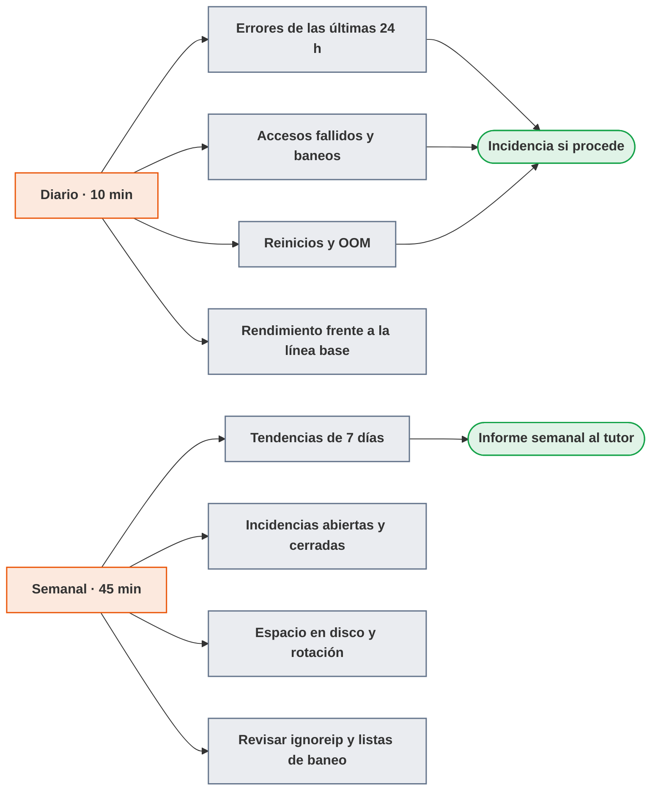
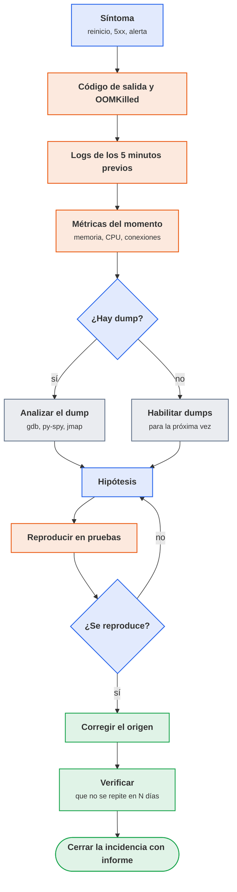
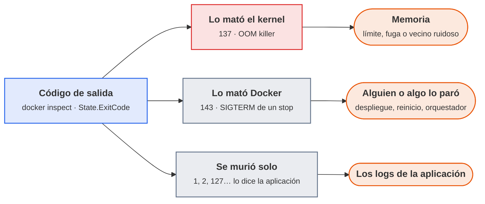

# UT5 · Explotación de logs, accesos y rendimiento

<p class="ut-meta">14 h · Formación en empresa (19 abr a 9 jun 2027) · RA3 CE a, b, c, d</p>

Hasta aquí todo el trabajo se ha hecho sobre el laboratorio: la pila de observabilidad de mon01 (UT1), las alarmas (UT2), la monitorización de seguridad (UT3) y los KPI y las pruebas de carga (UT4). Las alarmas avisan de lo que alguien previó; esta unidad trata de lo que solo se ve mirando el sistema cada día. El caso típico: un jueves por la tarde la API empieza a devolver algún 502 y, como funciona casi siempre, nadie mira nada. El lunes resulta que el contenedor lleva cuatro días reiniciándose cada veinte minutos por falta de memoria, que una IP de fuera ha probado ochenta usuarios distintos por SSH y que el disco está al 94 % porque nadie configuró la rotación de los logs. Nada era grave el jueves; el lunes son tres incidencias a la vez. Los cuatro bloques de la unidad son las cuatro miradas que lo habrían evitado, una por criterio de evaluación: los logs, los accesos, los fallos y reinicios, y el rendimiento. Esta unidad y la siguiente (UT6, copias de seguridad) se cursan en la empresa, entre el 19 de abril y el 9 de junio de 2027, sobre un sistema real que asigne el tutor de empresa. No hay sesiones numeradas ni laboratorio compartido: hay cuatro actividades (A5.1 a A5.4), una actividad de cierre y una ficha de evidencias que firma el tutor. Este documento es la guía para hacer ese trabajo con criterio sin nadie al lado, y al mismo tiempo la lista de lo que hay que traer de vuelta. La UT7 (actualización y vulnerabilidades) y la UT8 (terminación segura) se dieron en el centro antes de salir, en febrero y marzo, así que lo que se ve aquí se apoya en ellas y no al revés.

Una regla desde el principio: todo dato de la empresa que aparezca en las evidencias se anonimiza. Nombres de host, IPs públicas, nombres de usuario, dominios, rutas con nombre de cliente. No es un formalismo: un log de accesos con IP y usuario contiene datos personales (lo que se vio en la UT8, en [qué hay que conservar por obligación legal](ut8-terminacion-segura.md#que-hay-que-conservar-por-obligacion-legal)), y la evidencia sale de la empresa. Se sustituyen por equivalentes (`web01`, `203.0.113.45`, `usuario_a`, `empresa.example`) antes de pegar nada en el informe. Las redes 192.0.2.0/24, 198.51.100.0/24 y 203.0.113.0/24 están reservadas por la RFC 5737 justo para esto, para documentación, y el dominio `example` por la RFC 2606: como nunca se asignan a nadie, una evidencia anonimizada no señala por error a la máquina real de otro. Ante la duda de si algo se puede incluir, se pregunta al tutor antes de incluirlo, no después.

## Cómo trabajar en la empresa

**El método, no la herramienta.** Cada empresa tiene sus herramientas: Loki y Grafana como en mon01, Elastic, Graylog, Datadog o ficheros en `/var/log` y un `grep`. Lo que se evalúa es el método: qué se busca, cómo se justifica y qué se hace con lo que se encuentra. Por eso cada apartado da primero el método y después los comandos para el caso más habitual (Linux con Docker, journald y nginx), con su equivalente en Loki cuando existe. Si en la empresa hay otra cosa, se adapta el comando y se anota en la evidencia cuál se ha usado.

**Leer sí; cambiar, solo con permiso.** El trabajo se hace sobre sistemas en producción o cerca de ella, que mantiene el equipo de la empresa y de los que ese equipo responde. Todo lo que sea lectura (leer logs, consultar métricas, listar IPs bloqueadas) queda cubierto por la autorización general del tutor, aunque `fail2ban-client`, `nft` o el journal del kernel piden `sudo` incluso para consultar, y ese acceso se pide aparte. Todo lo que cambie algo (activar una jail, que es una regla de bloqueo de fail2ban; cambiar un límite de memoria; reiniciar un servicio) se acuerda antes con el tutor, se hace en el horario acordado y se apunta. La razón es práctica: cuando algo falla, lo primero que se pregunta es qué ha cambiado, y un cambio que nadie conoce hace perder horas buscando la causa donde no está. Por eso una evidencia de un cambio que el tutor no conocía no vale, aunque el resultado sea correcto.

**La rutina que se construye.** Las cuatro actividades no son independientes: juntas forman una rutina de revisión, diaria y semanal, que al final de la estancia se entrega escrita como procedimiento ([actividad de cierre](#actividad-de-cierre)). Este es su esqueleto:



<p class="pie" markdown>La rutina diaria son diez minutos y cuatro miradas. Lo que la hace útil es hacerla siempre, no hacerla bien un día.</p>

Cada mirada diaria es uno de los bloques de la unidad y responde a una pregunta: qué ha fallado (los logs, bloque 1), quién ha intentado entrar (los accesos, bloque 2), qué se ha reiniciado o se ha quedado sin memoria (bloque 3) y si el sistema va como siempre (el rendimiento frente a la línea base, bloque 4). Lo que encuentran, si lo merece, se abre como incidencia. Las miradas semanales cubren lo que no cambia de un día para otro y solo se ve con perspectiva: la tendencia de siete días, que va al informe semanal al tutor, el estado de las incidencias, el disco con su rotación de logs y las listas de bloqueo, que se quedan viejas si nadie las revisa.

Conviene guardar desde el primer día lo que se ejecuta: un fichero de texto con fecha, comando y una línea de resultado. Ahorra la mitad del trabajo del cierre, porque el procedimiento final tiene que llevar los comandos que se usaron de verdad, no los que se recuerdan.

**Dónde se guarda el trabajo.** El Gitea del laboratorio (`gitea.lab`) es una máquina del centro y desde la red de la empresa no se alcanza, así que el primer día se crea un repositorio local con `git init` en el equipo propio, con una carpeta `ut5/` dentro, y ahí van las evidencias según se producen; es lo mismo que se hizo con `alerting` en la UT2 cuando todavía no había servidor al que empujar. Al volver al centro se añade el remoto (`git remote add origin` y `git push -u`) y el conjunto se entrega por Aules, como el resto de prácticas evaluables. Regla que no admite excepción: nada entra en ese repositorio sin anonimizar antes, porque una vez en el historial de git borrarlo ya no es borrar un fichero.

!!! otra "La UT4 de Despliegue va en las mismas semanas"
    La [UT4 de Despliegue](https://victor-educ.github.io/apuntes-5166/ut/ut4-nube-publica/), nube pública, también se
    cursa en la empresa entre el 19 de abril y el 9 de junio. Muchas veces los sistemas serán los mismos: la plataforma
    donde allí se despliega es donde aquí se revisan logs, accesos y rendimiento. Conviene acordar con el tutor un único
    sistema para las dos asignaturas y aprovechar las evidencias que sirvan a ambas: una captura de Grafana anonimizada
    vale en las dos.

## Bloque 1 · Revisión de logs (CE 3a)

<p class="ut-meta">En la empresa · con el tutor</p>

Las alarmas de la UT2 vigilan lo que alguien previó: una cadena conocida, un umbral. Lo nuevo (el error que nadie había visto, el aviso que anuncia el fallo de la semana siguiente, el servicio que ha dejado de escribir) solo aparece si alguien lee los logs, y leerlos sin método es imposible, porque un servicio corriente escribe miles de líneas al día. Este bloque monta ese método en el orden en que se usa. Primero, por dónde llega cada log al disco, que es lo que dice con qué se lee y quién lo borra; después, qué se busca en él; luego, los comandos que convierten miles de líneas en un recuento por tipo que se lee en diez minutos, y un script que lo hace solo; a continuación, la retención, porque la revisión de mañana necesita que los logs de hoy sigan ahí sin llenar el disco; y al final, cómo se cuenta lo encontrado para que otra persona pueda actuar. Va primero porque es la base de los otros tres bloques: los accesos, los fallos y la lentitud también se leen, en parte, en los logs. La hoja A5.1 aplica todo esto durante cinco días laborables a un servicio de la empresa.

### Revisar los archivos de registro (CE 3a)

**Por qué cada día y no cuando algo falla.** Los logs se leen de forma periódica y sistemática. La diferencia entre un administrador que "mira los logs cuando pasa algo" y uno que los revisa cada mañana es que el segundo detecta el problema una semana antes, cuando todavía es una línea rara y no una caída. Además, la revisión alimenta a las alarmas: un error nuevo que aparece tres mañanas seguidas es candidato a regla en el ruler de Loki, porque las cadenas que se vigilan no se inventan, salen de lo que la aplicación escribe ([métricas sobre logs](ut2-alarmas.md#metricas-sobre-logs), en la UT2).

**Dónde están en la empresa.** En la UT1 se montó Loki para tener los logs de app01 en mon01. En la empresa el sitio lo indica el tutor: puede ser una plataforma central como aquella o los propios hosts, y en ese caso hay que saber quién escribe cada log, que es lo que explica el apartado siguiente.

#### Los tres caminos de un log

**Cada log llega al disco por un camino.** En un host Linux con contenedores, lo que escribe un programa acaba en uno de tres sitios según quién lo recoja, y cada sitio tiene su forma de leerse y su forma de borrarse:

| Quién escribe | Quién lo recoge y dónde lo deja | Cómo se lee | Quién lo borra |
|---|---|---|---|
| Un contenedor, por stdout y stderr | El driver de logs de Docker; con `json-file`, un fichero por contenedor en `/var/lib/docker/containers/` | `docker logs` o `docker compose logs` | El propio driver, si tiene `max-size` y `max-file` |
| Un servicio de systemd, y el kernel | journald, el registro central de systemd, en `/var/log/journal/` | `journalctl` | journald, según `journald.conf` |
| Un programa que escribe su propio fichero (nginx instalado en el host, una aplicación que escribe en un volumen) o rsyslog | El propio programa, en `/var/log/` o en la ruta que tenga configurada | `less`, `grep`, `zcat` | logrotate, según `/etc/logrotate.d/` |

rsyslog es el servicio clásico que reparte los mensajes del sistema en ficheros de `/var/log` (`syslog`, `auth.log`); en Debian 13 no se instala por defecto, y por eso esos ficheros pueden no existir. Una plataforma central como Loki no es un cuarto camino: es una copia que un agente saca de los otros tres y guarda en otra máquina, con su propia retención. La API del laboratorio, por ejemplo, va por el primero: escribe a stdout, Docker lo guarda en su fichero JSON y Promtail se lo pide a Docker para enviarlo a Loki ([la UT1](ut1-observabilidad.md#el-driver-de-logs-de-docker-y-por-que-limitarlo)). nginx va por el primero si corre en un contenedor y por el tercero si está instalado como paquete del host.

**Por qué importa saberlo.** El camino decide tres cosas de la revisión: el comando con que se lee, el permiso que hace falta y quién se encarga de que no llene el disco. Los ficheros de `/var/log` y el journal se leen con los grupos `adm` o `systemd-journal`; `docker logs` necesita hablar con el demonio de Docker, y eso es el grupo `docker`, que equivale a ser root (por eso muchas empresas prefieren dar `sudo` para comandos concretos). Y cada camino tiene su propio mecanismo de retención, que se revisa en [Retención: logrotate y journald](#retencion-logrotate-y-journald).

**El formato de la línea.** Cada aplicación escribe a su manera: texto libre (`ERROR db timeout`), JSON con el nivel en minúsculas como la API del curso (`"level":"error"`), o el formato combinado de nginx, con la IP, la petición y el código HTTP en posiciones fijas. El nivel (*level*) es la gravedad que la aplicación da a cada línea, normalmente debug, info, warning, error y critical o fatal; el journal usa además las ocho prioridades de syslog, el estándar clásico de registro de Unix, de 0 (emerg) a 7 (debug). Antes de escribir ningún filtro se miran unas líneas del log, porque un `grep ERROR` sobre un log que escribe `"level":"error"` no encuentra nada, y parece que el servicio está limpio.

#### Qué buscar

Lo que se busca cabe en cuatro grupos, que van del pasado al futuro: lo que ya ha fallado, lo que ha fallado y se ha recuperado solo, lo que ha cambiado y lo que va a fallar.

- **Errores.** Niveles ERROR y FATAL, y excepciones no controladas: en Java o Python se reconocen por la traza de pila (varias líneas que empiezan por `at ...` o `File "..."`), en Go por `panic:` seguido de `goroutine`. Una excepción no controlada que se repite cada pocos minutos es un bug que alguien tiene que mirar aunque el servicio siga respondiendo.
- **Salidas inesperadas.** Reinicios del servicio, `timeout`, `connection refused`, `connection reset by peer`, `out of memory`, `too many open files`, `no space left on device`, códigos HTTP 5xx en el proxy. Cada uno apunta a una capa distinta: `connection refused` es que no había nadie escuchando (el backend estaba caído o reiniciando) y `timeout`, que había alguien pero no respondió a tiempo. Los dos casos se distinguen también desde el proxy: nginx devuelve `502` en el primero y `504` en el segundo, así que el código del proxy ya dice cuál de los dos fue.
- **Cambios de volumen.** El doble de líneas de lo habitual suele ser un bucle de reintentos o un escáner; el silencio total es peor, porque significa que el servicio no está escribiendo (colgado, disco lleno, o el agente de logs muerto). Loki lo mide con `count_over_time` y Prometheus con la métrica `promtail_sent_entries_total` o su equivalente en Alloy (Promtail y Alloy son los agentes que recogen los logs del host y los envían a Loki); sin nada de eso, `wc -l` sobre el fichero de hoy comparado con el de ayer.
- **Avisos que anuncian un fallo futuro.** `deprecated`, certificados que caducan (`certificate will expire`), `disk usage above 85%`, reconexiones a la base de datos, o las consultas lentas que PostgreSQL apunta como `duration: ... ms` si tiene activado `log_min_duration_statement`.

Los dos primeros grupos se cuentan por tipo, el tercero se compara con el día anterior y el cuarto se apunta aunque hoy no haya pasado nada; así se rellena cada fila del registro de la A5.1.

#### Comandos para la revisión diaria

**Agrupar, no leer.** La revisión no consiste en leer las líneas una a una, sino en contarlas: cuántos errores de cada tipo ha habido en las últimas 24 horas y cuántas líneas en total, para compararlo con el día anterior. Trescientas líneas del mismo error son un problema, no trescientos. Por eso todos los comandos de abajo tienen la misma forma: una ventana de tiempo, un filtro y un recuento.

**La ventana de tiempo.** Con Docker es el parámetro que más se olvida. `docker logs app` sin más vuelca todo lo que el contenedor ha escrito desde que existe, y en un contenedor con semanas de vida eso son cientos de miles de líneas.

```bash
# Errores de las últimas 24 h en un contenedor
docker logs --since 24h app 2>&1 | grep -E "ERROR|FATAL|Exception|panic:" | tail -50

# Cuántos por tipo (agrupa por la parte del mensaje tras el nivel)
docker logs --since 24h app 2>&1 | grep -oE "(ERROR|FATAL) [A-Za-z._]+" | sort | uniq -c | sort -rn | head

# Servicio de systemd: solo prioridad err o superior desde ayer
journalctl -u nginx --since yesterday -p err --no-pager

# Todo el host, prioridad crit o superior, con explicación de cada mensaje
journalctl -p crit -x --since "-24h"

# Ficheros clásicos: nginx, 5xx de ayer
zcat -f /var/log/nginx/access.log* | awk -v d="$(LC_ALL=C date -d '-1 day' +%d/%b/%Y)" '$4 ~ d && $9 ~ /^5/' | wc -l
```

Tres detalles de estos comandos que no se ven a simple vista. `journalctl -p` acepta el nombre o el número de la prioridad syslog, y filtra esa y todas las más graves: `-p err` equivale a `-p 0..3`. Docker escribe stdout y stderr por separado y `docker logs` los devuelve en los dos descriptores, de ahí el `2>&1` antes del `grep`; sin él, los errores que la aplicación escribe por stderr no pasan por el filtro. Y en el recuento de nginx, `zcat -f` lee también los ficheros ya rotados: logrotate rota de madrugada, y en la revisión de la mañana las líneas de ayer ya no están en `access.log` sino en `access.log.1`. `LC_ALL=C` hace que el mes salga en inglés (`May`), como lo escribe nginx.

**Lo mismo en Loki.** Si la empresa tiene Loki, las mismas búsquedas se hacen con LogQL, como en la UT2 ([selectores de stream y filtros de línea](ut2-alarmas.md#selectores-de-stream-y-filtros-de-linea)): el selector entre llaves elige el flujo de logs y lo que va detrás lo filtra o lo cuenta. La ventaja no es la sintaxis, es que la consulta se guarda en un panel de Grafana y no depende de recordar el comando. Los ejemplos usan las etiquetas del laboratorio (`service` y `level`); en la empresa se cambian por las que ponga su agente de logs.

```text
{service="app", level="error"}

sum by (level) (count_over_time({service="app", level=~"error|critical"}[24h]))

# Volumen de líneas por hora, para ver el "doble de lo habitual" o el silencio
sum(count_over_time({service="app"}[1h]))

# 5xx en nginx en la última hora, con el log en formato combinado (con log JSON, | json)
count_over_time({service="nginx"} | pattern `<ip> - - [<_>] "<method> <uri> <_>" <status> <_>` | status >= 500 [1h])
```

**El panel de la revisión.** En Grafana 12 estas consultas van a un dashboard "Revisión diaria" con cuatro paneles (errores por nivel, volumen por hora, 5xx, accesos fallidos) y una variable `$service`, el desplegable de la cabecera del dashboard que cambia el servicio en todas las consultas a la vez. Es el panel que se abre cada mañana, y una captura suya con fecha vale como evidencia de la revisión. Conviene guardar además las consultas (con la estrella del historial de consultas de Explore, o en la biblioteca de consultas si la versión de Grafana la tiene), para que el siguiente que llegue las herede.

#### Un script diario que resuma errores

**Para qué un script.** La rutina falla el día en que nadie se acuerda de hacerla. Cuando no hay plataforma central, o como complemento a ella, un script en cron (el planificador de tareas de Linux) que resuma los errores por tipo y lo envíe por correo o a un canal de chat es lo que la mantiene viva esos días. Este es un ejemplo mínimo, pensado para llevarlo a la empresa y adaptarlo; lo importante es que agrupa, no que vuelque.

```bash
#!/usr/bin/env bash
# /usr/local/sbin/resumen-logs.sh : resumen diario de errores por contenedor
set -euo pipefail
DESDE="24h"
DEST="ops@empresa.example"
TMP=$(mktemp)
{
  echo "Resumen de errores $(hostname) $(date +%F) (últimas $DESDE)"
  echo
  for c in $(docker ps --format '{{.Names}}'); do
    n=$(docker logs --since "$DESDE" "$c" 2>&1 | grep -cE "ERROR|FATAL|panic:" || true)
    echo "== $c: $n líneas de error"
    if [ "$n" -gt 0 ]; then
      docker logs --since "$DESDE" "$c" 2>&1 \
        | grep -E "ERROR|FATAL|panic:" \
        | sed -E 's/^[0-9T:.-]+Z? //; s/[0-9a-f]{8,}/<id>/g; s/[0-9]{2,}/<n>/g' \
        | sort | uniq -c | sort -rn | head -10
    fi
    echo
  done
  echo "== Reinicios de contenedores en $DESDE"
  docker events --since "$DESDE" --until 0s --filter event=die --filter event=oom \
    --format '{{.Time}} {{.Actor.Attributes.name}} {{.Action}} exit={{.Actor.Attributes.exitCode}}' 2>/dev/null || true
  echo
  echo "== journal, prioridad err o superior"
  journalctl -p err --since "-$DESDE" --no-pager -q | tail -20
} > "$TMP"
mail -s "Resumen de errores $(hostname) $(date +%F)" "$DEST" < "$TMP"
rm -f "$TMP"
```

El `sed` del medio es el truco que hace útil el resumen: sustituye identificadores y números por marcadores para que "timeout en petición 48213" y "timeout en petición 48214" cuenten como el mismo error. Sin eso, el `uniq -c` no agrupa nada. `docker events --until 0s` es la forma de que el comando termine en lugar de quedarse escuchando. Se programa en `/etc/cron.d/resumen-logs` a las 07:30 (`30 7 * * * root /usr/local/sbin/resumen-logs.sh`), antes de que llegue nadie, o como timer de systemd (la alternativa de systemd a cron, que deja el resultado de cada ejecución en el journal) si la empresa los prefiere. La última línea da por hecho que el servidor sabe enviar correo: `mail` solo entrega si hay un agente de correo local o un relé configurado. Si no lo hay, esa línea se cambia por lo que use la empresa para avisar, o el resumen se deja en un fichero con fecha.

#### Retención: logrotate y journald

**Por qué la retención es parte de la revisión.** Un sistema en el que nadie ha pensado en la retención acaba con el disco lleno, y un disco lleno en un host de contenedores es una caída completa (Docker no puede escribir su estado, PostgreSQL deja de aceptar escrituras). Y al revés: si se guarda demasiado poco, la revisión del lunes no encuentra lo que pasó el sábado. Cada uno de los [tres caminos de un log](#los-tres-caminos-de-un-log) tiene su propio mecanismo, y los tres se revisan la primera semana en la empresa.

**Cuánto se guarda no lo decide la técnica.** El tamaño lo limita el disco, pero el tiempo depende de para qué se usan los logs: investigar un incidente semanas después, cumplir la política de la empresa o la normativa, porque un log con IP o usuario es un dato personal. Los plazos orientativos están en la UT8 ([qué hay que conservar por obligación legal](ut8-terminacion-segura.md#que-hay-que-conservar-por-obligacion-legal)); en la empresa se pregunta cuál es su política antes de proponer ningún valor.

**Los logs de Docker.** Con el driver `json-file` (el que hay por defecto), los logs de los contenedores no rotan si nadie lo configura. Es lo mismo que se hizo en la UT1 en app01 y mon01 ([el driver de logs y por qué limitarlo](ut1-observabilidad.md#el-driver-de-logs-de-docker-y-por-que-limitarlo)): lo normal es fijarlo en `/etc/docker/daemon.json` para todos los contenedores:

```json
{
  "log-driver": "json-file",
  "log-opts": { "max-size": "50m", "max-file": "5" }
}
```

Eso limita cada contenedor a 250 MB de logs. Solo afecta a contenedores creados después del cambio; los que ya existen hay que recrearlos (`docker compose up -d --force-recreate`). Por eso mirar `daemon.json` no basta para saber si un contenedor rota: lo que cuenta es la configuración con la que se creó cada uno, y se ve con `docker inspect --format '{{json .HostConfig.LogConfig}}' <contenedor>`. Para ver cuánto ocupa ahora mismo: `du -sh /var/lib/docker/containers/*/*-json.log | sort -rh | head`. Alternativa: driver `journald`, que mete los logs del contenedor en el journal del host y hereda su retención; entonces se leen con `journalctl CONTAINER_NAME=app`.

**El journal.** journald tiene su propia retención en `/etc/systemd/journald.conf`: `SystemMaxUse=2G` limita el total en disco, `MaxRetentionSec=1month` la antigüedad, y `Storage=persistent` asegura que sobreviva al reinicio (con `auto`, si no existe `/var/log/journal` se queda en RAM y se pierde al reiniciar; en Debian 13 el directorio existe por defecto). Para ver y recortar:

```bash
journalctl --disk-usage
journalctl --vacuum-size=1G          # deja como mucho 1 GB
journalctl --vacuum-time=30d         # elimina lo anterior a 30 días
journalctl --verify                  # comprueba la integridad de los ficheros
```

`vacuum` solo borra ficheros de archivo, nunca el activo; si el uso no baja, primero `journalctl --rotate` y después el vacuum.

**Los ficheros clásicos.** logrotate se encarga de los ficheros clásicos (`/var/log/nginx/*.log`, `/var/log/auth.log`, los de la aplicación si escribe a fichero). No es un servicio que esté siempre en marcha: lo lanza una vez al día un timer de systemd (cron, en sistemas antiguos), y por eso la rotación ocurre de madrugada. Cada servicio deja su configuración en `/etc/logrotate.d/`, y un ejemplo típico para una aplicación en `/srv/app/logs`:

```text
/srv/app/logs/*.log {
    daily
    rotate 14
    compress
    delaycompress
    missingok
    notifempty
    copytruncate
}
```

Cada línea es una decisión:

- `daily` y `rotate 14`: un fichero por día y catorce días guardados. Dos semanas bastan para comparar una semana con la anterior; si la política de la empresa pide más, se cambia aquí.
- `compress` y `delaycompress`: los ficheros viejos se comprimen, menos el más reciente, que se queda en claro hasta la rotación siguiente. Así el de ayer se lee sin `zcat`, y no se pierden las líneas que el programa todavía escriba en él unos segundos después de rotarlo.
- `missingok` y `notifempty`: no da error si no hay ficheros, y no rota uno vacío.
- `copytruncate`: copia el fichero y vacía el original en lugar de renombrarlo. Es lo que hace falta cuando el proceso mantiene el fichero abierto y no sabe reabrirlo al recibir una señal `SIGHUP`, que es lo que les pasa a la mayoría de aplicaciones dentro de contenedores que escriben a un volumen. El precio es que las líneas escritas entre la copia y el vaciado se pierden.

Con `logrotate -d /etc/logrotate.d/app` se simula sin tocar nada, y `logrotate -f` fuerza una rotación para comprobar que funciona. Documentación: la página de manual de logrotate en [man7.org](https://man7.org/linux/man-pages/man8/logrotate.8.html) y la de [journald.conf](https://man7.org/linux/man-pages/man5/journald.conf.5.html).

#### Cómo se redacta una incidencia útil

**Encontrar no basta.** Todo fallo encontrado se reporta. Reportar no es mandar un mensaje diciendo "he visto errores en app"; es abrir una incidencia (el registro de un problema en la herramienta de seguimiento de la empresa, con su responsable, su estado y su historia) con lo que alguien necesita para decidir si es urgente y por dónde empezar. En la UT2 las abría automáticamente el receptor de alertas en la Gitea del laboratorio ([categorizar, notificar y tratar](ut2-alarmas.md#categorizar-notificar-y-tratar)); aquí se abren a mano, y por eso hay que saber qué poner. Los ingredientes son siempre los mismos y conviene tener la plantilla a mano en la herramienta que use la empresa (Jira, GitLab issues, un Gitea como el del laboratorio, o un correo estructurado).

```text
Título: [servicio] resumen de una línea del síntoma
Fecha y hora de detección: 2027-05-04 08:10 (revisión diaria)
Servicio / host: api (contenedor app en app01)
Mensaje exacto (una línea, tal cual aparece):
  ERROR sqlalchemy.pool: QueuePool limit of size 5 overflow 10 reached, connection timed out
Frecuencia: 143 apariciones entre 02:00 y 02:40; ninguna fuera de esa ventana
Impacto observado: 37 respuestas 502 en nginx en el mismo intervalo; sin quejas de usuarios
Contexto: coincide con la copia de seguridad de la BD (02:00) según el cron de db01
Fragmento de log (10 líneas alrededor, anonimizado): adjunto
Hipótesis (opcional, marcada como tal): el pool se agota porque las consultas
  se ralentizan durante el pg_dump
Gravedad propuesta: media (recurrente, sin pérdida de servicio visible)
```

**Qué pesa más de cada campo.** El mensaje exacto es lo más valioso: es lo que se busca en Google, en la documentación y en el histórico de incidencias. Se copia literal, sin parafrasear. La frecuencia y la ventana temporal son lo segundo, porque convierten "hay errores" en "hay errores a las dos de la mañana", que ya es media investigación hecha. El impacto dice si corre prisa: no es lo mismo un error que solo queda en el log que uno que llega al usuario como un 502. La hipótesis va aparte y marcada, para que nadie la confunda con un hecho. Y la gravedad se propone, no se decide: la fija quien atiende la incidencia, con la escala que use la empresa.

### A5.1 Revisión de logs (CE 3a)

<span class="et et-obj">Objetivo</span> Al terminar tienes un registro de cinco días laborables de revisión diaria de los logs de un servicio y una incidencia abierta con la plantilla de la unidad. Es la primera de las cuatro miradas de la rutina, y la que más días necesita: cinco revisiones a la misma hora son lo que demuestra que la revisión es periódica y no una mirada suelta, y la incidencia, que lo encontrado llega a quien lo tiene que arreglar.

<span class="et et-pre">Antes de empezar</span>

- Autorización del tutor: qué servicio se revisa, dónde están sus logs y con qué usuario se leen. Es solo lectura, pero ese usuario tiene que poder leerlos de verdad: grupo `adm` o `systemd-journal`, grupo `docker` o `sudo`, según [el camino del log](#los-tres-caminos-de-un-log).
- Un fichero `a5.1-logs.md` en tu carpeta de trabajo para el registro del paso 2.
- Leídos [Los tres caminos de un log](#los-tres-caminos-de-un-log), [Qué buscar](#que-buscar), [Comandos para la revisión diaria](#comandos-para-la-revision-diaria), [Retención: logrotate y journald](#retencion-logrotate-y-journald) y [Cómo se redacta una incidencia útil](#como-se-redacta-una-incidencia-util).

<span class="et et-pas">Pasos</span>

Vas a pasar de no conocer el log del servicio a revisarlo cada mañana en diez minutos. Primero preparas las consultas un solo día, mirando cómo escribe el servicio; después las repites cinco días laborables a la misma hora, que es lo que convierte una mirada en una rutina y te da con qué comparar cada día; de lo que encuentres sale la incidencia. La retención va al final porque es una comprobación de una sola vez, pero puedes hacerla cualquier día de la semana.

1. **Conoce el log y prepara tus consultas.** El primer día, averigua por cuál de los [tres caminos](#los-tres-caminos-de-un-log) escribe el servicio y mira unas líneas para conocer su formato: si es texto libre, JSON o el formato de nginx, y cómo marca el nivel. Con eso, adapta al servicio los comandos (o las consultas de LogQL) de [Comandos para la revisión diaria](#comandos-para-la-revision-diaria): errores de 24 h agrupados por tipo y volumen de líneas. Son las dos consultas que vas a repetir cada día, así que guárdalas tal cual en tu fichero de trabajo.

    *Pista:* con un log JSON que escribe `"level":"error"`, un `grep ERROR` no encuentra nada. En un fichero, las líneas de ayer ya están en el que logrotate rotó de madrugada: `zcat -f` lee los dos.

2. **Revisa cinco días laborables, siempre a la misma hora.** Cada día, lanza las dos consultas y añade una fila al registro con fecha, servicio, intervalo revisado, comando o consulta exactos, errores agrupados por tipo con su recuento e incidencia, si la hay. La misma hora hace que cada fila cubra las mismas 24 h y que las filas se puedan comparar entre sí. Compara además el volumen con el del día anterior: que se doble o que se quede en silencio también es un hallazgo, como se explica en [Qué buscar](#que-buscar).

3. **Convierte un hallazgo en incidencia.** Elige uno de los hallazgos del registro y ábrelo con la plantilla de [Cómo se redacta una incidencia útil](#como-se-redacta-una-incidencia-util), en la herramienta de la empresa si el tutor lo autoriza o, si no, en un fichero con ese formato. La prueba de que está bien escrita es que otra persona podría atenderla sin preguntarte nada: el mensaje exacto, cuántas veces y en qué ventana, y qué impacto ha tenido.

    *Pista:* el mensaje va literal, sin parafrasear. En la herramienta de la empresa la incidencia lleva los datos reales; la copia que va a `a5.1-logs.md`, anonimizada.

4. **Comprueba que los logs se conservan lo justo.** Mira si los logs de Docker, el journal y los ficheros clásicos tienen retención, como se explica en [Retención: logrotate y journald](#retencion-logrotate-y-journald): un log que no rota acaba llenando el disco, y uno que se borra demasiado pronto deja la revisión sin datos. Si falta, anótalo como hallazgo y propónselo al tutor con el valor que sugieres y por qué; no cambies nada sin su visto bueno.

    *Pista:* en Docker no basta con leer `daemon.json`, que solo vale para los contenedores creados después: mira lo que tiene cada contenedor.

<span class="et et-com">Comprobación</span> La tabla tiene cinco filas con fecha, cada fila cita el comando exacto que se ejecutó, y la incidencia contiene un mensaje de log copiado literal con su recuento y su ventana temporal. Ningún host, IP pública ni usuario real aparece en el fichero.

<span class="et et-ent">Entrega</span> `a5.1-logs.md` en la carpeta `ut5/` del repositorio de la unidad, con el registro de los cinco días y la incidencia anonimizada. Pide al tutor que firme la fila A5.1 de la ficha.

<span class="et et-ext">Si te sobra tiempo</span> Adapta el script `resumen-logs.sh` de [Un script diario que resuma errores](#un-script-diario-que-resuma-errores) a los contenedores de la empresa y propón al tutor programarlo en cron; adjunta la salida de una ejecución manual como evidencia extra.

## Bloque 2 · Accesos y fuerza bruta (CE 3b)

<p class="ut-meta">En la empresa · con el tutor</p>

Cualquier sistema que se alcance desde Internet recibe intentos de entrar desde el primer minuto, y casi todos son ruido: programas que prueban contraseñas por defecto contra todo lo que responde. Lo difícil es distinguir de ese ruido un ataque dirigido, y asegurarse de que lo que tendría que pararlo lo para de verdad. El bloque lo construye en ese orden: dónde queda registrado cada acceso, qué patrón distingue una fuerza bruta de un password spraying, cómo se convierte ese patrón en una alerta y cómo se bloquea de forma automática, con fail2ban como herramienta principal y CrowdSec como alternativa. Viene después de la revisión de logs porque es la misma habilidad aplicada a un tipo de línea concreto, las de autenticación, y añade una acción: bloquear. La hoja A5.2 clasifica 24 h de accesos de un sistema de la empresa, revisa su mecanismo de bloqueo y termina comprobando sobre el firewall que un bloqueo real funciona; la regla de Loki queda para el tiempo que sobre.

### Monitorizar los accesos (CE 3b)

**El ruido de fondo.** Un servidor con SSH en el puerto 22 abierto a Internet ve entre cientos y varios miles de intentos fallidos al día sin que nadie lo esté atacando en particular. Son *botnets*, redes de máquinas infectadas que alguien controla a distancia y que prueban credenciales por defecto contra todo lo que responde. Ese ruido no se puede evitar; lo que se puede es dejarlo sin efecto: con claves en lugar de contraseñas no hay nada que adivinar, y un bloqueo automático reduce su volumen.

**Lo que se busca debajo.** Monitorizar los accesos es distinguir ese ruido de fondo de un ataque dirigido (alguien que prueba usuarios que existen de verdad en la empresa, o que vuelve con paciencia cada pocos minutos), y comprobar que el mecanismo de bloqueo hace su trabajo. Lo segundo importa tanto como lo primero: un bloqueo instalado que no bloquea da una seguridad falsa, que es peor que saber que no hay ninguno.

#### Dónde se registran

**Cada capa autentica por su cuenta.** Un sistema no tiene una sola puerta: SSH para quien lo administra, el proxy y la aplicación para los usuarios, el panel del hipervisor, la VPN. Cada una deja sus intentos en su propio log, y quien ataca prueba la que responda. La revisión empieza por la que está expuesta a Internet:

| Origen | Dónde mirar | Qué contiene |
|---|---|---|
| SSH | `/var/log/auth.log` (Debian con rsyslog) o `journalctl -u ssh` | Intentos fallidos, logins correctos, usuario inválido, clave aceptada |
| sudo, su y PAM (los módulos de autenticación de Linux) | mismo fichero o journal, `_COMM=sudo` | Quién escaló privilegios y qué ejecutó |
| Proxy inverso (nginx) | `/var/log/nginx/access.log` y `error.log` | Intentos a rutas de administración, 401/403, escáneres |
| Aplicación | su log (stdout del contenedor) | Login fallido, usuario bloqueado, cambio de contraseña, tokens rechazados |
| Panel del hipervisor | Proxmox: `/var/log/pve/tasks/`, `journalctl -u pvedaemon`, `-u pveproxy` | Accesos al panel web, acciones sobre VM |
| VPN (red privada virtual) | WireGuard no registra handshakes por defecto; OpenVPN en su log; OPNsense en Sistema > Registro | Conexiones, orígenes, fallos de autenticación |
| Firewall | OPNsense, `nft monitor`, `journalctl -k` con reglas `log` | Conexiones rechazadas, escaneos de puertos |

**SSH en Debian 13: por unidad, no por proceso.** Sin rsyslog instalado ([los tres caminos de un log](#los-tres-caminos-de-un-log)), `auth.log` no existe y todo está en el journal; `journalctl -u ssh --since today` es el equivalente. El filtro va por unidad de systemd y no por nombre de proceso a propósito: desde OpenSSH 9.8 (Debian 13 trae una versión posterior), el demonio que escucha (`sshd`) delega cada conexión en un proceso hijo, `sshd-session`, y es ese hijo el que escribe `Failed password`, `Invalid user` y `Accepted publickey`. Por eso `journalctl _COMM=sshd` devuelve poco más que los arranques del servicio y parece que nadie ha intentado entrar, mientras que `-u ssh` recoge los tres procesos (`sshd`, `sshd-session` y `sshd-auth`) porque todos cuelgan de la misma unidad, y funciona igual en Debian 12 y en Debian 13. Si la empresa centraliza en Loki con Alloy o Promtail, el job suele llamarse `auth` o `syslog` y ahí van todas las búsquedas de abajo con `|=`.

#### Qué se busca: patrones de fuerza bruta y password spraying

**Dos ataques, dos firmas.** Los dos intentan adivinar una contraseña, pero reparten los intentos al revés, y por eso se cuentan de forma distinta.

**Fuerza bruta clásica:** una misma IP prueba muchas contraseñas contra uno o pocos usuarios, deprisa. En `auth.log` se ve así (anonimizado):

```text
May  4 03:12:41 web01 sshd[18422]: Failed password for root from 203.0.113.45 port 51204 ssh2
May  4 03:12:44 web01 sshd[18422]: Failed password for root from 203.0.113.45 port 51204 ssh2
May  4 03:12:47 web01 sshd[18422]: Failed password for root from 203.0.113.45 port 51204 ssh2
May  4 03:12:49 web01 sshd[18422]: Failed password for root from 203.0.113.45 port 51204 ssh2
May  4 03:12:50 web01 sshd[18422]: Failed password for root from 203.0.113.45 port 51204 ssh2
May  4 03:12:50 web01 sshd[18422]: Disconnecting authenticating user root 203.0.113.45 port 51204: Too many authentication failures [preauth]
May  4 03:12:53 web01 sshd[18431]: Invalid user admin from 203.0.113.45 port 51290
May  4 03:12:55 web01 sshd[18431]: Failed password for invalid user admin from 203.0.113.45 port 51290 ssh2
```

Con OpenSSH 9.8 o posterior, el proceso que firma estas líneas es `sshd-session` en lugar de `sshd`; el resto es igual.

**Password spraying:** una IP (o varias coordinadas) prueba una o dos contraseñas muy comunes contra muchos usuarios distintos, despacio. Está pensado justo para esquivar los dos bloqueos habituales: el que bloquea una cuenta tras varios fallos (le llegan pocos intentos por cuenta) y el que bloquea una IP que falla mucho en poco tiempo (los intentos van repartidos). Se reconoce por la variedad de usuarios, no por el volumen:

```text
May  4 04:01:10 web01 sshd[19002]: Invalid user oracle from 198.51.100.7 port 40122
May  4 04:03:52 web01 sshd[19017]: Invalid user postgres from 198.51.100.7 port 40310
May  4 04:06:31 web01 sshd[19033]: Invalid user jenkins from 198.51.100.7 port 40488
May  4 04:09:14 web01 sshd[19051]: Invalid user deploy from 198.51.100.7 port 40615
May  4 04:11:58 web01 sshd[19068]: Invalid user ubuntu from 198.51.100.7 port 40790
```

Un intento cada tres minutos no dispara un `findtime = 10m` con `maxretry = 5` (los dos parámetros con los que fail2ban decide cuándo bloquear, que se explican más abajo: cuántos fallos y en qué ventana de tiempo). Por eso la detección de spraying se hace contando usuarios distintos por IP en ventanas largas, no intentos.

**Cómo se cuenta cada uno.** Los comandos siguen la idea de agrupar del bloque 1, cada uno con su firma: la fuerza bruta se cuenta como intentos fallidos por IP, y el spraying, como usuarios distintos por IP. Los logins correctos se revisan aparte, porque un ataque que ha funcionado ya no aparece como fallo:

```bash
# Fuerza bruta: intentos fallidos por IP, hoy
journalctl -u ssh --since today --no-pager \
  | grep -oE "Failed password for (invalid user )?\S+ from \S+" \
  | awk '{print $NF}' | sort | uniq -c | sort -rn | head

# Spraying: usuarios distintos por IP en las últimas 24 h
journalctl -u ssh --since -24h --no-pager \
  | grep -oE "Invalid user \S+ from \S+" \
  | awk '{print $5, $3}' | sort -u | awk '{print $1}' | uniq -c | sort -rn | head

# Logins correctos, para ver quién ha entrado y desde dónde (y cuándo)
journalctl -u ssh --since -7d --no-pager | grep "Accepted"

# nginx: IPs que más 401/403/404 generan (escáneres y rutas de administración)
# El fichero actual y el de ayer, que logrotate ya ha rotado: así se cubren 24 h
zcat -f /var/log/nginx/access.log /var/log/nginx/access.log.1 \
  | awk '$9 ~ /^(401|403|404)$/ {print $1}' | sort | uniq -c | sort -rn | head
zcat -f /var/log/nginx/access.log /var/log/nginx/access.log.1 \
  | awk '$7 ~ /(wp-login|wp-admin|\.env|phpmyadmin|\/admin|\.git)/ {print $1, $7}' | sort | uniq -c | sort -rn | head
```

**Lo que no es fuerza bruta pero se mira en el mismo pase.** Accesos correctos fuera del horario habitual (un `Accepted publickey` a las 03:40 de una cuenta que siempre entra de 8 a 18) y orígenes geográficos raros. Para lo segundo, `geoiplookup` (paquete `geoip-bin`) o la base de datos GeoLite2 de MaxMind (gratuita con registro) dan el país de una IP; en Loki, Alloy tiene una etapa `geoip` que añade `geoip_country_code` como etiqueta, y con eso el panel de Grafana puede mostrar un mapa de orígenes. Un país nuevo en la lista de logins correctos es motivo de llamada, no de incidencia: se pregunta a la persona de esa cuenta si era ella (un viaje, una VPN) antes de tratarlo como un problema de seguridad.

#### Detección en Loki y alerta

**De la consulta a la alerta.** Contar a mano sirve para la revisión de la mañana; para enterarse a las tres de la madrugada hace falta una alerta. En Loki 3.x las reglas de alerta van en el ruler, el componente que evalúa consultas cada cierto tiempo igual que hace Prometheus con sus reglas, y que ya se usó en la UT2 ([alertas en el ruler de Loki](ut2-alarmas.md#alertas-en-el-ruler-de-loki); en el laboratorio, las reglas iban en `/loki/rules/fake/`). Tienen la misma sintaxis que las de Prometheus y disparan a Alertmanager como las de la UT2. Estas dos son las dos firmas del apartado anterior:

```yaml
groups:
  - name: accesos
    rules:
      - alert: FuerzaBrutaSSH
        expr: |
          sum by (host) (count_over_time({job="auth"} |= "Failed password" [5m])) > 20
        for: 0m
        labels: { severity: warning }
        annotations:
          summary: "Más de 20 fallos SSH en 5 min en {{ $labels.host }}"
      - alert: PasswordSprayingSSH
        expr: |
          count by (host, ip) (
            sum by (host, ip, user) (
              count_over_time({job="auth"}
                | regexp `Invalid user (?P<user>\S+) from (?P<ip>\S+)` [1h])
          )) > 8
        for: 0m
        labels: { severity: warning }
        annotations:
          summary: "IP {{ $labels.ip }} ha probado más de 8 usuarios distintos en 1 h"
```

La primera es la de fuerza bruta: muchos fallos de contraseña en poco tiempo, más de 20 en 5 minutos en un mismo host. La segunda es la de spraying: extrae usuario e IP con `regexp`, agrupa por los tres, y cuenta cuántos usuarios distintos tiene cada IP. Un umbral de 8 usuarios distintos en una hora no lo alcanza nadie legítimo. Ojo con `count_over_time` sin agregación en logs con muchas etiquetas: devuelve una serie por stream y la alerta se dispara por cada una. La agregación `sum by` es la que la deja en una por host.

#### fail2ban a fondo

{ .logo-inline }

**El problema que resuelve.** Ver la fuerza bruta en el log no la para, y nadie puede vigilar el log de SSH las 24 horas para bloquear IPs a mano. fail2ban automatiza esa reacción: es un servicio escrito en Python, que está en los repositorios de las distribuciones habituales, y que lee los logs, cuenta los fallos de cada IP y, cuando pasan de un límite, la bloquea en el firewall durante un tiempo.

**Cómo decide.** Lee ficheros de log (o el journal) y les aplica expresiones regulares, los *filtros*. Cuando una IP supera `maxretry` fallos dentro de `findtime`, ejecuta una acción de bloqueo durante `bantime`, y al acabar ese tiempo la desbloquea sola. Cada combinación de filtro, acción y parámetros es una *jail*. La configuración de fábrica está en `/etc/fail2ban/jail.conf` y no se toca, porque una actualización del paquete puede sobrescribirla; la propia va en `/etc/fail2ban/jail.local` o en ficheros bajo `/etc/fail2ban/jail.d/`, que se cargan encima.

**Una configuración completa.** El `jail.local` de abajo es uno completo para un host con SSH y nginx. Las tres decisiones que más problemas evitan o causan son `ignoreip`, `backend` y `bantime.increment`, y son las que hay que entender antes de copiarlo:

```ini
# /etc/fail2ban/jail.local
[DEFAULT]
# Redes que nunca se bloquean: loopback, oficina, monitorización, bastión
ignoreip = 127.0.0.1/8 ::1 10.10.0.0/24 203.0.113.0/28
bantime  = 1h
findtime = 10m
maxretry = 5
# Bantime incremental: cada reincidencia alarga el baneo, hasta 4 semanas
bantime.increment = true
bantime.factor    = 2
bantime.maxtime   = 4w
banaction = nftables-multiport
banaction_allports = nftables-allports

[sshd]
enabled = true
mode    = aggressive
# Debian 13: sin rsyslog no hay auth.log, y el backend systemd lee el journal
backend = systemd
# el journalmatch de fábrica solo casa _COMM=sshd y no ve a sshd-session
journalmatch = _SYSTEMD_UNIT=ssh.service

[nginx-http-auth]
enabled  = true
logpath  = /var/log/nginx/error.log

[nginx-botsearch]
enabled  = true
logpath  = /var/log/nginx/access.log
maxretry = 2

[recidive]
enabled  = true
bantime  = 1w
findtime = 1d
maxretry = 3
```

Las decisiones de ese fichero, una por una:

- `ignoreip` es obligatorio pensarlo antes de activar nada: un bloqueo sobre la propia IP de administración o sobre la sonda de monitorización es un problema autoinfligido que en una empresa se nota. Ahí van la red de gestión, la IP pública de la oficina y la del bastión, la máquina intermedia desde la que se administra (en el laboratorio, el puesto de administración).
- `backend = systemd` va solo en la jail `sshd`, no en `[DEFAULT]`. En un sistema sin rsyslog los fallos de SSH solo están en el journal, y este backend es el que lo lee; pero con él fail2ban ignora `logpath` y busca solo en el journal, así que puesto en `[DEFAULT]` dejaría ciegas a las jails que leen ficheros, como las de nginx y `recidive`.
- `journalmatch` evita el fallo más silencioso de todos en Debian 13: el filtro de fábrica busca los mensajes del proceso `sshd`, y en esa versión los escribe `sshd-session`, así que la jail arranca, se queda a cero fallos y no banea nunca. Filtrando por unidad, `_SYSTEMD_UNIT=ssh.service`, entran los mensajes de los tres procesos, y la configuración vale también en Debian 12.
- `bantime.increment` es la forma moderna de castigar a los reincidentes: una IP que vuelve después de su primer baneo recibe uno más largo, y cada nueva reincidencia lo alarga otra vez, hasta `bantime.maxtime`; `bantime.factor` decide lo deprisa que crece. fail2ban guarda el historial en su base de datos SQLite (`/var/lib/fail2ban/fail2ban.sqlite3`), así que sobrevive a reinicios.
- La jail `recidive` es el mecanismo antiguo para lo mismo: lee el propio log de fail2ban y banea en todos los puertos (`banaction_allports`) a quien ha sido baneado tres veces en un día. Se pueden usar las dos.
- `banaction = nftables-multiport` dice cómo se aplica el bloqueo: con reglas de nftables en los puertos de cada jail. Dónde acaban esas reglas se explica más abajo.
- `mode = aggressive` amplía el filtro `sshd`: a las contraseñas fallidas y los usuarios que no existen, que ya cuenta el modo normal, les suma las conexiones que se cortan antes de intentar autenticarse, típicas de los escáneres.

**Un filtro propio para la aplicación.** Los filtros de fábrica cubren SSH, nginx y otros servicios conocidos, pero no los logins de una aplicación propia. Si la aplicación escribe `WARN auth: login failed for user=usuario_a ip=203.0.113.45` cuando alguien falla la contraseña, el filtro es una regex con el marcador `<HOST>` (o `<ADDR>` en versiones recientes) en el sitio de la IP, que es lo que fail2ban usa para saber a quién apuntarle el fallo:

```ini
# /etc/fail2ban/filter.d/app-login.conf
[Definition]
failregex = ^.*auth: login failed for user=\S+ ip=<HOST>\s*$
ignoreregex =
```

```ini
# /etc/fail2ban/jail.d/app-login.conf
[app-login]
enabled  = true
filter   = app-login
logpath  = /srv/app/logs/app.log
port     = http,https
maxretry = 8
findtime = 15m
bantime  = 2h
```

**El detalle de los contenedores.** fail2ban corre en el host y necesita leer el log de la aplicación. Si la aplicación escribe a stdout, el fichero está en `/var/lib/docker/containers/<id>/<id>-json.log` (cada línea envuelta en JSON, la regex tiene que contemplarlo) y cambia de nombre al recrear el contenedor; es más limpio que la aplicación escriba a un volumen montado, o usar `backend = systemd` con el driver de logs `journald` y `journalmatch = CONTAINER_NAME=app` en la jail. Y la IP que ve la aplicación detrás de nginx es la del proxy, no la del cliente, salvo que nginx pase `X-Forwarded-For` o `X-Real-IP` (cabeceras HTTP en las que el proxy pone la IP original del cliente) y la aplicación lo registre. Sin eso, el filtro banearía a nginx.

**Probar antes de activar.** Un filtro que no casa con nada no da ningún error: la jail arranca y se queda a cero. Por eso se prueba antes con `fail2ban-regex`, que lo pasa por un log real y dice cuántas líneas casan y cuáles no:

```bash
fail2ban-regex /srv/app/logs/app.log /etc/fail2ban/filter.d/app-login.conf --print-all-missed | tail -20
fail2ban-regex "$(journalctl -u ssh --since -1h -o short-iso | tail -200)" sshd
```

**Operar.** El día a día se hace con `fail2ban-client`, que habla con el servicio en marcha:

```bash
fail2ban-client status                       # jails activas
fail2ban-client status sshd                  # fallos, baneos actuales e IPs
fail2ban-client set sshd unbanip 203.0.113.45
fail2ban-client set sshd banip 198.51.100.7  # baneo manual
fail2ban-client get sshd bantime
fail2ban-client reload                       # recarga sin perder baneos
fail2ban-client banned                       # todas las IPs baneadas por jail
```

**Dónde se aplica el bloqueo.** fail2ban no bloquea nada por sí mismo: decide, y el bloqueo lo aplica la acción en el firewall. Con `banaction = nftables-multiport`, crea una tabla `inet f2b-table` (el nombre exacto depende de la versión) con un set por jail y una regla que descarta el tráfico de las IPs del set en los puertos de la jail. Se comprueba directamente con nftables (el firewall del kernel, el mismo de UT3), que es donde de verdad se ve si el bloqueo existe:

```bash
nft list table inet f2b-table
nft list set inet f2b-table addr-set-sshd
```

Si en el host ya hay un firewall nftables propio (como el de [la sesión 17 de la UT3](ut3-seguridad-monitorizacion.md#nftables-por-host-el-fichero-completo), con su tabla `inet fw`), fail2ban añade su tabla aparte y las dos conviven; el orden de evaluación entre tablas depende de la prioridad de las cadenas, y la de fail2ban usa `priority -1` para ir antes que `filter` (0).

**El hueco de Docker.** La cadena de fail2ban engancha en `input`, que es por donde pasa lo que va al propio host: SSH o un nginx instalado como paquete. El tráfico a los puertos que publica un contenedor no pasa por ahí, sino por `forward`, por la misma razón que se vio en la UT3 ([por qué Docker se salta el firewall del host](ut3-seguridad-monitorizacion.md#por-que-docker-se-salta-el-firewall-del-host)): Docker le cambia el destino y el kernel lo reenvía al contenedor. Un baneo de fail2ban, por tanto, no corta el acceso a un servicio publicado por Docker. Para ese caso fail2ban tiene la acción `iptables-multiport` con `chain = DOCKER-USER`, o se banea en `forward` con una acción nftables personalizada. Por eso, en un host con Docker, conviene bloquear en el proxy o en el cortafuegos del entorno, o usar la acción sobre `DOCKER-USER`.

**Comprobar un bloqueo de verdad.** Es lo que pide la actividad A5.2, porque cada eslabón puede fallar por separado: que el filtro cuente, que la acción cree la regla y que la regla corte. Desde una máquina que no esté en `ignoreip` (una VM de pruebas, el móvil con datos), se falla la contraseña SSH seis veces, se ve la IP en `fail2ban-client status sshd`, se ve la regla en nftables, se comprueba que la conexión ahora da `Connection refused` o se queda en timeout, y se desbanea. Capturas de esos cuatro momentos son la evidencia. Documentación oficial: [https://github.com/fail2ban/fail2ban/wiki](https://github.com/fail2ban/fail2ban/wiki) y las páginas de manual `jail.conf(5)`.

#### CrowdSec como alternativa

**Qué cambia respecto a fail2ban.** CrowdSec hace lo mismo que fail2ban con dos diferencias de diseño. La primera es que separa la detección (el agente, que lee logs con "parsers" y "scenarios" en YAML descargados desde su hub) del bloqueo (los "bouncers": un componente para nftables, otro para nginx, otro para OPNsense, otro para Traefik, que consultan la API local del agente y aplican las decisiones). Así el agente puede estar en un host y el bouncer en el firewall. La segunda es que es colaborativo: cada instalación que reporta ataques a la red de CrowdSec recibe a cambio una lista de IPs maliciosas vistas por la comunidad, de modo que un atacante queda bloqueado antes de llegar al sistema propio. Esa lista es opcional y en algunas empresas no gusta enviar datos fuera; se puede desactivar (`crowdsec` en modo sin API central) y sigue funcionando como fail2ban.

**Operar.** Todo se maneja con `cscli`, y las órdenes tienen el mismo papel que las de `fail2ban-client`: qué lee, qué ha decidido bloquear y qué bouncers lo aplican.

```bash
cscli metrics                  # qué logs lee y qué escenarios disparan
cscli decisions list           # IPs bloqueadas, motivo, duración
cscli decisions add --ip 203.0.113.45 --duration 4h --reason "prueba manual"
cscli decisions delete --ip 203.0.113.45
cscli alerts list              # histórico de detecciones
cscli hub list                 # colecciones instaladas (nginx, sshd, linux)
cscli bouncers list            # bouncers registrados y cuándo consultaron
```

**Cuál elegir.** La elección va por tamaño. Con uno o dos hosts, fail2ban basta: es más sencillo de operar y permite escribir filtros propios con expresiones regulares a medida. Con varios hosts, o cuando interesa bloquear en un solo punto, CrowdSec, porque separa el agente del bouncer y OPNsense tiene plugin oficial; la lista comunitaria es un argumento añadido a su favor donde se acepte enviar datos fuera. En la empresa, lo que haya. Documentación: [https://docs.crowdsec.net/](https://docs.crowdsec.net/).

### A5.2 Accesos y fuerza bruta (CE 3b)

<span class="et et-obj">Objetivo</span> Clasificar con argumentos los intentos de acceso de al menos 24 h de log de un sistema, revisar o configurar el mecanismo de bloqueo y demostrar un bloqueo real de extremo a extremo. Es la diferencia entre creer que el sistema está protegido y saberlo: una jail que lleva meses a cero fallos parece igual de tranquila si no hay ataques que si no está leyendo nada.

<span class="et et-pre">Antes de empezar</span>

- Autorización del tutor en dos niveles: lectura de los logs de acceso (general) y, aparte, permiso explícito para la prueba de bloqueo del paso 4, con la IP de pruebas, el día y la hora acordados. Si no autoriza la prueba, anótalo: la actividad termina en el paso 3.
- `sudo` para el cliente del mecanismo de bloqueo (`fail2ban-client`, `cscli`) y para `nft`, que necesitan los pasos 3 y 4. Si la empresa no lo concede, acuerda con el tutor que ejecute él esos comandos mientras se los dictas, y anota en la entrega quién los ejecutó.
- Saber qué mecanismo usa la empresa (fail2ban, CrowdSec, bloqueo en OPNsense u otro) y dónde está su configuración.
- Leídos [Dónde se registran](#donde-se-registran), [Qué se busca: patrones de fuerza bruta y password spraying](#que-se-busca-patrones-de-fuerza-bruta-y-password-spraying) y [fail2ban a fondo](#fail2ban-a-fondo) o [CrowdSec como alternativa](#crowdsec-como-alternativa), según el caso.

<span class="et et-pas">Pasos</span>

Vas de la lectura a la acción, y de lo que no toca nada a lo que sí: primero sacas los números del log, después los interpretas, luego revisas la configuración que debería reaccionar a ellos y, solo al final y con permiso, provocas un bloqueo para ver que la cadena entera funciona. Si el tutor no autoriza la prueba, la actividad termina en el paso 3 y lo anotas.

1. **Saca los números de 24 h de accesos.** Localiza el log de accesos del sistema elegido (SSH, proxy inverso o aplicación) con la tabla de [Dónde se registran](#donde-se-registran), y cuenta, con los comandos de [Qué se busca](#que-se-busca-patrones-de-fuerza-bruta-y-password-spraying), los intentos fallidos por IP y los usuarios distintos por IP de las últimas 24 h, y los logins correctos de la semana con su hora y su origen. Son los tres datos que separan las dos firmas de ataque del acceso legítimo.

    *Pista:* en Debian 13, filtra el journal por unidad (`-u ssh`) y no por proceso: los fallos los escribe `sshd-session`, y con `_COMM=sshd` parece que nadie ha intentado entrar.

2. **Clasifica lo que ves y justifícalo.** Con esos números, decide si lo que hay es ruido de fondo, fuerza bruta, password spraying o nada, y explica por qué con el criterio de [Qué se busca](#que-se-busca-patrones-de-fuerza-bruta-y-password-spraying): el volumen por IP en un caso, la variedad de usuarios en el otro. Guarda un extracto anonimizado de diez a veinte líneas que muestre el patrón, porque la clasificación se tiene que poder comprobar leyéndolo.

3. **Revisa la configuración que debería reaccionar.** Anota las jails activas (o los escenarios y bouncers, con CrowdSec), `ignoreip` o la lista blanca equivalente, los tiempos y el backend, y compáralos con las decisiones de [fail2ban a fondo](#fail2ban-a-fondo). Comprueba que la lista blanca incluye la red de gestión, la oficina y la sonda de monitorización, y que cada jail lee de verdad: si el paso 1 encontró fallos y la jail no ha contado ninguno, no está mirando donde debe.

    *Pista:* una jail `sshd` activa que lleva días a cero fallos suele estar leyendo donde no toca: las dos causas están en [Errores frecuentes](#errores-frecuentes-en-el-laboratorio).

4. **Demuestra un bloqueo de extremo a extremo.** En el momento acordado y desde una IP que no esté en `ignoreip`, falla el acceso SSH hasta superar `maxretry`. Recoge una captura de cada momento, porque cada eslabón puede fallar por separado ([comprobar un bloqueo de verdad](#fail2ban-a-fondo)): la IP baneada, su regla en el firewall, la conexión rechazada desde la máquina de pruebas y el desbaneo al terminar, que deja el sistema como estaba.

    *Pista:* el nombre de la tabla y del set de nftables cambia con la versión de fail2ban; búscalo con `nft list tables` antes de listar el set. Si el servidor solo admite claves, prueba con un usuario que no existe: también cuenta como fallo.

<span class="et et-com">Comprobación</span> El extracto de log tiene el patrón marcado y una explicación de por qué es esa categoría; la configuración muestra jails activas, `ignoreip`, tiempos y backend; las capturas del bloqueo demuestran que la IP dejó de poder conectar y que al final quedó desbaneada.

<span class="et et-ent">Entrega</span> `a5.2-accesos.md` en `ut5/` del repositorio, con el extracto clasificado, la configuración anonimizada y la prueba del bloqueo (salida de `fail2ban-client status`, `cscli decisions list` o equivalente, y la regla del firewall). Firma del tutor en la fila A5.2.

<span class="et et-ext">Si te sobra tiempo</span> Si hay una aplicación propia que registra los logins fallidos y no tiene filtro, escribe uno como el de [fail2ban a fondo](#fail2ban-a-fondo) y pruébalo con `fail2ban-regex` sin activarlo. Si la empresa tiene Loki, escribe la regla `PasswordSprayingSSH` del apartado [Detección en Loki y alerta](#deteccion-en-loki-y-alerta) adaptada a su job y comprueba en Explore que la consulta devuelve algo con el log real.

## Bloque 3 · Fallos y reinicios (CE 3c)

<p class="ut-meta">En la empresa · con el tutor</p>

Los dos bloques anteriores enseñan a ver que algo falla; este, a averiguar por qué. El caso más habitual con contenedores es el reinicio: la política de reinicio vuelve a levantar el contenedor en unos segundos, el servicio parece sano y nadie investiga la causa, que sigue ahí. El bloque sigue un reinicio hasta su causa y su corrección, en el orden en que se investiga: primero el método completo, que fija qué se recoge antes de pensar; después el código de salida, que dice quién mató al proceso; luego la causa más frecuente, la memoria y el OOM killer; a continuación los volcados de memoria y los registros de error de cada runtime, para cuando el proceso muere por un fallo propio; y al final la plantilla que lo junta todo en una página. Usa lo de los bloques anteriores: los cinco minutos de log previos al fallo son parte de la investigación. La hoja A5.3 lo aplica a un fallo real de la empresa o, si no ha habido ninguno, a uno reproducido en pruebas.

### Fallos y reinicios: crashdumps y registros de error (CE 3c)

**Un reinicio no es un fallo resuelto.** Un contenedor que se reinicia solo y vuelve a funcionar es el fallo más fácil de ignorar y el que más caro sale ignorar. Con `restart: unless-stopped` en el Compose (la política que hace que Docker lo vuelva a arrancar cuando muere), el servicio está caído unos segundos, el proxy devuelve unos 502, y nadie se entera hasta que el reinicio pasa a ser cada diez minutos. El análisis siempre sigue el mismo camino:



<p class="pie" markdown>El bucle hipótesis → reproducir → hipótesis es el trabajo real. Sin reproducir, corregir es adivinar.</p>

**Por qué ese orden.** Los tres primeros pasos recogen datos que desaparecen solos: el código de salida se pierde si el contenedor se recrea, los logs de antes del fallo rotan y las métricas de ese minuto quedan enterradas entre las de la semana. Por eso se recogen antes de tener ninguna idea sobre la causa, y no al revés, que es buscar solo lo que confirma la primera sospecha. El volcado de memoria (*dump*), si existe, dice en qué punto del código murió el proceso; si no existe, se deja preparado para la próxima vez. Solo entonces se formula una hipótesis, y no se da por buena hasta reproducir el fallo en un entorno de pruebas: lo que no se ha reproducido no se puede comprobar que esté corregido. Los apartados siguientes explican cada caja en ese orden.

#### Códigos de salida

**De dónde sale el número.** Cuando un proceso termina, deja al sistema un número entre 0 y 255: 0 si todo fue bien y otro valor si no, a elección del programa. Si en lugar de terminar lo mata una señal (el aviso que el kernel u otro proceso le manda: `SIGTERM` le pide que pare, `SIGKILL` lo mata sin que pueda hacer nada, `SIGSEGV` le avisa de que ha tocado memoria que no es suya), no llega a elegir ningún número, y por la convención de las shells de Unix, que Docker sigue, se informa como 128 más el número de la señal. Docker guarda el código del proceso principal del contenedor, y es lo primero que se mira, porque acota el problema a una de tres familias: lo mató el kernel, lo mató Docker, o se murió solo.



<p class="pie" markdown>El código acota antes de leer nada: cada familia lleva a un sitio distinto donde mirar, y ahorra media hora de logs.</p>


| Código | Qué significa | Causa habitual |
|---|---|---|
| 0 | Salida normal | El proceso principal terminó (un script que acaba, un `CMD` mal pensado) |
| 1 | Error genérico de la aplicación | Excepción no controlada, fichero de configuración que falta, variable de entorno vacía |
| 2 | Uso incorrecto | Argumentos erróneos al binario, típico en shell |
| 125 | Fallo del propio `docker run` | Opción inválida, imagen inexistente |
| 126 | El comando no es ejecutable | Permisos del entrypoint, falta el bit `x` |
| 127 | Comando no encontrado | Ruta errónea en `CMD`, binario que no está en la imagen |
| 134 | 128 + 6 (SIGABRT) | `abort()`: aserción fallida, error de memoria detectado por la propia biblioteca (glibc) |
| 137 | 128 + 9 (SIGKILL) | OOM killer (comprobar `OOMKilled`), o `docker stop` que agotó el periodo de gracia, o alguien con `kill -9` |
| 139 | 128 + 11 (SIGSEGV) | Fallo de segmentación: bug en código nativo, biblioteca incompatible, corrupción de memoria |
| 143 | 128 + 15 (SIGTERM) | Parada pedida desde fuera: `docker stop`, `compose down`, reinicio del host; el proceso no falló, lo pararon |
| 255 | Fuera de rango | Muchos programas lo usan como "error no especificado"; SSH lo devuelve al fallar la conexión |

**Cómo se lee.** Código mayor de 128 es señal (código menos 128 da el número de señal, `kill -l N` da el nombre). `137` sin `OOMKilled=true` es que a alguien se le acabó la paciencia con un `docker stop` (10 s de gracia por defecto, `stop_grace_period` en Compose) o que lo mató un `kill -9`; 137 con `OOMKilled=true` es memoria, y `OOMKilled` es la marca que pone Docker cuando el que mató al proceso fue el OOM killer. Con `143` el proceso no ha fallado: alguien le pidió parar, y lo que hay que averiguar es quién; un `docker events` o el journal de dockerd lo dicen.

**Dónde se leen.** El código, la marca de OOM, el número de reinicios y la hora del fallo están en `docker inspect`; la historia de los últimos días, en los eventos del demonio:

```bash
docker inspect app --format '{{.RestartCount}} {{.State.ExitCode}} {{.State.OOMKilled}} {{.State.FinishedAt}} {{.State.Error}}'
docker events --since 24h --until 0s --filter container=app --filter event=die --filter event=oom --filter event=restart
docker compose ps -a         # muestra "Exited (137) 2 hours ago"
```

`RestartCount` se pone a cero cuando el contenedor se recrea, así que un `0` no es garantía de nada si alguien hizo `compose up` esta mañana.

**Las políticas de reinicio.** Son las que deciden si un fallo se queda en un contenedor parado, que se ve, o en un reinicio, que se esconde. Las de Docker: `no`, `on-failure[:N]` (solo si sale con código distinto de 0, como mucho N veces), `always` y `unless-stopped` (como `always`, pero si se paró a mano no arranca con el demonio). En producción lo normal es `unless-stopped`; `on-failure:5` tiene sentido en trabajos por lotes que no deben reintentar sin fin. Docker aplica un retardo creciente entre reinicios (100 ms, 200 ms, 400 ms...) que se reinicia si el contenedor aguanta 10 s; un contenedor en bucle de arranque se reconoce por `RestartCount` alto y `docker ps` mostrando "Restarting (1) 3 seconds ago".

#### OOM: el kernel y los cgroups

**El mismo mecanismo de la UT1.** Los cgroups son el mecanismo del kernel con el que Docker acota la CPU y la memoria de cada contenedor, y de ellos salían las métricas de la UT1 ([de dónde salen los números](ut1-observabilidad.md#de-donde-salen-los-numeros)). Cuando un contenedor tiene `mem_limit` (Compose) o `--memory`, Docker lo traduce a `memory.max` en el cgroup v2 del contenedor. Si el uso llega al límite y el kernel no puede recuperar suficiente caché, invoca al OOM killer dentro de ese cgroup, que mata el proceso que más memoria consume (lo normal, el principal), y el contenedor sale con 137.

**Por qué todo contenedor lleva límite.** Si no hay límite, el contenedor puede consumir toda la RAM del host y el OOM killer global mata lo que le parezca, que puede ser otro contenedor o PostgreSQL. Con límite, el daño se queda en el contenedor que se ha pasado: mejor que muera él solo que el host entero.

**Dónde queda rastro.** El OOM deja tres huellas: el mensaje del kernel, el contador del propio cgroup y la marca `OOMKilled` de Docker que ya se vio en el apartado anterior. La ruta del cgroup se saca del proceso, como en la UT1, porque cambia según cómo esté configurado Docker en cada empresa:

```bash
# Mensajes del OOM killer, con marca de tiempo legible
dmesg -T | grep -iE "oom|killed process" | tail
journalctl -k --since -24h | grep -iE "oom-kill|out of memory"
# Ejemplo de lo que aparece:
#   Memory cgroup out of memory: Killed process 21877 (python3) total-vm:1893204kB, anon-rss:1044120kB ...
#   oom-kill:constraint=CONSTRAINT_MEMCG,...,task=python3,pid=21877,uid=1000

# Límite y uso del cgroup del contenedor (cgroup v2)
PID=$(docker inspect app --format '{{.State.Pid}}')
CG=/sys/fs/cgroup$(cut -d: -f3 /proc/$PID/cgroup)
cat $CG/memory.max $CG/memory.current
cat $CG/memory.events    # oom_kill N
head -20 $CG/memory.stat

docker stats --no-stream app
```

**Cómo se leen.** `memory.events` lleva un contador `oom_kill` con los procesos que el OOM killer ha matado dentro del cgroup, y es la forma más limpia de saber si hubo OOM aunque el mensaje del kernel ya no esté. Tiene un límite: el cgroup desaparece cuando el contenedor se para, así que el contador cuenta desde el último arranque. Donde más sirve es en el caso que no deja reinicio: si el kernel mata un proceso hijo (un *worker* que el proceso principal vuelve a lanzar), el contenedor sigue vivo, `RestartCount` no se mueve, y solo `oom_kill` y el journal del kernel lo cuentan. `anon-rss` en el mensaje del kernel es la memoria realmente usada por el proceso; `total-vm` es la reservada y no dice mucho.

**El mismo dato en Prometheus.** `container_memory_working_set_bytes` de cAdvisor (el exporter que publica las métricas de cada contenedor) es la memoria que el kernel no puede soltar, la que hay que comparar con el límite ([memory usage frente a working set](ut1-observabilidad.md#memory-usage-frente-a-working-set)), y `container_oom_events_total` cuenta los OOM. Un panel con el working set y el límite `container_spec_memory_limit_bytes` superpuestos muestra la fuga como una rampa que sube hasta tocar la línea y cae en vertical.

**Fuga o pico.** Una fuga de memoria y un pico de carga se ven distinto en ese panel: la fuga es una rampa constante, día tras día, hasta el OOM; el pico es un escalón que coincide con un evento (la copia de seguridad, un informe pesado, un ataque). La corrección es diferente: la fuga se arregla en el código (o se mitiga con reinicios programados mientras se arregla), el pico con más límite o con menos carga.

#### Core dumps en contenedores

**Qué es y para qué sirve.** Un core dump (volcado de memoria) es la imagen de la memoria del proceso en el momento de morir por una señal como `SIGSEGV` o `SIGABRT`. Con él y el mismo binario, un depurador dice en qué función y por qué camino del código murió el proceso, en lugar de adivinarlo por los síntomas. Es lo que hace falta cuando el código de salida es 134 o 139: el proceso no lo mató nadie de fuera, se murió por un fallo propio.

**Quién lo escribe y dónde.** El kernel escribe el volcado donde diga `core_pattern`, uno de sus parámetros. Si empieza por `|`, se lo pasa a un programa: `systemd-coredump` (en Debian es un paquete aparte), que los guarda y los lista con `coredumpctl`, o apport en Ubuntu. Si es una ruta, escribe un fichero; con el valor de fábrica, `core`, en el directorio de trabajo del proceso. Además, cada proceso tiene un tamaño máximo de volcado, el `ulimit -c`, y con 0 no se escribe ningún fichero.

**Los dos obstáculos de un contenedor.** `core_pattern` es del kernel y por tanto del host, no del contenedor: un `|/usr/lib/systemd/systemd-coredump ...` del host se ejecuta en los espacios de nombres del host (los *namespaces*, que deciden qué ve cada proceso, como se vio en la UT1) y a veces no puede leer el binario del contenedor. Y el `ulimit -c` del contenedor suele ser 0. La salida habitual es un patrón de fichero en un directorio que comparten el host y el contenedor:

```bash
# En el host
cat /proc/sys/kernel/core_pattern
# Si empieza por | lo recoge un programa (systemd-coredump, apport); si no, escribe un fichero
coredumpctl list
coredumpctl info 21877
coredumpctl debug 21877          # abre gdb sobre el dump

# Alternativa para contenedores: patrón de fichero en un directorio compartido
echo '/var/crash/core.%e.%p.%t' > /proc/sys/kernel/core_pattern
sysctl -w fs.suid_dumpable=2
```

```yaml
# docker-compose.yml: permitir dumps y montar el directorio
services:
  app:
    ulimits:
      core: -1
    volumes:
      - /var/crash:/var/crash
```

**Por qué la misma ruta dentro y fuera.** El directorio `/var/crash` tiene que existir dentro del contenedor en la misma ruta que indica `core_pattern`, porque el kernel escribe la ruta interpretada desde el espacio de nombres de montaje del proceso que murió. Y hay que vigilar el tamaño: un dump de una JVM con 4 GB de heap ocupa 4 GB.

**Antes de habilitarlo en un sistema ajeno.** Hay dos cosas que pesar antes de habilitar esto en un sistema que no sea el propio. `core_pattern` y `fs.suid_dumpable` son parámetros del kernel del host: el cambio afecta a todos los contenedores y a los procesos del propio host, no solo al servicio que se está investigando. Y un volcado es una copia literal de la memoria del proceso, con lo que hubiera dentro en claro: contraseñas, tokens de sesión y datos personales. Por eso el volcado se trata como un dato a proteger (directorio con permisos restrictivos, retención corta, borrado en cuanto deja de hacer falta) y, fuera de un laboratorio propio, habilitar los volcados es un cambio que se autoriza, se anota y se revierte, no una configuración que se deja puesta por si acaso.

**Cómo se analiza, según el runtime.** Hay una herramienta por lenguaje: gdb es el depurador clásico de binarios nativos (C, C++, Go, Rust) y es el que lee el dump; py-spy inspecciona un proceso Python vivo sin pararlo; jcmd, jmap y jstack son las utilidades de la JVM para volcar memoria e hilos. Conviene fijarse en dos detalles del bloque: gdb se ejecuta dentro de la misma imagen que murió, y Java no necesita el dump del kernel porque genera el suyo.

```bash
# C/C++/Go/Rust: gdb básico sobre el dump, con el mismo binario y bibliotecas
docker run --rm -it -v /var/crash:/var/crash --entrypoint bash app-imagen:1.4.2
gdb /usr/local/bin/servidor /var/crash/core.servidor.17.1746340361
(gdb) bt            # traza de pila del hilo que falló
(gdb) info threads  # todos los hilos
(gdb) thread apply all bt   # traza de todos
(gdb) frame 3       # saltar a un marco concreto
(gdb) info locals   # variables locales de ese marco

# Python: py-spy no necesita dump, inspecciona el proceso vivo (colgado, no muerto)
pipx install py-spy             # en Debian 12 o posterior, pip no instala fuera de un entorno virtual
py-spy dump --pid $(docker inspect app --format '{{.State.Pid}}')
py-spy top --pid <pid>          # qué funciones consumen CPU ahora mismo
# Un proceso Python que ha muerto por segfault viene de una extensión en C: gdb + python-gdb.py

# Java: heap dump para fugas, thread dump para cuelgues
docker exec app jcmd 1 GC.heap_info
docker exec app jmap -dump:live,format=b,file=/var/crash/heap.hprof 1
docker exec app jstack 1 > /var/crash/threads.txt
# O que la JVM lo haga sola al morir por OOM:
# JAVA_TOOL_OPTIONS="-XX:+HeapDumpOnOutOfMemoryError -XX:HeapDumpPath=/var/crash"
```

Para gdb el detalle importante es que el binario y las bibliotecas tienen que ser exactamente los del contenedor que murió; por eso se abre gdb dentro de la misma imagen (y versión). gdb casi nunca viene en la imagen: se instala en ese contenedor temporal, que se tira al salir. Sin símbolos de depuración la traza da direcciones y nombres de función, que suele bastar para saber en qué biblioteca ha reventado. jcmd, jmap y jstack vienen con el JDK (el kit de desarrollo de Java), así que en una imagen que solo lleva el JRE (el entorno de ejecución) no están. Los `.hprof` de Java se analizan con Eclipse MAT o VisualVM en un equipo de trabajo, no en el servidor. El PID `1` en los `docker exec` es el proceso principal del contenedor; si la aplicación arranca a través de un script, el PID real se busca con `docker top app`.

#### Registros de error de la aplicación

**No todo fallo deja volcado.** Aparte de lo que escriben por stdout, muchos runtimes dejan su propio informe cuando mueren, y es lo primero que se busca después del código de salida:

- **La JVM** escribe `hs_err_pid<N>.log` en el directorio de trabajo cuando muere por un error fatal, con la traza, los hilos y el estado de la memoria. Es lo primero que se busca en un 134 de Java.
- **Node** deja la traza en stderr y, arrancado con `--report-on-fatalerror`, genera además un informe de diagnóstico en JSON.
- **PostgreSQL** escribe en `/var/log/postgresql/postgresql-17-main.log` (o en la salida del contenedor, con la imagen oficial). Ahí aparecen el `FATAL: sorry, too many clients already` de un pool de conexiones mayor de lo que admite la base de datos o el `server process (PID ...) was terminated by signal 9` de un proceso de PostgreSQL que mató el OOM killer, y son los que explican los errores que la aplicación registra en ese mismo minuto.
- **El navegador**: los errores de un front están en el cliente y no en el servidor. Sin un servicio tipo Sentry o GlitchTip (plataformas que reciben los errores del navegador y del servidor y los agrupan) que los recoja, solo se ven en la consola del usuario, y la evidencia es la captura que este envíe.

#### El método y la plantilla de informe

**Primero se recopila, después se piensa.** Es el orden del diagrama del principio del apartado. Se reúnen el dump o el log de error, las líneas de log de los cinco minutos previos al fallo (`docker logs --until "2027-05-04T02:41:00" --since "2027-05-04T02:36:00" app`) y las métricas de ese instante (memoria, CPU, conexiones, latencia; en Grafana, el intervalo de tiempo fijado a esos diez minutos y una captura). Con eso se formula una hipótesis, se intenta reproducir en un entorno previo de la empresa (nunca en producción, porque reproducir un fallo es provocarlo), se corrige el origen y no el síntoma (subir el límite de memoria para una fuga es un parche, arreglar la fuga es la corrección; poner `restart: always` a algo que muere cada hora no es corregir nada), y se verifica durante días que el reinicio no se repite. Todo va a la incidencia.

**Una página, nueve puntos.** El informe de A5.3 es una página y sigue la estructura de abajo. La página obliga a separar lo que importa de lo que no; los nueve puntos siguen el orden del diagrama, de modo que quien lo lee puede comprobar cada conclusión con el dato que la sostiene y ver qué queda pendiente:

```text
1. Síntoma y detección: qué se vio, cuándo, cómo se detectó (alerta, revisión, aviso)
2. Datos del fallo: contenedor, imagen y versión, código de salida, OOMKilled,
   RestartCount, mensaje del kernel o del runtime (literal)
3. Contexto: log de los 5 min previos (extracto anonimizado), métricas del momento
   (captura o tabla: memoria usada/límite, CPU, conexiones, latencia p95)
4. Análisis del dump o del registro de error: traza, hilo, función, o "no había dump,
   se ha habilitado para la próxima"
5. Hipótesis (una principal, alternativas descartadas y por qué)
6. Reproducción: dónde, cómo, resultado
7. Corrección: qué se cambió (fichero, valor antes y después), dónde (pruebas o
   el sistema real) y quién lo aprobó
8. Verificación: métrica o comando que demuestra que no se repite, y durante cuánto tiempo
9. Acciones pendientes: lo que queda para el equipo de desarrollo o para más adelante
```

### A5.3 Fallos y reinicios (CE 3c)

<span class="et et-obj">Objetivo</span> Un informe de una página, con los nueve puntos de la unidad, sobre un reinicio o fallo real (o reproducido en pruebas) que llegue hasta la corrección y su verificación. Lo que cuenta no es que el fallo sea espectacular, sino el recorrido: datos recogidos antes de opinar, una hipótesis que se comprueba reproduciendo, y una corrección del origen que se verifica con un número.

<span class="et et-pre">Antes de empezar</span>

- Autorización del tutor en dos niveles: lectura (`docker inspect`, `docker events`, el journal del kernel y los dumps que ya existan) y, aparte y explícita, cualquier cambio en la máquina de la empresa: instalar gdb o py-spy, inspeccionar un proceso vivo, habilitar volcados de memoria (paso 3) o aplicar la corrección. Si no ha habido ningún fallo en el periodo, acuerda con él un entorno de pruebas (nunca producción) donde reproducir uno, y quién aprueba la corrección si la hay.
- Un contenedor de pruebas propio con la misma imagen y versión del servicio, en tu equipo o en ese entorno de pruebas. Ahí se hace lo que toca el kernel del host, que en el sistema de la empresa casi nunca se autoriza.
- Acceso a las métricas del momento del fallo (Grafana o `sar`, que se explica en el bloque 4, en [Cómo se toma y se guarda la línea base](#como-se-toma-y-se-guarda-la-linea-base)).
- Leídos [Fallos y reinicios](#fallos-y-reinicios-crashdumps-y-registros-de-error-ce-3c), con su diagrama, [Códigos de salida](#codigos-de-salida), [OOM: el kernel y los cgroups](#oom-el-kernel-y-los-cgroups), [Core dumps en contenedores](#core-dumps-en-contenedores), [Registros de error de la aplicación](#registros-de-error-de-la-aplicacion) y [El método y la plantilla de informe](#el-metodo-y-la-plantilla-de-informe).

<span class="et et-pas">Pasos</span>

Sigues el diagrama del método de arriba abajo: primero fijas los datos del fallo, que se pierden si esperas; después reúnes el contexto; luego buscas la causa dentro del proceso, con el volcado o el registro de error; con todo eso formulas la hipótesis, la compruebas reproduciendo y corriges; y al final mides que no se repite. Cada paso rellena uno o dos puntos de la plantilla, así que el informe se va escribiendo a la vez que investigas.

1. **Fija los datos del fallo.** Identifica el fallo con los comandos de [Códigos de salida](#codigos-de-salida) y anota el código de salida (con su señal, si pasa de 128), `OOMKilled`, `RestartCount`, la hora del fallo, la imagen y su versión. Va primero porque son los datos que antes desaparecen: basta un `compose up` para que el contenedor sea otro y `RestartCount` vuelva a cero. Si en el periodo no ha habido ningún fallo, reprodúcelo en el entorno de pruebas acordado.

    *Pista:* lo más sencillo de reproducir es un OOM: un contenedor con `mem_limit: 64m` y un `python3 -c` que vaya llenando una lista con bloques de 1 MB.

2. **Reúne el contexto del momento.** Recoge el log de los cinco minutos previos, el mensaje del kernel o el contador `oom_kill` si hubo OOM ([OOM: el kernel y los cgroups](#oom-el-kernel-y-los-cgroups)), y la memoria, la CPU y las conexiones de esos diez minutos en una captura de Grafana o una tabla de `sar`. El código de salida dice quién mató al proceso; el contexto dice qué estaba pasando cuando lo mataron, y de ahí sale la hipótesis.

    *Pista:* la hora del fallo es el `FinishedAt` de `docker inspect`, y `docker logs` acepta `--since` y `--until` con fecha y hora.

3. **Busca la causa dentro del proceso.** Analiza el dump o el registro de error según el runtime, con [Core dumps en contenedores](#core-dumps-en-contenedores) y [Registros de error de la aplicación](#registros-de-error-de-la-aplicacion). Si no había dump, comprueba cómo se generaría: en la máquina de la empresa solo con autorización escrita del tutor (anota antes el `core_pattern` para restaurarlo y acuerda la retención de `/var/crash`) y, si no la hay, que es lo normal, en tu contenedor de pruebas. El informe recoge entonces la propuesta para el host (`core_pattern`, `ulimits` del servicio, espacio en `/var/crash` y retención), que para el punto 4 de la plantilla vale igual que un volcado real.

    *Pista:* para provocar el volcado, la señal va a un proceso hijo (`sh -c 'sleep 60 & kill -SEGV $!'` dentro del contenedor); si la recibe el PID 1, `/var/crash` se queda vacío aunque la configuración esté bien.

4. **Formula la hipótesis, reprodúcela y corrige el origen.** Escribe una hipótesis principal y las alternativas que descartas, con el motivo: descartar también es un resultado, porque dice dónde ya no hay que mirar. Reproduce en pruebas y corrige allí el origen, no el síntoma, como se explica en [El método y la plantilla de informe](#el-metodo-y-la-plantilla-de-informe), anotando fichero y valor antes y después. Llevar la corrección al sistema de la empresa lo decide el tutor: si no lo aprueba, el informe la deja como propuesta en las acciones pendientes.

5. **Mide que no se repite.** Verifica la corrección donde se aplicó: en el sistema de la empresa, durante los días que queden de estancia; en pruebas, repitiendo la reproducción con la corrección puesta. Indica cuántos días o cuántas repeticiones, porque una verificación sin duración no demuestra nada: un fallo que salía cada tres días puede no salir en dos.

    *Pista:* `RestartCount` estable, `oom_kill` sin subir o el panel sin nuevas caídas son verificaciones que se pueden medir.

<span class="et et-com">Comprobación</span> El informe cabe en una página, sigue los nueve puntos en orden, incluye el mensaje del kernel o del runtime literal y termina con una verificación medible y con las acciones pendientes.

<span class="et et-ent">Entrega</span> `a5.3-fallos.md` en `ut5/` del repositorio. Firma del tutor en la fila A5.3.

<span class="et et-ext">Si te sobra tiempo</span> Añade al panel de revisión diaria un gráfico con `container_memory_working_set_bytes` y `container_spec_memory_limit_bytes` superpuestos para el contenedor analizado, y una alerta sobre `container_oom_events_total`.

## Bloque 4 · Rendimiento (CE 3d)

<p class="ut-meta">En la empresa · con el tutor</p>

"Va lento" es la queja más frecuente y la más vaga, y sin una referencia no hay forma de contestarla: un 60 % de CPU puede ser lo de todos los días o el principio de un problema. Este bloque construye esa referencia y la usa, en este orden: primero la línea base, los valores normales del sistema en una semana corriente, y cómo se guarda para poder compararla; después el método USE, que recorre cada recurso con las mismas tres preguntas para no dejarse ninguno; luego el caso de las máquinas virtuales, donde la causa puede estar fuera de la máquina que se mira; y al final cómo se pasa del diagnóstico a una propuesta con su coste. Es el último bloque porque necesita los otros (una carga anormal puede ser un ataque del bloque 2, una memoria que sube, la fuga del bloque 3), pero la grabación de datos empieza el primer día de estancia: si nadie la está haciendo ya, la semana de línea base no se recupera hacia atrás. La hoja A5.4 compara esa semana con un periodo de carga y termina en una propuesta.

### Rendimiento del equipo (CE 3d)

**Un número solo no dice nada.** El rendimiento no se evalúa con un número, se evalúa contra una línea base: los mismos indicadores en una semana normal. "CPU al 60 %" no dice nada; "CPU al 60 % cuando la línea base de ese día y esa hora es 25 %" sí. Sin línea base, la mitad de las alertas de rendimiento son falsas y la otra mitad llegan tarde. Es la misma regla que se siguió en la UT4 para fijar umbrales, ninguno sin mirar antes la distribución real ([cómo fijar umbrales](ut4-kpi-pruebas.md#como-fijar-umbrales)), aplicada a un sistema que no se conoce: primero hay que medir qué es lo normal.

#### Cómo se toma y se guarda la línea base

**Una forma, no un promedio.** La línea base no es un promedio plano: tiene forma (el pico de las 9:00, el valle de la noche, la copia de las 02:00), y lo que se compara es la forma. Por eso se toma durante una semana entera de días normales, y un valor se compara con el de la misma hora del mismo día de la semana anterior.

**Con Prometheus, ya está tomada.** Si `node_exporter` y cAdvisor llevan semanas en marcha, la línea base son las últimas dos o cuatro semanas que guarda Prometheus, y es la toma más útil porque no hay que esperar a nada. En Grafana se superpone añadiendo al panel una segunda consulta igual con `offset 1w`, el modificador de PromQL que evalúa la consulta como si fuera una semana antes: la serie de hace siete días, pintada en gris debajo de la actual. La opción *time shift* del panel no superpone, sino que desplaza el panel entero; sirve para tener al lado un panel gemelo con la semana anterior.

```text
# Uso de CPU del host ahora frente a hace una semana
100 * (1 - avg by (instance) (rate(node_cpu_seconds_total{mode="idle"}[5m])))
100 * (1 - avg by (instance) (rate(node_cpu_seconds_total{mode="idle"}[5m] offset 1w)))

# Percentil 95 de la última semana, como número de referencia
quantile_over_time(0.95, (100 * (1 - avg by (instance) (rate(node_cpu_seconds_total{mode="idle"}[5m]))))[7d:5m])
```

**Cómo se leen estas consultas.** `node_cpu_seconds_total` es un contador, de los que se vieron en la UT1 ([tipos de métrica](ut1-observabilidad.md#tipos-de-metrica)), con los segundos que cada núcleo ha pasado en cada modo. `rate()` sobre el modo `idle` da la fracción del tiempo en que ha estado parado, `avg by (instance)` hace la media de todos los núcleos de cada máquina, y uno menos eso es la fracción ocupada. `quantile_over_time` recorre los valores de la última semana (la subconsulta `[7d:5m]` los calcula cada cinco minutos) y devuelve su percentil 95: el número de referencia que no supera el 95 % de las muestras.

**Sin Prometheus, con sar.** Si no hay Prometheus, la línea base se toma con `sar`, el grabador de estadísticas del sistema del paquete `sysstat`, que graba cada 10 minutos en `/var/log/sysstat/` y guarda tantos días como diga `HISTORY` en `/etc/sysstat/sysstat`, que en Debian es 7: `sar -u -f /var/log/sysstat/sa04` da la CPU de todo el día 4, `sar -r` la memoria, `sar -d` el disco, `sar -n DEV` la red. Conviene activarlo la primera semana en la empresa si no está (`ENABLED="true"` en `/etc/default/sysstat`) y subir a la vez `HISTORY` a 28, el máximo con el que los ficheros siguen llamándose `saDD`: la semana de datos es el requisito de A5.4, no se puede recuperar hacia atrás y con 7 días el primero puede borrarse antes de procesarlo.

**Cómo se guarda.** Se guarda como tabla, con lo mínimo que hace falta para comparar después: por recurso, valor medio y p95 (el valor que el 95 % de las muestras no supera, para que un pico aislado no distorsione) en horario laboral, la media fuera de él y la hora que define la forma (pico de la mañana, batch nocturno). Y se guarda con fecha y con la versión de la aplicación desplegada en ese momento, porque una línea base tomada con la versión 1.4 no sirve para juzgar la 1.6 si el despliegue cambió el consumo.

| Recurso | Métrica | Media laboral | p95 laboral | Media nocturna | Hora del pico |
|---|---|---|---|---|---|
| CPU host | % uso | 22 | 48 | 6 | 09:15 |
| CPU contenedor app | % de un núcleo | 35 | 80 | 4 | 09:15 |
| Memoria app | working set / límite | 410 MB / 1 GB | 520 MB | 380 MB | 17:40 |
| Disco vdb (datos) | %util, await ms | 12, 1.8 | 35, 4.1 | 45 (02:00) | 02:10 |
| Red ens18 | Mbit/s entrada/salida | 3 / 11 | 9 / 30 | 0.4 / 1 | 12:30 |
| Peticiones | req/s, p95 latencia ms | 18, 120 | 45, 260 | 2, 90 | 09:15 |

#### USE por recurso: comandos y métricas

**Tres preguntas por recurso.** El método USE (*Utilization, Saturation, Errors*), que en la UT4 sirvió para elegir qué medir ([USE para recursos, RED para servicios](ut4-kpi-pruebas.md#use-para-recursos-red-para-servicios)), es aquí una lista de comprobación para diagnosticar: para cada recurso, cuánto se usa, cuánta cola hay esperando por él, y cuántos errores da. Recorrer la tabla entera evita el error más común de un diagnóstico de rendimiento, que es mirar la CPU, verla tranquila y concluir que todo va bien cuando el cuello estaba en el disco. Para cada recurso, la tabla da el comando, la métrica de Prometheus equivalente y la señal de cada pregunta, para poder usar en la empresa lo uno o lo otro.

| Recurso | Comando | Métrica Prometheus | Utilización | Saturación | Errores / señal de problema |
|---|---|---|---|---|---|
| CPU | `top`, `mpstat -P ALL 1`, `docker stats` | `node_cpu_seconds_total`, `container_cpu_usage_seconds_total`, `container_cpu_cfs_throttled_periods_total` | % no idle > 80 % sostenido | load average > número de núcleos (`node_load1`), columna `r` de `vmstat` alta, throttling de CFS en contenedores con límite de CPU | `%steal` alto en VM (ver abajo) |
| Memoria | `free -h`, `vmstat 1` (columnas `si`/`so`) | `node_memory_MemAvailable_bytes`, `container_memory_working_set_bytes` frente a `container_spec_memory_limit_bytes` | working set cerca del límite | swap activo (`si`/`so` > 0 de forma continua), `node_vmstat_pswpin` | OOM kills (`container_oom_events_total`) |
| Disco | `iostat -xz 1`, `df -h`, `df -i` | `node_disk_io_time_seconds_total`, `node_disk_read_time_seconds_total`, `node_filesystem_avail_bytes` | `%util` > 80 % | `await` > 10 ms en SSD o > 30 ms en disco rotacional, `aqu-sz` creciente | errores en `dmesg` (`I/O error`, `reset`), espacio < 15 %, inodos < 10 % |
| Red | `ss -s`, `ss -tan state established \| wc -l`, `iftop -i ens18`, `ip -s link` | `node_network_receive_bytes_total`, `node_network_transmit_drop_total`, `node_netstat_Tcp_RetransSegs` | Mbit/s frente a la capacidad del enlace | cola de conexiones (`ss -ltn` columna Recv-Q en escucha), `SYN` en `ss -s` | retransmisiones, `drop` y `errors` en `ip -s link`, `overruns` |
| Procesos | `ps aux --sort=-%mem \| head`, `pidstat -r -u 5`, `docker top app` | `container_memory_working_set_bytes` por contenedor, `process_resident_memory_bytes` de la propia aplicación | un proceso con % desproporcionado | número de hilos creciente (`ps -o nlwp`), descriptores de fichero (`ls /proc/<pid>/fd \| wc -l`) frente a `ulimit -n` | un proceso que crece sin parar (fuga), zombis (`Z` en `ps`) |

**El throttling de CFS.** Cuando un contenedor tiene límite de CPU (`cpus:` en Compose), el planificador del kernel, CFS, le da una cuota de tiempo de CPU en cada periodo de 100 ms; si la gasta antes de que acabe el periodo, lo frena hasta el siguiente. Eso es el *throttling*, y `container_cpu_cfs_throttled_periods_total` cuenta los periodos en que ha ocurrido. Es saturación aunque la CPU del host esté tranquila: el contenedor va lento porque su límite no le deja usar más.

**vmstat e iostat.** Son los dos comandos que merecen explicación aparte. `vmstat 1 5` da cinco muestras de un segundo; las columnas que importan son `r` (procesos esperando CPU; si es mayor que los núcleos de forma continua, hay saturación de CPU), `b` (bloqueados en E/S), `si`/`so` (swap in/out en KB/s; cualquier valor sostenido distinto de cero es un problema) y `wa` (% de CPU esperando E/S; alto quiere decir que el disco es el cuello de botella, no la CPU). `iostat -xz 1` con `-x` da las columnas extendidas y `-z` oculta los discos sin actividad; `%util` es el porcentaje de tiempo con al menos una petición en curso, `await` la latencia media de cada petición en milisegundos, y `aqu-sz` la longitud media de la cola. Las versiones recientes de `iostat` dan la latencia partida en `r_await` (lecturas) y `w_await` (escrituras); `sar -d` la da junta como `await`. En un SSD virtual de Proxmox, `await` por encima de 10 ms de forma continua indica que el almacenamiento del host está saturado, y eso no se arregla desde la VM.

#### El steal en máquinas virtuales

**La única columna que apunta fuera.** `%st` en `top` o `mpstat` es el tiempo en que la VM quería ejecutar y el hipervisor le dio la CPU a otra. Es la única columna que apunta fuera de la máquina que se está mirando. Un `steal` por encima del 5 al 10 % sostenido significa que el host de Proxmox (o el de la nube) está sobresuscrito: hay más vCPU asignadas de las que el host puede atender a la vez. Desde dentro de la VM la aplicación va lenta sin que ninguna métrica interna lo explique (CPU al 40 %, latencia el doble). En Prometheus es `rate(node_cpu_seconds_total{mode="steal"}[5m])`, y una alerta razonable es steal > 10 % durante 15 minutos. La acción no es de la VM: es hablar con quien administra el hipervisor (en la empresa, el equipo de sistemas; en el laboratorio, mirar en el nodo de Proxmox qué otra VM se está comiendo los núcleos, como en la [UT1 de Despliegue](https://victor-educ.github.io/apuntes-5166/ut/ut1-virtualizacion/)).

#### Señales de problema y acciones

**Del diagnóstico a la propuesta.** La comparación con la línea base termina en una propuesta, y una propuesta dice qué se cambia, no solo qué se ha visto. Las propuestas tipo, para no quedarse en "la CPU está alta":

- CPU del contenedor frenada por CFS al agotar su cuota `cpus:` ([el throttling de CFS](#use-por-recurso-comandos-y-metricas); `throttled_periods` creciente con uso por debajo del 100 % del host): subir `cpus:` en el Compose o quitar el límite si el host tiene margen. Caso muy frecuente con límites puestos "por si acaso" a 0,5 CPU.
- Memoria del contenedor con rampa hasta el límite y OOM: fuga; pedir corrección a desarrollo y, mientras, reinicio programado en la ventana de menor carga, con `restart` y monitorización del contador de OOM. Si no es rampa sino escalón, subir el límite y justificarlo con el nuevo consumo.
- Disco con `await` alto y `wa` alto en la ventana de la copia de seguridad: mover la copia, limitar su E/S con `ionice -c3` o `pg_dump` con `--jobs` menor, o pedir almacenamiento más rápido para la BD.
- Disco lleno o cerca: revisar la retención de logs ([Retención: logrotate y journald](#retencion-logrotate-y-journald), en el bloque 1), `docker system df` y `docker system prune` de imágenes huérfanas, dumps olvidados en `/var/crash` ([Core dumps en contenedores](#core-dumps-en-contenedores)).
- Red con retransmisiones: mirar primero el enlace físico o virtual (`ip -s link`, errores en la interfaz), después la MTU (el tamaño máximo de paquete de la interfaz) si hay túneles (WireGuard o VXLAN restan cabecera; 1420 o 1450 son valores habituales), después el firewall que pueda estar descartando.
- Latencia p95 alta con todos los recursos del host tranquilos: el cuello está fuera (base de datos, servicio externo, DNS) o en el pool de conexiones de la aplicación; se ve en el log de la aplicación y en las métricas de la BD (`pg_stat_activity`, consultas lentas), no en `top`.
- Carga muy por encima de la línea base sin ninguna causa interna: mirar los accesos, como en el bloque 2. Un escáner o un ataque a la API se ve antes en `req/s` por IP que en la CPU.

**Cada propuesta, con su coste.** Quien decide si se aplica necesita saber qué cuesta y qué se gana. Se documenta con una tabla antes/después (línea base, periodo de carga, diferencia, umbral) o con una captura del panel con la línea base superpuesta, y se propone la acción con su coste: ajustar límites (gratis, inmediato), escalar (dinero o recursos del hipervisor), optimizar una consulta (tiempo de desarrollo), limpiar disco (gratis, pero recurrente si no se arregla la retención).

### A5.4 Rendimiento (CE 3d)

<span class="et et-obj">Objetivo</span> Una línea base de CPU, memoria, disco y red de una semana, comparada con un periodo de carga, y una propuesta de acción justificada con su coste y su efecto esperado. Es lo que permite contestar a "va lento" con datos: qué ha cambiado respecto a lo normal, en qué recurso, y qué cuesta arreglarlo.

<span class="et et-pre">Antes de empezar</span>

- Autorización del tutor para consultar Prometheus y Grafana o, si no los hay, para activar `sysstat` en el equipo, que es un cambio y por tanto se acuerda. Empieza el primer día de estancia: la semana de datos no se recupera hacia atrás.
- Acordar con el tutor cuál será el periodo de carga: cierre de mes, campaña, prueba de carga como las de UT4 o el día de más tráfico de la semana siguiente.
- Leídos [Rendimiento del equipo](#rendimiento-del-equipo-ce-3d), [Cómo se toma y se guarda la línea base](#como-se-toma-y-se-guarda-la-linea-base), [USE por recurso: comandos y métricas](#use-por-recurso-comandos-y-metricas), [El steal en máquinas virtuales](#el-steal-en-maquinas-virtuales) si el sistema es una VM, y [Señales de problema y acciones](#senales-de-problema-y-acciones).

<span class="et et-pas">Pasos</span>

Aquí el orden lo marca el calendario: lo primero es poner a grabar, porque si nadie lo está haciendo ya, la semana de datos no se recupera hacia atrás, y mientras se graba, haces las otras actividades. Con la semana completa construyes la referencia; después mides el periodo de carga con las mismas medidas, pones una frente a la otra, y la propuesta sale de la diferencia.

1. **Pon a grabar desde el primer día.** Asegúrate de que se graban datos de CPU, memoria, disco y red, con Prometheus (`node_exporter` y cAdvisor en UP) o con `sar`, y anota la versión de la aplicación desplegada. Sin la versión, la línea base no sirve para juzgar la siguiente, porque un despliegue puede cambiar el consumo ([Cómo se toma y se guarda la línea base](#como-se-toma-y-se-guarda-la-linea-base)).

    *Pista:* en Debian, `sar` guarda solo 7 días: sube `HISTORY` a 28 antes de empezar a contar, o el primer día puede borrarse antes de que lo proceses.

2. **Construye la referencia.** Tras la semana, rellena la tabla de línea base de [Cómo se toma y se guarda la línea base](#como-se-toma-y-se-guarda-la-linea-base), una fila por recurso (CPU, memoria, disco y red), con fecha y versión de la aplicación. La media y el p95 en horario laboral, la media nocturna y la hora del pico son lo que da forma a la semana: con ellos, un valor del periodo de carga se puede llamar normal o anormal.

    *Pista:* `sar` no da percentiles: `sadf -d` exporta cada día en CSV y el p95 se calcula en una hoja de cálculo. Con Prometheus, la consulta del p95 está en ese apartado.

3. **Mide el periodo de carga, recurso a recurso.** En el periodo de carga, toma las mismas medidas y responde para cada recurso las tres preguntas de USE con los comandos o las métricas de [USE por recurso](#use-por-recurso-comandos-y-metricas). Las tres preguntas en todos los recursos, aunque alguno parezca tranquilo: así no se te escapa un cuello de botella que no está donde lo esperabas.

    *Pista:* si el sistema es una VM, mira también `%st`, la única columna que apunta fuera de la máquina ([El steal en máquinas virtuales](#el-steal-en-maquinas-virtuales)).

4. **Pon la carga frente a lo normal.** Compara la línea base con el periodo de carga en una tabla antes/después (línea base, carga, diferencia, umbral) o en una captura del panel con la serie de hace una semana superpuesta con `offset 1w`. La diferencia es la evidencia de lo que cambia con la carga, y el recurso donde más cambia es por donde va la propuesta.

5. **Propón una acción con su coste.** Redacta la propuesta a partir de [Señales de problema y acciones](#senales-de-problema-y-acciones): qué se cambia, qué cuesta (gratis, recursos, dinero o tiempo de desarrollo) y qué métrica esperas que cambie y cuánto. El valor esperado es lo que permitirá comprobar después si la acción funcionó.

<span class="et et-com">Comprobación</span> La línea base cubre cinco días laborables representativos (sin festivos ni vacaciones de medio equipo) y lleva fecha y versión; cada recurso tiene sus tres preguntas USE respondidas; la propuesta nombra una métrica concreta y un valor esperado.

<span class="et et-ent">Entrega</span> `a5.4-rendimiento.md` en `ut5/` del repositorio, con la tabla o la captura y la propuesta. Firma del tutor en la fila A5.4.

<span class="et et-ext">Si te sobra tiempo</span> Propón al tutor una alerta sobre la desviación respecto a la línea base (por ejemplo, CPU por encima del doble del valor de hace una semana durante 30 minutos) en lugar de un umbral fijo.

## Práctica evaluable

<p class="ut-meta">En la empresa · con el tutor</p>

En esta unidad no hay una práctica de laboratorio aparte: la práctica evaluable es el conjunto de las cuatro evidencias más el procedimiento de cierre, con la ficha firmada por el tutor de empresa, porque lo que se evalúa es el trabajo hecho sobre un sistema real y no un ejercicio montado para la ocasión. Se entrega por Aules la carpeta `ut5/` del repositorio de la unidad (un fichero Markdown o PDF por actividad, más `rutina.md` y la ficha escaneada) antes del 11 de junio de 2027, dos días después de terminar la estancia, y ese mismo día se empuja el repositorio a Gitea, que hasta la vuelta al centro no se alcanza. Todo anonimizado; una evidencia con datos identificables de la empresa se devuelve sin corregir hasta que se anonimice.

Entregables:

- [ ] `a5.1-logs.md`: registro de cinco días (A5.1, paso 2) e incidencia reportada (A5.1, paso 3)
- [ ] `a5.2-accesos.md`: extracto de log clasificado (A5.2, paso 2), configuración revisada (A5.2, paso 3) y prueba de bloqueo (A5.2, paso 4, o la negativa del tutor anotada)
- [ ] `a5.3-fallos.md`: informe de análisis de una página (A5.3, pasos 1 a 5)
- [ ] `a5.4-rendimiento.md`: tabla de línea base (A5.4, paso 2), comparación (A5.4, paso 4) y propuesta (A5.4, paso 5)
- [ ] `rutina.md`: procedimiento diario y semanal de dos páginas (actividad de cierre)
- [ ] `ficha-evidencias.pdf`: firmada por el tutor

| Criterio | CE | Peso | Qué se valora |
|---|---|---|---|
| A5.1 Revisión de logs | 3a | 20 % | Registro completo y constante; incidencia con mensaje literal, frecuencia, impacto y fragmento; comandos o consultas adecuados al sistema |
| A5.2 Accesos y fuerza bruta | 3b | 20 % | Patrón correctamente identificado y explicado; configuración revisada (`ignoreip`, tiempos, backend); bloqueo comprobado de extremo a extremo, si el tutor autoriza la prueba |
| A5.3 Fallos y reinicios | 3c | 20 % | Datos completos del fallo; hipótesis razonada y alternativas descartadas; corrección del origen, en pruebas o en el sistema real, y verificación |
| A5.4 Rendimiento | 3d | 20 % | Línea base representativa y bien guardada; USE aplicado; propuesta justificada con coste y efecto esperado |
| Procedimiento de cierre | a, b, c, d | 15 % | Revisado por otra persona y sin dudas pendientes; comandos reales; criterios de normalidad y de escalado |
| Forma y anonimización | | 5 % | Evidencias legibles, con fecha, sin datos identificables; ficha firmada |

Las observaciones del tutor de empresa en la ficha se tienen en cuenta en cada apartado. Una actividad sin firma del tutor no puntúa.

### Actividad de cierre

<span class="et et-obj">Objetivo</span> Un procedimiento de dos páginas, "Rutina de revisión diaria y semanal de logs, accesos, fallos y rendimiento en la empresa", que pueda seguir alguien que llegue nuevo al puesto. Es la prueba de que lo hecho en las cuatro actividades se puede transmitir: si otra persona puede hacer tu revisión con tu documento, la rutina sobrevive a tu marcha.

<span class="et et-pre">Antes de empezar</span>

- Las cuatro actividades hechas y el fichero con fecha, comando y resultado que has ido guardando desde el primer día.
- Visto bueno del tutor sobre qué comandos y rutas pueden aparecer (anonimizados) en el procedimiento.
- El diagrama de rutina de [Cómo trabajar en la empresa](#como-trabajar-en-la-empresa) como esqueleto.

<span class="et et-pas">Pasos</span>

Partes del esqueleto que ya tienes, el diagrama de la rutina, y lo rellenas con lo que has hecho de verdad estas semanas; después le añades lo que necesita quien empieza de cero, y al final lo pruebas con un lector real, que es la única forma de saber si se entiende sin ti.

1. **Rellena el esqueleto.** Para cada caja del diagrama (cuatro diarias, cuatro semanales) escribe una fila: qué se mira, herramienta, comando o consulta literal, tiempo estimado, qué se considera normal y qué dispara una incidencia. Los comandos salen del fichero que has ido guardando desde el primer día, y lo normal, de la línea base de la A5.4.
2. **Añade lo que necesita quien llega nuevo.** Pon al principio los accesos necesarios (usuario, hosts, paneles) y al final la plantilla de incidencia y a quién se escala. Son las dos cosas que no se ven en ningún comando, y sin ellas el procedimiento no se puede empezar ni terminar.
3. **Pruébalo con otra persona.** Pide al tutor o a un compañero que lo lea con el sistema delante y marque lo que no sabría ejecutar sin preguntarte; corrígelo. Cada pregunta que te haga es un hueco del documento, y por eso el criterio pide que no quede ninguna pendiente.

<span class="et et-com">Comprobación</span> Dos páginas, todos los comandos son los que has usado de verdad, y las dudas de quien lo ha revisado están resueltas en el texto.

<span class="et et-ent">Entrega</span> `rutina.md` en `ut5/` del repositorio. Firma del tutor en la fila Cierre.

### Ficha de evidencias

La ficha la rellena el tutor de empresa conforme se van entregando las evidencias, y se entrega firmada al final de la estancia junto con el conjunto de evidencias.

| Actividad | CE | Fecha | Evidencia adjunta | Observaciones del tutor | Firma |
|---|---|---|---|---|---|
| A5.1 Logs | 3a | | | | |
| A5.2 Accesos | 3b | | | | |
| A5.3 Fallos | 3c | | | | |
| A5.4 Rendimiento | 3d | | | | |
| Cierre | (todos) | | | | |

## Errores frecuentes en el laboratorio

Aunque esta unidad se hace en la empresa, estos son los tropiezos que se repiten y que conviene conocer antes de llegar.

- `docker logs` sin `--since` tarda minutos y llena el terminal. Siempre con ventana de tiempo, y con `--tail 200` para un vistazo rápido.
- `grep ERROR` no encuentra nada porque la aplicación escribe en JSON con `"level":"error"` en minúsculas. Conviene mirar primero cinco líneas del log para ver el formato y usar `grep -i` o `jq`: `docker logs --since 1h app | jq -r 'select(.level=="error") | .msg'`.
- `journalctl _COMM=sshd` no devuelve nada en Debian 13 y parece que no hay ni un intento de acceso. Desde OpenSSH 9.8 cada conexión la atiende un hijo llamado `sshd-session`, y es él quien escribe `Failed password` e `Invalid user`. Se filtra por unidad, `journalctl -u ssh`, que recoge `sshd`, `sshd-session` y `sshd-auth` y funciona igual en Debian 12.
- fail2ban activo pero `status sshd` da cero fallos. Dos causas, y conviene descartar las dos: el backend lee un `auth.log` que no existe porque el sistema no tiene rsyslog (se ve con `fail2ban-client get sshd logpath`, que apunta a un fichero que no existe, o en `/var/log/fail2ban.log`; se arregla con `backend = systemd` en la jail `sshd` de `jail.local` y reiniciando fail2ban), o el `journalmatch` de fábrica del filtro `sshd` solo casa `_COMM=sshd` y en Debian 13 no ve a `sshd-session` (`journalmatch = _SYSTEMD_UNIT=ssh.service` en la jail).
- Las jails de nginx y `recidive` se quedan a cero fallos después de poner `backend = systemd` en `[DEFAULT]`. Con ese backend fail2ban ignora `logpath` y busca en el journal, donde nginx no escribe. El backend `systemd` va solo en las jails que leen el journal, como la de SSH.
- Baneada la IP de la propia oficina o de la sonda de monitorización. `ignoreip` antes de `enabled = true`, y si ya ha pasado, `fail2ban-client set sshd unbanip`.
- fail2ban banea en `INPUT` pero el puerto publicado por Docker sigue accesible: el tráfico a contenedores pasa por `DOCKER-USER`/`forward`, no por `input`. Bloquear en el proxy, en OPNsense, o usar la acción con `chain = DOCKER-USER`.
- El filtro propio banea al proxy nginx (10.10.1.10) en lugar de al cliente: la aplicación registra la IP del proxy. Configurar `X-Forwarded-For` en nginx y que la aplicación lo registre (con cuidado: solo confiar en esa cabecera cuando viene del proxy).
- `OOMKilled=false` con código 137: no era memoria, era un `docker stop` sin tiempo de gracia suficiente. La aplicación no maneja `SIGTERM` y Docker la mata a los 10 s; arreglar la aplicación o subir `stop_grace_period`.
- No hay core dump aunque `ulimit -c` es ilimitado en el contenedor. Tres causas: el `core_pattern` del host apunta a un directorio que no existe dentro del contenedor, o a `systemd-coredump` que no encuentra el binario (montar `/var/crash` en la misma ruta y usar un patrón de fichero); o la señal se mandó a mano al PID 1 del contenedor, que la ignora si no tiene manejador para ella (probar con un proceso hijo: `sh -c 'sleep 60 & kill -SEGV $!'`).
- `RestartCount` a cero después de un `compose up -d` que recreó el contenedor. Los reinicios anteriores están en `docker events` o en el journal de dockerd (`journalctl -u docker | grep -i oom`), no en `inspect`.
- Línea base tomada un festivo o en la semana de vacaciones de medio equipo. La línea base es una semana representativa; si no lo es, se anota y se toma otra.
- `iostat` muestra `%util` al 100 % en un volumen virtual y se concluye que el disco está saturado, cuando en dispositivos con colas paralelas (NVMe, almacenamiento en red) `%util` deja de ser fiable a partir de cierto punto. En esos casos manda `await`.
- La captura de Grafana en la evidencia lleva el nombre real de la empresa en el título del dashboard o en la etiqueta `instance`. Revisar cada captura antes de adjuntarla; recortar o pixelar lo que haga falta.

Los enlaces para ampliar y los apartados que van más allá de lo que pide la unidad están en [Para ampliar](../ampliacion.md#ut5-explotacion-de-logs-accesos-y-rendimiento).
