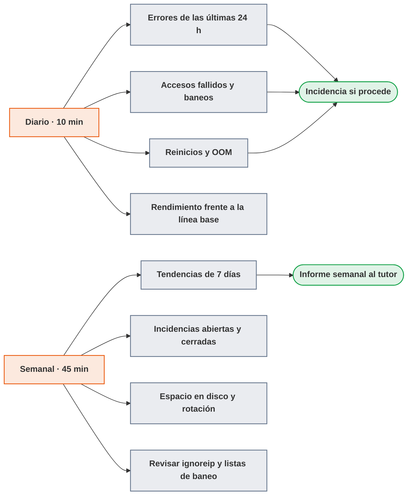
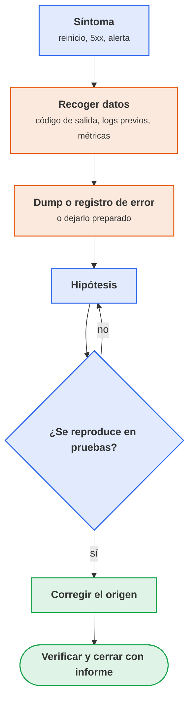

# UT5 · Explotación de logs, accesos y rendimiento

<p class="ut-meta">14 h · Formación en empresa (19 abr a 9 jun 2027) · RA3 CE a, b, c, d</p>

Hasta aquí todo el trabajo se ha hecho sobre el laboratorio. Las alarmas avisan de lo que alguien previó; esta unidad trata de lo que solo se ve mirando el sistema cada día. El caso típico: un jueves la API devuelve algún 502 y nadie mira nada; el lunes resulta que el contenedor lleva cuatro días reiniciándose por falta de memoria, que una IP de fuera ha probado ochenta usuarios por SSH y que el disco está al 94 % porque nadie configuró la rotación de los logs. Los cuatro bloques de la unidad son las cuatro miradas que lo habrían evitado, una por criterio de evaluación: los logs, los accesos, los fallos y reinicios, y el rendimiento.

Esta unidad y la siguiente, la de copias de seguridad, se cursan en la empresa, entre el 19 de abril y el 9 de junio de 2027, sobre un sistema real que asigna el tutor de empresa. Hay cuatro actividades (A5.1 a A5.4), una actividad de cierre y una ficha de evidencias que firma el tutor. Una regla desde el principio: todo dato de la empresa que aparezca en las evidencias se anonimiza (nombres de host, IP públicas, usuarios, dominios, rutas con nombre de cliente), porque un log con IP y usuario contiene datos personales, como se vio en [qué hay que conservar por obligación legal](ut8-terminacion-segura.md#que-hay-que-conservar-por-obligacion-legal), y la evidencia sale de la empresa. Se sustituyen por equivalentes (`web01`, `203.0.113.45`, `usuario_a`, `empresa.example`) antes de pegar nada: las redes 192.0.2.0/24, 198.51.100.0/24 y 203.0.113.0/24 y el dominio `example` están reservados para documentación y nunca se asignan a nadie, así que no señalan por error la máquina de otro. Ante la duda, se pregunta al tutor antes de incluirlo.

## Cómo trabajar en la empresa

**El método, no la herramienta.** Cada empresa tiene sus herramientas: Loki y Grafana como en mon01, Elastic, Graylog, Datadog o ficheros en `/var/log` y un `grep`. Lo que se evalúa es el método: qué se busca, cómo se justifica y qué se hace con lo que se encuentra. Por eso cada apartado da primero el método y después los comandos para el caso más habitual (Linux con Docker, journald y nginx), con su equivalente en Loki cuando existe. Si en la empresa hay otra cosa, se adapta el comando y se anota en la evidencia cuál se ha usado.

**Leer sí; cambiar, solo con permiso.** El trabajo se hace sobre sistemas en producción o cerca de ella, que mantiene el equipo de la empresa y de los que ese equipo responde. Todo lo que sea lectura (leer logs, consultar métricas, listar IPs bloqueadas) queda cubierto por la autorización general del tutor, aunque `fail2ban-client`, `nft` o el journal del kernel piden `sudo` incluso para consultar, y ese acceso se pide aparte. Todo lo que cambie algo (activar una jail, que es una regla de bloqueo de fail2ban; cambiar un límite de memoria; reiniciar un servicio) se acuerda antes con el tutor, se hace en el horario acordado y se apunta. La razón es práctica: cuando algo falla, lo primero que se pregunta es qué ha cambiado, y un cambio que nadie conoce hace perder horas buscando la causa donde no está. Por eso una evidencia de un cambio que el tutor no conocía no vale, aunque el resultado sea correcto.

**La rutina que se construye.** Las cuatro actividades no son independientes: juntas forman una rutina de revisión, diaria y semanal, que al final de la estancia se entrega escrita como procedimiento ([actividad de cierre](#actividad-de-cierre)). Este es su esqueleto:



<p class="pie" markdown>La rutina diaria son diez minutos y cuatro miradas. Lo que la hace útil es hacerla siempre, no hacerla bien un día.</p>

Cada mirada diaria es uno de los bloques de la unidad y responde a una pregunta: qué ha fallado (los logs, bloque 1), quién ha intentado entrar (los accesos, bloque 2), qué se ha reiniciado o se ha quedado sin memoria (bloque 3) y si el sistema va como siempre (el rendimiento frente a la línea base, bloque 4). Lo que encuentran, si lo merece, se abre como incidencia. Las miradas semanales cubren lo que no cambia de un día para otro y solo se ve con perspectiva: la tendencia de siete días, que va al informe semanal al tutor, el estado de las incidencias, el disco con su rotación de logs y las listas de bloqueo, que se quedan viejas si nadie las revisa.

Conviene guardar desde el primer día lo que se ejecuta: un fichero de texto con fecha, comando y una línea de resultado. Ahorra la mitad del trabajo del cierre, porque el procedimiento final tiene que llevar los comandos que se usaron de verdad, no los que se recuerdan.

**Dónde se guarda el trabajo.** El Gitea del laboratorio (`gitea.lab`) es una máquina del centro y desde la red de la empresa no se alcanza, así que el primer día se crea un repositorio local con `git init` en el equipo propio, con una carpeta `ut5/` dentro, y ahí van las evidencias según se producen; es lo mismo que se hizo con el repositorio `alerting`, que vivió en local hasta que hubo un Gitea al que empujar. Al volver al centro se añade el remoto (`git remote add origin` y `git push -u`) y el conjunto se entrega por Aules, como el resto de prácticas evaluables. Regla que no admite excepción: nada entra en ese repositorio sin anonimizar antes, porque una vez en el historial de git borrarlo ya no es borrar un fichero.

!!! otra "La UT4 de Despliegue va en las mismas semanas"
    La [UT4 de Despliegue](https://victor-educ.github.io/apuntes-5166/ut/ut4-nube-publica/), nube pública, también se
    cursa en la empresa entre el 19 de abril y el 9 de junio. Muchas veces los sistemas serán los mismos: la plataforma
    donde allí se despliega es donde aquí se revisan logs, accesos y rendimiento. Conviene acordar con el tutor un único
    sistema para las dos asignaturas y aprovechar las evidencias que sirvan a ambas: una captura de Grafana anonimizada
    vale en las dos.

## Bloque 1 · Revisión de logs (CE 3a)

<p class="ut-meta">En la empresa · con el tutor</p>

Un servicio corriente escribe miles de líneas al día, y lo nuevo (el error que nadie había visto, el aviso que anuncia el fallo de la semana siguiente) solo aparece si alguien las revisa con método. El bloque lo monta en el orden en que se usa: por dónde llega cada log al disco, qué se busca, los comandos que convierten miles de líneas en un recuento, la retención y cómo se cuenta lo encontrado. Va primero porque los otros tres bloques también se leen, en parte, en los logs.

### Revisar los archivos de registro (CE 3a)

**Cada día, no cuando algo falla.** Quien revisa los logs cada mañana detecta el problema una semana antes, cuando todavía es una línea rara y no una caída. Además, un error nuevo que aparece tres mañanas seguidas es candidato a regla de alerta en Loki ([métricas sobre logs](ut2-alarmas.md#metricas-sobre-logs)). Dónde están los logs en la empresa lo indica el tutor: en una plataforma central como el Loki de mon01 o en los propios hosts.

#### Los tres caminos de un log

**Para qué saberlo.** El camino por el que llega un log al disco decide con qué se lee, qué permiso hace falta y quién lo borra. En un host Linux con contenedores hay tres:

| Quién escribe | Dónde queda | Cómo se lee | Quién lo borra |
|---|---|---|---|
| Un contenedor, por stdout y stderr | Fichero JSON de Docker en `/var/lib/docker/containers/` | `docker logs` | Docker, si tiene `max-size` y `max-file` |
| Un servicio de systemd, y el kernel | journald, en `/var/log/journal/` | `journalctl` | journald, según `journald.conf` |
| Un programa que escribe su propio fichero (nginx instalado en el host, una aplicación en un volumen) | `/var/log/` o la ruta que tenga configurada | `less`, `grep`, `zcat` | logrotate, según `/etc/logrotate.d/` |

Loki no es un cuarto camino: es una copia que un agente saca de estos tres. En Debian 13 no viene rsyslog, y por eso ficheros clásicos como `auth.log` pueden no existir. Los permisos: `/var/log` y el journal se leen con los grupos `adm` o `systemd-journal`; `docker logs` necesita el grupo `docker`, que equivale a ser root, y por eso muchas empresas dan `sudo` para comandos concretos.

**Antes de filtrar, mirar el formato.** Cada aplicación escribe a su manera: texto libre (`ERROR db timeout`), JSON como la API del curso (`"level":"error"`) o el formato combinado de nginx. El nivel es la gravedad que la aplicación da a cada línea (debug, info, warning, error, critical). Un `grep ERROR` sobre un log que escribe `"level":"error"` no encuentra nada y el servicio parece limpio, así que antes de escribir un filtro se miran cinco líneas.

#### Qué buscar

Lo que se busca cabe en cuatro grupos:

- **Errores.** Niveles ERROR y FATAL, y excepciones no controladas (trazas de varias líneas que empiezan por `at ...` o `File "..."`, o `panic:` en Go). Una excepción que se repite cada pocos minutos es un bug aunque el servicio siga respondiendo.
- **Salidas inesperadas.** Reinicios, `timeout`, `connection refused`, `out of memory`, `no space left on device`, códigos 5xx en el proxy. `connection refused` es que no había nadie escuchando (nginx devuelve 502); `timeout`, que había alguien pero no respondió a tiempo (nginx devuelve 504).
- **Cambios de volumen.** El doble de líneas de lo habitual suele ser un bucle de reintentos o un escáner; el silencio total es peor, porque el servicio no está escribiendo.
- **Avisos de un fallo futuro.** `deprecated`, certificados que caducan, disco por encima del 85 %, reconexiones a la base de datos.

Los dos primeros grupos se cuentan por tipo, el tercero se compara con el día anterior y el cuarto se apunta aunque hoy no haya pasado nada.

#### Comandos para la revisión diaria

**Agrupar, no leer.** La revisión no lee las líneas una a una: cuenta cuántos errores de cada tipo ha habido en 24 horas y cuántas líneas en total. Trescientas líneas del mismo error son un problema, no trescientos. Todos los comandos tienen la misma forma: una ventana de tiempo, un filtro y un recuento.

```bash
# Errores de las últimas 24 h en un contenedor (2>&1 junta stdout y stderr)
docker logs --since 24h app 2>&1 | grep -E "ERROR|FATAL|Exception|panic:" | tail -50

# Cuántos por tipo
docker logs --since 24h app 2>&1 | grep -oE "(ERROR|FATAL) [A-Za-z._]+" | sort | uniq -c | sort -rn | head

# Servicio de systemd: prioridad err o más grave desde ayer
journalctl -u nginx --since yesterday -p err --no-pager

# Ficheros de nginx: 5xx de ayer (zcat -f lee también el fichero ya rotado)
zcat -f /var/log/nginx/access.log* | awk -v d="$(LC_ALL=C date -d '-1 day' +%d/%b/%Y)" '$4 ~ d && $9 ~ /^5/' | wc -l
```

`docker logs` sin `--since` vuelca todo lo que el contenedor ha escrito desde que existe. En nginx, logrotate rota de madrugada, y por eso en la revisión de la mañana las líneas de ayer ya están en `access.log.1`.

**Lo mismo en Loki.** Si la empresa tiene Loki, las búsquedas se hacen con LogQL, su lenguaje de consultas ([selectores de stream y filtros de línea](ut2-alarmas.md#selectores-de-stream-y-filtros-de-linea)): el selector entre llaves elige el flujo de logs y lo de detrás lo filtra o lo cuenta. Las etiquetas `service` y `level` son las del laboratorio; en la empresa se cambian por las suyas.

```text
# Errores por nivel en 24 h
sum by (level) (count_over_time({service="app", level=~"error|critical"}[24h]))

# Volumen de líneas por hora
sum(count_over_time({service="app"}[1h]))
```

**La buena práctica.** Las consultas se guardan en un dashboard de Grafana "Revisión diaria" (errores por nivel, volumen por hora, 5xx, accesos fallidos). Es el panel que se abre cada mañana, una captura suya con fecha vale como evidencia, y quien llegue después hereda las consultas.

#### Un script diario que resuma errores

**Para qué.** La rutina falla el día en que nadie se acuerda de hacerla. Un script en cron (el planificador de tareas de Linux) que resuma los errores por tipo y los envíe por correo la mantiene viva esos días.

```bash
#!/usr/bin/env bash
# /usr/local/sbin/resumen-logs.sh : resumen diario de errores por contenedor
set -euo pipefail
DESDE="24h"
DEST="ops@empresa.example"
TMP=$(mktemp)
{
  echo "Resumen de errores $(hostname) $(date +%F) (últimas $DESDE)"
  echo
  for c in $(docker ps --format '{{.Names}}'); do
    n=$(docker logs --since "$DESDE" "$c" 2>&1 | grep -cE "ERROR|FATAL|panic:" || true)
    echo "== $c: $n líneas de error"
    if [ "$n" -gt 0 ]; then
      docker logs --since "$DESDE" "$c" 2>&1 \
        | grep -E "ERROR|FATAL|panic:" \
        | sed -E 's/^[0-9T:.-]+Z? //; s/[0-9a-f]{8,}/<id>/g; s/[0-9]{2,}/<n>/g' \
        | sort | uniq -c | sort -rn | head -10
    fi
    echo
  done
  echo "== Reinicios de contenedores en $DESDE"
  docker events --since "$DESDE" --until 0s --filter event=die --filter event=oom \
    --format '{{.Time}} {{.Actor.Attributes.name}} {{.Action}} exit={{.Actor.Attributes.exitCode}}' 2>/dev/null || true
  echo
  echo "== journal, prioridad err o superior"
  journalctl -p err --since "-$DESDE" --no-pager -q | tail -20
} > "$TMP"
mail -s "Resumen de errores $(hostname) $(date +%F)" "$DEST" < "$TMP"
rm -f "$TMP"
```

El `sed` cambia identificadores y números por marcadores, para que "timeout en petición 48213" y "timeout en petición 48214" cuenten como el mismo error. Se programa en `/etc/cron.d/resumen-logs` a las 07:30 (`30 7 * * * root /usr/local/sbin/resumen-logs.sh`). `mail` solo entrega si el servidor tiene un relé de correo configurado; si no, esa línea se cambia por lo que use la empresa o el resumen se deja en un fichero con fecha.

#### Retención: logrotate y journald

**Para qué.** Sin retención el disco se llena, y un disco lleno en un host de contenedores es una caída completa. Con demasiado poca, la revisión del lunes no encuentra lo del sábado. Cuánto tiempo se guarda lo fija la política de la empresa (un log con IP es un dato personal), así que se pregunta antes de proponer ningún valor. Cada camino tiene su mecanismo.

**Los logs de Docker.** Con el driver `json-file`, el de fábrica, no rotan si nadie lo configura. Se fija para todos los contenedores en `/etc/docker/daemon.json` ([el driver de logs y por qué limitarlo](ut1-observabilidad.md#el-driver-de-logs-de-docker-y-por-que-limitarlo)):

```json
{
  "log-driver": "json-file",
  "log-opts": { "max-size": "50m", "max-file": "5" }
}
```

Solo afecta a los contenedores creados después del cambio, así que lo que cuenta es lo que tiene cada contenedor:

```bash
docker inspect --format '{{json .HostConfig.LogConfig}}' <contenedor>
du -sh /var/lib/docker/containers/*/*-json.log | sort -rh | head     # cuánto ocupan ahora
```

**El journal.** Su retención está en `/etc/systemd/journald.conf`: `SystemMaxUse=2G` limita el tamaño y `MaxRetentionSec=1month` la antigüedad.

```bash
journalctl --disk-usage
journalctl --vacuum-size=1G          # deja como mucho 1 GB
journalctl --vacuum-time=30d         # borra lo anterior a 30 días
```

**Los ficheros clásicos.** logrotate se lanza una vez al día, de madrugada, y cada servicio deja su configuración en `/etc/logrotate.d/`. Un ejemplo para una aplicación que escribe en `/srv/app/logs`:

```text
/srv/app/logs/*.log {
    daily
    rotate 14
    compress
    delaycompress
    missingok
    notifempty
    copytruncate
}
```

`daily` y `rotate 14` guardan un fichero por día durante catorce días; `compress` comprime los viejos y `delaycompress` deja sin comprimir el de ayer, que así se lee sin `zcat`; `missingok` y `notifempty` evitan errores si no hay fichero o está vacío; `copytruncate` copia y vacía el original, que es lo que necesita una aplicación que no sabe reabrir su fichero. `logrotate -d /etc/logrotate.d/app` simula sin tocar nada. Dos semanas bastan para comparar una semana con la anterior.

#### Cómo se redacta una incidencia útil

**Encontrar no basta.** Todo fallo encontrado se reporta como incidencia (el registro de un problema en la herramienta de seguimiento de la empresa, con responsable y estado), con lo que alguien necesita para decidir si es urgente y por dónde empezar. En el laboratorio las abría el receptor de alertas en Gitea ([categorizar, notificar y tratar](ut2-alarmas.md#categorizar-notificar-y-tratar)); aquí se abren a mano con esta plantilla:

```text
Título: [servicio] resumen de una línea del síntoma
Fecha y hora de detección: 2027-05-04 08:10 (revisión diaria)
Servicio / host: api (contenedor app en app01)
Mensaje exacto (una línea, tal cual aparece):
  ERROR sqlalchemy.pool: QueuePool limit of size 5 overflow 10 reached, connection timed out
Frecuencia: 143 apariciones entre 02:00 y 02:40; ninguna fuera de esa ventana
Impacto observado: 37 respuestas 502 en nginx en el mismo intervalo; sin quejas de usuarios
Contexto: coincide con la copia de seguridad de la base de datos (02:00)
Fragmento de log (10 líneas alrededor, anonimizado): adjunto
Hipótesis (opcional, marcada como tal): el pool se agota porque las consultas
  se ralentizan durante el pg_dump
Gravedad propuesta: media (recurrente, sin pérdida de servicio visible)
```

**Lo que más pesa.** El mensaje exacto, copiado literal, porque es lo que se busca en la documentación y en el histórico. Después la frecuencia y la ventana, que convierten "hay errores" en "hay errores a las dos de la mañana". La hipótesis va marcada para que nadie la tome por un hecho, y la gravedad se propone: la decide quien atiende la incidencia.

### A5.1 Revisión de logs (CE 3a)

<span class="et et-obj">Objetivo</span> **Qué vas a conseguir:** revisar los logs de un servicio de la empresa cada día durante cinco días laborables, siempre a la misma hora, y convertir algo de lo que encuentres en una incidencia que otra persona pueda atender.

**Para qué sirve en un trabajo:** los errores se acumulan en los logs mucho antes de que alguien se queje. Una revisión periódica, y no una mirada suelta, es la que los descubre a tiempo, y una incidencia bien escrita es la que hace que llegue a quien lo tiene que arreglar.

<span class="et et-pre">Antes de empezar</span>

- El tutor te dice qué servicio revisas, dónde están sus logs y con qué usuario los lees. Ese usuario tiene que poder leerlos de verdad: grupo `adm` o `systemd-journal`, grupo `docker` o `sudo`, según [el camino del log](#los-tres-caminos-de-un-log).
- Crea un fichero `a5.1-logs.md` en tu carpeta de trabajo. Ahí va el registro del paso 2.
- Ten a mano la teoría del bloque: [Los tres caminos de un log](#los-tres-caminos-de-un-log), [Qué buscar](#que-buscar), [Comandos para la revisión diaria](#comandos-para-la-revision-diaria), [Retención: logrotate y journald](#retencion-logrotate-y-journald) y [Cómo se redacta una incidencia útil](#como-se-redacta-una-incidencia-util).

<span class="et et-pas">Pasos</span>

Trabajas en el servidor del servicio y solo lees. El primer día preparas las consultas (paso 1); después las repites cinco días laborables (paso 2) y de lo que encuentres sale la incidencia (paso 3). La retención (paso 4) se mira una sola vez, cualquier día de la semana.

1. **Conoce el log y prepara tus consultas.** *En el servidor del servicio, el primer día.*

    Averigua por cuál de los [tres caminos](#los-tres-caminos-de-un-log) escribe el servicio: salida del contenedor, journal de systemd o fichero. Mira cinco líneas para ver su formato y cómo marca el nivel (`ERROR`, `WARN`...). Usa la orden de su camino:

    ```bash
    docker logs --since 1h --tail 5 <contenedor>
    journalctl -u <servicio> -n 5 --no-pager
    tail -n 5 <ruta del fichero de log>
    ```

    Con eso, adapta las dos consultas que vas a repetir cada día: errores de 24 h por tipo y volumen de líneas. Salen de [Comandos para la revisión diaria](#comandos-para-la-revision-diaria). Para un contenedor, cambia el patrón del `grep` al formato que has visto:

    ```bash
    docker logs --since 24h <contenedor> 2>&1 | grep -oE "(ERROR|FATAL) [A-Za-z._]+" | sort | uniq -c | sort -rn | head
    docker logs --since 24h <contenedor> 2>&1 | wc -l
    ```

    Guarda las dos tal cual en `a5.1-logs.md`.

    **Sale bien si:** la primera devuelve un recuento por tipo (o nada, y sabes por qué) y la segunda, un número.

2. **Revisa cinco días laborables, siempre a la misma hora.** *En el servidor del servicio, cada día.*

    Cada día lanza las dos consultas y añade una fila al registro. A la misma hora, cada fila cubre las mismas 24 h y se puede comparar con la anterior. Que el volumen se doble o se quede en silencio también es un hallazgo ([Qué buscar](#que-buscar)).

    ```markdown
    | Fecha | Servicio | Intervalo revisado | Comando o consulta | Errores por tipo (recuento) | Volumen | Incidencia |
    |---|---|---|---|---|---|---|
    ```

    **Sale bien si:** al quinto día tienes cinco filas con fecha y cada una cita la consulta exacta.

3. **Convierte un hallazgo en incidencia.** *En la herramienta de incidencias de la empresa o en tu fichero.*

    Elige un hallazgo del registro y ábrelo con la plantilla de [Cómo se redacta una incidencia útil](#como-se-redacta-una-incidencia-util). Va en la herramienta de la empresa si el tutor lo autoriza y, si no, en `a5.1-logs.md`. El mensaje del log va copiado literal: con los datos reales en la herramienta de la empresa y anonimizado en tu fichero.

    **Sale bien si:** otra persona podría atenderla sin preguntarte nada: mensaje exacto, cuántas veces, en qué ventana de tiempo y qué impacto.

4. **Comprueba que los logs se conservan lo justo.** *En el servidor del servicio, un día cualquiera.*

    La retención es cuánto tiempo o cuánto espacio se guardan los logs antes de borrarse. Mírala en cada camino que use el servicio:

    ```bash
    docker inspect --format '{{.Name}} {{json .HostConfig.LogConfig}}' $(docker ps -q)
    journalctl --disk-usage
    grep -E "SystemMaxUse|MaxRetentionSec" /etc/systemd/journald.conf
    ls /etc/logrotate.d/
    ```

    Si algún camino no tiene límite, anótalo como hallazgo y propónselo al tutor con el valor que sugieres y por qué. No cambies nada sin su visto bueno.

    **Sale bien si:** el registro dice, para cada camino, si tiene límite y cuál.

<span class="et et-com">Comprobación</span>

- [ ] La tabla tiene cinco filas con fecha.
- [ ] Cada fila cita el comando exacto que se ejecutó.
- [ ] La incidencia contiene un mensaje de log copiado literal, con su recuento y su ventana temporal.
- [ ] El registro dice qué retención tiene cada camino del log.
- [ ] Ningún host, IP pública ni usuario real aparece en el fichero.

<span class="et et-ent">Entrega</span>

- **Guarda** `a5.1-logs.md` en la carpeta `ut5/` del repositorio de la unidad, con el registro de los cinco días y la incidencia anonimizada. Es la evidencia del criterio 3a en la práctica evaluable.
- Pide al tutor que firme la fila A5.1 de la ficha.
- **Piensa:** si el volumen de un día cae a la mitad sin ningún error, ¿es buena o mala noticia?

<span class="et et-ext">Si te sobra tiempo</span> Para no lanzar las consultas a mano cada día, adapta el script `resumen-logs.sh` de [Un script diario que resuma errores](#un-script-diario-que-resuma-errores) a los contenedores de la empresa y propón al tutor programarlo en cron. Adjunta la salida de una ejecución manual como evidencia extra.

## Bloque 2 · Accesos y fuerza bruta (CE 3b)

<p class="ut-meta">En la empresa · con el tutor</p>

Cualquier sistema que se alcance desde Internet recibe intentos de entrar desde el primer minuto, y casi todos son ruido. El bloque enseña a distinguir de ese ruido un ataque, a convertir el patrón en una alerta y a bloquearlo de forma automática con fail2ban. Es la revisión de logs del bloque 1 aplicada a las líneas de autenticación, con una acción añadida: bloquear.

### Monitorizar los accesos (CE 3b)

**El ruido de fondo.** Un servidor con SSH abierto a Internet ve cientos o miles de intentos fallidos al día de *botnets*, redes de máquinas infectadas que prueban contraseñas por defecto contra todo lo que responde. Ese ruido no se evita, se deja sin efecto: con claves en lugar de contraseñas no hay nada que adivinar.

**Lo que se busca.** Distinguir ese ruido de un ataque dirigido (alguien que prueba usuarios que existen en la empresa, o que vuelve con paciencia) y comprobar que el bloqueo funciona: uno instalado que no bloquea da una seguridad falsa.

#### Dónde se registran

Cada puerta del sistema deja sus intentos en su propio log. La revisión empieza por la que está expuesta a Internet:

| Origen | Dónde mirar | Qué contiene |
|---|---|---|
| SSH | `journalctl -u ssh` (o `/var/log/auth.log` si hay rsyslog) | Intentos fallidos, usuarios inválidos, logins correctos |
| sudo | el mismo journal, `journalctl _COMM=sudo` | Quién escaló privilegios y qué ejecutó |
| Proxy inverso (nginx) | `/var/log/nginx/access.log` y `error.log` | Respuestas 401/403, rutas de administración, escáneres |
| Aplicación | su log (stdout del contenedor) | Login fallido, usuario bloqueado, tokens rechazados |

**SSH en Debian 13: por unidad, no por proceso.** Desde OpenSSH 9.8, quien escribe `Failed password` e `Invalid user` es un proceso hijo, `sshd-session`, y no `sshd`. Por eso se filtra por la unidad de systemd, `journalctl -u ssh`, que recoge todos los procesos de SSH y funciona igual en Debian 12. Con `_COMM=sshd` parece que nadie ha intentado entrar.

#### Qué se busca: patrones de fuerza bruta y password spraying

**Dos ataques, dos firmas.** Los dos intentan adivinar una contraseña, pero reparten los intentos al revés.

**Fuerza bruta:** una IP prueba muchas contraseñas contra pocos usuarios, deprisa. Se reconoce por el volumen de fallos de una misma IP:

```text
May  4 03:12:41 web01 sshd-session[18422]: Failed password for root from 203.0.113.45 port 51204 ssh2
May  4 03:12:44 web01 sshd-session[18422]: Failed password for root from 203.0.113.45 port 51204 ssh2
May  4 03:12:47 web01 sshd-session[18422]: Failed password for root from 203.0.113.45 port 51204 ssh2
May  4 03:12:53 web01 sshd-session[18431]: Invalid user admin from 203.0.113.45 port 51290
```

**Password spraying:** una IP prueba una o dos contraseñas comunes contra muchos usuarios distintos, despacio, para no disparar los bloqueos por número de fallos. Se reconoce por la variedad de usuarios, no por el volumen:

```text
May  4 04:01:10 web01 sshd-session[19002]: Invalid user oracle from 198.51.100.7 port 40122
May  4 04:03:52 web01 sshd-session[19017]: Invalid user postgres from 198.51.100.7 port 40310
May  4 04:06:31 web01 sshd-session[19033]: Invalid user jenkins from 198.51.100.7 port 40488
May  4 04:09:14 web01 sshd-session[19051]: Invalid user deploy from 198.51.100.7 port 40615
```

**Cómo se cuenta cada uno.** La fuerza bruta, como intentos fallidos por IP; el spraying, como usuarios distintos por IP. Los logins correctos se revisan aparte, porque un ataque que ha funcionado ya no aparece como fallo:

```bash
# Fuerza bruta: intentos fallidos por IP, hoy
journalctl -u ssh --since today --no-pager \
  | grep -oE "Failed password for (invalid user )?\S+ from \S+" \
  | awk '{print $NF}' | sort | uniq -c | sort -rn | head

# Spraying: usuarios distintos por IP en las últimas 24 h
journalctl -u ssh --since -24h --no-pager \
  | grep -oE "Invalid user \S+ from \S+" \
  | awk '{print $5, $3}' | sort -u | awk '{print $1}' | uniq -c | sort -rn | head

# Logins correctos de la semana: quién, cuándo y desde dónde
journalctl -u ssh --since -7d --no-pager | grep "Accepted"

# nginx: IP que más 401/403/404 generan en 24 h
zcat -f /var/log/nginx/access.log /var/log/nginx/access.log.1 \
  | awk '$9 ~ /^(401|403|404)$/ {print $1}' | sort | uniq -c | sort -rn | head
```

**En el mismo pase.** Un login correcto fuera del horario habitual de esa cuenta, o desde un país nuevo, es motivo de preguntar a su dueño (un viaje, una VPN) antes de tratarlo como un problema de seguridad.

#### Detección en Loki y alerta

**Para qué.** Contar a mano sirve para la revisión de la mañana; para enterarse de madrugada hace falta una alerta. En Loki las reglas van en el ruler, con la misma sintaxis que las de Prometheus ([alertas en el ruler de Loki](ut2-alarmas.md#alertas-en-el-ruler-de-loki)). Estas dos son las dos firmas anteriores; el job `auth` se cambia por el que use la empresa:

```yaml
groups:
  - name: accesos
    rules:
      - alert: FuerzaBrutaSSH          # más de 20 fallos en 5 min en un host
        expr: |
          sum by (host) (count_over_time({job="auth"} |= "Failed password" [5m])) > 20
        labels: { severity: warning }
        annotations:
          summary: "Más de 20 fallos SSH en 5 min en {{ $labels.host }}"
      - alert: PasswordSprayingSSH     # más de 8 usuarios distintos por IP en 1 h
        expr: |
          count by (host, ip) (
            sum by (host, ip, user) (
              count_over_time({job="auth"}
                | regexp `Invalid user (?P<user>\S+) from (?P<ip>\S+)` [1h])
          )) > 8
        labels: { severity: warning }
        annotations:
          summary: "IP {{ $labels.ip }} ha probado más de 8 usuarios distintos en 1 h"
```

#### fail2ban a fondo

{ .logo-inline }

**Para qué sirve.** Nadie puede vigilar el log de SSH las 24 horas. fail2ban lee los logs, cuenta los fallos de cada IP y, cuando una supera `maxretry` fallos dentro de `findtime`, la bloquea en el firewall durante `bantime`. Cada combinación de filtro (las expresiones que reconocen un fallo), acción y tiempos es una *jail*.

**Cómo se configura.** `/etc/fail2ban/jail.conf` es el de fábrica y no se toca; lo propio va en `/etc/fail2ban/jail.local`. Uno completo para un host con SSH y nginx:

```ini
# /etc/fail2ban/jail.local
[DEFAULT]
# Redes que nunca se bloquean: loopback, oficina, monitorización, bastión
ignoreip = 127.0.0.1/8 ::1 10.10.0.0/24 203.0.113.0/28
bantime  = 1h
findtime = 10m
maxretry = 5
# Cada reincidencia alarga el baneo, hasta 4 semanas
bantime.increment = true
bantime.factor    = 2
bantime.maxtime   = 4w
banaction = nftables-multiport
banaction_allports = nftables-allports

[sshd]
enabled = true
mode    = aggressive
# Debian 13: sin rsyslog no hay auth.log, y el backend systemd lee el journal
backend = systemd
# el journalmatch de fábrica solo casa _COMM=sshd y no ve a sshd-session
journalmatch = _SYSTEMD_UNIT=ssh.service

[nginx-http-auth]
enabled  = true
logpath  = /var/log/nginx/error.log

[nginx-botsearch]
enabled  = true
logpath  = /var/log/nginx/access.log
maxretry = 2

[recidive]
enabled  = true
bantime  = 1w
findtime = 1d
maxretry = 3
```

Las tres líneas que más problemas evitan:

- `ignoreip` se piensa antes de activar nada: bloquear la IP de administración o la sonda de monitorización es un problema autoinfligido.
- `backend = systemd` va solo en la jail `sshd`: con él fail2ban ignora `logpath` y lee el journal, y puesto en `[DEFAULT]` dejaría ciegas a las jails de nginx.
- `journalmatch` por unidad hace que la jail vea a `sshd-session`; sin él, en Debian 13 la jail arranca, se queda a cero fallos y no banea nunca.

**Un filtro propio para la aplicación.** Si la aplicación escribe `WARN auth: login failed for user=usuario_a ip=203.0.113.45`, el filtro es una expresión con `<HOST>` en el sitio de la IP:

```ini
# /etc/fail2ban/filter.d/app-login.conf
[Definition]
failregex = ^.*auth: login failed for user=\S+ ip=<HOST>\s*$
ignoreregex =
```

```ini
# /etc/fail2ban/jail.d/app-login.conf
[app-login]
enabled  = true
filter   = app-login
logpath  = /srv/app/logs/app.log
port     = http,https
maxretry = 8
findtime = 15m
bantime  = 2h
```

Detrás de nginx, la aplicación tiene que registrar la IP del cliente (la cabecera `X-Forwarded-For`), no la del proxy: si no, el filtro banearía a nginx. Un filtro que no casa con nada no da error, así que se prueba antes con `fail2ban-regex`, que dice cuántas líneas casan:

```bash
fail2ban-regex /srv/app/logs/app.log /etc/fail2ban/filter.d/app-login.conf
```

**Operar.** El día a día se hace con `fail2ban-client`:

```bash
fail2ban-client status                       # jails activas
fail2ban-client status sshd                  # fallos, baneos actuales e IP
fail2ban-client get sshd ignoreip            # lista blanca de la jail
fail2ban-client set sshd unbanip 203.0.113.45
fail2ban-client reload                       # recarga sin perder baneos
```

**Dónde se aplica el bloqueo.** fail2ban decide; el bloqueo lo pone la acción en nftables, el firewall del kernel, en una tabla propia. Es ahí donde se ve si el bloqueo existe de verdad (el nombre de la tabla cambia con la versión: `nft list tables`):

```bash
nft list tables
nft list set inet f2b-table addr-set-sshd
```

**El hueco de Docker.** La regla de fail2ban corta el tráfico que va al propio host (SSH, un nginx instalado como paquete), pero no el que va a un puerto publicado por un contenedor, que pasa por otra cadena ([por qué Docker se salta el firewall del host](ut3-seguridad-monitorizacion.md#por-que-docker-se-salta-el-firewall-del-host)). Para un servicio en Docker se bloquea en el proxy o en el cortafuegos del entorno.

**La buena práctica: comprobar un bloqueo de verdad.** Cada eslabón puede fallar por separado: que el filtro cuente, que la acción cree la regla y que la regla corte. Por eso se prueba de extremo a extremo desde una máquina que no esté en `ignoreip`, y se guarda una captura de cada momento: IP baneada, regla en nftables, conexión rechazada y desbaneo.

#### CrowdSec como alternativa

CrowdSec hace lo mismo que fail2ban, pero separa la detección (el agente) del bloqueo (los *bouncers*, uno por firewall o proxy), y comparte con su comunidad una lista de IP maliciosas. Con uno o dos hosts basta fail2ban; con varios, o para bloquear en un solo punto, CrowdSec. En la empresa, lo que haya. Las órdenes equivalentes:

| Para qué | fail2ban | CrowdSec |
|---|---|---|
| Qué lee y qué detecta | `fail2ban-client status` | `cscli metrics` |
| IP bloqueadas | `fail2ban-client status sshd` | `cscli decisions list` |
| Quitar un bloqueo | `fail2ban-client set sshd unbanip <IP>` | `cscli decisions delete --ip <IP>` |
| Dónde se aplica | `nft list tables` | `cscli bouncers list` |

### A5.2 Accesos y fuerza bruta (CE 3b)

<span class="et et-obj">Objetivo</span> **Qué vas a conseguir:** leer 24 h de intentos de acceso a un sistema y decir, con argumentos, si hay un ataque y de qué tipo. Después revisas el mecanismo que bloquea a los atacantes y compruebas con una prueba real que bloquea de verdad.

**Para qué sirve en un trabajo:** es la diferencia entre creer que el sistema está protegido y saberlo. Una jail de fail2ban que lleva meses a cero fallos parece igual de tranquila si no hay ataques que si no está leyendo nada.

<span class="et et-pre">Antes de empezar</span>

- Dos permisos del tutor, por separado: leer los logs de acceso y, aparte, hacer la prueba de bloqueo del paso 4, con la IP de pruebas, el día y la hora acordados. Si no autoriza la prueba, anótalo: la actividad termina en el paso 3.
- `sudo` para el cliente del mecanismo de bloqueo (`fail2ban-client`, `cscli`) y para `nft`, que necesitan los pasos 3 y 4. Si la empresa no lo concede, acuerda con el tutor que ejecute él esos comandos mientras se los dictas, y anota en la entrega quién los ejecutó.
- Saber qué mecanismo usa la empresa (fail2ban, CrowdSec, bloqueo en el cortafuegos u otro) y dónde está su configuración.
- Ten a mano la teoría del bloque: [Dónde se registran](#donde-se-registran), [Qué se busca: patrones de fuerza bruta y password spraying](#que-se-busca-patrones-de-fuerza-bruta-y-password-spraying) y [fail2ban a fondo](#fail2ban-a-fondo) o [CrowdSec como alternativa](#crowdsec-como-alternativa), según el caso.

<span class="et et-pas">Pasos</span>

Vas de lo que no toca nada a lo que sí: sacas los números del log (paso 1), los interpretas (paso 2), revisas la configuración que debería reaccionar a ellos (paso 3) y, solo al final y con permiso, provocas un bloqueo para ver que la cadena entera funciona (paso 4).

1. **Saca los números de 24 h de accesos.** *En el servidor.*

    Localiza el log de accesos del sistema (SSH, proxy o aplicación) con la tabla de [Dónde se registran](#donde-se-registran). Guarda las salidas en ficheros para no repetirlas:

    ```bash
    journalctl -u ssh --since -24h --no-pager > accesos-24h.txt
    journalctl -u ssh --since -7d --no-pager | grep "Accepted" > logins-7d.txt
    ```

    Sobre esos ficheros, saca los tres números de [Qué se busca](#que-se-busca-patrones-de-fuerza-bruta-y-password-spraying): intentos fallidos por IP, usuarios distintos por IP y logins correctos de la semana. Son las mismas órdenes, leyendo del fichero en vez del journal:

    ```bash
    grep -oE "Failed password for (invalid user )?\S+ from \S+" accesos-24h.txt | awk '{print $NF}' | sort | uniq -c | sort -rn | head
    grep -oE "Invalid user \S+ from \S+" accesos-24h.txt | awk '{print $5, $3}' | sort -u | awk '{print $1}' | uniq -c | sort -rn | head
    wc -l logins-7d.txt
    ```

    Si el servicio expuesto es web y no SSH, usa la orden de nginx del mismo apartado.

    **Sale bien si:** `accesos-24h.txt` empieza hace 24 h. Si sale vacío, filtra por unidad (`-u ssh`), no por proceso.

2. **Clasifica lo que ves y justifícalo.** *En el servidor y en tu fichero.*

    Con esos números decide si hay ruido de fondo, fuerza bruta (muchos intentos desde una IP contra pocos usuarios), password spraying (pocos intentos por usuario contra muchos usuarios distintos) o nada. Justifícalo con el criterio de [Qué se busca](#que-se-busca-patrones-de-fuerza-bruta-y-password-spraying). Copia un extracto anonimizado de diez a veinte líneas que muestre el patrón y márcalo:

    ```bash
    grep -E "Failed password|Invalid user" accesos-24h.txt | head -20
    ```

    **Sale bien si:** alguien que solo lea el extracto llegaría a tu misma clasificación.

3. **Revisa la configuración que debería reaccionar.** *En el servidor.*

    Una jail es la regla de fail2ban que vigila un log y bloquea a quien falla demasiado. Anota las jails activas, la lista blanca (`ignoreip`, las IP que nunca se bloquean), los tiempos y el backend (de dónde lee el log), y compáralos con [fail2ban a fondo](#fail2ban-a-fondo):

    ```bash
    sudo fail2ban-client status
    sudo fail2ban-client status sshd
    sudo fail2ban-client get sshd ignoreip
    grep -rE "bantime|findtime|maxretry|backend|journalmatch" /etc/fail2ban/jail.local /etc/fail2ban/jail.d/
    ```

    Con CrowdSec, `sudo cscli metrics` y `sudo cscli bouncers list`.

    **Sale bien si:** la lista blanca incluye la red de gestión, la oficina y la sonda de monitorización, y los fallos que encontraste en el paso 1 también los ha contado la jail. Si está a cero, mira las dos causas de [Errores frecuentes](#errores-frecuentes-en-el-laboratorio).

4. **Demuestra un bloqueo de extremo a extremo.** *En la máquina de pruebas y en el servidor, en el momento acordado.*

    Desde la máquina de pruebas (fuera de `ignoreip`), falla el acceso SSH hasta superar `maxretry`, el número de fallos que dispara el bloqueo. Un usuario que no existe también cuenta como fallo, y sirve si el servidor solo admite claves. Guarda una captura de cada momento:

    ```bash
    # En la máquina de pruebas, repetido hasta superar maxretry
    ssh usuario_inexistente@<IP del servidor>
    # En el servidor: la IP baneada y su regla en el firewall
    sudo fail2ban-client status sshd
    sudo nft list tables
    sudo nft list set inet f2b-table addr-set-sshd
    # En la máquina de pruebas: la conexión ya no llega
    ssh usuario_inexistente@<IP del servidor>
    # En el servidor, al terminar
    sudo fail2ban-client set sshd unbanip <IP de la máquina de pruebas>
    ```

    Cambia el nombre de la tabla y del set por los que dé `nft list tables`.

    **Sale bien si:** al final `status sshd` ya no lista la IP de pruebas.

<span class="et et-com">Comprobación</span>

- [ ] El extracto de log tiene el patrón marcado y una explicación de por qué es esa categoría.
- [ ] La configuración anotada muestra las jails activas, `ignoreip`, los tiempos y el backend.
- [ ] Las capturas demuestran que la IP de pruebas dejó de poder conectar.
- [ ] `fail2ban-client status sshd` ya no lista la IP de pruebas al terminar.

<span class="et et-ent">Entrega</span>

- **Guarda** `a5.2-accesos.md` en `ut5/` del repositorio, con el extracto clasificado, la configuración anonimizada y la prueba del bloqueo (salida de `fail2ban-client status`, `cscli decisions list` o equivalente, y la regla del firewall). Es la evidencia del criterio 3b.
- Firma del tutor en la fila A5.2.
- **Piensa:** ¿qué pasaría si la IP de la sonda de monitorización no estuviera en la lista blanca?

<span class="et et-ext">Si te sobra tiempo</span> Para que fail2ban proteja también la aplicación: si hay una aplicación propia que registra los logins fallidos y no tiene filtro, escribe uno como el de [fail2ban a fondo](#fail2ban-a-fondo) y pruébalo con `fail2ban-regex` sin activarlo. Si la empresa tiene Loki, escribe la regla `PasswordSprayingSSH` del apartado [Detección en Loki y alerta](#deteccion-en-loki-y-alerta) adaptada a su job y comprueba en Explore que la consulta devuelve algo con el log real.

## Bloque 3 · Fallos y reinicios (CE 3c)

<p class="ut-meta">En la empresa · con el tutor</p>

Los dos bloques anteriores enseñan a ver que algo falla; este, a averiguar por qué. El caso más habitual con contenedores es el reinicio: Docker vuelve a levantar el contenedor en unos segundos, el servicio parece sano y la causa sigue ahí. El bloque sigue un reinicio hasta su causa en el orden en que se investiga: el método, el código de salida, la memoria, los volcados y registros de error, y la plantilla de informe.

### Fallos y reinicios: crashdumps y registros de error (CE 3c)

**Un reinicio no es un fallo resuelto.** Con `restart: unless-stopped` en el Compose, el contenedor que muere vuelve solo; el servicio cae unos segundos, el proxy da unos 502, y nadie se entera hasta que el reinicio pasa a ser cada diez minutos. El análisis siempre sigue el mismo camino:



<p class="pie" markdown>Primero se recogen los datos, que desaparecen solos; luego se piensa. Sin reproducir, corregir es adivinar.</p>

**Por qué ese orden.** El código de salida se pierde si el contenedor se recrea, los logs rotan y las métricas de ese minuto quedan enterradas. Por eso se recogen antes de tener ninguna idea sobre la causa. Y una hipótesis no se da por buena hasta reproducir el fallo en pruebas: lo que no se ha reproducido no se puede comprobar que esté corregido.

#### Códigos de salida

**Para qué sirve.** Es lo primero que se mira, porque dice quién mató al proceso. Un proceso que termina deja un número: 0 si fue bien, otro si no. Si lo mata una señal (`SIGTERM` le pide que pare, `SIGKILL` lo mata sin aviso, `SIGSEGV` indica que ha tocado memoria que no es suya), Docker informa 128 más el número de la señal.

| Código | Qué significa | Causa habitual |
|---|---|---|
| 0 | Salida normal | El proceso principal terminó (un `CMD` mal pensado) |
| 1 | Error de la aplicación | Excepción, configuración que falta, variable vacía |
| 126 / 127 | Comando no ejecutable / no encontrado | Permisos del entrypoint, ruta errónea en `CMD` |
| 134 | `SIGABRT` | La propia aplicación aborta: aserción fallida |
| 137 | `SIGKILL` | El kernel por falta de memoria (`OOMKilled=true`), o un `docker stop` que agotó los 10 s de gracia |
| 139 | `SIGSEGV` | Fallo de segmentación: bug en código nativo |
| 143 | `SIGTERM` | Alguien lo paró (`docker stop`, `compose down`); no falló |

**Dónde se leen.** El código, la marca de memoria, los reinicios y la hora del fallo están en `docker inspect`; la historia de los últimos días, en los eventos de Docker:

```bash
docker inspect app --format '{{.RestartCount}} {{.State.ExitCode}} {{.State.OOMKilled}} {{.State.FinishedAt}}'
docker events --since 24h --until 0s --filter container=app --filter event=die --filter event=oom
docker compose ps -a         # muestra "Exited (137) 2 hours ago"
```

`RestartCount` vuelve a cero cuando el contenedor se recrea, así que un `0` no garantiza nada si alguien hizo `compose up` esta mañana. En producción la política habitual es `restart: unless-stopped`; un contenedor en bucle de arranque se ve en `docker ps` como "Restarting".

#### OOM: el kernel y los cgroups

**Qué pasa.** Cuando un contenedor tiene límite de memoria (`mem_limit` en Compose), Docker lo pone en su cgroup, el mecanismo del kernel que acota los recursos de cada contenedor ([de dónde salen los números](ut1-observabilidad.md#de-donde-salen-los-numeros)). Si el uso llega al límite, el *OOM killer* del kernel (el que mata procesos cuando falta memoria) mata el proceso que más consume, y el contenedor sale con 137.

**La buena práctica: todo contenedor lleva límite.** Sin él, un contenedor puede comerse la RAM del host y el kernel mata lo que le parezca, que puede ser PostgreSQL. Con límite, el daño se queda en el contenedor que se ha pasado.

**Dónde queda rastro.** En el journal del kernel y en el contador del cgroup, que también cuenta los procesos hijos que el kernel mata sin que el contenedor se reinicie:

```bash
journalctl -k --since -24h | grep -iE "oom-kill|out of memory"
#   Memory cgroup out of memory: Killed process 21877 (python3) ... anon-rss:1044120kB

# Límite, uso y contador del cgroup del contenedor
PID=$(docker inspect app --format '{{.State.Pid}}')
CG=/sys/fs/cgroup$(cut -d: -f3 /proc/$PID/cgroup)
cat $CG/memory.max $CG/memory.current
cat $CG/memory.events    # línea oom_kill N
```

`anon-rss` es la memoria que usaba de verdad el proceso. El contador `oom_kill` cuenta desde el último arranque del contenedor.

**En Prometheus.** `container_memory_working_set_bytes` es la memoria que hay que comparar con el límite, `container_spec_memory_limit_bytes` ([memory usage frente a working set](ut1-observabilidad.md#memory-usage-frente-a-working-set)), y `container_oom_events_total` cuenta los OOM. Con las dos primeras en el mismo panel se distinguen los dos casos: una **fuga** es una rampa que sube día tras día hasta tocar el límite, y se arregla en el código; un **pico** es un escalón que coincide con un evento (la copia, un informe pesado), y se arregla con más límite o menos carga.

#### Core dumps en contenedores

**Para qué sirve.** Un core dump (volcado de memoria) es la imagen de la memoria del proceso al morir por un fallo propio (códigos 134 y 139). Con él, un depurador dice en qué función murió el proceso en lugar de adivinarlo.

**Cómo se hace en un contenedor.** Dónde se escribe lo decide `core_pattern`, un parámetro del kernel del host, y el tamaño máximo lo fija `ulimit -c`, que en un contenedor suele ser 0. La solución habitual es un patrón de fichero en un directorio que comparten host y contenedor, en la misma ruta:

```bash
# En el host
cat /proc/sys/kernel/core_pattern       # anótalo antes de cambiarlo
echo '/var/crash/core.%e.%p.%t' > /proc/sys/kernel/core_pattern
sysctl -w fs.suid_dumpable=2
```

```yaml
# docker-compose.yml: permitir dumps y montar el directorio
services:
  app:
    ulimits:
      core: -1
    volumes:
      - /var/crash:/var/crash
```

**La buena práctica: es un cambio que se autoriza.** `core_pattern` afecta a todo el host, y un volcado es una copia de la memoria con contraseñas y datos personales en claro. Fuera de un laboratorio propio, habilitarlo se autoriza, se anota y se revierte; los volcados se guardan con permisos restrictivos y se borran en cuanto dejan de hacer falta.

**Cómo se analiza.** Con gdb, el depurador de binarios nativos, dentro de la misma imagen y versión que murió (gdb se instala en ese contenedor temporal, que se tira al salir):

```bash
docker run --rm -it -v /var/crash:/var/crash --entrypoint bash app-imagen:1.4.2
gdb /usr/local/bin/servidor /var/crash/core.servidor.17.1746340361
(gdb) bt            # traza de pila del hilo que falló
```

Para Python y Java hay herramientas propias que inspeccionan el proceso vivo: `py-spy dump --pid <pid>` y `jstack <pid>`.

#### Registros de error de la aplicación

**No todo fallo deja volcado.** Muchos programas dejan su propio informe al morir, y es lo primero que se busca después del código de salida:

- **Java** escribe `hs_err_pid<N>.log` en su directorio de trabajo.
- **Node** deja la traza en stderr.
- **PostgreSQL** escribe en su log (o en la salida del contenedor). Ahí aparecen `FATAL: sorry, too many clients already` o `terminated by signal 9`, que explican los errores que la aplicación registra en ese mismo minuto.

#### El método y la plantilla de informe

**Cómo se hace.** Se reúnen el dump o el registro de error, el log de los cinco minutos previos (`docker logs --since "2027-05-04T02:36:00" --until "2027-05-04T02:41:00" app`) y las métricas de ese momento (una captura de Grafana con el intervalo fijado). Con eso se formula una hipótesis, se reproduce en un entorno de pruebas (nunca en producción, porque reproducir un fallo es provocarlo), se corrige el origen y se verifica durante días que no se repite.

**La buena práctica: el origen, no el síntoma.** Subir el límite de memoria para una fuga es un parche; arreglar la fuga es la corrección. Poner `restart: always` a algo que muere cada hora no corrige nada.

El informe de A5.3 es una página con estos nueve puntos, en el orden del diagrama:

```text
1. Síntoma y detección: qué se vio, cuándo, cómo se detectó (alerta, revisión, aviso)
2. Datos del fallo: contenedor, imagen y versión, código de salida, OOMKilled,
   RestartCount, mensaje del kernel o del runtime (literal)
3. Contexto: log de los 5 min previos (extracto anonimizado), métricas del momento
   (captura o tabla: memoria usada/límite, CPU, conexiones, latencia p95)
4. Análisis del dump o del registro de error: traza, hilo, función, o "no había dump,
   se ha habilitado para la próxima"
5. Hipótesis (una principal, alternativas descartadas y por qué)
6. Reproducción: dónde, cómo, resultado
7. Corrección: qué se cambió (fichero, valor antes y después), dónde (pruebas o
   el sistema real) y quién lo aprobó
8. Verificación: métrica o comando que demuestra que no se repite, y durante cuánto tiempo
9. Acciones pendientes: lo que queda para el equipo de desarrollo o para más adelante
```

### A5.3 Fallos y reinicios (CE 3c)

<span class="et et-obj">Objetivo</span> **Qué vas a conseguir:** un informe de una página, con los nueve puntos de la plantilla de la unidad, sobre un fallo o reinicio real (o reproducido en pruebas), que llega hasta la corrección y la comprobación de que no se repite.

**Para qué sirve en un trabajo:** cuando un contenedor se reinicia de madrugada, lo que se espera de ti no es una opinión sino un recorrido: datos recogidos antes de opinar, una hipótesis que se comprueba reproduciendo y una corrección del origen que se verifica con un número.

<span class="et et-pre">Antes de empezar</span>

- Dos permisos del tutor, por separado: leer (`docker inspect`, `docker events`, el journal del kernel y los volcados que ya existan) y, aparte y explícito, cualquier cambio en la máquina de la empresa: instalar herramientas, habilitar volcados de memoria (paso 3) o aplicar la corrección.
- Si no ha habido ningún fallo en el periodo, acuerda con el tutor un entorno de pruebas (nunca producción) donde reproducir uno, y quién aprueba la corrección si la hay.
- Un Linux con Docker donde puedas usar `sudo` y que no sea de la empresa: tu portátil con Linux o una VM de pruebas. Ahí creas en el paso 3 un contenedor de pruebas y haces lo que toca el kernel del host, que en el sistema de la empresa casi nunca se autoriza.
- Acceso a las métricas del momento del fallo: Grafana o `sar`, que se explica en el bloque 4, en [Cómo se toma y se guarda la línea base](#como-se-toma-y-se-guarda-la-linea-base).
- Ten a mano la teoría del bloque: [Fallos y reinicios](#fallos-y-reinicios-crashdumps-y-registros-de-error-ce-3c), con su diagrama, [Códigos de salida](#codigos-de-salida), [OOM: el kernel y los cgroups](#oom-el-kernel-y-los-cgroups), [Core dumps en contenedores](#core-dumps-en-contenedores), [Registros de error de la aplicación](#registros-de-error-de-la-aplicacion) y [El método y la plantilla de informe](#el-metodo-y-la-plantilla-de-informe).

<span class="et et-pas">Pasos</span>

Sigues el diagrama del método de arriba abajo: fijas los datos del fallo (paso 1), reúnes el contexto (paso 2), buscas la causa dentro del proceso (paso 3), formulas la hipótesis, la reproduces y corriges (paso 4), y al final mides que no se repite (paso 5). Cada paso rellena uno o dos puntos de la plantilla, así que el informe se escribe a la vez que investigas.

1. **Fija los datos del fallo.** *En el servidor, o en el entorno de pruebas si reproduces.*

    Son los que antes desaparecen: basta un `compose up` para que el contenedor sea otro. Anota el código de salida (con su señal si pasa de 128), `OOMKilled` (si lo mató el kernel por falta de memoria), `RestartCount`, la hora, la imagen y la versión:

    ```bash
    docker inspect <contenedor> --format '{{.Config.Image}} {{.RestartCount}} {{.State.ExitCode}} {{.State.OOMKilled}} {{.State.FinishedAt}}'
    docker events --since 72h --until 0s --filter container=<contenedor> --filter event=die --filter event=oom
    ```

    Si en el periodo no ha habido ningún fallo, reproduce un OOM (falta de memoria) en el entorno de pruebas, con un contenedor limitado a 64 MB que intenta reservar 200:

    ```bash
    docker run --name oom-prueba -m 64m --memory-swap 64m python:3.12-slim \
      python3 -c "a=[bytearray(1024*1024) for _ in range(200)]"
    ```

    **Sale bien si:** tienes los cinco datos anotados en los puntos 1 y 2 de la plantilla.

2. **Reúne el contexto del momento.** *En el servidor y en Grafana.*

    Recoge el log de los cinco minutos previos (la hora del fallo es `FinishedAt`), el mensaje del kernel o el contador `oom_kill` si hubo OOM, y una captura de Grafana o una tabla de `sar` con memoria, CPU y conexiones de esos minutos:

    ```bash
    docker logs --since "<fallo menos 5 min>" --until "<hora del fallo>" <contenedor> > previos.txt 2>&1
    journalctl -k --since "<fallo menos 5 min>" --until "<hora del fallo>" | grep -iE "oom|killed process"
    ```

    Las horas van en formato `2027-05-04T02:36:00`.

    **Sale bien si:** `previos.txt` tiene líneas y termina en la hora del fallo.

3. **Busca la causa dentro del proceso.** *En tu contenedor de pruebas.*

    Si hay registro de error o volcado de memoria (core dump: la copia de la memoria del proceso en el momento de morir), analízalo con [Registros de error de la aplicación](#registros-de-error-de-la-aplicacion) y [Core dumps en contenedores](#core-dumps-en-contenedores). Si no lo hay, comprueba cómo se generaría, en tu Linux de pruebas y no en la máquina de la empresa.

    Anota antes el `core_pattern` (dónde deja el kernel los volcados), aplica el patrón, crea un contenedor de pruebas con volcados permitidos y `/var/crash` montado en la misma ruta (es lo mismo que el Compose de [Core dumps en contenedores](#core-dumps-en-contenedores), en una orden) y provoca un fallo en un proceso hijo, porque el PID 1 del contenedor ignora la señal:

    ```bash
    cat /proc/sys/kernel/core_pattern                                  # anota el valor
    sudo mkdir -p /var/crash
    sudo sh -c "echo '/var/crash/core.%e.%p.%t' > /proc/sys/kernel/core_pattern"
    docker run -d --name crash-prueba --ulimit core=-1 -v /var/crash:/var/crash debian:13 sleep infinity
    docker exec crash-prueba sh -c 'sleep 60 & kill -SEGV $!'
    ls -lh /var/crash/
    sudo sh -c "echo '<valor anotado>' > /proc/sys/kernel/core_pattern"  # deja el host como estaba
    docker rm -f crash-prueba
    ```

    El informe recoge entonces la propuesta para el host (`core_pattern`, `ulimits` del servicio, espacio en `/var/crash` y retención), que para el punto 4 de la plantilla vale igual que un volcado real.

    **Sale bien si:** aparece un `core.sleep...` en `/var/crash` y el `core_pattern` vuelve a su valor anotado.

4. **Formula la hipótesis, reprodúcela y corrige el origen.** *En el entorno de pruebas.*

    Escribe una hipótesis principal y las alternativas que descartas, con el motivo: descartar también dice dónde ya no hay que mirar. Reproduce en pruebas y corrige allí el origen, no el síntoma ([El método y la plantilla de informe](#el-metodo-y-la-plantilla-de-informe)). Anota fichero y valor antes y después.

    Llevar la corrección al sistema de la empresa lo decide el tutor; si no lo aprueba, queda como propuesta en las acciones pendientes.

    **Sale bien si:** con la corrección puesta, la reproducción ya no da el fallo.

5. **Mide que no se repite.** *Donde se aplicó la corrección.*

    En el sistema de la empresa, la verificas durante los días que queden de estancia; en pruebas, repitiendo la reproducción. Usa medidas que se puedan comparar:

    ```bash
    docker inspect <contenedor> --format '{{.RestartCount}}'
    PID=$(docker inspect <contenedor> --format '{{.State.Pid}}')
    cat /sys/fs/cgroup$(cut -d: -f3 /proc/$PID/cgroup)/memory.events     # línea oom_kill
    ```

    **Sale bien si:** el informe dice cuántos días o cuántas repeticiones duró la verificación. Una verificación sin duración no demuestra nada.

<span class="et et-com">Comprobación</span>

- [ ] El informe cabe en una página y sigue los nueve puntos de la plantilla en orden.
- [ ] Incluye el mensaje del kernel o del runtime copiado literal.
- [ ] La hipótesis principal va acompañada de las alternativas descartadas y su motivo.
- [ ] Termina con una verificación medible, con su duración, y con las acciones pendientes.

<span class="et et-ent">Entrega</span>

- **Guarda** `a5.3-fallos.md` en `ut5/` del repositorio. Es la evidencia del criterio 3c.
- Firma del tutor en la fila A5.3.
- **Piensa:** si el contenedor se reinicia solo y sigue funcionando, ¿por qué merece la pena investigar el fallo?

<span class="et et-ext">Si te sobra tiempo</span> Para ver venir el próximo OOM antes de que ocurra, añade al panel de Grafana que uses en la revisión diaria, si la empresa lo tiene, un gráfico con `container_memory_working_set_bytes` y `container_spec_memory_limit_bytes` superpuestos para el contenedor analizado, y una alerta sobre `container_oom_events_total`.

## Bloque 4 · Rendimiento (CE 3d)

<p class="ut-meta">En la empresa · con el tutor</p>

"Va lento" es la queja más frecuente y la más vaga, y sin una referencia no se puede contestar: un 60 % de CPU puede ser lo de todos los días o el principio de un problema. El bloque construye esa referencia, la línea base, y la usa: primero cómo se toma y se guarda, después cómo se recorre cada recurso para no dejarse ninguno y al final cómo se pasa a una propuesta con su coste. La grabación de datos empieza el primer día de estancia, porque la semana de línea base no se recupera hacia atrás.

### Rendimiento del equipo (CE 3d)

**Un número solo no dice nada.** "CPU al 60 %" no dice nada; "CPU al 60 % cuando lo normal a esa hora es 25 %" sí. El rendimiento se evalúa contra una línea base, los mismos indicadores en una semana normal, igual que los umbrales de los KPI se fijaron mirando antes la distribución real ([cómo fijar umbrales](ut4-kpi-pruebas.md#como-fijar-umbrales)).

#### Cómo se toma y se guarda la línea base

**Una forma, no un promedio.** La línea base tiene forma (el pico de las 9:00, el valle de la noche, la copia de las 02:00), así que se toma una semana entera y un valor se compara con el de la misma hora de la semana anterior.

**Con Prometheus, ya está tomada.** Si `node_exporter` y cAdvisor llevan semanas en marcha, la línea base son las semanas que guarda Prometheus. En Grafana se superpone al panel una segunda consulta igual con `offset 1w`, que la evalúa como si fuera una semana antes:

```text
# CPU del host ahora y hace una semana
100 * (1 - avg by (instance) (rate(node_cpu_seconds_total{mode="idle"}[5m])))
100 * (1 - avg by (instance) (rate(node_cpu_seconds_total{mode="idle"}[5m] offset 1w)))

# Percentil 95 de la última semana, como número de referencia
quantile_over_time(0.95, (100 * (1 - avg by (instance) (rate(node_cpu_seconds_total{mode="idle"}[5m]))))[7d:5m])
```

`node_cpu_seconds_total` es un contador ([tipos de métrica](ut1-observabilidad.md#tipos-de-metrica)) con los segundos que cada núcleo pasa en cada modo; `rate()` del modo `idle` da la fracción de tiempo parado, y uno menos eso es la fracción ocupada. El percentil 95 (p95) es el valor que no supera el 95 % de las muestras, y sirve para que un pico aislado no distorsione la referencia.

**Sin Prometheus, con sar.** `sar`, del paquete `sysstat`, graba cada 10 minutos en `/var/log/sysstat/`. Se activa con `ENABLED="true"` en `/etc/default/sysstat`, y conviene subir a la vez `HISTORY` a 28 en `/etc/sysstat/sysstat`, porque en Debian guarda solo 7 días. Se consulta por día del mes:

```bash
sar -u -f /var/log/sysstat/sa04      # CPU del día 4
sar -r -f /var/log/sysstat/sa04      # memoria
sar -d -f /var/log/sysstat/sa04      # disco
sar -n DEV -f /var/log/sysstat/sa04  # red
```

**Cómo se guarda.** Como tabla, por recurso: media y p95 en horario laboral, media nocturna y hora del pico. Con fecha y con la versión de la aplicación desplegada, porque una línea base de la versión 1.4 no sirve para juzgar la 1.6 si el despliegue cambió el consumo:

| Recurso | Métrica | Media laboral | p95 laboral | Media nocturna | Hora del pico |
|---|---|---|---|---|---|
| CPU host | % uso | 22 | 48 | 6 | 09:15 |
| CPU contenedor app | % de un núcleo | 35 | 80 | 4 | 09:15 |
| Memoria app | working set / límite | 410 MB / 1 GB | 520 MB | 380 MB | 17:40 |
| Disco vdb (datos) | %util, await ms | 12, 1.8 | 35, 4.1 | 45 (02:00) | 02:10 |
| Red eth0 | Mbit/s entrada/salida | 3 / 11 | 9 / 30 | 0.4 / 1 | 12:30 |
| Peticiones | req/s, p95 latencia ms | 18, 120 | 45, 260 | 2, 90 | 09:15 |

#### USE por recurso: comandos y métricas

**Tres preguntas por recurso.** El método USE, que ya se usó para elegir los KPI ([USE para recursos, RED para servicios](ut4-kpi-pruebas.md#use-para-recursos-red-para-servicios)), es aquí una lista de comprobación: para cada recurso, cuánto se usa (utilización), cuánta cola hay esperando (saturación) y cuántos errores da. Recorrer la tabla entera evita el error más común: ver la CPU tranquila y concluir que todo va bien cuando el cuello estaba en el disco.

| Recurso | Comando | Utilización | Saturación | Errores |
|---|---|---|---|---|
| CPU | `mpstat -P ALL 1 5`, `docker stats --no-stream` | uso > 80 % sostenido | columna `r` de `vmstat` mayor que el número de núcleos; contenedor frenado por su límite | `%st` alto en una VM |
| Memoria | `free -h`, `vmstat 1 5` | working set cerca del límite | `si`/`so` de `vmstat` distintos de 0 de forma continua (swap) | OOM en el journal del kernel |
| Disco | `iostat -xz 1 5`, `df -h` | `%util` > 80 % | `await` > 10 ms en SSD | `I/O error` en `dmesg`, espacio < 15 % |
| Red | `ip -s link`, `ss -s` | Mbit/s frente a la capacidad del enlace | conexiones en cola | `errors` y `drop` en `ip -s link` |

**Los dos casos que la tabla no explica sola.** Un contenedor con límite de CPU (`cpus:` en Compose) que lo agota queda frenado hasta el siguiente periodo aunque el host esté tranquilo; la métrica `container_cpu_cfs_throttled_periods_total` cuenta esas veces. Y `wa` alto en `vmstat` (CPU esperando al disco) quiere decir que el cuello es el disco, no la CPU.

#### El steal en máquinas virtuales

**La columna que apunta fuera.** `%st` en `top` o `mpstat` es el tiempo en que la VM quería CPU y el hipervisor se la dio a otra. Por encima del 5 al 10 % sostenido, el host de virtualización está sobrecargado, y la aplicación va lenta sin que ninguna métrica interna lo explique. No se arregla desde la VM: se habla con quien administra el hipervisor.

#### Señales de problema y acciones

**Del diagnóstico a la propuesta.** Una propuesta dice qué se cambia, no solo qué se ha visto. Las habituales:

- **CPU del contenedor frenada por su límite**, con el host tranquilo: subir `cpus:` en el Compose.
- **Memoria en rampa hasta el OOM**: fuga; pedir la corrección a desarrollo y, mientras, reinicio programado en la hora de menos carga. Si es un escalón, subir el límite y justificarlo.
- **Disco lento en la ventana de la copia**: mover la copia o bajarle la prioridad de disco con `ionice -c3`.
- **Disco casi lleno**: revisar la retención de logs ([Retención: logrotate y journald](#retencion-logrotate-y-journald)), `docker system df` y los volcados olvidados en `/var/crash`.
- **Latencia alta con todos los recursos tranquilos**: el cuello está fuera (base de datos, servicio externo) y se ve en sus logs y métricas, no en `top`.
- **Carga muy por encima de lo normal sin causa interna**: mirar los accesos, como en el bloque 2.

**La buena práctica: cada propuesta con su coste.** Se documenta con una tabla antes/después (línea base, carga, diferencia, umbral) o una captura con la semana anterior superpuesta, y se dice qué cuesta: ajustar límites (gratis), escalar (dinero o recursos), optimizar una consulta (tiempo de desarrollo).

### A5.4 Rendimiento (CE 3d)

<span class="et et-obj">Objetivo</span> **Qué vas a conseguir:** saber cómo se comporta un equipo en una semana normal (su línea base de CPU, memoria, disco y red), compararlo con un periodo de carga y proponer una mejora con lo que cuesta y lo que se espera ganar.

**Para qué sirve en un trabajo:** es lo que permite contestar a "va lento" con datos: qué ha cambiado respecto a lo normal, en qué recurso y qué cuesta arreglarlo.

<span class="et et-pre">Antes de empezar</span>

- Permiso del tutor para consultar Prometheus y Grafana o, si no los hay, para activar `sysstat` en el equipo, que es un cambio y por tanto se acuerda.
- Empieza el primer día de estancia: la semana de datos no se recupera hacia atrás.
- Acuerda con el tutor cuál será el periodo de carga: cierre de mes, campaña, una prueba de carga como las que hiciste con k6 o el día de más tráfico de la semana siguiente.
- Ten a mano la teoría del bloque: [Rendimiento del equipo](#rendimiento-del-equipo-ce-3d), [Cómo se toma y se guarda la línea base](#como-se-toma-y-se-guarda-la-linea-base), [USE por recurso: comandos y métricas](#use-por-recurso-comandos-y-metricas), [El steal en máquinas virtuales](#el-steal-en-maquinas-virtuales) si el sistema es una VM, y [Señales de problema y acciones](#senales-de-problema-y-acciones).

<span class="et et-pas">Pasos</span>

El orden lo marca el calendario. Lo primero es poner a grabar (paso 1) y, mientras se graba, haces las otras actividades. Con la semana completa construyes la referencia (paso 2); después mides el periodo de carga (paso 3), pones uno frente al otro (paso 4) y la propuesta sale de la diferencia (paso 5).

1. **Pon a grabar desde el primer día.** *En el servidor.*

    Si hay Prometheus, consulta `up` en Explore y comprueba que `node_exporter` y cAdvisor dan 1. Si no, activa `sar` (la herramienta de `sysstat` que guarda una muestra de los recursos cada pocos minutos) con el visto bueno del tutor:

    ```bash
    sudo sed -i 's/^ENABLED=.*/ENABLED="true"/' /etc/default/sysstat
    sudo sed -i 's/^HISTORY=.*/HISTORY=28/' /etc/sysstat/sysstat
    sudo systemctl restart sysstat
    docker inspect <contenedor> --format '{{.Config.Image}}'     # versión desplegada
    ```

    Anota la versión de la aplicación: sin ella, la línea base no sirve para juzgar la siguiente.

    **Sale bien si:** al día siguiente hay en `/var/log/sysstat/` un fichero `saDD` con la fecha de hoy.

2. **Construye la referencia.** *En el servidor y en una hoja de cálculo, tras la semana.*

    Rellena la tabla de [Cómo se toma y se guarda la línea base](#como-se-toma-y-se-guarda-la-linea-base), una fila por recurso (CPU, memoria, disco y red), con fecha y versión. El p95 es el valor que solo supera el 5 % de las muestras: describe lo normal sin dejarse engañar por un pico suelto. Con Prometheus, su consulta está en ese apartado. `sar` no da percentiles, pero esta orden saca la media y el p95 de la CPU en horario laboral (de 8 a 18) de los cinco días; pon en la lista los días del mes que has grabado:

    ```bash
    for d in <DD1> <DD2> <DD3> <DD4> <DD5>; do sadf -d -t /var/log/sysstat/sa$d -- -u; done \
      | awk -F';' '!/^#/ {h=substr($3,12,2)+0; if (h>=8 && h<18) print 100-$NF}' \
      | sort -n | awk '{v[NR]=$1; s+=$1} END {printf "media %.1f  p95 %.1f\n", s/NR, v[int(NR*0.95)]}'
    ```

    Para la memoria, cambia `-u` por `-r` y `100-$NF` por `$7` (`%memused`). La media nocturna sale igual cambiando la condición de horas, y la hora del pico, de `sar` del día más cargado. Disco y red bastan con media y pico de `sar -d` y `sar -n DEV`.

    **Sale bien si:** cada fila tiene media y p95 laborables, media nocturna y hora del pico.

3. **Mide el periodo de carga, recurso a recurso.** *En el servidor, durante el periodo de carga.*

    Toma las mismas medidas y responde para cada recurso las tres preguntas de USE (uso, saturación y errores: cuánto se usa, si hay cola esperando y si falla) con los comandos de [USE por recurso](#use-por-recurso-comandos-y-metricas), aunque alguno parezca tranquilo:

    ```bash
    vmstat 1 5
    mpstat -P ALL 1 5
    iostat -xz 1 5
    free -h; df -h; ip -s link
    docker stats --no-stream
    ```

    Si el sistema es una VM, mira también `%st`, el tiempo que el hipervisor le quita a la VM ([El steal en máquinas virtuales](#el-steal-en-maquinas-virtuales)).

    **Sale bien si:** tienes las tres respuestas de los cuatro recursos.

4. **Pon la carga frente a lo normal.** *En tu fichero o en Grafana.*

    Compara la línea base con el periodo de carga en una tabla antes/después o en una captura del panel con la semana anterior superpuesta con `offset 1w`:

    ```markdown
    | Recurso | Línea base (p95) | Carga | Diferencia | Umbral |
    |---|---|---|---|---|
    ```

    **Sale bien si:** la tabla o la captura deja ver en qué recurso cambia más. Por ahí va la propuesta.

5. **Propón una acción con su coste.** *En tu fichero.*

    Redacta la propuesta a partir de [Señales de problema y acciones](#senales-de-problema-y-acciones) con estas cuatro líneas: qué se cambia, qué cuesta (gratis, recursos, dinero o tiempo de desarrollo), qué métrica esperas que cambie y cuánto.

    **Sale bien si:** la propuesta tiene un valor esperado concreto. Es lo que permitirá comprobar después si la acción funcionó.

<span class="et et-com">Comprobación</span>

- [ ] La línea base cubre cinco días laborables representativos (sin festivos ni vacaciones de medio equipo).
- [ ] La línea base lleva fecha y versión de la aplicación.
- [ ] Cada recurso tiene sus tres preguntas USE respondidas.
- [ ] La propuesta nombra una métrica concreta y un valor esperado.

<span class="et et-ent">Entrega</span>

- **Guarda** `a5.4-rendimiento.md` en `ut5/` del repositorio, con la tabla o la captura y la propuesta. Es la evidencia del criterio 3d.
- Firma del tutor en la fila A5.4.
- **Piensa:** ¿por qué la línea base deja de valer cuando cambia la versión de la aplicación?

<span class="et et-ext">Si te sobra tiempo</span> Para que la alerta se adapte a lo que es normal en cada momento, propón al tutor una alerta sobre la desviación respecto a la línea base (por ejemplo, CPU por encima del doble del valor de hace una semana durante 30 minutos) en lugar de un umbral fijo.

## Práctica evaluable

<p class="ut-meta">En la empresa · con el tutor</p>

La práctica evaluable es el conjunto de las cuatro evidencias más el procedimiento de cierre, con la ficha firmada por el tutor de empresa: lo que se evalúa es el trabajo hecho sobre un sistema real. Se entrega por Aules la carpeta `ut5/` del repositorio de la unidad (un fichero Markdown o PDF por actividad, más `rutina.md` y la ficha escaneada) antes del 11 de junio de 2027, dos días después de terminar la estancia, y ese mismo día se empuja el repositorio a Gitea. Todo anonimizado; una evidencia con datos identificables de la empresa se devuelve sin corregir hasta que se anonimice.

Entregables:

- [ ] `a5.1-logs.md`: registro de cinco días (A5.1, paso 2) e incidencia reportada (A5.1, paso 3)
- [ ] `a5.2-accesos.md`: extracto de log clasificado (A5.2, paso 2), configuración revisada (A5.2, paso 3) y prueba de bloqueo (A5.2, paso 4, o la negativa del tutor anotada)
- [ ] `a5.3-fallos.md`: informe de análisis de una página (A5.3, pasos 1 a 5)
- [ ] `a5.4-rendimiento.md`: tabla de línea base (A5.4, paso 2), comparación (A5.4, paso 4) y propuesta (A5.4, paso 5)
- [ ] `rutina.md`: procedimiento diario y semanal de dos páginas (actividad de cierre)
- [ ] `ficha-evidencias.pdf`: firmada por el tutor

| Criterio | CE | Peso | Qué se valora |
|---|---|---|---|
| A5.1 Revisión de logs | 3a | 20 % | Registro completo y constante; incidencia con mensaje literal, frecuencia, impacto y fragmento; comandos o consultas adecuados al sistema |
| A5.2 Accesos y fuerza bruta | 3b | 20 % | Patrón correctamente identificado y explicado; configuración revisada (`ignoreip`, tiempos, backend); bloqueo comprobado de extremo a extremo, si el tutor autoriza la prueba |
| A5.3 Fallos y reinicios | 3c | 20 % | Datos completos del fallo; hipótesis razonada y alternativas descartadas; corrección del origen, en pruebas o en el sistema real, y verificación |
| A5.4 Rendimiento | 3d | 20 % | Línea base representativa y bien guardada; USE aplicado; propuesta justificada con coste y efecto esperado |
| Procedimiento de cierre | a, b, c, d | 15 % | Revisado por otra persona y sin dudas pendientes; comandos reales; criterios de normalidad y de escalado |
| Forma y anonimización | | 5 % | Evidencias legibles, con fecha, sin datos identificables; ficha firmada |

Las observaciones del tutor de empresa en la ficha se tienen en cuenta en cada apartado. Una actividad sin firma del tutor no puntúa.

### Actividad de cierre

<span class="et et-obj">Objetivo</span> **Qué vas a conseguir:** un procedimiento de dos páginas, "Rutina de revisión diaria y semanal de logs, accesos, fallos y rendimiento en la empresa", que pueda seguir alguien que llegue nuevo al puesto.

**Para qué sirve en un trabajo:** demuestra que lo que has hecho se puede transmitir. Si otra persona puede hacer tu revisión con tu documento, la rutina sobrevive a tu marcha.

<span class="et et-pre">Antes de empezar</span>

- Las cuatro actividades hechas y el fichero con fecha, comando y resultado que has ido guardando desde el primer día.
- Visto bueno del tutor sobre qué comandos y rutas pueden aparecer (anonimizados) en el procedimiento.
- El diagrama de rutina de [Cómo trabajar en la empresa](#como-trabajar-en-la-empresa), que sirve de esqueleto.

<span class="et et-pas">Pasos</span>

Partes del esqueleto que ya tienes, el diagrama de la rutina, y lo rellenas con lo que has hecho de verdad (paso 1). Después añades lo que necesita quien empieza de cero (paso 2) y al final lo pruebas con un lector real (paso 3).

1. **Rellena el esqueleto.** *En tu fichero.*

    Escribe una fila por cada caja del diagrama (cuatro diarias y cuatro semanales). Los comandos salen de tu fichero de trabajo, y lo normal, de la línea base de la A5.4:

    ```markdown
    | Revisión | Qué se mira | Herramienta | Comando o consulta | Tiempo | Normal | Abre incidencia si |
    |---|---|---|---|---|---|---|
    ```

    **Sale bien si:** hay ocho filas y ningún comando está escrito de memoria.

2. **Añade lo que necesita quien llega nuevo.** *En tu fichero.*

    Pon al principio los accesos necesarios (usuario, hosts, paneles) y al final la plantilla de incidencia y a quién se escala. Sin ellos el procedimiento no se puede empezar ni terminar.

    **Sale bien si:** el documento empieza por los accesos y termina con la plantilla y el escalado.

3. **Pruébalo con otra persona.** *Con el tutor o con un compañero.*

    Pide que lo lea con el sistema delante y marque lo que no sabría ejecutar sin preguntarte; corrígelo. Cada pregunta es un hueco del documento, y el criterio pide que no quede ninguna pendiente.

    **Sale bien si:** todas las dudas de quien lo ha revisado están resueltas en el texto.

<span class="et et-com">Comprobación</span>

- [ ] El procedimiento ocupa dos páginas.
- [ ] Todos los comandos son los que has usado de verdad.
- [ ] Empieza por los accesos y termina con la plantilla de incidencia y el escalado.
- [ ] Las dudas de quien lo ha revisado están resueltas en el texto.

<span class="et et-ent">Entrega</span>

- **Guarda** `rutina.md` en `ut5/` del repositorio. Es el procedimiento de cierre de la práctica evaluable.
- Firma del tutor en la fila Cierre.

### Ficha de evidencias

La ficha la rellena el tutor de empresa conforme se van entregando las evidencias, y se entrega firmada al final de la estancia junto con el conjunto de evidencias.

| Actividad | CE | Fecha | Evidencia adjunta | Observaciones del tutor | Firma |
|---|---|---|---|---|---|
| A5.1 Logs | 3a | | | | |
| A5.2 Accesos | 3b | | | | |
| A5.3 Fallos | 3c | | | | |
| A5.4 Rendimiento | 3d | | | | |
| Cierre | (todos) | | | | |

## Errores frecuentes en el laboratorio

Aunque esta unidad se hace en la empresa, estos son los tropiezos que se repiten y que conviene conocer antes de llegar.

- `docker logs` sin `--since` tarda minutos y llena el terminal. Siempre con ventana de tiempo, y con `--tail 200` para un vistazo rápido.
- `grep ERROR` no encuentra nada porque la aplicación escribe en JSON con `"level":"error"` en minúsculas. Se miran primero cinco líneas del log y se usa `grep -i` o `jq`: `docker logs --since 1h app | jq -r 'select(.level=="error") | .msg'`.
- `journalctl _COMM=sshd` no devuelve nada en Debian 13 y parece que no hay ni un intento de acceso. Quien escribe los fallos es `sshd-session`; se filtra por unidad, `journalctl -u ssh`.
- fail2ban activo pero `status sshd` da cero fallos. Dos causas, y conviene descartar las dos: la jail lee un `auth.log` que no existe porque el sistema no tiene rsyslog (`fail2ban-client get sshd logpath` apunta a un fichero inexistente; se arregla con `backend = systemd` en la jail `sshd` y reiniciando fail2ban), o el `journalmatch` de fábrica no ve a `sshd-session` (`journalmatch = _SYSTEMD_UNIT=ssh.service` en la jail).
- Las jails de nginx y `recidive` se quedan a cero después de poner `backend = systemd` en `[DEFAULT]`. Ese backend va solo en las jails que leen el journal, como la de SSH.
- Baneada la IP de la propia oficina o de la sonda de monitorización. `ignoreip` antes de `enabled = true`, y si ya ha pasado, `fail2ban-client set sshd unbanip`.
- fail2ban banea pero el puerto publicado por Docker sigue accesible: el tráfico a los contenedores no pasa por la regla de fail2ban. Se bloquea en el proxy o en el cortafuegos del entorno.
- El filtro propio banea al proxy nginx en lugar de al cliente: la aplicación registra la IP del proxy. nginx tiene que pasar `X-Forwarded-For` y la aplicación registrarlo.
- `OOMKilled=false` con código 137: no era memoria, era un `docker stop` sin tiempo de gracia suficiente. La aplicación no atiende `SIGTERM`; se arregla la aplicación o se sube `stop_grace_period`.
- No hay core dump aunque `ulimit -c` es ilimitado. O `/var/crash` no está montado en la misma ruta dentro del contenedor, o la señal se mandó al PID 1, que la ignora (probar con un hijo: `sh -c 'sleep 60 & kill -SEGV $!'`).
- `RestartCount` a cero después de un `compose up -d` que recreó el contenedor. Los reinicios anteriores están en `docker events` o en `journalctl -u docker`.
- Línea base tomada un festivo o en la semana de vacaciones de medio equipo. Si la semana no es representativa, se anota y se toma otra.
- La captura de Grafana lleva el nombre real de la empresa en el título del dashboard o en la etiqueta `instance`. Se revisa cada captura antes de adjuntarla.

Los enlaces para ampliar y los apartados que van más allá de lo que pide la unidad están en [Para ampliar](../ampliacion.md#ut5-explotacion-de-logs-accesos-y-rendimiento).
