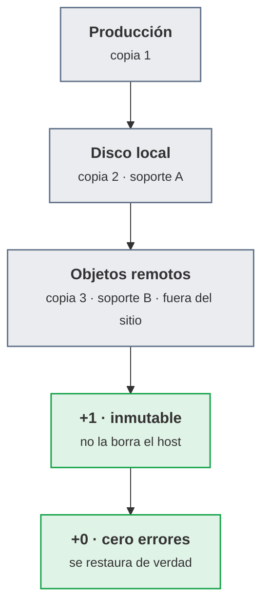
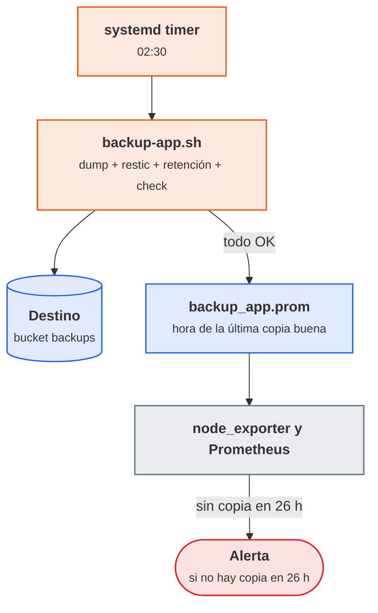

# UT6 · Copias de seguridad y restauración

<p class="ut-meta">14 h · Formación en empresa (19 abr a 9 jun 2027) · RA4 CE a, b, c</p>

Hasta ahora el módulo ha servido para enterarse a tiempo de lo que le pasa al servicio: métricas, logs, alarmas y pruebas. Hay fallos que ninguna alarma evita, como un disco que muere, un `DELETE` sin `WHERE` o un ransomware (un programa que cifra los datos y pide un rescate por la clave), y frente a ellos solo queda una copia que se pueda restaurar. En el centro la copia fue una pieza puntual: en febrero, la copia previa con restic (la herramienta de copias del curso) fue el plan B de la actualización en pre. Esta unidad, que se cursa en la empresa, la convierte en una tarea de mantenimiento sobre un servicio real, en tres bloques: que la copia se haga sola cada día (bloque 1), que esté fuera del alcance del host y cumpla la política de la empresa (bloque 2) y que se pueda restaurar en el tiempo comprometido (bloque 3).

Las reglas de trabajo son las de la UT5 ([Cómo trabajar en la empresa](ut5-logs-accesos-rendimiento.md#como-trabajar-en-la-empresa)), y aquí pesan más que nunca, porque casi todo toca producción: un volcado lee la base de datos entera, la prueba de borrado escribe en el destino de las copias y una restauración saca datos reales de donde están protegidos. Por eso cada hoja empieza pidiendo una autorización concreta del tutor, y nada que cambie un sistema de la empresa se hace sin ella. Tampoco se sacan datos de la empresa: se entregan configuraciones, listados y capturas anonimizadas (nombres de host, rutas y buckets pueden cambiarse por genéricos; el contenido de un dump nunca sale de allí). Las evidencias van a una carpeta `ut6/` del mismo repositorio local de la estancia, junto a la `ut5/`.

!!! empresa "Lo que hubo en el laboratorio"
    En el laboratorio hubo un repositorio restic contra el MinIO del curso, con la convención `s3:http://10.10.0.30:29000/backups`, la credencial `restic` y la contraseña en `/etc/restic/pass`, inicializado el 11 de febrero en la A7.4. Desde la red de la empresa no se alcanza, así que no sirve de destino: queda como referencia para comparar. La empresa tendrá su propia herramienta, su destino y sus políticas.

## Bloque 1 · Copias programadas (CE 4a)

<p class="ut-meta">En la empresa · con el tutor</p>

Un servicio en producción no puede depender de que alguien se acuerde de copiarlo: necesita una copia cada noche, consistente aunque la base de datos esté escribiendo, que deje rastro y que avise cuando falte. Este bloque la construye en orden: qué se copia, con qué objetivos (la regla 3-2-1, el RPO y el RTO), con qué herramienta (restic), cómo se programa y cómo se comprueba que se ha hecho. La hoja A6.1 lo aplica a una aplicación de la empresa, y esa copia es la que audita el bloque 2 y restaura el bloque 3.

### Qué se copia y qué no

**El criterio.** Se copia lo que no se puede reconstruir a partir de otra cosa ya guardada. Las imágenes están en el registry y el código en Git: copiarlos otra vez gasta espacio y da una falsa sensación de seguridad. Lo que sí se copia cabe en tres cajones:

- **Datos**: la base de datos y los volúmenes con ficheros que suben los usuarios. Es lo único que no existe en ningún otro sitio.
- **Configuración**: el `compose.yml`, el `.env` (cifrado, nunca en claro), certificados y claves TLS, la configuración del proxy y de la monitorización. Lo que corre en producción puede no coincidir con Git, y los secretos nunca están en él.
- **Versión desplegada**: qué imagen estaba en producción al hacer la copia, porque un dump de la versión 2.4 puede no arrancar con la imagen 2.6 si entre medias cambió la estructura de las tablas. Basta un `docker compose images` volcado a un fichero junto al dump.

#### Dump lógico frente a copia del volumen

**Por qué la base de datos no se copia como un fichero.** PostgreSQL escribe en disco de forma continua. Copiar el directorio del volumen con la base en marcha da ficheros de instantes distintos, que pueden no arrancar o arrancar con datos corruptos. La solución habitual es pedirle los datos al propio motor con un **dump lógico**: `pg_dump` exporta el contenido de la base como la foto de un instante, sin parar a nadie, y se puede cargar en una versión más nueva.

```bash
# La base, en formato custom (comprimido, permite restaurar en paralelo o una sola tabla)
docker compose exec -T db pg_dump -U app -Fc app > /var/backups/app.dump

# Roles y contraseñas del clúster, que pg_dump NO incluye
docker compose exec -T db pg_dumpall -U postgres --globals-only > /var/backups/globals.sql
```

- `-T` quita el terminal interactivo del `exec`. Sin él, la salida redirigida con `>` se corrompe: es la causa más habitual de un dump vacío.
- `-Fc` da el formato *custom*, que se carga con `pg_restore`.
- `--globals-only` saca los roles, que no pertenecen a ninguna base. Sin ellos, la carga falla con `role ... does not exist`.

Con otros motores la idea es la misma y cambia la orden:

| Motor | Volcado |
|---|---|
| MySQL o MariaDB | `mysqldump --single-transaction --routines --triggers --events app > app.sql` |
| MongoDB | `mongodump --archive --gzip > app.archive` |

**Los volúmenes de ficheros** sí se copian directamente: cada fichero se sostiene solo. Con restic basta pasarle la ruta del volumen (`/var/lib/docker/volumes/app_uploads/_data`). Si la base es tan grande que el dump no cabe en la ventana de copia, se copian los ficheros de la base con el servicio parado o con una copia física; eso lo decide la empresa y la hoja no lo necesita.

!!! truco "La buena práctica"
    `pg_dump -Fc` más los globals, cada noche, es la copia diaria estándar de una base PostgreSQL.

#### Ficheros, configuración y secretos

**Todo en la misma copia.** Ficheros y configuración van al mismo *snapshot* que los datos (snapshot es cada copia que guarda restic, con su fecha), para que una restauración devuelva la configuración y los datos del mismo día.

**Los secretos, cifrados aparte.** El `.env`, las claves de API y los certificados privados tienen que estar en la copia, pero no en claro. restic ya cifra todo el repositorio, pero quien tiene su contraseña lo lee todo; si además el `.env` va cifrado con una clave que custodia otra persona, esa contraseña ya no basta para llegar a las credenciales de producción. Se hace con `age`, que cifra con una clave pública y descifra con la privada: el host cifra cada noche sin tener la clave que descifra. La pública (la línea `age1...` que imprime `age-keygen`) se deja en `/etc/restic/age.pub`:

```bash
age-keygen -o copias.key                                        # quien custodia: genera el par, fuera del host
age -R /etc/restic/age.pub -o /opt/app/.env.enc /opt/app/.env   # el host: cifra antes de cada copia
age -d -i copias.key .env.enc > .env                            # al restaurar: descifra
```

La alternativa `sops` y dónde encaja cada una están en la [gestión de secretos](https://victor-educ.github.io/apuntes-5166/ut/ut5-iac/#gestion-de-secretos) de Despliegue.

### Regla 3-2-1, RPO y RTO

**Para qué sirven.** Dan la vara de medir una copia: cuántas hacen falta y dónde (3-2-1), cada cuánto se copia (RPO) y en cuánto tiempo hay que volver (RTO).

**La regla 3-2-1.** Tres copias de los datos (producción y dos más), en dos soportes distintos (disco local y almacenamiento de objetos, por ejemplo) y una fuera del edificio. La variante **3-2-1-1-0** añade una copia inmutable u *offline*, que nadie con las credenciales del host pueda borrar (el ransomware busca las copias para borrarlas antes de cifrar), y cero errores al verificar: las copias se restauran, no se dan por buenas.



<p class="pie" markdown>Una copia que el atacante puede borrar no es una copia, y una que nunca se ha restaurado no se sabe si lo es.</p>

**RPO y RTO.** Los fija quien responde del servicio, no el técnico, porque son una decisión de negocio: cuánto cuesta perder datos o tener el servicio parado frente a cuánto cuesta evitarlo.

- **RPO** (punto de recuperación objetivo): cuántos datos se pueden perder, medido en tiempo. Fija la frecuencia de copia: con un RPO de 24 h vale una copia diaria; con 1 h, hay que copiar cada hora o de forma continua.
- **RTO** (tiempo de recuperación objetivo): cuánto puede tardar el servicio en volver. Fija el método de restauración y dónde está la copia.

Un ejemplo: con copia diaria a las 02:30, si el disco muere a las 02:00 se pierde casi un día de pedidos. Si la empresa solo admite perder una hora, la copia diaria no cumple por muy bien que funcione. Y si el RTO es de 2 h pero la restauración de prueba tarda 3 h 40 min, el plan está mal. Por eso la A6.1 empieza pidiendo estos dos números y la A6.3 termina midiendo el segundo.

### Tipos de copia y snapshots

**Para qué saberlos.** Son el vocabulario de cualquier documentación y del tutor.

| Tipo | Qué copia | Para restaurar |
|---|---|---|
| Completa | Todo, cada vez | Un solo conjunto; cara en espacio y tiempo |
| Incremental | Lo que cambió desde la última copia | La completa y toda la cadena; un eslabón roto rompe lo de después |
| Diferencial | Lo que cambió desde la última completa | La completa y la última diferencial |
| Deduplicada (restic, borg) | Solo los bloques que no estaban ya guardados | Cada snapshot se restaura solo, y cuesta lo que una incremental |

**Los snapshots del hipervisor no son copias.** Las instantáneas de una VM en Proxmox (o de ZFS y LVM) son cómodas para volver atrás antes de una actualización, pero viven en el mismo almacenamiento que la VM y desaparecen con él, captan la base de datos en caliente y obligan a levantar la VM entera para recuperar un fichero. En empresa se combinan las dos cosas: copia de la VM entera para recuperar el host, y copia de aplicación con restic para recuperar datos.

### restic a fondo

**Para qué sirve.** restic cifra en el host antes de subir, guarda solo lo que ha cambiado, sabe qué copia es de qué día y de qué máquina, borra las antiguas con una regla y comprueba que lo guardado se puede leer. Es un solo programa (versión 0.18 en el laboratorio) que guarda en disco local, SFTP o almacenamiento de objetos compatible con S3, como MinIO.

**Tres reglas que conviene tener claras.** La contraseña es el repositorio: perderla es perder todas las copias, así que va al gestor de contraseñas de la empresa. Olvidar copias (`forget`) no libera espacio por sí solo: hace falta `prune`. Y cada operación deja un bloqueo en el repositorio mientras dura; si muere a medias, el bloqueo se queda y hay que retirarlo.

**Cómo se usa.** Con los valores del laboratorio; en la empresa cambian el destino y la credencial:

```bash
export RESTIC_REPOSITORY=s3:http://10.10.0.30:29000/backups
export RESTIC_PASSWORD_FILE=/etc/restic/pass        # permisos 600
export AWS_ACCESS_KEY_ID=restic                     # la credencial del bucket
export AWS_SECRET_ACCESS_KEY='...'                  # en el timer, desde /etc/restic/env
export RESTIC_CACHE_DIR=/var/cache/restic           # caché local de índices; acelera todo

restic init                                          # una vez: crea el repositorio
restic backup /var/backups /opt/app/compose.yml /var/lib/docker/volumes/app_uploads/_data \
  --tag app --exclude-file /etc/restic/excludes --one-file-system
restic snapshots                                     # lista las copias
restic snapshots --latest 1 --tag app                # la última con tag app
```

`--one-file-system` evita que la copia se meta en un disco de red montado bajo una de las rutas, y `/etc/restic/excludes` lleva un patrón por línea de lo que no se copia (cachés, `node_modules`, logs rotados). Las demás órdenes que aparecen en las hojas:

- **Tags y grupos.** Cada snapshot lleva el host y sus tags. La retención se aplica por grupos; con `--group-by host,tags`, añadir una ruta al script no deja copias viejas sin rotar.
- **Volcado por la entrada estándar.** `restic backup --stdin-from-command --stdin-filename app.dump -- pg_dump ...` guarda el dump sin escribirlo a disco, y si `pg_dump` falla no crea el snapshot. Es como se hizo la copia de la A7.4.
- **Retención.** `restic forget --keep-daily 7 --keep-weekly 4 --keep-monthly 6 --prune` conserva la última copia de cada uno de los 7 últimos días, 4 semanas y 6 meses (una misma copia puede contar como diaria, semanal y mensual). `forget` borra los snapshots y `prune` libera el espacio; como `prune` es lento y bloquea el repositorio, se programa aparte, una vez por semana.
- **Verificación.** `restic check` revisa la estructura; `--read-data-subset=5%` descarga y comprueba un 5 % de los datos en cada ejecución, y `--read-data` los comprueba todos.
- **Restauración.** `restic restore latest --target /restore` restaura la última copia; `--include <ruta>` saca solo una ruta. `restic find <fichero>` dice en qué snapshots está, `restic diff <id1> <id2>` qué cambió entre dos, y `restic mount /mnt/restic` monta el repositorio como un directorio para copiar un fichero suelto con `cp` (necesita el paquete `fuse3`).
- **Bloqueos.** Si una copia murió a medias, la siguiente falla con `repository is already locked`. `restic unlock` lo arregla, tras comprobar con `ps aux | grep restic` que no hay otro restic en marcha.
- **Contraseña.** `restic key add` añade una nueva y `restic key remove <id>` quita la antigua: así se cambia sin perder el acceso.

Si la empresa usa BorgBackup, la otra herramienta de copias deduplicadas y cifradas, el trabajo es el mismo con otros nombres. Su destino típico es una NAS por SSH, que puede ponerse en modo *append-only* (el cliente añade copias pero no borra):

| restic | borg |
|---|---|
| `restic backup` | `borg create` |
| `restic forget` + `restic prune` | `borg prune` + `borg compact` |
| `restic check` | `borg check` |
| `restic mount` | `borg mount` |

### Programar la copia

**Para qué sirve.** Para que la copia se haga sola cada noche hacen falta un script que ejecute los pasos siempre en el mismo orden y se pare en cuanto uno falle, y un programador que lo lance a la hora que pide el RPO. El recorrido completo:



<p class="pie" markdown>La copia no termina cuando se escribe: termina cuando alguien puede demostrar que se escribió.</p>

**El script.** Cifra el `.env`, apunta las versiones de imagen, vuelca la base de datos y los roles, lanza restic, aplica la retención y verifica; al terminar escribe una métrica que recoge node_exporter (el [agente de métricas del host](ut1-observabilidad.md#exporters-lo-que-no-se-puede-instrumentar)). Es el script que se adapta en la A6.1. Si en la empresa la base no está en el compose (en el laboratorio, PostgreSQL vivía en su propia VM), cambian las dos líneas del volcado.

```bash
#!/bin/bash
# /usr/local/bin/backup-app.sh
set -euo pipefail
export RESTIC_REPOSITORY=s3:https://<destino>/backups
export RESTIC_PASSWORD_FILE=/etc/restic/pass
export RESTIC_CACHE_DIR=/var/cache/restic
# AWS_ACCESS_KEY_ID y AWS_SECRET_ACCESS_KEY llegan por EnvironmentFile= de la unit

TS_FILE=/var/lib/prometheus/node-exporter/backup_app.prom   # el directorio de textfile del node_exporter
START=$(date +%s)

cd /opt/app
age -R /etc/restic/age.pub -o /opt/app/.env.enc /opt/app/.env   # el .env viaja cifrado
docker compose images --format json > /var/backups/app-images.json
docker compose exec -T db pg_dump -U app -Fc app > /var/backups/app.dump
docker compose exec -T db pg_dumpall -U postgres --globals-only > /var/backups/globals.sql

restic backup /var/backups /opt/app/compose.yml /opt/app/.env.enc \
  /var/lib/docker/volumes/app_uploads/_data \
  --tag app --exclude-file /etc/restic/excludes --one-file-system
restic forget --keep-daily 7 --keep-weekly 4 --keep-monthly 6 --tag app --group-by host,tags
restic check --read-data-subset=5%

# Métrica para Prometheus: solo se escribe si todo lo anterior ha ido bien (set -e)
# La etiqueta no se llama job: Prometheus la renombraría a exported_job
cat > "$TS_FILE.$$" <<EOF
# HELP backup_last_success_timestamp_seconds Epoch de la última copia correcta
# TYPE backup_last_success_timestamp_seconds gauge
backup_last_success_timestamp_seconds{backup="app"} $(date +%s)
backup_last_duration_seconds{backup="app"} $(( $(date +%s) - START ))
EOF
mv "$TS_FILE.$$" "$TS_FILE"
```

- **`set -euo pipefail`** para el script en cuanto falla una orden, una variable sin definir o cualquier parte de una tubería. El código de salida distinto de cero es lo que mira systemd.
- **El orden.** Los volcados van antes que restic, que copia lo que dejan en `/var/backups`. La retención va después de una copia correcta: si la de hoy falla, no se borra ninguna antigua. El `prune` no está aquí: va en un timer semanal aparte.
- **La métrica, al final.** Con `set -e`, llegar a la última línea significa que todo ha ido bien. Se escribe en un temporal y se renombra con `mv`, para que node_exporter nunca lea un fichero a medias.

#### systemd timers

**Para qué sirve.** Un timer de systemd lanza otra unit a una hora fija. Frente a cron, si el host estaba apagado lanza la copia al arrancar, el log va al journal y un fallo deja la unit en estado `failed`. Hacen falta dos ficheros:

```ini
# /etc/systemd/system/backup-app.service
[Unit]
Description=Copia de seguridad de app
After=docker.service network-online.target
Wants=network-online.target

[Service]
Type=oneshot
EnvironmentFile=/etc/restic/env
ExecStart=/usr/local/bin/backup-app.sh
Nice=10
IOSchedulingClass=best-effort
IOSchedulingPriority=7
```

- `Type=oneshot`: se ejecuta, termina y no queda residente.
- `After=` y `Wants=`: espera a Docker y a que la red esté lista.
- `EnvironmentFile=/etc/restic/env`: carga las credenciales del bucket, que así no quedan escritas en el script.
- `Nice` e `IOScheduling`: la copia cede CPU y disco al servicio si coinciden.

```ini
# /etc/systemd/system/backup-app.timer
[Unit]
Description=Lanza backup-app.service cada noche

[Timer]
OnCalendar=*-*-* 02:30:00
Persistent=true
RandomizedDelaySec=15m
Unit=backup-app.service

[Install]
WantedBy=timers.target
```

- `OnCalendar`: la hora. `systemd-analyze calendar '*-*-* 02:30:00'` dice cuándo será la próxima.
- `Persistent=true`: si el host estaba apagado a las 02:30, la copia se lanza al arrancar.
- `RandomizedDelaySec`: reparte la carga cuando varios hosts copian al mismo destino a la misma hora.

Se activa el timer, no el servicio, con `systemctl enable --now backup-app.timer`. `systemctl list-timers` muestra la próxima y la última ejecución, y `journalctl -u backup-app.service -n 50` el log.

#### cron y contenedor programador

**cron.** Si la empresa usa cron, se respeta: cambiar de programador es una decisión del equipo. La línea equivalente en `/etc/cron.d/backup-app`:

```
30 2 * * * root /usr/local/bin/backup-app.sh >> /var/log/backup-app.log 2>&1
```

cron no recupera ejecuciones perdidas ni tiene `EnvironmentFile=`, así que el script carga él mismo las credenciales al principio con `set -a; . /etc/restic/env; set +a`. La alerta por ausencia compensa que el fallo no se vea.

**Contenedor programador.** Si en el host solo se dispone de Docker, el programador va en un contenedor (ofelia, o un Alpine con `crond`). Necesita el socket de Docker, y quien habla con ese socket equivale a root en el host: hay que documentarlo.

### Verificar que se ha ejecutado

**El problema.** Una copia programada que nadie mira deja de funcionar en silencio: caduca la credencial, se llena el disco, cambia una contraseña. Se comprueba en cuatro capas, de la más barata a la más fiable:

1. **Código de salida.** `systemctl is-failed backup-app.service`.
2. **Log.** `journalctl -u backup-app.service --since yesterday`. restic resume al final cuántos ficheros y datos ha añadido; "Added to the repository: 0 B" varios días seguidos en una aplicación viva es sospechoso.
3. **El repositorio.** `restic snapshots --latest 1 --tag app` debe dar una copia de hoy, y `restic stats latest` un tamaño en el rango esperado.
4. **Alerta por ausencia.** Las tres anteriores no ven nada si el host está apagado o el timer deshabilitado. Hace falta que otro sistema espere una señal y avise cuando no llega.

**Con Prometheus.** La señal es la métrica que escribe el script. node_exporter publica los ficheros `.prom` de su directorio de textfile: en el paquete `prometheus-node-exporter` de Debian, `/var/lib/prometheus/node-exporter`; en otra instalación, el que diga su opción `--collector.textfile.directory`. Las dos reglas, con la sintaxis de las [reglas de alerta](ut2-alarmas.md#reglas-de-alerta):

```yaml
groups:
  - name: backups
    rules:
      - alert: BackupMissing
        expr: time() - backup_last_success_timestamp_seconds > 26 * 3600
        for: 10m
        labels: {severity: critical}
        annotations:
          summary: "Sin copia correcta de {{ $labels.backup }} en más de 26 h"
      - alert: BackupMetricAbsent
        expr: absent(backup_last_success_timestamp_seconds{backup="app"})
        for: 30m
        labels: {severity: warning}
```

La primera salta si la última copia correcta tiene más de 26 h (el margen evita ruido por el retraso aleatorio). La segunda cubre que la métrica desaparezca: sin [`absent()`](ut2-alarmas.md#operadores-con-etiquetas), la primera no devuelve nada y no salta. El enrutado en Alertmanager es el de [El árbol de rutas](ut2-alarmas.md#el-arbol-de-rutas).

**Sin Prometheus.** Se usa un servicio que espera la señal, como [healthchecks.io](https://healthchecks.io/docs/) (o su versión autoalojada en un contenedor): se crea un *check* con periodo de 24 h y gracia de 2 h, y el script termina con `curl -fsS -m 10 --retry 3 https://hc-ping.com/<uuid>`. Si el ping no llega, avisa.

### A6.1 Copias programadas (CE 4a)

<span class="et et-obj">Objetivo</span> Al terminar, una aplicación real de la empresa tiene una copia programada que se ejecuta sola a la hora que pide su RPO, deja rastro y avisa cuando falta. Es la copia que auditas en la A6.2 y restauras en la A6.3, y el montaje que te pedirán en cualquier empresa que tenga un servicio con datos.

<span class="et et-pre">Antes de empezar</span>

- Autorización escrita del tutor para trabajar sobre la aplicación elegida y acuerdo sobre qué puedes ejecutar en producción.
- Acceso como root al host de la aplicación, con `restic` y `age` instalados, o el tutor delante si no te lo dan.
- Un destino aprobado por la empresa: bucket o NAS o, si no hay nada, un MinIO temporal en contenedor en un host de pruebas, montado con la [receta del laboratorio de Despliegue](https://victor-educ.github.io/apuntes-5166/laboratorio/#como-se-monta-minio).
- La clave pública de `age` que te da quien custodia la privada ([Ficheros, configuración y secretos](#ficheros-configuracion-y-secretos)).
- Leído: [Qué se copia y qué no](#que-se-copia-y-que-no), [Regla 3-2-1, RPO y RTO](#regla-3-2-1-rpo-y-rto), [restic a fondo](#restic-a-fondo), [Programar la copia](#programar-la-copia) y [Verificar que se ha ejecutado](#verificar-que-se-ha-ejecutado).

<span class="et et-pas">Pasos</span>

Construyes la copia pieza a pieza y pruebas cada una a mano antes de automatizarla: primero decides qué se copia, después lanzas el volcado y la copia tú, y solo entonces los metes en el script y el timer y añades la alerta. Así, si algo falla de madrugada, sabes que el problema está en lo que añadió la automatización.

1. **Haz el inventario y fija los objetivos.** Con el tutor, haz una tabla con cada componente de la aplicación (base de datos, volúmenes, configuración, secretos, versión de imagen), si se copia o no y por qué. Saca los volúmenes en uso del propio contenedor, no de `docker volume ls`, que lista también los abandonados:

    ```bash
    cd <directorio del compose>
    docker compose ps
    docker compose images
    docker inspect -f '{{ json .Mounts }}' <contenedor>
    ```

    Apunta también el RPO y el RTO que fije el responsable del servicio. Si nadie los ha fijado, propón 24 h y 4 h y deja constancia de que es una propuesta.

    Comprobación: cada volumen que aparece en `Mounts` tiene su fila en la tabla.

2. **Contrasta lo que ya hay.** Si la empresa ya tiene copias, compara su script con el de [Programar la copia](#programar-la-copia): dump consistente, `-T` en el `exec`, secretos cifrados, `set -e` y retención escrita. Apunta cada diferencia en una lista de mejoras para el tutor; no sustituyas lo que funciona. Si no hay copias, pasa al paso 3.

    Comprobación: la lista tiene una línea por cada punto de los cinco, aunque sea "cumple".

3. **Saca a mano un volcado consistente.** A la hora que acuerdes con el tutor (lee la base entera de producción), vuelca la base y los roles:

    ```bash
    mkdir -p /var/backups
    docker compose exec -T <servicio de la base> pg_dump -U <usuario> -Fc <base> > /var/backups/app.dump
    docker compose exec -T <servicio de la base> pg_dumpall -U postgres --globals-only > /var/backups/globals.sql
    ```

    Comprobación: `ls -la /var/backups` muestra los dos ficheros con un tamaño coherente con la base, no 0 bytes. Un dump de 0 bytes suele ser el `-T` que falta.

4. **Haz a mano la primera copia con restic.** Cifra el `.env`, carga las variables de [restic a fondo](#restic-a-fondo) con tu destino y lanza la copia con el tag `app`:

    ```bash
    age -R /etc/restic/age.pub -o <directorio del compose>/.env.enc <directorio del compose>/.env
    export RESTIC_REPOSITORY=<tu destino>
    export RESTIC_PASSWORD_FILE=/etc/restic/pass
    set -a; . /etc/restic/env; set +a        # AWS_ACCESS_KEY_ID y AWS_SECRET_ACCESS_KEY
    restic init                              # solo si el repositorio es nuevo
    restic backup /var/backups <directorio del compose>/compose.yml <directorio del compose>/.env.enc \
      <ruta del volumen de ficheros> --tag app --one-file-system
    ```

    Si el repositorio es nuevo, su contraseña va al gestor de contraseñas de la empresa en cuanto la generas. Sin las variables `AWS_*`, `restic init` falla con un `unable to open config file` engañoso.

    Comprobación: `restic snapshots --tag app` muestra la copia recién hecha.

5. **Automatízala.** Copia el `backup-app.sh` de [Programar la copia](#programar-la-copia) en `/usr/local/bin/` y cambia el destino, las rutas, el servicio de la base y la retención acordada. Copia la unit y el timer de [systemd timers](#systemd-timers), con la hora que pide el RPO, o usa la línea de cron si es lo que usa la empresa. Lanza una ejecución por la unit, no ejecutando el script, para comprobar que con systemd ve las mismas credenciales que tú:

    ```bash
    chmod 700 /usr/local/bin/backup-app.sh
    systemctl daemon-reload
    systemctl enable --now backup-app.timer
    systemctl start backup-app.service
    journalctl -u backup-app.service -n 50
    ```

    `TS_FILE` tiene que estar en el directorio de textfile del node_exporter del host. Si no lee ninguno, activarlo lo decide el tutor; si no lo autoriza, la alerta va por healthchecks.io.

    Comprobación: el log termina con el resumen de restic y sin errores, y `systemctl list-timers` muestra la próxima ejecución.

6. **Comprueba que la alerta salta.** Añade las dos reglas de [Verificar que se ha ejecutado](#verificar-que-se-ha-ejecutado) si hay Prometheus, o el check de healthchecks.io si no. Provócala con el tutor delante sin esperar un día:

    - Con Prometheus: umbral de `BackupMissing` a `> 300` y `for: 1m` en las dos reglas; para `BackupMetricAbsent`, aparta el `.prom` a otro directorio.
    - Con healthchecks.io: periodo de 5 min y gracia de 1 min.

    Captura cada alerta disparada y deja los valores y el `.prom` como estaban.

    Comprobación: tras la siguiente copia correcta, la alerta vuelve a estado normal.

<span class="et et-com">Comprobación</span>

- `systemctl list-timers` muestra el timer con próxima ejecución, y `journalctl -u backup-app.service` termina con el resumen de restic y sin errores.
- `restic snapshots --latest 1 --tag app` devuelve un snapshot de hoy con las rutas esperadas; `restic ls latest | grep app.dump` lo localiza dentro.
- El dump tiene un tamaño coherente con la base (`ls -la /var/backups`), no 0 bytes.
- La alerta ha saltado en la prueba de ausencia y ha vuelto a estado normal tras una copia correcta.

<span class="et et-ent">Entrega</span> En `ut6/a61/` del repositorio de la estancia: la tabla de inventario del paso 1 y la lista de mejoras del paso 2 si había copias previas, el script o la configuración anonimizados, unit y timer (o la línea de cron), salida de `restic snapshots` (o equivalente), la regla o el check de alerta y la captura de la alerta disparada. Fila A6.1 de la ficha de evidencias firmada por el tutor.

## Bloque 2 · Exportación y políticas (CE 4b)

<p class="ut-meta">En la empresa · con el tutor</p>

La copia del bloque 1 se hace sola y avisa si falta, pero eso no garantiza que sobreviva. Si está en el mismo servidor, se pierde con él; si el host que copia puede borrarla, un ransomware que entre en él la borra; y si nadie la poda con criterio, el destino se llena o guarda menos de lo que la empresa cree. Este bloque comprueba esas tres cosas contra una política escrita. Necesita la copia del bloque 1 funcionando desde hace unos días, para que haya varios snapshots que contar.

### Destinos y políticas

**Dónde puede estar la copia.** La copia en `/var/backups` del propio host no cuenta: se pierde con el servidor. Los destinos habituales:

| Destino | A favor | En contra |
|---|---|---|
| Almacenamiento de objetos (S3, MinIO en otro centro de datos) | Fuera del sitio sin esfuerzo; permite impedir el borrado desde el propio destino | En nube, se paga por GB y por descargar al restaurar |
| NAS por SFTP o NFS | Barato y rápido en la red local | Suele estar en el mismo edificio |
| Disco externo rotado o cinta | Desconectado de verdad | Depende de que alguien lo cambie |

Con restic lo habitual es el almacenamiento de objetos: queda fuera del sitio y permite la protección contra borrado de abajo.

**Qué tiene que cumplir.** La política de copias de la empresa fija tres cosas, y la A6.2 las comprueba: cómo se almacena, cuántas copias se conservan (rotación) y cómo se libera lo que sobra (limpieza).

**Almacenamiento.** Tres requisitos, cada uno con su comprobación. En las órdenes, `minio` es el alias con el que se ha dado de alta el destino en `mc`, el cliente de línea de comandos de MinIO:

| Requisito | Qué se exige | Cómo se comprueba |
|---|---|---|
| Cifrado | Cifrado en el host antes de subir. restic ya lo hace. | En el destino solo se ven bloques cifrados, no nombres de fichero de la aplicación. |
| Ubicación | Si hay datos personales, el reglamento europeo de protección de datos (RGPD) condiciona dónde puede estar la copia: una región de la UE vale; una de Estados Unidos complica mucho las cosas. | Región del bucket (`mc admin info` o la consola de la nube) frente a la política. |
| Protección contra borrado | El host que copia no puede destruir las copias: versionado del bucket, bloqueo de objetos (Object Lock) con retención, y una credencial del script sin permiso de borrado (salvo en `locks/`). | `mc version info minio/backups`, `mc retention info minio/backups`, la política de la credencial y una prueba de borrado que tiene que responder `AccessDenied`. |

**Por qué tres capas.** Sin permiso de borrado, la credencial del host no borra, pero podría sobrescribir con basura; el versionado (`mc version enable minio/backups`) guarda la versión anterior; y Object Lock en modo *compliance* (`mc retention set --default COMPLIANCE 30d minio/backups`) impide que nadie, ni el administrador, borre esas versiones antes de que venza el plazo. La prueba de borrado se hace siempre con un objeto de usar y tirar, nunca con un `forget --prune` contra el repositorio real: si la protección está mal, ese comando destruye copias.

**Lo que cambia en el script.** Una credencial sin permiso de borrado tampoco puede ejecutar `forget`. Con esta protección, el `forget` sale del script de la A6.1 y pasa, junto al `prune`, a otro host con otras credenciales; el host de producción solo vuelca, copia y verifica. La excepción es `locks/`, donde restic crea y borra su fichero de bloqueo en cada operación.

**Rotación.** Los `--keep-*` tienen que coincidir con la política, y el listado del destino también. Se cuenta con `restic snapshots --group-by tags`.

**Limpieza.** El `prune` está programado y se ejecuta fuera de la hora de la copia; el espacio ocupado (`restic stats --mode raw-data`, `mc du minio/backups`) está dentro de lo previsto; y, con versionado, hay una regla de ciclo de vida para que las versiones antiguas se borren al vencer la retención (`mc ilm rule add --expire-delete-marker --noncurrent-expire-days 30 minio/backups`).

**Cómo se comprueba todo.** Se lista el destino y se compara línea a línea con la política. Lo que no coincide va a la tabla de cumplimiento con una fecha de corrección.

!!! ojo "Las credenciales del bucket no son secretos de segunda"
    Quien lea `/etc/restic/env` con la credencial del bucket y la contraseña del repositorio tiene las copias enteras de la empresa. Ese fichero va con `chmod 600`, propietario root y fuera de cualquier repositorio Git; si la empresa tiene un gestor de secretos, se sirve desde allí.

### A6.2 Exportación y políticas (CE 4b)

<span class="et et-obj">Objetivo</span> Al terminar, has demostrado con listados que las copias están fuera del host, que el host que copia no puede borrarlas y que la rotación y la limpieza coinciden con la política escrita; lo que no coincide queda en una tabla de cumplimiento con su corrección. Es la auditoría de copias que se pide en cualquier revisión de seguridad.

<span class="et et-pre">Antes de empezar</span>

- Autorización del tutor para lanzar comandos de solo lectura contra el destino; los cambios (versionado, Object Lock, ciclo de vida), solo con su visto bueno y, mejor, ejecutados por él.
- La copia de la A6.1 funcionando desde hace unos días.
- Credenciales de lectura al destino y, si es una nube pública, leído lo que explica la [unidad de nube pública de Despliegue](https://victor-educ.github.io/apuntes-5166/ut/ut4-nube-publica/) sobre cuentas, regiones y coste de descarga.
- Leído: [Destinos y políticas](#destinos-y-politicas) y el apartado de retención de [restic a fondo](#restic-a-fondo).

<span class="et et-pas">Pasos</span>

Es una auditoría: primero consigues la política, que es la vara de medir; después sacas los listados del destino; luego compruebas almacenamiento, rotación y limpieza; y al final lo resumes en una tabla. Todo es de solo lectura salvo la prueba de borrado del paso 3.

1. **Consigue la política escrita.** Pide la política de copias de la empresa. Si no existe, redáctala en media página a partir del RPO de la A6.1 y del espacio disponible, con cinco puntos: cifrado, ubicación, protección contra borrado, retención y limpieza. Márcala como propuesta y que el tutor la lea antes de seguir.

    Comprobación: el tutor ha dado por buena la política contra la que vas a medir.

2. **Lista el destino.** Saca los snapshots agrupados, los objetos con sus versiones y el espacio ocupado, y guarda la salida anonimizada:

    ```bash
    restic snapshots --group-by tags --no-lock > snapshots.txt
    restic stats --mode raw-data --no-lock
    mc ls --versions --recursive minio/backups | head -50
    mc du minio/backups
    ```

    `--no-lock` deja listar con una credencial de solo lectura, que no puede crear su fichero en `locks/`.

    Comprobación: `snapshots.txt` contiene las copias de la A6.1.

3. **Comprueba el almacenamiento.** Recorre las tres filas de la tabla de [Destinos y políticas](#destinos-y-politicas) anotando orden y resultado. La protección contra borrado se demuestra intentando borrar, con la credencial del script, un objeto de usar y tirar que subes tú, en un alias aparte para no usar sin querer la de administración:

    ```bash
    mc alias set script <URL del destino> <clave de acceso del script> <secreto del script>
    echo prueba > prueba-borrado.txt
    mc cp prueba-borrado.txt script/backups/prueba-borrado.txt
    mc rm script/backups/prueba-borrado.txt
    ```

    Si la empresa usa borg contra una NAS, lo que se busca es el modo `--append-only` en el `authorized_keys` del usuario de copias.

    Comprobación: `mc rm` responde `AccessDenied` y el objeto sigue ahí; anótalo para que lo retire quien administre el bucket.

    !!! ojo "El repositorio real no se usa para probar borrados"
        Si la protección está mal puesta, que es lo que vienes a comprobar, un `restic forget --prune` contra el
        repositorio de la empresa borra copias de verdad. Si el destino no deja escribir fuera de él, prueba
        contra un repositorio restic de usar y tirar en otro prefijo.

4. **Cuenta la rotación.** En `snapshots.txt`, cuenta cuántas diarias, semanales y mensuales hay y compáralo con los `--keep-*` que aplica la limpieza y con la política. Recuerda que una misma copia puede contar como diaria, semanal y mensual.

    Comprobación: tienes los tres números (listado, `--keep-*` y política) en una misma línea de tus notas.

5. **Comprueba la limpieza.** Localiza dónde se ejecuta el `prune` y cuándo fue la última vez, compara el espacio ocupado con el previsto y, si el bucket tiene versionado, busca la regla de ciclo de vida:

    ```bash
    systemctl list-timers | grep -i prune      # en el host que hace la limpieza
    mc ilm rule ls minio/backups
    ```

    Comprobación: sabes en qué host, con qué credencial y cada cuánto se libera espacio, o has apuntado que no se hace.

6. **Resume en la tabla de cumplimiento.** Una fila por punto de la política: requisito, cómo se comprobó, resultado y acción correctora con fecha si procede. Lo que no cumple se propone al tutor y, si lo autoriza, se corrige y se vuelve a comprobar.

    Comprobación: ninguna fila vacía, y cada "no cumple" tiene acción y fecha.

<span class="et et-com">Comprobación</span>

- El listado del destino muestra los snapshots de la A6.1 y el recuento por tipo coincide con la política y con los flags `--keep-*`.
- El borrado del objeto (o del repositorio) de usar y tirar con la credencial del script ha fallado con `AccessDenied`, y las copias reales siguen intactas: `restic snapshots` devuelve las mismas de antes de la prueba.
- La tabla de cumplimiento no tiene filas vacías y cada "no cumple" tiene acción y fecha.

<span class="et et-ent">Entrega</span> En `ut6/a62/` del repositorio de la estancia: la política del paso 1 (de la empresa o tu propuesta, indicando cuál), los listados del destino del paso 2 (anonimizados) y la tabla de cumplimiento del paso 6. Fila A6.2 de la ficha de evidencias firmada por el tutor.

## Bloque 3 · Restauración de prueba (CE 4c)

<p class="ut-meta">En la empresa · con el tutor</p>

Una copia puede estar completa y no restaurarse: falta la clave del `.env`, los roles no se copiaron, la versión de imagen no casa con los datos o la restauración tarda el triple de lo que permite el RTO. Todo eso solo aparece al restaurar, y es mejor que aparezca un martes cualquiera en pruebas que el día del desastre. Este bloque restaura la copia del bloque 1, desde el destino que audita el bloque 2, y recoge lo aprendido en el plan de copias que se entrega al cierre.

### Restaurar: el mantenimiento preventivo

**Para qué sirve.** Una copia que no se ha restaurado nunca es una suposición. La restauración periódica (mensual como mínimo, y siempre antes de una actualización mayor) es el mantenimiento preventivo de las copias: se hace sin que nada haya fallado, para encontrar los fallos mientras arreglarlos no corre prisa.

**El procedimiento.** Con el cronómetro en marcha desde la primera orden, porque se quiere saber cuánto tarda cada fase frente al RTO:

1. **Elegir la copia**, normalmente la última: `restic snapshots --latest 1 --tag app`. Anotar el ID corto.
2. **Preparar la plataforma de pruebas**: una VM o un host que no sea producción, con Docker, restic, acceso al destino y espacio libre del doble del dump. Se usa un proyecto de compose distinto (`-p app_restore`) para que contenedores, redes y volúmenes no choquen con nada.
3. **Restaurar** con `restic restore <id> --target /restore`. Lo restaurado conserva las rutas originales: el dump, los roles y `app-images.json` quedan en `/restore/var/backups`.
4. **Levantar solo la base de datos** con la versión de imagen de `app-images.json`, con el `compose.yml` y el `.env` descifrado ya en su sitio (la copia solo guarda el `.env.enc`). Después, cargar roles y dump:

    ```bash
    docker compose -p app_restore up -d db
    docker compose -p app_restore cp /restore/var/backups/globals.sql db:/tmp/
    docker compose -p app_restore cp /restore/var/backups/app.dump db:/tmp/
    docker compose -p app_restore exec -T db psql -U postgres -f /tmp/globals.sql
    docker compose -p app_restore exec -T db pg_restore -U app -d app -j 4 /tmp/app.dump
    ```

    El dump se copia al contenedor porque `pg_restore -j` no lee de la entrada estándar. Los errores "role already exists" al cargar los roles son normales.
5. **Restaurar los ficheros** en el volumen nuevo con un contenedor auxiliar. `docker compose -p app_restore create` crea el volumen sin arrancar la aplicación:

    ```bash
    docker compose -p app_restore create
    docker run --rm -v app_restore_<volumen de ficheros>:/data \
      -v /restore/var/lib/docker/volumes/app_uploads/_data:/origen:ro alpine \
      sh -c 'cp -a /origen/. /data/ && chown -R <UID de la imagen> /data'
    ```

6. **Levantar el servicio y verificar**: la aplicación arranca, los datos están (recuentos de las tablas principales, el último registro, un fichero subido que se abre) y pasan las pruebas funcionales básicas (login, una búsqueda).
7. **Parar el cronómetro** y comparar con el RTO.
8. **Registrar** fecha, snapshot, quién, tiempo por fase, resultado e incidencias, y **destruir** el entorno (`docker compose -p app_restore down -v` y `rm -rf /restore`), porque contiene datos reales de la empresa.

**El fichero suelto.** Es lo que más piden los usuarios ("he borrado el informe de marzo"), y su tiempo es otro RTO. `restic find informe-marzo.pdf` dice en qué snapshots está, y `restic restore <id> --target /tmp/r --include '<ruta completa del fichero>'` lo saca solo.

**Restaurar a un punto anterior.** Si el daño se descubre días después ("alguien vació la tabla de clientes el martes"), la copia útil es la anterior al daño, no la última. `restic snapshots` y `restic diff` ayudan a localizarla, y `pg_restore -t clientes` recupera solo esa tabla en una base auxiliar.

Junto a la restauración, el mantenimiento incluye un `restic check --read-data` completo cada mes o cada trimestre (además del 5 % de cada noche) y el cambio de la contraseña del repositorio cuando lo pida la política.

### El plan de copias como documento

**Para qué sirve.** La empresa necesita un documento que otra persona pueda seguir a las tres de la mañana con el servicio caído, porque quien monta las copias no suele ser quien las restaura. Lleva comandos literales y rutas reales. Dos páginas, con estos apartados en este orden:

1. **Alcance**: qué servicio, qué componentes y qué queda fuera y por qué.
2. **Objetivos**: RPO y RTO acordados y los medidos en la última restauración de prueba.
3. **Qué y cuándo**: método por componente, programación (timer, hora), herramienta y versión.
4. **Dónde**: destino, cifrado, ubicación y quién custodia las claves.
5. **Retención y limpieza**: rotación, protección contra borrado, `prune` y ciclo de vida.
6. **Verificación**: qué se mira a diario y qué cada mes, y quién lo hace.
7. **Procedimiento de restauración**: el anterior adaptado, con comandos literales, y el del fichero suelto.
8. **Registro**: tabla con las restauraciones de prueba (fecha, snapshot, tiempo, resultado).

### A6.3 Restauración de prueba (CE 4c)

<span class="et et-obj">Objetivo</span> Al terminar, has levantado el servicio en una plataforma de pruebas desde la última copia de la A6.1, con los datos verificados, un tiempo medido por fase comparado con el RTO y el entorno destruido. Es la única prueba que demuestra a la vez que la copia, el destino, las claves y el procedimiento funcionan.

<span class="et et-pre">Antes de empezar</span>

- Autorización del tutor para restaurar datos reales en pruebas, con acuerdo escrito de que el entorno se destruye al terminar.
- Una VM o un host de pruebas que no sea producción, con Docker, restic (o la herramienta de la empresa), acceso de lectura al destino y espacio libre de al menos el doble del último snapshot.
- El `.env` descifrado o la clave con la que descifrarlo, en manos de quien la custodie.
- Un cronómetro y una plantilla de registro con una fila por fase: inicio, fin, duración e incidencia.
- Leído: [Restaurar: el mantenimiento preventivo](#restaurar-el-mantenimiento-preventivo) entero.

<span class="et et-pas">Pasos</span>

Sigues el procedimiento de [Restaurar: el mantenimiento preventivo](#restaurar-el-mantenimiento-preventivo) en el orden en que se reconstruiría el servicio de verdad: traes los datos, levantas y cargas la base, luego el resto, y con todo arriba verificas. El cronómetro corre desde el primer paso y se anota por fases, porque las fases dicen dónde se va el tiempo. Al final destruyes lo restaurado.

1. **Trae la copia a la plataforma de pruebas.** Con las variables de restic cargadas en la plataforma de pruebas, arranca el cronómetro y restaura:

    ```bash
    restic snapshots --latest 1 --tag app
    restic restore <ID> --target /restore
    ls /restore/var/backups
    ```

    Comprobación: en `/restore/var/backups` están el dump, los roles y `app-images.json`. Anota la duración de esta fase.

2. **Reconstruye la base de datos y los ficheros.** Pon el `compose.yml` restaurado y el `.env` descifrado en un directorio de trabajo, con la versión de imagen de `app-images.json`. Levanta solo la base, carga roles y dump, y lleva los ficheros a su volumen con las órdenes de los puntos 4 y 5 del [procedimiento](#restaurar-el-mantenimiento-preventivo), cambiando `<UID de la imagen>`. La base va sola y primero porque la aplicación, contra una base vacía, podría crear su propio esquema y estorbar a la carga.

    Comprobación: `docker compose -p app_restore exec db psql -U app -d app -c '\dt'` lista las tablas. Anota la duración de cada fase.

3. **Levanta el servicio y demuestra que los datos están.** `docker compose -p app_restore up -d` y verifica los recuentos de las tablas principales, el último registro, un fichero subido que se abre y las pruebas funcionales que acuerdes con el tutor, comparando con producción si es posible: que la aplicación arranque no basta. Para el cronómetro y compara el total con el RTO de la A6.1; si lo superas, va al registro como incidencia.

    Comprobación: las pruebas funcionales pasan y tienes el tiempo total escrito junto al RTO.

4. **Recupera un fichero suelto.** Con su propio cronómetro, recupera un fichero que acuerdes con el tutor, como en [Restaurar: el mantenimiento preventivo](#restaurar-el-mantenimiento-preventivo):

    ```bash
    restic find <nombre del fichero>
    restic restore <ID> --target /tmp/r --include '<ruta completa del fichero>'
    ```

    Comprobación: el fichero se abre en `/tmp/r` y su tiempo está anotado aparte.

5. **Registra y destruye el entorno.** Completa el registro (fecha, snapshot, quién, comandos, tiempo por fase y total, resultado, incidencias y correcciones) y destruye el entorno, que guarda datos reales fuera de los controles de producción:

    ```bash
    docker compose -p app_restore down -v
    rm -rf /restore /tmp/r
    ```

    Comprobación: `docker compose -p app_restore ps` no devuelve nada y `/restore` no existe. El tutor confirma la destrucción en la ficha.

6. **Propón cada cuánto repetirlo.** Redacta la propuesta de periodicidad (mensual, trimestral, siempre antes de una actualización mayor), justificada con el tiempo medido y con lo que cambia el servicio entre copias: cada cambio de versión, de esquema o de destino puede romper la siguiente restauración.

    Comprobación: la propuesta da una periodicidad concreta y su motivo.

<span class="et et-com">Comprobación</span>

- La aplicación restaurada arranca y las pruebas funcionales pasan; los recuentos coinciden o la diferencia se explica por la hora de la copia.
- El registro tiene un tiempo por cada fase y el total, con la comparación con el RTO escrita.
- El fichero suelto se ha recuperado y su tiempo está anotado aparte.
- `docker compose -p app_restore ps` no devuelve nada y `/restore` no existe.

<span class="et et-ent">Entrega</span> En `ut6/a63/` del repositorio de la estancia: el registro de la restauración del paso 5 (comandos ejecutados, tiempos por fase y del fichero suelto, resultado, incidencias, capturas anonimizadas de la aplicación restaurada) y la propuesta de periodicidad del paso 6. Fila A6.3 de la ficha de evidencias firmada por el tutor.

<span class="et et-ext">Si te sobra tiempo</span> Ensaya la restauración a un punto anterior: localiza con `restic snapshots` y `restic diff` la copia previa a un cambio conocido y recupera una sola tabla con `pg_restore -t <tabla>` en una base auxiliar.

## Práctica evaluable

<p class="ut-meta">En la empresa · con el tutor</p>

La práctica evaluable es el conjunto de las tres actividades más el plan de cierre, valoradas con la ficha de evidencias firmada por el tutor de empresa y revisadas por el profesor. No pide nada que no salga de un paso de las hojas. Los pesos:

| Criterio | Peso | Qué se valora |
|---|---|---|
| A6.1 Copias programadas (CE 4a) | 25 % | Selección justificada de qué se copia (paso 1), consistencia del dump (paso 3), programación correcta (paso 5), verificación con alerta de ausencia funcionando (paso 6) |
| A6.2 Exportación y políticas (CE 4b) | 25 % | Copia en medio externo (paso 2), protección contra borrado (paso 3), rotación y limpieza comprobadas contra la política (pasos 4 y 5), tabla de cumplimiento completa y honesta (paso 6) |
| A6.3 Restauración de prueba (CE 4c) | 30 % | Procedimiento seguido en plataforma de pruebas con verificación de datos (pasos 1 a 3), tiempos medidos por fase (pasos 1 a 3), fichero suelto (paso 4), registro completo y entorno destruido (paso 5) |
| Plan de copias y restauración | 15 % | Dos páginas ejecutables por un tercero, que recogen lo producido en las tres hojas: RPO y RTO acordados y medidos, comandos literales, registro de pruebas |
| Ficha de evidencias y anonimización | 5 % | Ficha completa y firmada, evidencias sin datos de la empresa |

Se entrega por Aules la carpeta `ut6/` del repositorio de la estancia antes del 11 de junio de 2027, junto con la `ut5/` y con las mismas reglas de anonimización. Tiene que contener:

- [ ] `a61/`: tabla de inventario (A6.1, paso 1) y lista de mejoras si había copias previas (paso 2), script, unit y timer o línea de cron (paso 5), listado de snapshots (pasos 4 y 5) y regla o check de alerta con la captura de la alerta disparada (paso 6).
- [ ] `a62/`: política (A6.2, paso 1), listados del destino (paso 2) y tabla de cumplimiento (paso 6).
- [ ] `a63/`: registro de la restauración con tiempos por fase y del fichero suelto (A6.3, pasos 1 a 5) y propuesta de periodicidad (paso 6).
- [ ] `plan-copias-servicio-X.pdf` (dos páginas, de la actividad de cierre).
- [ ] `ficha-evidencias.pdf` firmada.

### Actividad de cierre

Documento de dos páginas, "Plan de copias y restauración del servicio X", con los ocho apartados de [El plan de copias como documento](#el-plan-de-copias-como-documento). Es lo que se queda en la empresa cuando termina la estancia. No se escribe desde cero: cada apartado resume una evidencia que ya está en `ut6/`:

| Apartado del plan | De dónde sale |
|---|---|
| Alcance | Inventario de la A6.1 (paso 1) |
| Objetivos | RPO y RTO acordados (A6.1, paso 1) y tiempo medido (A6.3, paso 3) |
| Qué y cuándo | Script y timer (A6.1, paso 5) |
| Dónde, retención y limpieza | Política y tabla de cumplimiento de la A6.2 |
| Verificación | Alerta (A6.1, paso 6) y propuesta de periodicidad (A6.3, paso 6) |
| Procedimiento de restauración y registro | Registro de la A6.3 |

Se entrega al tutor de empresa y al profesor.

### Ficha de evidencias

| Actividad | CE | Fecha | Evidencia adjunta | Observaciones del tutor | Firma |
|---|---|---|---|---|---|
| A6.1 Copias programadas | 4a |  |  |  |  |
| A6.2 Exportación y políticas | 4b |  |  |  |  |
| A6.3 Restauración | 4c |  |  |  |  |
| Cierre: plan de copias | 4a, 4b, 4c |  |  |  |  |

## Errores frecuentes en el laboratorio

- **`pg_dump` de 0 bytes con código de salida 0.** Falta el `-T` en `docker compose exec`, o `set -o pipefail` si se encadena con `gzip`. Se ve con `ls -la /var/backups`; el script puede comprobarlo con `[ -s /var/backups/app.dump ]`.
- **`Fatal: unable to open config file ... repository does not exist`.** `RESTIC_REPOSITORY` no llega al script (systemd no hereda el entorno de la sesión) o faltan `AWS_ACCESS_KEY_ID` y `AWS_SECRET_ACCESS_KEY`: restic da el mismo mensaje. `systemctl show backup-app.service -p Environment` dice qué ve la unit.
- **`repository is already locked`.** Copia anterior interrumpida. `restic unlock`, tras confirmar con `ps aux | grep restic` que no hay otro proceso.
- **Copias de 0 B añadidos durante días.** La ruta copiada es un volumen que la aplicación ya no usa (se recreó con otro nombre). `docker inspect` del contenedor da el volumen real.
- **`BackupMissing` no salta aunque no haya copia.** La métrica ha desaparecido (node_exporter sin el directorio de textfile, `.prom` borrado). Es el caso que cubre `absent()`. La consulta `backup_last_success_timestamp_seconds` en Prometheus dice si la métrica llega, y `ls -la` del directorio de textfile si el fichero existe.
- **`forget` falla con `AccessDenied` desde el host de producción.** Es lo esperado cuando la credencial del script no puede borrar: la retención se ejecuta desde otro host ([Destinos y políticas](#destinos-y-politicas)).
- **El bucket no deja de crecer aunque `forget` borra snapshots.** Versionado sin regla de ciclo de vida. `mc ls --versions` lo muestra; `mc ilm rule add` lo arregla.
- **`pg_restore` falla con "role app does not exist" o por extensiones.** No se cargaron los roles (`globals.sql`) o la imagen de PostgreSQL de pruebas no tiene la extensión que usa la base.
- **La aplicación restaurada no abre un fichero subido.** No se restauró el volumen de ficheros, o el propietario no es el UID que usa la imagen: `chown -R <UID>` sobre el volumen restaurado.
- **El timer no se ejecutó.** Estaba arrancado pero no habilitado, y no volvió tras un reinicio. `systemctl enable --now backup-app.timer` y `systemctl list-timers --all`.

Los enlaces para ampliar y los apartados que van más allá de lo que pide la unidad están en [Para ampliar](../ampliacion.md#ut6-copias-de-seguridad-y-restauracion).
