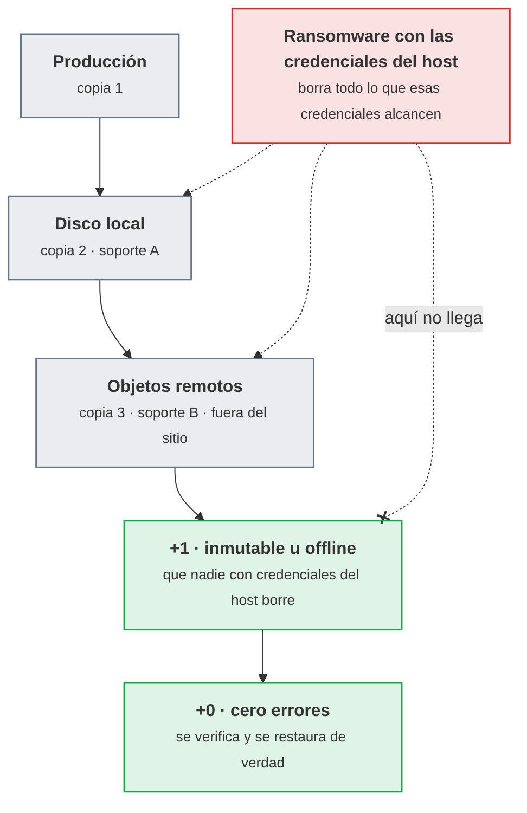
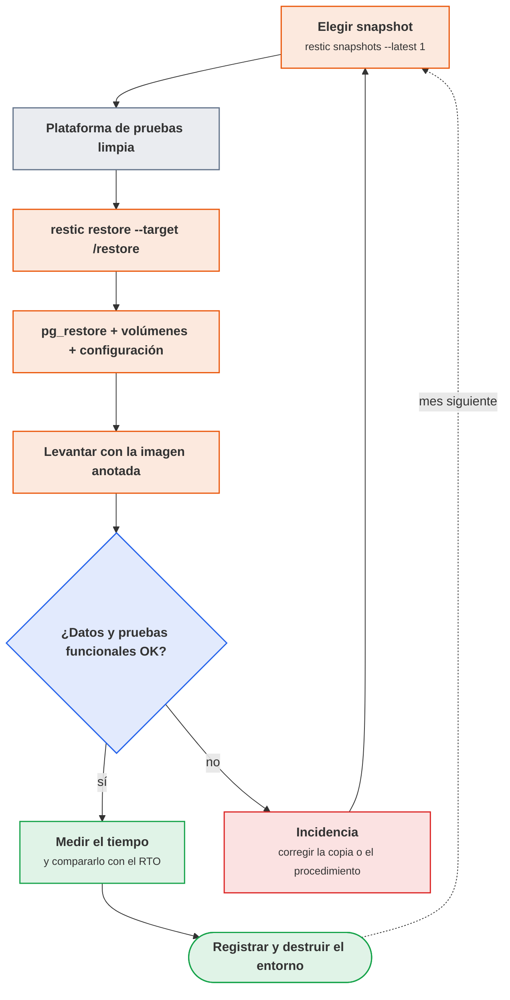

# UT6 · Copias de seguridad y restauración

<p class="ut-meta">14 h · Formación en empresa (19 abr a 9 jun 2027) · RA4 CE a, b, c</p>

Hasta la incorporación a la empresa todo el módulo ha transcurrido en el laboratorio del centro, sobre el servicio del curso (nginx en web01, API en app01, PostgreSQL en db01). Esta unidad y la UT5 se cursan durante la formación en empresa, y el objeto de trabajo pasa a ser un servicio real de la empresa de acogida: se revisan o se montan sus copias de seguridad, se comprueba que llegan a un medio externo y se restauran en un entorno de pruebas. Es la contraparte de lo que ya se hizo en el centro: en la UT7 la copia previa con restic (la herramienta de copias del curso) era el plan B de cada actualización, y en la UT8 las copias de pre que guardaba ese repositorio en MinIO (el almacenamiento de objetos del laboratorio) fueron justo lo que hubo que eliminar de forma controlada.

Estas páginas son guía de referencia y lista de evidencias. No se sacan datos de la empresa: lo que se entrega son configuraciones, listados y capturas anonimizadas (nombres de host, rutas y buckets pueden cambiarse por genéricos; el contenido de un dump nunca sale de allí). Las evidencias van a una carpeta `ut6/` del mismo repositorio local de la estancia que la UT5 ([cómo se lleva](ut5-logs-accesos-rendimiento.md#como-trabajar-en-la-empresa)).

!!! empresa "Lo que hubo en el laboratorio"
    En el laboratorio hubo un repositorio restic contra el MinIO del curso, con la convención `s3:http://10.10.0.30:9000/backups`, la credencial `restic` y la contraseña en `/etc/restic/pass`. Se montó en dos tiempos: el bucket `backups` y la credencial nacieron con el propio MinIO el 18 de diciembre, en la A5.2 de Despliegue, y el repositorio se inicializó el 11 de febrero en la A7.4, que lo usó como plan B de la actualización. En la UT8 se eliminaron de él las copias de pre. Desde la red de la empresa no se alcanza (como el Gitea del centro), así que no sirve de destino: queda solo como referencia para comparar. La empresa tendrá su propia herramienta, su propio destino y sus propias políticas, y parte del trabajo es entender por qué son distintas.

## Bloque 1 · Copias programadas (CE 4a)

<p class="ut-meta">En la empresa · con el tutor</p>

Al terminar este bloque la aplicación elegida tiene una copia programada que se ejecuta sola, deja rastro y avisa cuando falta. Antes de escribir el script hace falta saber qué se copia y con qué números se juzga una copia (3-2-1, RPO y RTO); después viene la herramienta, restic, el script que la orquesta con su timer, y las cuatro capas de verificación. El apartado de tipos de copia sirve para reconocer el vocabulario del tutor y de la documentación de la empresa. La hoja A6.1 lo aplica a una aplicación de la empresa.

### Qué se copia y qué no

De un servicio en contenedores se copia lo que no se puede reconstruir desde el código. Las imágenes están en el registry y el código en Git; copiarlos otra vez es gastar espacio y, peor, dar una sensación de seguridad falsa. Lo que sí hay que copiar cabe en tres cajones:

- **Datos**: la base de datos y los volúmenes de ficheros que suben los usuarios (adjuntos, imágenes, documentos generados).
- **Configuración**: el `compose.yml`, el `.env` (cifrado, nunca en claro), certificados y claves TLS, la configuración del proxy y de la monitorización (reglas de alerta, dashboards exportados).
- **Metadatos del despliegue**: qué versión de imagen estaba en producción cuando se hizo la copia. Un dump de la base de datos de la versión 2.4 no arranca con la imagen 2.6 si hubo migraciones de esquema. Basta con un `docker compose images` volcado a un fichero junto al dump.

#### Dump lógico frente a copia del volumen

Una base de datos escribe en disco de forma continua. Si se copia el directorio del volumen mientras PostgreSQL está en marcha, se obtienen ficheros de distintos instantes: un fichero de datos que ya tiene la transacción y un WAL (el registro de transacciones, *write-ahead log*) que todavía no. Ese conjunto puede no arrancar, o arrancar con datos corruptos que no se descubren hasta meses después. Hay dos maneras limpias de resolverlo:

**Dump lógico.** El propio motor genera un fichero consistente (una instantánea transaccional) que además es portable entre versiones y arquitecturas. Para PostgreSQL:

```bash
# Una base, formato custom (comprimido, permite restauración selectiva y en paralelo)
docker compose exec -T db pg_dump -U app -Fc app > /var/backups/app.dump

# Roles y contraseñas del clúster, que pg_dump NO incluye
docker compose exec -T db pg_dumpall -U postgres --globals-only > /var/backups/globals.sql
```

El `-T` desactiva la asignación de TTY (terminal interactivo); sin él, la salida por `>` se corrompe. `-Fc` produce el formato custom, que se restaura con `pg_restore` y admite `-j 4` para paralelizar y `-t tabla` para sacar una sola tabla. `pg_dumpall` sin `--globals-only` vuelca todo el clúster en SQL plano, útil para migraciones, poco práctico como copia diaria de una base de 40 GB.

Para MySQL o MariaDB el equivalente es `mysqldump --single-transaction --routines --triggers --events app > app.sql`. El `--single-transaction` abre una transacción con lectura consistente para que el volcado corresponda a un instante, sin bloquear tablas InnoDB (el motor de almacenamiento habitual de MySQL); si hay tablas del motor antiguo MyISAM no sirve y toca `--lock-tables`. Para MongoDB, `mongodump --archive --gzip`.

**Copia del volumen con el servicio parado o congelado.** Si la base de datos es enorme y el dump tarda más de lo que permite la ventana, se para el contenedor (o se hace una copia física con `pg_basebackup`, que admite PITR, recuperación a un instante concreto, si se archiva el WAL) y se copia el directorio. Para el resto de volúmenes (ficheros subidos) la copia directa es lo normal:

```bash
# Copiar un volumen con nombre sin conocer su ruta en el host
docker run --rm -v app_uploads:/data:ro -v /var/backups:/backup alpine \
  tar czf /backup/uploads.tgz -C /data .
```

Con restic no hace falta el tar: se le pasa la ruta del volumen y deduplica fichero a fichero.

| Método | Consistencia | Portabilidad | Tamaño | Cuándo |
|---|---|---|---|---|
| `pg_dump -Fc` | Transaccional | Entre versiones mayores | Comprimido | Copia diaria estándar |
| `pg_basebackup` + WAL | Física, con PITR | Misma versión mayor | Igual que el clúster | Bases grandes, RPO de minutos |
| Copia del volumen en caliente | Ninguna | Misma versión | Igual que el clúster | Nunca para bases de datos |
| Copia del volumen parado | Total | Misma versión | Igual que el clúster | Ventana de parada aceptable |

#### Ficheros, configuración y secretos

Los ficheros subidos por usuarios se copian tal cual; el único cuidado es que no cambien a mitad de copia (un fichero de 2 GB que se está subiendo). restic detecta la modificación y avisa, y se puede repetir esa ruta. La configuración va toda al mismo snapshot que los datos, para que una restauración devuelva un conjunto coherente.

Los secretos merecen aparte. El `.env` con la contraseña de la base de datos, las claves de API y los certificados privados tienen que estar en la copia (sin ellos no se restaura nada), pero no pueden viajar en claro a un bucket que gestiona otro equipo. Dos opciones válidas: cifrarlos antes con `age` o `sops` (dos herramientas de cifrado de ficheros) y copiar el fichero cifrado, o confiar en el cifrado del repositorio restic (todo lo que entra se cifra y se autentica antes de salir del host; el destino solo ve blobs). Lo habitual es combinar las dos: el repositorio cifra todo lo que sale del host y, además, los secretos viajan cifrados con una clave que custodia otra persona.

Con `age` son tres órdenes. El par de claves lo genera quien vaya a custodiar la privada, fuera del host que copia; en el host solo queda la pública (la línea `age1...` que imprime `age-keygen`), en `/etc/restic/age.pub`:

```bash
age-keygen -o copias.key                                        # privada: nunca junto a la copia
age -R /etc/restic/age.pub -o /opt/app/.env.enc /opt/app/.env   # cifrar, en el host, antes de cada copia
age -d -i copias.key .env.enc > .env                            # descifrar, al restaurar
```

sops hace lo mismo cifrando campo a campo un YAML o un JSON; dónde encaja cada una, en la [gestión de secretos de 5166 UT5](https://victor-educ.github.io/apuntes-5166/ut/ut5-iac/#gestion-de-secretos).

### Regla 3-2-1, RPO y RTO

Una vez claro qué se copia, falta saber con qué vara se mide una copia. Aquí se fijan tres números que decide la empresa, no el técnico, y con los que se justifica todo lo que viene después: frecuencia, destino y método de restauración.

La regla **3-2-1** es el mínimo defendible: tres copias de los datos (la de producción y dos más), en dos soportes distintos (disco local y almacenamiento de objetos, por ejemplo), y una fuera del sitio (otro centro de datos, otra región de la nube, una cinta en una caja fuerte). La variante **3-2-1-1-0**, que se ha extendido con el ransomware, añade una copia *offline* o inmutable (que nadie con credenciales del host pueda borrar) y cero errores en la verificación (las copias se comprueban y restauran, no se dan por buenas).



<p class="pie" markdown>El «+1» y el «+0» son los que se han vuelto imprescindibles: una copia que el atacante puede borrar no es una copia, y una que nunca se ha restaurado no se sabe si lo es.</p>


Los dos parámetros que fija la empresa, no el técnico:

- **RPO** (*Recovery Point Objective*): cuántos datos se pueden perder, medido en tiempo. Fija la frecuencia de copia. Si el RPO es 24 h, una copia diaria a las 02:30 vale. Si es 1 h, o se copia cada hora o se archiva el WAL de PostgreSQL de forma continua.
- **RTO** (*Recovery Time Objective*): cuánto puede tardar el servicio en volver. Fija el método de restauración y dónde está la copia. Un RTO de 4 h permite descargar 30 GB de un bucket remoto y hacer un `pg_restore`; un RTO de 15 min exige una réplica en caliente o un snapshot local.

Con números: una tienda con 200 pedidos al día y copia diaria a las 02:30 tiene un RPO real de hasta 24 h; si el disco muere a las 02:00, se pierden 199 pedidos. Si la empresa dice que solo puede perder una hora de pedidos, la copia diaria no cumple, por muy bien que funcione. Y si el RTO es de 2 h pero la restauración de prueba tardó 3 h 40 min, el plan está mal aunque la copia sea perfecta.

### Tipos de copia y snapshots

En la documentación de cualquier herramienta y en la conversación con el tutor van a salir las copias completas, incrementales y diferenciales. Se definen aquí para reconocer de qué hablan y por qué con restic o borg la distinción casi deja de importar; al final, por qué un snapshot del hipervisor no cuenta como copia.

- **Completa**: todo, cada vez. Simple de restaurar (un solo conjunto), cara en espacio y tiempo.
- **Incremental**: solo lo que cambió desde la última copia (completa o incremental). Barata; restaurar exige la completa más toda la cadena, y un eslabón corrupto rompe lo que viene después.
- **Diferencial**: lo que cambió desde la última completa. Restaurar necesita dos conjuntos; cada diferencial crece hasta la siguiente completa.
- **Deduplicada**: la que hacen restic y borg. Los ficheros se trocean en bloques de tamaño variable (*content-defined chunking*), cada bloque se identifica por su hash y solo se almacenan los bloques nuevos. Cada snapshot es lógicamente completo (se restaura solo, sin cadenas), pero cuesta lo que un incremental. Es la razón por la que la distinción clásica ha dejado de importar en la práctica.

Aparte están los **snapshots del hipervisor** (Proxmox, `vzdump` con modo *snapshot*) y los del sistema de ficheros (ZFS, LVM). Son instantáneas del disco de la VM entera: rápidos, cómodos para volver atrás antes de una actualización, y engañosos como copia de seguridad. Un snapshot en el mismo almacenamiento que la VM desaparece con él; capta la base de datos en caliente con los mismos problemas de consistencia que copiar el volumen (aunque el *guest agent* de QEMU con `fsfreeze`, que congela un instante el sistema de ficheros del invitado, mitiga parte); y restaurar un fichero suelto obliga a levantar la VM entera. La combinación habitual en empresa es ambas cosas: copia de VM con Proxmox Backup Server para recuperar el host en bloque, y copia de aplicación con restic para recuperar datos con granularidad. Cómo se hace el snapshot de VM está en [5166 UT1](https://victor-educ.github.io/apuntes-5166/ut/ut1-virtualizacion/).

### restic a fondo

Con restic se hace casi todo lo que sigue: copiar, retener, verificar y restaurar. Este apartado es su referencia; no hay que memorizar las opciones, sino saber que existen para reconocerlas en el script de la empresa. El bloque de comandos es lo mínimo; la lista de puntos, lo que separa una prueba de una copia en producción.

restic (versión 0.18 en el laboratorio) es un programa de un solo binario, escrito en Go, que crea repositorios deduplicados y cifrados en local, SFTP, S3 y compatibles (MinIO, Backblaze B2), Azure, Google Cloud Storage o su propio `rest-server`. Todo lo que se configura son variables de entorno y flags. Con los valores del laboratorio del curso (el repositorio de la A7.4) queda así; en la empresa cambian el destino y la credencial:

```bash
export RESTIC_REPOSITORY=s3:http://10.10.0.30:9000/backups
export RESTIC_PASSWORD_FILE=/etc/restic/pass        # chmod 600, propietario root
export AWS_ACCESS_KEY_ID=restic                     # la credencial de MinIO para copias
export AWS_SECRET_ACCESS_KEY='...'                  # mejor en /etc/restic/env con EnvironmentFile=
export RESTIC_CACHE_DIR=/var/cache/restic           # índices locales; acelera todo
export RESTIC_COMPRESSION=auto                      # off | auto | max

restic init                                          # una vez; crea la clave del repo
restic backup /var/backups /opt/app/compose.yml /var/lib/docker/volumes/app_uploads/_data \
  --tag app --tag daily --exclude-file /etc/restic/excludes --one-file-system
restic snapshots                                     # lista
restic snapshots --latest 1 --tag app --json         # el último con tag app, para scripts
```

Puntos que importan al usarlo en serio:

- **Tags y host**: cada snapshot lleva el nombre del host y los tags que se le pongan. Las políticas de retención se aplican por grupo (`--group-by host,tags` es el valor por defecto), así que si la misma máquina copia dos aplicaciones con tags distintos, cada una tiene su propia rotación.
- **Exclusiones**: `--exclude '*.tmp'`, `--exclude-file`, `--exclude-caches` (respeta los ficheros `CACHEDIR.TAG`) y `--exclude-if-present .nobackup`. Excluir `node_modules`, cachés y logs rotados reduce el snapshot de una aplicación típica a una fracción.
- **Volcado por stdin**: en lugar de escribir el dump a disco y copiarlo, `pg_dump ... | restic backup --stdin --stdin-filename app.dump --tag app`. Ahorra el espacio intermedio; la pega es que restic no puede deduplicar contra la versión anterior tan bien porque no ve metadatos, aunque el *chunking* sigue funcionando.
- **Retención**: `restic forget --keep-daily 7 --keep-weekly 4 --keep-monthly 6 --keep-yearly 2 --prune`. `forget` borra los snapshots; sin `--prune` los datos siguen ocupando espacio hasta que se ejecute `restic prune`, que reempaqueta y elimina blobs huérfanos. `prune` es lento y toma un bloqueo exclusivo, así que se programa aparte (semanal) y no en cada copia. `--max-unused 5%` limita cuánto reempaqueta.
- **Verificación**: `restic check` valida la estructura del repositorio con los índices; `--read-data` descarga y verifica cada blob (caro con 500 GB en un bucket remoto); `--read-data-subset=5%` o `--read-data-subset=1/10` lo hace por partes, de forma que en 10 ejecuciones queda leído entero.
- **Restauración**: `restic restore latest --target /restore` restaura el último snapshot; `--include /var/backups/app.dump` saca solo esa ruta; `--host` y `--tag` seleccionan el snapshot cuando hay varios. `restic ls latest` y `restic find app.dump` localizan ficheros sin restaurar; `restic diff id1 id2` muestra qué cambió entre dos snapshots.
- **Montaje**: `restic mount /mnt/restic` expone el repositorio por FUSE (un sistema de ficheros en espacio de usuario: el repositorio aparece como un directorio normal), con un directorio por snapshot (`/mnt/restic/snapshots/latest/...`). Es la forma más rápida de recuperar un fichero suelto o de inspeccionar qué hay dentro sin restaurar nada. Necesita el paquete `fuse3`.
- **Rendimiento**: la primera copia va limitada por CPU (hash y cifrado) y por la subida; las siguientes solo leen ficheros cambiados si los metadatos coinciden (por defecto compara tamaño, mtime e inodo). La caché local en `RESTIC_CACHE_DIR` es lo que más se nota: sin ella cada operación descarga los índices del bucket. El afinado fino (concurrencia de lectura, tamaño de los paquetes en S3, límite de ancho de banda en la ventana nocturna) está en [Para ampliar](../ampliacion.md#afinado-de-restic).
- **Bloqueos**: si una copia muere a medias (reinicio del host), queda un lock y la siguiente falla con "repository is already locked". `restic unlock` lo limpia; antes de hacerlo, asegurarse de que no hay otro proceso restic vivo.
- **Contraseña**: `restic key add` y `restic key remove` gestionan varias claves para el mismo repositorio; cambiarla según la política de la empresa es añadir la nueva, verificar que abre el repo y quitar la antigua. Perderla equivale a perder el repositorio entero; en la empresa conviene preguntar dónde está custodiada.

#### borg como alternativa

BorgBackup es el otro programa de copias deduplicadas y cifradas que se encuentra en producción: hace lo mismo que restic con otros nombres de comando (`borg create`, `borg prune`, `borg check`, `borg mount`). Su destino típico no es un bucket sino un NAS al que se llega por SSH, con `borg serve` al otro extremo. Ese servidor admite el modo `--append-only`, que deja al cliente añadir copias pero no borrar las que ya hay: la protección más directa contra un ransomware que entre por el host copiado. El criterio de elección suele venir dado por el destino: si es un NAS por SSH, borg; si es almacenamiento de objetos, restic. La equivalencia de comandos entre las dos herramientas, las opciones de cifrado y compresión y borgmatic están en [Para ampliar](../ampliacion.md#borgbackup-y-borgmatic-comandos-y-equivalencias).

### Programar la copia

El script hace de orquestador: vuelca la base de datos, lanza restic, aplica retención y verifica, y al terminar escribe una métrica que node_exporter (el agente de métricas del host, de la [UT1](ut1-observabilidad.md#exporters-lo-que-no-se-puede-instrumentar)) recoge. Este es el script de referencia de la unidad, el que se adapta en la A6.1; conviene fijarse en el `set -euo pipefail` de la cabecera y en que la métrica se escribe solo al final. En el laboratorio no hubo copia programada: la de la A7.4 se lanzó a mano y, como PostgreSQL vivía en su propia VM, el volcado se pidió por SSH a esa máquina en vez de con `docker compose exec`. Si en la empresa la base tampoco está en el compose, las dos líneas del volcado cambian de la misma forma.

```bash
#!/bin/bash
# /usr/local/bin/backup-app.sh
set -euo pipefail
export RESTIC_REPOSITORY=s3:https://<destino>/backups
export RESTIC_PASSWORD_FILE=/etc/restic/pass
export RESTIC_CACHE_DIR=/var/cache/restic
# AWS_ACCESS_KEY_ID y AWS_SECRET_ACCESS_KEY llegan por EnvironmentFile= de la unit

TS_FILE=/var/lib/prometheus/node-exporter/backup_app.prom   # el directorio de textfile del node_exporter
START=$(date +%s)

cd /opt/app
age -R /etc/restic/age.pub -o /opt/app/.env.enc /opt/app/.env   # el .env viaja cifrado
docker compose images --format json > /var/backups/app-images.json
docker compose exec -T db pg_dump -U app -Fc app > /var/backups/app.dump
docker compose exec -T db pg_dumpall -U postgres --globals-only > /var/backups/globals.sql

restic backup /var/backups /opt/app/compose.yml /opt/app/.env.enc \
  /var/lib/docker/volumes/app_uploads/_data \
  --tag app --exclude-file /etc/restic/excludes --one-file-system
restic forget --keep-daily 7 --keep-weekly 4 --keep-monthly 6 --tag app
restic check --read-data-subset=5%

# Métrica para Prometheus: solo se escribe si todo lo anterior ha ido bien (set -e)
# La etiqueta no se llama job: al leerla, Prometheus la renombraría a exported_job
cat > "$TS_FILE.$$" <<EOF
# HELP backup_last_success_timestamp_seconds Epoch de la última copia correcta
# TYPE backup_last_success_timestamp_seconds gauge
backup_last_success_timestamp_seconds{backup="app"} $(date +%s)
backup_last_duration_seconds{backup="app"} $(( $(date +%s) - START ))
EOF
mv "$TS_FILE.$$" "$TS_FILE"
```

El `set -euo pipefail` es lo que convierte cualquier fallo intermedio en un código de salida distinto de cero, que es lo que systemd va a mirar. El `mv` final es atómico: node_exporter nunca lee un fichero a medio escribir. El `prune` no está aquí a propósito: va en un timer semanal separado.

#### systemd timers

Una unit de servicio `oneshot` (se ejecuta, termina y no queda residente) y un timer que la dispara:

```ini
# /etc/systemd/system/backup-app.service
[Unit]
Description=Copia de seguridad de app
After=docker.service network-online.target
Wants=network-online.target

[Service]
Type=oneshot
EnvironmentFile=/etc/restic/env
ExecStart=/usr/local/bin/backup-app.sh
Nice=10
IOSchedulingClass=best-effort
IOSchedulingPriority=7
```

```ini
# /etc/systemd/system/backup-app.timer
[Unit]
Description=Lanza backup-app.service cada noche

[Timer]
OnCalendar=*-*-* 02:30:00
Persistent=true
RandomizedDelaySec=15m
Unit=backup-app.service

[Install]
WantedBy=timers.target
```

`OnCalendar` admite expresiones como `Mon..Fri 02:30`, `*-*-01 04:00` (el día 1 de cada mes) o `hourly`; `systemd-analyze calendar '*-*-* 02:30:00'` indica cuándo será la próxima ejecución. `Persistent=true` guarda en disco la última ejecución y, si el host estaba apagado a las 02:30, lanza la copia en cuanto arranca (cron no hace esto). `RandomizedDelaySec` reparte la carga cuando varios hosts comparten el mismo destino a la misma hora. Si la empresa ya tiene una unit que avisa por correo o webhook, una línea `OnFailure=` en `[Unit]` la engancha para que salte cuando la copia termine con error; aquí el aviso lo da la alerta por ausencia de [Verificar que se ha ejecutado](#verificar-que-se-ha-ejecutado), que cubre también el caso en que la copia ni siquiera arranca. Se activa con `systemctl enable --now backup-app.timer`; `systemctl list-timers` muestra la próxima y la última ejecución; `journalctl -u backup-app.service -n 50` es el log, sin gestionar rotación ni redirecciones.

#### cron y contenedor programador

Con cron la línea equivalente en `/etc/cron.d/backup-app` es `30 2 * * * root /usr/local/bin/backup-app.sh >> /var/log/backup-app.log 2>&1`. Funciona en cualquier sitio y es lo que hay en muchas empresas; sus carencias frente al timer son las del apartado anterior: no recupera ejecuciones perdidas, el log hay que gestionarlo a mano y el fallo solo se ve si alguien lee el correo de root. Cuando el host es ajeno (una plataforma gestionada donde solo se dispone de Docker), el programador va en un contenedor: ofelia lee etiquetas de los otros contenedores (`ofelia.job-exec.backup.schedule: "0 30 2 * * *"`, `ofelia.job-exec.backup.command: "pg_dump ..."`) y ejecuta comandos dentro de ellos; o un *sidecar* (contenedor auxiliar que acompaña al principal) Alpine con `crond` que monta el socket de Docker. Ambos tienen el mismo problema: el contenedor programador necesita acceso al socket o a los volúmenes, y eso es un privilegio grande que hay que documentar.


<p class="pie" markdown>La copia no termina cuando se escribe: termina cuando alguien puede demostrar que se escribió. De ahí la marca de tiempo y la alarma.</p>

### Verificar que se ha ejecutado

Una copia programada que nadie mira deja de funcionar en silencio: caduca la credencial del bucket, se llena `/var/backups`, cambia la contraseña de la base de datos, y nadie lo descubre hasta que hace falta restaurar. La verificación tiene cuatro capas, de la más barata a la más fiable:

1. **Código de salida.** El `set -e` del script y `Type=oneshot` hacen que systemd marque la unit como `failed`. `systemctl is-failed backup-app.service` lo consulta.
2. **Log.** `journalctl -u backup-app.service --since yesterday`. restic imprime al final de cada copia cuántos ficheros nuevos, cambiados y sin cambios, y cuántos datos se han añadido. Un "Added to the repository: 0 B" tres días seguidos en una aplicación viva es sospechoso aunque el código de salida sea 0.
3. **El repositorio.** `restic snapshots --latest 1 --tag app` devuelve fecha, host, tags y rutas del último snapshot. Comprobar que la fecha es de hoy y que el tamaño (`restic stats latest`) está en el rango esperado. Es lo que mira quien audita.
4. **Alerta por ausencia** (*dead man's switch*). Las tres anteriores fallan si el host que copia está apagado, si el timer se deshabilitó o si el script no llega ni a arrancar. La única forma de detectarlo es que otro sistema espere una señal y avise cuando no llega.

Si la empresa tiene Prometheus, como la pila de mon01 del curso, se hace con la métrica que escribe el script y el *textfile collector* de node_exporter, que lee los ficheros `.prom` de un directorio. El paquete `prometheus-node-exporter` de Debian, el de las VM del laboratorio, lo lee de `/var/lib/prometheus/node-exporter`; otra instalación lo indica con `--collector.textfile.directory=<ruta>` en su línea de arranque, y sin ese flag no lee ninguno:

```yaml
groups:
  - name: backups
    rules:
      - alert: BackupMissing
        expr: time() - backup_last_success_timestamp_seconds > 26 * 3600
        for: 10m
        labels: {severity: critical}
        annotations:
          summary: "Sin copia correcta de {{ $labels.backup }} en más de 26 h"
      - alert: BackupMetricAbsent
        expr: absent(backup_last_success_timestamp_seconds{backup="app"})
        for: 30m
        labels: {severity: warning}
```

Las 26 h dejan margen a `RandomizedDelaySec` y a una copia que tarde más de lo habitual sin generar ruido cada noche. La segunda regla cubre el caso en que la métrica desaparece (node_exporter caído, fichero borrado): sin `absent()`, la primera expresión no devuelve nada y no salta. En la UT2 se vio cómo enrutar estas alertas en Alertmanager; aquí solo hay que añadirlas.

Si la empresa no tiene Prometheus, o el host que copia está fuera de su red de monitorización, el mismo patrón se hace con un servicio externo tipo [healthchecks.io](https://healthchecks.io/docs/): se crea un *check* con periodo 24 h y gracia 2 h, y el script hace `curl -fsS -m 10 --retry 3 https://hc-ping.com/<uuid>` al terminar bien (y `.../<uuid>/fail` en el `trap ERR`, el manejador que bash ejecuta cuando falla un comando). Si no llega el ping, avisa por correo, Slack o webhook. Healthchecks se puede autoalojar en un contenedor si la política de la empresa no permite servicios externos.

### A6.1 Copias programadas (CE 4a)

<span class="et et-obj">Objetivo</span> Al terminar, la aplicación elegida tiene una copia programada que se ejecuta sola, deja rastro de que se ha ejecutado y avisa cuando falta.

<span class="et et-pre">Antes de empezar</span>

- Autorización escrita del tutor para trabajar sobre la aplicación elegida (o revisar su copia actual) y acuerdo sobre qué puedes ejecutar en producción.
- Acceso como root al host de la aplicación, con `restic` y `age` instalados, o el tutor delante si no te lo dan.
- Un destino aprobado por la empresa: bucket o NAS o, si no hay nada, un MinIO temporal en contenedor en un host de pruebas, montado con la [receta del laboratorio de Despliegue](https://victor-educ.github.io/apuntes-5166/laboratorio/#como-se-monta-minio). El MinIO del laboratorio no se alcanza desde la empresa.
- La clave pública de `age` que te da quien custodia la privada ([Ficheros, configuración y secretos](#ficheros-configuracion-y-secretos)).
- Leído: [Qué se copia y qué no](#que-se-copia-y-que-no), [Regla 3-2-1, RPO y RTO](#regla-3-2-1-rpo-y-rto), [restic a fondo](#restic-a-fondo), [Programar la copia](#programar-la-copia) y [Verificar que se ha ejecutado](#verificar-que-se-ha-ejecutado).

<span class="et et-pas">Pasos</span>

1. Haz con el tutor el inventario de la aplicación en una tabla (componente; se copia o no, y por qué): base de datos, volúmenes de ficheros, configuración, secretos y versión de imagen en producción. Apunta el RPO y el RTO que fije el responsable del servicio; si nadie los ha fijado, propón 24 h y 4 h y deja constancia de que es una propuesta.

    *Pista:* los volúmenes en uso salen del `compose.yml` o de `docker inspect`, no de `docker volume ls`, que lista también los abandonados.

2. Si la empresa ya tiene copias, contrasta su script con el bloque 1 (dump consistente, `-T` en el `exec`, secretos cifrados, `set -e`, retención escrita) y apunta cada diferencia en una lista de mejoras. Si no las tiene, los pasos siguientes las montan.

3. Vuelca a mano la base de datos y los roles del clúster en `/var/backups/app.dump` y `/var/backups/globals.sql`, como en [Dump lógico frente a copia del volumen](#dump-logico-frente-a-copia-del-volumen), y comprueba que no están vacíos.

    *Pista:* un dump de 0 bytes con código de salida 0 suele ser el `-T` que falta en `docker compose exec`.

4. Haz a mano una primera copia con restic y el tag `app`, con las rutas del script de [Programar la copia](#programar-la-copia) y la contraseña del repositorio en `/etc/restic/pass`. El `.env` entra solo cifrado con `age`, y si el repositorio es nuevo, su contraseña va al gestor de contraseñas de la empresa en cuanto se genera.

    *Pista:* además de las `RESTIC_*`, restic necesita la credencial del bucket (`AWS_ACCESS_KEY_ID` y `AWS_SECRET_ACCESS_KEY`); sin ella, `restic init` falla con un `unable to open config file` engañoso.

5. Adapta el `backup-app.sh` de [Programar la copia](#programar-la-copia) a la aplicación y a la retención acordada, y prográmalo a la hora que pide el RPO con el timer de [systemd timers](#systemd-timers), o con cron si es lo que usa la empresa. Lanza una ejecución a mano y revisa su log.

    *Pista:* `TS_FILE` tiene que estar en el directorio que lee el node_exporter del host (su `--collector.textfile.directory`, o el del script en el paquete de Debian). Si no lee ninguno, activarlo lo decide el tutor; si no lo autoriza, la alerta va por healthchecks.io.

6. Configura la alerta por ausencia de [Verificar que se ha ejecutado](#verificar-que-se-ha-ejecutado), con sus dos reglas si hay Prometheus o con healthchecks.io si no. Provócala con el tutor delante sin esperar un día, captura cada alerta disparada y deja todo como estaba.

    *Pista:* con Prometheus, umbral de `BackupMissing` a `> 300` y `for: 1m` en las dos reglas; `BackupMetricAbsent` salta al apartar el `.prom`. Con healthchecks.io, periodo de 5 min y gracia de 1 min.

<span class="et et-com">Comprobación</span>

- `systemctl list-timers` muestra el timer con próxima ejecución, y `journalctl -u backup-app.service` termina con el resumen de restic (ficheros nuevos, cambiados, datos añadidos) y sin errores.
- `restic snapshots --latest 1 --tag app` devuelve un snapshot de hoy con las rutas esperadas; `restic ls latest | grep app.dump` lo localiza dentro.
- El dump tiene tamaño coherente con la base (`ls -la /var/backups`), no 0 bytes.
- La alerta ha saltado en la prueba de ausencia y ha vuelto a estado normal tras una copia correcta.

<span class="et et-ent">Entrega</span> En `ut6/a61/` del repositorio de la estancia: la tabla de inventario del paso 1 y la lista de mejoras del paso 2 si había copias previas, el script o la configuración anonimizados, unit y timer (o la línea de cron), salida de `restic snapshots` (o equivalente), la regla o el check de alerta y la captura de la alerta disparada. Fila A6.1 de la ficha de evidencias firmada por el tutor.

## Bloque 2 · Exportación y políticas (CE 4b)

<p class="ut-meta">En la empresa · con el tutor</p>

Con la copia del bloque 1 funcionando desde hace unos días, toca demostrar con listados que está fuera del host, que el host que copia no puede borrarla y que la rotación y la limpieza coinciden con la política escrita. El apartado de destinos y políticas es lo que se audita en la hoja A6.2; el punto de retención de [restic a fondo](#restic-a-fondo), del bloque 1, se vuelve a usar aquí.

### Destinos y políticas

La copia local en `/var/backups` del propio host no es una copia: se pierde con el servidor, con el ransomware que cifra el disco y con el `rm -rf` equivocado. El destino externo es la parte del 3-2-1 que más se descuida. Los destinos habituales:

| Destino | Acceso desde restic | Puntos a favor | Puntos en contra |
|---|---|---|---|
| S3 / MinIO (propio o de otro CPD) | `s3:` nativo | Versionado, Object Lock, políticas IAM (permisos por credencial) por bucket | Coste por GB y por petición en nube; latencia en `prune` |
| NAS por SFTP o NFS | `sftp:` o ruta local | Barato, rápido en LAN | Mismo edificio; permisos difíciles de hacer *append-only* |
| Nube pública (B2, S3, Azure Blob) | nativo | Fuera del sitio sin esfuerzo | Egress (pago por descargar) al restaurar; cifrado en cliente obligatorio; ubicación |
| Cinta LTO (cinta magnética) | Vía intermedio (restic no escribe en cinta) | Offline de verdad, décadas de retención | Lento, requiere robot o disciplina manual |
| Disco externo rotado | ruta local | Trivial, offline | Depende de que alguien lo cambie; se olvida |

Las **políticas** que hay que respetar y comprobar, y que son el contenido de la A6.2:

**Almacenamiento.** Tres requisitos, y cada uno con su forma de comprobarlo:

| Requisito | Qué se exige | Cómo se comprueba |
|---|---|---|
| Cifrado | Cifrado en cliente, antes de que los datos salgan del host. El repositorio restic ya lo hace; en nube pública es obligatorio, no opcional. | `restic cat config` solo abre con la contraseña, y en el destino se ven blobs, no nombres de fichero de la aplicación. |
| Ubicación | Si el servicio trata datos personales, el RGPD (artículo 32, seguridad del tratamiento, y capítulo V, transferencias internacionales) condiciona dónde puede estar la copia: un bucket en `eu-west-1` o `eu-south-2` vale; uno en `us-east-1` exige garantías adicionales que la empresa probablemente no quiere gestionar. | Región del bucket (`mc admin info`, con `mc`, el cliente de línea de comandos de MinIO, o la consola de la nube) frente a la que permite la política escrita. |
| Protección contra borrado | El host que copia no debe poder destruir las copias. En S3 o MinIO se combinan el versionado del bucket (`mc version enable minio/backups`), que conserva las versiones anteriores de un objeto sobrescrito o borrado, y Object Lock en modo *compliance* con periodo de retención (`mc retention set --default COMPLIANCE 30d minio/backups`), que impide que nadie, ni el administrador, borre antes de que venza. La credencial del script lleva `s3:PutObject`, `s3:GetObject` y `s3:ListBucket` pero no `s3:DeleteObject`; con el servidor REST de restic el equivalente es `rest-server --append-only`. | `mc version info minio/backups`, `mc retention info minio/backups` y la política de la credencial; la prueba práctica es subir un objeto de usar y tirar con la credencial del script e intentar borrarlo, que tiene que responder `AccessDenied`. Nunca se prueba con un `forget --prune` contra el repositorio real: si la protección está mal puesta, que es lo que se está comprobando, el comando funciona y destruye copias. |

Con eso, un atacante que entre en el host de producción no puede borrar la copia, que es el primer paso del ransomware moderno. El `forget --prune` se ejecuta desde otro host y con otras credenciales.

**Rotación.** La política escrita dice cuántas diarias, semanales, mensuales y anuales se conservan; los flags `--keep-*` tienen que coincidir con ella, y el listado del destino también. Se comprueba con `restic snapshots --group-by tags` y contando.

**Limpieza.** `prune` programado y ejecutándose (con lock exclusivo, en horario que no coincida con la copia); espacio ocupado dentro de lo previsto (`restic stats --mode raw-data`, `mc du minio/backups`); y copias caducadas realmente eliminadas, lo que con versionado y Object Lock exige además una regla de ciclo de vida en el bucket (`mc ilm rule add --expire-delete-marker --noncurrent-expire-days 30 minio/backups`) para que las versiones no actuales se borren cuando venza la retención.

La comprobación es siempre la misma: listar el destino (`restic snapshots`, `aws s3 ls --recursive`, `mc ls --versions`, listado de la NAS) y compararlo línea a línea con la política. Lo que no coincide va a la tabla de cumplimiento con una fecha de corrección.

!!! ojo "Las credenciales del bucket no son secretos de segunda"
    Con `AWS_SECRET_ACCESS_KEY` y `RESTIC_PASSWORD` en el mismo fichero, quien lea `/etc/restic/env` tiene las copias enteras de la empresa. Ese fichero va con `chmod 600`, propietario root, fuera de cualquier repositorio Git y, si la empresa tiene Vault (un gestor de secretos) o similar, se sirve desde allí en tiempo de ejecución.

### A6.2 Exportación y políticas (CE 4b)

<span class="et et-obj">Objetivo</span> Al terminar, has demostrado con listados que las copias están fuera del host, que el host que copia no puede borrarlas, y que la rotación y la limpieza que hay coinciden con la política escrita (de la empresa o la que propones tú).

<span class="et et-pre">Antes de empezar</span>

- Autorización del tutor para lanzar comandos de solo lectura contra el destino; los cambios (versionado, Object Lock, ciclo de vida), solo con su visto bueno y, mejor, ejecutados por él.
- La copia de la A6.1 funcionando desde hace unos días, para que haya varios snapshots que contar.
- Credenciales de lectura al destino y, si es una nube pública, lo visto en [5166 UT4](https://victor-educ.github.io/apuntes-5166/ut/ut4-nube-publica/) sobre cuentas, regiones y coste de descarga.
- Leído: [Destinos y políticas](#destinos-y-politicas) y el apartado de retención de [restic a fondo](#restic-a-fondo).

<span class="et et-pas">Pasos</span>

1. Pide la política de copias escrita. Si no existe, redáctala en media página a partir del RPO de la A6.1 y del espacio disponible: cifrado, ubicación, protección contra borrado, retención y limpieza. Márcala como propuesta y que el tutor la lea antes de comprobar nada.

2. Lista el destino (snapshots agrupados por tags, objetos del bucket con sus versiones y espacio ocupado) con las órdenes de [Destinos y políticas](#destinos-y-politicas) y guarda la salida anonimizada.

3. Comprueba el cifrado, la ubicación y la protección contra borrado según la tabla de [Destinos y políticas](#destinos-y-politicas), anotando comando y resultado. La protección se demuestra intentando borrar, con la credencial del script, un objeto de usar y tirar que subes tú: tiene que responder `AccessDenied` y el objeto, seguir ahí. Anótalo para que lo retire quien administre el bucket.

    *Pista:* configura en `mc` un alias aparte con la credencial del script, para no probar sin querer con la de administración. Con una NAS y borg, lo que se busca es `--append-only` en el `authorized_keys` del usuario de copias.

    !!! ojo "El repositorio real no se usa para probar borrados"
        Si la protección está mal puesta, que es lo que vienes a comprobar, un `restic forget --prune` contra el
        repositorio de la empresa borra copias de verdad. Si el destino no deja escribir fuera de él, prueba
        contra un repositorio restic de usar y tirar en otro prefijo.

4. Cuenta en el listado del paso 2 cuántas diarias, semanales y mensuales hay de verdad y compáralo con los `--keep-*` del script y con la política: las tres cosas tienen que coincidir.

5. Localiza el `prune` (en otro host o con otras credenciales que las del script) y su última ejecución, compara el espacio ocupado con el previsto y, si el bucket tiene versionado, comprueba que hay una regla de ciclo de vida para las versiones no actuales.

6. Rellena la tabla de cumplimiento, una fila por punto de la política: requisito, cómo se comprobó, resultado, acción correctora con fecha si procede. Lo que no cumple se propone al tutor y, si lo autoriza, se corrige y se vuelve a comprobar.

<span class="et et-com">Comprobación</span>

- El listado del destino muestra los snapshots de la A6.1 y el recuento por tipo coincide con la política y con los flags `--keep-*`.
- El borrado del objeto (o del repositorio) de usar y tirar con la credencial del script ha fallado con `AccessDenied`, y las copias reales siguen intactas: `restic snapshots` devuelve las mismas de antes de la prueba.
- La tabla de cumplimiento no tiene filas vacías y cada "no cumple" tiene acción y fecha.

<span class="et et-ent">Entrega</span> En `ut6/a62/` del repositorio de la estancia: la política del paso 1 (de la empresa o tu propuesta, indicando cuál), los listados del destino del paso 2 (anonimizados) y la tabla de cumplimiento del paso 6. Fila A6.2 de la ficha de evidencias firmada por el tutor.

## Bloque 3 · Restauración de prueba (CE 4c)

<p class="ut-meta">En la empresa · con el tutor</p>

La prueba real de todo lo anterior es levantar el servicio en una plataforma de pruebas desde la última copia, con el cronómetro en marcha y comparando con el RTO. El procedimiento de ocho pasos es el que sigue la hoja A6.3; el plan de copias como documento es lo que se entrega al cierre y recoge lo hecho en los tres bloques.

### Restaurar: el mantenimiento preventivo

Una copia que no se ha restaurado nunca no es una copia; es una esperanza. La restauración periódica (mensual como mínimo, y siempre antes de una actualización mayor) es la tarea de mantenimiento preventivo de esta unidad, y la que cubre el CE 4c. El procedimiento, paso a paso, con el cronómetro en marcha desde el primer comando:

1. **Elegir la copia.** Normalmente la última: `restic snapshots --latest 1 --tag app`. Anotar el ID corto.
2. **Preparar la plataforma de pruebas.** Una VM limpia o un `docker compose` con proyecto distinto (`-p app_restore`) en un host que no sea producción. Comprobar que tiene Docker, restic, espacio en disco (el doble del tamaño del dump) y acceso al destino.
3. **Restaurar.** `restic restore <id> --target /restore`. Anotar cuánto tarda; en un bucket remoto esta suele ser la fase larga.
4. **Colocar la configuración y levantar la base de datos vacía** con la versión de imagen que dice `/restore/var/backups/app-images.json`. El `compose.yml` y el `.env` descifrado van en su sitio *antes* del primer `up`: la copia solo guarda el `.env.enc`, y sin el fichero en claro el contenedor de la base arranca sin contraseña ni nombre de base. Después se carga: `psql -U postgres -f /restore/var/backups/globals.sql` para los roles, y `pg_restore -U app -d app -j 4 /restore/var/backups/app.dump`. La ruta del dump va como argumento y no por redirección, porque `pg_restore` con `-j` abre el fichero varias veces y no puede hacerlo sobre la entrada estándar. Los errores de "role already exists" al cargar globals son normales si la imagen ya creó el rol.
5. **Restaurar los volúmenes de ficheros** copiando `/restore/var/lib/docker/volumes/app_uploads/_data` al volumen nuevo con un contenedor auxiliar, como en la copia pero al revés, y ajustando el propietario al UID que use la imagen.
6. **Levantar el servicio** y verificar: la aplicación arranca; los datos están (`SELECT count(*) FROM pedidos`, el último registro por fecha, un fichero subido que se abre); pruebas funcionales básicas (login, una búsqueda, generar un informe). Comparar los recuentos con los de producción a la hora de la copia si es posible.
7. **Parar el cronómetro** y comparar con el RTO. Si ha tardado más, el plan tiene un problema y es preferible descubrirlo hoy.
8. **Registrar**: fecha, snapshot usado, quién, tiempo por fase, resultado, incidencias encontradas y qué se corrigió. **Destruir** el entorno de pruebas (contiene datos reales de la empresa) y borrar `/restore`.



<p class="pie" markdown>Una copia que no se ha restaurado nunca es una suposición. Por eso la restauración se programa como mantenimiento preventivo, con su fecha.</p>

Tres tareas complementarias que también forman parte del mantenimiento:

- **`restic check --read-data` completo** con periodicidad (trimestral en repositorios grandes, mensual en pequeños), además del 5% de cada noche. Detecta corrupción silenciosa en el almacenamiento, que los subconjuntos pueden tardar meses en encontrar.
- **Rotación de la contraseña del repositorio** según la política (`restic key add`, probar, `restic key remove <id antiguo>`), con la nueva custodiada donde diga la empresa.
- **Restauración de un fichero suelto**, que es lo que de verdad piden los usuarios ("he borrado el informe de marzo"). Con restic: `restic find informe-marzo.pdf` para localizar en qué snapshots está, y `restic restore <id> --target /tmp/r --include '/var/lib/docker/volumes/app_uploads/_data/informes/informe-marzo.pdf'`; o `restic mount` y copiar con `cp`. Medir este tiempo también: es un RTO distinto, y suele ser el que más veces se ejerce.

!!! truco "Restauración a un punto anterior"
    Cuando el problema no es un disco roto sino un borrado lógico descubierto días después ("alguien vació la tabla de clientes el martes"), la copia que interesa no es la última sino la anterior al daño. `restic snapshots` con la fecha y `restic diff` entre dos snapshots ayudan a localizar el momento exacto; con `pg_restore -t clientes` se recupera solo esa tabla en una base auxiliar y se traspasan las filas.

### El plan de copias como documento

Lo que la empresa necesita al final no es el script, sino un documento que otra persona pueda seguir a las tres de la mañana con el servicio caído. Dos páginas, con estos apartados en este orden:

1. **Alcance**: qué servicio, qué componentes (base de datos, volúmenes, configuración) y qué queda fuera y por qué (imágenes en el registry, código en Git).
2. **Objetivos**: RPO y RTO acordados con quien responde del servicio, y los medidos en la última restauración de prueba.
3. **Qué y cuándo**: método por componente (dump `-Fc`, copia de volumen), programación (timer, hora, ventana), herramienta y versión.
4. **Dónde**: destino principal y externo, cifrado, ubicación geográfica, quién custodia las claves.
5. **Retención y limpieza**: política de rotación (diarias, semanales, mensuales), Object Lock o equivalente, `prune` y ciclo de vida.
6. **Verificación**: qué se mira a diario (alerta de ausencia, log), qué mensualmente (restauración de prueba, `check`), quién lo hace.
7. **Procedimiento de restauración**: los ocho pasos anteriores adaptados, con comandos literales y rutas reales, y el de fichero suelto.
8. **Registro**: tabla con las restauraciones de prueba realizadas (fecha, snapshot, tiempo, resultado).

### A6.3 Restauración de prueba (CE 4c)

<span class="et et-obj">Objetivo</span> Al terminar, has levantado el servicio en una plataforma de pruebas desde la última copia, con los datos verificados, un tiempo medido por fase comparado con el RTO, y el entorno de pruebas destruido.

<span class="et et-pre">Antes de empezar</span>

- Autorización del tutor para restaurar datos reales en pruebas, con acuerdo escrito de que el entorno se destruye al terminar.
- Una VM o un host de pruebas que no sea producción, con Docker, restic (o la herramienta de la empresa), acceso de lectura al destino y espacio libre de al menos el doble del último snapshot.
- El `.env` descifrado o la clave con la que descifrarlo, en manos de quien la custodie.
- Un cronómetro y una plantilla de registro con una fila por fase: inicio, fin, duración e incidencia.
- Leído: [Restaurar: el mantenimiento preventivo](#restaurar-el-mantenimiento-preventivo) entero, incluida la restauración de un fichero suelto.

<span class="et et-pas">Pasos</span>

1. Elige la copia (normalmente la última con el tag `app`), arranca el cronómetro y restáurala en `/restore` de la plataforma de pruebas, anotando cuánto tarda.

    *Pista:* lo restaurado conserva las rutas originales: en `/restore/var/backups` están el dump, los roles y `app-images.json`, con la versión de imagen de la copia.

2. En un proyecto de compose aparte, `app_restore`, levanta solo la base de datos con esa versión de imagen, carga roles y dump, y lleva los ficheros a su volumen con el propietario que use la imagen. Anota la duración de cada fase.

    *Pista:* el `.env` descifrado va en su sitio antes del primer `up`. `pg_restore -j` no lee de la entrada estándar, así que copia antes el dump al contenedor, y `docker compose create` crea el volumen de ficheros sin arrancar la aplicación.

3. Levanta el resto del servicio y verifica los datos (recuentos de las tablas principales, último registro, un fichero subido que se abre) y las pruebas funcionales que acuerdes con el tutor, comparando con producción si es posible. Para el cronómetro y compara el total con el RTO de la A6.1; si lo superas, va al registro como incidencia.

4. Recupera un fichero suelto que acuerdes con el tutor, con su propio tiempo, como en [Restaurar: el mantenimiento preventivo](#restaurar-el-mantenimiento-preventivo).

5. Completa el registro (fecha, snapshot, quién, comandos, tiempo por fase y total, resultado, incidencias y correcciones) y destruye el entorno: el proyecto `app_restore` con sus volúmenes, `/restore` y lo recuperado del fichero suelto. El tutor confirma la destrucción en la ficha.

6. Redacta la propuesta de periodicidad para la empresa (mensual, trimestral, siempre antes de una actualización mayor), justificada con el tiempo medido y con lo que cambia el servicio entre copias.

<span class="et et-com">Comprobación</span>

- La aplicación restaurada arranca y las pruebas funcionales pasan; los recuentos coinciden o la diferencia se explica por la hora de la copia.
- El registro tiene un tiempo por cada fase y el total, con la comparación con el RTO escrita.
- El fichero suelto se ha recuperado y su tiempo está anotado aparte.
- `docker compose -p app_restore ps` no devuelve nada y `/restore` no existe.

<span class="et et-ent">Entrega</span> En `ut6/a63/` del repositorio de la estancia: el registro de la restauración del paso 5 (comandos ejecutados, tiempos por fase y del fichero suelto, resultado, incidencias, capturas anonimizadas de la aplicación restaurada) y la propuesta de periodicidad del paso 6. Fila A6.3 de la ficha de evidencias firmada por el tutor.

<span class="et et-ext">Si te sobra tiempo</span> Ensaya la restauración a un punto anterior: localiza con `restic snapshots` y `restic diff` la copia previa a un cambio conocido y recupera una sola tabla con `pg_restore -t <tabla>` en una base auxiliar.

## Práctica evaluable

<p class="ut-meta">En la empresa · con el tutor</p>

En esta unidad la práctica evaluable es el conjunto de las tres actividades más el plan de cierre, valoradas con la ficha de evidencias firmada por el tutor de empresa y revisadas por el profesor. No pide nada que no salga de un paso de las hojas. Los pesos:

| Criterio | Peso | Qué se valora |
|---|---|---|
| A6.1 Copias programadas (CE 4a) | 25 % | Selección justificada de qué se copia (paso 1), consistencia del dump (paso 3), programación correcta (paso 5), verificación con alerta de ausencia funcionando (paso 6) |
| A6.2 Exportación y políticas (CE 4b) | 25 % | Copia en medio externo (paso 2), protección contra borrado (paso 3), rotación y limpieza comprobadas contra la política (pasos 4 y 5), tabla de cumplimiento completa y honesta (paso 6) |
| A6.3 Restauración de prueba (CE 4c) | 30 % | Procedimiento seguido en plataforma de pruebas con verificación de datos (pasos 1 a 3), tiempos medidos por fase (pasos 1 a 3), fichero suelto (paso 4), registro completo y entorno destruido (paso 5) |
| Plan de copias y restauración | 15 % | Dos páginas ejecutables por un tercero, que recogen lo producido en las tres hojas: RPO y RTO acordados y medidos, comandos literales, registro de pruebas |
| Ficha de evidencias y anonimización | 5 % | Ficha completa y firmada, evidencias sin datos de la empresa |

Se entrega por Aules la carpeta `ut6/` del repositorio de la estancia antes del 11 de junio de 2027, junto con la de la UT5 y con las mismas reglas de anonimización. Tiene que contener:

- [ ] `a61/`: tabla de inventario (A6.1, paso 1) y lista de mejoras si había copias previas (paso 2), script, unit y timer o línea de cron (paso 5), listado de snapshots (pasos 4 y 5) y regla o check de alerta con la captura de la alerta disparada (paso 6).
- [ ] `a62/`: política (A6.2, paso 1), listados del destino (paso 2) y tabla de cumplimiento (paso 6).
- [ ] `a63/`: registro de la restauración con tiempos por fase y del fichero suelto (A6.3, pasos 1 a 5) y propuesta de periodicidad (paso 6).
- [ ] `plan-copias-servicio-X.pdf` (dos páginas, de la actividad de cierre).
- [ ] `ficha-evidencias.pdf` firmada.

### Actividad de cierre

Documento de dos páginas, "Plan de copias y restauración del servicio X", con los ocho apartados de [El plan de copias como documento](#el-plan-de-copias-como-documento). No se escribe desde cero: cada apartado resume una evidencia que ya está en `ut6/`. El alcance sale del inventario de la A6.1 (paso 1); los objetivos, del RPO y el RTO acordados (A6.1, paso 1) y del tiempo medido (A6.3, paso 3); qué y cuándo, del script y el timer (A6.1, paso 5); dónde, retención y limpieza, de la política y la tabla de cumplimiento de la A6.2; la verificación, de la alerta (A6.1, paso 6) y de la propuesta de periodicidad (A6.3, paso 6); y el procedimiento de restauración y el registro, del registro de la A6.3. Se entrega al tutor de empresa y al profesor.

### Ficha de evidencias

| Actividad | CE | Fecha | Evidencia adjunta | Observaciones del tutor | Firma |
|---|---|---|---|---|---|
| A6.1 Copias programadas | 4a |  |  |  |  |
| A6.2 Exportación y políticas | 4b |  |  |  |  |
| A6.3 Restauración | 4c |  |  |  |  |
| Cierre: plan de copias | 4a, 4b, 4c |  |  |  |  |

## Errores frecuentes en el laboratorio

- **`pg_dump` vacío o de 0 bytes y código de salida 0.** Casi siempre es el `-T` que falta en `docker compose exec`, o `set -o pipefail` ausente cuando se encadena con `gzip`. Se ve mirando el tamaño del fichero (`ls -la /var/backups`) antes de dar la copia por buena; el script debería comprobar `[ -s "$DUMP" ]`.
- **`Fatal: unable to open config file ... repository does not exist`.** La variable `RESTIC_REPOSITORY` no llega al script (systemd no hereda el entorno de la sesión interactiva). O se exporta en el propio script o va en `EnvironmentFile=`. `systemctl show backup-app.service -p Environment` dice qué ve la unit. El mismo mensaje sale con el repositorio bien puesto cuando faltan `AWS_ACCESS_KEY_ID` y `AWS_SECRET_ACCESS_KEY`: restic llega al bucket pero no puede autenticarse, y no distingue las dos situaciones.
- **`repository is already locked`.** Copia anterior interrumpida (reinicio, `kill`). `restic unlock` tras confirmar con `ps aux | grep restic` que no hay otro proceso.
- **Copias de 0 B añadidos durante días.** La ruta copiada es un volumen que ya no usa la aplicación (se recreó con otro nombre tras un `docker compose down -v`). `docker volume ls` y `docker inspect` del contenedor para ver el volumen real.
- **La alerta `BackupMissing` no salta aunque no haya copia.** La métrica desapareció (node_exporter reiniciado sin el directorio de textfile, fichero `.prom` borrado). Es el caso que cubre `absent()`; si no está la segunda regla, no hay aviso. La consulta `backup_last_success_timestamp_seconds` en Prometheus lo confirma sin depender de cómo esté protegido el exporter (si no devuelve nada, la métrica no llega), y un `ls -la` del directorio de textfile en el host que copia dice si el fichero existe.
- **`forget --prune` falla con `AccessDenied` desde el host de producción.** Es lo esperado: la credencial del script va sin `s3:DeleteObject`, como debe ser, y el `prune` se ejecuta desde el host de administración con otras credenciales. En el laboratorio no pasaba porque la credencial `restic` era de lectura y escritura: el mismo host copiaba y limpiaba.
- **El bucket no deja de crecer aunque `forget` borra snapshots.** Versionado activado sin regla de ciclo de vida: los objetos borrados por `prune` quedan como versiones no actuales. `mc ls --versions` lo muestra; `mc ilm rule add` lo arregla.
- **`pg_restore` falla con "role app does not exist" o con errores de extensiones.** No se restauraron los globals (`pg_dumpall --globals-only`) o la imagen de PostgreSQL de pruebas no tiene la extensión (`pg_trgm`, `postgis`). Va en los metadatos del despliegue.
- **La restauración arranca pero la aplicación falla al abrir un fichero subido.** Se restauró la base pero no el volumen de ficheros, o se restauró en otra ruta y los permisos (UID del contenedor) no coinciden. `chown -R 1000:1000` sobre el volumen restaurado, con el UID que use la imagen.
- **El timer no se ejecutó y `Persistent=true` está puesto.** El timer no estaba `enabled`, solo `started`; al reiniciar el host no se cargó. `systemctl enable --now` y `systemctl list-timers --all` para ver los inactivos.

Los enlaces para ampliar y los apartados que van más allá de lo que se hace en clase están en [Para ampliar](../ampliacion.md#ut6-copias-de-seguridad-y-restauracion).
