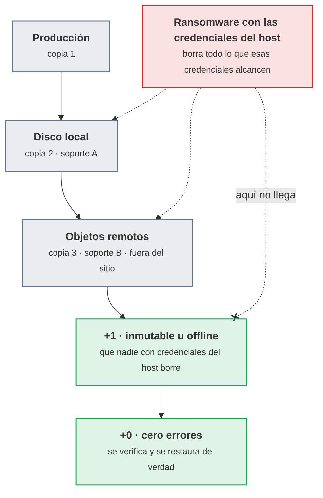
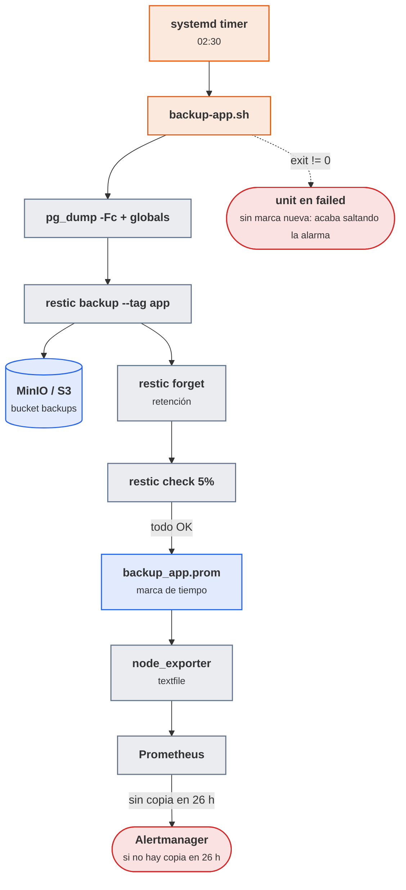

# UT6 · Copias de seguridad y restauración

<p class="ut-meta">14 h · Formación en empresa (19 abr a 9 jun 2027) · RA4 CE a, b, c</p>

Hasta la incorporación a la empresa todo el módulo ha transcurrido en el laboratorio del centro, sobre el servicio del curso (nginx en web01, API en app01, PostgreSQL en db01), y casi todo lo hecho ha servido para enterarse a tiempo de lo que le pasa: métricas, logs, alarmas y pruebas. Hay fallos que ninguna alarma evita, como un disco que muere, un `DELETE` sin `WHERE` o un ransomware (un programa que cifra los datos y pide un rescate por la clave), y frente a ellos solo queda una copia que se pueda restaurar. En el centro la copia fue una pieza puntual: en febrero, la copia previa con restic (la herramienta de copias del curso) era el plan B de la actualización en pre y se lanzó a mano, y en marzo, al dar de baja pre, sus copias en MinIO (el almacenamiento de objetos del laboratorio) fueron justo lo que hubo que eliminar de forma controlada. Esta unidad, que se cursa durante la formación en empresa, convierte esa pieza en una tarea de mantenimiento sobre un servicio real de la empresa de acogida. Va en tres bloques, en el orden en que una copia demuestra que sirve: que se haga sola cada día (bloque 1), que esté fuera del alcance del host y cumpla la política de la empresa (bloque 2) y que se pueda restaurar en el tiempo comprometido (bloque 3).

Estas páginas son guía de referencia y lista de evidencias. Las reglas de trabajo son las de la UT5 ([Cómo trabajar en la empresa](ut5-logs-accesos-rendimiento.md#como-trabajar-en-la-empresa)), y aquí pesan más que en ninguna otra unidad, porque casi todo toca producción: un volcado lee la base de datos entera, la prueba de borrado escribe en el destino de las copias y una restauración saca datos reales del sitio donde están protegidos. Por eso cada hoja empieza pidiendo una autorización concreta del tutor, y nada que cambie un sistema de la empresa se hace sin ella. Tampoco se sacan datos de la empresa: lo que se entrega son configuraciones, listados y capturas anonimizadas (nombres de host, rutas y buckets pueden cambiarse por genéricos; el contenido de un dump nunca sale de allí). Las evidencias van a una carpeta `ut6/` del mismo repositorio local de la estancia, junto a la `ut5/`; cómo se lleva ese repositorio lo explica el mismo apartado.

!!! empresa "Lo que hubo en el laboratorio"
    En el laboratorio hubo un repositorio restic contra el MinIO del curso, con la convención `s3:http://10.10.0.30:29000/backups`, la credencial `restic` y la contraseña en `/etc/restic/pass`. Se inicializó el 11 de febrero en la A7.4, que lo usó como plan B de la actualización. Desde la red de la empresa no se alcanza (como el Gitea del centro), así que no sirve de destino: queda solo como referencia para comparar. La empresa tendrá su propia herramienta, su propio destino y sus propias políticas, y parte del trabajo es entender por qué son distintas.

## Bloque 1 · Copias programadas (CE 4a)

<p class="ut-meta">En la empresa · con el tutor</p>

La copia de la A7.4 se hizo a mano, una vez y porque tocaba actualizar. Un servicio en producción no puede depender de que alguien se acuerde: necesita una copia cada noche, consistente aunque la base de datos esté escribiendo, que deje rastro y que avise cuando falte. Este bloque la construye en el orden en que se toman las decisiones. Primero, qué se copia y cómo se saca cada pieza sin corromperla. Después, los números con los que la empresa juzga una copia: la regla 3-2-1, que dice cuántas copias hacen falta y dónde, y el RPO y el RTO, que dicen cuántos datos se pueden perder y cuánto puede tardar el servicio en volver. Luego, el vocabulario de tipos de copia, que es el que usan el tutor y la documentación. Por último, la herramienta (restic), el script que la orquesta con su timer y las cuatro capas que comprueban que se ha ejecutado. La hoja A6.1 lo aplica a una aplicación de la empresa, y la copia que deja es la que audita el bloque 2 y restaura el bloque 3.

### Qué se copia y qué no

**El criterio.** La tentación es copiarlo todo, el disco entero del servidor si hace falta. Sale una copia enorme, lenta de hacer y de restaurar, que además puede llevar la base de datos a medio escribir y, por tanto, inservible, como explica el apartado siguiente. El criterio útil es el contrario: se copia lo que no se puede reconstruir a partir de otra cosa que ya está guardada. En un servicio en contenedores, las imágenes están en el registry y el código en Git; copiarlos otra vez es gastar espacio y, peor, dar una sensación de seguridad falsa, porque una copia de cientos de gigas parece completa aunque le falte lo único que no se puede rehacer. Lo que sí hay que copiar cabe en tres cajones:

- **Datos**: la base de datos y los volúmenes de ficheros que suben los usuarios (adjuntos, imágenes, documentos generados). Es lo único que no existe en ningún otro sitio.
- **Configuración**: el `compose.yml`, el `.env` (cifrado, nunca en claro), certificados y claves TLS, la configuración del proxy y de la monitorización (reglas de alerta, dashboards exportados). Aunque parte esté en Git, lo que corre en producción puede no coincidir con lo último del repositorio, y los secretos nunca están en él.
- **Metadatos del despliegue**: qué versión de imagen estaba en producción cuando se hizo la copia. La aplicación y sus datos van emparejados: si entre dos versiones hubo migraciones de esquema (cambios en la estructura de las tablas que aplica la versión nueva), un dump de la base de datos de la versión 2.4 no arranca con la imagen 2.6. Basta con un `docker compose images` volcado a un fichero junto al dump, y al restaurar se levanta la versión que dice ese fichero.

De los tres cajones, el delicado es la base de datos, porque es el único que cambia mientras se copia.

#### Dump lógico frente a copia del volumen

**Por qué una base de datos no se copia como un fichero.** Una base de datos escribe en disco de forma continua. Si se copia el directorio del volumen mientras PostgreSQL está en marcha, se obtienen ficheros de distintos instantes: un fichero de datos que ya tiene la transacción y un WAL (el registro de transacciones, *write-ahead log*) que todavía no. Ese conjunto puede no arrancar, o arrancar con datos corruptos que no se descubren hasta meses después. Hay dos maneras limpias de resolverlo: pedirle los datos al propio motor, o copiar los ficheros cuando nadie los está tocando.

**Dump lógico.** El propio motor exporta su contenido. Se llama *lógico* porque guarda lo que hay en la base (tablas, filas, definiciones de índices) y no los ficheros con los que el motor lo guarda en disco, que es lo que hace una copia *física*. `pg_dump` lee toda la base dentro de una sola transacción, así que el resultado es la foto de un instante aunque otras conexiones sigan escribiendo, y no les impide leer ni escribir mientras tanto. Además es portable: se carga en una versión más nueva de PostgreSQL o en una máquina de otra arquitectura. Para PostgreSQL:

```bash
# Una base, formato custom (comprimido, permite restauración selectiva y en paralelo)
docker compose exec -T db pg_dump -U app -Fc app > /var/backups/app.dump

# Roles y contraseñas del clúster, que pg_dump NO incluye
docker compose exec -T db pg_dumpall -U postgres --globals-only > /var/backups/globals.sql
```

Tres decisiones de estas dos órdenes:

- `-T` desactiva la asignación de TTY (terminal interactivo) en el `exec`. Sin él, la salida que se redirige con `>` se corrompe, y es la causa más habitual de un dump vacío.
- `-Fc` produce el formato *custom*, comprimido, que se restaura con `pg_restore`: admite `-j 4` para cargar en paralelo y `-t tabla` para sacar una sola tabla. El SQL plano, en cambio, se carga con `psql` de principio a fin y sin elegir qué.
- `pg_dumpall --globals-only` existe porque `pg_dump` vuelca una sola base, y los roles y sus contraseñas no pertenecen a ninguna: son del clúster entero. Sin ellos, la carga del dump falla en cada propietario y cada permiso con un `role ... does not exist`. `pg_dumpall` sin `--globals-only` vuelca todo el clúster en SQL plano, útil para migraciones, poco práctico como copia diaria de una base de 40 GB.

Con otros motores la idea es la misma y cambia la orden:

| Motor | Volcado | Lo que hay que saber |
|---|---|---|
| MySQL o MariaDB | `mysqldump --single-transaction --routines --triggers --events app > app.sql` | `--single-transaction` abre una transacción con lectura consistente para que el volcado corresponda a un instante, sin bloquear las tablas InnoDB (el motor de almacenamiento habitual de MySQL). Si hay tablas del motor antiguo MyISAM no sirve y toca `--lock-tables` |
| MongoDB | `mongodump --archive --gzip` | Sin nombre de fichero, `--archive` escribe en la salida estándar; se carga con `mongorestore --archive --gzip` |

**Copia del volumen con el servicio parado o congelado.** El dump tiene un límite: cuanto más grande es la base, más tarda en sacarse y mucho más en cargarse, porque restaurarlo es volver a insertar todas las filas y reconstruir todos los índices. Si la base es enorme y el dump no cabe en la ventana de copia (el rato de poca actividad en que se puede copiar), o su carga tarda más de lo que el servicio puede estar parado, se copian los ficheros, pero de forma que sean coherentes: se para el contenedor y se copia el directorio, o se hace una copia física con `pg_basebackup`, que la saca con el servidor en marcha y admite PITR (recuperación a un instante concreto) si además se archiva el WAL. Para el resto de volúmenes (ficheros subidos) la copia directa es lo normal, porque cada fichero se sostiene solo y no depende de que otro esté al día:

```bash
# Copiar un volumen con nombre sin conocer su ruta en el host
docker run --rm -v app_uploads:/data:ro -v /var/backups:/backup alpine \
  tar czf /backup/uploads.tgz -C /data .
```

Con restic no hace falta el tar: se le pasa la ruta del volumen directamente, y en cada copia solo lee los ficheros que han cambiado desde la anterior.

| Método | Consistencia | Portabilidad | Tamaño | Cuándo |
|---|---|---|---|---|
| `pg_dump -Fc` | Transaccional | Entre versiones mayores | Comprimido | Copia diaria estándar |
| `pg_basebackup` + WAL | Física, con PITR | Misma versión mayor | Igual que el clúster | Bases grandes, RPO de minutos |
| Copia del volumen en caliente | Ninguna | Misma versión | Igual que el clúster | Nunca para bases de datos |
| Copia del volumen parado | Total | Misma versión | Igual que el clúster | Ventana de parada aceptable |

La copia de la A7.4 y la de la A6.1 son la primera fila. Las otras dos filas válidas son para cuando el tamaño de la base no deja otra salida, y la de PITR, además, para cuando no se pueden perder más que unos minutos de datos.

#### Ficheros, configuración y secretos

**Ficheros y configuración.** Los ficheros subidos por usuarios se copian tal cual; el único cuidado es que no cambien a mitad de copia (un fichero de 2 GB que se está subiendo). restic detecta la modificación y avisa, y se puede repetir esa ruta. La configuración va toda al mismo *snapshot* que los datos (snapshot es cada copia que guarda restic, con su fecha), para que una restauración devuelva un conjunto coherente: la configuración de ese día con los datos de ese día.

**Los secretos, aparte.** El `.env` con la contraseña de la base de datos, las claves de API y los certificados privados tienen que estar en la copia (sin ellos no se restaura nada), pero no pueden viajar en claro a un bucket que gestiona otro equipo. Dos opciones válidas: cifrarlos antes con `age` o `sops` (dos herramientas de cifrado de ficheros) y copiar el fichero cifrado, o confiar en el cifrado del repositorio restic (todo lo que entra se cifra y se autentica antes de salir del host; el destino solo ve ficheros cifrados). Lo habitual es combinar las dos, y la razón es quién tiene cada clave. La contraseña del repositorio la tienen el host que copia y quien administra las copias, y con ella se lee todo, `.env` incluido; si además los secretos van cifrados con una clave que custodia otra persona, esa contraseña ya no basta para llegar a las credenciales de producción.

**age en tres órdenes.** `age` cifra con una clave pública y descifra con la privada que le corresponde, así que el host puede cifrar cada noche sin tener la clave que descifra. El par de claves lo genera quien vaya a custodiar la privada, fuera del host que copia; en el host solo queda la pública (la línea `age1...` que imprime `age-keygen`), en `/etc/restic/age.pub`:

```bash
age-keygen -o copias.key                                        # privada: nunca junto a la copia
age -R /etc/restic/age.pub -o /opt/app/.env.enc /opt/app/.env   # cifrar, en el host, antes de cada copia
age -d -i copias.key .env.enc > .env                            # descifrar, al restaurar
```

sops hace lo mismo cifrando campo a campo un YAML o un JSON; dónde encaja cada una lo explica la [gestión de secretos](https://victor-educ.github.io/apuntes-5166/ut/ut5-iac/#gestion-de-secretos) de Despliegue.

### Regla 3-2-1, RPO y RTO

**Qué falta.** Saber qué se copia no dice cuántas copias hacen falta, cada cuánto ni dónde, y sin una vara de medir cualquier copia parece suficiente hasta el día en que hay que usarla. La regla 3-2-1 responde a cuántas y dónde; el RPO y el RTO, a cada cuánto y en cuánto tiempo hay que poder volver. Con ellos se justifica todo lo que viene después: la frecuencia, el destino y el método de restauración.

**La regla 3-2-1.** Es el mínimo defendible, y cada número cubre un fallo distinto: tres copias de los datos (la de producción y dos más), para que perder una no deje una sola de la que depender; en dos soportes distintos (disco local y almacenamiento de objetos, por ejemplo), para que un defecto de un tipo de soporte no se lleve las dos; y una fuera del sitio (otro centro de datos, otra región de la nube, una cinta en una caja fuerte), para que un incendio o un robo en el edificio no acabe con todas. La variante **3-2-1-1-0**, que se ha extendido con el ransomware, añade una copia *offline* o inmutable (que nadie con credenciales del host pueda borrar, porque el ransomware busca las copias para borrarlas antes de cifrar) y cero errores en la verificación (las copias se comprueban y restauran, no se dan por buenas).



<p class="pie" markdown>El «+1» y el «+0» son los que se han vuelto imprescindibles: una copia que el atacante puede borrar no es una copia, y una que nunca se ha restaurado no se sabe si lo es.</p>

**RPO y RTO.** Son los dos parámetros que fija la empresa, no el técnico, porque responden a una pregunta de negocio: cuánto cuesta perder datos o tener el servicio parado, frente a cuánto cuesta evitarlo. Copiar cada hora o tener una réplica preparada cuesta dinero, y solo quien responde del servicio puede decidir si lo vale:

- **RPO** (*Recovery Point Objective*): cuántos datos se pueden perder, medido en tiempo. Fija la frecuencia de copia. Si el RPO es 24 h, una copia diaria a las 02:30 vale. Si es 1 h, o se copia cada hora o se archiva el WAL de PostgreSQL de forma continua.
- **RTO** (*Recovery Time Objective*): cuánto puede tardar el servicio en volver. Fija el método de restauración y dónde está la copia. Un RTO de 4 h permite descargar 30 GB de un bucket remoto y hacer un `pg_restore`; un RTO de 15 min exige una réplica en caliente o un snapshot local.

Con números: una tienda con 200 pedidos al día y copia diaria a las 02:30 tiene un RPO real de hasta 24 h: si el disco muere a las 02:00, justo antes de la copia, se pierden los pedidos de casi un día entero. Si la empresa dice que solo puede perder una hora de pedidos, la copia diaria no cumple, por muy bien que funcione. Y si el RTO es de 2 h pero la restauración de prueba tardó 3 h 40 min, el plan está mal aunque la copia sea perfecta. Por eso la A6.1 empieza pidiendo estos dos números y la A6.3 termina midiendo el segundo.

### Tipos de copia y snapshots

**El problema que resuelven.** Copiarlo todo cada noche es lo más sencillo de restaurar, pero con una base de cientos de gigas no cabe en la ventana ni en el destino. Las herramientas clásicas lo resolvieron copiando solo lo que cambia, y de ahí salen los tipos de copia que aparecen en cualquier documentación y en la conversación con el tutor. Se definen aquí para reconocerlos, para entender por qué con restic o borg la distinción casi deja de importar y, al final, por qué un snapshot del hipervisor no cuenta como copia.

- **Completa**: todo, cada vez. Simple de restaurar (un solo conjunto), cara en espacio y tiempo.
- **Incremental**: solo lo que cambió desde la última copia (completa o incremental). Barata; restaurar exige la completa más toda la cadena, y un eslabón corrupto rompe lo que viene después.
- **Diferencial**: lo que cambió desde la última completa. Restaurar necesita dos conjuntos; cada diferencial crece hasta la siguiente completa.
- **Deduplicada**: la que hacen restic y borg. Los ficheros se trocean en bloques de tamaño variable, cada bloque se identifica por su hash (una huella que solo cambia si cambia el contenido) y solo se almacenan los bloques que no estaban ya guardados. Los cortes los decide el propio contenido (*content-defined chunking*) y no una posición fija: si se insertan unas líneas al principio de un fichero, cambian los bloques de alrededor y el resto se reconoce igual, cosa que con bloques de tamaño fijo no pasaría, porque se desplazarían todos. Cada snapshot es lógicamente completo (se restaura solo, sin cadenas), pero cuesta lo que un incremental. Es la razón por la que la distinción clásica ha dejado de importar en la práctica.

**Los snapshots del hipervisor no son copias.** Aparte están los **snapshots del hipervisor** (los de Proxmox, o `vzdump`, su herramienta de copias de VM, en modo *snapshot*) y los del sistema de ficheros (ZFS, LVM). Son instantáneas del disco de la VM entera: rápidos, cómodos para volver atrás antes de una actualización, y engañosos como copia de seguridad. Un snapshot en el mismo almacenamiento que la VM desaparece con él; capta la base de datos en caliente con los mismos problemas de consistencia que copiar el volumen (aunque el *guest agent* de QEMU con `fsfreeze`, que congela un instante el sistema de ficheros del invitado, mitiga parte); y restaurar un fichero suelto obliga a levantar la VM entera. La combinación habitual en empresa es ambas cosas: copia de VM con Proxmox Backup Server (el servidor de copias de Proxmox) para recuperar el host en bloque, y copia de aplicación con restic para recuperar datos con granularidad.

### restic a fondo

**Qué resuelve.** Con un `pg_dump` y un `tar` ya se puede hacer una copia, pero quedan por resolver casi todas las exigencias de los apartados anteriores: cifrar antes de que los datos salgan del host, subir solo lo que ha cambiado, saber qué copia es de qué día y de qué máquina, borrar las antiguas con una regla y no a mano, y comprobar que lo guardado se puede leer. restic hace todo eso con un solo programa, y por eso es la herramienta del curso: con ella se hace casi todo lo que sigue (copiar, retener, verificar y restaurar).

**Qué es.** restic (versión 0.18 en el laboratorio) es un programa libre de un solo binario, escrito en Go, que crea repositorios deduplicados y cifrados en local, SFTP, S3 y compatibles (MinIO, Backblaze B2), Azure, Google Cloud Storage o su propio `rest-server`, un servidor HTTP hecho solo para guardar repositorios de restic. Todo lo que se configura son variables de entorno y flags.

**Cómo guarda las copias.** Un repositorio es un directorio, o un prefijo dentro de un bucket, con un fichero `config` y cinco carpetas. Saber qué hay en cada una explica casi todas las órdenes que vienen después:

| Carpeta | Qué guarda | Por qué importa al operar |
|---|---|---|
| `data/` | Los bloques de la deduplicación (*blobs*) y la estructura de directorios de cada copia, empaquetados en ficheros grandes (*packs*) | Es casi todo el tamaño del repositorio |
| `index/` | En qué pack está cada bloque | restic lo consulta en cada operación; la caché local lo guarda para no descargarlo cada vez |
| `snapshots/` | Un fichero pequeño por copia: fecha, host, rutas, tags y el punto de entrada a sus ficheros | Olvidar una copia (`forget`) es borrar solo este fichero |
| `keys/` | La clave maestra del repositorio, cifrada con cada una de sus contraseñas | Sin una contraseña que abra alguno de estos ficheros, el repositorio es ilegible |
| `locks/` | Un fichero por cada operación en curso | Es lo que impide que un `prune` borre bloques que una copia en marcha está usando |

Todo lo que entra se cifra y se autentica en el host antes de subir, así que en el destino no se ve ni un nombre de fichero de la aplicación. De esta estructura salen tres reglas: la contraseña es el repositorio (perderla es perderlo entero, y quien la tiene y llega al destino lo lee todo); olvidar copias no libera espacio por sí solo, porque los bloques siguen en `data/` hasta que `prune` reescribe los packs; y como cada operación deja su fichero en `locks/` mientras dura, una que muere a medias deja un bloqueo que hay que retirar.

**Cómo se usa.** Con los valores del laboratorio del curso queda así; en la empresa cambian el destino y la credencial:

```bash
export RESTIC_REPOSITORY=s3:http://10.10.0.30:29000/backups
export RESTIC_PASSWORD_FILE=/etc/restic/pass        # permisos 600, del usuario que lanza la copia
export AWS_ACCESS_KEY_ID=restic                     # la credencial de MinIO para copias
export AWS_SECRET_ACCESS_KEY='...'                  # mejor en /etc/restic/env con EnvironmentFile=
export RESTIC_CACHE_DIR=/var/cache/restic           # índices locales; acelera todo
export RESTIC_COMPRESSION=auto                      # off | auto | max

restic init                                          # una vez; crea la clave del repo
restic backup /var/backups /opt/app/compose.yml /var/lib/docker/volumes/app_uploads/_data \
  --tag app --tag daily --exclude-file /etc/restic/excludes --one-file-system
restic snapshots                                     # lista
restic snapshots --latest 1 --tag app --json         # el último con tag app, para scripts
```

`--one-file-system` impide que la copia se meta en otro sistema de ficheros montado bajo una de las rutas (un disco de red, por ejemplo), y `/etc/restic/excludes` es un fichero con un patrón por línea de lo que no se copia. No hay que memorizar las opciones de la lista siguiente, sino saber que existen para reconocerlas en el script de la empresa; son lo que separa una prueba de una copia en producción:

- **Tags y host**: cada snapshot lleva el nombre del host y los tags que se le pongan. Las políticas de retención se aplican por grupos, y por defecto un grupo es un host con unas rutas concretas (`--group-by host,paths`): si la misma máquina copia dos aplicaciones con rutas distintas, cada una tiene su propia rotación. La trampa está en cambiar las rutas de una copia que ya existe: las copias nuevas forman otro grupo, y las del antiguo se quedan para siempre, porque la política siempre conserva las últimas de cada grupo. Cuando un tag identifica la aplicación, como `app` en esta unidad, se agrupa por él (`--group-by host,tags`) y la trampa desaparece.
- **Exclusiones**: `--exclude '*.tmp'`, `--exclude-file`, `--exclude-caches` (respeta los ficheros `CACHEDIR.TAG`) y `--exclude-if-present .nobackup`. Excluir `node_modules`, cachés y logs rotados reduce el snapshot de una aplicación típica a una fracción.
- **Volcado por stdin**: en lugar de escribir el dump a disco y copiarlo, `pg_dump ... | restic backup --stdin --stdin-filename app.dump --tag app`, que es como se hizo la copia de la A7.4. Ahorra el espacio intermedio, pero restic no puede saber si lo que le llega está completo: si el `pg_dump` muere a medias, guarda lo recibido como una copia buena. Con `--stdin-from-command` (`restic backup --stdin-from-command --stdin-filename app.dump -- pg_dump ...`) es restic quien lanza la orden y, si esta termina con error, no crea el snapshot.
- **Retención**: `restic forget --keep-daily 7 --keep-weekly 4 --keep-monthly 6 --keep-yearly 2 --prune`. `--keep-daily 7` conserva, de los 7 últimos días que tienen copia, la última de cada día; `--keep-weekly`, `--keep-monthly` y `--keep-yearly` hacen lo mismo con semanas, meses y años, y una misma copia puede contar a la vez como diaria, semanal y mensual. `forget` borra los snapshots; sin `--prune` los datos siguen ocupando espacio hasta que se ejecute `restic prune`, que reempaqueta y elimina los bloques que ya no usa ningún snapshot. `prune` es lento y toma un bloqueo exclusivo, así que se programa aparte (semanal) y no en cada copia. `--max-unused 5%` limita cuánto reempaqueta.
- **Verificación**: `restic check` valida la estructura del repositorio con los índices; `--read-data` descarga y verifica cada blob (caro con 500 GB en un bucket remoto); `--read-data-subset=5%` o `--read-data-subset=1/10` lo hace por partes, de forma que en 10 ejecuciones queda leído entero.
- **Restauración**: `restic restore latest --target /restore` restaura el último snapshot; `--include /var/backups/app.dump` saca solo esa ruta; `--host` y `--tag` seleccionan el snapshot cuando hay varios. `restic ls latest` y `restic find app.dump` localizan ficheros sin restaurar; `restic diff id1 id2` muestra qué cambió entre dos snapshots.
- **Montaje**: `restic mount /mnt/restic` expone el repositorio por FUSE (un sistema de ficheros en espacio de usuario: el repositorio aparece como un directorio normal), con un directorio por snapshot (`/mnt/restic/snapshots/latest/...`). Es la forma más rápida de recuperar un fichero suelto o de inspeccionar qué hay dentro sin restaurar nada. Necesita el paquete `fuse3`.
- **Rendimiento**: la primera copia va limitada por CPU (hash y cifrado) y por la subida; las siguientes solo leen los ficheros cuyos metadatos han cambiado (por defecto compara las fechas de modificación y de cambio, el tamaño y el inodo). La caché local en `RESTIC_CACHE_DIR` es lo que más se nota: sin ella cada operación descarga los índices del bucket. El afinado fino (concurrencia de lectura, tamaño de los paquetes en S3, límite de ancho de banda en la ventana nocturna) está en [Para ampliar](../ampliacion.md#afinado-de-restic).
- **Bloqueos**: si una copia muere a medias (reinicio del host), queda un lock y la siguiente falla con "repository is already locked". `restic unlock` lo limpia; antes de hacerlo, asegurarse de que no hay otro proceso restic vivo.
- **Contraseña**: `restic key add` y `restic key remove` gestionan varias claves para el mismo repositorio; cambiarla según la política de la empresa es añadir la nueva, verificar que abre el repo y quitar la antigua. Perderla equivale a perder el repositorio entero; en la empresa conviene preguntar dónde está custodiada.

#### borg como alternativa

BorgBackup es el otro programa de copias deduplicadas y cifradas que se encuentra en producción: hace lo mismo que restic con otros nombres de comando (`borg create`, `borg prune`, `borg check`, `borg mount`). Su destino típico no es un bucket sino un NAS al que se llega por SSH, con `borg serve` al otro extremo. Ese servidor admite el modo `--append-only`, que deja al cliente añadir copias pero no borrar las que ya hay: la protección más directa contra un ransomware que entre por el host copiado. El criterio de elección suele venir dado por el destino: si es un NAS por SSH, borg; si es almacenamiento de objetos, restic. La equivalencia de comandos entre las dos herramientas, las opciones de cifrado y compresión y borgmatic están en [Para ampliar](../ampliacion.md#borgbackup-y-borgmatic-comandos-y-equivalencias).

### Programar la copia

**Qué falta.** Con lo anterior, una copia se puede hacer a mano. Para que se haga sola cada noche hacen falta dos piezas más: un script que ejecute los pasos siempre en el mismo orden y se pare en cuanto uno falle, y un programador que lo lance a la hora que pide el RPO. En el laboratorio no hubo copia programada: la de la A7.4 se lanzó a mano y, como PostgreSQL vivía en su propia VM, el volcado se pidió por SSH a esa máquina en vez de con `docker compose exec`. Si en la empresa la base tampoco está en el compose, las dos líneas del volcado del script cambian de la misma forma. El recorrido completo, que este apartado y el siguiente explican pieza a pieza:



<p class="pie" markdown>La copia no termina cuando se escribe: termina cuando alguien puede demostrar que se escribió. De ahí la marca de tiempo y la alarma.</p>

**El script.** Hace de orquestador: cifra el `.env`, apunta las versiones de imagen, vuelca la base de datos y los roles, lanza restic, aplica la retención y verifica, y al terminar escribe una métrica que node_exporter (el [agente de métricas del host](ut1-observabilidad.md#exporters-lo-que-no-se-puede-instrumentar)) recoge, como se explica en [Verificar que se ha ejecutado](#verificar-que-se-ha-ejecutado). Es el script de referencia de la unidad, el que se adapta en la A6.1:

```bash
#!/bin/bash
# /usr/local/bin/backup-app.sh
set -euo pipefail
export RESTIC_REPOSITORY=s3:https://<destino>/backups
export RESTIC_PASSWORD_FILE=/etc/restic/pass
export RESTIC_CACHE_DIR=/var/cache/restic
# AWS_ACCESS_KEY_ID y AWS_SECRET_ACCESS_KEY llegan por EnvironmentFile= de la unit

TS_FILE=/var/lib/prometheus/node-exporter/backup_app.prom   # el directorio de textfile del node_exporter
START=$(date +%s)

cd /opt/app
age -R /etc/restic/age.pub -o /opt/app/.env.enc /opt/app/.env   # el .env viaja cifrado
docker compose images --format json > /var/backups/app-images.json
docker compose exec -T db pg_dump -U app -Fc app > /var/backups/app.dump
docker compose exec -T db pg_dumpall -U postgres --globals-only > /var/backups/globals.sql

restic backup /var/backups /opt/app/compose.yml /opt/app/.env.enc \
  /var/lib/docker/volumes/app_uploads/_data \
  --tag app --exclude-file /etc/restic/excludes --one-file-system
restic forget --keep-daily 7 --keep-weekly 4 --keep-monthly 6 --tag app --group-by host,tags
restic check --read-data-subset=5%

# Métrica para Prometheus: solo se escribe si todo lo anterior ha ido bien (set -e)
# La etiqueta no se llama job: al leerla, Prometheus la renombraría a exported_job
cat > "$TS_FILE.$$" <<EOF
# HELP backup_last_success_timestamp_seconds Epoch de la última copia correcta
# TYPE backup_last_success_timestamp_seconds gauge
backup_last_success_timestamp_seconds{backup="app"} $(date +%s)
backup_last_duration_seconds{backup="app"} $(( $(date +%s) - START ))
EOF
mv "$TS_FILE.$$" "$TS_FILE"
```

Cuatro decisiones de este script, en el orden en que aparecen:

- **`set -euo pipefail`** convierte cualquier fallo intermedio en el final del script: `-e` lo detiene en cuanto una orden falla, `-u` trata como error una variable sin definir (una ruta mal escrita no se convierte en una ruta vacía) y `pipefail` hace que una tubería falle si falla cualquiera de sus partes, no solo la última. El código de salida distinto de cero que resulta es lo que systemd va a mirar.
- **El orden.** Los volcados van antes que restic porque restic copia los ficheros que ellos dejan en `/var/backups`. La retención va después de una copia correcta: si la de hoy falla, el script se detiene antes del `forget` y no se borra ninguna copia antigua el mismo día en que no hay una nueva. El `forget` agrupa por tags, como se explica en [restic a fondo](#restic-a-fondo), para que añadir una ruta al script no deje copias viejas sin rotar. El `prune` no está aquí a propósito: va en un timer semanal separado, porque es lento y bloquea el repositorio. Y si en el bloque 2 la credencial del host pierde el permiso de borrado, el `forget` sale también de aquí ([Destinos y políticas](#destinos-y-politicas)).
- **La métrica, solo al final.** Con `set -e`, llegar a la última línea significa que todo lo anterior ha ido bien, así que la hora que se escribe es la de la última copia correcta. Se escribe en un fichero temporal y se renombra con `mv`, que dentro del mismo sistema de ficheros es atómico: node_exporter nunca lee un fichero a medio escribir y, como solo lee los que acaban en `.prom`, ignora el temporal (`backup_app.prom.<PID>`).
- **La etiqueta `backup`, y no `job`.** Prometheus ya pone a cada serie la etiqueta `job` del scrape que la recoge; si la métrica trae una propia con ese nombre, la renombra a `exported_job`, y las reglas de alerta no la encontrarían donde la buscan.

#### systemd timers

**Por qué un timer.** Un timer de systemd es una unit que lanza otra unit a una hora o cada cierto tiempo. Frente a cron, que es lo que hay en muchas empresas, tiene tres ventajas que importan en una copia: si el host estaba apagado a la hora prevista, la lanza al arrancar; el log va al journal sin gestionar nada; y cuando el script falla, la unit queda en estado `failed`, que se puede consultar. Hacen falta dos ficheros: una unit de servicio `oneshot` (se ejecuta, termina y no queda residente) y el timer que la dispara.

```ini
# /etc/systemd/system/backup-app.service
[Unit]
Description=Copia de seguridad de app
After=docker.service network-online.target
Wants=network-online.target

[Service]
Type=oneshot
EnvironmentFile=/etc/restic/env
ExecStart=/usr/local/bin/backup-app.sh
Nice=10
IOSchedulingClass=best-effort
IOSchedulingPriority=7
```

De la unit de servicio, tres decisiones:

- `After=docker.service network-online.target` y `Wants=network-online.target`: la copia necesita Docker para el volcado y la red para llegar al destino. `After=` solo ordena el arranque; sin `Wants=`, el objetivo `network-online.target`, que es el que espera a que la red esté configurada, puede no activarse nunca y no habría nada que esperar.
- `EnvironmentFile=/etc/restic/env` carga las credenciales del bucket. Una unit no hereda el entorno de la sesión de quien la instala, y así los secretos tampoco quedan escritos en el script, que puede acabar en un repositorio.
- `Nice=10` y las dos líneas de `IOScheduling` bajan la prioridad de la copia en CPU y en disco, para que ceda ante el servicio si coinciden.

```ini
# /etc/systemd/system/backup-app.timer
[Unit]
Description=Lanza backup-app.service cada noche

[Timer]
OnCalendar=*-*-* 02:30:00
Persistent=true
RandomizedDelaySec=15m
Unit=backup-app.service

[Install]
WantedBy=timers.target
```

Del timer:

- `OnCalendar` admite expresiones como `Mon..Fri 02:30`, `*-*-01 04:00` (el día 1 de cada mes) o `hourly`; `systemd-analyze calendar '*-*-* 02:30:00'` indica cuándo será la próxima ejecución.
- `Persistent=true` guarda en disco la última ejecución y, si el host estaba apagado a las 02:30, lanza la copia en cuanto arranca (cron no hace esto).
- `RandomizedDelaySec` retrasa cada ejecución un tiempo al azar dentro de ese margen, para repartir la carga cuando varios hosts comparten el mismo destino a la misma hora.

Si la empresa ya tiene una unit que avisa por correo o webhook, una línea `OnFailure=` en `[Unit]` la engancha para que salte cuando la copia termine con error; aquí el aviso lo da la alerta por ausencia de [Verificar que se ha ejecutado](#verificar-que-se-ha-ejecutado), que cubre también el caso en que la copia ni siquiera arranca. Se activa con `systemctl enable --now backup-app.timer` (el timer, no el servicio: es el timer el que tiene que sobrevivir a un reinicio); `systemctl list-timers` muestra la próxima y la última ejecución; `journalctl -u backup-app.service -n 50` es el log, sin gestionar rotación ni redirecciones.

#### cron y contenedor programador

**cron.** La línea equivalente en `/etc/cron.d/backup-app` es `30 2 * * * root /usr/local/bin/backup-app.sh >> /var/log/backup-app.log 2>&1`. Funciona en cualquier sitio y es lo que hay en muchas empresas; sus carencias frente al timer son las del apartado anterior: no recupera ejecuciones perdidas, el log hay que gestionarlo a mano y el fallo solo se ve si alguien lee el correo de root. Si la empresa usa cron, se respeta, porque cambiar de programador es una decisión del equipo y no de la copia: la alerta por ausencia compensa la falta de aviso. Con cron no hay `EnvironmentFile=`, así que el script tiene que cargar él mismo `/etc/restic/env` exportando sus variables: `set -a; . /etc/restic/env; set +a`.

**Contenedor programador.** Cuando el host es ajeno (una plataforma gestionada donde solo se dispone de Docker), el programador va en un contenedor: ofelia, un programador de tareas pensado para Docker, lee etiquetas de los otros contenedores (`ofelia.job-exec.backup.schedule: "0 30 2 * * *"`, `ofelia.job-exec.backup.command: "pg_dump ..."`) y ejecuta comandos dentro de ellos; o un *sidecar* (contenedor auxiliar que acompaña al principal) Alpine con `crond` que monta el socket de Docker. Ambos tienen el mismo problema: el contenedor programador necesita acceso al socket o a los volúmenes, y eso es un privilegio grande que hay que documentar, porque quien habla con el socket de Docker puede arrancar un contenedor con el disco del host montado, y eso equivale a ser root.

### Verificar que se ha ejecutado

**El problema.** El script y el timer hacen la copia; falta saber que se ha hecho. Una copia programada que nadie mira deja de funcionar en silencio: caduca la credencial del bucket, se llena `/var/backups`, cambia la contraseña de la base de datos, y nadie lo descubre hasta que hace falta restaurar. La verificación tiene cuatro capas, de la más barata a la más fiable, y cada una ve algo que la anterior no ve:

1. **Código de salida.** El `set -e` del script y `Type=oneshot` hacen que systemd marque la unit como `failed`. `systemctl is-failed backup-app.service` lo consulta.
2. **Log.** `journalctl -u backup-app.service --since yesterday`. restic imprime al final de cada copia cuántos ficheros nuevos, cambiados y sin cambios, y cuántos datos se han añadido. Un "Added to the repository: 0 B" tres días seguidos en una aplicación viva es sospechoso aunque el código de salida sea 0.
3. **El repositorio.** `restic snapshots --latest 1 --tag app` devuelve fecha, host, tags y rutas del último snapshot. Comprobar que la fecha es de hoy y que el tamaño (`restic stats latest`) está en el rango esperado. Es lo que mira quien audita.
4. **Alerta por ausencia** (*dead man's switch*). Las tres anteriores fallan si el host que copia está apagado, si el timer se deshabilitó o si el script no llega ni a arrancar. La única forma de detectarlo es que otro sistema espere una señal y avise cuando no llega.

**Con Prometheus.** Si la empresa tiene Prometheus, como la pila de mon01 del curso, la señal es la métrica que escribe el script. Prometheus no puede hacer scrape a un script, que se ejecuta unos minutos y termina; por eso el script deja la métrica en un fichero, y node_exporter, que sí está siempre en marcha, la publica junto a las del host. Es el *textfile collector* de node_exporter, que lee los ficheros `.prom` de un directorio. El paquete `prometheus-node-exporter` de Debian, el de las VM del laboratorio, lo lee de `/var/lib/prometheus/node-exporter`; otra instalación lo indica con `--collector.textfile.directory=<ruta>` en su línea de arranque, y sin ese flag no lee ninguno. Las dos reglas, con la sintaxis de las [reglas de alerta](ut2-alarmas.md#reglas-de-alerta) de Prometheus:

```yaml
groups:
  - name: backups
    rules:
      - alert: BackupMissing
        expr: time() - backup_last_success_timestamp_seconds > 26 * 3600
        for: 10m
        labels: {severity: critical}
        annotations:
          summary: "Sin copia correcta de {{ $labels.backup }} en más de 26 h"
      - alert: BackupMetricAbsent
        expr: absent(backup_last_success_timestamp_seconds{backup="app"})
        for: 30m
        labels: {severity: warning}
```

La primera compara la hora actual con la de la última copia correcta. Las 26 h dejan margen a `RandomizedDelaySec` y a una copia que tarde más de lo habitual sin generar ruido cada noche. La segunda regla cubre el caso en que la métrica desaparece (node_exporter caído, fichero borrado): sin [`absent()`](ut2-alarmas.md#operadores-con-etiquetas), la primera expresión no devuelve nada y no salta. Cómo se enrutan después en Alertmanager está en [El árbol de rutas](ut2-alarmas.md#el-arbol-de-rutas); aquí solo hay que añadirlas.

**Sin Prometheus.** Si la empresa no tiene Prometheus, o el host que copia está fuera de su red de monitorización, el mismo patrón se hace con un servicio externo tipo [healthchecks.io](https://healthchecks.io/docs/), que hace de "otro sistema que espera la señal": se crea un *check* con periodo 24 h y gracia 2 h, y el script hace `curl -fsS -m 10 --retry 3 https://hc-ping.com/<uuid>` al terminar bien (y `.../<uuid>/fail` en el `trap ERR`, el manejador que bash ejecuta cuando falla un comando). Si no llega el ping, avisa por correo, Slack o webhook. Healthchecks se puede autoalojar en un contenedor si la política de la empresa no permite servicios externos.

### A6.1 Copias programadas (CE 4a)

<span class="et et-obj">Objetivo</span> Que una aplicación real de la empresa deje de depender de que alguien se acuerde de copiarla. Al terminar, la aplicación elegida tiene una copia programada que se ejecuta sola a la hora que pide su RPO, deja rastro de que se ha ejecutado y avisa cuando falta; es la copia que auditas en la A6.2 y restauras en la A6.3.

<span class="et et-pre">Antes de empezar</span>

- Autorización escrita del tutor para trabajar sobre la aplicación elegida (o revisar su copia actual) y acuerdo sobre qué puedes ejecutar en producción.
- Acceso como root al host de la aplicación, con `restic` y `age` instalados, o el tutor delante si no te lo dan.
- Un destino aprobado por la empresa: bucket o NAS o, si no hay nada, un MinIO temporal en contenedor en un host de pruebas, montado con la [receta del laboratorio de Despliegue](https://victor-educ.github.io/apuntes-5166/laboratorio/#como-se-monta-minio). El MinIO del laboratorio no se alcanza desde la empresa.
- La clave pública de `age` que te da quien custodia la privada ([Ficheros, configuración y secretos](#ficheros-configuracion-y-secretos)).
- Leído: [Qué se copia y qué no](#que-se-copia-y-que-no), [Regla 3-2-1, RPO y RTO](#regla-3-2-1-rpo-y-rto), [restic a fondo](#restic-a-fondo), [Programar la copia](#programar-la-copia) y [Verificar que se ha ejecutado](#verificar-que-se-ha-ejecutado).

<span class="et et-pas">Pasos</span>

Vas a construir la copia en el mismo orden que la teoría y a probar cada pieza a mano antes de automatizarla: primero decides qué se copia y con qué objetivos, después compruebas que el volcado y la copia funcionan cuando los lanzas tú, y solo entonces los metes en el script y el timer y añades la alerta. Así, si algo falla de madrugada, sabes que cada pieza funcionaba suelta y que el problema está en lo que añadió la automatización: el entorno, los permisos o la hora.

1. **Haz el inventario y fija los objetivos.** Con el tutor, apunta en una tabla cada componente de la aplicación (base de datos, volúmenes de ficheros, configuración, secretos y versión de imagen en producción), si se copia o no y por qué, con el criterio de [Qué se copia y qué no](#que-se-copia-y-que-no). Apunta también el RPO y el RTO que fije el responsable del servicio, porque deciden la hora del timer del paso 5 y la vara con la que se mide la restauración de la A6.3. Si nadie los ha fijado, propón 24 h y 4 h y deja constancia de que es una propuesta.

    *Pista:* los volúmenes en uso salen del `compose.yml` o de `docker inspect`, no de `docker volume ls`, que lista también los abandonados.

2. **Contrasta lo que ya hay.** Si la empresa ya tiene copias, compara su script con lo explicado en este bloque (dump consistente, `-T` en el `exec`, secretos cifrados, `set -e`, retención escrita) y apunta cada diferencia en una lista de mejoras. No se trata de sustituir lo que funciona, sino de saber qué riesgos tiene antes de tocarlo: esa lista es lo que propones al tutor. Si no hay copias, los pasos siguientes las montan desde cero.

3. **Saca a mano un volcado consistente.** Vuelca la base de datos y los roles del clúster en `/var/backups/app.dump` y `/var/backups/globals.sql`, como en [Dump lógico frente a copia del volumen](#dump-logico-frente-a-copia-del-volumen), a la hora que acuerdes con el tutor, porque un volcado lee la base entera de producción. Comprueba que no están vacíos: es la pieza que decide si la copia sirve, y si sale mal, el resto del sistema guardará cada noche, cifrado y verificado, un fichero inútil.

    *Pista:* un dump de 0 bytes con código de salida 0 suele ser el `-T` que falta en `docker compose exec`.

4. **Haz a mano la primera copia con restic.** Copia con el tag `app` las rutas del script de [Programar la copia](#programar-la-copia), con la contraseña del repositorio en `/etc/restic/pass` y el `.env` cifrado antes con `age`, porque en claro no entra nunca. Lanzarla a mano antes de automatizarla separa los problemas: si falla aquí, es el destino o la credencial; si después solo falla desde el timer, es el entorno de systemd. Si el repositorio es nuevo, su contraseña va al gestor de contraseñas de la empresa en cuanto se genera, porque sin ella las copias son ilegibles.

    *Pista:* además de las `RESTIC_*`, restic necesita la credencial del bucket (`AWS_ACCESS_KEY_ID` y `AWS_SECRET_ACCESS_KEY`); sin ella, `restic init` falla con un `unable to open config file` engañoso.

5. **Automatízala.** Adapta el `backup-app.sh` de [Programar la copia](#programar-la-copia) a la aplicación y a la retención acordada, y prográmalo a la hora que pide el RPO con el timer de [systemd timers](#systemd-timers), o con cron si es lo que usa la empresa. Lanza una ejecución a mano y revisa su log; con el timer, lánzala por la unit y no ejecutando el script, porque es la única forma de comprobar antes de la primera noche que el script, lanzado por systemd, ve las mismas credenciales que tú tenías en la terminal.

    *Pista:* `TS_FILE` tiene que estar en el directorio que lee el node_exporter del host: su `--collector.textfile.directory`, que en el paquete de Debian ya es el del script. Si no lee ninguno, activarlo lo decide el tutor; si no lo autoriza, la alerta va por healthchecks.io.

6. **Comprueba que la alerta salta.** Configura la alerta por ausencia de [Verificar que se ha ejecutado](#verificar-que-se-ha-ejecutado), con sus dos reglas si hay Prometheus o con healthchecks.io si no. Una alerta que nunca se ha visto saltar no demuestra nada, así que provócala con el tutor delante sin esperar un día, captura cada alerta disparada y deja todo como estaba.

    *Pista:* con Prometheus, umbral de `BackupMissing` a `> 300` y `for: 1m` en las dos reglas; `BackupMetricAbsent` salta al apartar el `.prom`. Con healthchecks.io, periodo de 5 min y gracia de 1 min.

<span class="et et-com">Comprobación</span>

- `systemctl list-timers` muestra el timer con próxima ejecución, y `journalctl -u backup-app.service` termina con el resumen de restic (ficheros nuevos, cambiados, datos añadidos) y sin errores.
- `restic snapshots --latest 1 --tag app` devuelve un snapshot de hoy con las rutas esperadas; `restic ls latest | grep app.dump` lo localiza dentro.
- El dump tiene tamaño coherente con la base (`ls -la /var/backups`), no 0 bytes.
- La alerta ha saltado en la prueba de ausencia y ha vuelto a estado normal tras una copia correcta.

<span class="et et-ent">Entrega</span> En `ut6/a61/` del repositorio de la estancia: la tabla de inventario del paso 1 y la lista de mejoras del paso 2 si había copias previas, el script o la configuración anonimizados, unit y timer (o la línea de cron), salida de `restic snapshots` (o equivalente), la regla o el check de alerta y la captura de la alerta disparada. Fila A6.1 de la ficha de evidencias firmada por el tutor.

## Bloque 2 · Exportación y políticas (CE 4b)

<p class="ut-meta">En la empresa · con el tutor</p>

La copia del bloque 1 se hace sola y avisa si falta, pero eso no garantiza que sobreviva a lo que tiene que sobrevivir. Si está en el mismo servidor, se pierde con él; si el host que copia puede borrarla, un ransomware que entre en él la borra antes de cifrar; y si nadie la poda, o la poda sin criterio, el destino se llena o guarda menos de lo que la empresa cree. Este bloque comprueba esas tres cosas contra una política escrita, en el orden en que se audita una copia: dónde está el destino y qué garantías da, si el host que copia puede destruirla, y si la rotación y la limpieza hacen lo que dice la política. Va después del bloque 1 porque necesita una copia funcionando desde hace unos días: sin varios snapshots no hay rotación que contar. La hoja A6.2 lo demuestra con listados, y el punto de retención de [restic a fondo](#restic-a-fondo), del bloque 1, se vuelve a usar aquí.

### Destinos y políticas

**El problema.** La copia local en `/var/backups` del propio host no es una copia: se pierde con el servidor, con el ransomware que cifra el disco y con el `rm -rf` equivocado. El destino externo es la parte del 3-2-1 que más se descuida, y elegirlo es decidir de qué desastres protege la copia.

**Dónde puede estar.** Los destinos habituales, con lo que aporta y lo que cuesta cada uno:

| Destino | Acceso desde restic | Puntos a favor | Puntos en contra |
|---|---|---|---|
| S3 / MinIO (propio o en otro CPD, centro de datos) | `s3:` nativo | Versionado, Object Lock, políticas IAM (permisos por credencial) por bucket | Coste por GB y por petición en nube; latencia en `prune` |
| NAS por SFTP o NFS | `sftp:` o ruta local | Barato, rápido en LAN | Mismo edificio; permisos difíciles de hacer *append-only* |
| Nube pública (B2, S3, Azure Blob) | nativo | Fuera del sitio sin esfuerzo | Egress (pago por descargar) al restaurar; cifrado en cliente obligatorio; ubicación |
| Cinta LTO (cinta magnética) | Vía intermedio (restic no escribe en cinta) | Offline de verdad, décadas de retención | Lento, requiere robot o disciplina manual |
| Disco externo rotado | ruta local | Trivial, offline | Depende de que alguien lo cambie; se olvida |

Con restic, lo habitual es el almacenamiento de objetos, propio en otro centro de datos o en una nube pública: queda fuera del sitio sin que nadie tenga que mover nada, y es el que permite impedir el borrado desde el propio destino, que es lo que más pesa en las políticas de abajo. La cinta y el disco rotado aportan la copia *offline* de la variante 3-2-1-1-0, a cambio de depender de que alguien los cambie.

**Qué tiene que cumplir.** Las **políticas** que hay que respetar y comprobar, y que son el contenido de la A6.2, son de tres tipos: cómo se almacena la copia, cuántas se conservan (rotación) y cómo se libera lo que sobra (limpieza).

**Almacenamiento.** Tres requisitos, y cada uno con su forma de comprobarlo:

| Requisito | Qué se exige | Cómo se comprueba |
|---|---|---|
| Cifrado | Cifrado en cliente, antes de que los datos salgan del host. El repositorio restic ya lo hace; en nube pública es obligatorio, no opcional. | `restic cat config` solo abre con la contraseña, y en el destino se ven blobs, no nombres de fichero de la aplicación. |
| Ubicación | Si el servicio trata datos personales, el RGPD (el reglamento europeo de protección de datos: su artículo 32, seguridad del tratamiento, y su capítulo V, transferencias internacionales) condiciona dónde puede estar la copia: un bucket en `eu-west-1` o `eu-south-2` (Irlanda y España) vale; uno en `us-east-1` exige garantías adicionales que la empresa probablemente no quiere gestionar. | Región del bucket (`mc admin info`, con `mc`, el cliente de línea de comandos de MinIO, o la consola de la nube) frente a la que permite la política escrita. |
| Protección contra borrado | El host que copia no debe poder destruir las copias. En S3 o MinIO se combinan el versionado del bucket (`mc version enable minio/backups`), que conserva las versiones anteriores de un objeto sobrescrito o borrado, y Object Lock en modo *compliance* con periodo de retención (`mc retention set --default COMPLIANCE 30d minio/backups`), que impide que nadie, ni el administrador, borre antes de que venza. La credencial del script lleva `s3:PutObject`, `s3:GetObject` y `s3:ListBucket` pero no `s3:DeleteObject`, salvo en el prefijo `locks/` del repositorio (el porqué está debajo de la tabla); con el servidor REST de restic el equivalente es `rest-server --append-only`. | `mc version info minio/backups`, `mc retention info minio/backups` y la política de la credencial; la prueba práctica es subir un objeto de usar y tirar, fuera de `locks/`, con la credencial del script e intentar borrarlo, que tiene que responder `AccessDenied`. Nunca se prueba con un `forget --prune` contra el repositorio real: si la protección está mal puesta, que es lo que se está comprobando, el comando funciona y destruye copias. |

En las órdenes de la tabla, `minio` es el alias con el que se ha dado de alta el destino en `mc`; en el laboratorio era `lab`.

**Cómo funciona la protección contra borrado.** Son tres capas porque cada una tapa el hueco de otra. Quitarle el permiso de borrado a la credencial que vive en el host impide que borre, pero no que sobrescriba un objeto con basura; el versionado hace que sobrescribir o borrar deje guardada la versión anterior; y Object Lock en modo *compliance* impide que esas versiones se eliminen antes de su fecha, ni siquiera con la cuenta de administración del destino. Con las tres, un atacante que entre en el host de producción no puede borrar la copia, que es el primer paso del ransomware moderno.

**Lo que cambia en el script.** Una credencial que no puede borrar tampoco puede ejecutar `forget`: olvidar un snapshot es borrar su fichero de `snapshots/`, y la documentación de restic advierte que `forget` y `prune` necesitan permiso completo de lectura, escritura y borrado, y que se lancen desde un cliente aparte y bien protegido. Por eso, cuando se aplica esta protección, el `forget` sale del script de la A6.1 y pasa, junto al `prune` y con la misma política, a otro host con otras credenciales; el host de producción se queda en volcar, copiar y verificar. La excepción es `locks/`: restic crea un fichero de bloqueo al empezar cada operación y lo borra al terminar, así que la credencial del script conserva el permiso de borrado solo en ese prefijo, donde no hay ninguna copia.

**Rotación.** La política escrita dice cuántas diarias, semanales, mensuales y anuales se conservan; los flags `--keep-*` tienen que coincidir con ella, y el listado del destino también. Se comprueba con `restic snapshots --group-by tags` y contando, sin olvidar que una misma copia puede contar a la vez como diaria, semanal y mensual.

**Limpieza.** `prune` programado y ejecutándose (con lock exclusivo, en horario que no coincida con la copia); espacio ocupado dentro de lo previsto (`restic stats --mode raw-data`, `mc du minio/backups`); y copias caducadas realmente eliminadas, lo que con versionado y Object Lock exige además una regla de ciclo de vida en el bucket (`mc ilm rule add --expire-delete-marker --noncurrent-expire-days 30 minio/backups`) para que las versiones no actuales se borren cuando venza la retención.

**Cómo se comprueba.** Siempre igual: listar el destino (`restic snapshots`, `aws s3 ls --recursive`, `mc ls --versions`, listado de la NAS) y compararlo línea a línea con la política. Lo que no coincide va a la tabla de cumplimiento con una fecha de corrección.

!!! ojo "Las credenciales del bucket no son secretos de segunda"
    Con `AWS_SECRET_ACCESS_KEY` y `RESTIC_PASSWORD` en el mismo fichero, quien lea `/etc/restic/env` tiene las copias enteras de la empresa. Ese fichero va con `chmod 600`, propietario root, fuera de cualquier repositorio Git y, si la empresa tiene Vault (un gestor de secretos) o similar, se sirve desde allí en tiempo de ejecución.

### A6.2 Exportación y políticas (CE 4b)

<span class="et et-obj">Objetivo</span> Pasar de "tenemos copias" a poder demostrar que sobreviven a perder el host y a un ataque desde él. Al terminar, has demostrado con listados que las copias están fuera del host, que el host que copia no puede borrarlas, y que la rotación y la limpieza que hay coinciden con la política escrita (de la empresa o la que propones tú), y lo que no coincide está en una tabla de cumplimiento con su corrección.

<span class="et et-pre">Antes de empezar</span>

- Autorización del tutor para lanzar comandos de solo lectura contra el destino; los cambios (versionado, Object Lock, ciclo de vida), solo con su visto bueno y, mejor, ejecutados por él.
- La copia de la A6.1 funcionando desde hace unos días, para que haya varios snapshots que contar.
- Credenciales de lectura al destino y, si es una nube pública, leído lo que explica la [unidad de nube pública de Despliegue](https://victor-educ.github.io/apuntes-5166/ut/ut4-nube-publica/) sobre cuentas, regiones y coste de descarga.
- Leído: [Destinos y políticas](#destinos-y-politicas) y el apartado de retención de [restic a fondo](#restic-a-fondo).

<span class="et et-pas">Pasos</span>

Es una auditoría, y como toda auditoría va de la norma a los datos y de los datos a la conclusión: primero consigues la política escrita, que es la vara de medir; después sacas los listados del destino; luego compruebas punto por punto el almacenamiento, la rotación y la limpieza; y al final lo resumes en la tabla de cumplimiento. Casi todo es de solo lectura. Lo único que escribe en el destino es la prueba de borrado del paso 3, y por eso lleva su propia advertencia.

1. **Consigue la política escrita.** Pide la política de copias de la empresa: sin ella no hay contra qué comparar, y cada comprobación acabaría siendo una opinión. Si no existe, redáctala en media página a partir del RPO de la A6.1 y del espacio disponible: cifrado, ubicación, protección contra borrado, retención y limpieza. Márcala como propuesta y que el tutor la lea antes de comprobar nada, para que la auditoría mida contra algo aceptado.

2. **Lista el destino.** Saca los snapshots agrupados por tags, los objetos del bucket con sus versiones y el espacio ocupado, con las órdenes de [Destinos y políticas](#destinos-y-politicas), y guarda la salida anonimizada. Esos listados son la evidencia de que la copia está fuera del host, y los datos con los que trabajan los pasos 4 y 5.

    *Pista:* con una credencial de solo lectura, restic no puede crear su fichero en `locks/`; `--no-lock` le deja listar sin crearlo.

3. **Comprueba el almacenamiento.** Recorre las tres filas de la tabla de [Destinos y políticas](#destinos-y-politicas) (cifrado, ubicación y protección contra borrado) anotando comando y resultado. La protección no se da por buena leyendo la configuración, porque lo que importa es qué pasaría en un ataque: se demuestra intentando borrar, con la credencial del script, un objeto de usar y tirar que subes tú. Tiene que responder `AccessDenied` y el objeto, seguir ahí; anótalo para que lo retire quien administre el bucket.

    *Pista:* configura en `mc` un alias aparte con la credencial del script, para no probar sin querer con la de administración. Con una NAS y borg, lo que se busca es `--append-only` en el `authorized_keys` del usuario de copias.

    !!! ojo "El repositorio real no se usa para probar borrados"
        Si la protección está mal puesta, que es lo que vienes a comprobar, un `restic forget --prune` contra el
        repositorio de la empresa borra copias de verdad. Si el destino no deja escribir fuera de él, prueba
        contra un repositorio restic de usar y tirar en otro prefijo.

4. **Cuenta la rotación.** Cuenta en el listado del paso 2 cuántas diarias, semanales y mensuales hay de verdad y compáralo con los `--keep-*` que aplica la limpieza (los del script o, si ya se ha separado, los del host que hace el `forget`) y con la política: las tres cosas tienen que coincidir. Una diferencia significa que la empresa cree tener copias que no tiene, o que guarda y paga copias que nadie ha pedido.

5. **Comprueba la limpieza.** Localiza el `prune` (en otro host o con otras credenciales que las del script) y su última ejecución, compara el espacio ocupado con el previsto y, si el bucket tiene versionado, comprueba que hay una regla de ciclo de vida para las versiones no actuales. Es la otra mitad de la rotación: sin `prune`, lo que olvida `forget` sigue ocupando, y con versionado pero sin ciclo de vida, lo que borra `prune` tampoco se libera.

6. **Resume en la tabla de cumplimiento.** Rellena una fila por punto de la política: requisito, cómo se comprobó, resultado, acción correctora con fecha si procede. La tabla es lo que se queda la empresa: lo que cumple y lo que falta, con una fecha para cada corrección. Lo que no cumple se propone al tutor y, si lo autoriza, se corrige y se vuelve a comprobar.

<span class="et et-com">Comprobación</span>

- El listado del destino muestra los snapshots de la A6.1 y el recuento por tipo coincide con la política y con los flags `--keep-*`.
- El borrado del objeto (o del repositorio) de usar y tirar con la credencial del script ha fallado con `AccessDenied`, y las copias reales siguen intactas: `restic snapshots` devuelve las mismas de antes de la prueba.
- La tabla de cumplimiento no tiene filas vacías y cada "no cumple" tiene acción y fecha.

<span class="et et-ent">Entrega</span> En `ut6/a62/` del repositorio de la estancia: la política del paso 1 (de la empresa o tu propuesta, indicando cuál), los listados del destino del paso 2 (anonimizados) y la tabla de cumplimiento del paso 6. Fila A6.2 de la ficha de evidencias firmada por el tutor.

## Bloque 3 · Restauración de prueba (CE 4c)

<p class="ut-meta">En la empresa · con el tutor</p>

Los dos bloques anteriores demuestran que la copia se hace, que está fuera del host y que se conserva como dice la política, pero no que sirva. Una copia puede estar completa y no restaurarse: falta la clave para descifrar el `.env`, los roles no se copiaron, la versión de imagen no casa con los datos o la restauración tarda el triple de lo que permite el RTO. Todo eso solo aparece al restaurar, y es preferible que aparezca un martes cualquiera en un entorno de pruebas que el día del desastre. Por eso este bloque va al final y recoge lo anterior: se restaura la copia que monta el bloque 1, desde el destino que audita el bloque 2, con el procedimiento de ocho pasos que sigue la hoja A6.3; y lo aprendido en los tres bloques se escribe en el plan de copias, el documento que se entrega al cierre.

### Restaurar: el mantenimiento preventivo

**Por qué es mantenimiento preventivo.** Una copia que no se ha restaurado nunca no es una copia; es una esperanza. La restauración periódica (mensual como mínimo, y siempre antes de una actualización mayor) es la tarea de mantenimiento preventivo de esta unidad, y la que cubre el CE 4c. Se llama preventiva por lo mismo que cambiar una pieza antes de que se rompa: se hace sin que nada haya fallado, para encontrar los fallos de la copia mientras arreglarlos todavía no corre prisa.

**El procedimiento.** Paso a paso, con el cronómetro en marcha desde el primer comando, porque lo que se quiere saber no es solo si se restaura, sino cuánto tarda cada fase frente al RTO:

1. **Elegir la copia.** Normalmente la última: `restic snapshots --latest 1 --tag app`. Anotar el ID corto.
2. **Preparar la plataforma de pruebas.** Una VM limpia o un `docker compose` con proyecto distinto (`-p app_restore`) en un host que no sea producción, porque restaurar encima del servicio real sustituiría los datos de hoy por los de la copia; el proyecto distinto hace que compose ponga otros nombres a contenedores, redes y volúmenes, para que no choquen con nada que ya exista. Comprobar que tiene Docker, restic, espacio en disco (el doble del tamaño del dump) y acceso al destino.
3. **Restaurar.** `restic restore <id> --target /restore`. Anotar cuánto tarda; en un bucket remoto esta suele ser la fase larga.
4. **Colocar la configuración y levantar la base de datos vacía** con la versión de imagen que dice `/restore/var/backups/app-images.json`. El `compose.yml` y el `.env` descifrado van en su sitio *antes* del primer `up`: la copia solo guarda el `.env.enc`, y sin el fichero en claro el contenedor de la base arranca sin contraseña ni nombre de base. Después se carga: `psql -U postgres -f /restore/var/backups/globals.sql` para los roles, y `pg_restore -U app -d app -j 4 /restore/var/backups/app.dump`. La ruta del dump va como argumento y no por redirección, porque `pg_restore` con `-j` abre el fichero varias veces y no puede hacerlo sobre la entrada estándar. Los errores de "role already exists" al cargar globals son normales si la imagen ya creó el rol.
5. **Restaurar los volúmenes de ficheros** copiando `/restore/var/lib/docker/volumes/app_uploads/_data` al volumen nuevo con un contenedor auxiliar, como en la copia pero al revés, y ajustando el propietario al UID que use la imagen.
6. **Levantar el servicio** y verificar: la aplicación arranca; los datos están (`SELECT count(*) FROM pedidos`, el último registro por fecha, un fichero subido que se abre); pruebas funcionales básicas (login, una búsqueda, generar un informe). Comparar los recuentos con los de producción a la hora de la copia si es posible.
7. **Parar el cronómetro** y comparar con el RTO. Si ha tardado más, el plan tiene un problema y es preferible descubrirlo hoy.
8. **Registrar**: fecha, snapshot usado, quién, tiempo por fase, resultado, incidencias encontradas y qué se corrigió. **Destruir** el entorno de pruebas (contiene datos reales de la empresa) y borrar `/restore`.


<p class="pie" markdown>Una copia que no se ha restaurado nunca es una suposición. Por eso la restauración se programa como mantenimiento preventivo, con su fecha.</p>

Tres tareas complementarias que también forman parte del mantenimiento:

- **`restic check --read-data` completo** con periodicidad (trimestral en repositorios grandes, mensual en pequeños), además del 5% de cada noche. Detecta corrupción silenciosa en el almacenamiento, que los subconjuntos pueden tardar meses en encontrar.
- **Rotación de la contraseña del repositorio** según la política (`restic key add`, probar, `restic key remove <id antiguo>`), con la nueva custodiada donde diga la empresa.
- **Restauración de un fichero suelto**, que es lo que de verdad piden los usuarios ("he borrado el informe de marzo"). Con restic: `restic find informe-marzo.pdf` para localizar en qué snapshots está, y `restic restore <id> --target /tmp/r --include '/var/lib/docker/volumes/app_uploads/_data/informes/informe-marzo.pdf'`; o `restic mount` y copiar con `cp`. Medir este tiempo también: es un RTO distinto, y suele ser el que más veces se ejerce.

!!! truco "Restauración a un punto anterior"
    Cuando el problema no es un disco roto sino un borrado lógico descubierto días después ("alguien vació la tabla de clientes el martes"), la copia que interesa no es la última sino la anterior al daño. `restic snapshots` con la fecha y `restic diff` entre dos snapshots ayudan a localizar el momento exacto; con `pg_restore -t clientes` se recupera solo esa tabla en una base auxiliar y se traspasan las filas.

### El plan de copias como documento

**Para quién se escribe.** Lo que la empresa necesita al final no es el script, sino un documento que otra persona pueda seguir a las tres de la mañana con el servicio caído. Quien monta las copias no suele ser quien las restaura: el día que hacen falta puede estar de vacaciones o haber terminado ya su estancia en la empresa. Por eso el documento lleva comandos literales y rutas reales, y no da por sabido nada de lo que hizo quien lo escribió. Dos páginas, con estos apartados en este orden:

1. **Alcance**: qué servicio, qué componentes (base de datos, volúmenes, configuración) y qué queda fuera y por qué (imágenes en el registry, código en Git).
2. **Objetivos**: RPO y RTO acordados con quien responde del servicio, y los medidos en la última restauración de prueba.
3. **Qué y cuándo**: método por componente (dump `-Fc`, copia de volumen), programación (timer, hora, ventana), herramienta y versión.
4. **Dónde**: destino principal y externo, cifrado, ubicación geográfica, quién custodia las claves.
5. **Retención y limpieza**: política de rotación (diarias, semanales, mensuales), Object Lock o equivalente, `prune` y ciclo de vida.
6. **Verificación**: qué se mira a diario (alerta de ausencia, log), qué mensualmente (restauración de prueba, `check`), quién lo hace.
7. **Procedimiento de restauración**: los ocho pasos anteriores adaptados, con comandos literales y rutas reales, y el de fichero suelto.
8. **Registro**: tabla con las restauraciones de prueba realizadas (fecha, snapshot, tiempo, resultado).

### A6.3 Restauración de prueba (CE 4c)

<span class="et et-obj">Objetivo</span> Demostrar que la copia de la A6.1 sirve para lo que se hizo: devolver el servicio. Al terminar, has levantado el servicio en una plataforma de pruebas desde la última copia, con los datos verificados, un tiempo medido por fase comparado con el RTO, y el entorno de pruebas destruido. Es la única prueba que pone a examen a la vez la copia, el destino, las claves y el procedimiento.

<span class="et et-pre">Antes de empezar</span>

- Autorización del tutor para restaurar datos reales en pruebas, con acuerdo escrito de que el entorno se destruye al terminar.
- Una VM o un host de pruebas que no sea producción, con Docker, restic (o la herramienta de la empresa), acceso de lectura al destino y espacio libre de al menos el doble del último snapshot.
- El `.env` descifrado o la clave con la que descifrarlo, en manos de quien la custodie.
- Un cronómetro y una plantilla de registro con una fila por fase: inicio, fin, duración e incidencia.
- Leído: [Restaurar: el mantenimiento preventivo](#restaurar-el-mantenimiento-preventivo) entero, incluida la restauración de un fichero suelto.

<span class="et et-pas">Pasos</span>

Vas a seguir el procedimiento de [Restaurar: el mantenimiento preventivo](#restaurar-el-mantenimiento-preventivo) en el orden en que se reconstruiría el servicio de verdad: primero traes los datos, después levantas la base de datos y la cargas, luego el resto del servicio, y solo con todo arriba verificas. El cronómetro corre desde el primer paso y se anota por fases, porque el total dice si cumples el RTO, pero son las fases las que dicen dónde se va el tiempo. Al final destruyes lo restaurado, porque son datos reales de la empresa fuera de producción.

1. **Trae la copia a la plataforma de pruebas.** Elige la copia (normalmente la última con el tag `app`), arranca el cronómetro y restáurala en `/restore` de la plataforma de pruebas, anotando cuánto tarda. Con un destino remoto suele ser la fase más larga, y la que más depende del destino que auditaste en la A6.2.

    *Pista:* lo restaurado conserva las rutas originales: en `/restore/var/backups` están el dump, los roles y `app-images.json`, con la versión de imagen de la copia.

2. **Reconstruye la base de datos y los ficheros.** En un proyecto de compose aparte, `app_restore`, levanta solo la base de datos con esa versión de imagen, carga roles y dump, y lleva los ficheros a su volumen con el propietario que use la imagen. La base va sola y primero porque la aplicación, si arrancara contra una base vacía, podría crear su propio esquema y estorbar a la carga. Anota la duración de cada fase.

    *Pista:* el `.env` descifrado va en su sitio antes del primer `up`. `pg_restore -j` no lee de la entrada estándar, así que copia antes el dump al contenedor, y `docker compose create` crea el volumen de ficheros sin arrancar la aplicación.

3. **Levanta el servicio y demuestra que los datos están.** Levanta el resto del servicio y verifica los datos (recuentos de las tablas principales, último registro, un fichero subido que se abre) y las pruebas funcionales que acuerdes con el tutor, comparando con producción si es posible: que la aplicación arranque no basta, porque una base restaurada a medias también arranca. Para el cronómetro y compara el total con el RTO de la A6.1; si lo superas, va al registro como incidencia.

4. **Recupera un fichero suelto.** Recupera un fichero que acuerdes con el tutor, con su propio tiempo, como en [Restaurar: el mantenimiento preventivo](#restaurar-el-mantenimiento-preventivo). Es la restauración que más se pide en el día a día, y se mide aparte porque su tiempo es otro RTO, distinto del de la caída completa.

5. **Registra y destruye el entorno.** Completa el registro (fecha, snapshot, quién, comandos, tiempo por fase y total, resultado, incidencias y correcciones) y destruye el entorno: el proyecto `app_restore` con sus volúmenes, `/restore` y lo recuperado del fichero suelto. El registro es lo que alimenta el apartado de registro del plan de copias, y la destrucción no es opcional, porque el entorno guarda datos reales fuera de los controles de producción. El tutor confirma la destrucción en la ficha.

6. **Propón cada cuánto repetirlo.** Redacta la propuesta de periodicidad para la empresa (mensual, trimestral, siempre antes de una actualización mayor), justificada con el tiempo medido y con lo que cambia el servicio entre copias. Una restauración de prueba caduca: cada cambio de versión, de esquema o de destino puede romper la siguiente, y la propuesta dice cada cuánto hay que volver a demostrar que funciona.

<span class="et et-com">Comprobación</span>

- La aplicación restaurada arranca y las pruebas funcionales pasan; los recuentos coinciden o la diferencia se explica por la hora de la copia.
- El registro tiene un tiempo por cada fase y el total, con la comparación con el RTO escrita.
- El fichero suelto se ha recuperado y su tiempo está anotado aparte.
- `docker compose -p app_restore ps` no devuelve nada y `/restore` no existe.

<span class="et et-ent">Entrega</span> En `ut6/a63/` del repositorio de la estancia: el registro de la restauración del paso 5 (comandos ejecutados, tiempos por fase y del fichero suelto, resultado, incidencias, capturas anonimizadas de la aplicación restaurada) y la propuesta de periodicidad del paso 6. Fila A6.3 de la ficha de evidencias firmada por el tutor.

<span class="et et-ext">Si te sobra tiempo</span> Ensaya la restauración a un punto anterior: localiza con `restic snapshots` y `restic diff` la copia previa a un cambio conocido y recupera una sola tabla con `pg_restore -t <tabla>` en una base auxiliar.

## Práctica evaluable

<p class="ut-meta">En la empresa · con el tutor</p>

En esta unidad la práctica evaluable es el conjunto de las tres actividades más el plan de cierre, valoradas con la ficha de evidencias firmada por el tutor de empresa y revisadas por el profesor. No pide nada que no salga de un paso de las hojas. Los pesos:

| Criterio | Peso | Qué se valora |
|---|---|---|
| A6.1 Copias programadas (CE 4a) | 25 % | Selección justificada de qué se copia (paso 1), consistencia del dump (paso 3), programación correcta (paso 5), verificación con alerta de ausencia funcionando (paso 6) |
| A6.2 Exportación y políticas (CE 4b) | 25 % | Copia en medio externo (paso 2), protección contra borrado (paso 3), rotación y limpieza comprobadas contra la política (pasos 4 y 5), tabla de cumplimiento completa y honesta (paso 6) |
| A6.3 Restauración de prueba (CE 4c) | 30 % | Procedimiento seguido en plataforma de pruebas con verificación de datos (pasos 1 a 3), tiempos medidos por fase (pasos 1 a 3), fichero suelto (paso 4), registro completo y entorno destruido (paso 5) |
| Plan de copias y restauración | 15 % | Dos páginas ejecutables por un tercero, que recogen lo producido en las tres hojas: RPO y RTO acordados y medidos, comandos literales, registro de pruebas |
| Ficha de evidencias y anonimización | 5 % | Ficha completa y firmada, evidencias sin datos de la empresa |

Se entrega por Aules la carpeta `ut6/` del repositorio de la estancia antes del 11 de junio de 2027, junto con la `ut5/` y con las mismas reglas de anonimización. Tiene que contener:

- [ ] `a61/`: tabla de inventario (A6.1, paso 1) y lista de mejoras si había copias previas (paso 2), script, unit y timer o línea de cron (paso 5), listado de snapshots (pasos 4 y 5) y regla o check de alerta con la captura de la alerta disparada (paso 6).
- [ ] `a62/`: política (A6.2, paso 1), listados del destino (paso 2) y tabla de cumplimiento (paso 6).
- [ ] `a63/`: registro de la restauración con tiempos por fase y del fichero suelto (A6.3, pasos 1 a 5) y propuesta de periodicidad (paso 6).
- [ ] `plan-copias-servicio-X.pdf` (dos páginas, de la actividad de cierre).
- [ ] `ficha-evidencias.pdf` firmada.

### Actividad de cierre

Documento de dos páginas, "Plan de copias y restauración del servicio X", con los ocho apartados de [El plan de copias como documento](#el-plan-de-copias-como-documento). Es lo que se queda en la empresa cuando termina la estancia: sin él, lo montado en las tres hojas solo lo sabe manejar quien lo montó. No se escribe desde cero: cada apartado resume una evidencia que ya está en `ut6/`. El alcance sale del inventario de la A6.1 (paso 1); los objetivos, del RPO y el RTO acordados (A6.1, paso 1) y del tiempo medido (A6.3, paso 3); qué y cuándo, del script y el timer (A6.1, paso 5); dónde, retención y limpieza, de la política y la tabla de cumplimiento de la A6.2; la verificación, de la alerta (A6.1, paso 6) y de la propuesta de periodicidad (A6.3, paso 6); y el procedimiento de restauración y el registro, del registro de la A6.3. Se entrega al tutor de empresa y al profesor.

### Ficha de evidencias

| Actividad | CE | Fecha | Evidencia adjunta | Observaciones del tutor | Firma |
|---|---|---|---|---|---|
| A6.1 Copias programadas | 4a |  |  |  |  |
| A6.2 Exportación y políticas | 4b |  |  |  |  |
| A6.3 Restauración | 4c |  |  |  |  |
| Cierre: plan de copias | 4a, 4b, 4c |  |  |  |  |

## Errores frecuentes en el laboratorio

- **`pg_dump` vacío o de 0 bytes y código de salida 0.** Casi siempre es el `-T` que falta en `docker compose exec`, o `set -o pipefail` ausente cuando se encadena con `gzip`. Se ve mirando el tamaño del fichero (`ls -la /var/backups`) antes de dar la copia por buena; el script debería comprobar `[ -s "$DUMP" ]`.
- **`Fatal: unable to open config file ... repository does not exist`.** La variable `RESTIC_REPOSITORY` no llega al script (systemd no hereda el entorno de la sesión interactiva). O se exporta en el propio script o va en `EnvironmentFile=`. `systemctl show backup-app.service -p Environment` dice qué ve la unit. El mismo mensaje sale con el repositorio bien puesto cuando faltan `AWS_ACCESS_KEY_ID` y `AWS_SECRET_ACCESS_KEY`: restic llega al bucket pero no puede autenticarse, y no distingue las dos situaciones.
- **`repository is already locked`.** Copia anterior interrumpida (reinicio, `kill`). `restic unlock` tras confirmar con `ps aux | grep restic` que no hay otro proceso.
- **Copias de 0 B añadidos durante días.** La ruta copiada es un volumen que ya no usa la aplicación (se recreó con otro nombre tras un `docker compose down -v`). `docker volume ls` y `docker inspect` del contenedor para ver el volumen real.
- **La alerta `BackupMissing` no salta aunque no haya copia.** La métrica desapareció (node_exporter reiniciado sin el directorio de textfile, fichero `.prom` borrado). Es el caso que cubre `absent()`; si no está la segunda regla, no hay aviso. La consulta `backup_last_success_timestamp_seconds` en Prometheus lo confirma sin depender de cómo esté protegido el exporter (si no devuelve nada, la métrica no llega), y un `ls -la` del directorio de textfile en el host que copia dice si el fichero existe.
- **`forget` o `forget --prune` fallan con `AccessDenied` desde el host de producción.** Es lo esperado cuando la credencial del script va sin `s3:DeleteObject`, como debe ser: la retención y el `prune` se ejecutan desde el host de administración con otras credenciales, y el `forget` sale del script ([Destinos y políticas](#destinos-y-politicas)). En el laboratorio no pasaba porque la credencial `restic` era de lectura y escritura: el mismo host copiaba y limpiaba.
- **El bucket no deja de crecer aunque `forget` borra snapshots.** Versionado activado sin regla de ciclo de vida: los objetos borrados por `prune` quedan como versiones no actuales. `mc ls --versions` lo muestra; `mc ilm rule add` lo arregla.
- **`pg_restore` falla con "role app does not exist" o con errores de extensiones.** No se restauraron los globals (`pg_dumpall --globals-only`) o la imagen de PostgreSQL de pruebas no tiene la extensión (`pg_trgm`, `postgis`). Va en los metadatos del despliegue.
- **La restauración arranca pero la aplicación falla al abrir un fichero subido.** Se restauró la base pero no el volumen de ficheros, o se restauró en otra ruta y los permisos (UID del contenedor) no coinciden. `chown -R 1000:1000` sobre el volumen restaurado, con el UID que use la imagen.
- **El timer no se ejecutó y `Persistent=true` está puesto.** El timer no estaba `enabled`, solo `started`; al reiniciar el host no se cargó. `systemctl enable --now` y `systemctl list-timers --all` para ver los inactivos.

Los enlaces para ampliar y los apartados que van más allá de lo que pide la unidad están en [Para ampliar](../ampliacion.md#ut6-copias-de-seguridad-y-restauracion).
