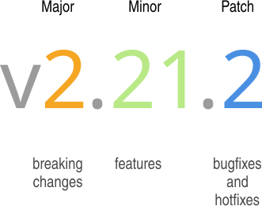
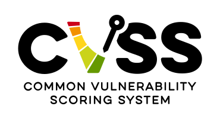
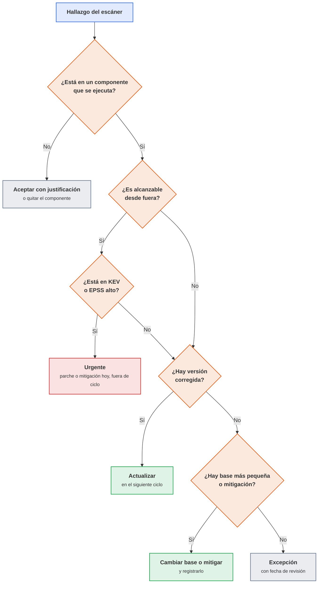
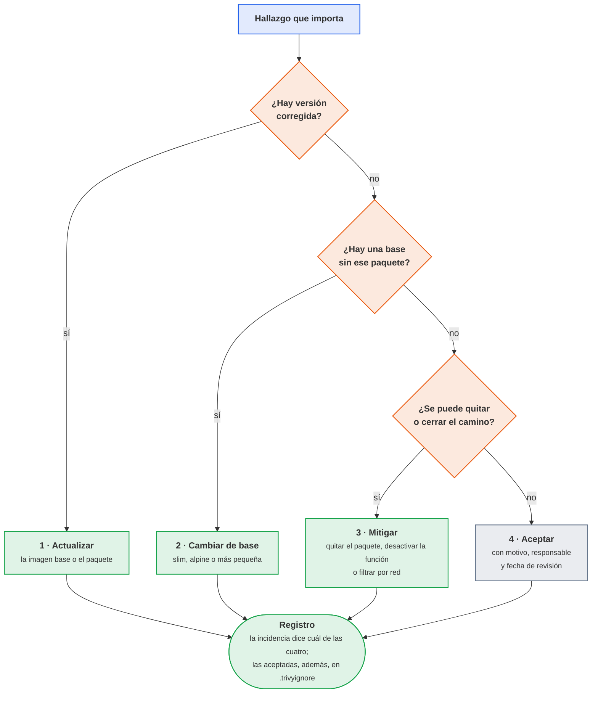
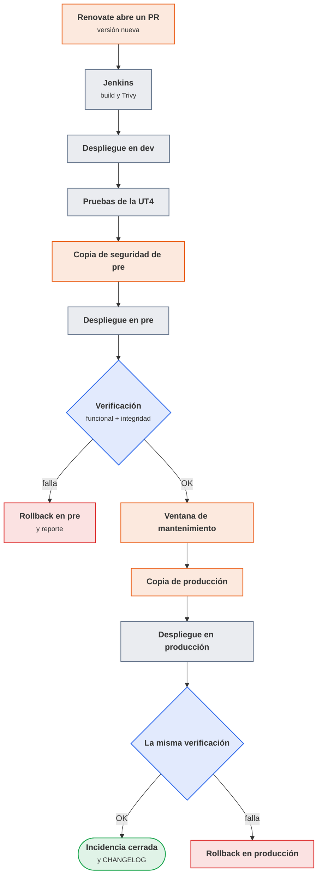

# UT7 · Actualización y gestión de vulnerabilidades

<p class="ut-meta">14 h · Sesiones 28 a 34 · RA4 CE d, e, f, g, h, i</p>

Hasta aquí el módulo ha tratado de mirar el servicio (UT1 a UT3) y de medirlo y probarlo (UT4). Todo eso da por hecho que el servicio no cambia. En esta unidad cambia: aparecen versiones nuevas de la imagen base, de las librerías y de la propia aplicación, aparecen vulnerabilidades en librerías que nadie sabía que llevaba el contenedor, y hay que decidir qué se actualiza, cuándo y cómo, sin romper nada y dejando rastro. Las pruebas de la UT4 se reutilizan tal cual como red de seguridad de cada actualización, y el plan B es una copia con restic contra el MinIO del laboratorio: el repositorio de copias del curso se inicializa en la sesión 31, que es la primera que lo necesita. Después de esta unidad viene la UT8, donde se da de baja el entorno pre que aquí se usa tanto. La práctica evaluable de la sesión 34 cierra la unidad el 23 de febrero y la UT8 arranca el 25, justo antes del parón de las fiestas de la Magdalena, del 1 al 5 de marzo.

La unidad sigue el orden en que se trabaja en cualquier equipo de Sistemas, y cada sesión contesta a la pregunta que deja abierta la anterior. Primero, qué hay desplegado exactamente y cómo enterarse de que sale algo nuevo (sesión 28). Después, si alguna de esas piezas tiene un fallo de seguridad publicado (29) y qué se hace con cada uno (30). Con la decisión tomada, cómo se actualiza sin perder nada (31) y qué se hace cuando la actualización falla (32). Y al final, cómo queda escrito todo para poder reconstruirlo meses después, y cómo se automatiza el escaneo para que ninguna imagen se lo salte (33).

## Sesión 28 · Inventario de versiones y seguimiento automático

<p class="ut-meta" markdown>2 de febrero · Teoría y práctica · <span class="dur" tabindex="0" aria-label="Versiones, etiquetas y digests · 15 min&#10;Seguir la aparición de versiones · 10 min&#10;A7.1 Inventario de versiones y seguimiento automático · 85 min" data-dur="Versiones, etiquetas y digests · 15 min&#10;Seguir la aparición de versiones · 10 min&#10;A7.1 Inventario de versiones y seguimiento automático · 85 min">:material-school:<i class="dur-barra" style="--teoria:23%"></i>:material-flask:</span></p>

En la UT4 se probó a fondo una versión concreta del servicio, la 1.4.2, y su informe de Trivy quedó archivado. Desde hoy esa versión empieza a envejecer: Docker Hub publica bases nuevas, las librerías sacan correcciones y la aplicación tendrá su 1.4.3. Antes de cambiar nada hay que resolver dos cosas, y en este orden. La primera, saber con exactitud qué hay desplegado y conseguir que no cambie por su cuenta: para eso la teoría explica cómo se nombra una imagen sin ambigüedad (etiqueta y digest), qué promete un número de versión y qué variante de imagen conviene. La segunda, enterarse de que sale algo nuevo sin tener que mirarlo a mano: Renovate, por qué no Watchtower y la política escrita que dice quién decide qué. La hoja hace las dos cosas sobre el servicio del curso: primero el inventario y la base fijada, después la vigilancia automática.

### Versiones, etiquetas y digests

**El problema: el nombre no basta.** Antes de actualizar nada hay que poder decir con exactitud qué hay desplegado. Sin eso no se puede saber si un fallo publicado afecta al servicio, ni repetir en producción exactamente lo que se probó en pre (el entorno de preproducción, donde se ensaya antes de tocar producción), ni volver a lo que había si la actualización sale mal. Con contenedores, la línea `image:` del compose no siempre lo dice, y este apartado explica por qué y cómo se resuelve.

**Qué es una imagen por dentro.** Una imagen está hecha de capas, los cambios en el sistema de ficheros que va añadiendo cada instrucción del Dockerfile, y de un fichero de configuración con el comando de arranque, las variables y el usuario. El *registry*, el servidor del que se descargan las imágenes (Docker Hub para las públicas; en el laboratorio, desde el 19 de febrero, `registry.lab:5000`), describe cada imagen con un **manifiesto**: un documento JSON pequeño que lista la configuración y cada capa con su hash SHA-256. Como el manifiesto contiene el hash de todo lo demás, su propio hash identifica la imagen entera: si cambia un solo byte de cualquier capa, cambia también. Ese hash del manifiesto es el **digest** (`sha256:…`).

**Etiqueta frente a digest.** Una imagen se nombra por `repositorio:etiqueta` (`postgres:17.6`) y se identifica de forma inequívoca por su digest (`postgres@sha256:…`). La diferencia importa más de lo que parece: la etiqueta es un puntero que el mantenedor puede mover cuando quiera, el digest es el contenido. Cuando los mantenedores de la imagen oficial reconstruyen `17.6` porque Debian ha publicado un parche de `libssl`, la etiqueta no cambia y el digest sí. Un `docker compose pull` en producción un lunes puede traer una imagen distinta de la que se probó el viernes aunque el compose diga lo mismo.


<p class="pie" markdown>El nombre del compose no identifica el software: identifica una etiqueta que alguien puede mover. Solo el digest dice qué hay desplegado de verdad.</p>

**Tres niveles de precisión.** De menos a más:

| Referencia | Qué significa | Dónde tiene sentido |
|---|---|---|
| `postgres:latest`, `postgres:17` | La última versión que haya en ese momento. Impredecible: un `pull` puede saltar de 17.5 a 17.6 o, peor, de 17 a 18 con `latest`. | Pruebas rápidas en un portátil. Nunca en un compose que se despliegue. |
| `postgres:17.6`, `postgres:17.6-bookworm` | Versión concreta. Identifica qué software lleva, pero la imagen se puede reconstruir por debajo (parches del SO base). | Mínimo aceptable en pre y producción. Es lo que se lee y lo que se escribe en el CHANGELOG. |
| `postgres:17.6@sha256:3f1a…` | Contenido exacto. Reproducible al 100 %: lo que se ha probado es lo que se despliega. | Pipelines y producción. La etiqueta se deja al lado para que un humano sepa qué es. |

**Cómo se pasa de uno a otro.** Las órdenes que dan cada dato (`jq` filtra JSON en la línea de comandos):

```bash
# Digest de una imagen descargada de un registry
docker images --digests python

# Digest y arquitecturas de una etiqueta en el registry, sin descargarla (consulta el registry)
docker manifest inspect python:3.13-slim-bookworm | jq '.manifests[] | {digest, platform}'

# Imagen exacta de la que salió un contenedor que está corriendo: su ID
# (el contenedor se busca por su servicio del compose, sin escribir su nombre)
docker inspect --format '{{.Image}}' $(docker compose -f /opt/servicio/compose.yml ps -q app)

# Reescribir el compose con todas las imágenes resueltas a digest (también consulta el registry)
docker compose config --resolve-image-digests > compose.pinned.yml
```

**Las imágenes construidas en local no tienen digest.** `RepoDigests`, el campo de `docker image inspect` que guarda los digests de una imagen, solo se rellena cuando la imagen se ha descargado de un registry o se ha subido a uno. Una imagen construida en local, como `app:1.4.2` en app01 mientras no existe el registry del laboratorio, lo tiene vacío. Se identifica por su **ID** (`docker image inspect --format '{{.Id}}' app:1.4.2`), otro hash que Docker calcula en la propia máquina. El ID se conserva al llevar la imagen a otra máquina con `docker save` y `docker load`, y por eso es lo que se compara cuando una imagen viaja como fichero: si el ID coincide en los dos lados, es la misma imagen.

**Imágenes para varias arquitecturas.** Ojo con `docker manifest inspect`: una imagen publicada para varias arquitecturas tiene un **índice**, un manifiesto de manifiestos con uno por plataforma (`linux/amd64`, `linux/arm64`), y la orden devuelve el índice con el digest de cada plataforma. Para fijar en el compose se usa el digest del índice (el que aparece en `RepoDigests`), y Docker escoge la plataforma correcta al hacer `pull`. Si se fija a mano el digest de `amd64` y algún día el servicio se mueve a una máquina ARM, el `pull` falla con un mensaje poco claro.

**Para qué se usa en el curso.** La forma de trabajo de las empresas que lo hacen bien: la etiqueta para leer, el digest para desplegar. En el servicio del curso, la base de la imagen viene de Docker Hub y lleva las dos cosas; la imagen de la aplicación se construye en app01 y, hasta que exista el registry, lleva una versión fija sin digest:

```dockerfile
# api/Dockerfile
FROM python:3.13-bookworm@sha256:3f1a9c...
```

```yaml
# compose.yml
services:
  app:
    image: app:1.4.2     # desde el 19 de febrero, registry.lab:5000/app:1.4.2@sha256:...
```

Fijar tiene un precio: una versión fijada no recibe ningún parche hasta que alguien cambia el digest. Quién lo cambia se explica en [Seguir la aparición de versiones](#seguir-la-aparicion-de-versiones): no una persona a mano, sino Renovate, un robot que revisa el repositorio y propone el cambio cada vez que sale una versión nueva.

#### Versionado semántico

<figure markdown="span">
  { width="520" }
  <figcaption>Las tres partes de una versión semántica y qué puede cambiar en cada una. Fuente: Surjit Bains, CC BY-SA 4.0, vía Wikimedia Commons.</figcaption>
</figure>

**Qué problema resuelve.** De un número de versión depende cuánto trabajo da una actualización: leer dos líneas y aplicarla, o leer una guía de migración y reservar una ventana. El **versionado semántico** es la convención que hace que el número lo diga. Es una especificación pública y corta (semver.org) en la que el proyecto promete qué puede romperse según qué parte del número cambie, `MAYOR.MENOR.PARCHE`:

- **Parche** (1.4.2 → 1.4.3): corrección de errores compatible. Se puede aplicar sin leer casi nada, y en la política del curso es el único tipo de cambio que se fusiona solo.
- **Menor** (1.4.3 → 1.5.0): funcionalidad nueva compatible hacia atrás. Conviene leer las notas por si hay opciones nuevas o algo marcado como obsoleto (deprecated), que es el aviso de que en la siguiente mayor desaparece.
- **Mayor** (1.5.0 → 2.0.0): cambios incompatibles. Hay que leer la guía de migración entera, probar en pre con datos reales y planificar ventana. Aquí es donde se rompen formatos de configuración, se renombran variables de entorno y cambian los esquemas de base de datos.

**Cada proyecto la cumple a su manera.** La promesa la hace cada proyecto, y no todos numeran igual. PostgreSQL usa dos números: el primero es la mayor (17 → 18, requiere `pg_upgrade` o volcado y restauración porque cambia el formato en disco) y el segundo es la "menor" (17.5 → 17.6), que en realidad se comporta como un parche: solo correcciones, mismo formato de datos, se actualiza parando y arrancando con la imagen nueva. nginx alterna ramas: las versiones con segundo número par (1.28.x) son la rama estable, que solo recibe correcciones, y las impares (1.29.x), la *mainline*, por donde entran las novedades. Python publica una menor al año (3.13, 3.14) y correcciones cada dos meses, más o menos, pero sus menores pueden retirar funciones que antes había marcado como obsoletas: el paso de 3.13 a 3.14 se lee como si fuera una mayor.

**Para qué se usa en el curso.** Renovate, que se presenta más abajo, compara los números para clasificar cada actualización en parche, menor o mayor, y el `renovate.json` decide por esa clase qué se fusiona solo y qué espera a una persona. Un proyecto que no sigue la convención engaña a esa clasificación, y por eso a sus paquetes se les dice a mano cómo leer las versiones (`versioning`, en [Errores frecuentes](#errores-frecuentes-en-el-laboratorio)).

#### Políticas de etiquetas de las imágenes oficiales

**Qué son las imágenes oficiales.** Son las de Docker Hub que no llevan delante el nombre de un usuario o de una organización: `python`, `postgres`, `nginx`. Las mantiene un equipo de Docker junto con cada proyecto, a partir de un repositorio público (`docker-library/official-images`), y se reconstruyen cuando se actualiza la distribución de debajo, que es justo lo que mueve el digest de una etiqueta que no ha cambiado.

**Por qué hay tantas etiquetas para una misma versión.** Cada versión se publica en varias variantes, según la distribución base y lo que traen instalado, y cada variante con varios alias (`17`, `17.6`, `17.6-bookworm`). Escoger la variante decide cuántos paquetes entran en la imagen sin que nadie los haya pedido, y cada paquete es un candidato a vulnerabilidad: por eso escogerla bien es una de las [cuatro soluciones](#las-cuatro-soluciones-y-el-registro-de-excepciones) a una vulnerabilidad que se ven en la sesión 30. Lo que significa cada sufijo:

| Variante | Base | Tamaño orientativo | Cuándo |
|---|---|---|---|
| `python:3.13` (sin sufijo) | Debian completa, con compiladores y cabeceras | ~1 GB | Solo para construir. Nunca como imagen final. |
| `python:3.13-slim` | Debian con lo mínimo para ejecutar | ~150 MB | La opción por defecto para la aplicación del curso. |
| `postgres:17.6-bookworm`, `-trixie` | El sufijo nombra la versión de Debian de debajo (12 o 13) | | Conviene fijarla siempre: sin sufijo, el proyecto puede cambiar de Debian al lanzar una versión nueva. |
| `nginx:1.28.0-alpine`, `postgres:17.6-alpine` | Alpine, con musl (otra biblioteca C, no la glibc de Debian) y `apk` como gestor de paquetes | 20 a 80 MB | Muchos menos paquetes y menos CVE (fallos de seguridad publicados). Cuidado con programas que dependen de glibc o de su resolución DNS. |

Por debajo de alpine hay bases todavía más pequeñas, sin shell ni gestor de paquetes dentro, que dejan el recuento de hallazgos casi a cero a cambio de no poder entrar a depurar con `docker exec`; se describen en [Para ampliar](../ampliacion.md#bases-minimas-distroless-y-chainguard).

**Para qué se usa en el curso.** Una regla práctica: para el escáner, cada paquete que no está no puede ser vulnerable. Pasar la API del curso de `python:3.13` a `python:3.13-slim` quita de un plumazo cientos de hallazgos que venían de `gcc`, `perl` o `imagemagick` que nadie usaba. Se mide en la actividad A7.3, y antes la A7.1 fija el sufijo de Debian, para que el cambio de variante no traiga además, sin que nadie lo decida, un cambio de distribución.

### Seguir la aparición de versiones

**El problema contrario.** Con las versiones fijadas, nada cambia por su cuenta, que es lo que se buscaba. Pero tampoco se actualiza nada: la base fijada hoy seguirá sin los parches de Debian dentro de seis meses si nadie se entera de que han salido. Hay tres formas de enterarse: que un robot lo detecte y proponga el cambio (Renovate), que un programa lo detecte y lo aplique por su cuenta (Watchtower), o que una persona lo mire a mano de vez en cuando. El curso usa la primera. Este apartado explica cómo funciona, por qué la segunda no vale para un servicio que se mantiene y qué política escrita convierte cada propuesta en una decisión.

#### Renovate a fondo

**Qué hace.** Renovate lee el repositorio, detecta dependencias (imágenes en `compose.yml` y en `FROM` de los Dockerfile, paquetes en `requirements.txt` o `package-lock.json`, módulos de Ansible, versiones de acciones de CI) y abre un pull request (PR: una propuesta de cambio que alguien revisa antes de fusionarla en la rama principal) por cada actualización disponible, con las notas de la versión pegadas en la descripción. Una persona revisa, el pipeline prueba, alguien fusiona. Automatiza el aviso, no la decisión.

**Cómo funciona una pasada.** Renovate no es un servicio que se quede escuchando. Cada ejecución clona el repositorio, busca dependencias con un detector por tipo de fichero (un *manager*: `docker-compose`, `dockerfile`, `pip_requirements`...), pregunta al origen de cada una qué versiones existen (Docker Hub para las imágenes, PyPI para los paquetes de Python), compara y abre o actualiza un PR por cada cambio, cada uno en su propia rama (`renovate/...`). Después termina. En una empresa se programa para que pase cada pocas horas; en el laboratorio se lanza a mano.

**Dónde corre y con qué cuenta.** Funciona en GitHub, GitLab y Gitea, que es lo que hay en el laboratorio, y se ejecuta como contenedor con el token de un usuario técnico, una cuenta de Gitea solo para el robot. Así sus PR se reconocen a simple vista, sus permisos se limitan a los repositorios que mantiene y su token se puede revocar sin tocar la cuenta de nadie:

```bash
docker run --rm \
  -e RENOVATE_PLATFORM=gitea \
  -e RENOVATE_ENDPOINT=http://gitea.lab:3001/api/v1 \
  -e RENOVATE_TOKEN=$TOKEN_BOT \
  -e RENOVATE_REPOSITORIES=ops/servicio \
  -e LOG_LEVEL=info \
  renovate/renovate:41
```

**La configuración vive en el propio repositorio**, en `renovate.json`, y viaja con el código como cualquier otro fichero. Conviene fijarse en `extends`, que carga una configuración base ya hecha, y en `packageRules`, que decide qué se fusiona solo y qué no:

```json
{
  "$schema": "https://docs.renovatebot.com/renovate-schema.json",
  "extends": ["config:recommended", ":pinDigests"],
  "timezone": "Europe/Madrid",
  "schedule": ["after 7am and before 9am every weekday"],
  "labels": ["actualizacion"],
  "prConcurrentLimit": 5,
  "enabledManagers": ["docker-compose", "dockerfile", "pip_requirements"],
  "ignoreDeps": ["app"],
  "packageRules": [
    {
      "description": "Parches y digests: fusión automática si el pipeline pasa",
      "matchUpdateTypes": ["patch", "digest"],
      "automerge": true,
      "automergeType": "pr"
    },
    {
      "description": "Versiones menores de la imagen base: un solo PR semanal",
      "matchPackageNames": ["python"],
      "matchUpdateTypes": ["minor"],
      "groupName": "imagen base",
      "schedule": ["before 8am on monday"]
    },
    {
      "description": "Mayores: nunca automático, etiqueta para que se vea",
      "matchUpdateTypes": ["major"],
      "labels": ["actualizacion", "mayor", "requiere-ventana"],
      "automerge": false
    }
  ],
  "vulnerabilityAlerts": {
    "labels": ["seguridad"],
    "schedule": ["at any time"]
  }
}
```

Lo que hace cada bloque:

- `config:recommended` es la base razonable que mantiene el propio proyecto. Entre otras cosas, abre en el repositorio una incidencia fija, el *Dependency Dashboard*, con la lista de todo lo pendiente; no es un aviso de fallo.
- `:pinDigests` convierte `python:3.13-bookworm` en `python:3.13-bookworm@sha256:…` la primera vez y a partir de ahí abre un PR cada vez que el digest cambia por debajo, aunque la etiqueta no se mueva. Es la manera de detectar que la imagen se ha reconstruido con un parche de Debian.
- `enabledManagers` limita los detectores a los tres tipos de fichero que tiene el servicio (compose, Dockerfile y `requirements.txt`); `prConcurrentLimit`, a cinco los PR abiertos a la vez, para que la primera pasada no inunde el repositorio; y `labels` pone a sus PR la etiqueta `actualizacion`, que es por la que luego se buscan.
- `schedule` limita cuándo abre PR (no un viernes a las siete de la tarde).
- `automerge` solo para `patch` y `digest`, y solo si el pipeline está en verde: Renovate no fusiona nada sin pruebas que hayan pasado, así que, mientras el repositorio no tenga pipeline, no fusiona nada solo. Una menor o una mayor la fusiona una persona después de leer las notas.
- `groupName` junta varias actualizaciones en un PR para no tener quince abiertos el lunes.
- `ignoreDeps` saca de la vigilancia la imagen `app`: hasta el 19 de febrero es local, Renovate la buscaría en Docker Hub y cada pasada acabaría con un error de búsqueda.
- `vulnerabilityAlerts` configura los PR que corrigen una vulnerabilidad conocida: se abren en cuanto se detectan, sin esperar a su horario, y con la etiqueta `seguridad`. Ojo: Renovate solo lee esos avisos de GitHub. En Gitea el bloque no tiene efecto, y la alternativa, `osvVulnerabilityAlerts` (que consulta la base abierta de vulnerabilidades OSV), es todavía experimental y solo cubre las dependencias directas del lenguaje. En el curso, las vulnerabilidades no se vigilan con Renovate, sino con el escaneo de la sesión 29 y la puerta del pipeline de la sesión 33.

Desde el 19 de febrero la imagen del servicio vive en el registry propio (`registry.lab:5000/app`). Entonces se quita de `ignoreDeps` y se le dan a Renovate credenciales de lectura del registry en `hostRules`, por variable de entorno y nunca en el repositorio (`RENOVATE_HOST_RULES`). Sin ellas ignora esa imagen en silencio y parece cubierta cuando no lo está; con `LOG_LEVEL=debug` se ve `skipping` con el motivo.

Dependabot es el equivalente integrado en GitHub, que se configura en `.github/dependabot.yml` del propio repositorio; cubre menos gestores que Renovate y solo corre allí, así que en clase se usa Renovate, pero sus propuestas aparecen en cualquier proyecto alojado en GitHub. El fichero de ejemplo y la comparación con Renovate están en [Para ampliar](../ampliacion.md#dependabot).

#### Watchtower y por qué no en producción

**Qué hace.** Watchtower es un contenedor que vigila a los demás del host: con acceso al socket de Docker, hace `pull` de sus imágenes cada cierto tiempo y los recrea en cuanto hay una nueva. Automatiza a la vez el aviso, la decisión y el despliegue; Renovate solo automatiza lo primero y deja lo demás en manos de una persona.

**Por qué no en un servicio que se mantiene.** Actualiza sin probar, sin copia previa, sin ventana, sin registro y sin más vuelta atrás que buscar a mano la etiqueta anterior, de modo que un cambio de configuración incompatible tira el servicio a las tres de la mañana. Para un laboratorio personal vale; en el entorno dev del curso tampoco se usa, porque dev es donde se depura y nada debería cambiar solo.

Sin Renovate, un job programado en Jenkins puede hacer lo mismo a mano: comparar el digest desplegado con el publicado y abrir una incidencia cuando no coinciden. Sirve cuando no se puede instalar nada más; el ejemplo está en [Para ampliar](../ampliacion.md#un-job-en-el-pipeline-que-vigila-versiones).

#### La política escrita

**El problema.** Renovate dice que hay algo nuevo; no dice quién lo mira, cuándo ni con qué prisa. Sin una regla escrita, cada actualización se decide sobre la marcha según quién esté de guardia, y la misma versión se aplicaría deprisa un día y se olvidaría otro. La **política de actualización** es esa regla: media página en el repositorio que cualquiera puede leer antes de decidir. Tiene que responder a seis preguntas, y estas son las respuestas del servicio del curso:

- Frecuencia de revisión: Renovate abre PR a diario; una persona revisa los abiertos cada lunes.
- Quién aprueba: parches y digests, el pipeline; menores, quien esté de mantenimiento; mayores, el responsable del servicio y aviso al equipo de desarrollo.
- Ventana de mantenimiento, el rato pactado en que se admiten cortes: martes de 7:00 a 8:00, fuera de ella solo emergencias. Cómo se trabaja dentro de ella está en [Ventanas de mantenimiento](#ventanas-de-mantenimiento).
- Qué salta la cola: CVE CRITICAL con parche disponible o cualquier entrada en KEV (los CVE, su gravedad y la lista KEV de vulnerabilidades que se están explotando se explican en [la sesión 29](#cve-cvss-epss-y-kev)); se aplica en pre el mismo día y en producción en la siguiente ventana, o antes si hay explotación activa.
- Qué espera al ciclo: todo lo demás, agrupado cada dos semanas.
- Cuánto tiempo se da a una actualización que falla antes de volver atrás: 40 minutos en pre, 20 en producción.

Cada respuesta evita una discusión en el peor momento: a mitad de una ventana nadie tiene que negociar si se vuelve atrás, porque ya está escrito.

### A7.1 Inventario de versiones y seguimiento automático (sesión 28)

<span class="et et-obj">Objetivo</span> Saber con exactitud qué corre en app01 y dejar de depender de que nadie mueva una etiqueta: la imagen base del Dockerfile fijada con versión y digest, el inventario en `docs/inventario.md` y la política en `docs/politica-actualizacion.md`. Y, sobre esa base fija, un vigilante: Renovate con al menos un PR abierto en el Gitea del laboratorio. Al terminar, cualquier versión nueva de lo que usa el servicio te llega como una propuesta que se puede revisar, y el inventario es la referencia que escanea la A7.2.

<span class="et et-pre">Antes de empezar</span>

- app01 con el servicio arrancado y la copia de trabajo de `servicio` en `/opt/servicio`. No sale a Internet desde el 27 de noviembre, ni le hace falta hoy: solo se miran imágenes que ya tiene.
- El repositorio `ops/servicio` en `gitea.lab` (hoy, el contenedor de mon01 en el 3001). Usa siempre ese nombre, nunca la dirección: el 12 de febrero Gitea se muda a `gitea01` y solo cambian el host override y el endpoint.
- Trabajo que se puede traer hecho: en Gitea, el usuario técnico `renovate-bot` con permiso de escritura en `ops/servicio` y su token en el gestor de contraseñas; en mon01, la imagen `renovate/renovate:41` (o la mayor vigente, nunca `latest`), que pesa varios cientos de MB.
- Explicado antes: [Versiones, etiquetas y digests](#versiones-etiquetas-y-digests), [Versionado semántico](#versionado-semantico), [Políticas de etiquetas de las imágenes oficiales](#politicas-de-etiquetas-de-las-imagenes-oficiales), [Renovate a fondo](#renovate-a-fondo) y [La política escrita](#la-politica-escrita).

<span class="et et-pas">Pasos</span>

La hoja tiene dos mitades, y el orden importa. En la primera averiguas qué corre de verdad en app01 y fijas la base del Dockerfile, para que deje de depender de una etiqueta que otro puede mover. En la segunda pones a Renovate a vigilar esa base ya fijada y escribes la política que dice qué se hace con lo que proponga. Fijar antes de lanzar Renovate tiene su porqué: con la base sin fijar, lo primero que propondría para ella sería fijarla; fijada con el digest de otoño, lo que propone es ya una actualización de verdad, la de la base que Docker Hub ha reconstruido desde entonces.

1. **Averigua qué corre de verdad.** Haz el inventario en `docs/inventario.md`, en la copia de trabajo de app01: una fila por cada imagen que corre en la máquina (servicio y agentes) y otra para la base del `FROM` de `api/Dockerfile`, con componente, etiqueta, digest o ID, fecha de creación y si es flotante. Los paquetes de Python del contenedor `app`, con su versión, van aparte en `inventario-app.txt`. Es la foto de partida de toda la unidad: la A7.2 escanea estas mismas imágenes y la A7.6 recupera de aquí el digest de otoño de la base.

    *Pista:* `app:1.4.2` se construyó en app01 y no tiene digest de registry: se identifica por su ID. Flotante es `latest`, solo la mayor (`python:3`) o sin sufijo de Debian.

2. **Fija la base y llévala a `main` por un PR.** Cambia el `FROM` de `api/Dockerfile` para que lleve versión, sufijo de Debian y digest, como en [Versiones, etiquetas y digests](#versiones-etiquetas-y-digests): desde ese momento, construir la imagen hoy o dentro de un mes da el mismo resultado. El cambio entra por el repositorio y no solo en la máquina: súbelo junto con el inventario en la rama `inventario`, abre el PR y fusiónalo tú mismo, porque Renovate lee `main` y tiene que encontrar allí la base ya fijada.

    *Pista:* el digest sale del `RepoDigests` de la base, que app01 tiene porque con ella construyó la aplicación; el sufijo (`bookworm` o `trixie`), del `/etc/os-release` del contenedor `app`.

3. **Pon a Renovate a vigilar.** Sube a la raíz de `main` el `renovate.json` de [Renovate a fondo](#renovate-a-fondo), con `"schedule": ["at any time"]` mientras dura la práctica, porque fuera de su franja Renovate no abre nada. Lanza una pasada desde mon01, que sí sale a Internet y llega a Docker Hub y a PyPI, con el token de `renovate-bot` y `LOG_LEVEL=debug`, y guarda la salida en `renovate.log`: es la prueba de qué dependencias ha encontrado y de por qué se ha saltado alguna. Como la base se descargó en otoño, Docker Hub tiene ya otro digest para esa etiqueta, y entre los PR que abra tiene que estar el que lo actualiza. Guarda la captura del PR que abra con la etiqueta `actualizacion`.

    *Pista:* a la orden del apartado le falta `--network host`, para que el contenedor resuelva `gitea.lab` como lo hace mon01.

4. **Escribe qué se hace con lo que proponga.** Renovate solo avisa; lo que decide es la política. Escribe en `main` `docs/politica-actualizacion.md` con los seis puntos de [La política escrita](#la-politica-escrita) como encabezados y, en cada uno, una o dos líneas decididas para tu servicio. Se cierra en la práctica evaluable de la sesión 34.

<span class="et et-com">Comprobación</span> Las líneas `image:` y `FROM` de `compose.yml` y `api/Dockerfile` ya no llevan etiquetas flotantes; `docker image inspect python:3.13-<debian>@sha256:<digest>` encuentra la imagen en app01, así que el digest está bien copiado; en Gitea hay un PR de `renovate-bot` con la etiqueta `actualizacion` y las notas de la versión; en `renovate.log` la base del Dockerfile aparece entre las dependencias detectadas y `app` no da error de búsqueda.

<span class="et et-ent">Entrega</span> El PR fusionado con `docs/inventario.md` y el Dockerfile fijado; `renovate.json` y `docs/politica-actualizacion.md` en `main`; la captura del PR de Renovate y `renovate.log` en la carpeta de la práctica.

<span class="et et-ext">Si te sobra tiempo</span> Fija también con digest las imágenes de `/opt/agentes/compose.yml` que el paso 1 marcó como flotantes, y añade un `packageRule` con `versioning` explícito para alguna imagen que no siga semver.

## Sesión 29 · Escaneo

<p class="ut-meta" markdown>4 de febrero · Teoría y práctica · <span class="dur" tabindex="0" aria-label="Vulnerabilidades en los componentes · 20 min&#10;A7.2 Escaneo · 90 min" data-dur="Vulnerabilidades en los componentes · 20 min&#10;A7.2 Escaneo · 90 min">:material-school:<i class="dur-barra" style="--teoria:18%"></i>:material-flask:</span></p>

La sesión 28 dejó escrito qué versión lleva cada pieza del servicio. Ese inventario sirve para hacerse la segunda pregunta de la unidad: ¿alguna de esas piezas tiene un fallo de seguridad publicado? A mano no se puede contestar, porque una imagen lleva cientos de paquetes y cada semana se publican cientos de fallos nuevos: hay que cruzar las dos listas de forma automática. La teoría sigue el orden en que se construye ese cruce. Primero, el vocabulario con el que se nombra y se pesa un fallo (CVE, CVSS, EPSS y KEV); después, el inventario completo de una imagen (el SBOM); luego, cómo lo cruza un escáner con una base de datos de vulnerabilidades, y al final qué hace cada escáner y con qué opciones. De Trivy, que ya se usó en la UT4, solo se ve lo nuevo. La hoja aplica todo eso a la imagen del servicio y a la de un agente y termina en una tabla de hallazgos graves; qué se hace con cada uno queda para la sesión 30.

### Vulnerabilidades en los componentes

**Dónde puede estar el fallo.** Un contenedor de la API del curso lleva, de fuera hacia dentro: la imagen base (Debian y sus paquetes: `libc`, `openssl`, `zlib`), el runtime (Python y su biblioteca estándar), las librerías de la aplicación (`flask`, `gunicorn`, el driver de PostgreSQL y las que arrastran) y el propio código. Cualquiera de las cuatro capas puede tener una vulnerabilidad publicada, y el escáner no distingue entre "está en la imagen" y "se ejecuta". Este apartado presenta el vocabulario con el que se describen esos fallos, cómo se inventaría y se escanea una imagen y, sobre todo, cómo se lee el resultado con calma: la mayoría de los hallazgos no requieren hacer nada hoy, y decidir cuáles sí es el trabajo.

#### CVE, CVSS, EPSS y KEV

**Un nombre común para cada fallo.** Cuando se descubre un fallo, lo cuentan a la vez el proyecto afectado, cada distribución que lo empaqueta y cada fabricante de escáneres. Sin un nombre común no habría forma de saber que cuatro avisos hablan del mismo problema. Ese nombre es el **CVE** (Common Vulnerabilities and Exposures), un identificador público, `CVE-AÑO-NÚMERO`, en uso desde 1999. Lo asigna una autoridad acreditada, normalmente el propio proyecto o un fabricante autorizado, a un fallo concreto. No dice nada de su gravedad, solo lo nombra.

<figure markdown="span">
  { width="240" }
  <figcaption>CVSS es el sistema con el que se puntúa la gravedad de un CVE; la versión 4.0 se publicó en 2023 y convive con la 3.1. Fuente: FIRST, CC BY-SA 4.0, vía Wikimedia Commons.</figcaption>
</figure>

**Cuánto de grave es: CVSS.** El **CVSS** (Common Vulnerability Scoring System) puntúa de 0 a 10 la gravedad técnica de un fallo a partir de un vector, una cadena que describe cómo se explota y qué permite. Un ejemplo con la versión 3.1, que es la que todavía aparece en la mayoría de fichas:

```text
CVSS:3.1/AV:N/AC:L/PR:N/UI:N/S:U/C:H/I:H/A:H   →   9.8 CRITICAL
```

Desglosado:

| Métrica | Valor | Significado |
|---|---|---|
| AV (Attack Vector) | N (Network) | Se explota por red, sin estar en la máquina. |
| AC (Attack Complexity) | L (Low) | No hace falta ninguna condición especial. |
| PR (Privileges Required) | N (None) | Sin cuenta ni credenciales. |
| UI (User Interaction) | N (None) | Nadie tiene que pinchar nada. |
| S (Scope) | U (Unchanged) | El daño se queda en el componente vulnerable. |
| C / I / A | H / H / H | Pérdida total de confidencialidad, integridad y disponibilidad. |

Es el peor caso: ejecución remota de código sin autenticación. Si el mismo fallo requiriera usuario local (`AV:L`) y privilegios (`PR:L`), la puntuación bajaría a la zona de 7. CVSS 4.0 cambia la notación (separa el impacto sobre el sistema vulnerable, `VC/VI/VA`, del impacto sobre otros sistemas, `SC/SI/SA`, y añade métricas de ataque como `AT`), y el mismo perfil queda en 9.3. La escala es la misma: 0,1 a 3,9 LOW, 4,0 a 6,9 MEDIUM, 7,0 a 8,9 HIGH, 9,0 a 10 CRITICAL. Los niveles que enseña Trivy usan esta escala, aunque para los paquetes del sistema Trivy prefiere la valoración que publica la propia distribución: por eso un mismo CVE puede salir con una severidad en el escáner y con otra en la ficha de NVD, la base oficial de CVE de Estados Unidos.

**Gravedad no es urgencia: EPSS y KEV.** El problema de CVSS es que mide gravedad teórica, no probabilidad. Un 9.8 en una librería que solo se usa para leer imágenes TIFF que la API nunca recibe es menos urgente que un 7.5 en el parser de HTTP del proxy. Lo que corre prisa es lo que alguien ya sabe aprovechar: un fallo para el que circula un *exploit*, un programa o una técnica publicada que lo explota. Para medirlo hay dos complementos:

- **EPSS** (Exploit Prediction Scoring System, de FIRST, el foro internacional de equipos de respuesta a incidentes): probabilidad, entre 0 y 1, de que el CVE se explote en los próximos 30 días, calculada a diario con datos reales de ataques. La mayoría de CVE tienen EPSS por debajo del 1 %; los que pasan del 10 % son una minoría y es donde hay que mirar primero.
- **KEV** (Known Exploited Vulnerabilities, de CISA, la agencia de ciberseguridad de Estados Unidos): la lista de los que se están explotando ya, con pruebas. Binario: está o no está.

**El orden que se aplica en el curso.** Está en KEV, EPSS alto, CRITICAL o HIGH con parche disponible y componente alcanzable desde fuera, el resto por ciclo. Y todo ello después de la pregunta que ningún escáner responde: ¿este componente se ejecuta en el contenedor?

**Ejecutarse y ser alcanzable.** Ninguna de esas cifras sabe nada del servicio concreto. Un paquete puede estar en la imagen y no ejecutarse nunca (un `curl` que nadie llama), ejecutarse solo con datos internos, o estar en el camino de una petición que llega de fuera: el servidor HTTP, el parser de JSON, la librería de TLS. Solo en el último caso el fallo es **alcanzable desde fuera**: un atacante puede dispararlo sin haber entrado antes en la máquina. Eso lo decide quien conoce el servicio, no el escáner, y por eso es una de las dos columnas que la A7.2 rellena a mano.

#### SBOM: el inventario

**Por qué no basta el inventario de la sesión 28.** El inventario de la A7.1 dice qué imágenes corren y qué paquetes de Python lleva la API, pero una imagen trae además cientos de paquetes del sistema que nadie ha pedido uno a uno. Y cuando dentro de unos meses salga un fallo en uno de ellos, la pregunta será qué versiones desplegadas lo llevaban, sin tener que reconstruirlas para mirarlo.

**Qué es.** Un **SBOM** (Software Bill of Materials, la lista de materiales del software) es la lista de todo lo que hay dentro de una imagen: paquetes del SO con versión, librerías del lenguaje con versión, ficheros binarios detectados y el origen de cada uno, en un formato que lee una máquina. La idea viene de la industria, donde cada producto lleva su lista de materiales, y en software se generalizó a partir de 2021, cuando el gobierno de Estados Unidos la incluyó entre lo que pide a sus proveedores; el Reglamento europeo de Ciberresiliencia, aprobado en 2024, la incluye también entre las obligaciones de los fabricantes. Hay dos formatos estándar: **CycloneDX** (de OWASP, más orientado a seguridad) y **SPDX** (de la Linux Foundation, más orientado a licencias). Cualquiera de los dos lo entienden todos los escáneres.

**Cómo se genera.** Syft, una herramienta de línea de comandos de Anchore (la misma casa que Grype), abre la imagen y lee lo que dejó apuntado cada gestor de paquetes:

```bash
# De un fichero de docker save: la imagen del servicio, que hasta el 19 de febrero no está en ningún registry
syft docker-archive:app-1.4.2.tar -o cyclonedx-json > sbom-app-1.4.2.cdx.json
# De un registry, sin descargarla con Docker
syft registry:python:3.13-bookworm -o spdx-json > sbom-python-3.13.spdx.json

# Cuántos componentes y de qué tipo
jq '.components | group_by(.type) | map({type: .[0].type, n: length})' sbom-app-1.4.2.cdx.json
```

**Para qué sirve.** El SBOM se guarda con cada versión, junto al informe de escaneo, en el repositorio o como artefacto del pipeline. Su valor está en el futuro: cuando dentro de cuatro meses salga un CVE en `libxml2`, no hace falta reescanear las veinte versiones desplegadas por ahí, basta con buscar en los SBOM archivados cuáles la llevaban y en qué versión. Cuando salió el fallo de `xz` (CVE-2024-3094), las empresas con SBOM contestaron en minutos.

#### Cómo trabaja un escáner

**Un inventario más una base de datos.** Trivy, Grype y los demás hacen dos cosas seguidas. Primero el inventario, lo mismo que Syft: leen la base de datos del gestor de paquetes de la imagen (la de `dpkg` en Debian, la de `apk` en Alpine) y los metadatos de las librerías del lenguaje, y sacan la lista de paquetes con su versión. Después el cruce: comparan cada paquete y versión con una base de datos de vulnerabilidades que dice, para cada CVE, qué paquetes afecta, en qué rangos de versiones y en qué versión se corrigió. Esa base no la inventa el escáner: la compone con los avisos de cada distribución (el rastreador de seguridad de Debian, por ejemplo), con NVD y con las bases de avisos de cada lenguaje, y la descarga de Internet antes de escanear.

**Lo que se deduce de eso.** Casi todo lo que sorprende de un escáner sale de esas dos mitades:

- Sin base de datos al día no hay cruce: un escáner sin acceso a Internet, o con la base de hace un mes, no ve los CVE nuevos. Por eso en el curso se escanea en el puesto de administración, que sale a Internet, y no en app01.
- Si la imagen no tiene la base de datos de su gestor de paquetes (una imagen construida desde `scratch`, o una a la que se le ha borrado para ahorrar espacio), el escáner no ve los paquetes del sistema, y el informe sale casi vacío sin que la imagen esté limpia.
- Cada escáner compone su base a su manera y empareja los nombres de paquete con sus propias reglas. Por eso Trivy y Grype nunca dan la misma lista, y un hallazgo que solo ve uno de los dos puede ser un falso positivo (el escáner atribuye el CVE a un paquete o a una versión que no lo tiene) o un fallo que el otro se pierde.
- La versión corregida y el estado del parche (`fixed`, `will_not_fix`...) los da la distribución, y dicen si basta con reconstruir la imagen sobre una base al día. Cómo se leen se ve en la sesión 30.
- Como el inventario y el cruce son pasos separados, se puede escanear un SBOM archivado sin tener la imagen: el cruce se repite con la base de datos de hoy.

#### Escanear con Trivy

!!! otra "Repaso"
    `trivy image` con `--severity`, `--ignore-unfixed`, `--format json` y `--exit-code 1` se explicó en la [sesión 25](ut4-kpi-pruebas.md#seguridad-zap-baseline-y-trivy-image), y la A4.6 lo dejó instalado en el puesto de administración. Aquí solo se añade lo nuevo: escanear una imagen que no está en ningún registry, los otros modos de Trivy y qué informe se archiva.

**Qué cambia respecto a la UT4.** Hasta el 19 de febrero la imagen del servicio vive solo en el Docker de app01. Se saca a un fichero y se escanea en el puesto de administración, que tiene Trivy y salida a Internet para su base de datos. Y además de la imagen, Trivy tiene otros modos que miran el repositorio: con ellos se cubren las tres cosas que pide el CE e (código, binarios y librerías):

```bash
# Imagen, desde un fichero de docker save: paquetes del SO y dependencias del lenguaje
ssh ops@10.10.2.10 docker save app:1.4.2 > app-1.4.2.tar
trivy image --input app-1.4.2.tar --severity HIGH,CRITICAL

# Sistema de ficheros: el código fuente, sus ficheros de dependencias y los secretos olvidados
trivy fs --scanners vuln,secret .

# Configuración: Dockerfile, compose, manifiestos; busca malas prácticas, no CVE
trivy config .

# Desde un SBOM ya generado, sin volver a leer la imagen
trivy sbom sbom-app-1.4.2.cdx.json

# Para archivar: el informe completo, sin filtros
trivy image --input app-1.4.2.tar --format json -o trivy-app-1.4.2.json
trivy image --input app-1.4.2.tar --format sarif -o trivy-app-1.4.2.sarif
```

Lo nuevo respecto a la UT4:

- `--input` lee la imagen de un fichero de `docker save`: la máquina que escanea no necesita Docker ni acceso a ningún registry.
- El informe que se archiva va sin `--severity` ni `--ignore-unfixed`. La lista de trabajo se filtra; el archivo no, porque un hallazgo sin parche hoy puede tenerlo mañana y hay que poder buscarlo en el informe de esta versión.
- `--format sarif` escribe SARIF (un formato normalizado de resultados de análisis de código), que es el que entienden Gitea, GitLab y GitHub para pintar los hallazgos junto al código.
- `--scanners vuln,secret` hace que `trivy fs` busque, además de vulnerabilidades en los ficheros de dependencias, *secretos*: contraseñas, tokens o claves que alguien dejó escritos en un fichero del repositorio.

`trivy config` avisa además de cosas de la 5166: contenedor que corre como root, `ADD` con URL, puerto 22 expuesto.

#### Grype, Docker Scout y los escáneres del lenguaje

**Por qué un segundo escáner.** Grype (de los mismos autores que Syft) escanea imágenes o SBOM contra otra base de datos. Da resultados parecidos a los de Trivy pero no idénticos, por lo que se explica en [Cómo trabaja un escáner](#como-trabaja-un-escaner), y esa diferencia es útil: un hallazgo que aparece en los dos es más fiable, y uno que solo aparece en uno hay que mirarlo con más cuidado.

```bash
grype sbom:sbom-app-1.4.2.cdx.json --only-fixed --fail-on high
grype docker-archive:app-1.4.2.tar -o table
```

**Por qué además un escáner del lenguaje.** Los escáneres de imagen ven lo que quedó instalado en la imagen ya construida. Los del lenguaje leen el fichero de dependencias del repositorio, antes de construir nada, resuelven el árbol de dependencias igual que lo haría el instalador y lo comparan con la base de avisos de su ecosistema. Así avisan de un problema antes de que llegue a ninguna imagen. En el curso la API es Python, así que el que se usa es pip-audit, contra la base de datos de avisos de PyPI:

```bash
pip-audit -r api/requirements.txt
```

Los demás son la misma idea para otros lenguajes o para otro sitio:

| Herramienta | Qué lee | Cuándo |
|---|---|---|
| `npm audit --audit-level=high` | `package-lock.json` | Proyectos Node |
| `osv-scanner scan --lockfile <fichero>` | Ficheros de dependencias de casi cualquier lenguaje, contra OSV (la base abierta de avisos por paquete) | Repositorios con varios lenguajes |
| `docker scout cves <imagen>` | Imágenes, desde Docker Desktop o Docker Hub | Cómodo en un portátil con Docker Desktop, que lo trae; pide iniciar sesión con una cuenta de Docker |

**Dos filtros a distinta altura.** pip-audit mira las dependencias declaradas antes de construir, y Trivy la imagen ya construida. En el curso los dos se pasan en la A7.2; en el pipeline de la A7.6 entra solo Trivy.

### A7.2 Escaneo (sesión 29)

<span class="et et-obj">Objetivo</span> Saber qué fallos publicados lleva lo que corre en app01 y cuáles importan de verdad: el SBOM y los informes JSON de Trivy y Grype de la imagen del servicio y de la de un agente, el escaneo del código con pip-audit y `trivy fs`, y una tabla de hallazgos HIGH y CRITICAL con las columnas de exploit conocido y alcanzable rellenas, todo en `seguridad/` del repositorio. Es la materia prima de la A7.3, que decide qué se hace con cada fila.

<span class="et et-pre">Antes de empezar</span>

- Se trabaja en el puesto de administración, que tiene Trivy desde la A4.6, salida a Internet para las bases de datos de vulnerabilidades y tu clon de `servicio`. Entra con `ssh -A` para que desde él llegues a app01.
- Trabajo que se puede traer hecho: Syft y Grype instalados con los instaladores oficiales de Anchore, pip-audit con `pipx`, y las bases de datos al día (`trivy image --download-db-only` y `grype db update`).
- Explicado antes: [CVE, CVSS, EPSS y KEV](#cve-cvss-epss-y-kev), [SBOM: el inventario](#sbom-el-inventario), [Cómo trabaja un escáner](#como-trabaja-un-escaner), [Escanear con Trivy](#escanear-con-trivy) y [Grype, Docker Scout y los escáneres del lenguaje](#grype-docker-scout-y-los-escaneres-del-lenguaje).

<span class="et et-pas">Pasos</span>

Vas del inventario al juicio, en ese orden. Primero sacas las imágenes de app01 y haces su SBOM, la lista sobre la que trabajan los escáneres. Después pasas los escáneres: dos sobre las imágenes, porque cada uno ve cosas que el otro no, y otros dos sobre el código, porque el CE pide código, binarios y librerías. Con todo eso reúnes los hallazgos graves en una tabla de trabajo y le añades lo que ningún escáner sabe: si hay exploit conocido y si el fallo es alcanzable desde fuera. Al final contrastas los dos escáneres, que es la comprobación de que la tabla no depende de uno solo.

1. **Saca las dos imágenes y haz su inventario.** Trae al puesto la imagen del servicio (`app-1.4.2.tar`) y la de cAdvisor de tu inventario (`cadvisor.tar`). cAdvisor es de un tercero y es el agente con más privilegios de app01, porque corre `privileged` y con el socket de Docker: un fallo en él es el más peligroso de la máquina. Los ficheros van a `~/imagenes/` del puesto, fuera del repositorio, porque pesan cientos de MB y no se versionan; cómo se saca una imagen de app01 está en [Escanear con Trivy](#escanear-con-trivy). Genera en `seguridad/` de tu clon el [SBOM](#sbom-el-inventario) en CycloneDX de cada una y anota su número de componentes, que da la medida de lo que hay que vigilar.

2. **Escanea las imágenes con dos escáneres.** Pasa Trivy y Grype por las dos imágenes; Grype puede leer la imagen o directamente el SBOM del paso 1. De cada escáner guarda el informe completo en JSON (`trivy-<imagen>.json`, `grype-<imagen>.json`), sin filtros, porque es el que se archiva y al que se vuelve cuando un hallazgo cambia de estado. Saca además una tabla con HIGH y CRITICAL, que es con la que se trabaja.

3. **Escanea también el código.** Pasa pip-audit por las dependencias declaradas (`pip-audit.txt`) y `trivy fs` por el repositorio, buscando vulnerabilidades y secretos (`trivy-fs.json`). Son los que ven los problemas antes de que lleguen a una imagen, y con ellos cubres la parte de código del CE. Anota en `hallazgos.md` cuántos hallazgos da cada uno y si pip-audit ve alguno que Trivy no.

    *Pista:* excluye `seguridad/` con `--skip-dirs`, o `trivy fs` analizará también los informes que acabas de generar.

4. **Reúne lo grave en una tabla de trabajo.** Dos imágenes pueden dar cientos de hallazgos, y una tabla de cientos de filas no sirve para decidir. Reúne en `hallazgos.tsv` las filas HIGH y CRITICAL de los tres JSON de Trivy, que es el archivo completo, y pasa a la tabla de `seguridad/hallazgos.md` **las ocho más graves**: las CRITICAL y, si no llegas a ocho, las HIGH con parche. Encima de la tabla, el recuento por severidad de `hallazgos.tsv`, para que se vea el tamaño de lo que queda fuera.

    *Pista:* las filas, con CVE, objetivo, paquete, versión instalada, versión corregida y severidad, salen de los JSON con este `jq`:

    ```bash
    jq -r '.Results[] | .Target as $t | .Vulnerabilities[]? | select(.Severity=="HIGH" or .Severity=="CRITICAL")
      | [.VulnerabilityID, $t, .PkgName, .InstalledVersion, (.FixedVersion // "sin parche"), .Severity] | @tsv' \
      trivy-*.json | sort -u > hallazgos.tsv
    ```

5. **Añade lo que ningún escáner sabe.** Rellena en esas ocho filas las dos columnas que deciden la prioridad, como se explica en [CVE, CVSS, EPSS y KEV](#cve-cvss-epss-y-kev): exploit conocido (KEV y EPSS) y alcanzable desde fuera (sí, no, no sé). La segunda la decides tú, según el paquete esté en el camino que atiende peticiones o solo en la construcción; un "no sé" honrado vale más que un "no" sin mirar, porque la A7.3 parte de estas dos columnas.

    *Pista:* el catálogo KEV se descarga una vez en JSON de la web de CISA y se consulta en local; el EPSS de cada CVE lo da `https://api.first.org/data/v1/epss?cve=<CVE>`.

6. **Contrasta los dos escáneres.** Compara la lista de CVE de Trivy con la de Grype sobre la imagen del servicio y anota en `hallazgos.md` los que solo ve uno de los dos. Son los que más cuidado piden, por lo que se explica en [Cómo trabaja un escáner](#como-trabaja-un-escaner), y en la A7.3 la ficha del CVE dirá quién tiene razón.

    *Pista:* `comm -3` sobre las dos listas ordenadas de identificadores: `.Results[].Vulnerabilities[]?.VulnerabilityID` en Trivy y `.matches[].vulnerability.id` en Grype.

<span class="et et-com">Comprobación</span> La cabecera de cada informe de imagen de Trivy reconoce el sistema base (`(debian 12.x)` o `(debian 13.x)`); `hallazgos.tsv` no está vacío; la tabla tiene ocho filas (o todas las CRITICAL y las HIGH con parche, si salen menos de ocho) con las dos columnas manuales rellenas y el recuento por severidad encima; `pip-audit.txt` y `trivy-fs.json` existen y su resultado está resumido en `hallazgos.md`; hay al menos un CVE anotado que solo aparece en uno de los escáneres.

<span class="et et-ent">Entrega</span> Commit con `seguridad/` (los dos SBOM, los JSON de los escáneres, `pip-audit.txt` y `hallazgos.md`), sin los `.tar`. Es la base de A7.3.

## Sesión 30 · Investigar y decidir

<p class="ut-meta" markdown>9 de febrero · Teoría y práctica · <span class="dur" tabindex="0" aria-label="Leer un informe · 5 min&#10;Las cuatro soluciones y el registro de excepciones · 5 min&#10;A7.3 Investigar y decidir · 100 min" data-dur="Leer un informe · 5 min&#10;Las cuatro soluciones y el registro de excepciones · 5 min&#10;A7.3 Investigar y decidir · 100 min">:material-school:<i class="dur-barra" style="--teoria:9%"></i>:material-flask:</span></p>

La A7.2 terminó con una tabla de ocho hallazgos graves y dos columnas rellenas a mano. Una tabla todavía no es una decisión: hay que decir, para cada fila, qué se hace y por qué, y dejarlo escrito para que el próximo escaneo no vuelva a plantear lo mismo. La teoría sigue el orden en que se trabaja un hallazgo: primero, cómo se lee una fila del informe y qué preguntas deciden su destino; después, las cuatro salidas posibles y cómo se registran las que se aceptan. Las fuentes donde se investiga cada CVE están justo antes de la hoja como material de consulta, y su tiempo de lectura va dentro del de la hoja. La hoja decide cuatro hallazgos y aplica la salida que más hallazgos quita de una vez: reconstruir la imagen sobre la base slim, que queda desplegada en dev como 1.4.3.

### Leer un informe

**El problema: la severidad no decide sola.** Un informe de escaneo ordena los hallazgos por gravedad técnica, y la tentación es empezar por arriba y arreglarlo todo. No se puede, porque muchas filas no tienen arreglo, y tampoco conviene, porque la fila más grave puede estar en un componente que no se ejecuta nunca. Leer un informe es hacerle a cada fila las mismas preguntas y en el mismo orden.

**Un ejemplo.** Esto es un extracto, recortado, de lo que devuelve `trivy image` sobre una API en `python:3.12-slim-bookworm` de hace unos meses, sin `--ignore-unfixed`. Trivy da una sección por cada objetivo que analiza: los paquetes del sistema y, aparte, los de Python:

```text
app-1.4.2.tar (debian 12.5)
Total: 2 (HIGH: 1, CRITICAL: 1)

┌────────────────┬────────────────┬──────────┬──────────────┬───────────────────┬───────────────┬─────────────────────────────────────┐
│    Library     │ Vulnerability  │ Severity │    Status    │ Installed Version │ Fixed Version │                Title                │
├────────────────┼────────────────┼──────────┼──────────────┼───────────────────┼───────────────┼─────────────────────────────────────┤
│ zlib1g         │ CVE-2023-45853 │ CRITICAL │ will_not_fix │ 1:1.2.13.dfsg-1   │               │ zlib: integer overflow in MiniZip   │
│ libnghttp2-14  │ CVE-2023-44487 │ HIGH     │ fixed        │ 1.52.0-1          │ 1.52.0-1+deb12u1 │ HTTP/2: rapid reset attack       │
└────────────────┴────────────────┴──────────┴──────────────┴───────────────────┴───────────────┴─────────────────────────────────────┘

Python (python-pkg)
Total: 1 (HIGH: 1, CRITICAL: 0)

│ setuptools     │ CVE-2024-6345  │ HIGH     │ fixed        │ 65.5.1            │ 70.0.0        │ pypa/setuptools: remote code exec.. │
```

**Las columnas que deciden.** `Status` dice qué ha decidido la distribución sobre ese fallo: `fixed`, hay versión corregida en sus repositorios; `affected`, afectado y todavía sin parche; `fix_deferred`, afectado, y se arreglará más adelante; `will_not_fix`, afectado, pero la distribución no piensa arreglarlo, normalmente porque el fallo no se da tal como ella compila el paquete o porque lo considera menor. `Fixed Version` dice a qué versión hay que subir: si es un paquete del sistema, basta con reconstruir la imagen sobre una base al día; si es una librería del lenguaje, hay que subirla en `requirements.txt`. Y fuera de la tabla está lo que más pesa, lo que se sabe del servicio. Por cada fila, las preguntas del diagrama:



<p class="pie" markdown>La severidad del CVE no decide sola: lo que decide es si ese código se ejecuta, si se alcanza desde fuera y si se está explotando de verdad.</p>

Aplicado a las tres filas del informe:

1. `zlib1g / CVE-2023-45853`. CRITICAL 9.8, pero el fallo está en MiniZip, una utilidad que forma parte del código fuente de zlib y que Debian no compila en `zlib1g`. Debian lo marca `will_not_fix` precisamente por eso. No se ejecuta: excepción en `.trivyignore`, con esa justificación y una fecha para revisar si Debian cambia de opinión.
2. `libnghttp2-14 / CVE-2023-44487`. Rapid Reset, con explotación conocida (está en KEV). ¿Se ejecuta? La API en Python no habla HTTP/2 y `libnghttp2` está en la imagen porque `curl` la arrastra. No es alcanzable desde fuera (el HTTP/2 lo termina nginx, que tiene su propia corrección). Pero tiene parche y es un `apt upgrade`: se actualiza en el siguiente ciclo reconstruyendo la imagen con la base al día. En el proxy nginx, en cambio, sería urgente.
3. `setuptools / CVE-2024-6345`. Ejecución remota a través de `package_index`, que solo se usa al instalar paquetes. En una imagen que ya está construida y no ejecuta `pip install`, no es alcanzable. Aun así la corrección es gratis (subir `setuptools` en la etapa de construcción o directamente desinstalarlo de la imagen final), así que se hace en ciclo y de paso desaparece una fila del informe.

Conviene fijarse en que la fila más grave del informe ha terminado como excepción, y una HIGH como actualización normal. Esa es la diferencia entre escanear y gestionar vulnerabilidades.

### Las cuatro soluciones y el registro de excepciones

**Cuatro salidas, y siempre por escrito.** Las preguntas del diagrama anterior terminan siempre en una de cuatro salidas, y la incidencia del hallazgo tiene que decir cuál se ha tomado. Este segundo diagrama empieza donde termina el primero: una vez decidido que el hallazgo importa, ordena las salidas de la más limpia a la menos limpia:



<p class="pie" markdown>Lo que no vale es la quinta salida: dejarlo pasar sin decir nada. Un hallazgo sin decisión escrita vuelve en el siguiente escaneo y nadie recuerda por qué sigue ahí.</p>

1. **Actualizar** la imagen base o el paquete afectado. Reconstruir con `FROM python:3.13-slim-bookworm` al día (y `apt-get upgrade` en el Dockerfile si la base oficial va por detrás de Debian) o subir la versión de la librería en el lockfile.
2. **Cambiar a una base más pequeña**: `-slim`, `-alpine`, distroless o Chainguard. Menos paquetes, menos hallazgos y menos superficie de ataque real. Tiene coste: puede que falten librerías nativas, que no haya shell para depurar o que cambie el comportamiento de DNS en Alpine.
3. **Mitigar** sin tocar la versión: desinstalar el componente en el Dockerfile (`apt-get purge curl`), deshabilitar la función vulnerable en la configuración (un módulo de nginx, un protocolo de TLS), o limitar por red con las reglas de la 5166 UT3 para que el componente no sea alcanzable.
4. **Aceptar el riesgo** por escrito, con motivo, responsable y fecha de revisión. Es legítimo, pero solo si está documentado.

Un falso positivo, cuando el escáner atribuye el CVE a un paquete o a una versión que no lo tiene, no es una quinta salida: se registra como una aceptación más, y su motivo es la ficha que demuestra que no aplica.

**El registro de excepciones.** Las excepciones aceptadas van a `.trivyignore`, un fichero de texto con un CVE por línea que Trivy lee para no volver a mostrar esos hallazgos. Va en la raíz del repositorio porque Trivy lo busca en el directorio desde el que se ejecuta, y desde ahí se ejecuta también la etapa del pipeline de la sesión 33: el mismo fichero vale en el puesto y en Jenkins. Es la misma idea que la supresión justificada de un hallazgo de checkov que se vio en la UT5 de Despliegue. Trivy admite comentarios y fechas de caducidad, y hay que usar las dos cosas:

```text
# CVE-2023-45853: MiniZip no se compila en zlib1g de Debian. Debian: will_not_fix.
# Decidido en #142 por el equipo de Sistemas el 2027-02-09. Revisar cuando Debian cambie de estado.
CVE-2023-45853 exp:2027-08-01

# CVE-2024-6345: setuptools solo se usa en la etapa de construcción; no está en la imagen final desde 1.4.3.
# Cerrar esta excepción al fusionar !57.
CVE-2024-6345 exp:2027-03-15
```

**Cada excepción, con su porqué y su fecha.** El comentario dice el motivo, quién lo decidió y dónde (`#142` es una incidencia de Gitea y `!57`, un PR; la notación se explica en [Trazabilidad](#trazabilidad)). Con `exp:`, a partir de esa fecha Trivy vuelve a mostrar el hallazgo, y alguien tiene que revisarlo de nuevo en lugar de que la excepción se quede para siempre. Una línea sin comentario ni fecha es una excepción que nadie revisará, y en seis meses el fichero tiene ochenta líneas que ya no significan nada. En la práctica evaluable, un `.trivyignore` sin justificaciones cuenta como no entregado.

### Fuentes y cómo se leen

!!! consulta "Material de consulta"
    Este apartado no se desarrolla en clase: es material de consulta para la hoja de práctica de esta sesión.

**Por qué hay que ir a la fuente.** El escáner da un resumen de una línea. Para decidir hace falta saber qué versiones afecta de verdad el fallo, si hay parche y cómo se aplica, si hay forma de mitigarlo mientras tanto y si alguien lo está explotando. Cada pregunta tiene su fuente:

- **Releases y CHANGELOG del proyecto.** En GitHub o GitLab, la pestaña Releases de cada componente. Para las imágenes oficiales, además, el repositorio `docker-library/official-images` y la página de la imagen en Docker Hub. En una nota de versión se buscan tres cosas por este orden: la sección de seguridad (a veces solo dice "fixes CVE-XXXX"), la lista de cambios incompatibles (breaking changes) y las opciones marcadas como obsoletas.
- **Avisos de seguridad del proyecto.** La pestaña Security de GitHub (los GHSA, GitHub Security Advisories), las listas `announce` de PostgreSQL y nginx, y la lista `oss-security` para lo que afecta a varios proyectos a la vez. Las distribuciones publican los suyos: DSA (Debian Security Advisory) en Debian, que es la base de casi todas las imágenes del servicio.
- **NVD** (https://nvd.nist.gov/): la base oficial de CVE del NIST, el instituto de estándares de Estados Unidos. De cada ficha interesa el vector CVSS, las versiones afectadas (en formato CPE, un nombre normalizado de producto y versión) y las referencias, que suelen enlazar al parche.
- **OSV** (https://osv.dev/): base abierta pensada para lenguajes. Indexa por paquete y versión con rangos precisos, por lo que da menos falsos positivos que NVD en dependencias de Python o Node.
- **GitHub Advisory Database** (https://github.com/advisories): los GHSA. Suele ser la primera en publicar para librerías, y es la fuente de Dependabot.
- **CISA KEV** (https://www.cisa.gov/known-exploited-vulnerabilities-catalog): catálogo de la agencia de ciberseguridad de Estados Unidos de vulnerabilidades que se están explotando de verdad. Es corto (menos de uno de cada cien CVE acaba en él), y cualquier cosa que aparezca ahí y esté en el inventario salta la cola.

Al investigar un hallazgo en la actividad A7.3, el orden de lectura es: ficha NVD u OSV para saber qué es y qué versiones afecta, aviso del proyecto para saber si ya hay parche y cómo se activa, issue tracker del componente para ver si hay mitigación mientras tanto, y KEV para saber si corre prisa.

### A7.3 Investigar y decidir (sesión 30)

<span class="et et-obj">Objetivo</span> Pasar de la tabla de hallazgos a decisiones que se puedan defender: cuatro hallazgos investigados, decididos y justificados con su fuente, un `.trivyignore` documentado y, como la solución que más hallazgos quita de una vez, la imagen del servicio reconstruida con base `-slim` como `app:1.4.3`, medida frente a la 1.4.2 y funcionando en dev. Es la parte del trabajo con vulnerabilidades que no hace ninguna herramienta: el criterio.

<span class="et et-pre">Antes de empezar</span>

- `seguridad/hallazgos.md` de la A7.2 y `~/imagenes/app-1.4.2.tar` en el puesto de administración, con acceso a NVD, OSV, GitHub Advisory y el catálogo KEV.
- app01 con la copia de trabajo de `servicio` en `main` y al día.
- La consola de OPNsense: app01 no sale a Internet, y construir la imagen nueva descarga la base y las librerías. El paso 4 abre una fila temporal y la cierra en el mismo paso.
- Explicado antes: [Leer un informe](#leer-un-informe) y [Las cuatro soluciones y el registro de excepciones](#las-cuatro-soluciones-y-el-registro-de-excepciones). Dónde se consulta cada CVE está en [Fuentes y cómo se leen](#fuentes-y-como-se-leen), el material de consulta de esta hoja.

<span class="et et-pas">Pasos</span>

Primero investigas y decides, y solo después tocas la imagen, porque reconstruirla es una de las decisiones. Eliges cuatro hallazgos que cubran casos distintos, los investigas en las fuentes y escribes la decisión de cada uno; los que aceptas van al registro de excepciones. Después aplicas la solución que más hallazgos quita de golpe, el cambio a la base slim: reconstruyes como 1.4.3, la despliegas en dev con el plan B guardado y mides si ha merecido la pena. Todo va en una sola rama, `base-slim`, que acaba en un PR.

1. **Elige cuatro hallazgos e investígalos.** Crea la rama `base-slim` en tu clon de `servicio` y elige cuatro filas de la tabla: al menos una CRITICAL y una sin parche, que son las que llevan el diagrama a sus dos extremos (la más grave puede acabar en excepción, y la que no tiene parche obliga a cambiar de base, mitigar o aceptar). Investígalas en el orden de [Fuentes y cómo se leen](#fuentes-y-como-se-leen): qué versiones afecta, si hay parche, si hay mitigación y si corre prisa.

    *Pista:* si tu tabla no tiene ninguna sin parche, búscala en `hallazgos.tsv` (`sin parche` o `will_not_fix`).

2. **Decide y deja escrito por qué.** Escribe en `seguridad/decisiones.md`, por hallazgo, las respuestas del diagrama de [Leer un informe](#leer-un-informe): CVE y componente, ¿se ejecuta?, ¿alcanzable desde fuera?, KEV y EPSS, cuál de las [cuatro soluciones](#las-cuatro-soluciones-y-el-registro-de-excepciones) eliges y tres o cuatro líneas de justificación con la fuente enlazada. La fuente es lo que convierte una opinión en una decisión que otra persona puede revisar.

3. **Registra las excepciones.** Cada CVE que aceptes va a `.trivyignore`, en la raíz del clon, con su comentario (motivo, quién decide, fecha) y su caducidad `exp:`, como en [Las cuatro soluciones y el registro de excepciones](#las-cuatro-soluciones-y-el-registro-de-excepciones). Comprueba que Trivy lo respeta sobre `app-1.4.2.tar`: las filas aceptadas desaparecen del informe y las demás siguen ahí. Sube la rama; es el mismo fichero que leerá la etapa del pipeline en la A7.6.

4. **Reconstruye la imagen sobre la base slim.** Es la segunda de las cuatro soluciones aplicada a la imagen entera: menos paquetes, menos hallazgos. En app01, desde la rama `base-slim`, construye `app:1.4.3` sobre `python:3.13-slim-<debian>` fijada con digest, con la misma Debian de la A7.1, para que solo cambie la variante y la comparación del paso 6 mida eso y nada más. Antes de desplegarla, comprueba con `pip check` y un `import flask` que la imagen está sana. app01 no sale a Internet y el build descarga la base y las librerías: abre antes en OPNsense la fila temporal de la pestaña DMZINT (Pass, origen `srv_app`, destino any, puertos `p_web`, descripción `TEMPORAL alta 09-02 baja 09-02 build en app01`) y bórrala al terminar el build.

    *Pista:* la slim no trae las librerías de cliente de PostgreSQL: si el driver no compila o no carga, añade `libpq5` en el Dockerfile o usa la variante binaria del driver.

5. **Despliégala en dev con el plan B guardado.** Antes de desplegar, guarda el compose que corre como `compose.anterior.yml`: es la vuelta atrás de dev, y la A7.4 la da por hecha. Después despliega la 1.4.3 y sube a la rama el cambio de `compose.yml`. La 1.4.3 pasa dos días en dev antes de llegar a pre: si algo no funciona, tiene que verse aquí.

6. **Mide si ha merecido la pena y abre el PR.** Desde el puesto, compara la 1.4.2 con la 1.4.3 en tamaño y en hallazgos HIGH y CRITICAL, y añade a `seguridad/decisiones.md` la tabla de comparación (base, tamaño, hallazgos, qué hubo que tocar). Es la prueba de que la decisión ha servido, y las cifras que llevará el CHANGELOG en la A7.6. Abre el PR de `base-slim`.

    *Pista:* trae antes a tu clon el commit que hiciste en app01, o la rama divergirá.

<span class="et et-com">Comprobación</span> Cuatro entradas con las preguntas del diagrama respondidas y la fuente enlazada; Trivy con `--ignorefile` muestra menos filas que sin él y ninguna línea del `.trivyignore` va sin comentario ni fecha; la fila temporal ya no está en OPNsense; `app:1.4.3` responde en el `/health` de app01 y tiene menos hallazgos que la 1.4.2.

<span class="et et-ent">Entrega</span> PR de `base-slim` con `seguridad/decisiones.md`, `.trivyignore`, el Dockerfile con la base nueva y `compose.yml` en la 1.4.3. No lo fusiones todavía: se fusiona al empezar la A7.4, después de dos días de la 1.4.3 en dev y antes de llevarla a pre.

<span class="et et-ext">Si te sobra tiempo</span> Repite la reconstrucción del paso 4 y la medida del paso 6 con `python:3.13-alpine` (con la fila temporal abierta solo mientras dura el build) y anota qué se rompió. O quita `setuptools` de la imagen final y comprueba si desaparece una fila del informe.

## Sesión 31 · Actualización en pre

<p class="ut-meta" markdown>11 de febrero · Teoría y práctica · <span class="dur" tabindex="0" aria-label="Actualizar · 10 min&#10;A7.4 Actualización en pre · 100 min" data-dur="Actualizar · 10 min&#10;A7.4 Actualización en pre · 100 min">:material-school:<i class="dur-barra" style="--teoria:9%"></i>:material-flask:</span></p>

La 1.4.3 existe y lleva dos días funcionando en dev (A7.3). Llevarla a pre, la copia reducida de producción donde se ensaya cada cambio antes de hacerlo de verdad, ya no es solo cambiar una etiqueta: pre tiene datos que conservar, y si algo sale mal hay que poder volver atrás con la imagen y con los datos. Esta sesión convierte la actualización en un procedimiento que se repite igual para un parche de PostgreSQL que para una versión nueva de la API. La teoría va de lo general a lo concreto: el ciclo completo, el paso a paso con su plan de vuelta atrás, la copia previa con restic (la herramienta de copias del laboratorio, que aquí se usa por primera vez), la comprobación de que los datos no han cambiado y la ventana de mantenimiento, que es el marco del paso a producción. La hoja lo aplica en pre y deja escrito ese paso a producción, que en el laboratorio no existe como entorno.

### Actualizar

**El problema: actualizar es fácil, deshacer no.** Cambiar la imagen de un servicio es una línea. Lo difícil es demostrar después que todo funciona igual que antes y, si no, volver al estado anterior sin perder nada (la vuelta atrás o *rollback*). Por eso una actualización no se improvisa: sigue siempre el mismo ciclo, con copia previa, pruebas y un plan de vuelta atrás escrito antes de tocar nada. Este apartado es ese procedimiento.

#### El ciclo

**El recorrido completo.** Una versión nueva pasa por tres entornos, y en cada uno contesta a una pregunta distinta: en dev, si arranca; en pre, con datos parecidos a los de producción, si funciona; en producción, si funciona para los usuarios, dentro de una ventana pactada.



<p class="pie" markdown>La copia va **antes** de cada despliegue, no después. Y la verificación es la misma en pre y en producción: si cambia, no está verificando lo mismo.</p>

En el laboratorio no hay producción: el ciclo se recorre hasta pre, y la mitad de abajo del diagrama queda escrita como plan en la incidencia, con el orden de [Ventanas de mantenimiento](#ventanas-de-mantenimiento).

#### Paso a paso

Lo que hace seguro cada tramo del ciclo, en el orden en que se hace:

1. **Fuente.** La versión nueva sale de un repositorio: el registry de `gitea01` para la aplicación (desde el 19 de febrero, reconstruida por el pipeline con la base actualizada) o Docker Hub para las oficiales, y se comprueba el digest contra el publicado. Mientras no hay registry, la imagen viaja con `docker save | docker load` desde la máquina que la construyó, nunca desde el portátil de alguien, y se comprueba que el ID de imagen es el mismo en los dos lados.
2. **Cambio en el repositorio, no en el servidor.** La versión se cambia en el `compose.yml` del repositorio a través de un PR o de un commit revisable; en pre, en la variable `app_image` del playbook de la 5166 UT5, que la escribe en el `.env` de `app01-pre` (el compose de pre lee la imagen de ahí). Editar el compose a mano en la máquina es la forma más rápida de que nadie sepa qué hay desplegado.
3. **Dev primero, luego pre.** En dev se ve si arranca; en pre, con datos parecidos a producción, se ve si funciona. Nunca directamente en producción, ni para un parche.
4. **Copia de seguridad previa** con el restic del laboratorio, anotando el nombre del snapshot o del volcado. Es el plan B de los datos y tiene que existir antes de tocar nada; cómo se hace está en [La copia previa con restic](#la-copia-previa-con-restic).
5. **Plan de vuelta atrás escrito** antes de empezar. Para el servicio del curso es la etiqueta y el digest anteriores (o el ID de imagen, mientras no hay registry) apuntados en la incidencia, y el comando exacto para volver:

    ```bash
    # Guardar antes de actualizar
    cp /opt/servicio/compose.yml /opt/servicio/compose.anterior.yml
    # Vuelta atrás
    docker compose -f /opt/servicio/compose.anterior.yml up -d app
    ```

    En pre, donde la imagen sale de `APP_IMAGE` en el `.env`, lo que se guarda es ese fichero (`.env.anterior`), y la vuelta atrás es `docker compose --env-file /opt/servicio/.env.anterior -f /opt/servicio/compose.yml up -d app`. Con imágenes de un registry conviene guardarlo con `docker compose config --resolve-image-digests > compose.anterior.yml`, que deja escritos los digests. Si la actualización lleva migraciones de esquema, se decide antes si son reversibles o si la vuelta atrás pasa por restaurar la copia, no a los 35 minutos.

6. **Despliegue.** En dev, a mano con `docker compose up -d app`; en pre, el playbook de la 5166 UT5, y desde el 26 de febrero la etapa Deploy del pipeline de la UT6, que hace lo mismo y además deja el log del despliegue enlazable.
7. **Migraciones.** Una migración es el cambio de estructura de la base de datos (tablas o columnas nuevas, por ejemplo) que una versión trae consigo. La API del curso crea su esquema al arrancar y no las lleva. Cuando una aplicación sí las lleva, o cuando lo que se actualiza es el propio PostgreSQL, hay que comprobar que han terminado antes de dar la actualización por buena; cómo se hace en cada caso está en [Para ampliar](../ampliacion.md#migraciones-y-actualizaciones-de-postgresql).
8. **Verificación** con las pruebas de la UT4 (la suite funcional, k6 con sus umbrales, ZAP en modo baseline) más la verificación de integridad de datos de abajo.
9. **Producción en ventana**, con la misma copia previa, la misma verificación y la misma persona que hizo pre, que es la que sabe qué esperar.

#### La copia previa con restic

!!! consulta "Material de consulta"
    No se explica en clase: hace falta para el paso 3 de la A7.4.

**Por qué la imagen anterior no basta.** El plan de vuelta atrás del paso a paso devuelve el programa, no los datos. Si la versión nueva estropea la base de datos (una migración a medias, un error que escribe mal), volver a la imagen anterior no arregla nada: hace falta una copia de los datos tomada justo antes y guardada fuera de la máquina que se va a tocar.

**Qué es restic.** Un programa libre de copias de seguridad, de un solo binario, que guarda las copias en un *repositorio*: un directorio local o, como en el laboratorio, un bucket de un almacenamiento de objetos (MinIO, que habla el mismo protocolo que el S3 de Amazon). Todo lo que entra en el repositorio va cifrado, y los trozos de datos que ya estaban no se vuelven a guardar (deduplicación), así que copiar cada día la misma base ocupa poco más que la primera vez.

**Cómo funciona.** El repositorio se crea una sola vez, con `restic init`, que le pone una contraseña: sin ella no se abre, las copias son ilegibles y no hay forma de recuperarla. Cada `restic backup` añade un *snapshot*, una copia completa con un identificador corto (ocho caracteres hexadecimales), la fecha, la máquina y las etiquetas que se le pongan con `--tag`. restic no tiene fichero de configuración: todo se le dice con variables de entorno (dónde está el repositorio, en qué fichero está la contraseña y con qué credencial se entra en MinIO), que en el laboratorio se guardan en un fichero y se cargan antes de usarlo. De una base de datos no se copia su directorio de datos con PostgreSQL en marcha, que podría quedar a medio escribir, sino un volcado de `pg_dump`, y restic lo puede recibir directamente por la entrada estándar, sin escribirlo antes en ningún disco:

```bash
ssh ops@10.20.3.10 'sudo -u postgres pg_dump -Fc servicio' \
  | restic backup --stdin --stdin-filename servicio-pre.dump --tag pre
```

La orden se lanza en el puesto de administración: el volcado sale de db01-pre por SSH y entra en restic sin pasar por el disco de nadie. Dentro del snapshot queda como un fichero, `/servicio-pre.dump`, que es lo que se saca para restaurar.

**Cómo se usa en el curso.** Hay un solo repositorio para todo el laboratorio, `s3:http://10.10.0.30:9000/backups`, en el bucket que nació con el propio MinIO el 18 de diciembre, y se maneja desde el puesto de administración, que está en la misma subred que MinIO y llega a pre por SSH. Se inicializa una sola vez en todo el curso, en la A7.4, y las copias de pre llevan la etiqueta `pre`: por esa etiqueta las borra la UT8 cuando da de baja el entorno, sin tocar el resto del repositorio. La referencia completa (retención, verificación, restauración) está en [restic a fondo](ut6-copias-seguridad.md#restic-a-fondo), en la UT6, que se cursa en la empresa.

#### Verificación de integridad de datos

**El problema.** Que la aplicación arranque y responda no demuestra que los datos sigan intactos: una versión que vacía una tabla al arrancar o una migración que pierde filas pueden pasar todas las comprobaciones de salud. La 1.4.3 no lleva migraciones, pero la API crea su esquema al arrancar, y una versión que lo hiciera mal perdería datos sin dar ningún error. Lo único que lo demuestra es comparar los datos de antes y de después.

**Cómo se hace.** Se toma una foto antes y otra después y se comparan. Estas consultas van en un script `integridad.sql` que se pasa a `psql` en los dos momentos y cuya salida se guarda en la incidencia. Van de menos a más precisas; la que da la confianza es la 3:

```sql
-- 1. Recuentos por tabla (rápido, detecta pérdidas gordas)
SELECT relname, n_live_tup
FROM pg_stat_user_tables
ORDER BY relname;

-- 2. Recuento exacto de las tablas críticas (n_live_tup es una estimación)
SELECT 'items' AS tabla, count(*) FROM items;

-- 3. Suma de control del contenido, ordenada para que sea determinista
SELECT md5(string_agg(i::text, '|' ORDER BY i.id)) AS hash_items FROM items i;

-- 4. Último registro: id máximo
SELECT max(id) FROM items;

-- 5. Secuencias: que no se hayan reiniciado ni adelantado
SELECT sequencename, last_value FROM pg_sequences WHERE schemaname = 'public';
```

Están escritas para el esquema del servicio del curso, cuya tabla principal es `items`; con más tablas, se añade una línea por tabla en las consultas 2 y 3.

Qué aporta cada una: la 1 es casi gratis, pero da recuentos aproximados, porque `n_live_tup` sale de las estadísticas de PostgreSQL y no de contar; la 2 cuenta de verdad; la 3 convierte cada fila entera en texto, las une en orden y calcula un `md5` del conjunto, así que si el hash de `items` es el mismo antes y después, cada fila es idéntica, columna por columna; la 4 y la 5 detectan que el último identificador o el contador que reparte los siguientes (la secuencia) se hayan movido sin motivo.

**Desde dónde se pasa.** Desde el puesto de administración, por SSH, igual que la copia: pre no abre conexiones hacia gestión, así que todo se le pide desde fuera, y la salida queda ya en el puesto:

```bash
ssh ops@10.20.3.10 'sudo -u postgres psql -d servicio' < scripts/integridad.sql > integridad-antes.txt
```

Después de actualizar se repite con `integridad-despues.txt`, y un `diff` entre las dos tiene que salir vacío.

**Lo que solo se ve desde fuera.** Una prueba de lectura y escritura de extremo a extremo (crear un item con `POST /items` y leerlo), que es lo que hace la suite funcional, y los KPI de la UT4 (p95, tasa de errores) comparados con la línea base. Una actualización que "funciona" pero dobla la latencia es una degradación.

#### Ventanas de mantenimiento

**Qué es y para qué.** La ventana es un compromiso con los usuarios: en ese rato puede haber cortes y fuera de él no. Para el servicio del curso, martes de 7:00 a 8:00, que es lo que fija la [política escrita](#la-politica-escrita).

**El orden dentro de la ventana** es siempre el mismo:

1. Aviso previo a los usuarios (banner o correo, 48 horas antes para las versiones mayores).
2. Silencio de las alarmas afectadas en Alertmanager, como en los [silencios de la UT2](ut2-alarmas.md#silencios), con fecha de fin. El corte está planificado y no debe despertar a nadie ni abrir incidencias por el receptor de la A2.6; la fecha de fin evita que el silencio, olvidado, tape después un fallo de verdad.
3. Copia.
4. Despliegue.
5. Verificación.
6. Retirada del silencio.
7. Cierre de la incidencia.

**Y un reloj.** Si a los 20 minutos de la hora prevista de fin no está verificado, se vuelve atrás sin discutir. Esa regla evita el "cinco minutos más" que acaba en dos horas de caída.

### A7.4 Actualización en pre (sesión 31)

<span class="et et-obj">Objetivo</span> Llevar la 1.4.3 de dev a pre recorriendo el ciclo completo, con todo lo necesario para deshacerla: pre dado de alta en la monitorización, copia previa en restic, `integridad.sql` idéntico antes y después, la suite funcional de la UT4 en verde contra pre y todo enlazado desde una incidencia que deja escrito el plan de paso a producción. En dev la 1.4.3 corre desde la A7.3. Al terminar tienes una actualización que se puede demostrar paso a paso y deshacer en minutos, que es lo que piden los CE f y h.

<span class="et et-pre">Antes de empezar</span>

- pre, creado por el IaC de la 5166 UT5 (A5.3 y A5.5) y sin montar a mano: web01-pre 10.20.1.10, app01-pre 10.20.2.10 con el servicio y db01-pre 10.20.3.10 con PostgreSQL. El puesto de administración llega a pre por su `ruta-lab.service`; mon01 todavía no.
- El PR `base-slim` de la A7.3: fusiónalo en Gitea antes del paso 1 y devuelve a `main` la copia de trabajo de app01.
- En el puesto: `~/iac-lab` con el playbook de la A5.5, la suite funcional de la A4.4 en tu clon de `servicio` y, en el gestor de contraseñas, el secreto de la credencial `restic` de MinIO, que nació en el paso 1 de la [A5.2 de Despliegue](https://victor-educ.github.io/apuntes-5166/ut/ut5-iac/).
- restic 0.18 o superior instalado en el puesto, que se puede traer hecho. Es la primera vez que se usa: lo necesario está en [La copia previa con restic](#la-copia-previa-con-restic), y su referencia completa, en [restic a fondo](ut6-copias-seguridad.md#restic-a-fondo) de la UT6.
- Explicado antes: [El ciclo](#el-ciclo), [Paso a paso](#paso-a-paso), [La copia previa con restic](#la-copia-previa-con-restic), [Verificación de integridad de datos](#verificacion-de-integridad-de-datos) y [Ventanas de mantenimiento](#ventanas-de-mantenimiento).

<span class="et et-pas">Pasos</span>

Sigues el ciclo de la teoría en su orden, y cada paso deja preparado el siguiente. Primero abres el registro de la actualización, antes de tocar nada, para que exista aunque algo salga mal a mitad. Después haces que mon01 vea pre, porque una actualización que nadie vigila no se puede dar por buena. Con eso preparas el plan B de los datos (el repositorio de copias, la copia previa y la foto de antes) y solo entonces cambias la versión, por el repositorio. Al final compruebas datos y servicio, en un orden que no estropee la comparación, y cierras el registro con todo enlazado y el paso a producción escrito.

1. **Abre el registro antes de tocar nada.** Crea la incidencia en Gitea: título `Actualizar app 1.4.2 → 1.4.3 (pre)`, etiquetas `actualizacion` y `seguridad`, y en el cuerpo las versiones origen y destino con su ID de imagen, el motivo (los CVE de la A7.3), el responsable y el plan de vuelta atrás. Abrirla primero hace que, si algo sale mal a mitad, ya haya un sitio donde está escrito qué se iba a hacer y cómo se deshace.

2. **Haz que mon01 vea pre.** pre está aislado del resto del laboratorio, y desde gestión solo se llega a él por la pata de `router-pre` (10.10.0.2): el puesto ya tiene esa ruta, mon01 todavía no. Pon en mon01 la ruta a `10.20.0.0/16` por `router-pre` en una unidad `ruta-pre.service`, para que sobreviva a un reinicio, y añade al job `node` de Prometheus un grupo nuevo con las tres VM de pre, cada una con su `host` (`web01-pre`, `app01-pre`, `db01-pre`) y la etiqueta `env: pre`. Sube el cambio a `monitoring`. Desde ese momento, si la actualización tumba una máquina de pre, lo ves.

    *Pista:* la unidad es la `ruta-lab.service` del puesto con solo la línea de `10.20.0.0/16` y la tarjeta de mon01, `ens18`. La UT8 retira pre por `env="pre"`: escríbela exactamente así.

3. **Prepara el plan B de los datos.** Crea en el puesto el repositorio de copias del laboratorio, `s3:http://10.10.0.30:9000/backups`, con `restic init`, **una sola vez en todo el curso**: es un repositorio único para todo el laboratorio, y la contraseña que se le pone al crearlo es la que lo abre. Su configuración va en `/etc/restic/`, del usuario `ops` y con permisos 700, en dos ficheros con permisos 600: `pass`, una contraseña aleatoria que copias al gestor de contraseñas antes de seguir, porque sin ella las copias son ilegibles; y `env`, con las cuatro variables (el repositorio, `RESTIC_PASSWORD_FILE` y la credencial `restic` de MinIO en `AWS_ACCESS_KEY_ID` y `AWS_SECRET_ACCESS_KEY`). Después haz la copia previa con la etiqueta `pre`, como en [La copia previa con restic](#la-copia-previa-con-restic), apunta el id del snapshot en la incidencia y, desde la raíz de tu clon, toma la foto de integridad de antes con las consultas de [Verificación de integridad de datos](#verificacion-de-integridad-de-datos), guardadas en `scripts/integridad.sql`. Las dos se piden desde el puesto, porque pre no abre conexiones hacia gestión.

    *Pista:* restic solo ve las variables de `env` si se exportan al cargar el fichero: `set -a; . /etc/restic/env; set +a`. Si `restic init` dice que el repositorio ya existe, no lo crees de nuevo: mira [Errores frecuentes](#errores-frecuentes-en-el-laboratorio).

4. **Lleva la 1.4.3 a pre por el repositorio.** pre no llega al registry ni a gestión, así que la imagen se le empuja: pasa de app01 a app01-pre con `docker save | docker load` a través del puesto, y tiene que llegar con el mismo ID, que es la prueba de que es la misma que ha corrido dos días en dev. Guarda antes el `.env` de app01-pre como `/opt/servicio/.env.anterior`: es el plan B de la imagen. Después cambia la versión donde vive de verdad, en `app_image` de `ansible/group_vars/all.yml` de `iac-lab`, súbelo y pasa el playbook de la A5.5 limitado a `app`. Así el repositorio dice siempre lo que corre en pre.

    *Pista:* en pre la imagen no está en el compose: el playbook la escribe como `APP_IMAGE` en el `.env` de app01-pre. La API responde en el 8080, sin nginx delante.

5. **Comprueba los datos y después el servicio.** Toma la foto de integridad de después (`integridad-despues.txt`) y compárala con la de antes: tiene que ser idéntica, porque la 1.4.3 cambia la base de la imagen, no los datos. Luego pasa contra pre la suite funcional de la A4.4 con `API_URL=http://10.20.2.10:8080`. El orden importa: la suite escribe en la base, y pasada antes estropearía la comparación.

6. **Cierra el expediente con el plan B y el paso a producción.** Completa la incidencia, que es lo que se revisa en la A7.6 y en la evaluable. Enlaza el PR de la A7.3, el commit de `iac-lab`, el snapshot, las dos salidas de integridad y el resultado de la suite. Escribe la vuelta atrás con sus órdenes exactas, la de la imagen y la de los datos, con el plan B comprobado: `compose.anterior.yml` en app01, `.env.anterior` en app01-pre y el id del snapshot. Añade el plan de paso a producción, que en el laboratorio no existe como entorno: cinco o seis líneas con el orden de [Ventanas de mantenimiento](#ventanas-de-mantenimiento) aplicado a esta actualización (ventana, aviso, silencio en Alertmanager con fecha de fin, copia, despliegue, la misma verificación que en pre y el reloj de 20 minutos). Se queda abierta hasta la A7.6.

    *Pista:* la vuelta atrás de la imagen en pre está en [Paso a paso](#paso-a-paso); la de los datos es el camino inverso de la copia, de `restic dump` del snapshot a `pg_restore --clean` en db01-pre.

<span class="et et-com">Comprobación</span> `up{env="pre"}` da las tres VM de pre a 1; `restic snapshots --tag pre` lista la copia previa; app01-pre corre `app:1.4.3` con el mismo ID de imagen que app01 y responde en `http://10.20.2.10:8080/health`; el `diff` de integridad sale vacío; la suite funcional pasa contra pre; la incidencia lleva todos los enlaces, la vuelta atrás y el plan de paso a producción.

<span class="et et-ent">Entrega</span> La incidencia abierta con los enlaces, la vuelta atrás y el plan de paso a producción; `scripts/integridad.sql` en `servicio`; los commits de `iac-lab` y de `monitoring`; `integridad-antes.txt`, `integridad-despues.txt` y el informe de la suite en la carpeta de la práctica.

<span class="et et-ext">Si te sobra tiempo</span> Pasa `carga.js` de la A4.5 contra pre (`API_URL=http://10.20.2.10:8080`) y compara p95 y tasa de errores con la línea base. Después actualiza PostgreSQL de db01-pre a la versión menor siguiente con la misma disciplina, copia previa y foto de integridad antes y después: `ssh ops@10.20.3.10 'sudo apt-get update && sudo apt-get install -y --only-upgrade postgresql-17 && sudo systemctl restart postgresql@17-main'`, y `show server_version` al terminar.

## Sesión 32 · Fallo provocado

<p class="ut-meta" markdown>16 de febrero · Práctica · <span class="dur" tabindex="0" aria-label="Cuando algo falla · 10 min&#10;A7.5 Fallo provocado · 100 min" data-dur="Cuando algo falla · 10 min&#10;A7.5 Fallo provocado · 100 min">:material-school:<i class="dur-barra" style="--teoria:9%"></i>:material-flask:</span></p>

En la A7.4 la actualización salió bien. Hoy sale mal a propósito: el profesor entrega una versión de la aplicación, la 1.5.0, que falla al actualizar, y hay que diagnosticarla en pre, decidir entre volver atrás o corregir antes de los 40 minutos que fija la política y contárselo al equipo de desarrollo de forma que pueda reproducirlo. Es la prueba de que el plan B de la A7.4 funciona cuando hace falta, y con reloj. La explicación corta de abajo sigue el orden en que se trabaja un fallo: dónde mirar primero, cómo se clasifica (porque la clase decide qué se hace), por qué el plazo no se negocia y cómo se escribe el reporte. Es lo que se usa en la hoja.

### Cuando algo falla

**Dónde se analiza.** El análisis se hace en pre, que para eso existe: lo que allí se rompe no afecta a ningún usuario, y lo que se aprende evita que se rompa en producción.

**Dónde mirar, por orden de probabilidad.** Se empieza por lo que más a menudo explica un fallo de actualización y menos cuesta mirar:

1. **Qué ha cambiado.** Las notas de la versión, sección de cambios incompatibles. Muchos fallos de actualización están anunciados ahí, y leerlas cuesta menos que buscarlos en el log.
2. **Logs del arranque.** `docker compose logs --tail 200 app`. Un contenedor que se reinicia en bucle suele fallar en las primeras diez líneas: variable de entorno que ya no existe, fichero de configuración con formato nuevo, migración que no puede aplicarse.
3. **Dependencias incompatibles.** La aplicación nueva requiere una versión de PostgreSQL o de una librería que no está. Suele verse en el arranque, como un error al importar un módulo o al conectar con la base de datos.
4. **Permisos.** La imagen nueva corre con otro usuario (muchas pasaron de root a un usuario sin privilegios en los últimos años) y el volumen tiene el propietario antiguo.
5. **Formato de configuración.** Claves renombradas, YAML en lugar de INI, valores que ahora se validan y antes se ignoraban.

**La clasificación decide qué se hace.** No todos los fallos merecen la misma respuesta: uno que impide arrancar exige volver atrás ya, y un aviso nuevo en el log no justifica deshacer nada.

| Clase | Definición | Acción |
|---|---|---|
| **Bloqueante** | El servicio no arranca o no cumple su función principal, o los datos no cuadran | Rollback inmediato, aviso al responsable y reporte a desarrollo |
| **Degradación** | Funciona pero peor: latencia, errores parciales, una función secundaria caída | Parche si es evidente y cabe en plazo; si no, rollback. Reporte |
| **Cosmético** | Avisos en el log, cambios de formato de salida, algo visual | Se registra y se sigue adelante |

**El plazo se respeta.** Cuarenta minutos en pre y no está resuelto: se vuelve atrás y se reporta. Es el plazo de la [política escrita](#la-politica-escrita), y tiene dos razones. En producción, cada minuto de pruebas es un minuto de servicio roto dentro de una ventana que se acaba. Y cuanto más se toca un sistema roto intentando arreglarlo, más se ensucian las pruebas de lo que pasó, que son justo lo que el equipo de desarrollo necesita para corregirlo.

**El reporte a desarrollo.** Todo lo que afecte al código o a la configuración de la aplicación se reporta al equipo de desarrollo, y un reporte que no se puede reproducir no sirve: quien lo recibe no estaba delante, y si no consigue provocar el fallo en su entorno no lo puede corregir. La plantilla de referencia, la misma que se pide en cualquier empresa ordenada:

```markdown
## Fallo al actualizar app 1.4.3 → 1.5.0 en pre

**Fecha y hora:** 2027-02-16 09:15, entorno pre (app01-pre, 10.20.2.10)
**Versión origen:** app:1.4.3 (ID sha256:c0de…)  **Versión destino:** app:1.5.0 (ID sha256:f00d…)
**Clasificación:** bloqueante. **Decisión:** rollback a 1.4.3 a las 09:41 (26 min).

### Síntoma
El contenedor `app` se reinicia cada 8 s y `curl http://10.20.2.10:8080/health` da `Connection refused`.

### Pasos para reproducir
1. Con la base de datos de pre (copia restic del 2027-02-16 09:10), cambiar la imagen a app:1.5.0 en el compose.
2. Desplegar el servicio `app`.
3. Los logs del arranque muestran lo de abajo.

### Logs (primeras líneas del arranque)
    [ERROR] Exception in worker process
    KeyError: 'DATABASE_URL'
    (la 1.4.3 leía DB_HOST, DB_NAME, DB_USER y DB_PASSWORD por separado)

### Causa probable
El cambio a una sola variable DATABASE_URL no aparece en las notas de la 1.5.0
ni en la plantilla .env.example del repositorio.

### Qué se pide
Documentar el cambio en las notas y en .env.example, o mantener compatibilidad
con las variables antiguas durante una versión con aviso de obsoleto.

### Enlaces
Incidencia #147 · commit 4e1f2a9 de iac-lab · Copia previa restic snapshot 3fa2b1c
```

Con eso, quien lo lea reproduce el fallo sin preguntar nada; si falta un bloque, el reporte vuelve con preguntas.

### A7.5 Fallo provocado (sesión 32)

<span class="et et-obj">Objetivo</span> Comprobar que el plan B funciona cuando hace falta. El profesor entrega una versión de la aplicación que falla al actualizar: tienes que diagnosticarla en pre, tomar la decisión (rollback o parche) dentro de los 40 minutos y entregar un reporte que el equipo de desarrollo pueda reproducir sin preguntarte nada.

<span class="et et-pre">Antes de empezar</span>

- Pre en la 1.4.3 de la A7.4, con el repositorio de copias listo en el puesto de administración.
- La imagen `app:1.5.0` del profesor. El registry no existe hasta el 19 de febrero, así que llega como fichero (`app-1.5.0.tar`, en Aules): cópialo al puesto, cárgalo en app01-pre y comprueba que su ID es el que publica el profesor.
- Un reloj a la vista y una incidencia abierta: `Actualizar app 1.4.3 → 1.5.0 (pre)`, con el plan de vuelta atrás.
- Explicado antes: [Cuando algo falla](#cuando-algo-falla), con la tabla de clasificación y la plantilla de reporte.

<span class="et et-pas">Pasos</span>

Repites la actualización de la A7.4 con la misma disciplina, para que el plan B exista antes de que algo falle. En cuanto falla, lo primero es guardar las pruebas, porque una vuelta atrás borra los logs del contenedor que ha fallado. Con las pruebas a salvo diagnosticas y clasificas, y la clase decide lo que haces antes del minuto 40. Al final verificas lo que ha quedado, porque deshacer también es un cambio, y lo cuentas en el reporte.

1. **Actualiza a la 1.5.0 con la misma disciplina.** Apunta la hora de inicio en la incidencia: desde ella corren los 40 minutos. Después repite la preparación de la A7.4: copia previa e `integridad-antes.txt` como en el paso 3 de la A7.4, el `.env` de app01-pre (que ahora apunta a la 1.4.3) guardado como `.env.anterior`, y el cambio de `app_image` con su pasada del playbook como en el paso 4 de la A7.4. Sin esa preparación no hay decisión posible en plazo.

2. **Guarda las pruebas del fallo antes de tocar nada.** Si `app` se reinicia, guarda sus últimas 200 líneas de log en `fallo-logs.txt` y la respuesta completa de `/health` en el 8080 de app01-pre. Hazlo antes de cualquier arreglo: al volver atrás, el contenedor se recrea y sus logs desaparecen, y son lo que necesita el reporte.

    *Pista:* pídelo todo desde el puesto por SSH, con `sudo` y el compose en `/opt/servicio/compose.yml`; así `fallo-logs.txt` queda en el puesto.

3. **Diagnostica y clasifica.** Recorre las causas de [Cuando algo falla](#cuando-algo-falla) en su orden y anota la causa probable con la línea de log que la delata. Después clasifica el fallo en bloqueante, degradación o cosmético: la clase decide qué toca hacer en el paso siguiente.

4. **Decide y ejecuta antes del minuto 40.** Apunta la hora de la decisión. Si haces rollback, primero el servicio, con el `.env.anterior` como en [Paso a paso](#paso-a-paso), para que vuelva a funcionar cuanto antes; después `iac-lab`, porque si el repositorio sigue diciendo 1.5.0, la siguiente pasada del playbook la volverá a poner. Si el arreglo es evidente y cabe en el plazo, parchea.

    *Pista:* en `iac-lab` el cambio se deshace con `git revert`, sin reescribir la historia. Si la causa es una variable de entorno, el parche va en la tarea del playbook que escribe el `.env` de pre.

5. **Verifica lo que ha quedado.** Una vuelta atrás también es un cambio, y se comprueba igual que una actualización: `/health`, la foto de integridad de después y la suite funcional.

6. **Reporta y cierra.** Redacta el reporte en `docs/reportes/2027-02-16-app-1.5.0.md` con todos los bloques de la plantilla y los minutos de la decisión, para que alguien que no estaba pueda reproducir el fallo. Cierra la incidencia con la etiqueta `revertida` (sin ella si parcheaste) y el enlace al reporte: es lo que buscará la auditoría de la A7.6.

<span class="et et-com">Comprobación</span> `curl http://10.20.2.10:8080/health` responde con la versión que hayas dejado; alguien que no estuvo en clase puede reproducir el fallo con el reporte; la decisión consta con hora y dentro del plazo; `app_image` en `ansible/group_vars/all.yml` de `iac-lab` dice la misma versión que corre en app01-pre.

<span class="et et-ent">Entrega</span> Reporte en el repositorio, incidencia cerrada con estado y enlaces, y `fallo-logs.txt` en la carpeta de la práctica.

<span class="et et-ext">Si te sobra tiempo</span> Si hiciste rollback, prueba ahora el parche sin reloj y anota en el reporte si confirma la causa.

## Sesión 33 · Trazabilidad

<p class="ut-meta" markdown>18 de febrero · Teoría y práctica · <span class="dur" tabindex="0" aria-label="Trazabilidad · 15 min&#10;A7.6 Trazabilidad · 95 min" data-dur="Trazabilidad · 15 min&#10;A7.6 Trazabilidad · 95 min">:material-school:<i class="dur-barra" style="--teoria:14%"></i>:material-flask:</span></p>

Las sesiones 31 y 32 dejaron dos actualizaciones, una verificada y otra revertida, con su rastro repartido entre incidencias, PR, commits y ficheros. Dentro de unos meses alguien preguntará qué cambió en el servicio, cuándo, por qué y qué se comprobó, y la respuesta tiene que poder reconstruirse sin depender de la memoria de nadie. Eso es la trazabilidad, y se construye en tres sitios que se enlazan entre sí: la incidencia de cada actualización, el CHANGELOG del servicio, que cuenta lo mismo por versiones, y el pipeline, que desde ahora escanea cada imagen nueva sin que nadie tenga que acordarse. La teoría y la hoja siguen ese orden; la etapa de escaneo se prueba hoy en un job aparte, porque la etapa `Package` del pipeline de Despliegue, donde va a vivir, no existe hasta mañana.

### Trazabilidad

**Qué es.** Trazabilidad es poder seguir el hilo de un cambio en las dos direcciones: desde una versión desplegada hasta la decisión, las pruebas y la copia que la respaldan, y desde una decisión hasta lo que acabó desplegado. Ese hilo se guarda en el repositorio de incidencias. En clase es el gestor de issues de Gitea (`gitea01`); en la empresa será GitLab, Jira o GLPI, y la estructura es la misma. La regla es una incidencia por actualización, abierta antes de empezar y cerrada después de verificar en producción, con este contenido:

- Título: `Actualizar app 1.4.2 → 1.4.3 (pre)`.
- Etiquetas: `actualizacion`, y una de `seguridad` / `funcionalidad` / `ciclo` según el motivo; `mayor` si lo es; `revertida` si acaba así.
- Cuerpo: versión origen y destino con digest (o ID de imagen, mientras no hay registry), motivo (el CVE o la funcionalidad, con enlace a la ficha), entornos, fecha prevista, responsable, plan de vuelta atrás y, mientras no se haya hecho, el plan de paso a producción.
- Enlaces, que en Gitea se hacen con `#número` para incidencias, `!número` para PR y URL para el resto: al PR de Renovate o al del cambio de versión, al commit o al pipeline que desplegó, al informe de Trivy antes y después, a la salida de las pruebas de la UT4 y del script de integridad, y al snapshot de la copia previa.
- Estado: abierta mientras la actualización está en curso y cerrada al verificarla, o cerrada con la etiqueta `revertida`, la causa y el enlace al reporte a desarrollo si se deshace. En una empresa es habitual un tablero de proyecto con una columna por estado (`planificada`, `en pre`, `en producción`, `verificada`); en el laboratorio basta el estado de la incidencia y, como no hay producción, la de pre se cierra con el plan de paso a producción escrito.

Las etiquetas no son decoración: dentro de un año, `label:seguridad label:revertida` responde en un segundo a "¿cuántas actualizaciones de seguridad ha habido que deshacer?", que es exactamente lo que se pregunta en una auditoría.

#### CHANGELOG del servicio

**Por qué además un CHANGELOG.** Las incidencias cuentan la historia actualización por actualización, pero quien despliega o audita suele preguntar de otra forma: qué trae la versión 1.4.3. Eso lo contesta el `CHANGELOG.md` del repositorio, con una sección por versión que enlaza a las incidencias para el detalle. Sigue el formato Keep a Changelog (https://keepachangelog.com/es-ES/1.1.0/), una convención pública muy extendida: una sección por versión con fecha, y dentro, las categorías fijas `Added`, `Changed`, `Deprecated`, `Removed`, `Fixed`, `Security`. Lo que interesa a quien mantiene el servicio es la categoría `Security` y anotar las versiones de las dependencias:

```markdown
## [1.4.3] - 2027-02-11
### Security
- Base cambiada a python:3.13-slim-bookworm (digest del 2027-02-08): corrige CVE-2023-44487 en libnghttp2 (#142).
- setuptools eliminado de la imagen final (#143).
### Changed
- Imagen de 1,1 GB a 190 MB por el cambio de base; desplegada en pre (#145).

## [1.4.2] - 2027-01-20
### Fixed
- ...
```

Con la incidencia, el PR y el CHANGELOG cruzados entre sí, cualquiera puede reconstruir semanas después qué cambió, cuándo, por qué y qué se comprobó. Sin eso, "¿desde cuándo va lenta la API?" se responde con arqueología de `docker history` y la memoria de quien estuviera de guardia.

#### La etapa de escaneo en el Jenkinsfile

**El problema: escanear a mano depende de acordarse.** Hasta ahora cada imagen se ha escaneado porque una hoja lo pedía. En un servicio vivo, una imagen construida con prisa llega al registry sin que nadie la haya mirado. La solución es una puerta en el pipeline: una etapa que escanea cada imagen nueva antes de publicarla y no la deja pasar si trae algo grave que tenga arreglo. Aplica sola lo que se decidió en la sesión 30, porque lee el mismo `.trivyignore`.

**Dónde va.** El pipeline de la 5166 UT6, definido en el `Jenkinsfile` del repositorio del servicio, construye la imagen y la sube al registry en la etapa `Package`, que tiene dos etapas anidadas, `Construir` y `Subir`, en el mismo agente (`agent { label 'docker' }`). Entre las dos deja marcado con un comentario el hueco de la puerta de seguridad: una etapa que escanea la imagen recién construida, que todavía solo existe en el Docker del agente, falla con cualquier CRITICAL corregible, archiva el informe completo y respeta el `.trivyignore` del repositorio. Usa las mismas variables que el resto del `Jenkinsfile`: `IMAGEN`, el nombre de la imagen (`registry.lab:5000/app`), y `TAG`, los siete primeros caracteres del commit, que fija la etapa `Checkout`:

```groovy
// Dentro de stage('Package') { stages { ... } }, entre 'Construir' y 'Subir'
stage('Escaneo de vulnerabilidades') {
    steps {
        sh '''
            trivy image --format json -o trivy-${TAG}.json ${IMAGEN}:${TAG}
            trivy image --format sarif -o trivy-${TAG}.sarif ${IMAGEN}:${TAG}
            trivy image --exit-code 1 --severity CRITICAL --ignore-unfixed \
                --ignorefile .trivyignore ${IMAGEN}:${TAG}
        '''
    }
    post {
        always {
            archiveArtifacts artifacts: 'trivy-*.json,trivy-*.sarif', fingerprint: true
        }
        failure {
            echo "Imagen ${IMAGEN}:${TAG} bloqueada por CRITICAL. Revisar trivy-${TAG}.json"
        }
    }
}
```

**Cómo funciona.** La etapa no declara `agent`: lo hereda de `Package`, así que corre en el mismo agente que `Construir`, cuyo Docker tiene la imagen recién construida, y con el mismo workspace, donde está el `.trivyignore`. Si falla, `Subir` no se ejecuta y la imagen no llega al registry. El agente necesita Trivy instalado. El bloque `post` se ejecuta al final de la etapa según cómo haya ido: con `always`, archiva los informes junto al build (`archiveArtifacts` los deja descargables desde Jenkins, y `fingerprint` les calcula una huella para seguirles la pista entre builds), y con `failure` deja escrito en el log qué imagen se ha parado y dónde mirar.

**Tres decisiones más.** El JSON se genera siempre, falle o no la puerta, porque es lo que se enlaza desde la incidencia, mientras que el SARIF es el que leen las interfaces de revisión de código. `--ignore-unfixed` va en la puerta, para no bloquear el pipeline por algo que nadie puede arreglar hoy, pero no en el informe archivado. Y el umbral empieza en CRITICAL: tras un mes con la puerta en verde, se baja a `HIGH,CRITICAL`. Empezar en HIGH el primer día es la forma de que el equipo desactive la etapa la primera semana.

**Hasta que exista `Package`.** `Package` se monta en Despliegue el 19 de febrero, un día después de la sesión 33. Hasta entonces la etapa se prueba en un job aparte que solo construye y escanea, con las mismas variables: `IMAGEN` es `app`, porque la imagen se queda en el Docker del agente, y `TAG` sale del commit como en el `Jenkinsfile` de Despliegue. Desde el 19, la etapa se pega tal cual en el hueco de `Package`, sin cambiar nada. El job aparte, en el fichero `Jenkinsfile.escaneo` del repositorio:

```groovy
pipeline {
    agent { label 'docker' }
    parameters { string(name: 'RAMA', defaultValue: 'main', description: 'Rama que se construye') }
    environment { IMAGEN = 'app' }
    stages {
        stage('Construir') {
            steps {
                git url: 'https://gitea.lab/ops/servicio.git', branch: params.RAMA, credentialsId: 'git-ro'
                script {
                    env.TAG = sh(script: 'git rev-parse --short=7 HEAD', returnStdout: true).trim()
                    docker.build("${IMAGEN}:${TAG}", 'api')
                }
            }
        }
        // Aquí, la etapa 'Escaneo de vulnerabilidades' de arriba, copiada tal cual
    }
}
```

### A7.6 Trazabilidad (sesión 33)

<span class="et et-obj">Objetivo</span> Que cualquiera pueda reconstruir sin preguntarte qué ha cambiado en el servicio y por qué, y que ninguna imagen vulnerable pase sin que alguien lo decida: las actualizaciones de A7.4 (verificada) y A7.5 (revertida) registradas y enlazadas en Gitea, el `CHANGELOG.md` al día y la etapa de Trivy funcionando en un job de Jenkins que bloquea una imagen vulnerable y deja pasar la corregida.

<span class="et et-pre">Antes de empezar</span>

- Las incidencias de A7.4 y A7.5, aunque estén incompletas.
- El Jenkins de la 5166 UT6: `agent01` con la etiqueta `docker` desde la A6.3 y la credencial `git-ro` en la carpeta `servicio` desde la A6.4. La etapa `Package` no existe hasta mañana, así que hoy la etapa de escaneo se prueba en un job aparte.
- El `.trivyignore` de A7.3 en la raíz del repositorio, y Trivy en el puesto de administración.
- Explicado antes: [Trazabilidad](#trazabilidad), [CHANGELOG del servicio](#changelog-del-servicio) y [La etapa de escaneo en el Jenkinsfile](#la-etapa-de-escaneo-en-el-jenkinsfile).

<span class="et et-pas">Pasos</span>

Primero dejas completo el rastro de lo que ya ha pasado: las dos incidencias y el CHANGELOG, que lo cuenta por versiones. Después montas la puerta que vigila lo que viene, y la pruebas en los dos sentidos, porque una puerta que nunca has visto cerrarse no está probada. Al final compruebas que todo eso sirve para lo que existe: contestar a una auditoría con búsquedas, no de memoria.

1. **Completa las dos incidencias.** Revísalas contra la lista de [Trazabilidad](#trazabilidad) y completa lo que falte: título con versiones, etiquetas (y `revertida` en la de A7.5), cuerpo con IDs de imagen, motivo y vuelta atrás, y todos los enlaces. Cierra la de A7.4 como verificada en pre, con su plan de paso a producción escrito; la de A7.5 ya está cerrada.

2. **Cuenta la versión en el CHANGELOG.** Escribe `CHANGELOG.md` en formato Keep a Changelog: sección `[1.4.3]` con fecha, `Security` (base nueva y CVE corregidos, con `#incidencia`) y `Changed` (el cambio de base, con el tamaño antes y después de la A7.3). La 1.5.0 revertida no lleva sección porque no está desplegada: el CHANGELOG cuenta lo que llegó a correr, y lo que se deshizo queda en su incidencia.

3. **Monta la puerta en un job aparte.** La etapa de [La etapa de escaneo en el Jenkinsfile](#la-etapa-de-escaneo-en-el-jenkinsfile) se prueba hoy en un job propio, porque `Package` no existe hasta mañana. Instala Trivy en `agent01` (10.10.0.12), que es donde va a correr; deja en la raíz del repositorio el `Jenkinsfile.escaneo` del apartado, con la etapa de escaneo pegada en su sitio, y crea en la carpeta `servicio` de Jenkins un job de tipo Pipeline llamado `escaneo` con ese mismo contenido en Pipeline script.

    *Pista:* Trivy es un binario único: basta copiar el del puesto a `/usr/local/bin` de `agent01`.

4. **Demuestra que la puerta cierra y abre.** Lanza el job dos veces. En rojo, con `RAMA=escaneo-rojo`: una rama nueva con el `FROM` de la base completa de la 1.4.2 (el digest de otoño de tu inventario de la A7.1) y el `.trivyignore` vacío, que tiene que quedarse en la puerta. En verde, con `RAMA=main`, que lleva la 1.4.3 con sus excepciones y tiene que pasar. Guarda la captura de cada build con sus artefactos `trivy-*.json` y `trivy-*.sarif`, que tienen que estar también en el que falla, porque es cuando más se necesitan. Enlaza los dos builds desde la incidencia de A7.4.

    *Pista:* si ni con la base completa sale ningún CRITICAL corregible, cambia en el job `--severity CRITICAL` por `HIGH,CRITICAL` solo para esa ejecución y anótalo.

5. **Prepara el repositorio para una auditoría.** Las etiquetas existen para contestar preguntas, y este paso lo comprueba. Crea las seis etiquetas del apartado (`actualizacion`, `seguridad`, `funcionalidad`, `ciclo`, `mayor`, `revertida`) con color y descripción, y deja cada incidencia con las suyas. Contesta después con una búsqueda, no de memoria, a tres preguntas, con la búsqueda a la vista en cada captura: cuántas actualizaciones de seguridad ha habido, cuántas se han deshecho y cuál fue la última verificada.

<span class="et et-com">Comprobación</span> En Gitea, `label:actualizacion` lista las dos incidencias y sus enlaces abren; `CHANGELOG.md` tiene versión, fecha y solo las categorías fijas; en el job `escaneo` hay un build rojo con `bloqueada por CRITICAL` y uno verde, ambos con JSON y SARIF archivados; las tres búsquedas de auditoría devuelven lo que esperabas.

<span class="et et-ent">Entrega</span> Commit con `CHANGELOG.md` y `Jenkinsfile.escaneo`; capturas de los dos builds y de las tres búsquedas en la carpeta de la práctica; incidencias en su estado final.

<span class="et et-ext">Si te sobra tiempo</span> Monta el índice de actualizaciones en `docs/actualizaciones/README.md`: una fila por actualización con fecha, versiones, motivo, estado y los enlaces a la incidencia, al PR, al escaneo, a las pruebas y a la copia, enlazado desde el `CHANGELOG.md`. O baja el umbral a `HIGH,CRITICAL` en una rama y cuenta las excepciones que harían falta.

## Sesión 34 · Práctica evaluable

<p class="ut-meta" markdown>23 de febrero · Práctica evaluable · <span class="dur" tabindex="0" aria-label="Explicación · 10 min&#10;Trabajo en la práctica · 100 min" data-dur="Explicación · 10 min&#10;Trabajo en la práctica · 100 min">:material-school:<i class="dur-barra" style="--teoria:9%"></i>:material-flask:</span></p>

Las hojas A7.1 a A7.6 han recorrido, entre todas, el ciclo completo de una actualización: saber qué hay desplegado, buscar sus fallos, decidir, actualizar con red de seguridad, volver atrás cuando falla y dejar rastro. La evaluable lo junta. Sobre el servicio del curso, entrega en el repositorio de `gitea01` y en la carpeta de la práctica lo que han ido dejando esas hojas. La sesión es para completar y ordenar esas evidencias, no para hacer nada nuevo: cada casilla corresponde a un criterio de la tabla y dice de qué paso sale. Repasa cada una contra su hoja, termina lo que quedara a medias y comprueba que los enlaces de las incidencias abren.

- [ ] Inventario de versiones con digests y política de actualización escrita (A7.1, pasos 1, 2 y 4).
- [ ] `renovate.json` funcionando, con captura del PR de Renovate (A7.1, paso 3).
- [ ] SBOM e informes de Trivy y Grype de las dos imágenes, escaneo del código y tabla de hallazgos (A7.2, pasos 1 a 5).
- [ ] Decisión justificada por hallazgo, `.trivyignore` documentado y comparación de bases (A7.3, pasos 2, 3 y 6).
- [ ] Evidencia de la actualización en pre: incidencia, copia previa, salida de `integridad.sql` antes y después, suite funcional de la UT4 y plan de paso a producción (A7.4, pasos 1, 3, 5 y 6).
- [ ] Reporte del fallo provocado con la plantilla de la unidad y la decisión tomada en plazo (A7.5, pasos 4 y 6).
- [ ] Incidencias trazables en Gitea con etiquetas y enlaces, CHANGELOG actualizado y etapa de Trivy con un build en rojo y otro en verde (A7.6, pasos 1, 2, 4 y 5).

| Criterio | RA4 | Peso |
|----|----|----|
| Software de base mantenido: seguimiento de versiones e instalación | d | 15 % |
| Vulnerabilidades examinadas (escaneo de código, binarios y librerías, fuentes consultadas) con soluciones | e | 25 % |
| Actualización periódica desde repositorio con verificación de datos | f | 15 % |
| Problemas de actualización analizados y resueltos en plazo, reportados a desarrollo | g | 15 % |
| Funcionamiento e integridad comprobados en pre, con el plan de paso a producción escrito | h | 15 % |
| Documentación y trazabilidad en el repositorio de incidencias | i | 15 % |

## Errores frecuentes en el laboratorio

- **El compose fijado a digest no arranca tras `docker compose pull`: "manifest unknown".** Se ha copiado el digest de una plataforma concreta de `docker manifest inspect` en vez del digest del índice. Sirve el que devuelve `docker inspect --format '{{index .RepoDigests 0}}'`, o dejar que `docker compose config --resolve-image-digests` lo escriba.
- **Renovate corre y no abre ningún PR.** Casi siempre: el token no tiene permiso de escritura en el repositorio, el `schedule` no incluye la hora a la que se lanza, o (desde que existe el registry) la imagen del registry propio no está en `hostRules` y Renovate la ignora. Con `LOG_LEVEL=debug` aparece `skipping` con el motivo.
- **Trivy devuelve 0 hallazgos en una imagen que sí los tiene.** Base de datos sin descargar (sin salida a Internet desde la máquina; hay que bajarla en otra con `trivy image --download-db-only` y copiar `~/.cache/trivy`), o la imagen no tiene la base de datos de paquetes de la que Trivy saca el inventario (una imagen construida desde `scratch`, o una a la que se le ha borrado), como se explica en [Cómo trabaja un escáner](#como-trabaja-un-escaner). Se comprueba la línea de cabecera del informe: si no dice `(debian 12.x)` o `(debian 13.x)`, no ha reconocido la base.
- **Trivy y Grype dan números muy distintos.** Normal: bases de datos y heurísticas diferentes. Solo interesan los hallazgos HIGH y CRITICAL que aparezcan en uno y no en otro, y la ficha decide quién tiene razón.
- **`md5(string_agg(...))` da distinto antes y después sin que haya cambiado nada.** Falta el `ORDER BY` dentro del `string_agg`, así que el orden de las filas depende del plan de ejecución. O la migración ha añadido una columna y `i::text` ahora incluye un campo más.
- **`restic init` falla con `Fatal: unable to open config file` aunque el bucket existe.** A `/etc/restic/env` le faltan las dos variables de la credencial de MinIO, `AWS_ACCESS_KEY_ID` y `AWS_SECRET_ACCESS_KEY`, o se ha cargado sin exportarlas: restic no sabe con qué credencial hablar con MinIO.
- **`restic init` responde `config file already exists`.** El repositorio ya existe: se inicializó desde otra máquina o lo creó el profesor para toda el aula. No se vuelve a crear con otra contraseña, porque un repositorio restic solo se abre con la contraseña con la que se creó y se perderían las copias anteriores: se piden la contraseña y el secreto de acceso y se ponen en `/etc/restic/pass` y `/etc/restic/env`.
- **PostgreSQL no arranca tras subir de 17 a 18: "database files are incompatible with server".** Es un cambio de versión mayor sobre un directorio de datos con formato antiguo. No es un fallo de la imagen: hace falta `pg_upgrade` o volcado y restauración. Y con `postgres:latest`, esto ocurre sin que nadie lo haya pedido.
- **El contenedor nuevo no puede escribir en el volumen.** La imagen ha cambiado el usuario con el que corre (por ejemplo de root a `uid 1000`). Se ve en los logs como `Permission denied` en el arranque. Se ajusta el propietario del volumen o se fija `user:` en el compose, y se anota en la incidencia porque en producción pasará igual.
- **La etapa de Trivy falla en Jenkins pero en local pasa.** En Jenkins no se está leyendo `.trivyignore` (el fichero está en otro directorio o falta `--ignorefile`), o la base de datos del agente está más nueva y ya conoce un CVE de ayer. Lo segundo es correcto y es la razón de tener la etapa. Si lo que sale es `trivy: not found`, el agente no tiene Trivy: es el paso 3 de la A7.6.
- **Renovate hace automerge de algo que no era un parche.** Un proyecto que no sigue semver (etiquetas tipo `2027.02`, o `v1.28` sin tercer número) hace que Renovate clasifique mal el cambio. Para esos paquetes se añade una `packageRule` con `versioning` explícito o se les quita el automerge.

Los enlaces para ampliar y los apartados que van más allá de lo que se hace en clase están en [Para ampliar](../ampliacion.md#ut7-actualizacion-y-gestion-de-vulnerabilidades).
