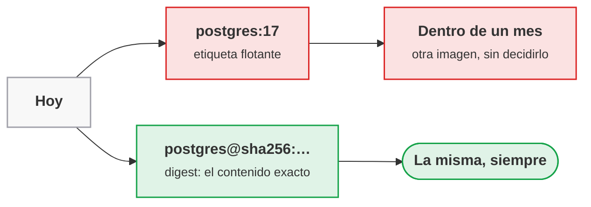
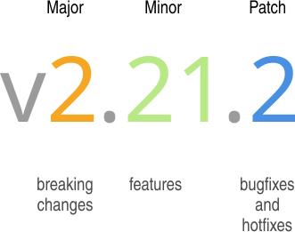
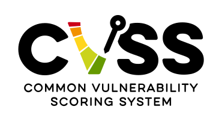
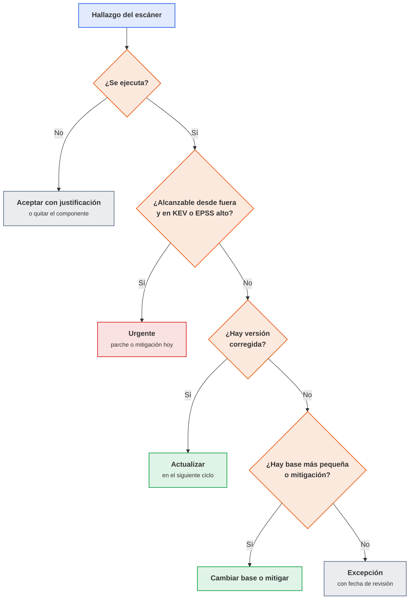
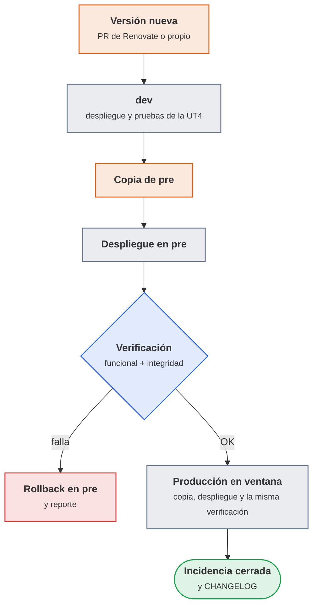

# UT7 · Actualización y gestión de vulnerabilidades

<p class="ut-meta">14 h · Sesiones 28 a 34 · RA4 CE d, e, f, g, h, i</p>

Hasta aquí el servicio se ha observado, medido y probado sin que cambiara. En esta unidad cambia: salen versiones nuevas de la imagen base, de las librerías y de la aplicación, y aparecen fallos de seguridad en piezas que el contenedor lleva sin que nadie las pidiera. Hay que decidir qué se actualiza, cuándo y cómo, sin romper nada y dejando rastro. Las pruebas de la UT4 sirven de red de seguridad en cada actualización, y el plan B de los datos es una copia con restic en el MinIO del laboratorio.

La unidad sigue el orden de trabajo de cualquier equipo de Sistemas: qué hay desplegado y cómo enterarse de que sale algo nuevo; si alguna pieza tiene un fallo publicado y qué se hace con él; cómo se actualiza sin perder nada y qué se hace si falla; y cómo queda todo escrito y automatizado. La práctica evaluable cierra la unidad el 23 de febrero.

## Sesión 28 · Inventario de versiones y seguimiento automático

<p class="ut-meta" markdown>2 de febrero · Teoría y práctica · <span class="dur" tabindex="0" aria-label="Versiones, etiquetas y digests · 10 min&#10;Seguir la aparición de versiones · 10 min&#10;A7.1 Inventario de versiones y seguimiento automático · 90 min" data-dur="Versiones, etiquetas y digests · 10 min&#10;Seguir la aparición de versiones · 10 min&#10;A7.1 Inventario de versiones y seguimiento automático · 90 min">:material-school:<i class="dur-barra" style="--teoria:18%"></i>:material-flask:</span></p>

En la UT4 se probó a fondo la versión 1.4.2 del servicio. Desde hoy empieza a envejecer: salen bases nuevas, parches de librerías y una 1.4.3. Antes de cambiar nada hay que resolver dos cosas, en este orden: saber con exactitud qué hay desplegado y conseguir que no cambie solo (etiquetas, digests y variantes de imagen), y enterarse de lo nuevo sin mirarlo a mano (Renovate y una política escrita). La hoja hace las dos cosas sobre el servicio del curso.

### Versiones, etiquetas y digests

**El problema: el nombre no basta.** Para saber si un fallo publicado afecta al servicio, o para desplegar en producción lo mismo que se probó en pre (el entorno de preproducción, donde se ensaya antes), hay que saber con exactitud qué imagen corre. La línea `image:` del compose no siempre lo dice.

**Etiqueta frente a digest.** Una imagen se nombra por `repositorio:etiqueta` (`postgres:17.6`) y se identifica por su **digest** (`postgres@sha256:…`), un hash de su contenido que da el *registry*, el servidor del que se descargan las imágenes (Docker Hub; en el laboratorio, desde el 19 de febrero, `registry.lab:5000`). La etiqueta es un puntero que el mantenedor puede mover; el digest es el contenido. Cuando Debian publica un parche, la imagen oficial se reconstruye con la misma etiqueta y otro digest, y un `pull` el lunes trae una imagen distinta de la que se probó el viernes.



<p class="pie" markdown>El nombre del compose identifica una etiqueta que alguien puede mover. Solo el digest dice qué hay desplegado de verdad.</p>

| Referencia | Qué significa | Dónde |
|---|---|---|
| `postgres:latest`, `postgres:17` | Lo último que haya. Un `pull` puede saltar de versión sin avisar. | Pruebas en un portátil. Nunca en un compose que se despliega. |
| `postgres:17.6-bookworm` | Versión concreta, pero se puede reconstruir por debajo. | Mínimo aceptable. Es lo que se escribe en el CHANGELOG. |
| `postgres:17.6-bookworm@sha256:3f1a…` | Contenido exacto: lo probado es lo desplegado. | Pre y producción. La etiqueta se deja al lado para que se lea. |

**Las órdenes que dan cada dato** (`jq` filtra JSON en la terminal):

```bash
# Digest de una imagen descargada de un registry
docker image inspect --format '{{index .RepoDigests 0}}' python:3.13-bookworm

# ID de una imagen construida en local (no tiene digest)
docker image inspect --format '{{.Id}}' app:1.4.2

# Imagen de la que salió el contenedor app que está corriendo
docker inspect --format '{{.Image}}' $(docker compose -f /opt/servicio/compose.yml ps -q app)
```

**Las imágenes construidas en local no tienen digest.** `app:1.4.2` se construyó en app01 y nunca ha pasado por un registry, así que se identifica por su **ID**, otro hash que calcula Docker. El ID se conserva al llevar la imagen a otra máquina con `docker save` y `docker load`: si coincide en los dos lados, es la misma imagen.

**La buena práctica:** la etiqueta para leer, el digest para desplegar. En el servicio del curso, la base viene de Docker Hub y lleva las dos cosas; la imagen de la aplicación, hasta que exista el registry, lleva versión fija:

```dockerfile
# api/Dockerfile
FROM python:3.13-bookworm@sha256:3f1a9c...
```

```yaml
# compose.yml
services:
  app:
    image: app:1.4.2     # desde el 19 de febrero, registry.lab:5000/app:1.4.2@sha256:...
```

Fijar tiene un precio: la versión fijada no recibe parches hasta que alguien cambia el digest. De eso se encarga Renovate, en [Seguir la aparición de versiones](#seguir-la-aparicion-de-versiones).

#### Versionado semántico

<figure markdown="span">
  { width="520" }
  <figcaption>Las tres partes de una versión semántica y qué puede cambiar en cada una. Fuente: Surjit Bains, CC BY-SA 4.0, vía Wikimedia Commons.</figcaption>
</figure>

**Para qué sirve.** El número de versión dice cuánto trabajo da una actualización. El **versionado semántico** (semver.org) es la convención `MAYOR.MENOR.PARCHE`:

- **Parche** (1.4.2 → 1.4.3): corrige errores sin romper nada. Es el único tipo que en el curso se fusiona solo.
- **Menor** (1.4.3 → 1.5.0): añade funciones compatibles. Se leen las notas por si algo queda obsoleto.
- **Mayor** (1.5.0 → 2.0.0): rompe cosas. Guía de migración, prueba en pre y ventana de mantenimiento.

**Cada proyecto la cumple a su manera.** En PostgreSQL el segundo número (17.5 → 17.6) es un parche y el primero, una mayor que cambia el formato de los datos. En Python, una menor (3.13 → 3.14) puede retirar funciones y se trata como una mayor. Renovate clasifica cada actualización por estos números, y a los proyectos que no siguen la convención hay que decirle cómo leerlos (`versioning`).

#### Políticas de etiquetas de las imágenes oficiales

**Para qué sirve.** Las imágenes oficiales de Docker Hub (`python`, `postgres`, `nginx`) se publican en varias variantes. Escoger bien la variante decide cuántos paquetes entran en la imagen sin pedirlos, y cada paquete es un posible fallo de seguridad:

| Variante | Base | Tamaño | Cuándo |
|---|---|---|---|
| `python:3.13` (sin sufijo) | Debian completa, con compiladores | ~1 GB | Solo para construir. |
| `python:3.13-slim` | Debian con lo mínimo para ejecutar | ~150 MB | La opción por defecto para la aplicación. |
| `-bookworm`, `-trixie` | Fija la versión de Debian (12 o 13) | | Siempre: sin sufijo, Debian puede cambiar sola. |
| `-alpine` | Alpine, otra distribución muy pequeña | 20 a 80 MB | Menos fallos, pero algunos programas no funcionan igual. |

**La buena práctica:** cada paquete que no está no puede ser vulnerable. Pasar la API de `python:3.13` a `-slim` quita cientos de hallazgos; lo hace la A7.3, el 9 de febrero. Por eso la A7.1 fija antes el sufijo de Debian: así el cambio de variante no trae también un cambio de distribución.

### Seguir la aparición de versiones

**El problema contrario.** Con todo fijado nada cambia solo, pero tampoco llegan los parches si nadie se entera de que han salido. En el curso se usa Renovate, que detecta la versión nueva y propone el cambio, y una política escrita que dice qué se hace con cada propuesta.

#### Renovate

**Qué hace.** Renovate lee el repositorio, encuentra las dependencias (las imágenes del compose y del `FROM`, los paquetes de `requirements.txt`) y abre un pull request (PR: una propuesta de cambio que alguien revisa antes de fusionarla) por cada versión nueva, con sus notas. Automatiza el aviso, no la decisión.

**Cómo se lanza.** Cada ejecución revisa el repositorio, abre los PR y termina. En una empresa se programa cada pocas horas; en el laboratorio se lanza a mano desde mon01, con el token de un usuario técnico de Gitea solo para el robot (así sus PR se reconocen y su token se revoca sin tocar a nadie):

```bash
docker run --rm --network host \
  -e RENOVATE_PLATFORM=gitea \
  -e RENOVATE_ENDPOINT=http://gitea.lab:23001/api/v1 \
  -e RENOVATE_TOKEN=$TOKEN_BOT \
  -e RENOVATE_REPOSITORIES=ops/servicio \
  -e LOG_LEVEL=info \
  renovate/renovate:41
```

`--network host` hace que el contenedor resuelva `gitea.lab` igual que mon01.

**La configuración va en el propio repositorio**, en `renovate.json`:

```json
{
  "$schema": "https://docs.renovatebot.com/renovate-schema.json",
  "extends": ["config:recommended", ":pinDigests"],
  "timezone": "Europe/Madrid",
  "schedule": ["after 7am and before 9am every weekday"],
  "labels": ["actualizacion"],
  "prConcurrentLimit": 5,
  "enabledManagers": ["docker-compose", "dockerfile", "pip_requirements"],
  "ignoreDeps": ["app"],
  "packageRules": [
    {
      "description": "Parches y digests: fusión automática si el pipeline pasa",
      "matchUpdateTypes": ["patch", "digest"],
      "automerge": true,
      "automergeType": "pr"
    },
    {
      "description": "Versiones menores de la imagen base: un solo PR semanal",
      "matchPackageNames": ["python"],
      "matchUpdateTypes": ["minor"],
      "groupName": "imagen base",
      "schedule": ["before 8am on monday"]
    },
    {
      "description": "Mayores: nunca automático, etiqueta para que se vea",
      "matchUpdateTypes": ["major"],
      "labels": ["actualizacion", "mayor", "requiere-ventana"],
      "automerge": false
    }
  ]
}
```

- `extends`: la configuración base recomendada, que abre una incidencia fija con la lista de lo pendiente (*Dependency Dashboard*), y `:pinDigests`, que abre un PR cada vez que el digest de una etiqueta cambia por debajo.
- `schedule`, `labels` y `prConcurrentLimit`: cuándo abre PR, con qué etiqueta y cuántos a la vez como mucho.
- `enabledManagers`: los tres tipos de fichero del servicio (compose, Dockerfile y `requirements.txt`).
- `ignoreDeps`: deja fuera la imagen `app`, que hasta el 19 de febrero es local y Renovate buscaría sin éxito en Docker Hub. Ese día se quita de aquí y se le dan a Renovate las credenciales del registry por variable de entorno, nunca en el repositorio.
- `packageRules`: los parches se fusionan solos solo si el pipeline pasa; las menores se agrupan en un PR semanal; las mayores esperan siempre a una persona.

**Y por qué no Watchtower.** Watchtower es un contenedor que descarga las imágenes nuevas y recrea los contenedores él solo: sin probar, sin copia previa y sin registro. Vale para un laboratorio personal, no para un servicio que se mantiene.

#### La política escrita

**Para qué sirve.** Renovate avisa, pero no dice quién mira cada propuesta, cuándo ni con qué prisa. La **política de actualización** es media página en el repositorio que lo deja decidido de antemano. Responde a seis preguntas; estas son las respuestas del servicio del curso:

- **Frecuencia de revisión:** Renovate abre PR a diario; una persona revisa los abiertos cada lunes.
- **Quién aprueba:** parches y digests, el pipeline; menores, quien esté de mantenimiento; mayores, el responsable del servicio con aviso al equipo de desarrollo.
- **Ventana de mantenimiento**, el rato pactado en que se admiten cortes: martes de 7:00 a 8:00.
- **Qué salta la cola:** un fallo CRITICAL con parche o que se esté explotando (lista KEV, que se explica el 4 de febrero en [CVE, CVSS, EPSS y KEV](#cve-cvss-epss-y-kev)): a pre el mismo día y a producción en la siguiente ventana.
- **Qué espera al ciclo:** todo lo demás, agrupado cada dos semanas.
- **Cuánto se espera antes de volver atrás** si una actualización falla: 40 minutos en pre, 20 en producción.

**La buena práctica:** con la regla escrita, nadie negocia a mitad de una ventana si se vuelve atrás.

### A7.1 Inventario de versiones y seguimiento automático (sesión 28)

<span class="et et-obj">Objetivo</span> **Qué vas a conseguir:** saber exactamente qué versión de cada imagen corre en app01 y dejar la base fijada para que no cambie sola. Al terminar, un robot (Renovate) te avisa con una propuesta en Gitea cada vez que sale una versión nueva.

**Para qué sirve en un trabajo:** cuando se publica un fallo de seguridad, la primera pregunta es «¿nos afecta?», y solo se responde si se sabe qué hay desplegado. Y nadie mira a mano cada semana si hay versión nueva de cada imagen: avisa un robot y decide una persona.

<span class="et et-pre">Antes de empezar</span>

- app01 con el servicio arrancado y la copia de trabajo de `servicio` en `/opt/servicio`. app01 no sale a Internet, y hoy no le hace falta.
- El repositorio `ops/servicio` en `gitea.lab` (hoy, el contenedor de mon01 en el 23001). Usa siempre el nombre, nunca la IP: el 12 de febrero Gitea se muda a `gitea01`.
- El usuario técnico de Renovate en Gitea (puedes traerlo hecho, son cinco minutos). Como administrador, en *Administración del sitio → Cuentas de usuario → Crear cuenta de usuario*, crea `renovate-bot`. En `ops/servicio`, *Configuración → Colaboradores*, añádelo con permiso de escritura. Entra como `renovate-bot` y en *Configuración → Aplicaciones* genera un token con lectura y escritura en *repository* e *issue*, y lectura en *user*; guárdalo en el gestor de contraseñas.
- En mon01, la imagen `renovate/renovate:41` descargada (`docker pull renovate/renovate:41`, tarda: mejor traerla hecha).
- La teoría de hoy: [Versiones, etiquetas y digests](#versiones-etiquetas-y-digests), [Políticas de etiquetas de las imágenes oficiales](#politicas-de-etiquetas-de-las-imagenes-oficiales), [Renovate](#renovate) y [La política escrita](#la-politica-escrita).

<span class="et et-pas">Pasos</span>

Trabajas en app01 y, para lanzar Renovate, en mon01. El recorrido: averiguas qué corre (paso 1), fijas la base del Dockerfile (paso 2), pones a Renovate a vigilarla (paso 3) y escribes qué se hace con lo que proponga (paso 4). Fijar antes de lanzar Renovate importa: así lo que proponga ya es una actualización de verdad.

1. **Averigua qué corre de verdad.** *En app01.*

    Saca cada imagen que corre (las del servicio y las de `/opt/agentes`) con su etiqueta, su digest o su ID (el hash que identifica el contenido exacto) y su fecha. El bucle escribe ya las filas de la tabla en `docs/inventario.md`; las librerías de Python van aparte, a `inventario-app.txt`:

    ```bash
    cd /opt/servicio && mkdir -p docs
    printf '| Componente | Digest o ID | Creada | ¿Flotante? |\n|---|---|---|---|\n' > docs/inventario.md
    for i in $(docker ps --format '{{.Image}}' | sort -u); do
      docker image inspect --format "| $i | {{if .RepoDigests}}{{index .RepoDigests 0}}{{else}}{{.Id}}{{end}} | {{.Created}} | |" "$i"
    done >> docs/inventario.md
    grep FROM api/Dockerfile
    docker compose -f /opt/servicio/compose.yml exec app pip freeze > inventario-app.txt
    ```

    Añade a mano la fila de la base del `FROM` y rellena la última columna de todas. Una etiqueta es **flotante** si mañana puede apuntar a otra imagen: `latest`, solo la mayor (`python:3`) o sin sufijo de Debian. `app:1.4.2` sale con su ID y no con digest porque se construyó en app01 y nunca ha pasado por un registry.

    **Sale bien si:** hay una fila por cada imagen que da `docker ps`, más la del `FROM`, y ninguna con la última columna vacía.

2. **Fija la base y llévala a `main` con un PR.** *En app01 y en Gitea.*

    Fijar es escribir en el `FROM` la versión y el digest, para que la base no cambie por debajo. Saca el digest de la base y la versión de Debian del contenedor:

    ```bash
    docker image inspect --format '{{index .RepoDigests 0}}' <imagen del FROM>
    docker compose -f /opt/servicio/compose.yml exec app grep VERSION_CODENAME /etc/os-release
    ```

    Cambia el `FROM` de `api/Dockerfile` a `FROM python:3.13-<debian>@sha256:<digest>` (conserva la variante que tenga) y sube el cambio con el inventario en la rama `inventario`:

    ```bash
    git switch -c inventario
    git add docs/inventario.md inventario-app.txt api/Dockerfile
    git commit -m "Inventario de versiones y base fijada con digest"
    git push -u origin inventario
    ```

    En Gitea, abre el PR de `inventario` (pull request: la propuesta de cambio que se revisa antes de unirla a `main`) y fusiónalo tú. Hace falta ahora porque Renovate lee `main`.

    **Sale bien si:** `docker image inspect python:3.13-<debian>@sha256:<digest>` encuentra la imagen en app01.

3. **Pon a Renovate a vigilar.** *En app01 y en mon01.*

    Renovate lee el repositorio y abre un PR por cada versión nueva que encuentra. En app01, trae `main`, crea `renovate.json` en la raíz con el de [Renovate](#renovate) cambiando `schedule` por `["at any time"]` (fuera de su franja horaria no abre nada) y súbelo:

    ```bash
    git switch main && git pull
    nano renovate.json
    git add renovate.json && git commit -m "Renovate" && git push
    ```

    En mon01, lanza una pasada con la orden de [Renovate](#renovate), con `LOG_LEVEL=debug` (el log con todo el detalle) y la salida guardada:

    ```bash
    read -rs TOKEN_BOT        # pega el token de renovate-bot; no queda en el historial
    docker run --rm --network host \
      -e RENOVATE_PLATFORM=gitea \
      -e RENOVATE_ENDPOINT=http://gitea.lab:23001/api/v1 \
      -e RENOVATE_TOKEN=$TOKEN_BOT \
      -e RENOVATE_REPOSITORIES=ops/servicio \
      -e LOG_LEVEL=debug \
      renovate/renovate:41 2>&1 | tee renovate.log
    ```

    **Sale bien si:** en Gitea hay un PR de `renovate-bot` con la etiqueta `actualizacion`; entre ellos, el que actualiza el digest de la base. Haz una captura.

4. **Escribe qué se hace con lo que proponga.** *En app01.*

    Renovate avisa, pero no decide quién revisa ni con qué prisa. Crea en `main` `docs/politica-actualizacion.md` con los seis puntos de [La política escrita](#la-politica-escrita) como encabezados. Debajo de cada uno, una o dos líneas: parte de las respuestas de la teoría y cámbialas donde tu servicio sea distinto (por ejemplo, la ventana o quién aprueba). Deja los 40 minutos de pre: la A7.5, el 16 de febrero, los usa como plazo para decidir.

    ```markdown
    # Política de actualización
    ## Frecuencia de revisión
    ## Quién aprueba
    ## Ventana de mantenimiento
    ## Qué salta la cola
    ## Qué espera al ciclo
    ## Tiempo antes de volver atrás
    ```

    ```bash
    git add docs/politica-actualizacion.md && git commit -m "Política de actualización" && git push
    ```

    **Sale bien si:** cada encabezado tiene debajo al menos una línea y el fichero está en `main` en Gitea. La terminas en la práctica evaluable.

<span class="et et-com">Comprobación</span>

- [ ] Ni `compose.yml` ni `api/Dockerfile` llevan etiquetas flotantes.
- [ ] El digest del `FROM` existe en app01.
- [ ] En Gitea hay un PR de `renovate-bot` con la etiqueta `actualizacion`.
- [ ] En `renovate.log` aparece la base del Dockerfile entre las dependencias, y `app` no da error de búsqueda.

<span class="et et-ent">Para practicar</span>

- **Guarda** en `main` el PR fusionado con `docs/inventario.md` y el Dockerfile fijado, `renovate.json` y `docs/politica-actualizacion.md`; en la carpeta de la práctica, la captura del PR de Renovate y `renovate.log`. La práctica evaluable parte de ahí, y el inventario es lo que escanea la A7.2.
- **Piensa:** si no hubieras fijado el digest, ¿qué imagen traería un `pull` dentro de un mes, y quién lo habría decidido?

<span class="et et-ext">Si te sobra tiempo</span> Para que tampoco cambien solos los agentes, fija con digest las imágenes de `/opt/agentes/compose.yml` que el paso 1 marcó como flotantes. Y para alguna imagen que no siga el versionado semántico, añade un `packageRule` con `versioning` explícito, que le dice a Renovate cómo leer sus números.

## Sesión 29 · Escaneo

<p class="ut-meta" markdown>4 de febrero · Teoría y práctica · <span class="dur" tabindex="0" aria-label="Vulnerabilidades en los componentes · 15 min&#10;A7.2 Escaneo · 95 min" data-dur="Vulnerabilidades en los componentes · 15 min&#10;A7.2 Escaneo · 95 min">:material-school:<i class="dur-barra" style="--teoria:14%"></i>:material-flask:</span></p>

El inventario de la A7.1 dice qué lleva el servicio. La pregunta de hoy es si alguna de esas piezas tiene un fallo de seguridad publicado. Una imagen lleva cientos de paquetes y cada semana salen cientos de fallos, así que el cruce lo hace un escáner. La teoría va en el orden del trabajo: cómo se nombra y se pesa un fallo, el inventario completo de una imagen (SBOM), cómo cruza un escáner ese inventario con una base de fallos y qué herramientas se usan. La hoja termina en una tabla con los hallazgos graves; qué se hace con cada uno se decide el 9 de febrero.

### Vulnerabilidades en los componentes

**Dónde puede estar el fallo.** En cualquiera de las capas del contenedor: la imagen base (Debian y sus paquetes), el intérprete (Python), las librerías de la aplicación (`flask`, `gunicorn`...) o el propio código. El escáner no distingue entre "está en la imagen" y "se ejecuta": eso lo decide quien conoce el servicio.

#### CVE, CVSS, EPSS y KEV

**Un nombre para cada fallo: CVE.** Un **CVE** es el identificador público de un fallo (`CVE-2024-3094`). Sirve para saber que cuatro avisos hablan del mismo problema. No dice nada de su gravedad.

<figure markdown="span">
  { width="240" }
  <figcaption>CVSS es el sistema con el que se puntúa la gravedad de un CVE; la versión 4.0 se publicó en 2023 y convive con la 3.1. Fuente: FIRST, CC BY-SA 4.0, vía Wikimedia Commons.</figcaption>
</figure>

**Cuánto de grave es: CVSS.** El **CVSS** puntúa de 0 a 10 la gravedad técnica, a partir de cómo se explota el fallo (por red o en local, con o sin credenciales) y qué permite. Los niveles que enseña Trivy salen de esa escala: 0,1 a 3,9 LOW, 4 a 6,9 MEDIUM, 7 a 8,9 HIGH y 9 a 10 CRITICAL.

**Gravedad no es urgencia: EPSS y KEV.** CVSS mide lo grave que sería, no lo probable que es. Lo que corre prisa es lo que alguien ya sabe aprovechar:

- **EPSS**: probabilidad, de 0 a 1, de que el CVE se explote en los próximos 30 días. Casi todos están por debajo de 0,01; por encima de 0,1 hay que mirar primero.
- **KEV**: la lista de la agencia de ciberseguridad de Estados Unidos con los CVE que se están explotando ya. Está o no está.

**Alcanzable desde fuera.** Un paquete puede estar en la imagen y no ejecutarse nunca, o ejecutarse en el camino de una petición que llega de fuera (el servidor HTTP, el parser de JSON). Solo en el segundo caso un atacante puede dispararlo sin haber entrado antes. Eso no lo sabe ningún escáner.

**El orden que se aplica en el curso:** primero lo que está en KEV o tiene EPSS alto, después CRITICAL o HIGH con parche y alcanzable desde fuera, y el resto por ciclo.

#### SBOM: el inventario

**Para qué sirve.** Un **SBOM** (la lista de materiales del software) es la lista de todo lo que hay dentro de una imagen, paquetes del sistema y librerías con su versión, en un formato que lee una máquina. Se guarda con cada versión. Cuando dentro de unos meses salga un fallo en `libxml2`, basta con buscar en los SBOM archivados qué versiones lo llevaban, sin reconstruir nada.

**Cómo se genera.** Con Syft, en formato CycloneDX, que leen todos los escáneres:

```bash
syft docker-archive:app-1.4.2.tar -o cyclonedx-json > sbom-app-1.4.2.cdx.json
jq '.components | length' sbom-app-1.4.2.cdx.json     # cuántos componentes
```

#### Cómo trabaja un escáner

**Un inventario más una base de datos.** Trivy y Grype sacan primero la lista de paquetes de la imagen (lo mismo que Syft) y después la cruzan con una base de datos de fallos que descargan de Internet. De ahí salen sus límites:

- Sin la base al día no ven los fallos nuevos. Por eso en el curso se escanea en el puesto de administración, que sale a Internet, y no en app01.
- Si la imagen no conserva la lista de paquetes de su sistema, el informe sale casi vacío sin que la imagen esté limpia.
- Cada escáner tiene su base y sus reglas, así que Trivy y Grype nunca dan la misma lista. Un hallazgo que solo ve uno puede ser un falso positivo (atribuye el fallo a un paquete que no lo tiene) o un fallo que el otro se pierde.

#### Escanear con Trivy

!!! consulta "Repaso"
    `trivy image` con `--severity`, `--ignore-unfixed`, `--format json` y `--exit-code 1` se explicó en la [sesión 25](ut4-kpi-pruebas.md#seguridad-zap-baseline-y-trivy-image), y la A4.6 lo dejó instalado en el puesto de administración. Aquí solo se añade lo nuevo.

**Qué cambia respecto a la UT4.** Hasta el 19 de febrero la imagen del servicio solo existe en el Docker de app01: se saca a un fichero y se escanea en el puesto. Además de la imagen, Trivy mira el repositorio, y así se cubre lo que pide el CE e (código, binarios y librerías):

```bash
# Imagen, desde un fichero de docker save
ssh ops@10.10.2.10 docker save app:1.4.2 > app-1.4.2.tar
trivy image --input app-1.4.2.tar --severity HIGH,CRITICAL

# Repositorio: ficheros de dependencias y secretos olvidados (contraseñas, tokens)
trivy fs --scanners vuln,secret .

# Informe para archivar: completo, sin filtros
trivy image --input app-1.4.2.tar --format json -o trivy-app-1.4.2.json
```

**La buena práctica:** la lista de trabajo se filtra; el informe que se archiva no, porque un hallazgo sin parche hoy puede tenerlo mañana.

#### Grype y pip-audit

**Un segundo escáner de imagen: Grype.** Da resultados parecidos a los de Trivy pero no iguales. Un hallazgo que sale en los dos es más fiable; uno que sale en uno solo se mira con más cuidado.

```bash
grype sbom:sbom-app-1.4.2.cdx.json -o json > grype-app.json
```

**Un escáner del lenguaje: pip-audit.** Lee `requirements.txt` antes de construir nada y avisa del problema antes de que llegue a una imagen. Para Node, lo mismo es `npm audit`.

```bash
pip-audit -r api/requirements.txt
```

### A7.2 Escaneo (sesión 29)

<span class="et et-obj">Objetivo</span> **Qué vas a conseguir:** saber qué fallos de seguridad publicados lleva lo que corre en app01 y cuáles importan de verdad. Al terminar tienes los informes de los escáneres guardados y una tabla corta con los hallazgos graves.

**Para qué sirve en un trabajo:** un escáner devuelve cientos de líneas y nadie puede arreglarlas todas. El trabajo real es pasarlo, guardar el informe y quedarse con las pocas filas que corren prisa.

<span class="et et-pre">Antes de empezar</span>

- Trabajas en el puesto de administración: tiene Trivy desde la A4.6, sale a Internet y tiene tu clon de `servicio`. Todas las órdenes se lanzan desde la raíz de ese clon.
- Puedes traerlo hecho: Syft y Grype instalados con los instaladores oficiales de Anchore, pip-audit con `pipx`, y las bases de fallos al día (`trivy image --download-db-only` y `grype db update`).
- La teoría de hoy: [CVE, CVSS, EPSS y KEV](#cve-cvss-epss-y-kev), [SBOM: el inventario](#sbom-el-inventario), [Cómo trabaja un escáner](#como-trabaja-un-escaner), [Escanear con Trivy](#escanear-con-trivy) y [Grype y pip-audit](#grype-y-pip-audit).

<span class="et et-pas">Pasos</span>

Todo se hace en el puesto. El recorrido: sacas las dos imágenes y haces su inventario (paso 1), pasas dos escáneres a las imágenes (paso 2) y dos al código (paso 3), reúnes lo grave en una tabla (paso 4), le añades lo que ningún escáner sabe (paso 5) y comparas los dos escáneres (paso 6).

1. **Saca las dos imágenes y haz su inventario.** *En el puesto.*

    Escaneas la imagen del servicio y la de cAdvisor, el agente con más privilegios de app01 (corre `privileged` y con el socket de Docker). El inventario de cada una es su SBOM (la lista de todo lo que lleva dentro, con versiones). Las imágenes van a `~/imagenes/`, fuera del repositorio, porque pesan cientos de MB:

    ```bash
    mkdir -p ~/imagenes seguridad
    ssh ops@10.10.2.10 docker save app:1.4.2 > ~/imagenes/app-1.4.2.tar
    ssh ops@10.10.2.10 docker save <imagen de cAdvisor de tu inventario> > ~/imagenes/cadvisor.tar
    syft docker-archive:$HOME/imagenes/app-1.4.2.tar -o cyclonedx-json > seguridad/sbom-app-1.4.2.cdx.json
    syft docker-archive:$HOME/imagenes/cadvisor.tar -o cyclonedx-json > seguridad/sbom-cadvisor.cdx.json
    jq '.components | length' seguridad/sbom-*.cdx.json
    ```

    Anota en `seguridad/hallazgos.md` el número de componentes de cada una.

    **Sale bien si:** el `jq` da un número para cada uno de los dos SBOM.

2. **Escanea las imágenes con dos escáneres.** *En el puesto.*

    Guarda el informe completo de cada uno, sin filtros, que es el que se archiva. Después mira solo la tabla de HIGH y CRITICAL (los dos niveles más graves), que es con la que se trabaja:

    ```bash
    trivy image --input ~/imagenes/app-1.4.2.tar --format json -o seguridad/trivy-app.json
    trivy image --input ~/imagenes/cadvisor.tar --format json -o seguridad/trivy-cadvisor.json
    grype sbom:seguridad/sbom-app-1.4.2.cdx.json -o json > seguridad/grype-app.json
    grype sbom:seguridad/sbom-cadvisor.cdx.json -o json > seguridad/grype-cadvisor.json
    trivy image --input ~/imagenes/app-1.4.2.tar --severity HIGH,CRITICAL
    ```

    **Sale bien si:** la cabecera de la tabla de Trivy reconoce el sistema base (`debian 12.x` o `debian 13.x`). Si no, mira [Errores frecuentes](#errores-frecuentes-en-el-laboratorio).

3. **Escanea también el código.** *En el puesto.*

    Las imágenes no son lo único: pip-audit revisa las librerías de Python que pide `requirements.txt`, y `trivy fs` revisa el repositorio en busca de dependencias vulnerables y de secretos olvidados (contraseñas, tokens):

    ```bash
    pip-audit -r api/requirements.txt > seguridad/pip-audit.txt
    trivy fs --scanners vuln,secret --skip-dirs seguridad --format json -o seguridad/trivy-fs.json .
    ```

    Anota en `hallazgos.md` cuántos hallazgos da cada uno y si pip-audit ve alguno que Trivy no.

    **Sale bien si:** existen `seguridad/pip-audit.txt` y `seguridad/trivy-fs.json`.

4. **Reúne lo grave en una tabla de trabajo.** *En el puesto.*

    Saca a `hallazgos.tsv` las filas HIGH y CRITICAL de los tres JSON de Trivy, una por línea, y cuenta cuántas hay de cada severidad:

    ```bash
    cd seguridad
    jq -r '.Results[] | .Target as $t | .Vulnerabilities[]? | select(.Severity=="HIGH" or .Severity=="CRITICAL")
      | [.VulnerabilityID, $t, .PkgName, .InstalledVersion, (.FixedVersion // "sin parche"), .Severity] | @tsv' \
      trivy-*.json | sort -u > hallazgos.tsv
    cut -f6 hallazgos.tsv | sort | uniq -c
    ```

    Pon el recuento en `hallazgos.md` y, debajo, una tabla con **las ocho filas más graves**: las CRITICAL y, si no llegas a ocho, las HIGH con parche. Estas órdenes la escriben por ti, con las dos últimas columnas vacías para el paso 5:

    ```bash
    printf '\n| CVE | Objetivo | Paquete | Instalada | Corregida | Severidad | Exploit conocido | Alcanzable |\n|---|---|---|---|---|---|---|---|\n' >> hallazgos.md
    { grep CRITICAL hallazgos.tsv; grep HIGH hallazgos.tsv | grep -v "sin parche"; } | head -8 \
      | sed 's/\t/ | /g; s/^/| /; s/$/ |  |  |/' >> hallazgos.md
    ```

    **Sale bien si:** `hallazgos.tsv` no está vacío y la tabla de `hallazgos.md` tiene sus ocho filas (o todas las que haya, si salen menos).

5. **Añade lo que ningún escáner sabe.** *En el puesto.*

    Rellena en esas ocho filas las dos columnas vacías. *Exploit conocido*: si el CVE está en KEV (la lista de fallos que ya se están aprovechando) y su EPSS (la probabilidad de que se aproveche pronto). *Alcanzable desde fuera*: sí, no o no sé, según [CVE, CVSS, EPSS y KEV](#cve-cvss-epss-y-kev). La primera la consultan estas órdenes para las ocho de una vez; la segunda la decides tú: un "no sé" honrado vale más que un "no" sin mirar.

    ```bash
    curl -s -o ~/kev.json https://www.cisa.gov/sites/default/files/feeds/known_exploited_vulnerabilities.json
    for c in <los ocho CVE de tu tabla, separados por espacios>; do
      kev=$(jq -r --arg c "$c" '.vulnerabilities[] | select(.cveID==$c) | "sí"' ~/kev.json)
      epss=$(curl -s "https://api.first.org/data/v1/epss?cve=$c" | jq -r '.data[0].epss // "sin dato"')
      echo "$c  KEV: ${kev:-no}  EPSS: $epss"
    done
    ```

    **Sale bien si:** ninguna de las ocho filas tiene esas dos columnas en blanco.

6. **Compara los dos escáneres.** *En el puesto.*

    Trivy y Grype no dan la misma lista. Compara sus identificadores sobre la imagen del servicio y anota en `hallazgos.md` los que solo ve uno; en la A7.3, la ficha del CVE dirá quién tiene razón:

    ```bash
    jq -r '.Results[].Vulnerabilities[]?.VulnerabilityID' trivy-app.json | sort -u > /tmp/trivy.ids
    jq -r '.matches[].vulnerability.id' grype-app.json | sort -u > /tmp/grype.ids
    comm -3 /tmp/trivy.ids /tmp/grype.ids
    ```

    **Sale bien si:** `comm -3` lista identificadores en dos columnas (los que solo ve cada escáner) y tienes al menos uno anotado.

<span class="et et-com">Comprobación</span>

- [ ] Cada informe de imagen de Trivy reconoce el sistema base.
- [ ] `hallazgos.tsv` no está vacío.
- [ ] La tabla tiene ocho filas (o todas las CRITICAL y las HIGH con parche, si salen menos), con las dos columnas manuales rellenas y el recuento encima.
- [ ] `pip-audit.txt` y `trivy-fs.json` existen y están resumidos en `hallazgos.md`.
- [ ] Hay al menos un CVE anotado que solo aparece en uno de los escáneres.

<span class="et et-ent">Para practicar</span>

- **Guarda** con un commit `seguridad/`: los dos SBOM, los JSON de los escáneres, `pip-audit.txt` y `hallazgos.md`, sin los `.tar`. Es la base de la A7.3 y de la práctica evaluable.
- **Piensa:** de tus ocho filas, ¿cuántas siguen siendo urgentes cuando miras si son alcanzables desde fuera?

## Sesión 30 · Investigar y decidir

<p class="ut-meta" markdown>9 de febrero · Teoría y práctica · <span class="dur" tabindex="0" aria-label="Leer un informe · 5 min&#10;Las cuatro soluciones y el registro de excepciones · 5 min&#10;A7.3 Investigar y decidir · 100 min" data-dur="Leer un informe · 5 min&#10;Las cuatro soluciones y el registro de excepciones · 5 min&#10;A7.3 Investigar y decidir · 100 min">:material-school:<i class="dur-barra" style="--teoria:9%"></i>:material-flask:</span></p>

La A7.2 dejó una tabla de ocho hallazgos graves. Una tabla todavía no es una decisión: hay que decir, para cada fila, qué se hace y por qué, y dejarlo escrito para que el siguiente escaneo no vuelva a plantearlo. La teoría explica cómo se lee una fila y las cuatro salidas posibles. La hoja decide tres hallazgos y aplica la salida que más quita de una vez: reconstruir la imagen sobre la base slim, que queda en dev como 1.4.3.

### Leer un informe

**La severidad no decide sola.** Muchas filas no tienen arreglo, y la más grave puede estar en un componente que no se ejecuta nunca. Leer un informe es hacerle a cada fila las mismas preguntas, en el mismo orden.

**Un ejemplo** recortado de `trivy image` sobre una API en `python:3.12-slim-bookworm`:

```text
app-1.4.2.tar (debian 12.5)
│ Library        │ Vulnerability  │ Severity │ Status       │ Installed Version │ Fixed Version    │
│ zlib1g         │ CVE-2023-45853 │ CRITICAL │ will_not_fix │ 1:1.2.13.dfsg-1   │                  │
│ libnghttp2-14  │ CVE-2023-44487 │ HIGH     │ fixed        │ 1.52.0-1          │ 1.52.0-1+deb12u1 │

Python (python-pkg)
│ setuptools     │ CVE-2024-6345  │ HIGH     │ fixed        │ 65.5.1            │ 70.0.0           │
```

**Las columnas que deciden.** `Status` es lo que ha decidido la distribución: `fixed`, hay versión corregida; `affected`, todavía sin parche; `will_not_fix`, no lo piensa arreglar (normalmente porque no le afecta tal como compila el paquete). `Fixed Version` dice a qué versión subir: si es un paquete del sistema, basta con reconstruir sobre una base al día; si es una librería, se sube en `requirements.txt`. Después, las preguntas del diagrama:



<p class="pie" markdown>Lo que decide no es la severidad, sino si el código se ejecuta, si se alcanza desde fuera y si se está explotando.</p>

Aplicado a las tres filas:

1. `zlib1g / CVE-2023-45853`: CRITICAL, pero está en una parte de zlib que Debian no compila (`will_not_fix`). No se ejecuta: excepción justificada.
2. `libnghttp2-14 / CVE-2023-44487`: está en KEV, pero la API no habla HTTP/2 y no es alcanzable. Tiene parche: se actualiza en el ciclo reconstruyendo la imagen. En el proxy nginx sería urgente.
3. `setuptools / CVE-2024-6345`: solo actúa al instalar paquetes, no en la imagen ya construida. La corrección es gratis (subirlo o quitarlo de la imagen final): se hace en el ciclo.

La fila más grave ha acabado en excepción. Esa es la diferencia entre escanear y gestionar vulnerabilidades.

### Las cuatro soluciones y el registro de excepciones

**Cuatro salidas, siempre por escrito**, de la más limpia a la menos:

1. **Actualizar** la imagen base o el paquete: reconstruir sobre la base al día o subir la librería en `requirements.txt`.
2. **Cambiar a una base más pequeña** (`-slim`, `-alpine`): menos paquetes, menos hallazgos. A cambio, pueden faltar librerías.
3. **Mitigar** sin cambiar la versión: quitar el paquete en el Dockerfile (`apt-get purge curl`), desactivar la función vulnerable o cerrar el camino con el cortafuegos.
4. **Aceptar el riesgo** por escrito, con motivo, responsable y fecha de revisión. Un falso positivo se registra igual, con la ficha que demuestra que no aplica.

Lo que no vale es dejarlo pasar sin decir nada: el hallazgo vuelve en el siguiente escaneo y nadie recuerda por qué sigue ahí.

**El registro de excepciones.** Las aceptadas van a `.trivyignore`, en la raíz del repositorio: un CVE por línea, que Trivy deja de mostrar. Cada una lleva un comentario con el motivo, quién lo decidió y dónde (`#142` es una incidencia de Gitea; `!57`, un PR), y una caducidad `exp:` a partir de la cual Trivy vuelve a mostrarla:

```text
# CVE-2023-45853: MiniZip no se compila en zlib1g de Debian. Debian: will_not_fix.
# Decidido en #142 por el equipo de Sistemas el 2027-02-09. Revisar cuando Debian cambie de estado.
CVE-2023-45853 exp:2027-08-01

# CVE-2024-6345: setuptools solo se usa en la etapa de construcción; no está en la imagen final desde 1.4.3.
# Cerrar esta excepción al fusionar !57.
CVE-2024-6345 exp:2027-03-15
```

**La buena práctica:** una línea sin comentario ni fecha es una excepción que nadie revisará. En la práctica evaluable, un `.trivyignore` sin justificaciones cuenta como no entregado.

### Fuentes y cómo se leen

!!! consulta "Material de consulta"
    Este apartado no se desarrolla en clase: es material de consulta para la hoja de práctica de esta sesión.

El escáner da un resumen de una línea. Para decidir hay que ir a la fuente, en este orden:

1. **Ficha del CVE**, para saber qué es y qué versiones afecta: NVD (`https://nvd.nist.gov/vuln/detail/<CVE>`), la base oficial de CVE de Estados Unidos, u OSV (`https://osv.dev/vulnerability/<CVE>`), más precisa para librerías de Python. Para librerías, también la GitHub Advisory Database (`https://github.com/advisories`).
2. **Aviso del proyecto o de la distribución**, para saber si hay parche y cómo se aplica: las notas de versión (Releases) del proyecto y, para los paquetes de Debian, su rastreador de seguridad (`https://security-tracker.debian.org/tracker/<CVE>`).
3. **Incidencias del proyecto**, por si hay una forma de mitigarlo mientras tanto.
4. **CISA KEV**, para saber si corre prisa.

### A7.3 Investigar y decidir (sesión 30)

<span class="et et-obj">Objetivo</span> **Qué vas a conseguir:** decidir qué se hace con tres hallazgos de la tabla, dejarlo escrito con su fuente, y reconstruir la imagen del servicio sobre una base más pequeña (`-slim`) como `app:1.4.3`, funcionando en dev.

**Para qué sirve en un trabajo:** ninguna herramienta decide por ti si un fallo importa. Lo que se le pide a quien mantiene un servicio es una decisión que otra persona pueda revisar, y aplicar la solución que más quita de una vez.

<span class="et et-pre">Antes de empezar</span>

- De la A7.2, `seguridad/hallazgos.md`, y `~/imagenes/app-1.4.2.tar` en el puesto de administración.
- app01 con la copia de trabajo de `servicio` en `main` y al día.
- La consola de OPNsense: app01 no sale a Internet y el build descarga la base y las librerías. El paso 4 abre una fila temporal y la cierra.
- La teoría de hoy: [Leer un informe](#leer-un-informe) y [Las cuatro soluciones y el registro de excepciones](#las-cuatro-soluciones-y-el-registro-de-excepciones). Dónde se consulta cada CVE está en [Fuentes y cómo se leen](#fuentes-y-como-se-leen).

<span class="et et-pas">Pasos</span>

Primero investigas y decides en el puesto (pasos 1 a 3), y solo después tocas la imagen en app01 (pasos 4 y 5), porque reconstruirla es una de las decisiones. Al final mides el resultado y abres el PR (paso 6). Todo va en la rama `base-slim`.

1. **Elige tres hallazgos e investígalos.** *En el puesto.*

    En tu clon, crea la rama:

    ```bash
    git switch -c base-slim
    ```

    Elige tres filas de la tabla, al menos una CRITICAL y una sin parche (si tu tabla no tiene ninguna, búscala con `grep "sin parche" seguridad/hallazgos.tsv`). La sin parche será casi seguro la excepción del paso 3. Investígalas en el orden de [Fuentes y cómo se leen](#fuentes-y-como-se-leen).

    **Sale bien si:** de cada una tienes abierta al menos la ficha del CVE y el aviso de la distribución o del proyecto.

2. **Decide y deja escrito por qué.** *En el puesto.*

    Escribe en `seguridad/decisiones.md` una entrada por hallazgo con las preguntas del diagrama de [Leer un informe](#leer-un-informe):

    ```markdown
    ## <CVE> · <paquete>
    - ¿Se ejecuta?:
    - ¿Alcanzable desde fuera?:
    - KEV / EPSS:
    - Decisión: actualizar | cambiar de base | mitigar | aceptar
    - Justificación (3 o 4 líneas) y fuente: <enlace>
    ```

    **Sale bien si:** las tres entradas tienen todas las preguntas respondidas y un enlace a la fuente. Sin fuente, es una opinión.

3. **Registra las excepciones.** *En el puesto.*

    Los CVE que aceptes van a `.trivyignore`, en la raíz del clon: es la lista de excepciones que Trivy deja de mostrar. Cada uno con su comentario (motivo, quién y dónde) y su `exp:` (la fecha en que vuelve a salir), como en el ejemplo de [Las cuatro soluciones y el registro de excepciones](#las-cuatro-soluciones-y-el-registro-de-excepciones). Comprueba que Trivy lo respeta y sube la rama:

    ```bash
    trivy image --input ~/imagenes/app-1.4.2.tar --severity HIGH,CRITICAL --ignorefile .trivyignore
    git add seguridad/decisiones.md .trivyignore
    git commit -m "Decisiones sobre hallazgos y excepciones"
    git push -u origin base-slim
    ```

    **Sale bien si:** las filas aceptadas desaparecen del informe y las demás siguen ahí. Este fichero lo leerá el pipeline en la A7.6.

4. **Reconstruye la imagen sobre la base slim.** *En OPNsense y en app01.*

    app01 necesita salir a Internet solo mientras dura el build. En OPNsense, abre en la pestaña DMZINT la fila temporal: Pass, origen `srv_app`, destino any, puertos `p_web`, descripción `TEMPORAL alta 09-02 baja 09-02 build en app01`. En app01, usa la misma Debian de la A7.1 para que solo cambie la variante:

    ```bash
    cd /opt/servicio
    git fetch && git switch base-slim
    docker pull python:3.13-slim-<debian>
    docker image inspect --format '{{index .RepoDigests 0}}' python:3.13-slim-<debian>
    nano api/Dockerfile           # FROM python:3.13-slim-<debian>@sha256:<digest>
    docker build -t app:1.4.3 api
    docker run --rm app:1.4.3 sh -c 'pip check && python -c "import flask"'
    ```

    Borra la fila temporal de OPNsense en cuanto termine el build.

    **Sale bien si:** la última orden no da errores y la fila temporal ya no está. Si falla al cargar el driver de PostgreSQL, mira [Errores frecuentes](#errores-frecuentes-en-el-laboratorio).

5. **Despliégala en dev con el plan B guardado.** *En app01.*

    Antes de cambiar nada, guarda el compose que corre: es la vuelta atrás de dev, y la A7.4 la da por hecha. Después despliega la 1.4.3 y sube el cambio:

    ```bash
    cp compose.yml compose.anterior.yml
    sed -i 's/app:1.4.2/app:1.4.3/' compose.yml
    docker compose -f /opt/servicio/compose.yml up -d app
    curl -s http://localhost:28080/health
    git add api/Dockerfile compose.yml
    git commit -m "app 1.4.3 sobre base slim"
    git push
    ```

    **Sale bien si:** `/health` responde. La 1.4.3 pasa dos días en dev antes de llegar a pre.

6. **Mide si ha merecido la pena y abre el PR.** *En el puesto y en Gitea.*

    Trae el commit de app01 y compara tamaño y hallazgos de las dos versiones:

    ```bash
    git pull
    ssh ops@10.10.2.10 docker image ls app
    ssh ops@10.10.2.10 docker save app:1.4.3 > ~/imagenes/app-1.4.3.tar
    trivy image --input ~/imagenes/app-1.4.2.tar --severity HIGH,CRITICAL -q | grep Total
    trivy image --input ~/imagenes/app-1.4.3.tar --severity HIGH,CRITICAL -q | grep Total
    ```

    Añade a `seguridad/decisiones.md` una tabla de comparación (base, tamaño, hallazgos, qué hubo que tocar): son las cifras del CHANGELOG de la A7.6. Súbelo y abre en Gitea el PR de `base-slim`.

    **Sale bien si:** el PR de `base-slim` está abierto con la tabla de comparación dentro.

<span class="et et-com">Comprobación</span>

- [ ] Hay tres entradas en `decisiones.md` con las preguntas respondidas y la fuente enlazada.
- [ ] Trivy con `--ignorefile` muestra menos filas que sin él, y ninguna línea del `.trivyignore` va sin comentario ni fecha.
- [ ] La fila temporal ya no está en OPNsense.
- [ ] `app:1.4.3` responde en el `/health` de app01 y tiene menos hallazgos que la 1.4.2.

<span class="et et-ent">Para practicar</span>

- **Guarda** abierto el PR de `base-slim` con `seguridad/decisiones.md`, `.trivyignore`, el Dockerfile con la base nueva y `compose.yml` en la 1.4.3. No lo fusiones todavía: se fusiona al empezar la A7.4, después de dos días de la 1.4.3 en dev y antes de llevarla a pre. La práctica evaluable pide las decisiones, el `.trivyignore` y la comparación.
- **Piensa:** de tus tres hallazgos, ¿cuántos ha resuelto el cambio de base sin que tuvieras que decidir nada sobre ellos?

<span class="et et-ext">Si te sobra tiempo</span> Para ver qué cuesta ir aún más pequeño, repite la reconstrucción del paso 4 y la medida del paso 6 con `python:3.13-alpine` (con la fila temporal abierta solo mientras dura el build) y anota qué se rompió. O quita `setuptools` de la imagen final y comprueba si desaparece una fila del informe.

## Sesión 31 · Actualización en pre

<p class="ut-meta" markdown>11 de febrero · Teoría y práctica · <span class="dur" tabindex="0" aria-label="Actualizar · 10 min&#10;A7.4 Actualización en pre · 100 min" data-dur="Actualizar · 10 min&#10;A7.4 Actualización en pre · 100 min">:material-school:<i class="dur-barra" style="--teoria:9%"></i>:material-flask:</span></p>

La 1.4.3 lleva dos días en dev. Llevarla a pre, la copia reducida de producción, ya no es cambiar una etiqueta: pre tiene datos, y si algo sale mal hay que poder volver atrás con la imagen y con los datos. La teoría da el ciclo completo, el paso a paso con su vuelta atrás, la copia previa con restic, la comprobación de que los datos no han cambiado y la ventana de mantenimiento. La hoja lo aplica en pre y deja escrito el paso a producción, que en el laboratorio no existe.

### Actualizar

**Actualizar es fácil; deshacer, no.** Cambiar la imagen es una línea. Lo difícil es demostrar que todo funciona igual y, si no, volver atrás sin perder nada (*rollback*). Por eso una actualización sigue siempre el mismo ciclo: copia previa, pruebas y un plan de vuelta atrás escrito antes de tocar nada.

#### El ciclo

Una versión nueva pasa por tres entornos: en dev se ve si arranca; en pre, con datos parecidos a los reales, si funciona; en producción, dentro de una ventana pactada, si funciona para los usuarios.



<p class="pie" markdown>La copia va **antes** de cada despliegue. Y la verificación es la misma en pre y en producción: si cambia, no se verifica lo mismo.</p>

En el laboratorio no hay producción: el ciclo llega hasta pre, y el paso a producción queda escrito como plan en la incidencia.

#### Paso a paso

1. **Fuente conocida.** La imagen sale del registry o, mientras no lo hay, de la máquina que la construyó con `docker save | docker load`, y se comprueba que el ID es el mismo en los dos lados.
2. **El cambio, en el repositorio.** En dev, en el `compose.yml`; en pre, en la variable `app_image` del playbook de `iac-lab`, que la escribe como `APP_IMAGE` en el `.env` de app01-pre. Editar a mano en la máquina es la forma más rápida de que nadie sepa qué hay desplegado.
3. **Dev primero, luego pre.** Nunca directamente en producción, ni para un parche.
4. **Copia previa** de los datos, con el id de la copia apuntado ([La copia previa con restic](#la-copia-previa-con-restic)).
5. **Plan de vuelta atrás escrito** antes de empezar, con las órdenes exactas:

    ```bash
    # dev: guardar antes de actualizar, y vuelta atrás
    cp /opt/servicio/compose.yml /opt/servicio/compose.anterior.yml
    docker compose -f /opt/servicio/compose.anterior.yml up -d app

    # pre: la imagen sale del .env
    cp /opt/servicio/.env /opt/servicio/.env.anterior
    docker compose --env-file /opt/servicio/.env.anterior -f /opt/servicio/compose.yml up -d app
    ```

6. **Despliegue**: en dev con `docker compose up -d app`; en pre con el playbook de `iac-lab`.
7. **Migraciones**, los cambios de estructura de la base de datos que trae una versión. La API del curso no las lleva; cuando las hay, se comprueba que han terminado antes de dar nada por bueno.
8. **Verificación**: las pruebas de la UT4 y la [verificación de integridad de datos](#verificacion-de-integridad-de-datos).
9. **Producción en ventana**, con la misma copia, la misma verificación y la misma persona que hizo pre.

#### La copia previa con restic

!!! consulta "Material de consulta"
    No se explica en clase: hace falta para el paso 3 de la A7.4.

**Para qué sirve.** Volver a la imagen anterior devuelve el programa, no los datos. Si la versión nueva estropea la base, hace falta una copia tomada justo antes y guardada fuera de la máquina.

**Qué es restic.** Un programa de copias que las guarda cifradas en un *repositorio*, en el laboratorio un bucket de MinIO (un almacenamiento de objetos que habla el protocolo S3 de Amazon). El repositorio se crea una vez con `restic init` y una contraseña: sin ella las copias son ilegibles. Cada `restic backup` crea un *snapshot* con un id corto, y se le pueden poner etiquetas con `--tag`. restic se configura con variables de entorno: dónde está el repositorio (`RESTIC_REPOSITORY`), el fichero de la contraseña (`RESTIC_PASSWORD_FILE`) y la credencial de MinIO (`AWS_ACCESS_KEY_ID` y `AWS_SECRET_ACCESS_KEY`).

**Cómo se copia una base de datos.** Con un volcado de `pg_dump`, que restic recibe directamente por la entrada estándar. Se lanza desde el puesto de administración: el volcado sale de db01-pre por SSH y entra en restic sin pasar por ningún disco:

```bash
ssh ops@10.20.3.10 'sudo -u postgres pg_dump -Fc servicio' \
  | restic backup --stdin --stdin-filename servicio-pre.dump --tag pre
```

**En el curso** hay un solo repositorio para todo el laboratorio, `s3:http://10.10.0.30:29000/backups`, que se crea una sola vez, en la A7.4. Las copias de pre llevan la etiqueta `pre`, que es la que permite a la UT8 borrarlas en marzo sin tocar el resto. La referencia completa está en [restic a fondo](ut6-copias-seguridad.md#restic-a-fondo).

#### Verificación de integridad de datos

**Para qué sirve.** Que la aplicación arranque no demuestra que los datos sigan intactos: una versión que pierde filas al arrancar pasa todas las comprobaciones de salud. Se demuestra comparando una foto de los datos antes y otra después.

**Cómo se hace.** Estas consultas van en `scripts/integridad.sql`, para el esquema del servicio (tabla `items`):

```sql
-- 1. Recuentos aproximados por tabla
SELECT relname, n_live_tup FROM pg_stat_user_tables ORDER BY relname;
-- 2. Recuento exacto
SELECT 'items' AS tabla, count(*) FROM items;
-- 3. Suma de control del contenido, en orden para que sea siempre igual
SELECT md5(string_agg(i::text, '|' ORDER BY i.id)) AS hash_items FROM items i;
-- 4. Último id
SELECT max(id) FROM items;
-- 5. Contadores de ids (secuencias)
SELECT sequencename, last_value FROM pg_sequences WHERE schemaname = 'public';
```

La 3 es la que da la confianza: si el hash es el mismo, cada fila es idéntica. Se pasa desde el puesto, porque pre no abre conexiones hacia gestión, y después de actualizar se repite y se compara con `diff`, que tiene que salir vacío:

```bash
ssh ops@10.20.3.10 'sudo -u postgres psql -d servicio' < scripts/integridad.sql > integridad-antes.txt
```

**La buena práctica:** después de la integridad, la suite funcional de la UT4 (crea y lee datos) y los indicadores del servicio. Una actualización que funciona pero dobla la latencia también es un fallo.

#### Ventanas de mantenimiento

**Para qué sirve.** La ventana es el compromiso con los usuarios: en ese rato puede haber cortes y fuera de él no. Para el servicio del curso, martes de 7:00 a 8:00, según la [política escrita](#la-politica-escrita). Dentro, el orden es siempre el mismo:

1. Aviso previo a los usuarios (48 horas antes para las versiones mayores).
2. Silencio de las alarmas afectadas en Alertmanager, como en los [silencios de la UT2](ut2-alarmas.md#silencios), con fecha de fin para que, si se olvida, no tape un fallo de verdad.
3. Copia.
4. Despliegue.
5. Verificación.
6. Retirada del silencio.
7. Cierre de la incidencia.

**Y un reloj.** Si a los 20 minutos de la hora prevista de fin no está verificado, se vuelve atrás sin discutir.

### A7.4 Actualización en pre (sesión 31)

<span class="et et-obj">Objetivo</span> **Qué vas a conseguir:** llevar la versión 1.4.3 de dev a pre con todo preparado para deshacerla: una copia de los datos antes de tocar nada, la prueba de que los datos no han cambiado y el servicio funcionando. Todo queda anotado en una incidencia de Gitea, con el plan para producción.

**Para qué sirve en un trabajo:** cambiar la versión es una línea; lo que se le exige a quien mantiene un servicio es poder demostrar que todo sigue igual y, si no, volver atrás sin perder datos. Así se hace cualquier actualización en una empresa.

<span class="et et-pre">Antes de empezar</span>

- pre, creado por el IaC (la infraestructura como código) de la 5166 UT5 (A5.3 y A5.5): web01-pre 10.20.1.10, app01-pre 10.20.2.10 con el servicio y db01-pre 10.20.3.10 con PostgreSQL. El puesto llega a pre por su `ruta-lab.service`; mon01 todavía no.
- El PR `base-slim` de la A7.3: fusiónalo en Gitea antes del paso 1 y devuelve a `main` la copia de trabajo de app01 (`git switch main && git pull`).
- En el puesto: `~/iac-lab` con el playbook de la A5.5, la suite funcional de la A4.4 en tu clon de `servicio` y, en el gestor de contraseñas, el secreto de la credencial `restic` de MinIO, que nació en el paso 1 de la [A5.2 de Despliegue](https://victor-educ.github.io/apuntes-5166/ut/ut5-iac/).
- restic 0.18 o superior instalado en el puesto (puedes traerlo hecho).
- La teoría de hoy: [El ciclo](#el-ciclo), [Paso a paso](#paso-a-paso), [Verificación de integridad de datos](#verificacion-de-integridad-de-datos) y [Ventanas de mantenimiento](#ventanas-de-mantenimiento). Para restic, el material de consulta [La copia previa con restic](#la-copia-previa-con-restic).

<span class="et et-pas">Pasos</span>

Trabajas sobre todo desde el puesto, con un momento en mon01. Sigues el ciclo en su orden: abres el registro (paso 1), haces que mon01 vea pre (paso 2), preparas el plan B de los datos (paso 3), cambias la versión por el repositorio (paso 4), compruebas datos y servicio (paso 5) y cierras el registro (paso 6).

1. **Abre el registro antes de tocar nada.** *En Gitea y en el puesto.*

    Si algo sale mal a mitad, tiene que haber un sitio donde esté escrito qué se iba a hacer y cómo se deshace. Crea la incidencia en Gitea, título `Actualizar app 1.4.2 → 1.4.3 (pre)`, etiquetas `actualizacion` y `seguridad` (la que no exista se crea en *Incidencias → Etiquetas*). Saca los ID de imagen con `ssh ops@10.10.2.10 docker image ls --no-trunc app` y rellena el cuerpo:

    ```markdown
    **Origen:** app:1.4.2 (ID sha256:…)  **Destino:** app:1.4.3 (ID sha256:…)
    **Motivo:** CVE de seguridad/decisiones.md, PR !<número de base-slim>
    **Responsable:** ops
    **Vuelta atrás:** imagen con .env.anterior; datos con el snapshot de restic
    ```

    **Sale bien si:** la incidencia existe con sus dos etiquetas y los dos ID completos.

2. **Haz que mon01 vea pre.** *En mon01.*

    Si pre no está en la monitorización, no ves si la actualización lo estropea. mon01 todavía no sabe llegar a pre: le das la ruta por `router-pre`, como servicio para que sobreviva a un reinicio. Cópialo tal cual:

    ```bash
    sudo tee /etc/systemd/system/ruta-pre.service > /dev/null <<'EOF'
    [Unit]
    Description=Ruta a pre por router-pre
    After=network-online.target
    Wants=network-online.target

    [Service]
    Type=oneshot
    RemainAfterExit=yes
    ExecStart=/sbin/ip route replace 10.20.0.0/16 via 10.10.0.2 dev eth0

    [Install]
    WantedBy=multi-user.target
    EOF
    sudo systemctl daemon-reload && sudo systemctl enable --now ruta-pre.service
    curl -s http://10.20.2.10:29100/metrics | head -3     # node_exporter de app01-pre
    ```

    Con la ruta puesta, Prometheus ya puede leer las VM de pre. Añade al job `node` de `/opt/monitoring/prometheus.yml`, debajo de los grupos que ya tiene, estos tres, con la etiqueta `env: pre` escrita exactamente así (la UT8 las retira buscándola). Recarga y sube el cambio al repositorio `monitoring`:

    ```yaml
          - targets: ["10.20.1.10:29100"]
            labels: { host: web01-pre, env: pre }
          - targets: ["10.20.2.10:29100"]
            labels: { host: app01-pre, env: pre }
          - targets: ["10.20.3.10:29100"]
            labels: { host: db01-pre, env: pre }
    ```

    ```bash
    curl -s -X POST http://localhost:29090/-/reload
    cd /opt/monitoring && git commit -am "Prometheus: VM de pre" && git push
    ```

    **Sale bien si:** en Prometheus, `up{env="pre"}` da las tres VM a 1.

3. **Prepara el plan B de los datos.** *En el puesto.*

    Volver a la imagen anterior no devuelve los datos: para eso hace falta una copia tomada justo antes. Se hace con restic, que guarda las copias cifradas en MinIO. Crea su configuración, de `ops` y solo legible por él; en la última línea cambia el secreto por el de la credencial `restic`:

    ```bash
    sudo install -d -o ops -g ops -m 700 /etc/restic
    openssl rand -base64 32 > /etc/restic/pass     # cópiala al gestor de contraseñas ya
    cat > /etc/restic/env <<'EOF'
    RESTIC_REPOSITORY=s3:http://10.10.0.30:29000/backups
    RESTIC_PASSWORD_FILE=/etc/restic/pass
    AWS_ACCESS_KEY_ID=restic
    AWS_SECRET_ACCESS_KEY=<secreto de la credencial restic>
    EOF
    chmod 600 /etc/restic/pass /etc/restic/env
    ```

    Crea el repositorio, **una sola vez en todo el curso** (si dice que ya existe, mira [Errores frecuentes](#errores-frecuentes-en-el-laboratorio)), y haz la copia previa. Después, desde la raíz de tu clon, copia en `scripts/integridad.sql` las cinco consultas de [Verificación de integridad de datos](#verificacion-de-integridad-de-datos), tal cual, y toma la foto de antes:

    ```bash
    set -a; . /etc/restic/env; set +a
    restic init
    ssh ops@10.20.3.10 'sudo -u postgres pg_dump -Fc servicio' \
      | restic backup --stdin --stdin-filename servicio-pre.dump --tag pre
    restic snapshots --tag pre
    ssh ops@10.20.3.10 'sudo -u postgres psql -d servicio' < scripts/integridad.sql > integridad-antes.txt
    ```

    Apunta en la incidencia el id del snapshot (la copia).

    **Sale bien si:** `restic snapshots --tag pre` lista la copia e `integridad-antes.txt` tiene las cinco consultas con resultado.

4. **Lleva la 1.4.3 a pre por el repositorio.** *En el puesto.*

    pre no llega a gestión, así que la imagen se le empuja desde el puesto. Guarda antes el `.env` de app01-pre, que es el plan B de la imagen:

    ```bash
    ssh ops@10.20.2.10 sudo cp /opt/servicio/.env /opt/servicio/.env.anterior
    ssh ops@10.10.2.10 docker save app:1.4.3 | ssh ops@10.20.2.10 sudo docker load
    ssh ops@10.20.2.10 sudo docker image inspect --format '{{.Id}}' app:1.4.3
    ```

    El ID tiene que ser el mismo que en app01. Después cambia `app_image: app:1.4.3` en `ansible/group_vars/all.yml` de `iac-lab`, súbelo y pasa el playbook solo para `app`. El cambio va por el repositorio, no a mano en la máquina, para que siempre conste qué hay desplegado:

    ```bash
    cd ~/iac-lab
    nano ansible/group_vars/all.yml
    git commit -am "pre: app 1.4.3" && git push
    ansible-playbook -i ansible/inventory.ini ansible/site.yml --limit app
    curl -s http://10.20.2.10:28080/health
    ```

    **Sale bien si:** el ID coincide con el de app01 y `/health` responde.

5. **Comprueba los datos y después el servicio.** *En el puesto.*

    Primero la integridad, porque la suite escribe en la base y estropearía la comparación. Desde la raíz de tu clon:

    ```bash
    ssh ops@10.20.3.10 'sudo -u postgres psql -d servicio' < scripts/integridad.sql > integridad-despues.txt
    diff integridad-antes.txt integridad-despues.txt
    API_URL=http://10.20.2.10:28080 python3 -m pytest tests/functional -v --junitxml=reports/pytest.xml
    ```

    **Sale bien si:** el `diff` sale vacío y la suite, en verde.

6. **Cierra el expediente con el plan B y el paso a producción.** *En Gitea.*

    Completa la incidencia, que se revisa en la A7.6 y en la evaluable:

    - Enlaces: el PR de la A7.3, el commit de `iac-lab`, el snapshot, las dos salidas de integridad y el resultado de la suite.
    - Vuelta atrás con las órdenes exactas: la de la imagen ([Paso a paso](#paso-a-paso), con `.env.anterior` en app01-pre y `compose.anterior.yml` en app01) y la de los datos (`restic dump <snapshot> /servicio-pre.dump` hacia `pg_restore --clean` en db01-pre).
    - Plan de paso a producción, cinco o seis líneas con el orden de [Ventanas de mantenimiento](#ventanas-de-mantenimiento) aplicado a esta actualización: ventana, aviso, silencio con fecha de fin, copia, despliegue, la misma verificación y el reloj de 20 minutos.

    Déjala abierta hasta la A7.6.

    **Sale bien si:** la incidencia tiene los enlaces, las dos vueltas atrás y el plan de producción.

<span class="et et-com">Comprobación</span>

- [ ] `up{env="pre"}` da las tres VM a 1.
- [ ] `restic snapshots --tag pre` lista la copia previa.
- [ ] app01-pre corre `app:1.4.3` con el mismo ID que app01 y responde en `http://10.20.2.10:28080/health`.
- [ ] El `diff` de integridad sale vacío y la suite pasa contra pre.
- [ ] La incidencia lleva los enlaces, la vuelta atrás y el plan de paso a producción.

<span class="et et-ent">Para practicar</span>

- **Guarda** la incidencia abierta con los enlaces, la vuelta atrás y el plan de paso a producción; `scripts/integridad.sql` en `servicio`; los commits de `iac-lab` y de `monitoring`; y `integridad-antes.txt`, `integridad-despues.txt` y el informe de la suite en la carpeta de la práctica. Son la evidencia de los CE f y h en la práctica evaluable.
- **Piensa:** si la suite hubiera fallado pero el `diff` hubiera salido vacío, ¿habrías necesitado la copia de restic para volver atrás?

<span class="et et-ext">Si te sobra tiempo</span> Para comprobar que la versión nueva no es más lenta, pasa `carga.js` de la A4.5 contra pre (`API_URL=http://10.20.2.10:28080`) y compara p95 y tasa de errores con la línea base. Después actualiza PostgreSQL de db01-pre a la versión menor siguiente con la misma disciplina, copia previa y foto de integridad antes y después: `ssh ops@10.20.3.10 'sudo apt-get update && sudo apt-get install -y --only-upgrade postgresql-17 && sudo systemctl restart postgresql@17-main'`, y `show server_version` al terminar.

## Sesión 32 · Fallo provocado

<p class="ut-meta" markdown>16 de febrero · Práctica · <span class="dur" tabindex="0" aria-label="Cuando algo falla · 10 min&#10;A7.5 Fallo provocado · 100 min" data-dur="Cuando algo falla · 10 min&#10;A7.5 Fallo provocado · 100 min">:material-school:<i class="dur-barra" style="--teoria:9%"></i>:material-flask:</span></p>

En la A7.4 la actualización salió bien. Hoy sale mal a propósito: el profesor entrega una versión 1.5.0 que falla al actualizar, y hay que diagnosticarla en pre, decidir antes de los 40 minutos de la política y contárselo al equipo de desarrollo de forma que pueda reproducirlo. Es la prueba de que el plan B funciona cuando hace falta.

### Cuando algo falla

**Dónde mirar, por orden.** Se empieza por lo que más a menudo explica un fallo de actualización y menos cuesta mirar:

1. **Las notas de la versión**, en su sección de cambios incompatibles.
2. **Los logs del arranque**: `docker compose logs --tail 200 app`. Un contenedor que se reinicia en bucle suele decir por qué en las primeras líneas.
3. **Dependencias**: la versión nueva necesita una librería o una base de datos que no está.
4. **Permisos**: la imagen nueva corre con otro usuario y el volumen tiene el propietario antiguo.
5. **Configuración**: variables o claves renombradas, valores que ahora se validan.

**La clasificación decide qué se hace:**

| Clase | Definición | Acción |
|---|---|---|
| **Bloqueante** | No arranca, no cumple su función principal o los datos no cuadran | Rollback inmediato, aviso y reporte a desarrollo |
| **Degradación** | Funciona peor: latencia, errores parciales, una función secundaria caída | Parche si es evidente y cabe en plazo; si no, rollback. Reporte |
| **Cosmético** | Avisos en el log, cambios de formato | Se registra y se sigue |

**El plazo se respeta.** A los 40 minutos sin resolver, se vuelve atrás y se reporta. Cada minuto más es servicio roto, y cuanto más se toca un sistema roto, más se ensucian las pruebas que necesita desarrollo.

**El reporte a desarrollo** tiene que permitir reproducir el fallo sin preguntar nada. Plantilla:

```markdown
## Fallo al actualizar app 1.4.3 → 1.5.0 en pre

**Fecha y hora:** 2027-02-16 09:15, entorno pre (app01-pre, 10.20.2.10)
**Versión origen:** app:1.4.3 (ID sha256:c0de…)  **Versión destino:** app:1.5.0 (ID sha256:f00d…)
**Clasificación:** bloqueante. **Decisión:** rollback a 1.4.3 a las 09:41 (26 min).

### Síntoma
El contenedor `app` se reinicia cada 8 s y `curl http://10.20.2.10:28080/health` da `Connection refused`.

### Pasos para reproducir
1. Con la base de datos de pre (copia restic del 2027-02-16 09:10), cambiar la imagen a app:1.5.0 en el compose.
2. Desplegar el servicio `app`.
3. Los logs del arranque muestran lo de abajo.

### Logs (primeras líneas del arranque)
    [ERROR] Exception in worker process
    KeyError: 'DATABASE_URL'
    (la 1.4.3 leía DB_HOST, DB_NAME, DB_USER y DB_PASSWORD por separado)

### Causa probable
El cambio a una sola variable DATABASE_URL no aparece en las notas de la 1.5.0
ni en la plantilla .env.example del repositorio.

### Qué se pide
Documentar el cambio en las notas y en .env.example, o mantener compatibilidad
con las variables antiguas durante una versión con aviso de obsoleto.

### Enlaces
Incidencia #147 · commit 4e1f2a9 de iac-lab · Copia previa restic snapshot 3fa2b1c
```

### A7.5 Fallo provocado (sesión 32)

<span class="et et-obj">Objetivo</span> **Qué vas a conseguir:** actualizar pre a una versión que falla a propósito, averiguar por qué, decidir en menos de 40 minutos si vuelves atrás o lo arreglas, y escribir un reporte con el que el equipo de desarrollo pueda reproducir el fallo sin preguntarte nada.

**Para qué sirve en un trabajo:** las actualizaciones fallan, y el plan B solo sirve si se ha probado. Saber volver atrás a tiempo y explicar bien el fallo a quien tiene que arreglarlo es lo que distingue una avería de una tarde perdida.

<span class="et et-pre">Antes de empezar</span>

- Pre en la 1.4.3 de la A7.4, con restic configurado en el puesto de administración.
- La imagen `app:1.5.0` del profesor, como fichero `app-1.5.0.tar` en Aules (el registry no existe hasta el 19 de febrero). Cópiala al puesto y cárgala en app01-pre:

    ```bash
    ssh ops@10.20.2.10 sudo docker load < app-1.5.0.tar
    ssh ops@10.20.2.10 sudo docker image inspect --format '{{.Id}}' app:1.5.0
    ```

    El ID tiene que ser el que publica el profesor.
- Un reloj a la vista y la incidencia abierta en Gitea, como la de la A7.4: título `Actualizar app 1.4.3 → 1.5.0 (pre)`, etiqueta `actualizacion` y en el cuerpo origen, destino y la vuelta atrás (imagen con `.env.anterior`, datos con el snapshot que harás en el paso 1).
- La teoría de hoy: [Cuando algo falla](#cuando-algo-falla).

<span class="et et-pas">Pasos</span>

Trabajas desde el puesto. Repites la actualización de la A7.4 para que el plan B exista antes del fallo (paso 1). En cuanto falla, guardas las pruebas (paso 2), diagnosticas (paso 3) y decides antes del minuto 40 (paso 4). Al final compruebas lo que ha quedado (paso 5) y lo cuentas en el reporte (paso 6).

1. **Actualiza a la 1.5.0 con la misma disciplina.** *En el puesto.*

    Apunta la hora de inicio en la incidencia: desde ella corren los 40 minutos. Repites la preparación de la A7.4, sin `restic init` (el repositorio ya existe): copia previa y foto de integridad desde la raíz de tu clon (las de la A7.4 ya están en la carpeta de la práctica), el `.env` de app01-pre, que ahora apunta a la 1.4.3, guardado como `.env.anterior`, y el cambio de `app_image` a `app:1.5.0` en `ansible/group_vars/all.yml` con su pasada del playbook:

    ```bash
    set -a; . /etc/restic/env; set +a
    ssh ops@10.20.3.10 'sudo -u postgres pg_dump -Fc servicio' \
      | restic backup --stdin --stdin-filename servicio-pre.dump --tag pre
    ssh ops@10.20.3.10 'sudo -u postgres psql -d servicio' < scripts/integridad.sql > integridad-antes.txt
    ssh ops@10.20.2.10 sudo cp /opt/servicio/.env /opt/servicio/.env.anterior
    cd ~/iac-lab
    nano ansible/group_vars/all.yml          # app_image: app:1.5.0
    git commit -am "pre: app 1.5.0" && git push
    ansible-playbook -i ansible/inventory.ini ansible/site.yml --limit app
    ```

    **Sale bien si:** tienes el snapshot nuevo, `.env.anterior` en app01-pre y el commit de `iac-lab`. Que `/health` falle aquí es lo esperado.

2. **Guarda las pruebas del fallo antes de tocar nada.** *En el puesto.*

    Al volver atrás el contenedor se recrea y sus logs desaparecen, así que se guardan primero:

    ```bash
    ssh ops@10.20.2.10 sudo docker compose -f /opt/servicio/compose.yml logs --tail 200 app > fallo-logs.txt
    curl -si http://10.20.2.10:28080/health >> fallo-logs.txt
    ```

    **Sale bien si:** `fallo-logs.txt` tiene las líneas del arranque y la respuesta de `/health`.

3. **Diagnostica y clasifica.** *En el puesto y en la incidencia.*

    Recorre las causas de [Cuando algo falla](#cuando-algo-falla) en su orden y anota en la incidencia la causa probable con la línea de log que la delata. Clasifica el fallo con la tabla (bloqueante, degradación o cosmético): la clase decide el paso siguiente.

    **Sale bien si:** la incidencia tiene la causa, la línea de log y la clase.

4. **Decide y ejecuta antes del minuto 40.** *En el puesto.*

    Apunta la hora de la decisión. Si haces rollback (volver a la versión anterior), primero el servicio, para que vuelva a funcionar cuanto antes, y después `iac-lab`, porque si sigue diciendo 1.5.0 la siguiente pasada del playbook la volverá a poner:

    ```bash
    ssh ops@10.20.2.10 'sudo docker compose --env-file /opt/servicio/.env.anterior -f /opt/servicio/compose.yml up -d app'
    cd ~/iac-lab
    git revert --no-edit <commit que puso la 1.5.0>
    git push
    ansible-playbook -i ansible/inventory.ini ansible/site.yml --limit app
    ```

    La última pasada del playbook reescribe el `.env` de app01-pre con la 1.4.3, para que lo que dice el repositorio y lo que corre vuelvan a coincidir.

    Si el arreglo es evidente y cabe en plazo, parchea: si la causa es una variable de entorno, el parche va en la tarea del playbook que escribe el `.env` de pre.

    **Sale bien si:** la hora de la decisión está apuntada y cae dentro de los 40 minutos.

5. **Verifica lo que ha quedado.** *En el puesto.*

    Una vuelta atrás también es un cambio, y se comprueba igual que una actualización, con las órdenes del paso 5 de la A7.4: `/health`, `integridad-despues.txt` con su `diff` y la suite funcional.

    **Sale bien si:** `/health` responde, el `diff` sale vacío y la suite pasa.

6. **Reporta y cierra.** *En el puesto y en Gitea.*

    Redacta el reporte en `docs/reportes/2027-02-16-app-1.5.0.md` del repositorio `servicio` con todos los bloques de la [plantilla](#cuando-algo-falla) y los minutos de la decisión. Cierra la incidencia con la etiqueta `revertida` (créala si no existe; sin ella si parcheaste) y el enlace al reporte: es lo que buscará la auditoría de la A7.6.

    **Sale bien si:** el reporte está en el repositorio y la incidencia, cerrada y enlazada a él.

<span class="et et-com">Comprobación</span>

- [ ] `curl http://10.20.2.10:28080/health` responde con la versión que hayas dejado.
- [ ] Alguien que no estuvo en clase puede reproducir el fallo con el reporte.
- [ ] La decisión consta con hora y dentro del plazo.
- [ ] `app_image` en `ansible/group_vars/all.yml` de `iac-lab` dice la misma versión que corre en app01-pre.

<span class="et et-ent">Para practicar</span>

- **Guarda** el reporte en el repositorio, la incidencia cerrada con su estado y sus enlaces, y `fallo-logs.txt` en la carpeta de la práctica. Son la evidencia del CE g en la práctica evaluable.
- **Piensa:** si no hubieras revertido el commit de `iac-lab`, ¿qué habría pasado la próxima vez que alguien lanzara el playbook?

<span class="et et-ext">Si te sobra tiempo</span> Para confirmar el diagnóstico, si hiciste rollback, prueba ahora el parche sin reloj y anota en el reporte si confirma la causa.

## Sesión 33 · Trazabilidad

<p class="ut-meta" markdown>18 de febrero · Teoría y práctica · <span class="dur" tabindex="0" aria-label="Trazabilidad · 15 min&#10;A7.6 Trazabilidad · 95 min" data-dur="Trazabilidad · 15 min&#10;A7.6 Trazabilidad · 95 min">:material-school:<i class="dur-barra" style="--teoria:14%"></i>:material-flask:</span></p>

La A7.4 y la A7.5 dejaron dos actualizaciones, una verificada y otra revertida, con su rastro repartido entre incidencias, PR y ficheros. Dentro de unos meses alguien preguntará qué cambió, cuándo, por qué y qué se comprobó, y la respuesta no puede depender de la memoria de nadie. Eso se construye en tres sitios enlazados: la incidencia de cada actualización, el CHANGELOG del servicio y el pipeline, que desde hoy escanea cada imagen nueva sin que nadie tenga que acordarse.

### Trazabilidad

**Para qué sirve.** Trazabilidad es poder seguir un cambio en las dos direcciones: de una versión desplegada a la decisión, las pruebas y la copia que la respaldan, y al revés. Se guarda en el gestor de incidencias (en clase, Gitea; en la empresa, el que haya: GitLab, Jira, GLPI). La regla: una incidencia por actualización, abierta antes de empezar y cerrada al verificar, con este contenido:

- **Título:** `Actualizar app 1.4.2 → 1.4.3 (pre)`.
- **Etiquetas:** `actualizacion` y una de `seguridad`, `funcionalidad` o `ciclo` según el motivo; `mayor` si lo es; `revertida` si acaba así.
- **Cuerpo:** versión origen y destino con digest o ID, motivo con enlace, entornos, responsable, plan de vuelta atrás y plan de paso a producción.
- **Enlaces** (`#número` para incidencias, `!número` para PR, URL para el resto): el PR, el commit o el build que desplegó, los informes de Trivy, las pruebas, la integridad y el snapshot.
- **Estado:** abierta mientras dura; cerrada al verificar, o cerrada con `revertida` y el enlace al reporte si se deshace.

**La buena práctica:** las etiquetas sirven para responder a una auditoría con un filtro ("¿cuántas actualizaciones de seguridad se han deshecho?"), no de memoria.

#### CHANGELOG del servicio

**Para qué sirve.** Las incidencias cuentan cada actualización; el `CHANGELOG.md` del repositorio cuenta qué trae cada versión, y enlaza a las incidencias para el detalle. Sigue el formato Keep a Changelog (https://keepachangelog.com/es-ES/1.1.0/): una sección por versión con fecha y las categorías fijas `Added`, `Changed`, `Deprecated`, `Removed`, `Fixed` y `Security`:

```markdown
## [1.4.3] - 2027-02-11
### Security
- Base cambiada a python:3.13-slim-bookworm (digest del 2027-02-08): corrige CVE-2023-44487 en libnghttp2 (#142).
- setuptools eliminado de la imagen final (#143).
### Changed
- Imagen de 1,1 GB a 190 MB por el cambio de base; desplegada en pre (#145).

## [1.4.2] - 2027-01-20
### Fixed
- ...
```

#### La etapa de escaneo en el Jenkinsfile

**Para qué sirve.** Escanear a mano depende de acordarse. La solución es una puerta en el pipeline: una etapa que escanea cada imagen nueva antes de publicarla y la para si trae algo CRITICAL que tenga arreglo. Lee el mismo `.trivyignore`, así que respeta las excepciones decididas en la A7.3.

**Dónde va.** En el `Jenkinsfile` del servicio, la etapa `Package` construye la imagen (`Construir`) y la sube al registry (`Subir`). La puerta va entre las dos, y usa las variables del pipeline: `IMAGEN` (`registry.lab:5000/app`) y `TAG` (los siete primeros caracteres del commit):

```groovy
// Dentro de stage('Package') { stages { ... } }, entre 'Construir' y 'Subir'
stage('Escaneo de vulnerabilidades') {
    steps {
        sh '''
            trivy image --format json -o trivy-${TAG}.json ${IMAGEN}:${TAG}
            trivy image --format sarif -o trivy-${TAG}.sarif ${IMAGEN}:${TAG}
            trivy image --exit-code 1 --severity CRITICAL --ignore-unfixed \
                --ignorefile .trivyignore ${IMAGEN}:${TAG}
        '''
    }
    post {
        always {
            archiveArtifacts artifacts: 'trivy-*.json,trivy-*.sarif', fingerprint: true
        }
        failure {
            echo "Imagen ${IMAGEN}:${TAG} bloqueada por CRITICAL. Revisar trivy-${TAG}.json"
        }
    }
}
```

- Las dos primeras órdenes guardan el informe completo: el JSON se enlaza desde la incidencia, y el SARIF (un formato normalizado de resultados) es el que pintan Gitea y GitLab junto al código.
- La tercera es la puerta: `--exit-code 1` hace fallar la etapa, y entonces `Subir` no se ejecuta y la imagen no llega al registry.
- `post` archiva los informes junto al build siempre, también cuando falla, y en ese caso deja escrito en el log qué imagen se ha parado.

**La buena práctica:** empezar con el umbral en CRITICAL y bajarlo a `HIGH,CRITICAL` tras un mes en verde. Empezar en HIGH el primer día es la forma de que el equipo desactive la etapa la primera semana.

**Hasta que exista `Package`.** Despliegue monta `Package` el 19 de febrero, el día después de esta sesión. Hoy la etapa se prueba en un job aparte que solo construye y escanea, en el fichero `Jenkinsfile.escaneo` del repositorio. Desde el 19, la etapa se pega tal cual en `Package`:

```groovy
pipeline {
    agent { label 'docker' }
    parameters { string(name: 'RAMA', defaultValue: 'main', description: 'Rama que se construye') }
    environment { IMAGEN = 'app' }
    stages {
        stage('Construir') {
            steps {
                git url: 'https://gitea.lab/ops/servicio.git', branch: params.RAMA, credentialsId: 'git-ro'
                script {
                    env.TAG = sh(script: 'git rev-parse --short=7 HEAD', returnStdout: true).trim()
                    docker.build("${IMAGEN}:${TAG}", 'api')
                }
            }
        }
        // Aquí, la etapa 'Escaneo de vulnerabilidades' de arriba, copiada tal cual
    }
}
```

### A7.6 Trazabilidad (sesión 33)

<span class="et et-obj">Objetivo</span> **Qué vas a conseguir:** que las dos actualizaciones de la unidad (la que salió bien y la que se deshizo) queden contadas en Gitea y en el `CHANGELOG.md`, y que Jenkins pare solo cualquier imagen con un fallo grave que tenga arreglo.

**Para qué sirve en un trabajo:** dentro de unos meses alguien preguntará qué cambió, cuándo y por qué, y la respuesta no puede depender de tu memoria. Y escanear a mano depende de acordarse: una puerta en el pipeline lo hace siempre.

<span class="et et-pre">Antes de empezar</span>

- Las incidencias de A7.4 y A7.5, aunque estén incompletas.
- El Jenkins de la 5166 UT6: `agent01` con la etiqueta `docker` desde la A6.3 y la credencial `git-ro` en la carpeta `servicio` desde la A6.4.
- El `.trivyignore` de la A7.3 en la raíz del repositorio, y Trivy en el puesto de administración.
- La teoría de hoy: [Trazabilidad](#trazabilidad), [CHANGELOG del servicio](#changelog-del-servicio) y [La etapa de escaneo en el Jenkinsfile](#la-etapa-de-escaneo-en-el-jenkinsfile).

<span class="et et-pas">Pasos</span>

Trabajas en Gitea, en tu clon del puesto y en Jenkins. Primero completas el rastro de lo que ya ha pasado: incidencias (paso 1) y CHANGELOG (paso 2). Después montas la puerta (paso 3) y la pruebas en los dos sentidos (paso 4), porque una puerta que nunca has visto cerrarse no está probada. Al final compruebas que todo responde a una auditoría (paso 5).

1. **Completa las dos incidencias.** *En Gitea.*

    Revísalas contra la lista de [Trazabilidad](#trazabilidad) y completa lo que falte: título con versiones, etiquetas (`revertida` en la de A7.5), cuerpo con IDs, motivo y vuelta atrás, y todos los enlaces. Cierra la de A7.4 como verificada en pre, con su plan de paso a producción; la de A7.5 ya está cerrada.

    **Sale bien si:** las dos están cerradas y todos sus enlaces abren.

2. **Cuenta la versión en el CHANGELOG.** *En el puesto.*

    El `CHANGELOG.md` cuenta qué trae cada versión, para quien no va a leer las incidencias. Créalo en la raíz de `servicio` con el formato de [CHANGELOG del servicio](#changelog-del-servicio): sección `[1.4.3]` con fecha, `Security` (base nueva y CVE corregidos, con `#incidencia`) y `Changed` (el cambio de base, con el tamaño antes y después medido en la A7.3). La 1.5.0 no lleva sección: no llegó a correr, y lo que se deshizo queda en su incidencia.

    **Sale bien si:** el fichero tiene versión, fecha y solo categorías de la lista fija.

3. **Monta la puerta en un job aparte.** *En el puesto y en Jenkins.*

    La puerta es una etapa que escanea la imagen y para el pipeline si hay algo CRITICAL con arreglo. Primero instala Trivy en `agent01` (10.10.0.12), copiando el binario del puesto:

    ```bash
    scp /usr/local/bin/trivy ops@10.10.0.12:/tmp/trivy
    ssh ops@10.10.0.12 sudo install -m 755 /tmp/trivy /usr/local/bin/trivy
    ```

    Crea en la raíz del repositorio `Jenkinsfile.escaneo` con el job de [La etapa de escaneo en el Jenkinsfile](#la-etapa-de-escaneo-en-el-jenkinsfile) y la etapa de escaneo pegada en el sitio del comentario, y súbelo a `main`. En Jenkins, dentro de la carpeta `servicio`, crea un job de tipo Pipeline llamado `escaneo` y pega ese mismo contenido en *Pipeline script*.

    **Sale bien si:** `ssh ops@10.10.0.12 trivy --version` responde y el job `escaneo` aparece en la carpeta `servicio`.

4. **Demuestra que la puerta cierra y abre.** *En el puesto y en Jenkins.*

    Prepara una rama que tiene que quedarse en la puerta: la base completa de la 1.4.2 (la `python:3.13-<debian>@sha256:…` que fijaste en la A7.1, paso 2) y sin excepciones:

    ```bash
    git switch -c escaneo-rojo main
    nano api/Dockerfile          # FROM con la base completa y el digest de la A7.1
    : > .trivyignore
    git commit -am "Rama de prueba: base antigua sin excepciones" && git push -u origin escaneo-rojo
    ```

    Lanza el job con *Build with Parameters* dos veces: `RAMA=escaneo-rojo` tiene que acabar en rojo y `RAMA=main` en verde. Guarda la captura de cada build con sus artefactos `trivy-*.json` y `trivy-*.sarif`, y enlaza los dos builds desde la incidencia de A7.4. Si ni con la base antigua sale un CRITICAL corregible, cambia en el job `--severity CRITICAL` por `HIGH,CRITICAL` solo para esa ejecución y anótalo.

    **Sale bien si:** hay un build rojo con `bloqueada por CRITICAL` en el log y uno verde, y los dos tienen sus artefactos archivados, también el rojo.

5. **Prepara el repositorio para una auditoría.** *En Gitea.*

    Una auditoría se responde con un filtro, no de memoria. En *Incidencias → Etiquetas*, completa las seis de [Trazabilidad](#trazabilidad) (`actualizacion`, `seguridad`, `funcionalidad`, `ciclo`, `mayor`, `revertida`): las A7.4 y A7.5 ya crearon algunas, así que solo faltan las demás, con una línea de descripción cada una. Responde con un filtro en la lista de incidencias a tres preguntas, con el filtro a la vista en cada captura: cuántas actualizaciones de seguridad ha habido, cuántas se han deshecho y cuál fue la última verificada.

    **Sale bien si:** tienes tres capturas, cada una con su filtro visible.

<span class="et et-com">Comprobación</span>

- [ ] En Gitea, filtrar por la etiqueta `actualizacion` lista las dos incidencias, y sus enlaces abren.
- [ ] `CHANGELOG.md` tiene versión, fecha y solo las categorías fijas.
- [ ] En el job `escaneo` hay un build rojo con `bloqueada por CRITICAL` y uno verde, ambos con JSON y SARIF archivados.
- [ ] Los tres filtros de auditoría devuelven lo que esperabas.

<span class="et et-ent">Para practicar</span>

- **Guarda** con un commit `CHANGELOG.md` y `Jenkinsfile.escaneo`, deja las incidencias en su estado final y guarda en la carpeta de la práctica las capturas de los dos builds y de las tres búsquedas. Son la evidencia del CE i en la práctica evaluable.
- **Piensa:** ¿por qué la etapa para solo con CRITICAL y no con HIGH desde el primer día?

<span class="et et-ext">Si te sobra tiempo</span> Para tener todo el historial en una sola página, monta el índice de actualizaciones en `docs/actualizaciones/README.md`: una fila por actualización con fecha, versiones, motivo, estado y los enlaces a la incidencia, al PR, al escaneo, a las pruebas y a la copia, enlazado desde el `CHANGELOG.md`. O baja el umbral a `HIGH,CRITICAL` en una rama y cuenta las excepciones que harían falta.

## Sesión 34 · Práctica evaluable

<p class="ut-meta" markdown>23 de febrero · Práctica evaluable · <span class="dur" tabindex="0" aria-label="Explicación · 10 min&#10;Trabajo en la práctica · 100 min" data-dur="Explicación · 10 min&#10;Trabajo en la práctica · 100 min">:material-school:<i class="dur-barra" style="--teoria:9%"></i>:material-flask:</span></p>

Las hojas A7.1 a A7.6 han recorrido el ciclo completo de una actualización: saber qué hay desplegado, buscar sus fallos, decidir, actualizar con red de seguridad, volver atrás cuando falla y dejar rastro. La evaluable lo junta: entrega en el repositorio de `gitea01` y en la carpeta de la práctica lo que han dejado esas hojas. La sesión es para completar y ordenar las evidencias, no para hacer nada nuevo. Repasa cada casilla contra su hoja, termina lo que quedara a medias y comprueba que los enlaces de las incidencias abren.

- [ ] Inventario de versiones con digests y política de actualización escrita (A7.1, pasos 1, 2 y 4).
- [ ] `renovate.json` funcionando, con captura del PR de Renovate (A7.1, paso 3).
- [ ] SBOM e informes de Trivy y Grype de las dos imágenes, escaneo del código y tabla de hallazgos (A7.2, pasos 1 a 5).
- [ ] Decisión justificada por hallazgo, `.trivyignore` documentado y comparación de bases (A7.3, pasos 2, 3 y 6).
- [ ] Evidencia de la actualización en pre: incidencia, copia previa, salida de `integridad.sql` antes y después, suite funcional de la UT4 y plan de paso a producción (A7.4, pasos 1, 3, 5 y 6).
- [ ] Reporte del fallo provocado con la plantilla de la unidad y la decisión tomada en plazo (A7.5, pasos 4 y 6).
- [ ] Incidencias trazables en Gitea con etiquetas y enlaces, CHANGELOG actualizado y etapa de Trivy con un build en rojo y otro en verde (A7.6, pasos 1, 2, 4 y 5).

| Criterio | RA4 | Peso |
|----|----|----|
| Software de base mantenido: seguimiento de versiones e instalación | d | 15 % |
| Vulnerabilidades examinadas (escaneo de código, binarios y librerías, fuentes consultadas) con soluciones | e | 25 % |
| Actualización periódica desde repositorio con verificación de datos | f | 15 % |
| Problemas de actualización analizados y resueltos en plazo, reportados a desarrollo | g | 15 % |
| Funcionamiento e integridad comprobados en pre, con el plan de paso a producción escrito | h | 15 % |
| Documentación y trazabilidad en el repositorio de incidencias | i | 15 % |

## Errores frecuentes en el laboratorio

- **El compose fijado a digest da "manifest unknown" al hacer `pull`.** Se ha copiado un digest que no es el de la imagen publicada. Sirve el que devuelve `docker image inspect --format '{{index .RepoDigests 0}}'`.
- **Renovate corre y no abre ningún PR.** El token no tiene permiso de escritura, el `schedule` no incluye la hora a la que se lanza o (desde que existe el registry) le faltan las credenciales del registry. Con `LOG_LEVEL=debug` aparece `skipping` con el motivo.
- **Renovate fusiona solo algo que no era un parche.** El proyecto no sigue semver (etiquetas tipo `2027.02`) y Renovate clasifica mal el cambio. Se añade una `packageRule` con `versioning` explícito o se le quita el automerge.
- **Trivy devuelve 0 hallazgos en una imagen que sí los tiene.** Sin base de datos (la máquina no sale a Internet: se baja en otra con `trivy image --download-db-only` y se copia `~/.cache/trivy`), o la imagen no conserva la lista de paquetes. Si la cabecera del informe no dice `debian 12.x` o `debian 13.x`, no ha reconocido la base.
- **Trivy y Grype dan números muy distintos.** Normal: cada uno tiene su base. Solo interesan los HIGH y CRITICAL que salen en uno y no en otro, y la ficha del CVE decide.
- **`md5(string_agg(...))` cambia sin que hayan cambiado los datos.** Falta el `ORDER BY` dentro del `string_agg`, o la versión nueva ha añadido una columna a la tabla.
- **`restic init` falla con `Fatal: unable to open config file` aunque el bucket existe.** A `/etc/restic/env` le faltan `AWS_ACCESS_KEY_ID` y `AWS_SECRET_ACCESS_KEY`, o se ha cargado sin `set -a` y restic no las ve.
- **`restic init` responde `config file already exists`.** El repositorio ya existe (lo creó otra máquina o el profesor para el aula). No se vuelve a crear con otra contraseña, porque se perderían las copias: se piden la contraseña y el secreto y se ponen en `/etc/restic/pass` y `/etc/restic/env`.
- **La imagen sobre `-slim` construye, pero la API no arranca porque no carga el driver de PostgreSQL.** La variante slim no trae `libpq5`, que la base completa sí tenía. Se añade con `apt-get install -y --no-install-recommends libpq5` en el Dockerfile o se cambia en `requirements.txt` el driver por su variante binaria, que la lleva dentro.
- **El contenedor nuevo no puede escribir en el volumen (`Permission denied` al arrancar).** La imagen ha cambiado el usuario con el que corre. Se ajusta el propietario del volumen o se fija `user:` en el compose, y se anota en la incidencia.
- **La etapa de Trivy falla en Jenkins pero en local pasa.** Jenkins no lee el `.trivyignore` (otro directorio o falta `--ignorefile`), o la base del agente es más nueva y ya conoce un CVE de ayer, que es justo para lo que está la etapa. Si sale `trivy: not found`, falta el paso 3 de la A7.6.

Los enlaces para ampliar están en [Para ampliar](../ampliacion.md#ut7-actualizacion-y-gestion-de-vulnerabilidades).
