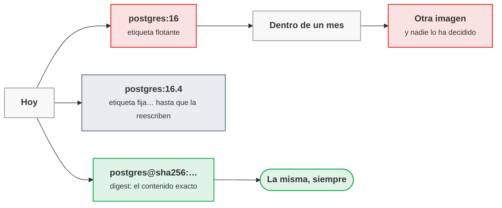
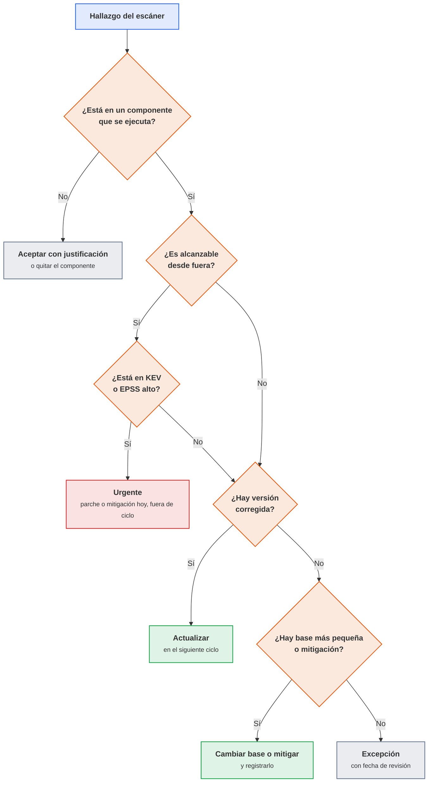
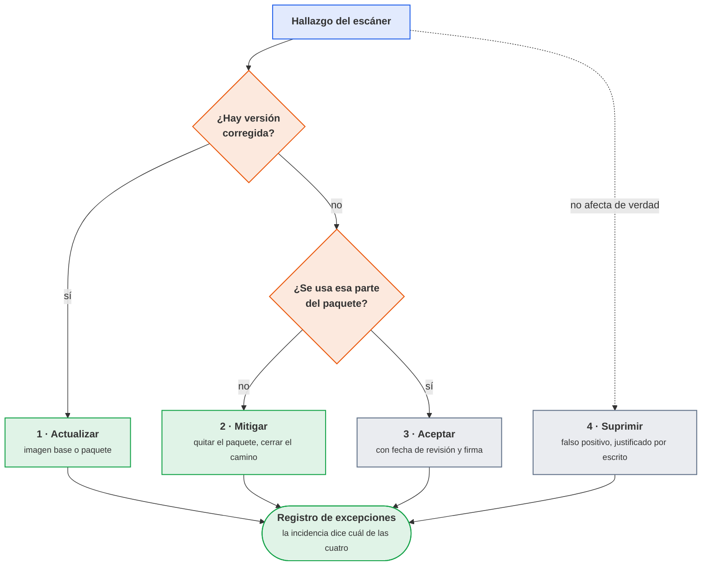

# UT7 · Actualización y gestión de vulnerabilidades

<p class="ut-meta">14 h · Sesiones 28 a 34 · RA4 CE d, e, f, g, h, i</p>

Hasta aquí el módulo ha tratado de mirar el servicio (UT1 a UT3) y de medirlo y probarlo (UT4). Todo eso da por hecho que el servicio no cambia. En esta unidad cambia: aparecen versiones nuevas de la imagen base, de las librerías y de la propia aplicación, aparecen vulnerabilidades en librerías que nadie sabía que llevaba el contenedor, y hay que decidir qué se actualiza, cuándo y cómo, sin romper nada y dejando rastro. Las pruebas de la UT4 se reutilizan tal cual como red de seguridad de cada actualización, y el plan B es una copia con restic contra el MinIO del laboratorio: el repositorio de copias del curso se inicializa en la sesión 31, que es la primera que lo necesita. Después de esta unidad viene la UT8, donde se da de baja el entorno pre que aquí se usa tanto. La práctica evaluable de la sesión 34 cierra la unidad el 23 de febrero y la UT8 arranca el 25, justo antes del parón de las fiestas de la Magdalena, del 1 al 5 de marzo.

## Sesión 28 · Inventario de versiones y seguimiento automático

<p class="ut-meta" markdown>2 de febrero · Teoría y práctica · <span class="dur" tabindex="0" aria-label="Versiones, etiquetas y digests · 15 min&#10;Seguir la aparición de versiones · 10 min&#10;A7.1 Inventario de versiones y seguimiento automático · 85 min" data-dur="Versiones, etiquetas y digests · 15 min&#10;Seguir la aparición de versiones · 10 min&#10;A7.1 Inventario de versiones y seguimiento automático · 85 min">:material-school:<i class="dur-barra" style="--teoria:23%"></i>:material-flask:</span></p>

Al acabar la sesión la imagen base del servicio está fijada con versión y digest, el inventario y la política de actualización están escritos y Renovate abre propuestas de cambio en el Gitea del laboratorio. La hoja se apoya en los apartados de abajo: cómo nombrar una imagen sin ambigüedad (etiqueta, digest y versionado semántico), cómo funciona Renovate y su configuración, y la política escrita que decide quién aprueba qué. Dependabot y Watchtower son las alternativas que conviene conocer para entender por qué no se usan aquí.

### Versiones, etiquetas y digests

Antes de actualizar nada hay que poder decir con exactitud qué hay desplegado, y con contenedores el nombre del compose no siempre identifica el mismo software. Este apartado explica cómo nombrar una imagen sin ambigüedad, cómo leer lo que promete un número de versión y cómo escoger la variante de imagen adecuada.



<p class="pie" markdown>El nombre del compose no identifica el software: identifica una etiqueta que alguien puede mover. Solo el digest dice qué hay desplegado de verdad.</p>


Una imagen de contenedor se nombra por `repositorio:etiqueta` (`postgres:17.6`) y se identifica de forma inequívoca por su digest (`postgres@sha256:…`), que es el hash SHA-256 del manifiesto. La diferencia importa más de lo que parece: la etiqueta es un puntero que el mantenedor puede mover cuando quiera, el digest es el contenido. Cuando el equipo de PostgreSQL reconstruye `17.6` porque Debian ha publicado un parche de `libssl`, la etiqueta no cambia y el digest sí. Un `docker compose pull` en producción un lunes puede traer una imagen distinta de la que se probó el viernes aunque el compose diga lo mismo.

Hay tres niveles de precisión, de menos a más:

| Referencia | Qué significa | Dónde tiene sentido |
|---|---|---|
| `postgres:latest`, `postgres:17` | La última versión que haya en ese momento. Impredecible: un `pull` puede saltar de 17.5 a 17.6 o, peor, de 17 a 18 con `latest`. | Pruebas rápidas en un portátil. Nunca en un compose que se despliegue. |
| `postgres:17.6`, `postgres:17.6-bookworm` | Versión concreta. Identifica qué software lleva, pero la imagen se puede reconstruir por debajo (parches del SO base). | Mínimo aceptable en pre y producción. Es lo que se lee y lo que se escribe en el CHANGELOG. |
| `postgres:17.6@sha256:3f1a…` | Contenido exacto. Reproducible al 100 %: lo que se ha probado es lo que se despliega. | Pipelines y producción. La etiqueta se deja al lado para que un humano sepa qué es. |

Los comandos para pasar de una cosa a otra (`jq` filtra JSON en la línea de comandos):

```bash
# Digest de una imagen descargada de un registry
docker images --digests python

# Digest y arquitecturas de una etiqueta en el registry, sin descargarla (consulta el registry)
docker manifest inspect python:3.13-slim-bookworm | jq '.manifests[] | {digest, platform}'

# Imagen exacta de la que salió un contenedor que está corriendo: su ID
# (el contenedor se busca por su servicio del compose, sin escribir su nombre)
docker inspect --format '{{.Image}}' $(docker compose -f /opt/servicio/compose.yml ps -q app)

# Reescribir el compose con todas las imágenes resueltas a digest (también consulta el registry)
docker compose config --resolve-image-digests > compose.pinned.yml
```

Una imagen construida en local, como `app:1.4.2` en app01 mientras no existe el registry del laboratorio, no tiene digest de registry: `RepoDigests` sale vacío. Se identifica por su ID (`docker image inspect --format '{{.Id}}' app:1.4.2`), que se conserva al llevarla a otra máquina con `docker save` y `docker load`.

Ojo con `docker manifest inspect`: en una imagen multiarquitectura devuelve un índice con un digest por plataforma (`linux/amd64`, `linux/arm64`) y además el digest del propio índice. Para fijar en el compose se usa el del índice (el que aparece en `RepoDigests`), y Docker escoge la plataforma correcta al hacer `pull`. Si se fija a mano el digest de `amd64` y algún día el servicio se mueve a una máquina ARM, el `pull` falla con un mensaje poco claro.

La forma de trabajo de las empresas que lo hacen bien: la etiqueta para leer, el digest para desplegar. En el servicio del curso, la base de la imagen viene de Docker Hub y lleva las dos cosas; la imagen de la aplicación se construye en app01 y, hasta que exista el registry, lleva una versión fija sin digest:

```dockerfile
# api/Dockerfile
FROM python:3.13-bookworm@sha256:3f1a9c...
```

```yaml
# compose.yml
services:
  app:
    image: app:1.4.2     # desde el 19 de febrero, registry.lab:5000/app:1.4.2@sha256:...
```

Y quien mantiene esos digests al día no es una persona a mano, sino Renovate, un robot que revisa el repositorio y abre propuestas de cambio con cada versión nueva, que se trata en el apartado siguiente.

#### Versionado semántico

<figure markdown="span">
  { width="520" }
  <figcaption>Las tres partes de una versión semántica y qué puede cambiar en cada una. Fuente: Surjit Bains, CC BY-SA 4.0, vía Wikimedia Commons.</figcaption>
</figure>

El versionado semántico (`MAYOR.MENOR.PARCHE`) es una promesa del proyecto sobre qué puede romperse al actualizar:

- **Parche** (1.4.2 → 1.4.3): corrección de errores compatible. Se puede aplicar sin leer casi nada. Es el único tipo de cambio que admite fusión automática.
- **Menor** (1.4.3 → 1.5.0): funcionalidad nueva compatible hacia atrás. Conviene leer las notas por si hay opciones nuevas o algo marcado como obsoleto (deprecated), que es el aviso de que en la siguiente mayor desaparece.
- **Mayor** (1.5.0 → 2.0.0): cambios incompatibles. Hay que leer la guía de migración entera, probar en pre con datos reales y planificar ventana. Aquí es donde se rompen formatos de configuración, se renombran variables de entorno y cambian los esquemas de base de datos.

La promesa la hace cada proyecto y no todos la cumplen igual. PostgreSQL usa dos números: el primero es la mayor (17 → 18, requiere `pg_upgrade` o volcado y restauración porque cambia el formato en disco) y el segundo es la "menor" (17.5 → 17.6) que en realidad se comporta como un parche: solo correcciones, mismo formato de datos, se actualiza parando y arrancando con la imagen nueva. nginx alterna ramas: las versiones con segundo número par (1.28.x) son la rama estable y las impares (1.29.x) la de desarrollo. Python sí sigue semver en el sentido habitual, con una menor al año (3.13, 3.14) y parches mensuales.

#### Políticas de etiquetas de las imágenes oficiales

Las imágenes oficiales de Docker Hub publican un abanico de etiquetas por versión y hay que saber qué significa cada sufijo, porque escogerlo bien es una de las cuatro soluciones a una vulnerabilidad:

| Variante | Base | Tamaño orientativo | Cuándo |
|---|---|---|---|
| `python:3.13` (sin sufijo) | Debian completa, con compiladores y cabeceras | ~1 GB | Solo para construir. Nunca como imagen final. |
| `python:3.13-slim` | Debian con lo mínimo para ejecutar | ~150 MB | La opción por defecto para la aplicación del curso. |
| `postgres:17.6-bookworm`, `-trixie` | El sufijo nombra la versión de Debian de debajo (12 o 13) | | Conviene fijarla siempre: sin sufijo, el proyecto puede cambiar de Debian al lanzar una versión nueva. |
| `nginx:1.28.0-alpine`, `postgres:17.6-alpine` | Alpine, con musl (otra biblioteca C, no la glibc de Debian) y `apk` como gestor de paquetes | 20 a 80 MB | Muchos menos paquetes y menos CVE (fallos de seguridad publicados). Cuidado con programas que dependen de glibc o de su resolución DNS. |

Por debajo de alpine hay bases todavía más pequeñas, sin shell ni gestor de paquetes dentro, que dejan el recuento de hallazgos casi a cero a cambio de no poder entrar a depurar con `docker exec`; se describen en [Para ampliar](../ampliacion.md#bases-minimas-distroless-y-chainguard).

Una regla práctica: para el escáner, cada paquete que no está no puede ser vulnerable. Pasar la API del curso de `python:3.13` a `python:3.13-slim` quita de un plumazo cientos de hallazgos que venían de `gcc`, `perl` o `imagemagick` que nadie usaba. Se mide en la actividad A7.3.

### Seguir la aparición de versiones

Con las versiones fijadas, el problema pasa a ser el contrario: nada cambia hasta que alguien se entera de que hay una versión nueva y la propone. Este apartado recorre cómo automatiza ese aviso Renovate, por qué no se usa Watchtower y la política escrita que dice quién decide qué.

#### Renovate a fondo

Renovate lee el repositorio, detecta dependencias (imágenes en `compose.yml` y en `FROM` de los Dockerfile, paquetes en `requirements.txt` o `package-lock.json`, módulos de Ansible, versiones de acciones de CI) y abre un pull request (PR: una propuesta de cambio que alguien revisa antes de fusionarla en la rama principal) por cada actualización disponible, con las notas de la versión pegadas en la descripción. Una persona revisa, el pipeline prueba, alguien fusiona. Automatiza el aviso, no la decisión.

Funciona en GitHub, GitLab y Gitea, que es lo que hay en el laboratorio. Se ejecuta como contenedor con el token de un usuario técnico (una cuenta de Gitea solo para el robot):

```bash
docker run --rm \
  -e RENOVATE_PLATFORM=gitea \
  -e RENOVATE_ENDPOINT=http://gitea.lab:3001/api/v1 \
  -e RENOVATE_TOKEN=$TOKEN_BOT \
  -e RENOVATE_REPOSITORIES=ops/servicio \
  -e LOG_LEVEL=info \
  renovate/renovate:41
```

La configuración vive en el propio repositorio, en `renovate.json`. Conviene fijarse en `extends`, que carga una configuración base ya hecha, y en `packageRules`, que decide qué se fusiona solo y qué no:

```json
{
  "$schema": "https://docs.renovatebot.com/renovate-schema.json",
  "extends": ["config:recommended", ":pinDigests"],
  "timezone": "Europe/Madrid",
  "schedule": ["after 7am and before 9am every weekday"],
  "labels": ["actualizacion"],
  "prConcurrentLimit": 5,
  "enabledManagers": ["docker-compose", "dockerfile", "pip_requirements"],
  "ignoreDeps": ["app"],
  "packageRules": [
    {
      "description": "Parches y digests: fusión automática si el pipeline pasa",
      "matchUpdateTypes": ["patch", "digest"],
      "automerge": true,
      "automergeType": "pr"
    },
    {
      "description": "Versiones menores de la imagen base: un solo PR semanal",
      "matchPackageNames": ["python"],
      "matchUpdateTypes": ["minor"],
      "groupName": "imagen base",
      "schedule": ["before 8am on monday"]
    },
    {
      "description": "Mayores: nunca automático, etiqueta para que se vea",
      "matchUpdateTypes": ["major"],
      "labels": ["actualizacion", "mayor", "requiere-ventana"],
      "automerge": false
    }
  ],
  "vulnerabilityAlerts": {
    "labels": ["seguridad"],
    "schedule": ["at any time"]
  }
}
```

Lo que hace cada bloque:

- `:pinDigests` convierte `python:3.13-bookworm` en `python:3.13-bookworm@sha256:…` la primera vez y a partir de ahí abre un PR cada vez que el digest cambia por debajo, aunque la etiqueta no se mueva. Es la manera de detectar que la imagen se ha reconstruido con un parche de Debian.
- `schedule` limita cuándo abre PR (no un viernes a las siete de la tarde). `vulnerabilityAlerts` los salta: un PR de seguridad se abre en cuanto se detecta.
- `automerge` solo para `patch` y `digest`, y solo si el pipeline está en verde. Renovate no fusiona nada que no haya pasado por Jenkins. Una menor o una mayor la fusiona una persona después de leer las notas.
- `groupName` junta varias actualizaciones en un PR para no tener quince abiertos el lunes.
- `ignoreDeps` saca de la vigilancia la imagen `app`: hasta el 19 de febrero es local, Renovate la buscaría en Docker Hub y cada pasada acabaría con un error de búsqueda.

Desde el 19 de febrero la imagen del servicio vive en el registry propio (`registry.lab:5000/app`). Entonces se quita de `ignoreDeps` y se le dan a Renovate credenciales de lectura del registry en `hostRules`, por variable de entorno y nunca en el repositorio (`RENOVATE_HOST_RULES`). Sin ellas ignora esa imagen en silencio y parece cubierta cuando no lo está; con `LOG_LEVEL=debug` se ve `skipping` con el motivo.

Dependabot es el equivalente integrado en GitHub, que se configura en `.github/dependabot.yml` del propio repositorio; cubre menos gestores que Renovate y solo corre allí, así que en clase se usa Renovate, pero sus propuestas aparecen en cualquier proyecto alojado en GitHub. El fichero de ejemplo y la comparación con Renovate están en [Para ampliar](../ampliacion.md#dependabot).

#### Watchtower y por qué no en producción

Watchtower es un contenedor que vigila a los demás del host, hace `pull` de sus imágenes cada cierto tiempo y los recrea en cuanto hay una nueva: actualiza sin probar, sin copia previa, sin ventana, sin registro y sin más vuelta atrás que buscar a mano la etiqueta anterior, de modo que un cambio de configuración incompatible tira el servicio a las tres de la mañana. Para un laboratorio personal vale; en el entorno dev del curso tampoco se usa, porque dev es donde se depura y nada debería cambiar solo.

Sin Renovate, un job programado en Jenkins puede hacer lo mismo a mano: comparar el digest desplegado con el publicado y abrir una incidencia cuando no coinciden. Sirve cuando no se puede instalar nada más; el ejemplo está en [Para ampliar](../ampliacion.md#un-job-en-el-pipeline-que-vigila-versiones).

#### La política escrita

Aquí toca escribir media página que diga cómo se actualiza el servicio. Sin eso, cada actualización se decide sobre la marcha según quién esté de guardia. La política tiene que responder a esto:

- Frecuencia de revisión: Renovate abre PR a diario; una persona revisa los abiertos cada lunes.
- Quién aprueba: parches y digests, el pipeline; menores, quien esté de mantenimiento; mayores, el responsable del servicio y aviso al equipo de desarrollo.
- Ventana de mantenimiento: martes de 7:00 a 8:00, fuera de ella solo emergencias.
- Qué salta la cola: CVE CRITICAL con parche disponible o cualquier entrada en KEV, se aplica en pre el mismo día y en producción en la siguiente ventana o antes si hay explotación activa.
- Qué espera al ciclo: todo lo demás, agrupado cada dos semanas.
- Cuánto tiempo se da a una actualización que falla antes de volver atrás: 40 minutos en pre, 20 en producción.

### A7.1 Inventario de versiones y seguimiento automático (sesión 28)

Dos tareas encadenadas: primero el inventario y luego, sobre él, su vigilancia automática.

<span class="et et-obj">Objetivo</span> La imagen base del Dockerfile fijada con versión y digest, el inventario en `docs/inventario.md`, la política en `docs/politica-actualizacion.md` y Renovate con al menos un PR abierto en el Gitea del laboratorio.

<span class="et et-pre">Antes de empezar</span>

- app01 con el servicio arrancado y la copia de trabajo de `servicio` en `/opt/servicio`. No sale a Internet desde el 27 de noviembre, ni le hace falta hoy: solo se miran imágenes que ya tiene.
- El repositorio `ops/servicio` en `gitea.lab` (hoy, el contenedor de mon01 en el 3001). Usa siempre ese nombre, nunca la dirección: el 12 de febrero Gitea se muda a `gitea01` y solo cambian el host override y el endpoint.
- Trabajo que se puede traer hecho: en Gitea, el usuario técnico `renovate-bot` con permiso de escritura en `ops/servicio` y su token en el gestor de contraseñas; en mon01, la imagen `renovate/renovate:41` (o la mayor vigente, nunca `latest`), que pesa varios cientos de MB.
- Explicado antes: [Versiones, etiquetas y digests](#versiones-etiquetas-y-digests), [Versionado semántico](#versionado-semantico), [Renovate a fondo](#renovate-a-fondo) y [La política escrita](#la-politica-escrita).

<span class="et et-pas">Pasos</span>

1. Inventaria en `docs/inventario.md`, en la copia de trabajo de app01, las imágenes que corren en la máquina (servicio y agentes) y la base del `FROM` de `api/Dockerfile`: una fila por imagen con componente, etiqueta, digest o ID, fecha de creación y si es flotante. Los paquetes de Python del contenedor `app`, con su versión, van aparte en `inventario-app.txt`.

    *Pista:* `app:1.4.2` se construyó en app01 y no tiene digest de registry: se identifica por su ID. Flotante es `latest`, solo la mayor (`python:3`) o sin sufijo de Debian.

2. Fija la base de `api/Dockerfile` con versión, sufijo de Debian y digest, y lleva el Dockerfile y el inventario a `main` con un PR desde la rama `inventario` que fusionas tú mismo: Renovate tiene que encontrar la base ya fijada.

    *Pista:* el digest sale del `RepoDigests` de la base, que app01 tiene porque con ella construyó la aplicación; el sufijo (`bookworm` o `trixie`), del `/etc/os-release` del contenedor `app`.

3. Pon Renovate a vigilar el repositorio: en la raíz de `main`, el `renovate.json` de [Renovate a fondo](#renovate-a-fondo) con `"schedule": ["at any time"]` mientras dura la práctica, y desde mon01 una pasada con el token de `renovate-bot` y `LOG_LEVEL=debug`, guardada en `renovate.log`. Guarda la captura del PR que abra con la etiqueta `actualizacion`.

    *Pista:* a la orden del apartado le falta `--network host`, para que el contenedor resuelva `gitea.lab` como lo hace mon01.

4. Escribe en `main` `docs/politica-actualizacion.md`: los seis puntos de [La política escrita](#la-politica-escrita) como encabezados, cada uno con una o dos líneas decididas para tu servicio. Se cierra en la práctica evaluable de la sesión 34.

<span class="et et-com">Comprobación</span> Las líneas `image:` y `FROM` de `compose.yml` y `api/Dockerfile` ya no llevan etiquetas flotantes; `docker image inspect python:3.13-<debian>@sha256:<digest>` encuentra la imagen en app01, así que el digest está bien copiado; en Gitea hay un PR de `renovate-bot` con la etiqueta `actualizacion` y las notas de la versión; en `renovate.log` la base del Dockerfile aparece entre las dependencias detectadas y `app` no da error de búsqueda.

<span class="et et-ent">Entrega</span> El PR fusionado con `docs/inventario.md` y el Dockerfile fijado; `renovate.json` y `docs/politica-actualizacion.md` en `main`; la captura del PR de Renovate y `renovate.log` en la carpeta de la práctica.

<span class="et et-ext">Si te sobra tiempo</span> Fija también con digest las imágenes de `/opt/agentes/compose.yml` que el paso 1 marcó como flotantes, y añade un `packageRule` con `versioning` explícito para alguna imagen que no siga semver.

## Sesión 29 · Escaneo

<p class="ut-meta" markdown>4 de febrero · Teoría y práctica · <span class="dur" tabindex="0" aria-label="Vulnerabilidades en los componentes · 20 min&#10;A7.2 Escaneo · 90 min" data-dur="Vulnerabilidades en los componentes · 20 min&#10;A7.2 Escaneo · 90 min">:material-school:<i class="dur-barra" style="--teoria:18%"></i>:material-flask:</span></p>

Al acabar la sesión quedan hechos el SBOM de la imagen del servicio y la de un agente, los informes de Trivy y Grype, el escaneo del código con pip-audit y `trivy fs`, y una tabla de hallazgos HIGH y CRITICAL con las columnas de exploit conocido y alcanzable. La hoja se apoya en el vocabulario de abajo (CVE, CVSS, EPSS y KEV), en qué es un SBOM y cómo lo genera Syft, y en qué hace cada escáner y con qué opciones; de Trivy, que ya se usó en la UT4, solo se ve lo nuevo. Cómo leer el informe y decidir queda para la sesión siguiente.

### Vulnerabilidades en los componentes

Saber qué versión lleva cada pieza sirve para la segunda pregunta de la unidad: ¿alguna de esas piezas tiene un fallo de seguridad publicado? Este apartado presenta el vocabulario con el que se describen esos fallos, cómo inventariar y escanear una imagen y, sobre todo, cómo leer el resultado con calma: la mayoría de los hallazgos no requieren hacer nada hoy, y decidir cuáles sí es el trabajo.

Un contenedor de la API del curso lleva, de fuera hacia dentro: la imagen base (Debian y sus paquetes: `libc`, `openssl`, `zlib`), el runtime (Python y su biblioteca estándar), las librerías de la aplicación (`flask`, `gunicorn`, el driver de PostgreSQL y las decenas que arrastran) y el propio código. Cualquiera de las cuatro capas puede tener una vulnerabilidad publicada, y el escáner no distingue entre "está en la imagen" y "se ejecuta".

#### CVE, CVSS, EPSS y KEV

Un **CVE** (Common Vulnerabilities and Exposures) es un identificador público, `CVE-AÑO-NÚMERO`, asignado por una autoridad acreditada, normalmente el propio proyecto o un fabricante autorizado, a un fallo concreto. No dice nada de su gravedad, solo lo nombra.

<figure markdown="span">
  { width="240" }
  <figcaption>CVSS es el sistema con el que se puntúa la gravedad de un CVE; la versión 4.0 se publicó en 2023 y convive con la 3.1. Fuente: FIRST, CC BY-SA 4.0, vía Wikimedia Commons.</figcaption>
</figure>

**CVSS** (Common Vulnerability Scoring System) puntúa de 0 a 10 la gravedad técnica a partir de un vector. Un ejemplo con la versión 3.1, que es la que todavía aparece en la mayoría de fichas:

```text
CVSS:3.1/AV:N/AC:L/PR:N/UI:N/S:U/C:H/I:H/A:H   →   9.8 CRITICAL
```

Desglosado:

| Métrica | Valor | Significado |
|---|---|---|
| AV (Attack Vector) | N (Network) | Se explota por red, sin estar en la máquina. |
| AC (Attack Complexity) | L (Low) | No hace falta ninguna condición especial. |
| PR (Privileges Required) | N (None) | Sin cuenta ni credenciales. |
| UI (User Interaction) | N (None) | Nadie tiene que pinchar nada. |
| S (Scope) | U (Unchanged) | El daño se queda en el componente vulnerable. |
| C / I / A | H / H / H | Pérdida total de confidencialidad, integridad y disponibilidad. |

Es el peor caso: ejecución remota de código sin autenticación. Si el mismo fallo requiriera usuario local (`AV:L`) y privilegios (`PR:L`), la puntuación bajaría a la zona de 7. CVSS 4.0 cambia la notación (separa el impacto sobre el sistema vulnerable, `VC/VI/VA`, del impacto sobre otros sistemas, `SC/SI/SA`, y añade métricas de ataque como `AT`), y el mismo perfil queda en 9.3. La escala es la misma: 0,1 a 3,9 LOW, 4,0 a 6,9 MEDIUM, 7,0 a 8,9 HIGH, 9,0 a 10 CRITICAL. Los niveles que enseña Trivy salen de aquí.

El problema de CVSS es que mide gravedad teórica, no probabilidad. Un 9.8 en una librería que solo se usa para leer imágenes TIFF que la API nunca recibe es menos urgente que un 7.5 en el parser de HTTP del proxy. Para eso hay dos complementos:

- **EPSS** (Exploit Prediction Scoring System, de FIRST, el foro internacional de equipos de respuesta a incidentes): probabilidad, entre 0 y 1, de que el CVE se explote en los próximos 30 días, calculada a diario con datos reales de ataques. La mayoría de CVE tienen EPSS por debajo del 1 %; los que pasan del 10 % son una minoría y es donde hay que mirar primero.
- **KEV** (Known Exploited Vulnerabilities, de CISA): la lista de los que se están explotando ya. Binario: está o no está.

El orden de priorización que se aplica en el curso: está en KEV, EPSS alto, CRITICAL o HIGH con parche disponible y componente alcanzable desde fuera, el resto por ciclo. Y todo ello después de la pregunta que ningún escáner responde: ¿este componente se ejecuta en el contenedor?

#### SBOM: el inventario

Un **SBOM** (Software Bill of Materials) es la lista de todo lo que hay dentro de una imagen: paquetes del SO con versión, librerías del lenguaje con versión, ficheros binarios detectados, y el origen de cada uno. Hay dos formatos estándar: **CycloneDX** (de OWASP, más orientado a seguridad) y **SPDX** (de la Linux Foundation, más orientado a licencias). Cualquiera de los dos lo entienden todos los escáneres.

Syft, una herramienta de línea de comandos de Anchore (la misma casa que Grype), lo genera:

```bash
# De un fichero de docker save: la imagen del servicio, que hasta el 19 de febrero no está en ningún registry
syft docker-archive:app-1.4.2.tar -o cyclonedx-json > sbom-app-1.4.2.cdx.json
# De un registry, sin descargarla con Docker
syft python:3.13-bookworm -o spdx-json > sbom-python-3.13.spdx.json

# Cuántos componentes y de qué tipo
jq '.components | group_by(.type) | map({type: .[0].type, n: length})' sbom-app-1.4.2.cdx.json
```

El SBOM se guarda con cada versión, junto al informe de escaneo, en el repositorio o como artefacto del pipeline. Su valor está en el futuro: cuando dentro de cuatro meses salga un CVE en `libxml2`, no hace falta reescanear las veinte versiones desplegadas por ahí, basta con buscar en los SBOM archivados cuáles la llevaban y en qué versión. Cuando salió el fallo de `xz` (CVE-2024-3094), las empresas con SBOM contestaron en minutos.

#### Escanear con Trivy

!!! otra "Repaso"
    `trivy image` con `--severity`, `--ignore-unfixed`, `--format json` y `--exit-code 1` se explicó en la [sesión 25](ut4-kpi-pruebas.md#seguridad-zap-baseline-y-trivy-image), y la A4.6 lo dejó instalado en el puesto de administración. Aquí solo se añade lo nuevo: escanear una imagen que no está en ningún registry, los otros modos de Trivy y qué informe se archiva.

Hasta el 19 de febrero la imagen del servicio vive solo en el Docker de app01. Se saca a un fichero y se escanea en el puesto de administración, que tiene Trivy y salida a Internet para su base de datos. Los otros modos cubren, con la imagen, las tres cosas que pide el CE e (código, binarios y librerías):

```bash
# Imagen, desde un fichero de docker save: paquetes del SO y dependencias del lenguaje
ssh ops@10.10.2.10 docker save app:1.4.2 > app-1.4.2.tar
trivy image --input app-1.4.2.tar --severity HIGH,CRITICAL

# Sistema de ficheros: el código fuente, sus ficheros de dependencias y los secretos olvidados
trivy fs --scanners vuln,secret .

# Configuración: Dockerfile, compose, manifiestos; busca malas prácticas, no CVE
trivy config .

# Desde un SBOM ya generado, sin volver a leer la imagen
trivy sbom sbom-app-1.4.2.cdx.json

# Para archivar: el informe completo, sin filtros
trivy image --input app-1.4.2.tar --format json -o trivy-app-1.4.2.json
trivy image --input app-1.4.2.tar --format sarif -o trivy-app-1.4.2.sarif
```

Lo nuevo respecto a la UT4:

- `--input` lee la imagen de un fichero de `docker save`: la máquina que escanea no necesita Docker ni acceso a ningún registry.
- El informe que se archiva va sin `--severity` ni `--ignore-unfixed`. La lista de trabajo se filtra; el archivo no, porque un hallazgo sin parche hoy puede tenerlo mañana y hay que poder buscarlo en el informe de esta versión.
- `--format sarif` escribe SARIF (un formato normalizado de resultados de análisis de código), que es el que entienden Gitea, GitLab y GitHub para pintar los hallazgos junto al código.

`trivy config` avisa además de cosas de la 5166: contenedor que corre como root, `ADD` con URL, puerto 22 expuesto.

#### Grype, Docker Scout y los escáneres del lenguaje

Grype (de los mismos autores que Syft) escanea imágenes o SBOM contra otra base de datos. Da resultados parecidos a Trivy pero no idénticos, y esa diferencia es útil: un hallazgo que aparece en los dos es más fiable, y uno que solo aparece en uno hay que mirarlo con más cuidado.

```bash
grype sbom:sbom-app-1.4.2.cdx.json --only-fixed --fail-on high
grype docker-archive:app-1.4.2.tar -o table
```

Para las dependencias del lenguaje, los escáneres propios ven cosas que los de imagen se pierden, porque leen el fichero de dependencias con la resolución exacta. En el curso la API es Python, así que el que se usa es pip-audit, contra la base de datos de avisos de PyPI:

```bash
pip-audit -r api/requirements.txt
```

Los demás son la misma idea para otros lenguajes o para otro sitio:

| Herramienta | Qué lee | Cuándo |
|---|---|---|
| `npm audit --audit-level=high` | `package-lock.json` | Proyectos Node |
| `osv-scanner scan --lockfile <fichero>` | Ficheros de dependencias de casi cualquier lenguaje, contra OSV | Repositorios con varios lenguajes |
| `docker scout cves <imagen>` | Imágenes, desde Docker Desktop o Docker Hub | Cómodo en un portátil; en el servidor no está disponible |

Son dos filtros a distinta altura: pip-audit mira las dependencias declaradas antes de construir, y Trivy la imagen ya construida. En el curso los dos se pasan en la A7.2; en el pipeline de la A7.6 entra solo Trivy.

### A7.2 Escaneo (sesión 29)

<span class="et et-obj">Objetivo</span> El SBOM y los informes JSON de Trivy y Grype de la imagen del servicio y de la de un agente, el escaneo del código con pip-audit y `trivy fs`, y una tabla de hallazgos HIGH y CRITICAL con las columnas de exploit conocido y alcanzable rellenas, todo en `seguridad/` del repositorio.

<span class="et et-pre">Antes de empezar</span>

- Se trabaja en el puesto de administración, que tiene Trivy desde la A4.6, salida a Internet para las bases de datos de vulnerabilidades y tu clon de `servicio`. Entra con `ssh -A` para que desde él llegues a app01.
- Trabajo que se puede traer hecho: Syft y Grype instalados con los instaladores oficiales de Anchore, pip-audit con `pipx`, y las bases de datos al día (`trivy image --download-db-only` y `grype db update`).
- Explicado antes: [CVE, CVSS, EPSS y KEV](#cve-cvss-epss-y-kev), [SBOM: el inventario](#sbom-el-inventario), [Escanear con Trivy](#escanear-con-trivy) y [Grype, Docker Scout y los escáneres del lenguaje](#grype-docker-scout-y-los-escaneres-del-lenguaje).

<span class="et et-pas">Pasos</span>

1. Saca a `~/imagenes/` del puesto, fuera del repositorio, la imagen del servicio (`app-1.4.2.tar`) y la de cAdvisor de tu inventario (`cadvisor.tar`), el agente con más privilegios de app01, y genera en `seguridad/` de tu clon el [SBOM](#sbom-el-inventario) en CycloneDX de cada una, con su número de componentes.

2. Escanea las dos imágenes con Trivy y con Grype. De cada escáner, el informe completo en JSON (`trivy-<imagen>.json`, `grype-<imagen>.json`), sin filtros porque es el que se archiva, y una tabla con HIGH y CRITICAL.

3. Escanea el código con pip-audit (`pip-audit.txt`) y con `trivy fs` para vulnerabilidades y secretos (`trivy-fs.json`), y anota en `hallazgos.md` cuántos hallazgos da cada uno y si pip-audit ve alguno que Trivy no.

    *Pista:* excluye `seguridad/` con `--skip-dirs`, o `trivy fs` analizará también los informes que acabas de generar.

4. Reúne en `hallazgos.tsv` las filas HIGH y CRITICAL de los tres JSON de Trivy y pasa a la tabla de `seguridad/hallazgos.md` **las ocho más graves**: las CRITICAL y, si no llegas a ocho, las HIGH con parche. Encima de la tabla, el recuento por severidad de `hallazgos.tsv`.

    *Pista:* las filas, con CVE, objetivo, paquete, versión instalada, versión corregida y severidad, salen de los JSON con este `jq`:

    ```bash
    jq -r '.Results[] | .Target as $t | .Vulnerabilities[]? | select(.Severity=="HIGH" or .Severity=="CRITICAL")
      | [.VulnerabilityID, $t, .PkgName, .InstalledVersion, (.FixedVersion // "sin parche"), .Severity] | @tsv' \
      trivy-*.json | sort -u > hallazgos.tsv
    ```

5. Rellena en esas ocho filas las dos columnas que no da ningún escáner: exploit conocido (KEV y EPSS) y alcanzable desde fuera (sí, no, no sé), que decides tú según el paquete esté en el camino que atiende peticiones o solo en la construcción.

    *Pista:* el catálogo KEV se descarga una vez en JSON de la web de CISA y se consulta en local; el EPSS de cada CVE lo da `https://api.first.org/data/v1/epss?cve=<CVE>`.

6. Compara Trivy y Grype sobre la imagen del servicio y anota en `hallazgos.md` los CVE que solo ve uno de los dos.

    *Pista:* `comm -3` sobre las dos listas ordenadas de identificadores: `.Results[].Vulnerabilities[]?.VulnerabilityID` en Trivy y `.matches[].vulnerability.id` en Grype.

<span class="et et-com">Comprobación</span> La cabecera de cada informe de imagen de Trivy reconoce el sistema base (`(debian 12.x)` o `(debian 13.x)`); `hallazgos.tsv` no está vacío; la tabla tiene ocho filas (o todas las CRITICAL y las HIGH con parche, si salen menos de ocho) con las dos columnas manuales rellenas y el recuento por severidad encima; `pip-audit.txt` y `trivy-fs.json` existen y su resultado está resumido en `hallazgos.md`; hay al menos un CVE anotado que solo aparece en uno de los escáneres.

<span class="et et-ent">Entrega</span> Commit con `seguridad/` (los dos SBOM, los JSON de los escáneres, `pip-audit.txt` y `hallazgos.md`), sin los `.tar`. Es la base de A7.3.

## Sesión 30 · Investigar y decidir

<p class="ut-meta" markdown>9 de febrero · Teoría y práctica · <span class="dur" tabindex="0" aria-label="Leer un informe · 5 min&#10;Las cuatro soluciones y el registro de excepciones · 5 min&#10;A7.3 Investigar y decidir · 100 min" data-dur="Leer un informe · 5 min&#10;Las cuatro soluciones y el registro de excepciones · 5 min&#10;A7.3 Investigar y decidir · 100 min">:material-school:<i class="dur-barra" style="--teoria:9%"></i>:material-flask:</span></p>

Al acabar la sesión están investigados cuatro hallazgos en NVD y OSV, decidido y justificado qué hacer con cada uno, documentado el `.trivyignore` y medido cuánto cambia el informe al reconstruir la imagen con base slim, que queda desplegada en dev como 1.4.3. La hoja se apoya en el diagrama de decisión de Leer un informe y en las cuatro soluciones posibles con su registro de excepciones; las fuentes donde se consulta cada CVE están justo antes de la hoja como material de consulta, y su tiempo de lectura va dentro del de la hoja.

### Leer un informe

Esto es un extracto real de lo que devuelve `trivy image` sobre una API en `python:3.12-slim-bookworm` de hace unos meses, sin `--ignore-unfixed`:

```text
app-1.4.2.tar (debian 12.5)
Total: 3 (HIGH: 2, CRITICAL: 1)

┌────────────────┬────────────────┬──────────┬──────────────┬───────────────────┬───────────────┬─────────────────────────────────────┐
│    Library     │ Vulnerability  │ Severity │    Status    │ Installed Version │ Fixed Version │                Title                │
├────────────────┼────────────────┼──────────┼──────────────┼───────────────────┼───────────────┼─────────────────────────────────────┤
│ zlib1g         │ CVE-2023-45853 │ CRITICAL │ will_not_fix │ 1:1.2.13.dfsg-1   │               │ zlib: integer overflow in MiniZip   │
│ libnghttp2-14  │ CVE-2023-44487 │ HIGH     │ fixed        │ 1.52.0-1          │ 1.52.0-1+deb12u1 │ HTTP/2: rapid reset attack       │
└────────────────┴────────────────┴──────────┴──────────────┴───────────────────┴───────────────┴─────────────────────────────────────┘

Python (python-pkg)
│ setuptools     │ CVE-2024-6345  │ HIGH     │ fixed        │ 65.5.1            │ 70.0.0        │ pypa/setuptools: remote code exec.. │
```

Las columnas que deciden: `Status` (si hay parche o la distribución ha dicho que no lo va a arreglar), `Fixed Version` (a qué hay que subir) y, fuera de la tabla, lo que se sabe del servicio. Y por cada fila, las preguntas del diagrama:



<p class="pie" markdown>La severidad del CVE no decide sola: lo que decide es si ese código se ejecuta, si se alcanza desde fuera y si se está explotando de verdad.</p>

Aplicado a las tres filas del informe:

1. `zlib1g / CVE-2023-45853`. CRITICAL 9.8, pero el fallo está en MiniZip, una utilidad que forma parte del código fuente de zlib y que Debian no compila en `zlib1g`. Debian lo marca `will_not_fix` precisamente por eso. No se ejecuta: excepción en `.trivyignore`, con esa justificación y una fecha para revisar si Debian cambia de opinión.
2. `libnghttp2-14 / CVE-2023-44487`. Rapid Reset, con explotación conocida (está en KEV). ¿Se ejecuta? La API en Python no habla HTTP/2 y `libnghttp2` está en la imagen porque `curl` la arrastra. No es alcanzable desde fuera (el HTTP/2 lo termina nginx, que tiene su propia corrección). Pero tiene parche y es un `apt upgrade`: se actualiza en el siguiente ciclo reconstruyendo la imagen con la base al día. En el proxy nginx, en cambio, sería urgente.
3. `setuptools / CVE-2024-6345`. Ejecución remota a través de `package_index`, que solo se usa al instalar paquetes. En una imagen que ya está construida y no ejecuta `pip install`, no es alcanzable. Aun así la corrección es gratis (subir `setuptools` en la etapa de construcción o directamente desinstalarlo de la imagen final), así que se hace en ciclo y de paso desaparece una fila del informe.

Conviene fijarse en que la fila más grave del informe ha terminado como excepción, y una HIGH como actualización normal. Esa es la diferencia entre escanear y gestionar vulnerabilidades.

### Las cuatro soluciones y el registro de excepciones

Para cada hallazgo hay exactamente cuatro salidas, y la incidencia tiene que decir cuál se ha tomado:



<p class="pie" markdown>Lo que no vale es la quinta salida: dejarlo pasar sin decir nada. Un hallazgo sin decisión escrita vuelve en el siguiente escaneo y nadie recuerda por qué sigue ahí.</p>


1. **Actualizar** la imagen base o el paquete afectado. Reconstruir con `FROM python:3.13-slim-bookworm` al día (y `apt-get upgrade` en el Dockerfile si la base oficial va por detrás de Debian) o subir la versión de la librería en el lockfile.
2. **Cambiar a una base más pequeña**: `-slim`, `-alpine`, distroless o Chainguard. Menos paquetes, menos hallazgos y menos superficie de ataque real. Tiene coste: puede que falten librerías nativas, que no haya shell para depurar o que cambie el comportamiento de DNS en Alpine.
3. **Mitigar** sin tocar la versión: desinstalar el componente en el Dockerfile (`apt-get purge curl`), deshabilitar la función vulnerable en la configuración (un módulo de nginx, un protocolo de TLS), o limitar por red con las reglas de la 5166 UT3 para que el componente no sea alcanzable.
4. **Aceptar el riesgo** por escrito, con motivo, responsable y fecha de revisión. Es legítimo, pero solo si está documentado.

Las excepciones aceptadas van a `.trivyignore` en la raíz del repositorio. Trivy admite comentarios y fechas de caducidad, y hay que usar las dos cosas:

```text
# CVE-2023-45853: MiniZip no se compila en zlib1g de Debian. Debian: will_not_fix.
# Decidido en #142 por el equipo de Sistemas el 2027-02-09. Revisar cuando Debian cambie de estado.
CVE-2023-45853 exp:2027-08-01

# CVE-2024-6345: setuptools solo se usa en la etapa de construcción; no está en la imagen final desde 1.4.3.
# Cerrar esta excepción al fusionar !57.
CVE-2024-6345 exp:2027-03-15
```

Una línea sin comentario ni fecha es una excepción que nadie revisará, y en seis meses el fichero tiene ochenta líneas que ya no significan nada. En la práctica evaluable, un `.trivyignore` sin justificaciones cuenta como no entregado.

### Fuentes y cómo se leen

!!! consulta "Material de consulta"
    Este apartado no se desarrolla en clase: es material de consulta para la hoja de práctica de esta sesión.

- **Releases y CHANGELOG del proyecto.** En GitHub o GitLab, la pestaña Releases de cada componente. Para las imágenes oficiales, además, el repositorio `docker-library/official-images` y la página de la imagen en Docker Hub. En una nota de versión se buscan tres cosas por este orden: la sección de seguridad (a veces solo dice "fixes CVE-XXXX"), la lista de cambios incompatibles (breaking changes) y las opciones marcadas como obsoletas.
- **Avisos de seguridad del proyecto.** La pestaña Security de GitHub (los GHSA, GitHub Security Advisories), las listas `announce` de PostgreSQL y nginx, y la lista `oss-security` para lo que afecta a varios proyectos a la vez. Las distribuciones publican los suyos: DSA (Debian Security Advisory) en Debian, que es la base de casi todas las imágenes del servicio.
- **NVD** (https://nvd.nist.gov/): la base oficial de CVE del NIST, el instituto de estándares de Estados Unidos. De cada ficha interesa el vector CVSS, las versiones afectadas (en formato CPE, un nombre normalizado de producto y versión) y las referencias, que suelen enlazar al parche.
- **OSV** (https://osv.dev/): base abierta pensada para lenguajes. Indexa por paquete y versión con rangos precisos, por lo que da menos falsos positivos que NVD en dependencias de Python o Node.
- **GitHub Advisory Database** (https://github.com/advisories): los GHSA. Suele ser la primera en publicar para librerías, y es la fuente de Dependabot.
- **CISA KEV** (https://www.cisa.gov/known-exploited-vulnerabilities-catalog): catálogo de la agencia de ciberseguridad de Estados Unidos de vulnerabilidades que se están explotando de verdad. Es corto (unas pocas al mes) y cualquier cosa que aparezca ahí y esté en el inventario salta la cola.

Al investigar un hallazgo en la actividad A7.3, el orden de lectura es: ficha NVD u OSV para saber qué es y qué versiones afecta, aviso del proyecto para saber si ya hay parche y cómo se activa, issue tracker del componente para ver si hay mitigación mientras tanto, y KEV para saber si corre prisa.

### A7.3 Investigar y decidir (sesión 30)

<span class="et et-obj">Objetivo</span> Cuatro hallazgos decididos y justificados, un `.trivyignore` documentado, y la imagen del servicio reconstruida con base `-slim` como `app:1.4.3`, medida frente a la 1.4.2 y funcionando en dev.

<span class="et et-pre">Antes de empezar</span>

- `seguridad/hallazgos.md` de la A7.2 y `~/imagenes/app-1.4.2.tar` en el puesto de administración, con acceso a NVD, OSV, GitHub Advisory y el catálogo KEV.
- app01 con la copia de trabajo de `servicio` en `main` y al día.
- La consola de OPNsense: app01 no sale a Internet, y construir la imagen nueva descarga la base y las librerías. El paso 4 abre una fila temporal y la cierra en el mismo paso.
- Explicado antes: [Leer un informe](#leer-un-informe) y [Las cuatro soluciones y el registro de excepciones](#las-cuatro-soluciones-y-el-registro-de-excepciones). Dónde se consulta cada CVE está en [Fuentes y cómo se leen](#fuentes-y-como-se-leen), el material de consulta de esta hoja.

<span class="et et-pas">Pasos</span>

1. Crea la rama `base-slim` en tu clon de `servicio`, elige cuatro filas de la tabla (al menos una CRITICAL y una sin parche) e investígalas en el orden de [Fuentes y cómo se leen](#fuentes-y-como-se-leen).

    *Pista:* si tu tabla no tiene ninguna sin parche, búscala en `hallazgos.tsv` (`sin parche` o `will_not_fix`).

2. Escribe en `seguridad/decisiones.md`, por hallazgo, las respuestas del diagrama de [Leer un informe](#leer-un-informe): CVE y componente, ¿se ejecuta?, ¿alcanzable desde fuera?, KEV y EPSS, la solución elegida y tres o cuatro líneas de justificación con la fuente enlazada.

3. Registra en `.trivyignore`, en la raíz del clon, cada CVE aceptado con su comentario (motivo, quién decide, fecha) y su caducidad `exp:`. Comprueba que Trivy lo respeta sobre `app-1.4.2.tar` y sube la rama.

4. Reconstruye en app01, desde `base-slim`, la imagen como `app:1.4.3` sobre `python:3.13-slim-<debian>` (la Debian de la A7.1) fijada con digest, y comprueba con `pip check` y un `import flask` que está sana. Para las descargas, abre antes en OPNsense la fila temporal de la pestaña DMZINT (Pass, origen `srv_app`, destino any, puertos `p_web`, descripción `TEMPORAL alta 09-02 baja 09-02 build en app01`) y bórrala al terminar el build.

    *Pista:* la slim no trae las librerías de cliente de PostgreSQL: si el driver no compila o no carga, añade `libpq5` en el Dockerfile o usa la variante binaria del driver.

5. Despliega la 1.4.3 en dev guardando antes el compose que corre como `compose.anterior.yml`, el plan B de dev que usa la A7.4, y sube a la rama el cambio de `compose.yml`.

6. Mide desde el puesto la 1.4.2 frente a la 1.4.3 (tamaño y hallazgos HIGH y CRITICAL), añade a `seguridad/decisiones.md` la tabla de comparación (base, tamaño, hallazgos, qué hubo que tocar) y abre el PR de `base-slim`.

    *Pista:* trae antes a tu clon el commit que hiciste en app01, o la rama divergirá.

<span class="et et-com">Comprobación</span> Cuatro entradas con las preguntas del diagrama respondidas y la fuente enlazada; Trivy con `--ignorefile` muestra menos filas que sin él y ninguna línea del `.trivyignore` va sin comentario ni fecha; la fila temporal ya no está en OPNsense; `app:1.4.3` responde en el `/health` de app01 y tiene menos hallazgos que la 1.4.2.

<span class="et et-ent">Entrega</span> PR de `base-slim` con `seguridad/decisiones.md`, `.trivyignore`, el Dockerfile con la base nueva y `compose.yml` en la 1.4.3. No lo fusiones todavía: se fusiona al empezar la A7.4, después de dos días de la 1.4.3 en dev y antes de llevarla a pre.

<span class="et et-ext">Si te sobra tiempo</span> Repite la reconstrucción del paso 4 y la medida del paso 6 con `python:3.13-alpine` (con la fila temporal abierta solo mientras dura el build) y anota qué se rompió. O quita `setuptools` de la imagen final y comprueba si desaparece una fila del informe.

## Sesión 31 · Actualización en pre

<p class="ut-meta" markdown>11 de febrero · Teoría y práctica · <span class="dur" tabindex="0" aria-label="Actualizar · 10 min&#10;A7.4 Actualización en pre · 100 min" data-dur="Actualizar · 10 min&#10;A7.4 Actualización en pre · 100 min">:material-school:<i class="dur-barra" style="--teoria:9%"></i>:material-flask:</span></p>

Al acabar la sesión pre está dado de alta en la monitorización y la aplicación 1.4.3 corre en pre con copia previa en restic, la salida de `integridad.sql` es idéntica antes y después y la suite funcional de la UT4 está en verde, todo enlazado desde una incidencia que deja escrito el paso a producción. La hoja se apoya en el ciclo completo de una actualización, en el paso a paso con el plan de vuelta atrás escrito y en las consultas de verificación de integridad; las ventanas de mantenimiento son el marco del plan de paso a producción con el que se cierra.

### Actualizar

Con el inventario hecho y los hallazgos decididos, toca ejecutar la actualización. Este apartado es el procedimiento: el mismo ciclo para un parche de PostgreSQL que para una versión nueva de la API, con copia previa, pruebas y un plan de vuelta atrás escrito antes de tocar nada.

#### El ciclo


<p class="pie" markdown>La copia va **antes** de cada despliegue, no después. Y la verificación es la misma en pre y en producción: si cambia, no está verificando lo mismo.</p>

En el laboratorio no hay producción: el ciclo se recorre hasta pre, y la mitad de abajo del diagrama queda escrita como plan en la incidencia, con el orden de [Ventanas de mantenimiento](#ventanas-de-mantenimiento).

#### Paso a paso

1. **Fuente.** La versión nueva sale de un repositorio: el registry de `gitea01` para la aplicación (desde el 19 de febrero, reconstruida por el pipeline con la base actualizada) o Docker Hub para las oficiales, y se comprueba el digest contra el publicado. Mientras no hay registry, la imagen viaja con `docker save | docker load` desde la máquina que la construyó, nunca desde el portátil de alguien, y se comprueba que el ID de imagen es el mismo en los dos lados.
2. **Cambio en el repositorio, no en el servidor.** La versión se cambia en el `compose.yml` del repositorio a través de un PR o de un commit revisable; en pre, en la variable `app_image` del playbook de la 5166 UT5, que la escribe en el `.env` de `app01-pre` (el compose de pre lee la imagen de ahí). Editar el compose a mano en la máquina es la forma más rápida de que nadie sepa qué hay desplegado.
3. **Dev primero, luego pre.** En dev se ve si arranca; en pre, con datos parecidos a producción, se ve si funciona. Nunca directamente en producción, ni para un parche.
4. **Copia de seguridad previa** con el restic del laboratorio, anotando el nombre del snapshot o del volcado. Es el plan B y tiene que existir antes de tocar nada.
5. **Plan de vuelta atrás escrito** antes de empezar. Para el servicio del curso es la etiqueta y el digest anteriores (o el ID de imagen, mientras no hay registry) apuntados en la incidencia, y el comando exacto para volver:

    ```bash
    # Guardar antes de actualizar
    cp /opt/servicio/compose.yml /opt/servicio/compose.anterior.yml
    # Vuelta atrás
    docker compose -f /opt/servicio/compose.anterior.yml up -d app
    ```

    En pre, donde la imagen sale de `APP_IMAGE` en el `.env`, lo que se guarda es ese fichero (`.env.anterior`), y la vuelta atrás es `docker compose --env-file /opt/servicio/.env.anterior -f /opt/servicio/compose.yml up -d app`. Con imágenes de un registry conviene guardarlo con `docker compose config --resolve-image-digests > compose.anterior.yml`, que deja escritos los digests. Si la actualización lleva migraciones de esquema, se decide antes si son reversibles o si la vuelta atrás pasa por restaurar la copia, no a los 35 minutos.

6. **Despliegue.** En dev, a mano con `docker compose up -d app`; en pre, el playbook de la 5166 UT5, y desde el 26 de febrero la etapa Deploy del pipeline de la UT6, que hace lo mismo y además deja el log del despliegue enlazable.
7. **Migraciones.** La API del curso crea su esquema al arrancar y no las lleva. Cuando una aplicación sí las lleva, o cuando lo que se actualiza es el propio PostgreSQL, hay que comprobar que han terminado antes de dar la actualización por buena; cómo se hace en cada caso está en [Para ampliar](../ampliacion.md#migraciones-y-actualizaciones-de-postgresql).
8. **Verificación** con las pruebas de la UT4 (la suite funcional, k6 con sus umbrales, ZAP en modo baseline) más la verificación de integridad de datos de abajo.
9. **Producción en ventana**, con la misma copia previa, la misma verificación y la misma persona que hizo pre, que es la que sabe qué esperar.

#### Verificación de integridad de datos

Después de actualizar la base de datos o una aplicación con migraciones, funcionar no basta: hay que demostrar que los datos son los mismos. Se toma una foto antes y otra después y se comparan. Estas consultas van en un script `integridad.sql` que se pasa a `psql` en ambos momentos y cuya salida se guarda en la incidencia. Las consultas van de menos a más precisas; la que da la confianza es la 3:

```sql
-- 1. Recuentos por tabla (rápido, detecta pérdidas gordas)
SELECT relname, n_live_tup
FROM pg_stat_user_tables
ORDER BY relname;

-- 2. Recuento exacto de las tablas críticas (n_live_tup es una estimación)
SELECT 'items' AS tabla, count(*) FROM items;

-- 3. Suma de control del contenido, ordenada para que sea determinista
SELECT md5(string_agg(i::text, '|' ORDER BY i.id)) AS hash_items FROM items i;

-- 4. Último registro: id máximo
SELECT max(id) FROM items;

-- 5. Secuencias: que no se hayan reiniciado ni adelantado
SELECT sequencename, last_value FROM pg_sequences WHERE schemaname = 'public';
```

Están escritas para el esquema del servicio del curso, cuya tabla principal es `items`; con más tablas, se añade una línea por tabla en las consultas 2 y 3.

El `md5(string_agg(...))` es la parte que da confianza: si el hash de `items` es el mismo antes y después, cada fila es idéntica.

Y lo que solo se ve desde fuera: una prueba de lectura y escritura de extremo a extremo (crear un item con `POST /items` y leerlo), que es lo que hace la suite funcional, y los KPI de la UT4 (p95, tasa de errores) comparados con la línea base. Una actualización que "funciona" pero dobla la latencia es una degradación.

#### Ventanas de mantenimiento

La ventana es un compromiso con los usuarios: en ese rato puede haber cortes y fuera de él no. Para el servicio del curso, martes de 7:00 a 8:00. Dentro de la ventana el orden es siempre el mismo: aviso previo (banner o correo, 48 horas antes para mayores), silencio de las alarmas afectadas en Alertmanager (UT2) con fecha de fin, copia, despliegue, verificación, retirada del silencio, cierre de la incidencia. Y un reloj: si a los 20 minutos de la hora prevista de fin no está verificado, se vuelve atrás sin discutir. Esa regla evita el "cinco minutos más" que acaba en dos horas de caída.

### A7.4 Actualización en pre (sesión 31)

<span class="et et-obj">Objetivo</span> pre dado de alta en la monitorización, la aplicación 1.4.3 desplegada en pre con copia previa en restic, `integridad.sql` idéntico antes y después, la suite funcional de la UT4 en verde contra pre y todo enlazado desde una incidencia que deja escrito el plan de paso a producción. En dev la 1.4.3 corre desde la A7.3.

<span class="et et-pre">Antes de empezar</span>

- pre, creado por el IaC de la 5166 UT5 (A5.3 y A5.5) y sin montar a mano: web01-pre 10.20.1.10, app01-pre 10.20.2.10 con el servicio y db01-pre 10.20.3.10 con PostgreSQL. El puesto de administración llega a pre por su `ruta-lab.service`; mon01 todavía no.
- El PR `base-slim` de la A7.3: fusiónalo en Gitea antes del paso 1 y devuelve a `main` la copia de trabajo de app01.
- En el puesto: `~/iac-lab` con el playbook de la A5.5, la suite funcional de la A4.4 en tu clon de `servicio` y, en el gestor de contraseñas, el secreto de la credencial `restic` de MinIO, que nació en el paso 1 de la [A5.2 de Despliegue](https://victor-educ.github.io/apuntes-5166/ut/ut5-iac/).
- restic 0.18 o superior instalado en el puesto, que se puede traer hecho. No se ha explicado todavía: lo necesario está en el paso 3, y su referencia, en [restic a fondo](ut6-copias-seguridad.md#restic-a-fondo) de la UT6.
- Explicado antes: [El ciclo](#el-ciclo), [Paso a paso](#paso-a-paso), [Verificación de integridad de datos](#verificacion-de-integridad-de-datos) y [Ventanas de mantenimiento](#ventanas-de-mantenimiento).

<span class="et et-pas">Pasos</span>

1. Abre la incidencia en Gitea antes de tocar nada: título `Actualizar app 1.4.2 → 1.4.3 (pre)`, etiquetas `actualizacion` y `seguridad`, y en el cuerpo las versiones origen y destino con su ID de imagen, el motivo (los CVE de la A7.3), el responsable y el plan de vuelta atrás.

2. Da de alta pre en la monitorización: en mon01, la ruta a `10.20.0.0/16` por `router-pre` (10.10.0.2) en una unidad `ruta-pre.service`, y en el job `node` de Prometheus un grupo nuevo con las tres VM de pre, cada una con su `host` (`web01-pre`, `app01-pre`, `db01-pre`) y la etiqueta `env: pre`. Sube el cambio a `monitoring`.

    *Pista:* la unidad es la `ruta-lab.service` del puesto con solo la línea de `10.20.0.0/16` y la tarjeta de mon01, `ens18`. La UT8 retira pre por `env="pre"`: escríbela exactamente así.

3. Crea en el puesto el repositorio de copias del laboratorio, `s3:http://10.10.0.30:9000/backups`, con `restic init`, **una sola vez en todo el curso**. Su configuración va en `/etc/restic/`, del usuario `ops` y con permisos 700: `pass`, una contraseña aleatoria que copias al gestor de contraseñas antes de seguir, porque sin ella las copias son ilegibles; y `env`, con las cuatro variables (el repositorio, `RESTIC_PASSWORD_FILE` y la credencial `restic` de MinIO en `AWS_ACCESS_KEY_ID` y `AWS_SECRET_ACCESS_KEY`); los dos ficheros, en 600. Después, desde la raíz de tu clon, haz la copia previa con la etiqueta `pre`, apunta el id del snapshot en la incidencia y toma la foto de integridad con las consultas de [Verificación de integridad de datos](#verificacion-de-integridad-de-datos) en `scripts/integridad.sql`. Las dos se piden desde el puesto, porque pre no abre conexiones hacia gestión:

    ```bash
    ssh ops@10.20.3.10 'sudo -u postgres pg_dump -Fc servicio' \
      | restic backup --stdin --stdin-filename servicio-pre.dump --tag pre
    ssh ops@10.20.3.10 'sudo -u postgres psql -d servicio' < scripts/integridad.sql > integridad-antes.txt
    ```

    *Pista:* restic solo ve las variables de `env` si se exportan al cargar el fichero: `set -a; . /etc/restic/env; set +a`.

4. Lleva la 1.4.3 a pre cambiando la versión en el repositorio, no en la máquina. La imagen pasa de app01 a app01-pre con `docker save | docker load` a través del puesto y tiene que llegar con el mismo ID. Guarda antes el `.env` de app01-pre como `/opt/servicio/.env.anterior`, que es el plan B; después cambia `app_image` en `ansible/group_vars/all.yml` de `iac-lab`, súbelo y pasa el playbook de la A5.5 limitado a `app`.

    *Pista:* en pre la imagen no está en el compose: el playbook la escribe como `APP_IMAGE` en el `.env` de app01-pre. La API responde en el 8080, sin nginx delante.

5. Toma la foto de integridad después (`integridad-despues.txt`) y compárala con la de antes; luego pasa contra pre la suite funcional de la A4.4 con `API_URL=http://10.20.2.10:8080`. La suite va al final porque escribe en la base.

6. Completa la incidencia. Enlaza el PR de la A7.3, el commit de `iac-lab`, el snapshot, las dos salidas de integridad y el resultado de la suite. Escribe la vuelta atrás con sus órdenes exactas, la de la imagen y la de los datos, con el plan B comprobado: `compose.anterior.yml` en app01, `.env.anterior` en app01-pre y el id del snapshot. Y añade el plan de paso a producción, que en el laboratorio no existe como entorno: cinco o seis líneas con el orden de [Ventanas de mantenimiento](#ventanas-de-mantenimiento) aplicado a esta actualización (ventana, aviso, silencio en Alertmanager con fecha de fin, copia, despliegue, la misma verificación que en pre y el reloj de 20 minutos). Se queda abierta hasta la A7.6.

    *Pista:* la vuelta atrás de la imagen en pre está en [Paso a paso](#paso-a-paso); la de los datos es el camino inverso de la copia, de `restic dump` del snapshot a `pg_restore --clean` en db01-pre.

<span class="et et-com">Comprobación</span> `up{env="pre"}` da las tres VM de pre a 1; `restic snapshots --tag pre` lista la copia previa; app01-pre corre `app:1.4.3` con el mismo ID de imagen que app01 y responde en `http://10.20.2.10:8080/health`; el `diff` de integridad sale vacío; la suite funcional pasa contra pre; la incidencia lleva todos los enlaces, la vuelta atrás y el plan de paso a producción.

<span class="et et-ent">Entrega</span> La incidencia abierta con los enlaces, la vuelta atrás y el plan de paso a producción; `scripts/integridad.sql` en `servicio`; los commits de `iac-lab` y de `monitoring`; `integridad-antes.txt`, `integridad-despues.txt` y el informe de la suite en la carpeta de la práctica.

<span class="et et-ext">Si te sobra tiempo</span> Pasa `carga.js` de la A4.5 contra pre (`API_URL=http://10.20.2.10:8080`) y compara p95 y tasa de errores con la línea base. Después actualiza PostgreSQL de db01-pre a la versión menor siguiente con la misma disciplina, copia previa y foto de integridad antes y después: `ssh ops@10.20.3.10 'sudo apt-get update && sudo apt-get install -y --only-upgrade postgresql-17 && sudo systemctl restart postgresql@17-main'`, y `show server_version` al terminar.

## Sesión 32 · Fallo provocado

<p class="ut-meta" markdown>16 de febrero · Práctica · <span class="dur" tabindex="0" aria-label="Cuando algo falla · 10 min&#10;A7.5 Fallo provocado · 100 min" data-dur="Cuando algo falla · 10 min&#10;A7.5 Fallo provocado · 100 min">:material-school:<i class="dur-barra" style="--teoria:9%"></i>:material-flask:</span></p>

Esta sesión es casi toda práctica: el profesor entrega una versión de la aplicación que falla al actualizar y hay que diagnosticarla en pre, clasificarla y decidir rollback o parche antes de los 40 minutos, con un reporte reproducible para el equipo de desarrollo. La explicación corta de abajo recoge el orden de diagnóstico, la tabla de clasificación y la plantilla del reporte, que es lo que se usa en la hoja.

### Cuando algo falla

El análisis se hace en pre, que para eso existe. Lo que hay que mirar, por orden de probabilidad:

1. **Qué ha cambiado.** Las notas de la versión, sección de cambios incompatibles. El 80 % de los fallos de actualización están escritos ahí.
2. **Logs del arranque.** `docker compose logs --tail 200 app`. Un contenedor que se reinicia en bucle suele fallar en las primeras diez líneas: variable de entorno que ya no existe, fichero de configuración con formato nuevo, migración que no puede aplicarse.
3. **Dependencias incompatibles.** La aplicación nueva requiere una versión de PostgreSQL o de una librería que no está. En Python se ve en el arranque; en compilados, en tiempo de ejecución.
4. **Permisos.** La imagen nueva corre con otro usuario (muchas pasaron de root a un usuario sin privilegios en los últimos años) y el volumen tiene el propietario antiguo.
5. **Formato de configuración.** Claves renombradas, YAML en lugar de INI, valores que ahora se validan y antes se ignoraban.

La clasificación decide qué se hace:

| Clase | Definición | Acción |
|---|---|---|
| **Bloqueante** | El servicio no arranca o no cumple su función principal, o los datos no cuadran | Rollback inmediato, aviso al responsable y reporte a desarrollo |
| **Degradación** | Funciona pero peor: latencia, errores parciales, una función secundaria caída | Parche si es evidente y cabe en plazo; si no, rollback. Reporte |
| **Cosmético** | Avisos en el log, cambios de formato de salida, algo visual | Se registra y se sigue adelante |

El plazo se respeta. Cuarenta minutos en pre y no está resuelto: se vuelve atrás y se reporta. El tiempo que se gana insistiendo lo pierde después el equipo de desarrollo sin logs limpios de lo que pasó.

Todo lo que afecte al código o a la configuración de la aplicación se reporta al equipo de desarrollo, y un reporte que no se puede reproducir no sirve. La plantilla de referencia, la misma que se pide en cualquier empresa ordenada:

```markdown
## Fallo al actualizar app 1.4.3 → 1.5.0 en pre

**Fecha y hora:** 2027-02-16 09:15, entorno pre (app01-pre, 10.20.2.10)
**Versión origen:** app:1.4.3 (ID sha256:c0de…)  **Versión destino:** app:1.5.0 (ID sha256:f00d…)
**Clasificación:** bloqueante. **Decisión:** rollback a 1.4.3 a las 09:41 (26 min).

### Síntoma
El contenedor `app` se reinicia cada 8 s y `curl http://10.20.2.10:8080/health` da `Connection refused`.

### Pasos para reproducir
1. Con la base de datos de pre (copia restic del 2027-02-16 09:10), cambiar la imagen a app:1.5.0 en el compose.
2. Desplegar el servicio `app`.
3. Los logs del arranque muestran lo de abajo.

### Logs (primeras líneas del arranque)
    [ERROR] Exception in worker process
    KeyError: 'DATABASE_URL'
    (la 1.4.3 leía DB_HOST, DB_NAME, DB_USER y DB_PASS por separado)

### Causa probable
El cambio a una sola variable DATABASE_URL no aparece en las notas de la 1.5.0
ni en la plantilla .env.example del repositorio.

### Qué se pide
Documentar el cambio en las notas y en .env.example, o mantener compatibilidad
con las variables antiguas durante una versión con aviso de obsoleto.

### Enlaces
Incidencia #147 · commit 4e1f2a9 de iac-lab · Copia previa restic snapshot 3fa2b1c
```

Con eso, quien lo lea reproduce el fallo sin preguntar nada; si falta un bloque, el reporte vuelve con preguntas.

### A7.5 Fallo provocado (sesión 32)

El profesor entrega una versión de la aplicación que falla al actualizar.

<span class="et et-obj">Objetivo</span> Diagnosticar en pre una actualización que falla, tomar la decisión (rollback o parche) dentro de los 40 minutos y entregar un reporte reproducible al equipo de desarrollo.

<span class="et et-pre">Antes de empezar</span>

- Pre en la 1.4.3 de la A7.4, con el repositorio de copias listo en el puesto de administración.
- La imagen `app:1.5.0` del profesor. El registry no existe hasta el 19 de febrero, así que llega como fichero (`app-1.5.0.tar`, en Aules): cópialo al puesto, cárgalo en app01-pre y comprueba que su ID es el que publica el profesor.
- Un reloj a la vista y una incidencia abierta: `Actualizar app 1.4.3 → 1.5.0 (pre)`, con el plan de vuelta atrás.
- Explicado antes: [Cuando algo falla](#cuando-algo-falla), con la tabla de clasificación y la plantilla de reporte.

<span class="et et-pas">Pasos</span>

1. Apunta la hora de inicio en la incidencia y actualiza pre a la 1.5.0 con la disciplina de la A7.4: copia previa e `integridad-antes.txt` como en el paso 3 de la A7.4, el `.env` de app01-pre (que ahora apunta a la 1.4.3) guardado como `.env.anterior`, y el cambio de `app_image` con su pasada del playbook como en el paso 4 de la A7.4.

2. Antes de tocar nada más, guarda las evidencias del fallo: si `app` se reinicia, sus últimas 200 líneas de log en `fallo-logs.txt` y la respuesta completa de `/health` en el 8080 de app01-pre.

    *Pista:* pídelo todo desde el puesto por SSH, con `sudo` y el compose en `/opt/servicio/compose.yml`; así `fallo-logs.txt` queda en el puesto.

3. Diagnostica y clasifica el fallo con [Cuando algo falla](#cuando-algo-falla): anota la causa probable con la línea de log que la delata, y si es bloqueante, degradación o cosmético.

4. Decide y ejecuta antes del minuto 40, apuntando la hora: rollback, primero del servicio con el `.env.anterior` como en [Paso a paso](#paso-a-paso) y después de `iac-lab`, para que el playbook no vuelva a poner la 1.5.0; o parche, si es evidente y cabe en plazo.

    *Pista:* en `iac-lab` el cambio se deshace con `git revert`, sin reescribir la historia. Si la causa es una variable de entorno, el parche va en la tarea del playbook que escribe el `.env` de pre.

5. Verifica lo que haya quedado desplegado: `/health`, la foto de integridad después y la suite funcional.

6. Redacta el reporte en `docs/reportes/2027-02-16-app-1.5.0.md` con todos los bloques de la plantilla y los minutos de la decisión, y cierra la incidencia con la etiqueta `revertida` (sin ella si parcheaste) y el enlace al reporte.

<span class="et et-com">Comprobación</span> `curl http://10.20.2.10:8080/health` responde con la versión que hayas dejado; alguien que no estuvo en clase puede reproducir el fallo con el reporte; la decisión consta con hora y dentro del plazo; `app_image` en `ansible/group_vars/all.yml` de `iac-lab` dice la misma versión que corre en app01-pre.

<span class="et et-ent">Entrega</span> Reporte en el repositorio, incidencia cerrada con estado y enlaces, y `fallo-logs.txt` en la carpeta de la práctica.

<span class="et et-ext">Si te sobra tiempo</span> Si hiciste rollback, prueba ahora el parche sin reloj y anota en el reporte si confirma la causa.

## Sesión 33 · Trazabilidad

<p class="ut-meta" markdown>18 de febrero · Teoría y práctica · <span class="dur" tabindex="0" aria-label="Trazabilidad · 15 min&#10;A7.6 Trazabilidad · 95 min" data-dur="Trazabilidad · 15 min&#10;A7.6 Trazabilidad · 95 min">:material-school:<i class="dur-barra" style="--teoria:14%"></i>:material-flask:</span></p>

Al acabar la sesión las dos actualizaciones anteriores (la verificada y la revertida) están registradas como incidencias enlazadas en Gitea, el `CHANGELOG.md` está al día y la etapa de Trivy, probada en un job de Jenkins, bloquea una imagen con CRITICAL corregible y deja pasar la corregida. La hoja se apoya en qué debe contener una incidencia de actualización, en el formato Keep a Changelog y en la etapa de escaneo tal como encaja en el Jenkinsfile de la 5166.

### Trazabilidad

Cada actualización deja rastro en el repositorio de incidencias. En clase es el gestor de issues de Gitea (`gitea01`); en la empresa será GitLab, Jira o GLPI, y la estructura es la misma. La regla es una incidencia por actualización, abierta antes de empezar y cerrada después de verificar en producción, con este contenido:

- Título: `Actualizar app 1.4.2 → 1.4.3 (pre)`.
- Etiquetas: `actualizacion`, y una de `seguridad` / `funcionalidad` / `ciclo` según el motivo; `mayor` si lo es; `revertida` si acaba así.
- Cuerpo: versión origen y destino con digest (o ID de imagen, mientras no hay registry), motivo (el CVE o la funcionalidad, con enlace a la ficha), entornos, fecha prevista, responsable, plan de vuelta atrás y, mientras no se haya hecho, el plan de paso a producción.
- Enlaces, que en Gitea se hacen con `#número` para incidencias, `!número` para PR y URL para el resto: al PR de Renovate o al del cambio de versión, al commit o al pipeline que desplegó, al informe de Trivy antes y después, a la salida de las pruebas de la UT4 y del script de integridad, y al snapshot de la copia previa.
- Estado: abierta mientras la actualización está en curso y cerrada al verificarla, o cerrada con la etiqueta `revertida`, la causa y el enlace al reporte a desarrollo si se deshace. En una empresa es habitual un tablero de proyecto con una columna por estado (`planificada`, `en pre`, `en producción`, `verificada`); en el laboratorio basta el estado de la incidencia y, como no hay producción, la de pre se cierra con el plan de paso a producción escrito.

Las etiquetas no son decoración: dentro de un año, `label:seguridad label:revertida` responde en un segundo a "¿cuántas actualizaciones de seguridad ha habido que deshacer?", que es exactamente lo que se pregunta en una auditoría.

#### CHANGELOG del servicio

El `CHANGELOG.md` del repositorio sigue el formato Keep a Changelog (https://keepachangelog.com/es-ES/1.1.0/): una sección por versión con fecha, y dentro, las categorías fijas `Added`, `Changed`, `Deprecated`, `Removed`, `Fixed`, `Security`. Lo que interesa a quien mantiene el servicio es la categoría `Security` y anotar las versiones de las dependencias:

```markdown
## [1.4.3] - 2027-02-11
### Security
- Base cambiada a python:3.13-slim-bookworm (digest del 2027-02-08): corrige CVE-2023-44487 en libnghttp2 (#142).
- setuptools eliminado de la imagen final (#143).
### Changed
- Imagen de 1,1 GB a 190 MB por el cambio de base; desplegada en pre (#145).

## [1.4.2] - 2027-01-20
### Fixed
- ...
```

Con la incidencia, el PR y el CHANGELOG cruzados entre sí, cualquiera puede reconstruir semanas después qué cambió, cuándo, por qué y qué se comprobó. Sin eso, "¿desde cuándo va lenta la API?" se responde con arqueología de `docker history` y la memoria de quien estuviera de guardia.

#### La etapa de escaneo en el Jenkinsfile

El pipeline de la 5166 UT6, definido en el `Jenkinsfile` del repositorio del servicio, construye la imagen y la sube al registry en la etapa `Package`, que tiene dos etapas anidadas, `Construir` y `Subir`, en el mismo agente (`agent { label 'docker' }`). Entre las dos deja marcado con un comentario el hueco de la puerta de seguridad: una etapa que escanea la imagen recién construida, que todavía solo existe en el Docker del agente, falla con cualquier CRITICAL corregible, archiva el informe completo y respeta el `.trivyignore` del repositorio. Usa las mismas variables que el resto del `Jenkinsfile`: `IMAGEN`, el nombre de la imagen (`registry.lab:5000/app`), y `TAG`, los siete primeros caracteres del commit, que fija la etapa `Checkout`:

```groovy
// Dentro de stage('Package') { stages { ... } }, entre 'Construir' y 'Subir'
stage('Escaneo de vulnerabilidades') {
    steps {
        sh '''
            trivy image --format json -o trivy-${TAG}.json ${IMAGEN}:${TAG}
            trivy image --format sarif -o trivy-${TAG}.sarif ${IMAGEN}:${TAG}
            trivy image --exit-code 1 --severity CRITICAL --ignore-unfixed \
                --ignorefile .trivyignore ${IMAGEN}:${TAG}
        '''
    }
    post {
        always {
            archiveArtifacts artifacts: 'trivy-*.json,trivy-*.sarif', fingerprint: true
        }
        failure {
            echo "Imagen ${IMAGEN}:${TAG} bloqueada por CRITICAL. Revisar trivy-${TAG}.json"
        }
    }
}
```

La etapa no declara `agent`: lo hereda de `Package`, así que corre en el mismo agente que `Construir`, cuyo Docker tiene la imagen recién construida, y con el mismo workspace, donde está el `.trivyignore`. Si falla, `Subir` no se ejecuta y la imagen no llega al registry. El agente necesita Trivy instalado.

Tres detalles más: el JSON se genera siempre, falle o no la puerta, porque es lo que se enlaza desde la incidencia, mientras que el SARIF es el que leen las interfaces de revisión de código; `--ignore-unfixed` va en la puerta, para no bloquear el pipeline por algo que nadie puede arreglar hoy, pero no en el informe archivado; y el umbral empieza en CRITICAL. Tras un mes con la puerta en verde, se baja a `HIGH,CRITICAL`. Empezar en HIGH el primer día es la forma de que el equipo desactive la etapa la primera semana.

`Package` se monta en Despliegue el 19 de febrero, un día después de la sesión 33. Hasta entonces la etapa se prueba en un job aparte que solo construye y escanea, con las mismas variables: `IMAGEN` es `app`, porque la imagen se queda en el Docker del agente, y `TAG` sale del commit como en el `Jenkinsfile` de Despliegue. Desde el 19, la etapa se pega tal cual en el hueco de `Package`, sin cambiar nada. El job aparte, en el fichero `Jenkinsfile.escaneo` del repositorio:

```groovy
pipeline {
    agent { label 'docker' }
    parameters { string(name: 'RAMA', defaultValue: 'main', description: 'Rama que se construye') }
    environment { IMAGEN = 'app' }
    stages {
        stage('Construir') {
            steps {
                git url: 'https://gitea.lab/ops/servicio.git', branch: params.RAMA, credentialsId: 'git-ro'
                script {
                    env.TAG = sh(script: 'git rev-parse --short=7 HEAD', returnStdout: true).trim()
                    docker.build("${IMAGEN}:${TAG}", 'api')
                }
            }
        }
        // Aquí, la etapa 'Escaneo de vulnerabilidades' de arriba, copiada tal cual
    }
}
```

### A7.6 Trazabilidad (sesión 33)

<span class="et et-obj">Objetivo</span> Las actualizaciones de A7.4 (verificada) y A7.5 (revertida) registradas y enlazadas en Gitea, el `CHANGELOG.md` al día y la etapa de Trivy funcionando en un job de Jenkins que bloquea una imagen vulnerable y deja pasar la corregida.

<span class="et et-pre">Antes de empezar</span>

- Las incidencias de A7.4 y A7.5, aunque estén incompletas.
- El Jenkins de la 5166 UT6: `agent01` con la etiqueta `docker` desde la A6.3 y la credencial `git-ro` en la carpeta `servicio` desde la A6.4. La etapa `Package` no existe hasta mañana, así que hoy la etapa de escaneo se prueba en un job aparte.
- El `.trivyignore` de A7.3 en la raíz del repositorio, y Trivy en el puesto de administración.
- Explicado antes: [Trazabilidad](#trazabilidad), [CHANGELOG del servicio](#changelog-del-servicio) y [La etapa de escaneo en el Jenkinsfile](#la-etapa-de-escaneo-en-el-jenkinsfile).

<span class="et et-pas">Pasos</span>

1. Revisa las dos incidencias contra la lista de [Trazabilidad](#trazabilidad) y completa lo que falte: título con versiones, etiquetas (y `revertida` en la de A7.5), cuerpo con IDs de imagen, motivo y vuelta atrás, y todos los enlaces. Cierra la de A7.4 como verificada en pre, con su plan de paso a producción escrito; la de A7.5 ya está cerrada.

2. Escribe `CHANGELOG.md` en formato Keep a Changelog: sección `[1.4.3]` con fecha, `Security` (base nueva y CVE corregidos, con `#incidencia`) y `Changed` (el cambio de base, con el tamaño antes y después de la A7.3). La 1.5.0 revertida no lleva sección porque no está desplegada.

3. Monta el job aparte: Trivy en `agent01` (10.10.0.12), el `Jenkinsfile.escaneo` del apartado en la raíz del repositorio con la etapa de escaneo pegada en su sitio, y en la carpeta `servicio` de Jenkins un job de tipo Pipeline llamado `escaneo` con ese mismo contenido en Pipeline script.

    *Pista:* Trivy es un binario único: basta copiar el del puesto a `/usr/local/bin` de `agent01`.

4. Lanza el job en rojo y en verde, y guarda la captura de cada build con sus artefactos `trivy-*.json` y `trivy-*.sarif`, que tienen que estar también en el que falla. El rojo, con `RAMA=escaneo-rojo`, una rama nueva con el `FROM` de la base completa de la 1.4.2 (el digest de otoño de tu inventario de la A7.1) y el `.trivyignore` vacío; el verde, con `RAMA=main`. Enlaza los dos builds desde la incidencia de A7.4.

    *Pista:* si ni con la base completa sale ningún CRITICAL corregible, cambia en el job `--severity CRITICAL` por `HIGH,CRITICAL` solo para esa ejecución y anótalo.

5. Prepara el repositorio de incidencias para una auditoría: las seis etiquetas del apartado (`actualizacion`, `seguridad`, `funcionalidad`, `ciclo`, `mayor`, `revertida`) creadas con color y descripción, y las dos incidencias con las suyas. Contesta después con una búsqueda, no de memoria, a tres preguntas, con la búsqueda a la vista en cada captura: cuántas actualizaciones de seguridad ha habido, cuántas se han deshecho y cuál fue la última verificada.

<span class="et et-com">Comprobación</span> En Gitea, `label:actualizacion` lista las dos incidencias y sus enlaces abren; `CHANGELOG.md` tiene versión, fecha y solo las categorías fijas; en el job `escaneo` hay un build rojo con `bloqueada por CRITICAL` y uno verde, ambos con JSON y SARIF archivados; las tres búsquedas de auditoría devuelven lo que esperabas.

<span class="et et-ent">Entrega</span> Commit con `CHANGELOG.md` y `Jenkinsfile.escaneo`; capturas de los dos builds y de las tres búsquedas en la carpeta de la práctica; incidencias en su estado final.

<span class="et et-ext">Si te sobra tiempo</span> Monta el índice de actualizaciones en `docs/actualizaciones/README.md`: una fila por actualización con fecha, versiones, motivo, estado y los enlaces a la incidencia, al PR, al escaneo, a las pruebas y a la copia, enlazado desde el `CHANGELOG.md`. O baja el umbral a `HIGH,CRITICAL` en una rama y cuenta las excepciones que harían falta.

## Sesión 34 · Práctica evaluable

<p class="ut-meta" markdown>23 de febrero · Práctica evaluable · <span class="dur" tabindex="0" aria-label="Explicación · 10 min&#10;Trabajo en la práctica · 100 min" data-dur="Explicación · 10 min&#10;Trabajo en la práctica · 100 min">:material-school:<i class="dur-barra" style="--teoria:9%"></i>:material-flask:</span></p>

Sobre el servicio del curso, entrega en el repositorio de `gitea01` y en la carpeta de la práctica lo que han ido dejando las hojas A7.1 a A7.6. La sesión es para completar y ordenar esas evidencias, no para hacer nada nuevo: cada casilla dice de qué paso sale.

- [ ] Inventario de versiones con digests y política de actualización escrita (A7.1, pasos 1, 2 y 4).
- [ ] `renovate.json` funcionando, con captura del PR de Renovate (A7.1, paso 3).
- [ ] SBOM e informes de Trivy y Grype de las dos imágenes, escaneo del código y tabla de hallazgos (A7.2, pasos 1 a 5).
- [ ] Decisión justificada por hallazgo, `.trivyignore` documentado y comparación de bases (A7.3, pasos 2, 3 y 6).
- [ ] Evidencia de la actualización en pre: incidencia, copia previa, salida de `integridad.sql` antes y después, suite funcional de la UT4 y plan de paso a producción (A7.4, pasos 1, 3, 5 y 6).
- [ ] Reporte del fallo provocado con la plantilla de la unidad y la decisión tomada en plazo (A7.5, pasos 4 y 6).
- [ ] Incidencias trazables en Gitea con etiquetas y enlaces, CHANGELOG actualizado y etapa de Trivy con un build en rojo y otro en verde (A7.6, pasos 1, 2, 4 y 5).

| Criterio | RA4 | Peso |
|----|----|----|
| Software de base mantenido: seguimiento de versiones e instalación | d | 15 % |
| Vulnerabilidades examinadas (escaneo de código, binarios y librerías, fuentes consultadas) con soluciones | e | 25 % |
| Actualización periódica desde repositorio con verificación de datos | f | 15 % |
| Problemas de actualización analizados y resueltos en plazo, reportados a desarrollo | g | 15 % |
| Funcionamiento e integridad comprobados en pre, con el plan de paso a producción escrito | h | 15 % |
| Documentación y trazabilidad en el repositorio de incidencias | i | 15 % |

## Errores frecuentes en el laboratorio

- **El compose fijado a digest no arranca tras `docker compose pull`: "manifest unknown".** Se ha copiado el digest de una plataforma concreta de `docker manifest inspect` en vez del digest del índice. Sirve el que devuelve `docker inspect --format '{{index .RepoDigests 0}}'`, o dejar que `docker compose config --resolve-image-digests` lo escriba.
- **Renovate corre y no abre ningún PR.** Casi siempre: el token no tiene permiso de escritura en el repositorio, el `schedule` no incluye la hora a la que se lanza, o (desde que existe el registry) la imagen del registry propio no está en `hostRules` y Renovate la ignora. Con `LOG_LEVEL=debug` aparece `skipping` con el motivo.
- **Trivy devuelve 0 hallazgos en una imagen que sí los tiene.** Base de datos sin descargar (sin salida a Internet desde la máquina; hay que bajarla en otra con `trivy image --download-db-only` y copiar `~/.cache/trivy`), o se está escaneando una imagen distroless donde Trivy no detecta el SO. Se comprueba la línea de cabecera del informe: si no dice `(debian 12.x)` o `(debian 13.x)`, no ha reconocido la base.
- **Trivy y Grype dan números muy distintos.** Normal: bases de datos y heurísticas diferentes. Solo interesan los hallazgos HIGH y CRITICAL que aparezcan en uno y no en otro, y la ficha decide quién tiene razón.
- **`md5(string_agg(...))` da distinto antes y después sin que haya cambiado nada.** Falta el `ORDER BY` dentro del `string_agg`, así que el orden de las filas depende del plan de ejecución. O la migración ha añadido una columna y `p::text` ahora incluye un campo más.
- **`restic init` falla con `Fatal: unable to open config file` aunque el bucket existe.** A `/etc/restic/env` le faltan las dos variables de la credencial de MinIO, `AWS_ACCESS_KEY_ID` y `AWS_SECRET_ACCESS_KEY`, o se ha cargado sin exportarlas: restic no sabe con qué credencial hablar con MinIO.
- **`restic init` responde `config file already exists`.** El repositorio ya existe: se inicializó desde otra máquina o lo creó el profesor para toda el aula. No se vuelve a crear con otra contraseña, porque un repositorio restic solo se abre con la contraseña con la que se creó y se perderían las copias anteriores: se piden la contraseña y el secreto de acceso y se ponen en `/etc/restic/pass` y `/etc/restic/env`.
- **PostgreSQL no arranca tras subir de 17 a 18: "database files are incompatible with server".** Es un cambio de versión mayor sobre un directorio de datos con formato antiguo. No es un fallo de la imagen: hace falta `pg_upgrade` o volcado y restauración. Y con `postgres:latest`, esto ocurre sin que nadie lo haya pedido.
- **El contenedor nuevo no puede escribir en el volumen.** La imagen ha cambiado el usuario con el que corre (por ejemplo de root a `uid 1000`). Se ve en los logs como `Permission denied` en el arranque. Se ajusta el propietario del volumen o se fija `user:` en el compose, y se anota en la incidencia porque en producción pasará igual.
- **La etapa de Trivy falla en Jenkins pero en local pasa.** En Jenkins no se está leyendo `.trivyignore` (el fichero está en otro directorio o falta `--ignorefile`), o la base de datos del agente está más nueva y ya conoce un CVE de ayer. Lo segundo es correcto y es la razón de tener la etapa. Si lo que sale es `trivy: not found`, el agente no tiene Trivy: es el paso 3 de la A7.6.
- **Renovate hace automerge de algo que no era un parche.** Un proyecto que no sigue semver (etiquetas tipo `2027.02`, o `v1.28` sin tercer número) hace que Renovate clasifique mal el cambio. Para esos paquetes se añade una `packageRule` con `versioning` explícito o se les quita el automerge.

Los enlaces para ampliar y los apartados que van más allá de lo que se hace en clase están en [Para ampliar](../ampliacion.md#ut7-actualizacion-y-gestion-de-vulnerabilidades).
