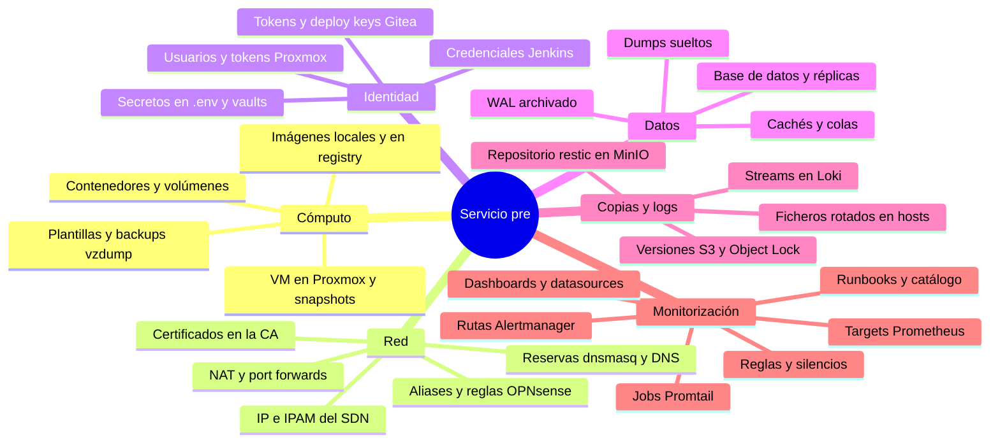
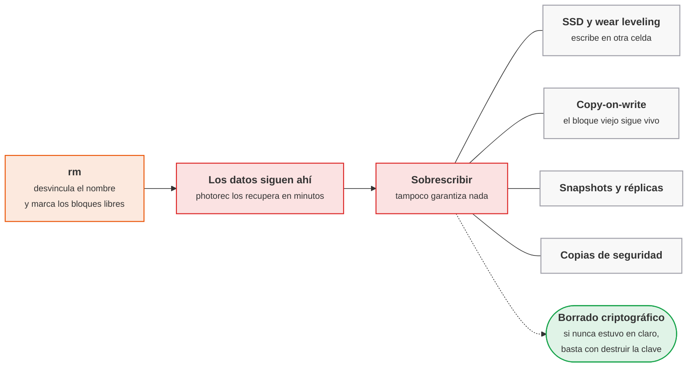

# UT8 · Terminación segura del contenedor

<p class="ut-meta">10 h · Sesiones 35 a 39 · RA5 CE a, b, c, d</p>

Esta es la última unidad en el centro. Durante el curso el servicio se ha levantado, instrumentado, protegido, probado, copiado y actualizado; ahora toca lo contrario: retirarlo sin dejar rastro. Parece la operación más sencilla de todas, porque apagar una máquina cuesta un minuto, y es la que más fácil sale mal: cada unidad anterior dejó algo del servicio fuera de él (una serie en Prometheus, una copia en MinIO, una credencial en Jenkins, una ruta en otra máquina), y nada de eso desaparece al apagar. Una baja bien hecha encuentra cada rastro, decide cuál se conserva y por qué, destruye el resto de forma que no se pueda recuperar y lo demuestra con una evidencia por punto.

El sujeto de la baja es el entorno **pre**, creado con OpenTofu en la UT5 de Despliegue (8 de enero) y estrenado en esta asignatura en la UT7 (11 de febrero) para ensayar actualizaciones. Después del último despliegue, el 26 de febrero, ya no lo usa nadie, y se da de baja de verdad: contenedores e imágenes, VM y redes, rutas desde gestión, credenciales, copias, correo de alertas, datos y toda referencia en la monitorización. Dev sigue vivo al lado, y buena parte del cuidado de la unidad consiste en no llevárselo por delante. Son cinco sesiones, de la 35 a la 39. La práctica evaluable, el acta de baja, no tiene sesión propia: se construye en las cinco hojas y se entrega por Aules antes del examen de la segunda evaluación, el 23 de marzo (sesión 40), que entra UT4, UT7 y UT8. En la formación en empresa se pide exactamente esto cuando un cliente deja de serlo.

## Sesión 35 · Plan de baja

<p class="ut-meta" markdown>25 de febrero · Teoría y práctica · <span class="dur" tabindex="0" aria-label="La baja es un cambio más · 10 min&#10;Inventario de rastros · 15 min&#10;A8.1 Plan de baja · 85 min" data-dur="La baja es un cambio más · 10 min&#10;Inventario de rastros · 15 min&#10;A8.1 Plan de baja · 85 min">:material-school:<i class="dur-barra" style="--teoria:23%"></i>:material-flask:</span></p>

Hasta hoy cada unidad ha añadido algo al servicio. Esta empieza a quitarlo y, sin embargo, su primera sesión no toca nada. Una baja tiene dos errores posibles y los dos salen caros: dejarse algo (y quedan datos personales, credenciales vivas o alarmas que nadie atiende) o llevarse lo que no tocaba (y se pierde lo que la ley obliga a guardar, o un trozo de dev). Ninguno de los dos se evita con cuidado al teclear: se evita decidiendo antes, por escrito, qué se va a hacer, y eso se deja en el **acta de baja**, el documento que recoge quién autorizó la baja, qué se conserva, qué se destruye y con qué evidencia. La teoría va en ese orden: primero, por qué la baja se trata como cualquier otro cambio, con su aprobación y lo que la ley obliga a conservar; después, cómo se encuentra todo lo que pre ha dejado y desde dónde se pregunta a cada sistema; y al final, cómo ese inventario se convierte en la lista de comprobación que guía las cuatro sesiones siguientes. La hoja hace lo mismo con pre: prepara el puesto de administración, inventaría, abre el acta y pide la aprobación.

### La baja es un cambio más

**El problema.** Terminar un contenedor "para siempre" no es `docker stop`. Un servicio deja huella en la infraestructura, en la monitorización, en las copias y en los datos, y cada rastro es un coste o un riesgo: datos personales que siguen existiendo después de que el cliente pidiera su supresión, alarmas HostDown que nadie atiende, una IP reservada que impide reutilizar el rango, un token de Jenkins con permisos sobre un repositorio que ya no existe. Y el error contrario es peor, porque no tiene arreglo: una baja precipitada destruye lo que había que guardar. Por eso la baja se planifica con una lista de comprobación y se documenta como cualquier otro cambio.


<p class="pie" markdown>Cada rastro que se queda es un coste o un riesgo. Por eso la baja se aprueba, se ejecuta y se documenta como cualquier otro cambio.</p>


**De dónde sale tratarla como un cambio.** Cualquier modificación de un sistema en uso puede romperlo, y muchas de las caídas graves empiezan con un cambio que nadie revisó. La gestión de servicios de TI lleva décadas organizando ese riesgo, y el marco más extendido para hacerlo es ITIL, un catálogo de buenas prácticas que nació a finales de los años ochenta en la administración pública británica y que hoy es el vocabulario común de casi cualquier departamento de sistemas. ITIL reparte los cambios en tres tipos según su riesgo:

- **Estándar**: repetitivo, de bajo riesgo y aprobado de antemano, como ampliar el disco de una VM siguiendo un procedimiento ya probado. Se ejecuta sin pedir permiso cada vez.
- **Normal**: pasa por una solicitud (RFC), una evaluación de riesgo, la aprobación de quien tiene autoridad sobre el servicio (en una empresa pequeña, el responsable técnico y el dueño del negocio; en una grande, el CAB, el comité que aprueba los cambios) y una ventana acordada.
- **De emergencia**: el que no puede esperar, como un fallo en producción o una vulnerabilidad que se está explotando. Se aprueba por una vía abreviada y se revisa después.

La baja de un servicio es siempre un **cambio normal**. No es estándar, porque destruye datos y no se repite lo bastante para estar aprobada de antemano, y no es una emergencia, porque se sabe con semanas de antelación. En la práctica eso se traduce en cuatro cosas que tienen que existir antes de tocar nada:

1. **Confirmación escrita** del responsable del servicio con fecha. Un correo vale; una conversación en el pasillo no. Ese correo va al acta. En el laboratorio es la respuesta del profesor a la solicitud en Aules.
2. **Ventana de ejecución.** Aunque el servicio ya no dé tráfico, la baja toca sistemas compartidos (el firewall, Prometheus, la base de datos común). Se hace en horario en que alguien pueda deshacer un error.
3. **Comunicación.** A los usuarios que quedasen (aviso previo de cierre, normalmente con semanas), a los equipos que consumen la monitorización (para que no abran incidencias) y al equipo de soporte.
4. **Lista de lo que se conserva y hasta cuándo.** Esto es lo que más se olvida y lo que más problemas legales da en las dos direcciones: conservar de más incumple el principio de limitación del plazo de conservación, y conservar de menos, una obligación fiscal.

El cuarto punto es el que necesita más explicación, porque no lo decide la técnica sino la ley.

#### Qué hay que conservar por obligación legal

**Por qué lo tiene que saber un técnico.** Decidir qué se conserva no le corresponde al técnico, sino al responsable del servicio, con su asesoría jurídica y con el DPO (el delegado de protección de datos, la persona que supervisa en la organización el cumplimiento de la normativa de datos personales). Pero quien sabe qué datos hay y dónde está cada copia es el técnico, así que tiene que saber qué preguntar y a quién. Esto no es asesoramiento jurídico. En España pesan sobre todo dos normas: el **RGPD**, el reglamento europeo de protección de datos, que se aplica desde mayo de 2018, y la **LOPDGDD**, la ley orgánica española del mismo año que lo adapta. Junto a ellas, las leyes mercantiles y fiscales obligan a guardar ciertos documentos durante años. Los plazos orientativos son estos:

| Tipo de dato | Norma | Plazo habitual |
|---|---|---|
| Facturas y documentación contable | Código de Comercio, art. 30 | 6 años |
| Justificantes con trascendencia tributaria | Ley General Tributaria, art. 66 y siguientes | 4 años, el plazo de prescripción |
| Datos personales de clientes tras el fin de la relación | RGPD art. 5.1.e y 17; LOPDGDD | Bloqueo (art. 32 LOPDGDD) mientras puedan derivarse responsabilidades; después supresión |
| Logs de acceso con IP o usuario | RGPD (son datos personales); ENS (Esquema Nacional de Seguridad) para el sector público | Entre 6 meses y 2 años según finalidad y política; el ENS pide al menos lo que dure el análisis de incidentes |
| Registros de actividades de tratamiento | RGPD art. 30 | Mientras exista el tratamiento, y se actualiza con la baja |

**El bloqueo: guardar sin seguir usando.** El RGPD obliga a suprimir lo que ya no hace falta, y a la vez puede quedar pendiente una reclamación o una inspección en la que esos datos sean la prueba. El artículo 32 de la LOPDGDD resuelve ese choque con el **bloqueo**, que es lo que da sentido a "qué se conserva por si acaso": los datos se dejan de tratar, se aíslan con acceso restringido al responsable y a la autoridad, y solo se destruyen cuando prescriben las responsabilidades. Técnicamente eso es un volcado cifrado en un sitio al que solo llega el DPO o el responsable, con fecha de destrucción apuntada en el acta. Lo que no puede ser es "lo dejamos en el bucket de siempre porque nunca se sabe". En pre, ese volcado es el que guarda la A8.2.

El acta tiene que decir, para cada categoría de datos, una de tres cosas: se destruye ahora (y cómo), se bloquea hasta una fecha (y dónde), o se transfiere a otro servicio que hereda el tratamiento.

### Inventario de rastros

**Por qué hace falta un método.** Antes de borrar hay que saber qué hay. Un servicio de un año deja rastros en sitios que nadie recuerda, y quien mejor conocía el sistema puede haberse ido hace meses. Fiarse de la memoria garantiza olvidar algo, y lo que se olvida en el inventario no se borra nunca, porque ninguna hoja posterior sabrá que existe. El mapa siguiente agrupa los rastros en seis familias; conviene fijarse en que la mitad no están en el servicio sino alrededor de él (red, identidad, copias, monitorización), y esas son las que se olvidan.



<p class="pie" markdown>Seis sitios donde queda rastro de un servicio. El que siempre se olvida es el último: la monitorización sigue vigilando algo que ya no existe.</p>

**Buscar por lo que identifica a pre.** Cada sistema guarda pre a su manera, pero casi siempre con una de tres marcas: la etiqueta `env="pre"` que la A7.4 puso a sus targets en Prometheus y que heredan sus alertas, el dominio `pre.lab` de sus nombres y el rango `10.20.` de sus direcciones. Buscar esas tres cadenas en todos los sitios donde pueden estar escritas encuentra casi todo, incluido lo que nadie apuntó.

**Lo escrito frente a lo que existe.** Lo que dice un fichero de configuración no siempre es lo que existe, y al revés: un recurso creado a mano no está escrito en ningún sitio, y una línea de configuración puede referirse a algo que ya no corre. Por eso, además de buscar en lo escrito, se pregunta a cada sistema por lo que tiene ahora, de la forma que ese sistema admite. La forma no es un capricho de cada herramienta: depende de dónde guarde la información y de si la deja ver en claro. En el laboratorio la lista es más corta que el mapa, pero tiene las mismas trampas:

- **Repositorios.** Lo que está en Git se encuentra con `git grep` de las tres cadenas: `iac-lab`, `operacion` y `entregas-5166` en el puesto de administración, `monitoring` y `alerting` en mon01. Que salga una línea que no estaba prevista es lo normal; se apunta.
- **OpenTofu frente a Proxmox.** `tofu state list` dice lo que la herramienta creó; la API de Proxmox, lo que existe. Comparar las dos listas es lo que descubre lo que se hizo a mano: `router-pre` y las VNets de pre son de la UT2 de Despliegue y no están en ningún estado.
- **Prometheus.** No basta con leer `prometheus.yml`: se pregunta a la API por las series que existen ahora mismo con `env="pre"`. Configuración y estado no siempre coinciden, y lo que sobra puede estar en cualquiera de los dos.
- **Jenkins y el registry.** Las credenciales de Jenkins están cifradas y solo se listan por la API de su carpeta; las etiquetas del registry, por la suya. Cuáles de esas etiquetas llegaron a pre lo dice `docker images` en app01-pre.
- **Red.** Las rutas hacia `10.20.0.0/16` están en tres máquinas de gestión (el puesto, agent01 y mon01), y los nombres de pre los sirve el dnsmasq de `router-pre`, que muere con él. OPNsense no sabe nada de pre, porque gestión llega a pre por la pata que `router-pre` tiene en `devmgmt`, sin cruzar el cortafuegos, y eso también se comprueba.
- **Certificados.** En la CA del curso no hay API que preguntar: el fichero `index.txt` de `~/ca` lista todo lo emitido con su estado (V válido, R revocado, E expirado) y se lee buscando el dominio.
- **Copias, correo y logs.** `restic snapshots --tag pre` en el repositorio del laboratorio, una búsqueda en Mailpit por las direcciones de pre y `logcli series` en Loki.

**Un inventario caduca.** El inventario es una foto del día en que se hace, y si algo cambia antes de ejecutar la baja, se repite la parte afectada. En el curso pasa seguro: la A8.1 inventaría el 25 de febrero, y al día siguiente la A6.8 de Despliegue crea en Jenkins la carpeta de pre, da a agent01 una ruta hacia pre y hace el último despliegue. Por eso la A8.2 empieza repitiendo esa parte.

El inventario se hace así, sistema por sistema, en el paso 3 de la [A8.1](#a81-plan-de-baja-sesion-35), y se lanza entero desde el puesto de administración, por las razones del apartado siguiente. Su resultado es la lista de comprobación de la baja: una fila por rastro, en orden de ejecución, con cómo se verifica que ya no está.

#### El puesto de administración como base de la baja

**Por qué todo se lanza desde el puesto.** La baja entera se ejecuta desde una sola máquina, el puesto de administración (`admin01`, la `10.10.0.50` de gestión), por tres razones. Es la que llega a todo lo que hay que tocar: a pre por su ruta, a mon01, agent01 y db01 por SSH, y a las API de Proxmox, Jenkins, Grafana, el registry y MinIO. No se destruye, así que lo que se guarda en ella sobrevive a la baja: por eso las evidencias van a `~/operacion/baja/pre/ev/`, en la copia de trabajo del repositorio `operacion`, y nunca a una VM de pre, que se llevaría consigo las pruebas de su propia destrucción. Y ya tiene casi todo lo que hace falta: la CA del curso en `~/ca`, la copia de trabajo de `iac-lab` con el entorno pre de OpenTofu y el entorno de restic de la A7.4 en `/etc/restic/`.

**Cada sistema se pregunta por su camino.** Desde el puesto hay cinco formas de llegar, y cada una lleva su credencial:

| Camino | A qué se llega | Con qué credencial |
|---|---|---|
| API por HTTPS | Proxmox, Grafana, Jenkins y el registry | Un token por sistema: el `tofu` de Proxmox (A5.1 de Despliegue), el de una cuenta de servicio de Grafana y un API token de Jenkins; en el registry, su usuario `jenkins` (A6.6) |
| SSH | Las VM de pre, agent01, mon01 y db01 | La clave de `ops` del puesto del aula, que `ssh -A` presta al puesto de administración |
| Túnel SSH | Prometheus, Alertmanager y Mailpit, que desde la UT3 solo escuchan en el `127.0.0.1` de mon01 | La misma clave, en un túnel hacia mon01 |
| Certificado de cliente | Loki, que lo exige desde la UT3 | El certificado `logcli` de `~/tls-monitorizacion/` |
| Cliente de almacenamiento | El repositorio restic y el bucket `backups` de MinIO | La credencial `restic` de MinIO y la contraseña del repositorio |

**Qué es un token y por qué uno propio.** Un token es una contraseña pensada para programas: se crea para un uso concreto, con los permisos justos, y se revoca sin tocar la contraseña de ninguna persona. Por eso la unidad crea en Grafana una cuenta de servicio propia, `baja-pre`, en lugar de usar la de `admin`: tiene los permisos que necesita la baja y no los de administrador, y se puede borrar sin afectar a nadie.

**Un fichero para toda la unidad.** Las cinco hojas se reparten en tres semanas y usan los mismos accesos, así que se preparan una sola vez, en un fichero que se carga al empezar cada sesión con `. ~/baja-pre.env`. Define las variables y las funciones cortas con las que los bloques de esta unidad funcionan tal cual. Lleva secretos, así que va con permisos 600 y fuera de cualquier repositorio. En cada `...` va su secreto, y `192.168.1.50` se cambia por la IP del nodo Proxmox de cada puesto:

```bash
# ~/baja-pre.env · UT8. Se carga con ". ~/baja-pre.env" al empezar cada sesión
export EV=~/operacion/baja/pre/ev             # evidencias: siempre aquí, nunca en una VM que se destruye
export GPG_TTY=$(tty)
export TF_VAR_pve_token='terraform@pve!tofu=...'
export AWS_ACCESS_KEY_ID=tofu AWS_SECRET_ACCESS_KEY='...'
export PVE=https://192.168.1.50:8006/api2/json
pve() { curl -sk -H "Authorization: PVEAPIToken=$TF_VAR_pve_token" "$PVE$1"; }
# Prometheus, Alertmanager y Mailpit solo escuchan en el 127.0.0.1 de mon01: se llega por túnel
tunel() { ssh -fN -L 9090:127.0.0.1:9090 -L 9093:127.0.0.1:9093 -L 8025:127.0.0.1:8025 ops@10.10.0.20; }
export P=http://localhost:9090 MP=http://localhost:8025/api/v1
amt() { ssh ops@10.10.0.20 docker compose -f /opt/monitoring/compose.yml exec -T alertmanager amtool --alertmanager.url=http://localhost:9093 "$@"; }
export G=https://grafana.lab GRAFANA_TOKEN='...'
export LOKI_ADDR=https://10.10.0.20:3100      # Loki pide el certificado de cliente de la UT3
export LOKI_CLIENT_CERT_PATH=~/tls-monitorizacion/logcli.crt LOKI_CLIENT_KEY_PATH=~/tls-monitorizacion/logcli.key
export J=https://jenkins.lab JENKINS_TOKEN='...'
export R=https://registry.lab:5000/v2/app REG_USER=jenkins REG_PASS='...'
rst() { ( set -a; . /etc/restic/env; set +a; exec restic "$@" ); }   # restic con el entorno de la A7.4
```

Las líneas que no se explican solas:

- `EV` es la carpeta de evidencias: dentro de `operacion`, que se sube a Gitea, y nunca en una máquina que se va a destruir.
- `GPG_TTY` le dice a `gpg` en qué terminal pedir la frase de paso; sin ella, el cifrado del volcado de la A8.2 falla.
- `TF_VAR_pve_token` y las dos variables `AWS_*` son el token de Proxmox y la credencial `tofu` de MinIO, que OpenTofu necesita para leer el estado de pre y para destruirlo. `pve` aprovecha el mismo token para preguntar a la API de Proxmox.
- `tunel` abre en segundo plano los tres túneles hacia mon01. Con él abierto, Prometheus, Alertmanager y Mailpit responden en el `localhost` del puesto, que es adonde apuntan `P` y `MP`.
- `amt` ejecuta `amtool` dentro del contenedor de Alertmanager de mon01, que ya lo trae, así que no hay que instalarlo en el puesto.
- Las tres `LOKI_*` son las que lee `logcli`: la dirección de Loki y el certificado de cliente con su clave.
- `rst` lanza restic con el entorno de la A7.4 cargado en una subshell, de modo que sus secretos no se quedan en el entorno de la sesión.

#### Lista de comprobación completa

**Del inventario a la lista.** El inventario dice qué hay; la lista de comprobación dice en qué orden se quita y cómo se demuestra que ya no está. Esta es la lista para pre, en el orden en que se ejecuta y con la hoja que se encarga de cada punto. Ese orden no es el de las familias del mapa, sino el que justifica [El orden importa](#el-orden-importa), en la sesión 36: primero lo que protege (la aprobación, el silencio, el volcado), después lo que destruye, y al final lo que confirma que no queda nada (el silencio expirado sin alertas y el acta cerrada). Cada línea lleva el comando de verificación, porque una casilla marcada sin evidencia no vale nada en un acta; `amt`, `pve` y `rst` son las funciones del [fichero de la unidad](#el-puesto-de-administracion-como-base-de-la-baja).

- [ ] Aprobación escrita archivada: `ev/01-aprobacion.txt` con la respuesta del profesor (A8.1)
- [ ] Silencio en Alertmanager para `env="pre"`, más largo que la ventana: `amt silence query env=pre` (A8.2)
- [ ] Volcado de bloqueo cifrado, comprobado y entregado al DPO: `pg_restore -l` y `sha256sum` (A8.2)
- [ ] Dashboards de pre exportados a Git, si los hay: `git -C ~/operacion log -1 -- dashboards/pre/` (A8.2)
- [ ] Job de despliegue a pre deshabilitado: la API de Jenkins lo da en `disabled` (A8.2)
- [ ] Servicio parado y app01-pre sin contenedores, volúmenes, imágenes ni redes propias: `docker ps -a`, `docker volume ls`, `docker images` vacíos (A8.2)
- [ ] `prevent_destroy` retirado en una rama de `iac-lab` que cita la aprobación: `git log -1` de la rama `baja-pre` (A8.3)
- [ ] VM de pre destruidas con OpenTofu: `tofu state list` vacío (A8.3)
- [ ] `router-pre` y VNets de pre destruidos: `pve` no lista nada de la franja 200 ni VNets `pre*`; `ping 10.10.0.2` sin respuesta (A8.3)
- [ ] Rutas a pre retiradas en el puesto, agent01 y mon01: `ip route show 10.20.0.0/16` vacío; `dig +short app01.pre.lab @10.10.0.1` vacío (A8.3)
- [ ] Carpeta `servicio/pre` y credencial `ssh-pre` borradas en Jenkins, con el historial de despliegues guardado: la carpeta responde 404 (A8.3)
- [ ] Ningún certificado de pre en la CA, o revocados con su CRL: `grep -i 'pre\.lab' ~/ca/index.txt` (A8.3)
- [ ] Copias de pre fuera del repositorio restic: `restic snapshots --tag pre` vacío y `restic check` sin errores (A8.4)
- [ ] Bucket sin versiones antiguas de lo borrado: `mc version info lab/backups` (A8.4)
- [ ] Etiquetas desplegadas en pre borradas del registry por digest: `tags/list` sin ellas; recolector de basura ejecutado o pendiente con fecha (A8.4)
- [ ] Correo de alertas de pre borrado de Mailpit sin tocar el resto: la búsqueda da 0 (A8.4)
- [ ] Loki sin streams de pre: `logcli series '{host=~".+-pre"}'` vacío (A8.4)
- [ ] Datos del tenant pre (el cliente de prueba de la A8.5) anonimizados y tablas borradas con `VACUUM FULL`: la consulta de control da 0 (A8.5)
- [ ] Réplicas y volcados sueltos revisados en db01 (A8.5)
- [ ] Targets de pre retirados: `count(up{env="pre"})` vacío (A8.5)
- [ ] Reglas, rutas y dashboards sin referencias a pre: `git grep` y búsquedas por API vacías (A8.5)
- [ ] Silencio expirado y sin alertas: `amt alert query env=pre` vacío (A8.5)
- [ ] Series de pre fuera del TSDB, el almacén en disco de Prometheus: por retención, como pendiente con fecha, o con `delete_series` (A8.5)
- [ ] Acta completa, sin filas sin evidencia ni pendientes sin fecha (A8.5)

### A8.1 Plan de baja (sesión 35)

<span class="et et-obj">Objetivo</span> El puesto de administración preparado para las cinco hojas de la unidad (variables, túnel a la pila y herramientas) y `operacion/baja/pre/acta.md` abierta con el inventario real de pre y la lista de comprobación, con un comando de verificación por punto. Es la hoja de la que depende todo lo demás: lo que no salga hoy en el inventario no lo borrará ninguna otra, y sin la aprobación que pides al final no se toca nada de pre.

<span class="et et-pre">Antes de empezar</span>

- Entra en el puesto de administración con `ssh -A ops@<IP de aula de admin01>`: el `-A` le presta tu clave para llegar a mon01, agent01, db01 y las VM de pre.
- Enciende lo que usa la hoja: `jenkins01`, `router-pre`, `app01-pre` y `db01-pre`. Para que quepa en la memoria, apaga `web01` y `db01` de dev, como indica el [presupuesto de memoria](https://victor-educ.github.io/apuntes-5166/laboratorio/#presupuesto-de-memoria) de Despliegue.
- A mano, en el gestor de contraseñas del puesto: el token `tofu` de Proxmox (A5.1 de Despliegue), los secretos de las credenciales `tofu` y `restic` de MinIO (A5.2), la contraseña del usuario del registry (A6.6) y la de `admin` en Jenkins. En el puesto, `~/iac-lab/envs/pre` con su backend inicializado (A5.4) y el entorno de restic de la A7.4 en `/etc/restic/`.
- Lo explicado antes: [la baja como cambio](#la-baja-es-un-cambio-mas), [el inventario de rastros](#inventario-de-rastros), [el puesto como base de la baja](#el-puesto-de-administracion-como-base-de-la-baja) y la [lista de comprobación completa](#lista-de-comprobacion-completa). La plantilla del acta está en la [práctica evaluable](#acta-de-baja).

<span class="et et-pas">Pasos</span>

Hoy no borras nada. Primero preparas el puesto, porque el inventario se hace con esas herramientas y las cuatro hojas siguientes también; después inventarías pre sistema por sistema; con el inventario delante escribes la lista de comprobación del acta; y al final decides qué se conserva y pides la aprobación, que es lo que abre la puerta a la A8.2.

1. **Prepara el fichero de la unidad.** Crea `~/baja-pre.env` a partir del que está en [El puesto de administración como base de la baja](#el-puesto-de-administracion-como-base-de-la-baja), con cada `...` cambiado por su secreto y la IP del nodo por la tuya. Los bloques de las cinco hojas cuentan con esos nombres de variables y funciones, así que no los cambies. Lo cargarás al empezar cada sesión de la unidad; lleva secretos, así que va con permisos 600 y fuera de cualquier repositorio.

2. **Completa el puesto y prueba cada acceso.** Faltan cuatro piezas: la CA del curso en el almacén del sistema, para que `curl` y `logcli` confíen en los servicios del laboratorio sin repetir `--cacert`; `jq`, para leer las respuestas de las API; el cliente `mc` de MinIO con el alias `lab` y la credencial `restic`; y los dos tokens que el fichero deja en blanco, el de una cuenta de servicio `baja-pre` con rol Editor en Grafana y un API token de `admin` en Jenkins. Con el fichero cargado y el túnel abierto, comprueba que responden Prometheus, `amt`, Grafana, Jenkins, `logcli`, `rst` y `pve`. Lo que falle se arregla hoy: las hojas siguientes lo dan por hecho, y un acceso que se rompe a mitad de la baja deja el entorno a medio destruir.

    *Pista:* `mc` no es un paquete de Debian sino un binario de `dl.min.io`, y el alias apunta a `http://10.10.0.30:9000`. Las cuentas de servicio de Grafana están en Administration → Users and access, y el token de Jenkins, en tu usuario → Security.

3. **Inventaría pre sistema por sistema.** Recorre los sistemas de [Inventario de rastros](#inventario-de-rastros), más los dashboards de Grafana con la etiqueta `pre`, y deja lo que encuentres en `$EV/00-inventario.txt`, con una sección por sistema. Lo que tiene API o vive en el puesto se pregunta desde el puesto; lo demás, por SSH: app01-pre (`10.20.2.10`), agent01 (`10.10.0.12`) y mon01 (`10.10.0.20`). Busca con las tres cadenas del apartado y pregunta a cada sistema por lo que existe, no solo por lo que dice su configuración: lo que salga aquí es lo único que se va a borrar. La carpeta `servicio/pre` de Jenkins nace mañana, en la A6.8 de Despliegue: hoy su sección sale con error, y la A8.2 la repite.

    *Pista:* las rutas que no se adivinan son `/cluster/resources?type=vm` y `/cluster/sdn/vnets` en Proxmox, `<carpeta>/credentials/store/folder/domain/_/api/json?depth=1` en Jenkins y `/search?query=10.20.` en Mailpit. `logcli series` sin `--since` solo mira la última hora.

4. **Convierte el inventario en la lista del acta.** Copia la [plantilla](#acta-de-baja) en `~/operacion/baja/pre/acta.md` y rellena la identificación. Después escribe la lista de comprobación a partir de la [lista completa](#lista-de-comprobacion-completa): una fila por rastro del inventario, en el mismo orden, con su verificación y la hoja que la ejecuta, y las columnas de resultado y evidencia vacías, que irán llenando las hojas siguientes. Una fila sin verificación es una casilla que nadie podrá demostrar.

    *Pista:* lo que lista Proxmox y no está en el estado de OpenTofu (`router-pre` y las VNets) se destruye a mano y lleva sus propias filas. Lo que no esperabas va a "Incidencias durante la baja".

5. **Decide qué se conserva y pide la aprobación.** Rellena "Qué se conserva" con motivo, dónde y hasta cuándo: el volcado de bloqueo, el repositorio `servicio` con su webhook y su Multibranch (dev los sigue usando), el token de OpenTofu, el repositorio restic (guarda más copias que las de pre) y el historial de despliegues de Jenkins. Es la parte del acta que protege de borrar de más. Haz commit del acta y de `ev/00-inventario.txt` y pide la aprobación con el enlace del commit en la tarea de la A8.1 en Aules, para que quien aprueba lea exactamente lo que se va a hacer. La respuesta del profesor, con su fecha, va a `ev/01-aprobacion.txt` antes del 9 de marzo: sin ella la A8.2 no empieza.

<span class="et et-com">Comprobación</span> `tunel` y las siete comprobaciones del paso 2 responden; `ev/00-inventario.txt` tiene todas sus secciones, con tres VM de pre en el estado de OpenTofu y cuatro en la franja 200 de Proxmox; la lista del acta empieza por la aprobación y el silencio y termina con la expiración del silencio y el cierre del acta; ninguna fila sin verificación.

<span class="et et-ent">Entrega</span> `acta.md` y `ev/00-inventario.txt` en un commit del repositorio `operacion`, y la solicitud de aprobación en Aules.

<span class="et et-ext">Si te sobra tiempo</span> Redacta en la identificación del acta la comunicación de la baja: el aviso a los usuarios, a soporte y a la guardia, con la fecha de cada uno.

## Sesión 36 · Liberar la infraestructura: servicio y contenedores

<p class="ut-meta" markdown>9 de marzo · Teoría y práctica · <span class="dur" tabindex="0" aria-label="El orden importa · 10 min&#10;Cómo se libera cada capa dentro de la VM · 15 min&#10;A8.2 Liberar el servicio y los contenedores · 85 min" data-dur="El orden importa · 10 min&#10;Cómo se libera cada capa dentro de la VM · 15 min&#10;A8.2 Liberar el servicio y los contenedores · 85 min">:material-school:<i class="dur-barra" style="--teoria:23%"></i>:material-flask:</span></p>

Con la aprobación en `ev/01-aprobacion.txt` empieza la ejecución, y lo primero que hay que decidir no es cómo se borra cada cosa sino en qué orden: casi todos los errores graves de una baja son de orden (parar antes de silenciar, borrar antes de guardar, destruir antes de exportar las pruebas). Por eso la teoría empieza por la secuencia completa de la baja y por qué cada paso va antes que el siguiente, y solo después baja a lo de hoy, que es la primera mitad de la infraestructura: lo que vive dentro de las máquinas. Ahí se ve qué libera `docker compose down` y qué deja, y cómo se saca antes el volcado de bloqueo, la copia de los datos de pre que sobrevivirá a todo lo demás. La hoja recorre exactamente ese orden: pone al día el inventario, silencia, guarda, corta el despliegue, para y libera. Al terminar, las VM de pre siguen en pie a propósito: son el trabajo de la sesión siguiente, y mientras existan la baja todavía tiene vuelta atrás. Los bloques de comandos de la teoría son los que copia la hoja.

### El orden importa

**Por qué el orden decide.** Hay una secuencia correcta y no es "borrar de arriba abajo". Si el servicio se para antes de silenciar las alarmas, Alertmanager abre incidencias, el receptor webhook crea tickets y el equipo de guardia recibe un aviso a las diez de la noche por un servicio que se sabía que iba a apagarse. Si los volúmenes se borran antes de haber verificado que la copia bloqueada existe y se puede restaurar, ya no hay vuelta atrás. Si la VM se destruye antes de exportar las evidencias que están dentro (logs de auditoría, por ejemplo), el acta se queda sin pruebas. El silencio es el de la [UT2](ut2-alarmas.md#silencios): una inhibición temporal, creada a mano, de las alertas que cumplen unas etiquetas, con un comentario que dice por qué.


<p class="pie" markdown>El **periodo de gracia** es el último momento reversible: una vez pasado, lo que viene debajo ya no se puede deshacer. De ahí que se extraiga antes lo que se conserva.</p>

**El periodo de gracia.** El paso E es opcional pero muy recomendable: el servicio está parado, nada se ha destruido, y si alguien grita ("el informe mensual tiraba de esa API") se levanta en un minuto. En una empresa una semana es lo habitual. En el laboratorio va del 9 al 11 de marzo: el servicio está parado y app01-pre vacía, pero db01-pre sigue intacta y la imagen sigue en el registry, así que volver atrás es habilitar el job de despliegue de pre y relanzarlo. Lo irreversible empieza el 11, con `tofu destroy`, y desde ese momento la única vuelta atrás es la copia bloqueada.

**Cortar lo que lo puede volver a levantar.** Parar el servicio sirve de poco si algo automático lo puede arrancar otra vez. En el curso ese algo es el pipeline de Despliegue: su etapa `Deploy` lanza el job `despliegue` de la carpeta `servicio/pre` de Jenkins, y un lanzamiento con `RUN_DEPLOY` marcado volvería a llevar la imagen a app01-pre. Por eso ese job se deshabilita antes de parar el servicio. Deshabilitar no es borrar: el job y su historial siguen ahí, y durante el periodo de gracia volver atrás es habilitarlo y relanzarlo. Se borra con la carpeta en la sesión siguiente.

**Los silencios, al final.** Los silencios se quitan al final, no antes, y con criterio: si el silencio se retira con los targets todavía configurados, salta todo. Primero se retiran los targets y las reglas, se comprueba que no hay alertas pendientes, y entonces se expira el silencio. La [lista de comprobación completa](#lista-de-comprobacion-completa) de la sesión 35 sigue exactamente este orden.

### Cómo se libera cada capa dentro de la VM

**Por qué Docker no lo borra todo de una vez.** En esta primera mitad se devuelve lo que el entorno pre tenía asignado dentro de app01-pre, y Docker lo reparte en cuatro recursos con vidas distintas: los contenedores (el proceso y su capa de escritura, que se recrean en cada despliegue), los volúmenes (los datos que tienen que sobrevivir a esa recreación), las imágenes (las capas de solo lectura de las que salen los contenedores) y las redes. La separación es deliberada: un `down` seguido de un `up` tiene que poder hacerse sin perder datos, y por eso las órdenes normales se llevan los contenedores y dejan los volúmenes. En una baja hay que pedir cada cosa expresamente, y antes de nada se extrae lo que se conserva. Cada recurso tiene un comando para liberarlo y otro para comprobar que ya no está, y ese segundo es el que va al acta.

| Recurso | Cómo se libera | Cómo se verifica |
|---|---|---|
| Contenedores | `docker compose down` | `docker ps -a` vacío |
| Volúmenes | `docker compose down -v`; `docker volume rm` | `docker volume ls` vacío |
| Imágenes | `docker compose down --rmi all`; `docker image prune -a` en un host dedicado | `docker images` vacío; las del registry, en la sesión 38 |
| Redes | `docker compose down`; `docker network rm` | `docker network ls` sin redes propias |

#### Docker en app01-pre

**Qué se lleva cada opción.** En app01-pre el servicio es el compose de `/opt/servicio`, proyecto `servicio`, con un solo servicio, `app`: la base de datos de pre vive en db01-pre como paquete de Debian, no en un contenedor. `docker compose down` para y elimina contenedores y redes del proyecto, pero deja los volúmenes con nombre y las imágenes. Con `-v` elimina también los volúmenes declarados en el fichero y los anónimos; con `--rmi all`, las imágenes que usaba el proyecto. Es la forma limpia de terminar un despliegue de Compose porque usa las etiquetas `com.docker.compose.project` para saber qué es suyo y no toca otros proyectos del mismo host:

```bash
docker compose -f /opt/servicio/compose.yml down -v --rmi all --remove-orphans
docker ps -aq; docker volume ls -q; docker images -q          # vacíos
```

**Lo que `down` no ve.** `--remove-orphans` limpia contenedores del proyecto que ya no aparecen en el fichero. Lo que `down -v` no ve son los volúmenes creados a mano con `docker volume create` y montados como `external: true`: se borran con `docker volume rm`, después de mirar quién más los usa con `docker ps -a --filter volume=<nombre>`.

**`prune`, solo en un host dedicado.** `docker image prune -a` borra todas las imágenes sin contenedor del host entero, no solo las del proyecto, y `docker system prune -af --volumes` además contenedores parados, redes sin usar, caché de build y volúmenes anónimos. En app01-pre, donde solo vive este servicio y que se destruye dos días después, es aceptable, y además necesario: `--rmi all` solo se lleva las imágenes que usa el compose actual, y en app01-pre quedan las de despliegues anteriores, con otras etiquetas, que solo el `prune` encuentra. En un host compartido no se ejecuta nunca, y se borra imagen por imagen con `docker image rm`.

**Un volumen borrado no es un dato borrado.** Un volumen borrado es un `rm -rf` de `/var/lib/docker/volumes/<nombre>/_data`: los bloques siguen en el disco de la VM hasta que el disco se destruye, y el porqué está en la [sesión 38](#por-que-borrar-no-borra).

#### El volcado de bloqueo

**Qué se guarda, y por qué antes que nada.** Lo que se conserva sale antes de destruir nada. Para pre es un volcado completo de su base de datos que queda bloqueado en el sentido del artículo 32 de la LOPDGDD, el de [Qué hay que conservar por obligación legal](#que-hay-que-conservar-por-obligacion-legal): solo lo abre el DPO y tiene fecha de destrucción en el acta. Cuando la A8.3 destruya db01-pre y la A8.4 borre las copias de restic, será la única copia que quede de esos datos.

**Cómo se saca sin dejar copias en claro.** Se pide desde el puesto de administración, de modo que el volcado viaja por SSH y se cifra al llegar, sin tocar ningún disco sin cifrar:

```bash
ssh ops@10.20.3.10 'sudo -u postgres pg_dump -Fc servicio' | gpg -c --cipher-algo AES256 -o ~/pre-bloqueo.dump.gpg
gpg -d ~/pre-bloqueo.dump.gpg | pg_restore -l | head -5     # el índice del volcado: no está vacío
sha256sum ~/pre-bloqueo.dump.gpg                             # la huella que va al acta
```

**Qué demuestra cada línea.** `-Fc` es el formato propio de `pg_dump`, comprimido, que `pg_restore -l` sabe listar: esa lista es la prueba de que el volcado se puede restaurar, y sin ella no se destruye nada. La huella de `sha256sum` va al acta para que, mientras dure el bloqueo, se pueda comprobar que el fichero que guarda el DPO es el mismo que se verificó ese día.

**Por qué cifrado, y cómo.** El volcado sale del sistema con datos personales dentro, y cifrarlo es lo que hace que no se pueda leer sin la clave, esté donde esté. Lo cifra `gpg` (GnuPG, la implementación libre del estándar de cifrado OpenPGP). `gpg -c` cifra con una frase de paso y no con la clave pública de nadie: en el laboratorio el DPO es el profesor, que recibe el fichero por un lado y la frase de paso por otro, de modo que quien intercepte uno de los dos no tiene nada. En una empresa se cifra para la clave del DPO (`gpg -e -r <su clave>`) y la frase no viaja. Si `gpg` falla con `Inappropriate ioctl for device`, no sabe en qué terminal pedir la frase: le falta `GPG_TTY`, que carga el fichero de la A8.1.

### A8.2 Liberar el servicio y los contenedores (sesión 36)

<span class="et et-obj">Objetivo</span> pre silenciado, con el volcado de bloqueo guardado y comprobado, el despliegue a pre deshabilitado y app01-pre sin contenedores, volúmenes, imágenes ni redes del servicio, cada verificación en `$EV` y apuntada en el acta. Es la mitad reversible de la baja: al terminar, el servicio ya no existe, pero lo necesario para levantarlo de nuevo sigue en su sitio hasta el 11 de marzo.

<span class="et et-pre">Antes de empezar</span>

- Entra en el puesto de administración con `ssh -A`, carga `. ~/baja-pre.env` y abre el túnel con `tunel`.
- Enciende lo mismo que en la A8.1: `jenkins01`, `router-pre`, `app01-pre` y `db01-pre`, con `web01` y `db01` de dev apagadas.
- La aprobación del profesor en `ev/01-aprobacion.txt`. Sin ella no se toca nada.
- La A6.8 de Despliegue (26 de febrero) fue el último despliegue en pre, y su práctica evaluable de mañana no despliega.
- Lo explicado antes: [el orden de la baja](#el-orden-importa) y [cómo se libera cada capa dentro de la VM](#como-se-libera-cada-capa-dentro-de-la-vm), cuyos bloques se copian aquí.

<span class="et et-pas">Pasos</span>

Sigues el orden de [El orden importa](#el-orden-importa) al pie de la letra, porque cada paso protege al siguiente: primero pones al día el inventario, que caducó con la A6.8; después callas las alarmas, para que lo que viene no despierte a nadie; guardas lo que se conserva mientras todavía hay de dónde sacarlo; cortas el despliegue, para que nada vuelva a levantar pre; y solo entonces paras y liberas. El último paso deja escrito en el acta lo que ha pasado hoy.

1. **Pon al día el inventario.** El de la A8.1 es del 25 de febrero, y al día siguiente la A6.8 de Despliegue creó la carpeta `servicio/pre` en Jenkins, dio a agent01 una ruta hacia pre y desplegó en app01-pre. Repite esa parte en `$EV/00b-inventario.txt`: los jobs y las credenciales de la carpeta, lo que corre en app01-pre con sus etiquetas de imagen y la ruta a pre de agent01. Añade al acta las filas que falten.

    *Pista:* las etiquetas `app:<commit>` de app01-pre son las que llegaron a pre, y este fichero es lo único que las recordará cuando la A8.4 vaya a borrarlas del registry.

2. **Silencia pre antes de tocar nada.** Desde hoy pre va a desaparecer a trozos, y en cuanto sus VM dejen de contestar `HostDown` saltaría por cada una. Crea un silencio con el matcher `env=pre`, autor `ops` y una duración que pase del 18 de marzo, que es cuando lo retira la A8.5, y guárdalo en `$EV/02-silencio.txt`.

3. **Guarda lo que se conserva mientras todavía existe.** Saca el volcado de bloqueo de db01-pre (`10.20.3.10`) con el bloque de [El volcado de bloqueo](#el-volcado-de-bloqueo) y deja su índice y su huella en `$EV/03-dump-bloqueo.txt`: el índice demuestra que se puede restaurar, y la huella, que el fichero que entregas es ese. Si el inventario encontró dashboards de pre, exporta su JSON a `~/operacion/dashboards/pre/`, porque un dashboard bien hecho sirve para el siguiente servicio. El `.gpg` va a la tarea de la A8.2 en Aules y la frase de paso, al profesor en un mensaje aparte; ninguno de los dos va al repositorio. Hazlo bien: desde el 11 de marzo, la única copia al día de los datos de pre es esta.

    *Pista:* `pg_restore` viene en `postgresql-client`, que no suele estar en el puesto.

4. **Corta el camino que podría volver a levantar pre.** Deshabilita el job `despliegue` de `servicio/pre` en Jenkins, para que ningún lanzamiento del pipeline vuelva a desplegar mientras dura la baja, y guarda en `$EV/04-jenkins.txt` que la API lo da en `disabled`. Deshabilitar, no borrar: durante el periodo de gracia es tu vuelta atrás. El Multibranch `ci` no se toca: sigue construyendo.

    *Pista:* un job se deshabilita con un POST a su URL terminada en `/disable`, y su estado es el campo `color` de su `api/json`.

5. **Para el servicio y libera lo que `down` deja.** Para el servicio y comprueba desde el puesto que la API (`http://10.20.2.10:8080/health`) ya no responde: es la prueba de que ha terminado, vista como la vería un cliente. Después libera volúmenes, imágenes y redes como en [Docker en app01-pre](#docker-en-app01-pre), incluido el `prune` que ese apartado solo admite en un host dedicado, y deja en `$EV/05-docker.txt` la API sin respuesta y las cuatro listas vacías.

    *Pista:* el `prune` solo vale en app01-pre, que no aloja nada más; en app01 de dev se llevaría los volúmenes del servicio. Las redes propias se listan con `docker network ls --filter type=custom`.

6. **Cierra la mitad de hoy en el acta.** Apunta el resultado y la evidencia de cada fila ejecutada (`ev/00b` y `ev/02` a `ev/05`), el volcado de bloqueo con su huella en "Qué se conserva" y cualquier desviación en "Incidencias". Haz commit en `operacion`, con los dashboards de pre si los había. El acta cuenta hoy lo que ha pasado hoy: dentro de dos semanas nadie recordará en qué orden se hizo.

<span class="et et-com">Comprobación</span> `ev/02-silencio.txt` con el silencio activo y su fin después del 18 de marzo; `ev/03-dump-bloqueo.txt` con el índice del volcado y su huella; el job de despliegue en `disabled`; en `ev/05-docker.txt`, la API sin respuesta y las cuatro listas vacías. Las VM de pre siguen en pie: al acabar hoy, eso es lo correcto.

<span class="et et-ent">Entrega</span> Commit en `operacion` con el acta al día y las evidencias `ev/00b` y `ev/02` a `ev/05`; el `pre-bloqueo.dump.gpg` en Aules y su frase de paso aparte.

## Sesión 37 · Liberar la infraestructura: VM, red y credenciales

<p class="ut-meta" markdown>11 de marzo · Teoría y práctica · <span class="dur" tabindex="0" aria-label="Destruir lo declarado no basta · 10 min&#10;Cómo se libera cada capa fuera de la VM · 20 min&#10;A8.3 Liberar la VM, la red y las credenciales · 80 min" data-dur="Destruir lo declarado no basta · 10 min&#10;Cómo se libera cada capa fuera de la VM · 20 min&#10;A8.3 Liberar la VM, la red y las credenciales · 80 min">:material-school:<i class="dur-barra" style="--teoria:27%"></i>:material-flask:</span></p>

El periodo de gracia termina hoy. Hasta ahora la baja se podía deshacer, porque el servicio estaba parado pero las máquinas, la base de datos y la imagen seguían ahí; esta sesión destruye lo que queda fuera de los contenedores, y desde que termine la única vuelta atrás es el volcado de bloqueo. Al acabar no existen las VM de pre, ni `router-pre`, ni sus VNets; ninguna máquina de gestión tiene ruta hacia pre; Jenkins ya no tiene carpeta ni credencial de pre; y está comprobado que la CA no firmó nada para pre. Con infraestructura como código parece que bastaría una orden, `tofu destroy`, y la teoría empieza precisamente por lo que esa orden no hace: no conoce lo que se creó a mano, puede llevarse lo compartido y está bloqueada a propósito. De ahí sale lo demás: cómo se libera cada capa fuera de la máquina y por qué aquí cada comprobación se hace desde fuera, preguntando al sistema que tenía el recurso y no a la herramienta que lo borró. Ese segundo apartado es el más largo de la unidad, y de él sale entero el procedimiento de la hoja: en el laboratorio los bloques se copian de ahí tal cual.

### Destruir lo declarado no basta

**El problema.** Con infraestructura como código, dar de baja un entorno parece trivial: el código describe pre, y `tofu destroy` deshace lo que el código describe. Para ver dónde falla hay que recordar cómo decide qué borrar. OpenTofu no le pregunta a Proxmox qué existe: lee su **estado**, el fichero en el que apunta cada recurso que ha creado con su identificador real (que `vm["web01"]` es la VM 210, por ejemplo), y que en el laboratorio vive en el bucket `tfstate` de MinIO desde la A5.4 de Despliegue; está explicado en [El estado a fondo](https://victor-educ.github.io/apuntes-5166/ut/ut5-iac/#el-estado-a-fondo). Así que `tofu destroy` deshace lo que el estado dice que se creó, ni más ni menos, y en esa frase caben cuatro trampas que aparecen en la hoja de esta sesión.

**Lo que se creó a mano no está en el estado.** `router-pre` y las cuatro VNets de pre se crearon a mano en la UT2 de Despliegue, dos meses antes de que existiera el código, y sobreviven intactos a `tofu destroy`; lo mismo la pata de `router-pre` en gestión y las rutas que la usan. Por eso el inventario de la A8.1 comparó el estado con lo que lista Proxmox, y por eso la verificación se hace contra el sistema y nunca contra el plan.

**Y lo que está en el estado no siempre es de pre.** El caso contrario destruye de más: si un recurso compartido (una red, un usuario de API) entró en el estado de este entorno, `tofu destroy` se lo lleva, y con él el entorno que lo compartía. `tofu plan -destroy` es el único sitio donde eso se ve antes de que pase, y `tofu state rm` saca el recurso del estado sin tocarlo en el hipervisor.

**`prevent_destroy` para el plan, y hace bien.** Las VM de pre llevan `lifecycle { prevent_destroy = true }` desde la A5.3 de Despliegue, puesto para que ningún plan, por error o a propósito, destruyera pre mientras otra asignatura dependía de él. Por eso `tofu plan -destroy` falla con `Instance cannot be destroyed` en lugar de destruir. La protección no se salta: se retira en una rama de `iac-lab` que cita la aprobación del acta, se destruye desde esa rama y la rama no se fusiona. `main` sigue protegiendo, y la rama queda como prueba de quién levantó la protección, cuándo y con qué permiso.

**Revocar una credencial no es lo mismo que borrarla.** Un certificado borrado del servidor sigue siendo válido hasta su fecha de caducidad para cualquiera que conserve una copia de la clave privada; lo único que lo invalida es revocarlo y publicar la CRL. Con un token pasa al revés: muere en cuanto se borra del sistema que lo emitió, pero las copias que viajaron (un `.env` en un portátil, un workspace de Jenkins) no se borran solas y hay que pedir su destrucción por escrito. En el acta se anotan por separado las dos cosas: qué se revocó y a quién se le pidió destruir qué.


<p class="pie" markdown>`tofu destroy` solo deshace lo declarado, y solo cuando se levanta `prevent_destroy`. Lo creado a mano se deshace a mano, lo **compartido** se saca antes del estado, y la prueba de que algo ya no existe es siempre una pregunta desde fuera.</p>

### Cómo se libera cada capa fuera de la VM

**Por qué aquí se comprueba desde fuera.** La segunda mitad devuelve lo que el entorno tenía asignado fuera de las máquinas: las propias VM, el router y sus redes, las rutas que llevaban a él, los certificados y las credenciales. Dentro de una máquina bastaba con que un listado saliera vacío; aquí la máquina deja de existir y ya no se le puede preguntar, y la herramienta que borra no es buen testigo de su propio trabajo (`tofu state list` vacío solo dice que OpenTofu ya no recuerda nada). Por eso, de los dos comandos de cada recurso, el que lo libera y el que comprueba que ya no está, el segundo se lanza desde fuera del recurso: la API del hipervisor no lista la VM, el `ping` no contesta, la tabla de rutas no tiene la entrada. La tabla resume el qué; el cómo y el por qué van debajo, por subapartados.

| Recurso | Cómo se libera | Cómo se verifica |
|---|---|---|
| VM declaradas | `tofu destroy` del entorno, tras retirar `prevent_destroy` | `tofu state list` vacío; Proxmox sin las VM |
| VM y redes creadas a mano | `qm destroy --purge`; `pvesh delete` de subredes y VNets | la API de Proxmox no las lista |
| Rutas y DNS | quitar la ruta y su unidad de systemd; el DNS de pre muere con su router | `ip route show` vacío; `ping` y `dig` sin respuesta |
| Reglas de firewall | quitar reglas y después aliases | matriz de reglas actualizada; escaneo desde fuera |
| Certificados | revocar en la CA y publicar la CRL | `index.txt` con `R`; `openssl verify -crl_check` |
| Credenciales | borrarlas en el sistema que las emitió | el listado por API ya no las tiene |
| Pipeline y repositorio | nada, si el servicio sigue en otros entornos | el pipeline sigue construyendo |

#### OpenTofu: la rama, el plan y el estado

**Rama, plan y destrucción, en ese orden.** El entorno pre nació con `tofu apply` en `envs/pre` de `iac-lab`, así que muere con `tofu destroy` desde el mismo directorio. Primero se retira la protección en una rama, y después se mira el plan antes de aplicarlo: `tofu plan -destroy` muestra todo lo que va a desaparecer, y es donde se descubre si el estado incluye algo compartido. El plan se guarda en un fichero (`-out`) y se aplica ese fichero, no uno nuevo: así se destruye exactamente lo que se ha leído.

```bash
cd ~/iac-lab && git switch -c baja-pre
# borrar el bloque lifecycle { prevent_destroy = true } del recurso de las VM
git commit -am "Baja de pre: retira prevent_destroy (aprobación en operacion/baja/pre/ev/01-aprobacion.txt)"
git push -u origin baja-pre
cd envs/pre
tofu plan -destroy -out=destroy.plan      # Plan: 0 to add, 0 to change, 3 to destroy
tofu apply destroy.plan
tofu state list                           # vacío
```

**Lo que sobra en el plan, y lo que queda en el estado.** Si el plan lista algo que no es de pre, se saca del estado antes de aplicar con `tofu state rm <dirección>`, que lo olvida sin tocarlo en Proxmox, y se repite el plan. Con el estado vacío, el fichero del estado en MinIO sigue guardando el historial y, con el provider de Proxmox, puede contener datos sensibles como la contraseña de cloud-init: recibe el mismo tratamiento que un volcado de base de datos.

#### Proxmox: lo que no está en el estado

**Lo que se deshace a mano, y en qué orden.** `router-pre` (ID 200) y las VNets de pre se destruyen en el nodo con `qm` y `pvesh`, en ese orden, porque una VNet con una VM conectada no se deja borrar. Cada VNet lleva su subred, que se borra antes que la VNet, y los cambios del SDN no se aplican hasta `pvesh set /cluster/sdn`, igual que al crearlas en la A2.5 de Despliegue:

```bash
qm stop 200 --timeout 60 && qm destroy 200 --purge
i=0
for Z in mgmt front back data; do                  # premgmt 10.20.0.0/24 ... predata 10.20.3.0/24
  pvesh delete /cluster/sdn/vnets/pre$Z/subnets/lab-10.20.$i.0-24
  pvesh delete /cluster/sdn/vnets/pre$Z
  i=$((i+1))
done
pvesh set /cluster/sdn
```

**Lo que `--purge` limpia y lo que no.** `--purge` quita la VM de los trabajos de backup, de la replicación y de la configuración de alta disponibilidad; sin él, un trabajo de vzdump (las copias de VM de Proxmox) fallaría con "VM 200 not found" cada semana hasta que alguien lo edite. Los snapshots se destruyen con la VM; los backups vzdump ya hechos y las plantillas clonadas de ella, no: se listan con `pvesm list local --content backup` y `qm list`, y se borran aparte. En el laboratorio no hay trabajos de vzdump ni reservas en el IPAM del SDN (el registro en el que el SDN de Proxmox apunta qué dirección tiene cada VM), porque las direcciones de pre son fijas; cómo se borran las copias en Proxmox Backup Server y cómo se libera a mano una IP del IPAM está en [Para ampliar](../ampliacion.md#lo-que-proxmox-guarda-fuera-de-la-vm).

#### Rutas, DNS y firewall

**Por qué una ruta sobrante es un riesgo.** Gestión llega a pre por un camino que se abrió a propósito en la A5.3 de Despliegue: la pata de `router-pre` en `devmgmt` con la `10.10.0.2`, y una ruta a `10.20.0.0/16` por ella en cada máquina que lo necesitaba (el puesto de administración en su unidad `ruta-lab.service`; agent01 y mon01 en `ruta-pre.service`). La pata muere con `router-pre`; las rutas no, y una ruta hacia una red que ya no existe es un camino abierto para la próxima vez que alguien use ese rango:

```bash
sudo sed -i '/10\.20\.0\.0\/16/d' /etc/systemd/system/ruta-lab.service     # en el puesto
sudo systemctl daemon-reload && sudo ip route del 10.20.0.0/16
sudo systemctl disable --now ruta-pre.service                               # en agent01 y en mon01
sudo rm /etc/systemd/system/ruta-pre.service && sudo systemctl daemon-reload
sudo ip route del 10.20.0.0/16
```

**La ruta y la unidad, las dos.** Quitar la unidad sin borrar la ruta deja la máquina mal hasta el próximo reinicio; borrar la ruta sin quitar la unidad la deja mal desde el próximo reinicio. Van las dos cosas.

**Los nombres.** Los nombres `<host>.pre.lab` los resolvía el dnsmasq de `router-pre`, así que desaparecen con él. Se comprueba además que el DNS de gestión tampoco los resuelve (`dig +short app01.pre.lab @10.10.0.1` vacío), porque un nombre que sigue apuntando a una IP libre es un problema futuro: cuando esa IP se reasigne, el nombre apuntará a una máquina que no es.

**El cortafuegos.** En OPNsense no hay nada de pre, que nunca pasó por el cortafuegos. Si lo hubiera, el orden sería reglas primero y aliases después, porque un alias al que apunta una regla no se deja borrar, y la verificación sería un escaneo desde fuera y la matriz de reglas actualizada en un commit.

#### Certificados: revocar en la CA del curso

**Por qué revocar.** Un certificado de un servicio dado de baja sigue siendo válido hasta su caducidad aunque la máquina haya desaparecido; si alguien conserva la clave privada (en un volumen, en una copia), puede suplantar el servicio. Revocar es lo único que lo impide, y solo funciona si los clientes consultan la CRL, la lista de certificados revocados que publica la CA.

**En pre no hay nada que revocar, y se comprueba.** web01-pre se quedó como clon limpio, sin nginx ni certificado, así que en pre no hay nada que revocar, y eso se comprueba en el `index.txt` de la CA (`grep -i 'pre\.lab' ~/ca/index.txt` vacío), el registro de todo lo que ha firmado desde que nació en la UT3 de Despliegue. La revocación se explica igual, porque es lo que se hace con cualquier servicio que sí publicaba TLS.

**Cómo se revoca con la CA del curso.** `openssl ca` busca el certificado en `index.txt`, lo marca con `R` y la fecha, y `-gencrl` escribe la lista nueva. Los certificados emitidos están en `~/ca/emitidos/`, con el número de serie como nombre:

```bash
cd ~/ca
openssl ca -config ca.cnf -revoke emitidos/<serie>.pem -crl_reason cessationOfOperation
openssl ca -config ca.cnf -gencrl -out crl.pem
openssl verify -crl_check -CAfile ca.crt -CRLfile crl.pem emitidos/<serie>.pem    # certificate revoked
```

El motivo `cessationOfOperation` es el correcto para una baja (no `keyCompromise`, salvo constancia de que la clave se filtró). Los certificados del curso no llevan la extensión que dice dónde se publica la CRL, así que en el laboratorio la lista se reparte a mano a los clientes que la consultan. El certificado de la CA no se toca: se revocan los que firmó. La consulta en línea con un respondedor OCSP y la revocación con step-ca están en [Para ampliar](../ampliacion.md#ocsp-y-step-ca).

#### Credenciales y tokens

**Qué es una credencial huérfana.** Cada sistema tiene las suyas, y un token que sobrevive a su servicio es una credencial huérfana: nadie lo rota, nadie lo audita y sigue siendo válido para quien lo tenga.

**Lo que se borra en pre.** Son las de Jenkins que dejó la A6.8 de Despliegue: la carpeta `servicio/pre`, con la credencial `ssh-pre` (la clave con la que el job de despliegue entraba en app01-pre) y el propio job `despliegue`, más el job de prueba `ver-ssh-pre` que quedó en `servicio/dev`. Se borran por la API, guardando antes el historial de despliegues, que es la única prueba de qué versión se desplegó y cuándo, y que desaparece con la carpeta:

```bash
JP=https://jenkins.lab/job/servicio/job/pre
curl -s -u admin:$JENKINS_TOKEN "$JP/job/despliegue/api/json?tree=builds[number,result,timestamp,actions[parameters[name,value]]]" > historial.json
curl -X POST -u admin:$JENKINS_TOKEN "$JP/credentials/store/folder/domain/_/credential/ssh-pre/doDelete"
curl -X POST -u admin:$JENKINS_TOKEN "$JP/doDelete"
```

**Lo que no se toca.** Igual de importante es lo que no se toca, y el acta lo dice con su motivo: el Multibranch `ci`, `git-ro` y `registry-cred` son de la carpeta `servicio` y los usa el pipeline, que sigue construyendo; el token `tofu` de `terraform@pve` es el de la herramienta, no el del entorno, y es el que acaba de hacer el `tofu destroy`. En Gitea no hay nada exclusivo de pre, porque el webhook es del repositorio entero. Si lo hubiera, los tokens, las deploy keys y los webhooks se borran por su API (`DELETE /api/v1/repos/<dueño>/<repositorio>/keys/<id>` y las equivalentes).

**Los secretos que viajaron.** Además de lo que está en los sistemas, están los secretos que se copiaron fuera de ellos: el `.env` de app01-pre, con la contraseña de la base de datos, muere con la VM, pero una copia en un portátil o en un workspace de Jenkins no. Esas se piden por escrito y se anotan como "solicitada destrucción a X, confirmada el día Y".

#### Archivar, no borrar el código

**Si la baja fuera del servicio entero.** Si lo que se diera de baja fuera el servicio entero y no un entorno, el repositorio y el `Jenkinsfile` tampoco se borrarían: son el registro de cómo se hizo y pueden hacer falta para una auditoría o para resucitar el servicio. En Gitea el repositorio se archiva (Settings, Danger Zone, Archive, o `PATCH /api/v1/repos/ops/servicio` con `{"archived": true}`): queda en solo lectura, no acepta pushes ni issues, y se ve en la lista con la marca de archivado. En Jenkins no hay "archivar": el proyecto se deshabilita y se mueve a una carpeta `archivo/`, porque borrarlo elimina también el historial de builds y sus artefactos. En esta baja no se hace nada de eso: el repositorio `servicio`, su webhook y el Multibranch siguen, porque dev los usa.

### A8.3 Liberar la VM, la red y las credenciales (sesión 37)

<span class="et et-obj">Objetivo</span> pre sin VM, sin `router-pre` ni VNets, sin rutas desde gestión y sin carpeta en Jenkins, cada punto verificado desde fuera y guardado en `$EV`, con la retirada del `prevent_destroy` en una rama de `iac-lab` como evidencia de la aprobación. Es la parte irreversible de la baja: al terminar, pre ya no existe en ningún sistema que lo pudiera volver a arrancar.

<span class="et et-pre">Antes de empezar</span>

- Entra en el puesto de administración con `ssh -A` y carga `. ~/baja-pre.env`.
- Enciende `jenkins01` y `agent01`, porque hoy tocas Jenkins y la ruta de agent01, y apaga `web01` y `db01` de dev, como en la A8.1.
- A8.2 terminada: pre silenciado, volcado de bloqueo entregado y app01-pre vacía.
- La consola del nodo Proxmox (Shell en la interfaz web) abierta en otra pestaña: solo el paso 2 se hace allí, y el resto, desde el puesto.
- Lo explicado antes: [lo que `tofu destroy` no se lleva](#destruir-lo-declarado-no-basta) y [cómo se libera cada capa fuera de la VM](#como-se-libera-cada-capa-fuera-de-la-vm), cuyos bloques se copian aquí tal cual.

<span class="et et-pas">Pasos</span>

Vas de lo más grande a lo más pequeño y de lo declarado a lo hecho a mano: primero las VM que conoce OpenTofu, después lo que hay que borrar en el nodo porque OpenTofu no lo conoce, luego los caminos que llevaban a pre desde otras máquinas, y al final las credenciales y los certificados. Cada paso termina con una comprobación desde fuera, y esa comprobación es la evidencia, no la orden que borró.

1. **Destruye las VM declaradas desde una rama que deje rastro.** Crea en `iac-lab` una rama `baja-pre` que retire el `prevent_destroy`, como en [OpenTofu: la rama, el plan y el estado](#opentofu-la-rama-el-plan-y-el-estado): su commit cita `operacion/baja/pre/ev/01-aprobacion.txt` y la rama se sube a Gitea sin fusionarla, para que `main` siga protegiendo y quede constancia de quién levantó la protección y con qué permiso. Lee el plan entero antes de aplicarlo: `3 to destroy` y solo las tres VM de pre; si sale algo más, sácalo con `tofu state rm`, repite el plan y anótalo en "Incidencias". Las pruebas van a `$EV/06-rama-baja.txt` (`git log -1 --stat`), `$EV/07-tofu-plan.txt` y `$EV/08-tofu-state.txt` (`tofu state list` vacío).

    *Pista:* `grep -rn prevent_destroy modules/ envs/pre/` dice en qué fichero está el bloque `lifecycle`.

2. **Destruye en el nodo lo que OpenTofu no conoce.** `router-pre` y las cuatro VNets de pre se crearon a mano en la A2.5 de Despliegue y han sobrevivido al paso 1. Destrúyelos en la consola del nodo con el bloque de [Proxmox: lo que no está en el estado](#proxmox-lo-que-no-esta-en-el-estado), tal cual, porque su orden es el que Proxmox exige. Desde el puesto, guarda en `$EV/09-proxmox.txt` la verificación desde fuera: la API de Proxmox sin nada de la franja 200 ni VNets `pre*`, y sin respuesta al `ping` la pata de gestión de `router-pre` (`10.10.0.2`) y app01-pre (`10.20.2.10`). El `ping` solo confirma, porque una VM apagada tampoco contesta: la prueba es la API.

3. **Cierra los caminos que llevaban a pre.** Una ruta hacia una red que ya no existe es un camino abierto para quien reutilice ese rango. Quita la ruta a pre del puesto, de agent01 (`10.10.0.12`) y de mon01 (`10.10.0.20`), tanto la ruta como la unidad de systemd que la vuelve a poner en cada arranque, como en [Rutas, DNS y firewall](#rutas-dns-y-firewall). Guarda en `$EV/10-rutas-dns.txt` que `ip route show 10.20.0.0/16` sale vacío en las tres y que el DNS de gestión ya no resuelve `app01.pre.lab`.

    *Pista:* en el puesto la ruta es una línea de `ruta-lab.service`, que lleva también la ruta a dev: se borra esa línea, no la unidad.

4. **Retira de Jenkins lo que era de pre, salvando antes su historia.** Como en [Credenciales y tokens](#credenciales-y-tokens): primero el historial de despliegues a `$EV/11-despliegues-pre.json`, porque es la única prueba de qué versión estuvo en pre y cuándo, y desaparece con la carpeta; después la credencial `ssh-pre`, la carpeta `servicio/pre` y el job de prueba `ver-ssh-pre` de `servicio/dev`. Guarda en `$EV/12-jenkins.txt` que la carpeta de pre da 404 y que en `servicio` solo quedan `ci` y `dev`.

    *Pista:* la carpeta `dev`, `ci`, `git-ro` y `registry-cred` se quedan: el pipeline sigue construyendo.

5. **Comprueba que la CA no firmó nada para pre.** Un certificado emitido sigue valiendo aunque su máquina ya no exista, así que no basta con saber que web01-pre no tenía nginx: la prueba es el registro de la propia CA. Busca pre en su `index.txt` y guarda la búsqueda en `$EV/13-certificados.txt`. Si saliera alguno, revócalo con el bloque de [Certificados](#certificados-revocar-en-la-ca-del-curso) y guarda también la salida de `openssl verify`.

6. **Cierra la mitad de hoy en el acta.** Apunta el resultado y la evidencia de cada fila (`ev/06` a `ev/13`), la rama `baja-pre` y el historial de despliegues en "Qué se conserva", y cualquier desviación en "Incidencias". Haz commit en `operacion`.

<span class="et et-com">Comprobación</span> El plan dice `3 to destroy` y `tofu state list` sale vacío; la API de Proxmox no lista nada de la franja 200 ni VNets `pre*`; los dos `ping` fallan; `ip route show 10.20.0.0/16` vacío en las tres máquinas y `dig` sin respuesta; la carpeta de pre responde 404 y en `servicio` solo quedan `ci` y `dev`; `ev/13` vacío; la rama `baja-pre` está en Gitea y no en `main`.

<span class="et et-ent">Entrega</span> Commit en `operacion` con el acta al día y las evidencias `ev/06` a `ev/13`; la rama `baja-pre` en `iac-lab`.

<span class="et et-ext">Si te sobra tiempo</span> Practica la revocación que pre no ha necesitado: emite en `~/ca` un certificado de prueba `prueba.pre.lab` con las dos órdenes de la A3.2 de Despliegue, revócalo con el bloque del apartado de certificados y guarda la salida de `openssl verify` (`certificate revoked`) en `ev/13b-revocacion.txt`. Anota en el acta que era de prueba y que se revocó el mismo día.

## Sesión 38 · Copias y logs

<p class="ut-meta" markdown>16 de marzo · Teoría y práctica · <span class="dur" tabindex="0" aria-label="Por qué borrar no borra · 15 min&#10;Borrar del registry · 5 min&#10;Verificar con photorec sobre un volumen de pruebas · 5 min&#10;A8.4 Copias y logs · 85 min" data-dur="Por qué borrar no borra · 15 min&#10;Borrar del registry · 5 min&#10;Verificar con photorec sobre un volumen de pruebas · 5 min&#10;A8.4 Copias y logs · 85 min">:material-school:<i class="dur-barra" style="--teoria:23%"></i>:material-flask:</span></p>

Las VM de pre ya no existen, pero sus datos sí: siguen en las copias de restic del bucket de MinIO, en las imágenes del registry de gitea01, en el correo de las alertas de Mailpit y, si los hubo, en los logs de Loki. Los cuatro son sistemas compartidos que siguen en uso, así que no se pueden destruir enteros: hay que sacar de ellos lo de pre sin tocar lo demás. Y cambia la escala del problema: ya no basta con que algo desaparezca de un listado, hay que garantizar que no se pueda recuperar, porque borrar casi nunca borra. La teoría sigue ese hilo: primero por qué borrar no borra (SSD, copy-on-write, versionado, snapshots), y de ahí el orden de opciones de más a menos fiable, con el borrado criptográfico primero y, detrás, el borrado en el sistema de copias, que es el que toca en el laboratorio; después los logs externos y el registry, donde borrar una etiqueta tampoco borra las capas; y al final, qué tiene que recuperar photorec en cada escenario de la prueba con la que la hoja demuestra todo lo anterior.

### Por qué borrar no borra

**Lo que hace de verdad `rm`.** `rm` desvincula el nombre del fichero de sus bloques y marca los bloques como libres. Los datos siguen ahí hasta que otra escritura los pise, y un `photorec` (herramienta de recuperación de ficheros borrados) los recupera en minutos. Sobre eso se apilan cuatro mecanismos modernos que hacen que ni siquiera sobrescribir garantice nada:



<p class="pie" markdown>Por eso la lista de opciones empieza por el cifrado y no por sobrescribir: el borrado fiable solo se consigue si los datos **nunca estuvieron en claro**.</p>

- **SSD y wear leveling.** El controlador del SSD reparte las escrituras entre celdas para que se desgasten por igual. Cuando `shred` escribe tres veces sobre el mismo LBA (la dirección lógica del bloque, lo que el sistema operativo cree que es "el mismo sitio"), el controlador escribe en tres páginas físicas distintas y deja la original marcada como inválida, legible con acceso al chip. TRIM (`fstrim`, `blkdiscard`) le dice al controlador que puede borrar esas páginas, pero "puede" no es "debe".
- **Copy-on-write en ZFS y btrfs.** Estos sistemas de ficheros nunca sobrescriben un bloque en su sitio: escriben el nuevo en otro lugar y actualizan los punteros. `shred` en ZFS crea tres copias nuevas y deja la original intacta, y si hay un snapshot, el bloque original está referenciado y ni siquiera se marca libre. Los snapshots de LVM-thin, el almacenamiento del nodo del curso, se comportan igual.
- **Versionado en el almacenamiento de objetos.** Un bucket S3 o MinIO con versionado activado no borra nunca: `DELETE` crea un marcador de borrado y la versión anterior sigue ahí. Con Object Lock en modo compliance, ni el administrador puede borrarla antes de que venza la retención.
- **Snapshots del hipervisor y backups.** El snapshot de "antes de la actualización" de la UT7 contiene el disco completo con los datos recién borrados dentro de la VM. Lo mismo un vzdump de cada domingo.

**La consecuencia.** El borrado fiable de un soporte que no se controla físicamente (una VM, un bucket en un proveedor, un disco de un servidor alquilado) solo se consigue de una manera: que los datos nunca hayan estado en claro. De ahí el orden de opciones.

#### Opciones de más a menos fiable

Las opciones se ordenan por lo que garantizan, y cuál se puede usar no se decide el día de la baja: depende de cómo se diseñaron las copias.

**1. Borrado criptográfico.** Si las copias estaban cifradas (restic, borg, gpg, LUKS, S3 con cifrado en servidor), se destruye la clave y los datos se vuelven ruido aunque el fichero exista, aunque haya versiones, aunque haya snapshots. NIST SP 800-88, la guía de borrado de soportes del instituto de estándares de Estados Unidos, lo reconoce como técnica de *Purge* (borrado que resiste incluso una recuperación de laboratorio) siempre que la clave se haya gestionado bien: nunca almacenada junto a los datos, nunca copiada a sitios fuera de control. En restic, el repositorio tiene una clave maestra que se guarda cifrada con cada contraseña en `keys/`, y destruir todos los ficheros de `keys/` y la contraseña equivale a destruirla:

```bash
restic key list                                         # apuntar los IDs en el acta
mc rm --recursive --force --versions lab/<bucket>/keys/  # todas las versiones de las claves
shred -u <fichero de contraseña>                         # y la contraseña, en todos los sitios donde estaba
restic snapshots                                        # Fatal: wrong password or no key found
```

En el laboratorio no se puede hacer así, y conviene ver por qué: `s3:http://10.10.0.30:9000/backups` es un solo repositorio para todo el curso y guarda más copias que las de pre, así que destruir su clave se llevaría también las demás. El borrado criptográfico exige que cada servicio tenga su propio repositorio o su propia clave, y eso se decide al diseñar las copias, no al darlas de baja. Con otras herramientas cambia dónde está la clave, no la idea; los detalles, en [Para ampliar](../ampliacion.md#borrado-criptografico-con-borg-luks-y-kms):

| Herramienta | Dónde está la clave | Cómo se destruye |
|---|---|---|
| restic | cifrada con cada contraseña, en `keys/` del repositorio | borrar `keys/` con sus versiones y la contraseña |
| borg | en el repositorio o en `~/.config/borg/keys/`, según el modo | destruir las copias de la clave y la frase de paso |
| LUKS, el cifrado de discos de Linux | en los keyslots de la cabecera del volumen | `cryptsetup luksErase`, y destruir la copia de la cabecera |
| KMS de la nube | en el servicio gestor de claves del proveedor | borrado diferido: mientras dura la espera, los datos siguen legibles |

**2. Borrado en el sistema de copias.** Si el repositorio se conserva porque tiene otros clientes, que es el caso del laboratorio, se borran las copias del servicio y se reescribe. En restic, `forget` quita los snapshots, pero los datos siguen en el almacén, repartidos en *packs*, los ficheros en los que restic agrupa los trozos de las copias; `--prune` reempaqueta y borra los packs que solo usaban esos snapshots, y `check` confirma después que el repositorio sigue sano para los demás. Es la misma pareja `forget` y `prune` de la retención que se describe en [restic a fondo](ut6-copias-seguridad.md#restic-a-fondo), con una diferencia: `forget` sin política de retención (`--keep-*`) no borra nada, así que los snapshots se le pasan por identificador, sacados de la búsqueda por etiqueta:

```bash
IDS=$(restic snapshots --tag pre --json | jq -r '.[].short_id')
restic forget --prune $IDS
restic snapshots --tag pre          # vacío
restic check                        # no errors were found
```

Los packs que `prune` borra desaparecen del almacén de objetos, y ahí está la trampa del punto siguiente.

**3. Almacenamiento de objetos.** Un bucket con versionado guarda la versión anterior de todo lo que se borra, packs de restic incluidos. Lo primero es saber si lo tiene; si lo tiene, se borran explícitamente las versiones que ya no son actuales y se comprueba que no hay replicación a otro bucket:

```bash
mc version info lab/backups                                      # un-versioned, o versioning is enabled
mc rm --recursive --versions --non-current --force lab/backups   # solo si tiene versionado
mc replicate ls lab/backups                                      # sin réplicas
```

El bucket `backups` se creó en la A5.2 de Despliegue con `mc mb`, sin versionado, así que lo que `prune` borra desaparece del bucket. Hacerlo versión por versión con la CLI de AWS está en [Para ampliar](../ampliacion.md#borrar-versiones-con-la-cli-de-aws). Si el bucket tiene Object Lock en modo *governance*, el borrado necesita `--bypass-governance-retention` y el permiso correspondiente; en modo *compliance* no hay forma de borrar antes de la fecha de retención, ni siquiera siendo root del proveedor. Eso es lo que se buscaba al activarlo contra el ransomware, y por eso la retención se decide contando con la baja: una retención de 90 días significa que el acta tendrá una fecha de destrucción 90 días posterior, y alguien tiene que volver a verificarla entonces.

**4. Sobrescritura y destrucción del soporte.** Cuando el soporte es propio y sale de servicio, la referencia que se cita en cualquier pliego es NIST SP 800-88 rev. 1, que ordena los métodos en tres niveles:

- *Clear*: sobrescritura lógica con las herramientas del sistema operativo; protege frente a una recuperación con software.
- *Purge*: borrado criptográfico, borrado seguro del propio firmware del disco o desmagnetizado; protege además frente a una recuperación de laboratorio.
- *Destroy*: trituración o perforación del soporte, con proveedor certificado y certificado de destrucción por número de serie.

El nivel exigible lo fija la normativa que aplique (ENS categoría alta, datos de salud, contratos que lo especifiquen) y el tipo de soporte, y esa elección es lo que hay que justificar en el acta. En una VM de Proxmox no se llega a ninguno de los tres: el disco virtual es un volumen del hipervisor, y sobrescribir desde dentro de la VM no toca el soporte físico. Las herramientas por tipo de soporte están en [Para ampliar](../ampliacion.md#borrado-fisico-de-soportes-por-tipo).

#### Logs externos

**Dónde quedan los logs de pre.** Los logs del servicio están en tres sitios: en Loki, en los ficheros de cada host y en cualquier sitio al que se reenviaran, como el correo de las alarmas. Los de los hosts (`/var/log/`, el journal, los JSON del driver de logs de Docker) mueren con las VM. Los otros dos, no.

**Loki: el borrado lo hace el compactor.** En Loki 3.x el borrado por consulta lo hace el **compactor**, el mismo componente que aplica la retención de 7 días desde la [UT1](ut1-observabilidad.md#loki), y hay que tenerlo configurado para ello:

```yaml
compactor:
  working_directory: /loki/compactor
  retention_enabled: true
  delete_request_store: filesystem
limits_config:
  deletion_mode: filter-and-delete
  retention_period: 168h
  retention_stream:
    - selector: '{host=~".+-pre"}'
      priority: 1
      period: 24h
```

Con eso, la petición de borrado se envía a la API del compactor y se ejecuta en el siguiente ciclo, después del periodo de cancelación (24 horas por defecto, `delete_request_cancel_period`), durante el cual se puede anular. No es inmediato, y eso se refleja en el acta. Desde la UT3 Loki pide certificado de cliente, así que las peticiones llevan el del puesto:

```bash
T=~/tls-monitorizacion; L=https://10.10.0.20:3100/loki/api/v1/delete
curl -s -X POST -G --cert $T/logcli.crt --key $T/logcli.key $L \
  --data-urlencode 'query={host="app01-pre"}' --data-urlencode 'start=1700000000' --data-urlencode "end=$(date +%s)"
curl -s --cert $T/logcli.crt --key $T/logcli.key $L | jq .          # received, y después processed
```

La `retention_stream` es el cinturón además de los tirantes: aunque llegue algún log rezagado, desaparece en un día. En el laboratorio pre no tuvo Promtail, así que Loki no debería guardar nada suyo: la hoja lo comprueba con `logcli series`, y solo si aparece algo manda la petición.

**Mailpit: borrar solo lo de pre.** La bandeja de Mailpit, en cambio, sí guarda correo de pre: cada alerta de pre que se notificó por correo lleva dentro su dirección `10.20.`. Se borra de forma selectiva, buscando esos mensajes y borrándolos por su identificador, porque la bandeja es de toda la pila. La API tiene una trampa que conviene conocer antes de usarla: `DELETE /api/v1/messages` sin lista de identificadores no falla, borra todos los mensajes. Por eso la orden va detrás de la comprobación de que la lista no está vacía:

```bash
IDS=$(curl -s -G http://localhost:8025/api/v1/search --data-urlencode 'query=10.20.' | jq -c '[.messages[].ID]')
[ "$IDS" != "[]" ] && curl -s -X DELETE -H 'Content-Type: application/json' -d "{\"IDs\": $IDS}" http://localhost:8025/api/v1/messages
```

### Borrar del registry

**El rastro que más se olvida.** Borrar una imagen de app01-pre no la quita del registry de gitea01, y ese es el rastro que más se olvida: la imagen que corrió en pre, con todo lo que llevaba dentro, sigue ahí para quien la pida. El registry del laboratorio es Distribution (`registry:2`), que no borra por etiqueta sino por **digest**, el de la [UT7](ut7-actualizacion-vulnerabilidades.md#versiones-etiquetas-y-digests): la huella SHA-256 del manifiesto, el documento que dice qué capas forman la imagen. Y solo borra si arrancó con el borrado habilitado (`REGISTRY_STORAGE_DELETE_ENABLED=true`; si no, responde 405).

**Por digest, y mirando qué más se lleva.** Borrar por digest tiene una consecuencia que decide qué se borra: se lleva todas las etiquetas que apuntan a ese manifiesto. El pipeline sube cada imagen con dos, `app:<versión>` y `app:<commit>`, así que antes de borrar la etiqueta de un commit que llegó a pre se mira si comparte digest con otra que siga en uso. Si la comparte, no se borra y va al acta como conservada, con su motivo:

```bash
R=https://registry.lab:5000/v2/app; U="$REG_USER:$REG_PASS"
ACC='Accept: application/vnd.oci.image.manifest.v1+json,application/vnd.docker.distribution.manifest.v2+json,application/vnd.oci.image.index.v1+json,application/vnd.docker.distribution.manifest.list.v2+json'
digest() { curl -sI -u "$U" -H "$ACC" $R/manifests/$1 | awk -F': ' 'tolower($1)=="docker-content-digest" {print $2}' | tr -d '\r'; }
for T in $(curl -s -u "$U" $R/tags/list | jq -r '.tags[]'); do echo "$(digest $T) $T"; done | sort   # etiquetas agrupadas por digest
curl -s -o /dev/null -w '%{http_code}\n' -u "$U" -X DELETE $R/manifests/$(digest <etiqueta>)       # 202
```

La cabecera `Accept` no es un detalle: sin ella el registry puede devolver el digest de un manifiesto convertido y no el del real, y el DELETE responde 404.

**Las capas siguen hasta el recolector.** El DELETE desvincula el manifiesto, pero las capas siguen en el disco hasta que se ejecuta el recolector de basura, que recorre el almacén y borra las capas que ya no usa ningún manifiesto. Se lanza con el registry parado:

```bash
docker compose -f /opt/registry/compose.yml stop registry
docker compose -f /opt/registry/compose.yml run --rm registry garbage-collect --delete-untagged /etc/docker/registry/config.yml
docker compose -f /opt/registry/compose.yml start registry
```

Si la imagen se hubiera subido además al registro de paquetes de Gitea o a uno público, habría que borrarla allí también.

### Verificar con photorec sobre un volumen de pruebas

**Por qué una prueba.** Para que el "irrecuperable" del acta no sea un acto de fe, la A8.4 lo pone a prueba sobre volúmenes controlados del todo: un fichero imagen con un sistema de ficheros, un volcado reconocible escrito dentro, borrado de distintas formas, y photorec buscando qué queda.

**Cómo busca photorec.** photorec no necesita el sistema de ficheros para encontrar nada: recorre el soporte bloque a bloque buscando las firmas con las que empieza cada tipo de fichero (la cabecera de un PDF o de un JPEG, o una secuencia reconocible en un texto) y reconstruye lo que encuentra a partir de ahí. Por eso recupera ficheros que ya no tienen nombre, y por eso no encuentra nada en un volumen cifrado, donde no queda ninguna firma reconocible.

**Qué tiene que salir en cada escenario.** Lo que hay que saber antes de lanzarlo es qué debería salir en cada caso, porque un resultado inesperado casi siempre es un error de la prueba y no un descubrimiento:

- **`rm` en ext4.** photorec recupera el volcado entero: encuentra la firma de texto y sigue los bloques. Solo si los datos llegaron al disco: sin `sync` antes del `rm`, ext4 puede no haberlos escrito nunca, y la prueba sale falsamente limpia.
- **`shred` en ext4.** ext4 sobrescribe en su sitio, así que photorec no encuentra nada legible. Es el único escenario donde sobrescribir funciona.
- **`shred` con un snapshot previo (btrfs, ZFS, LVM-thin).** El `shred` no ha servido para nada: el snapshot sigue apuntando a los bloques originales y el fichero se lee entero desde él.
- **Volumen cifrado con las claves destruidas.** photorec sobre la imagen en bruto encuentra solo ruido: ninguna firma de fichero.

```bash
dd if=/dev/zero of=prueba.img bs=1M count=64 && mkfs.ext4 -q prueba.img
sudo mount -o loop prueba.img /mnt/prueba          # se escribe el volcado, sync, se borra y umount
photorec /d rec /cmd prueba.img search             # modo no interactivo: deja lo recuperado en rec.1/
grep -rl 'INSERT INTO usuarios' rec.1/
```

**testdisk, y el límite de las dos.** `testdisk`, del mismo paquete, recupera particiones y tablas de ficheros enteras; sirve para demostrar que una tabla de particiones borrada con `wipefs` sigue siendo reconstruible. Ninguna de las dos herramientas hace nada contra un cifrado con clave destruida, y esa es la conclusión que tiene que aparecer en el informe de la hoja.

### A8.4 Copias y logs (sesión 38)

<span class="et et-obj">Objetivo</span> Las copias de pre fuera del repositorio restic, sus etiquetas fuera del registry, su correo fuera de Mailpit y Loki sin nada suyo, cada punto verificado en `$EV`, y un informe de photorec con tres escenarios que justifica qué método garantiza la irrecuperabilidad. Lo difícil de hoy no es borrar, sino borrar solo lo de pre en sistemas que siguen en uso, y poder demostrar después que lo borrado no vuelve.

<span class="et et-pre">Antes de empezar</span>

- Entra en el puesto de administración con `ssh -A`, carga `. ~/baja-pre.env` y abre el túnel con `tunel`.
- A8.3 terminada: las VM de pre no existen. Queda lo que vivía fuera de ellas: las copias en MinIO, las imágenes en el registry de gitea01 y el correo en Mailpit.
- Trabajo que se puede traer hecho: `testdisk` y `btrfs-progs` instalados en el puesto, para el paso 4.
- Lo explicado antes: [por qué borrar no borra](#por-que-borrar-no-borra), con sus [opciones](#opciones-de-mas-a-menos-fiable) y los [logs externos](#logs-externos), [cómo se borra del registry](#borrar-del-registry) y [qué tiene que recuperar photorec](#verificar-con-photorec-sobre-un-volumen-de-pruebas).

<span class="et et-pas">Pasos</span>

Vas sistema por sistema, de lo que más datos guarda a lo que menos: primero las copias, que son la base de datos de pre entera; después las imágenes, con el código y las dependencias que corrieron en pre; luego el correo y los logs. En los tres el riesgo es el mismo, llevarse lo que no es de pre, y por eso cada paso empieza por listar lo que hay y termina comprobando que lo demás sigue intacto. Los dos últimos pasos son una prueba de laboratorio de lo que deja cada forma de borrar, y la conclusión que va al acta.

1. **Saca las copias de pre del repositorio sin dañar las demás.** Borra del repositorio restic las copias de pre, y solo esas, como en el punto 2 de [Opciones de más a menos fiable](#opciones-de-mas-a-menos-fiable), y comprueba que el repositorio sigue sano para el resto (`$EV/14-restic.txt`). Mira después si el bucket `backups` guarda versiones antiguas de lo que acabas de borrar y, si las guarda, bórralas (`$EV/15-minio.txt`): en un bucket con versionado, el `prune` no habría borrado nada de verdad.

    *Pista:* el repositorio es el de todo el curso. Ni el borrado criptográfico del punto 1 ni un `mc rm` sin `--non-current`: los dos se llevarían también las demás copias.

2. **Borra del registry las imágenes que corrieron en pre.** Son las etiquetas de `ev/00b-inventario.txt`. Antes de borrar, guarda la lista de etiquetas agrupadas por digest en `$EV/16-registry-antes.txt`, como en [Borrar del registry](#borrar-del-registry): el borrado va por digest y se lleva todas las etiquetas que lo comparten, así que una que comparta digest con otra en uso no se borra y va al acta como conservada, con su motivo. El resultado, en `$EV/17-registry.txt`. Las capas siguen en disco hasta el recolector de basura: si no lo lanzas hoy, va a "Pendientes con fecha".

    *Pista:* las cuatro primeras líneas del bloque del apartado sacan la lista agrupada; cada borrado es la quinta con la etiqueta cambiada.

3. **Borra el correo de pre y comprueba Loki.** Borra de Mailpit el correo de pre sin tocar el resto de la bandeja (`$EV/18-mailpit.txt`) y comprueba que Loki no guarda streams de pre (`$EV/19-loki.txt`), como en [Logs externos](#logs-externos). La comprobación de que la lista de identificadores no está vacía no es opcional: con la lista vacía, el DELETE de Mailpit borra todos los mensajes, los de dev incluidos.

    *Pista:* la búsqueda de Mailpit devuelve 50 mensajes como mucho si no le pasas `limit`. Si Loki guardara algo de pre, su petición de borrado tarda 24 horas: apúntalo en el acta.

4. **Pon a prueba lo que dice la teoría.** Hasta aquí has borrado fiándote de la teoría; ahora compruebas con photorec qué deja cada forma de borrar en los tres escenarios de [Verificar con photorec](#verificar-con-photorec-sobre-un-volumen-de-pruebas), cada uno en su imagen con un volcado de 500 líneas `INSERT INTO usuarios ...`: `rm` y `shred` en ext4 (64 MB) y `shred` con un snapshot previo en btrfs (256 MB). Antes de lanzar cada uno, apunta qué esperas que salga, y después lo que queda de verdad, en `$EV/20-photorec.txt`. Si `sudo modprobe btrfs` falla, haz el de btrfs en tu portátil si es Linux y anótalo.

    *Pista:* sin `sync` antes de borrar, ext4 puede no haber escrito nunca el volcado y la prueba sale falsamente limpia. En btrfs el volcado va en un subvolumen, y el snapshot se hace con `btrfs subvolume snapshot -r`.

5. **Escribe la conclusión y pon el acta al día.** Redacta `~/operacion/baja/pre/informe-photorec.md` con una tabla (escenario, método, qué se recuperó, por qué) y la conclusión: qué método garantiza la irrecuperabilidad en un soporte que no controlas. Es la justificación que permite escribir "irrecuperable" en el acta. Pon el acta al día con `ev/14` a `ev/20` y haz commit en `operacion`.

<span class="et et-com">Comprobación</span> `restic snapshots --tag pre` vacío y `restic check` sin errores; el bucket sin versionado o sin versiones antiguas; cada DELETE del registry con `202` y esas etiquetas fuera de `tags/list`; Mailpit con 0 correos de pre y el resto de la bandeja intacto; `ev/19` vacío; el escenario `rm` recupera al menos un fichero con el volcado, el `shred` ninguno, y el snapshot conserva las 500 líneas.

<span class="et et-ent">Entrega</span> Commit en `operacion` con el acta al día, `ev/14` a `ev/20` e `informe-photorec.md`.

<span class="et et-ext">Si te sobra tiempo</span> Libera las capas de las imágenes borradas: en gitea01, el recolector de basura del apartado del registry, con el registry parado, guardando su salida en `ev/17b-gc.txt`, y quita del acta ese pendiente. Después, un cuarto escenario: una imagen con LUKS, `cryptsetup luksErase` y photorec sobre la imagen en bruto, que no encuentra ningún fichero.

## Sesión 39 · Datos y monitorización

<p class="ut-meta" markdown>18 de marzo · Teoría y práctica · <span class="dur" tabindex="0" aria-label="Datos confidenciales en la base de datos interna · 10 min&#10;Desconfigurar la monitorización y las alarmas · 5 min&#10;A8.5 Datos y monitorización · 95 min" data-dur="Datos confidenciales en la base de datos interna · 10 min&#10;Desconfigurar la monitorización y las alarmas · 5 min&#10;A8.5 Datos y monitorización · 95 min">:material-school:<i class="dur-barra" style="--teoria:14%"></i>:material-flask:</span></p>

Quedan dos familias de rastros, y van al final por motivos distintos. Los datos en una base de datos que sigue en uso son el caso más delicado de la unidad: no se puede destruir ni el soporte ni el servicio, y `DELETE` engaña todavía más que `rm`. La monitorización va la última porque es lo que vigila que la baja no rompa nada, y porque el silencio que se puso en la A8.2 solo se puede retirar cuando ya no queda nada de pre capaz de disparar una alarma. La teoría va en ese orden: qué hace de verdad un DELETE en PostgreSQL, cómo se anonimiza cuando hay que conservar estadísticas y qué cambia si la base se elimina entera; y después, en qué orden se desconfigura la monitorización para no disparar alarmas fantasma. La hoja practica lo primero en una base de prueba del PostgreSQL de dev, retira lo segundo de mon01 y cierra el acta, que queda lista para entregar.

### Datos confidenciales en la base de datos interna

**El caso de la empresa.** En el laboratorio la base de datos de pre murió con db01-pre el 11 de marzo, y su única copia es el volcado de bloqueo. Pero el caso habitual en una empresa es otro: la base de datos se conserva porque otros servicios la usan, y lo que hay que borrar son las tablas y los datos de un servicio o de un cliente concreto. Pasa sobre todo en las aplicaciones que atienden a varios clientes con una sola base de datos y marcan en una columna de quién es cada fila: cada cliente es un *tenant* (inquilino), y darlo de baja es borrar sus filas sin tocar las de los demás. Ahí es donde `DELETE` engaña, y por eso la hoja lo practica en una base de prueba del PostgreSQL de dev, con datos sintéticos de un tenant `pre`.

**Por qué DELETE no borra.** PostgreSQL usa MVCC (control de concurrencia por versiones): cada modificación crea una versión nueva de la fila en vez de tocar la vieja, porque una transacción que empezó antes puede necesitar todavía la versión anterior; es lo que permite que una lectura no bloquee a una escritura. Por eso `DELETE` no borra la fila: marca la tupla (cada una de esas versiones) como muerta y la deja en la página hasta que `VACUUM` la recicla. Y por lo mismo, un `UPDATE` deja muerta la versión anterior de la fila, con el dato viejo dentro. `VACUUM` normal libera el espacio para que la propia tabla lo reutilice, pero ni lo devuelve al sistema operativo ni lo sobrescribe a propósito: los bytes pueden seguir en el fichero de la tabla hasta que otra fila ocupe su sitio, legibles con un editor hexadecimal por cualquiera con acceso al directorio de datos o a una copia del mismo. `DROP TABLE` desvincula los ficheros de la tabla, con lo que aplica lo de la sesión anterior.

```sql
-- Antes: ver cuánto hay muerto
SELECT relname, n_live_tup, n_dead_tup FROM pg_stat_user_tables WHERE relname LIKE 'pre_%';
DELETE FROM pre_sesiones;   -- deja n_dead_tup = filas
VACUUM FULL pre_sesiones;   -- reescribe la tabla en un fichero nuevo y desvincula el viejo
DROP TABLE pre_sesiones;
```

**`VACUUM FULL`, y dónde más quedan los datos.** `VACUUM FULL` bloquea la tabla en exclusiva mientras la reescribe, lo que en una tabla de 50 GB en producción puede ser una hora sin servicio; cómo se evita ese bloqueo está en [Para ampliar](../ampliacion.md#pg_repack-reescribir-sin-bloquear). El fichero antiguo se desvincula, no se sobrescribe. Hay tres sitios más donde viven los datos borrados y que la gente olvida: el **WAL** (el registro en el que PostgreSQL escribe cada cambio antes de aplicarlo, para poder recuperarse de una caída: cada fila insertada o actualizada está en sus segmentos, y en el archivo de WAL si hay PITR, la recuperación a un instante concreto, hasta que la retención los recicle), las **réplicas** (la réplica aplica el DELETE, pero su copia base inicial y sus propios WAL archivados no) y los **volcados sueltos** (el `pg_dump` en `/tmp` que alguien hizo para probar una migración, el fichero en un portátil, el que dejó el pipeline en un workspace de Jenkins).

#### Anonimizar cuando hay que conservar estadísticas

**Cuando no se puede borrar.** Si el negocio necesita conservar los pedidos por mes pero no a quién se hicieron, no se borra: se anonimiza.

**Seudonimizar no es anonimizar.** El RGPD (considerando 26) distingue **seudonimización**, que sigue siendo dato personal porque con información adicional se puede volver a identificar, de **anonimización**, que ya no lo es. Un `md5(email)` sin sal es seudonimización: cualquiera con una lista de correos puede calcular el hash y cruzar. Para que sea anonimización el hash lleva una sal aleatoria que se destruye al acabar, o directamente se sustituye por valores sintéticos que no derivan del original.

**Las tablas de la hoja.** La A8.5 lo practica sobre tres tablas sintéticas con dos tenants, `pre` y `dev`, a partes iguales. Llevan a propósito los tres casos de este apartado: datos personales en columnas (`usuarios`), un teléfono escrito a mano en texto libre (`comentarios`) y una tabla exclusiva del servicio (`pre_sesiones`):

```sql
CREATE TABLE usuarios (id int PRIMARY KEY, tenant text, email text, nombre text, telefono text, fecha_nac date);
INSERT INTO usuarios SELECT i, CASE WHEN i % 2 = 0 THEN 'pre' ELSE 'dev' END, 'usuario' || i || '@pre.lab',
       'Nombre ' || i, '600' || lpad(i::text, 6, '0'), date '1970-01-01' + i * 7 FROM generate_series(1, 2000) i;
CREATE TABLE comentarios (id serial PRIMARY KEY, usuario_id int, texto text);
INSERT INTO comentarios (usuario_id, texto) SELECT i, 'Llamadme al 600' || lpad(i::text, 6, '0') FROM generate_series(1, 2000) i;
CREATE TABLE pre_sesiones AS SELECT i AS id, md5(i::text) AS token FROM generate_series(1, 5000) i;
```

**El guion.** Este es el guion completo sobre esas tablas, con la comprobación al final:

```sql
BEGIN;
-- Sal de un solo uso: vive en una tabla temporal y muere con la sesión
CREATE TEMP TABLE sal AS SELECT gen_random_uuid()::text AS s;
UPDATE usuarios u SET
  email     = encode(sha256(convert_to(u.email || (SELECT s FROM sal), 'UTF8')), 'hex') || '@anon.invalid',
  nombre    = 'Usuario ' || u.id,
  telefono  = NULL,
  fecha_nac = date_trunc('year', u.fecha_nac)    -- se conserva el año para estadísticas de edad
WHERE u.tenant = 'pre';
-- Texto libre: no se puede anonimizar, se borra
DELETE FROM comentarios WHERE usuario_id IN (SELECT id FROM usuarios WHERE tenant = 'pre');
-- Tabla exclusiva del servicio: fuera entera
DROP TABLE pre_sesiones;
COMMIT;
VACUUM (FULL, ANALYZE) usuarios, comentarios;
-- Comprobación: restos tiene que dar 0 y no quedar tuplas muertas
SELECT count(*) AS restos FROM usuarios WHERE tenant = 'pre' AND (email NOT LIKE '%@anon.invalid' OR telefono IS NOT NULL);
SELECT relname, n_live_tup, n_dead_tup FROM pg_stat_user_tables ORDER BY relname;
```

Cada decisión del guion tiene su motivo:

- **La sal vive en una tabla temporal.** `gen_random_uuid()` genera un valor aleatorio, y la tabla `TEMP` que lo guarda desaparece al cerrar la sesión, así que nadie podrá usarlo después para recalcular los hashes y cruzarlos. Sin esa sal, el resultado sería seudonimización.
- **El nombre y el teléfono no se transforman: se sustituyen o se vacían**, porque ninguna estadística los necesita.
- **La fecha de nacimiento se queda en el año**, que basta para las estadísticas de edad; la fecha exacta, junto con otros datos, identifica a una persona, como se explica debajo.
- **Los comentarios se borran**, porque el texto libre no se puede anonimizar.
- **La tabla exclusiva del servicio se borra entera.**
- **`VACUUM (FULL, ANALYZE)` va después del `COMMIT`**, porque `VACUUM` no puede ejecutarse dentro de una transacción. Y no es opcional: el `UPDATE` y el `DELETE` han dejado muertas las versiones anteriores de las filas, con el correo y el teléfono reales dentro. `ANALYZE` deja al día las estadísticas de las tablas, de donde salen las cifras de `pg_stat_user_tables` que mira la comprobación.

**Texto libre y cuasi-identificadores.** Los campos de texto libre (comentarios, notas del pedido, motivo de la devolución) no se pueden anonimizar de forma fiable: la gente escribe su teléfono en el comentario. Se borran. Y las columnas cuasi-identificadoras (código postal completo, fecha de nacimiento exacta, sexo) combinadas identifican a una persona aunque no haya nombre, así que se generalizan (año en vez de fecha, provincia en vez de código postal). Ante un encargo de "anonimizar la base de datos" sin más detalle, esa es la conversación que hay que tener antes de escribir el UPDATE.

#### Si la base de datos se elimina entera

**El soporte.** Se para el servicio, se borra el volumen o el disco y se aplica al soporte lo de la sesión anterior. Con el volumen cifrado con LUKS, se destruyen las claves y listo. Sin cifrado, la única garantía en una VM es la destrucción del disco virtual más la confianza en que el almacenamiento del hipervisor no lo conserve en snapshots, que conviene verificar antes de destruir con `qm listsnapshot <ID>`. Es lo que pasó con db01-pre.

**Cachés y colas.** Quedan las cachés y las colas: Redis guarda en memoria y, si tiene persistencia, en `dump.rdb` y en el AOF (su fichero de registro de escrituras); `FLUSHDB` y borrar los ficheros. En RabbitMQ o similar, se purga la cola y se borra el vhost. Un mensaje encolado con datos de un cliente puede sobrevivir años en una cola muerta que nadie consume.

### Desconfigurar la monitorización y las alarmas

**Por qué no basta con dejar de mirar.** Un servicio dado de baja que sigue en la monitorización genera alarmas eternas, ocupa retención y, lo peor, puede resucitar por error: alguien ve el target en rojo, piensa que se cayó y lo levanta desde una copia. El orden es el del diagrama de la sesión 36: se retiran los targets, se comprueba que no queda nada pendiente y solo entonces se expira el silencio.

**Prometheus.** pre entró en la monitorización en la A7.4 como un grupo de targets con `env: pre` dentro del job `node` de `/opt/monitoring/prometheus.yml`; desde la UT7 de Despliegue ese job lee además sus targets de dev de un fichero propio, y el grupo de pre sigue escrito a mano. Se borra ese grupo, se valida con `promtool` y se recarga sin reiniciar (`POST /-/reload`, que admite el Prometheus del curso desde la UT2). Al retirar un target, sus series dejan de salir en las consultas instantáneas enseguida, pero las muestras siguen en el TSDB hasta que la retención las expulse, 45 días en el laboratorio: `count_over_time(up{env="pre"}[7d])` las sigue viendo. Si el acta necesita que desaparezcan ya, lo hace la API de administración, si Prometheus arrancó con `--web.enable-admin-api`:

```bash
curl -X POST -G http://localhost:9090/api/v1/admin/tsdb/delete_series --data-urlencode 'match[]={env="pre"}'
curl -X POST http://localhost:9090/api/v1/admin/tsdb/clean_tombstones
```

`delete_series` marca las muestras como borradas; `clean_tombstones` reescribe los bloques para que desaparezcan del disco. Si no se hace, el acta lleva un pendiente con la fecha en que vence la retención.

**Reglas y rutas.** Las alarmas de la UT2 son genéricas: `HostDown` vigila cualquier target del job `node`, por eso saltó para pre y lo cubrió el silencio. No hay reglas ni rutas propias de pre que retirar, y eso se comprueba con `git grep` en `alerting` y preguntando a la API de reglas. Si las hubiera, se retiran con un commit, con el silencio todavía activo para que el vaivén de la recarga no dispare nada.

**Alertmanager.** Con los targets fuera y ninguna alerta de pre activa ni silenciada (`amtool alert query -s env=pre` vacío), se expira el silencio con `amtool silence expire` y se comprueba dos minutos después que no ha vuelto nada.

**Grafana.** Los dashboards de pre se exportaron a Git en la A8.2, antes de borrarlos, porque un dashboard bien hecho vale para el siguiente servicio y porque en una auditoría pueden pedir "qué se vigilaba". Los compartidos no se tocan: dejan de enseñar pre en cuanto no hay series. En el catálogo de alarmas tampoco se borra nada: la ficha de `HostDown` sigue valiendo para dev.

### A8.5 Datos y monitorización (sesión 39)

<span class="et et-obj">Objetivo</span> En una base de prueba del PostgreSQL de dev, los datos del tenant `pre` anonimizados y sus tablas borradas sin tuplas muertas; en la monitorización, ninguna referencia a pre, con el silencio expirado y sin alertas; y el acta de baja completa para entregar. Con esta hoja la baja termina: lo que al acabar quede sin evidencia o sin fecha es lo que el acta no podrá demostrar.

<span class="et et-pre">Antes de empezar</span>

- Entra en el puesto de administración con `ssh -A`, carga `. ~/baja-pre.env` y abre el túnel con `tunel`.
- Acceso por SSH con `sudo` a db01 de dev (10.10.3.10) y a mon01. db01 es la base de datos de dev, en uso: el trabajo de datos va entero en una base de prueba, `bajapre`, nunca en `servicio`.
- Lo explicado antes: [DELETE y VACUUM FULL](#datos-confidenciales-en-la-base-de-datos-interna), [la anonimización](#anonimizar-cuando-hay-que-conservar-estadisticas) y [la desconfiguración de la monitorización](#desconfigurar-la-monitorizacion-y-las-alarmas).

<span class="et et-pas">Pasos</span>

Primero los datos y después la monitorización, como en la teoría. En la base de prueba mides, anonimizas y borras, y vuelves a medir, porque la prueba es la diferencia entre las dos medidas; después buscas en db01 las copias que hayan escapado al borrado. En mon01 retiras los targets, compruebas que no queda ninguna otra referencia a pre y solo entonces expiras el silencio, que es lo último que protege a la guardia. El último paso cierra el acta.

1. **Prepara la base de prueba y mídela.** Crea en db01 la base de prueba `bajapre` con las tablas sintéticas de [Anonimizar cuando hay que conservar estadísticas](#anonimizar-cuando-hay-que-conservar-estadisticas), que son las que espera el guion. Guarda en `$EV/21-db-antes.txt` la medida de antes: cuántos usuarios tiene el tenant `pre` y las tuplas vivas y muertas de cada tabla. Sin esa foto inicial, el 0 del final no demuestra nada.

    *Pista:* `sql() { ssh ops@10.10.3.10 sudo -u postgres psql -X -d bajapre; }` manda a `bajapre` el SQL de la entrada estándar, y así nada cae en `servicio` por error. Las tuplas están en `pg_stat_user_tables`.

2. **Anonimiza y borra con el guion.** Guarda en `~/operacion/baja/pre/anonimiza.sql` el guion de [Anonimizar cuando hay que conservar estadísticas](#anonimizar-cuando-hay-que-conservar-estadisticas), que es la evidencia del método, y ejecútalo contra `bajapre`. Su salida, con la consulta de control y las tuplas muertas, va a `$EV/22-db-control.txt`: tiene que demostrar que de pre no queda nada legible, ni en las filas vivas ni en las versiones muertas.

3. **Busca los datos que escaparon al borrado.** Una réplica o un volcado suelto guardan los datos tal como estaban antes del guion, como se explica en [Datos confidenciales en la base de datos interna](#datos-confidenciales-en-la-base-de-datos-interna). Búscalos en db01 (`$EV/23-db-restos.txt`), borra con `shred -u` lo que sea de pre o de `bajapre` y, al terminar, borra la base `bajapre`, que ya ha cumplido.

    *Pista:* las réplicas salen de `pg_stat_replication`, y los volcados, de buscar `*.sql*` y `*.dump` en `/tmp`, `/var/tmp`, `/home` y `/var/lib/postgresql`. Un volcado de dev es de dev y se queda.

4. **Retira los targets de pre.** En mon01, quita del job `node` de `/opt/monitoring/prometheus.yml` el grupo de las tres `10.20.x.10:9100` con `env: pre`, valídalo con `promtool`, haz commit solo de ese fichero, ponle la etiqueta `entrega-5169-ut8` y sube commit y etiqueta: la etiqueta marca el estado de `monitoring` que se corrige en la práctica evaluable. Recarga Prometheus por el túnel y guarda en `$EV/24-prometheus.txt` que `count(up{env="pre"})` sale vacío.

    *Pista:* el resto del job `node`, con los targets de dev de la UT7 de Despliegue, se queda como está, y el commit lleva solo `prometheus.yml` porque Despliegue trabaja en el mismo repositorio.

5. **Comprueba que no queda nada y solo entonces retira el silencio.** Busca referencias a pre en `alerting`, en las reglas de Prometheus y en Grafana (`$EV/25-reglas-dashboards.txt`); si sale algo, retíralo y repite. Solo entonces, sin alertas de pre activas ni silenciadas, expira el silencio y guarda en `$EV/26-alertas.txt` que dos minutos después `amt alert query env=pre` sigue vacío. Si lo expiras antes, cualquier resto de pre se convierte en una alarma real para la guardia.

    *Pista:* `amt alert query -s` incluye las alertas silenciadas, y `amt silence query -q env=pre` da el identificador del silencio.

6. **Cierra el acta.** Apunta el resultado y la evidencia de las filas de hoy (`ev/21` a `ev/26`), completa "Qué se destruye y cómo" y los "Pendientes con fecha" (la retención de 45 días del TSDB, el recolector del registry si no se lanzó, la destrucción del volcado de bloqueo), y revisa que ninguna fila de la lista quede sin evidencia o sin fecha: un pendiente sin fecha es algo que nadie hará. Antes de cerrar, retira las dos credenciales que creaste en la A8.1 para hacer la baja, la cuenta de servicio `baja-pre` de Grafana y tu token de Jenkins, y apúntalo como una fila más: una baja que deja vivas sus propias credenciales incumple lo mismo que comprueba. Commit y push de `operacion`, y el enlace del commit en la tarea de la práctica evaluable.

<span class="et et-com">Comprobación</span> `restos` a 0, sin `pre_sesiones` y `n_dead_tup` a 0 en `usuarios` y `comentarios`; `count(up{env="pre"})` devuelve `[]`; `ev/25` vacío; `amt alert query env=pre` vacío dos minutos después de expirar el silencio; la etiqueta `entrega-5169-ut8` en Gitea; la cuenta de servicio `baja-pre` ya no aparece en Grafana; ninguna fila del acta sin evidencia o sin fecha.

<span class="et et-ent">Entrega</span> Commit en `operacion` con el acta completa, `anonimiza.sql` y `ev/21` a `ev/26`; commit y etiqueta `entrega-5169-ut8` en `monitoring`. Es la entrega de la práctica evaluable.

<span class="et et-ext">Si te sobra tiempo</span> Si Prometheus arrancó con `--web.enable-admin-api`, borra ya las series de pre con el bloque del apartado de monitorización, comprueba que `count_over_time(up{env="pre"}[30d])` sale vacío y quita ese pendiente del acta.

## Práctica evaluable

La práctica evaluable de la unidad no tiene sesión propia ni pide trabajo nuevo: es el acta de baja que abres en la A8.1 y completas en cada hoja, con sus evidencias. Se evalúa el acta, y no cada hoja por separado, porque es lo que queda de una baja cuando ya no hay nada que mirar: la prueba, punto por punto, de que se hizo lo aprobado. Se entrega por Aules **antes del examen del 23 de marzo** (sesión 40): el enlace al commit de `operacion` con `baja/pre/acta.md`, `baja/pre/ev/`, `anonimiza.sql` e `informe-photorec.md`, y la etiqueta `entrega-5169-ut8` del repositorio `monitoring`. El módulo 5166 corrige otra etiqueta del mismo repositorio (`entrega-5166-ut7`); aquí solo se mira lo que retira esta unidad. Si después de poner la etiqueta corriges algo, la mueves: `git tag -f entrega-5169-ut8 && git push -f origin entrega-5169-ut8`.

### Acta de baja

El acta es el entregable de la unidad y el documento que cierra la vida del servicio. Se guarda con las incidencias del servicio (en `operacion/`, en el gestor de incidencias, en el sistema documental de la empresa) y es lo que se enseña cuando dentro de dos años alguien pregunta "¿qué pasó con los datos de pre?". La plantilla lleva ya los números de evidencia que producen las hojas: cada fila apunta al `ev/NN` que dejó la hoja correspondiente.

```markdown
# Acta de baja · entorno pre del servicio del curso

## Identificación
- Servicio: API del curso, entorno pre (VM 210, 220 y 230; router-pre, 200; VNets premgmt, prefront, preback y predata; 10.20.0.0/16)
- Responsable del servicio: <el profesor>
- Ejecuta: <tu usuario>, con revisión de <quien revise>
- Solicitud: enviada el 2027-02-25 (commit <hash>), aprobada el <fecha> (ev/01-aprobacion.txt)
- Ventana: 2027-03-09 a 2027-03-18, con periodo de gracia del 9 al 11 de marzo
- Comunicación: <a quién se avisó y cuándo>

## Qué se conserva
| Elemento | Motivo | Dónde | Hasta | Responsable de destruirlo |
|---|---|---|---|---|
| Volcado completo cifrado (bloqueo, LOPDGDD art. 32) | Posibles reclamaciones | Entregado al DPO, fuera de los repositorios | 2030-03-18 | DPO |
| Repositorio servicio, su webhook y el Multibranch | Dev los sigue usando | Gitea ops/servicio; Jenkins servicio/ci | Indefinido | n/a |
| Rama baja-pre de iac-lab | Evidencia de la aprobación | Gitea ops/iac-lab | Indefinido | n/a |
| Historial de despliegues a pre | Trazabilidad | ev/11-despliegues-pre.json | Indefinido | n/a |
| Repositorio restic | Guarda copias de otros servicios | MinIO, bucket backups | Indefinido | n/a |

## Qué se destruye y cómo
| Elemento | Método | Fecha | Evidencia |
|---|---|---|---|
| VM de pre | tofu destroy desde la rama baja-pre | 2027-03-11 | ev/07-tofu-plan.txt, ev/08-tofu-state.txt |
| Copias de pre en restic | forget por identificador con prune; bucket sin versionado | 2027-03-16 | ev/14-restic.txt, ev/15-minio.txt |
| ... |

## Lista de comprobación
| # | Punto | Verificación | Hoja | Resultado | Evidencia |
|---|---|---|---|---|---|
| 1 | Aprobación escrita | respuesta del profesor en Aules | A8.1 | OK, <fecha> | ev/01-aprobacion.txt |
| 2 | Silencio activo | amt silence query env=pre | A8.2 | OK, id 7c1e… | ev/02-silencio.txt |
| ... |

## Incidencias durante la baja
- 2027-02-25: el inventario encontró router-pre y las cuatro VNets de pre fuera del estado de OpenTofu; se destruyen a mano (A8.3).

## Pendientes con fecha
- 2027-05-02: comprobar que la retención de 45 días ha expulsado las series de pre del TSDB (responsable: ops)
- 2030-03-18: destruir el volcado de bloqueo (responsable: DPO)

## Firmas
Ejecuta: ______  Revisa: ______  Responsable del servicio: ______  Fecha: ______
```

La sección de pendientes con fecha es la que distingue un acta útil de una que se archiva y se olvida: todo lo que no se pudo destruir en la ventana (una retención, un bloqueo legal, un recolector que no se lanzó) tiene fecha y nombre, y entra en el calendario del equipo.

### Enunciado

Entrega el acta de baja del entorno pre con todas las secciones de la plantilla y una evidencia por punto. No pide nada que no salga de un paso de las hojas:

- [ ] `acta.md` con todas las secciones y ninguna fila sin evidencia o sin fecha (abierta en la A8.1, pasos 4 y 5; cerrada en la A8.5, paso 6)
- [ ] Inventario real de pre, antes y después de la A6.8 de Despliegue: `ev/00` y `ev/00b` (de la A8.1, paso 3, y de la A8.2, paso 1)
- [ ] Aprobación escrita: `ev/01` (de la A8.1, paso 5)
- [ ] Silencio, volcado de bloqueo comprobado, despliegue deshabilitado y app01-pre vacía: `ev/02` a `ev/05` (de la A8.2, pasos 2 a 5)
- [ ] Rama que retira `prevent_destroy` y destrucción con OpenTofu: `ev/06` a `ev/08` (de la A8.3, paso 1)
- [ ] `router-pre`, VNets y rutas retirados, verificado desde fuera: `ev/09` y `ev/10` (de la A8.3, pasos 2 y 3)
- [ ] Carpeta de pre en Jenkins borrada con su historial guardado, y la CA sin certificados de pre: `ev/11` a `ev/13` (de la A8.3, pasos 4 y 5)
- [ ] Copias de pre fuera de restic y bucket comprobado: `ev/14` y `ev/15` (de la A8.4, paso 1)
- [ ] Etiquetas de pre fuera del registry: `ev/16` y `ev/17` (de la A8.4, paso 2)
- [ ] Correo de pre fuera de Mailpit y Loki sin streams de pre: `ev/18` y `ev/19` (de la A8.4, paso 3)
- [ ] Informe de photorec con tres escenarios y su conclusión: `ev/20` e `informe-photorec.md` (de la A8.4, pasos 4 y 5)
- [ ] Datos anonimizados y tablas borradas con `VACUUM FULL`, con la consulta de control: `anonimiza.sql` y `ev/21` a `ev/23` (de la A8.5, pasos 1 a 3)
- [ ] Monitorización sin referencias a pre y silencio expirado: `ev/24` a `ev/26` y la etiqueta `entrega-5169-ut8` (de la A8.5, pasos 4 y 5)

| Criterio | RA5 | Peso | De dónde sale |
|---|---|---|---|
| Aplicación terminada y todos los recursos de infraestructura liberados y verificados | a | 30 % | A8.1, A8.2, A8.3 y el registry de la A8.4 |
| Copias de seguridad y logs externos eliminados de forma irrecuperable | b | 30 % | A8.4 |
| Datos confidenciales borrados en la base de datos interna | c | 15 % | A8.5, pasos 1 a 3 |
| Conectividad y referencias en monitorización y alarmas eliminadas | d | 25 % | las rutas de la A8.3 y la A8.5, pasos 4 y 5 |

## Errores frecuentes en el laboratorio

**El despliegue vuelve a levantar pre.** Entre el 9 y el 11 de marzo alguien lanza el pipeline con `RUN_DEPLOY` y `ENV=pre`: el job de despliegue de la carpeta de pre seguía habilitado, lleva la imagen a app01-pre y la levanta, y las evidencias de la A8.2 dejan de ser ciertas sin que nadie lo diga. Orden correcto: deshabilitar ese job antes de parar el servicio, no después (paso 4 de la A8.2). Desde el 11 la carpeta ya no existe y el mismo lanzamiento falla en la etapa `Deploy`: es lo esperado, y el resto del pipeline sigue construyendo.

**`tofu plan -destroy` falla con `Instance cannot be destroyed`.** Es `prevent_destroy`, que hace su trabajo. No se salta con `-target` ni borrando el recurso del estado: se retira en la rama `baja-pre`, con referencia a la aprobación (paso 1 de la A8.3), y se repite el plan desde esa rama. Si el error sigue, el `git switch` no se hizo y el plan se está leyendo desde `main`.

**`tofu plan -destroy` quiere borrar algo que no es de pre.** Un recurso compartido (una red, un usuario de API) entró en el estado del entorno. Diagnóstico: el plan lo lista. Solución: `tofu state rm` de ese recurso antes de destruir, y mover su definición a un estado propio para el futuro.

**`pvesh delete` de una VNet responde que está en uso.** Queda una VM conectada: casi siempre `router-pre`, porque el bucle de las VNets se lanzó antes del `qm destroy 200`, o una VM de pre que el estado de OpenTofu no conocía. `qm config` de cada VM de la franja 200 dice cuál.

**Después de reiniciar mon01 vuelve la ruta a 10.20.0.0/16.** Se borró la ruta con `ip route del`, pero no la unidad `ruta-pre.service`, que la vuelve a poner en cada arranque. Van las dos cosas (paso 3 de la A8.3).

**`docker compose down -v` no borra un volumen.** Estaba declarado `external: true`. `docker volume ls` lo muestra y `docker volume rm` lo quita. La lección es que `down -v` solo gestiona lo que Compose creó.

**`gpg` falla con `Inappropriate ioctl for device` al cifrar el volcado.** No sabe en qué terminal pedir la frase de paso: falta `GPG_TTY`. Está en `~/baja-pre.env`; si la shell se abrió sin cargarlo, `export GPG_TTY=$(tty)` y se repite.

**Alertmanager avisa de HostDown de pre aunque hay un silencio.** El silencio se puso con `env=pre`, pero el grupo de targets de pre lleva otro valor (por ejemplo `env="pre-lab"`) porque en la A7.4 se escribió distinto. Diagnóstico: `amt alert query -s` muestra las etiquetas reales. Se corrige el matcher del silencio.

**`restic forget --tag pre --prune` no borra nada.** Sin política de retención (`--keep-*`), `forget` no quita ningún snapshot y lo dice: `no policy was specified, no snapshots will be removed`. Los snapshots se le pasan por identificador (paso 1 de la A8.4).

**El registry responde 405 al DELETE del manifiesto.** No arrancó con `REGISTRY_STORAGE_DELETE_ENABLED=true`. En gitea01 se añade `REGISTRY_STORAGE_DELETE_ENABLED: "true"` al `environment` de `/opt/registry/compose.yml`, se recrea con `docker compose up -d`, se repite el borrado y se anota en "Incidencias". Y si responde 404 con un digest recién leído, es que se pidió el manifiesto sin la cabecera `Accept` correcta y el registry devolvió el digest de un manifiesto convertido, no del real.

**El DELETE de Mailpit vacía la bandeja entera.** Se lanzó con la lista de identificadores vacía, y `DELETE /api/v1/messages` sin identificadores borra todos los mensajes. Por eso la orden va detrás de la comprobación de que la lista no está vacía. Lo borrado no vuelve, y va a "Incidencias".

**La petición de borrado de Loki queda en "received" para siempre.** El compactor no tiene `retention_enabled: true` o el `deletion_mode` sigue en `disabled`. Los logs de Loki lo dicen: `delete requests are disabled`. Se corrige la configuración, se reinicia Loki y la petición se procesa en el siguiente ciclo.

**`count_over_time(up{env="pre"}[7d])` sigue devolviendo datos después de quitar los targets.** Es lo esperado: quitar el target detiene el scrape, no borra el TSDB. O se espera a la retención o se usan `delete_series` y `clean_tombstones`. Si `delete_series` responde `admin APIs disabled`, Prometheus no arrancó con `--web.enable-admin-api`.

**`VACUUM FULL` falla por falta de espacio.** Necesita el doble del tamaño de la tabla porque escribe la copia entera antes de borrar la original. Con `df -h` se ve. Solución en el laboratorio: borrar primero las tablas grandes con `DROP` y hacer `VACUUM FULL` solo en las que se conservan.

Los enlaces para ampliar y los apartados que van más allá de lo que se hace en clase están en [Para ampliar](../ampliacion.md#ut8-terminacion-segura-del-contenedor).
