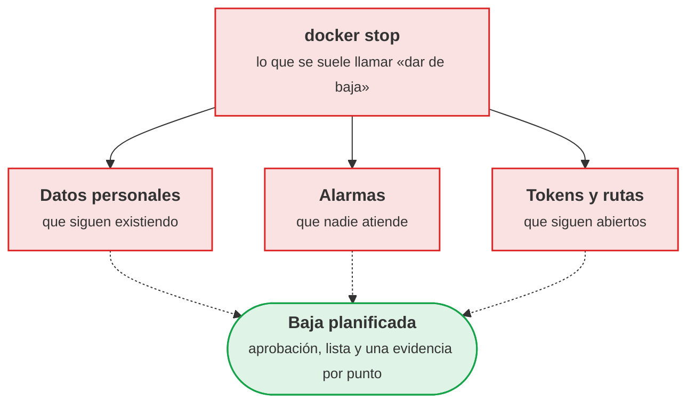
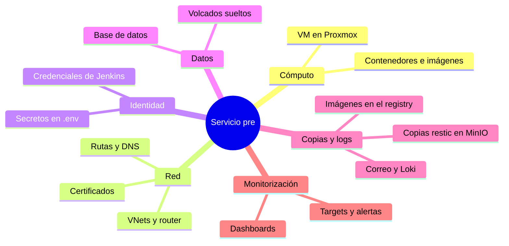
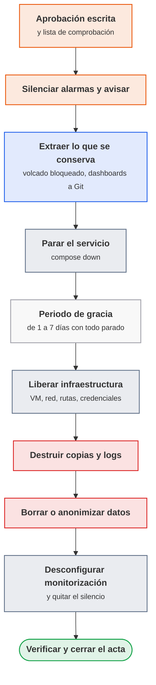
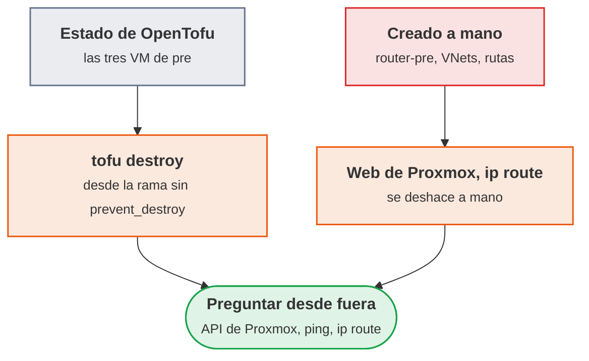
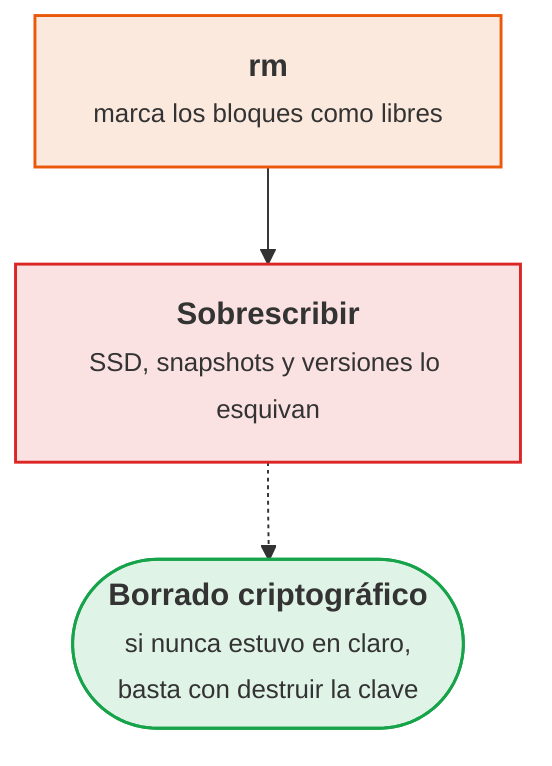

# UT8 · Terminación segura del contenedor

<p class="ut-meta">10 h · Sesiones 35 a 39 · RA5 CE a, b, c, d</p>

Esta es la última unidad en el centro. Durante el curso el servicio se ha levantado, vigilado, copiado y actualizado; ahora toca retirarlo sin dejar rastro. Apagar una máquina cuesta un minuto, pero cada unidad anterior dejó algo del servicio fuera de él (una serie en Prometheus, una copia en MinIO, una credencial en Jenkins, una ruta en otra máquina), y nada de eso desaparece al apagar. Una baja bien hecha encuentra cada rastro, decide cuál se conserva, destruye el resto y lo demuestra con una evidencia por punto.

Lo que se da de baja es el entorno **pre**, creado con OpenTofu en enero y usado para ensayar actualizaciones. Después del último despliegue, el 26 de febrero, ya no lo usa nadie: se retiran sus contenedores, imágenes, VM y redes, las rutas desde gestión, las credenciales, las copias, el correo de alertas, los datos y toda referencia en la monitorización. Dev sigue vivo al lado, y buena parte del cuidado consiste en no llevárselo por delante. La práctica evaluable, el **acta de baja**, se construye en las cinco hojas y se entrega por Aules antes del examen del 23 de marzo.

## Sesión 35 · Plan de baja

<p class="ut-meta" markdown>25 de febrero · Teoría y práctica · <span class="dur" tabindex="0" aria-label="La baja es un cambio más · 10 min&#10;Inventario de rastros · 10 min&#10;A8.1 Plan de baja · 90 min" data-dur="La baja es un cambio más · 10 min&#10;Inventario de rastros · 10 min&#10;A8.1 Plan de baja · 90 min">:material-school:<i class="dur-barra" style="--teoria:18%"></i>:material-flask:</span></p>

La primera sesión de la baja no borra nada. Una baja tiene dos errores posibles: dejarse algo (datos personales, credenciales vivas, alarmas que nadie atiende) o llevarse lo que no tocaba (lo que la ley obliga a guardar, o un trozo de dev). Los dos se evitan decidiendo antes, por escrito, qué se va a hacer, y eso se deja en el **acta de baja**: quién autorizó la baja, qué se conserva, qué se destruye y con qué evidencia. Hoy se ve por qué la baja se trata como un cambio con aprobación, cómo se encuentra todo lo que pre ha dejado y cómo ese inventario se convierte en la lista de comprobación de las cuatro sesiones siguientes.

### La baja es un cambio más

**El problema.** Terminar un contenedor "para siempre" no es `docker stop`. Cada rastro que queda es un coste o un riesgo, y el error contrario es peor porque no tiene arreglo: una baja precipitada destruye lo que había que guardar.



<p class="pie" markdown>Parar el servicio deja vivo todo lo que tiene alrededor. Por eso la baja se aprueba, se ejecuta y se documenta como cualquier otro cambio.</p>

**Un cambio con aprobación.** En cualquier departamento de sistemas, un cambio que puede romper algo pasa por una solicitud, una aprobación de quien manda sobre el servicio y una ventana acordada. La baja es siempre de ese tipo: destruye datos y se sabe con semanas de antelación. Antes de tocar nada tienen que existir cuatro cosas:

1. **Confirmación escrita** del responsable del servicio, con fecha. Un correo vale; una conversación en el pasillo, no. En el laboratorio es la respuesta del profesor a la solicitud que se le manda por Aules.
2. **Ventana de ejecución**, en un horario en que alguien pueda deshacer un error, porque la baja toca sistemas compartidos.
3. **Comunicación** a los usuarios que queden, a quien recibe las alarmas y a soporte.
4. **Lista de lo que se conserva y hasta cuándo.** Es lo que más se olvida y lo que más problemas legales da: conservar de más y conservar de menos incumplen normas distintas.

#### Qué hay que conservar por obligación legal

**Para qué lo necesita un técnico.** Qué se conserva lo decide el responsable del servicio con el delegado de protección de datos (la persona que vigila en la organización el cumplimiento de la normativa de datos personales). Pero quien sabe qué datos hay y dónde está cada copia es el técnico, así que tiene que saber qué preguntar. En España pesan el **RGPD**, el reglamento europeo de protección de datos, y la **LOPDGDD**, la ley orgánica española que lo adapta. Los plazos orientativos:

| Tipo de dato | Plazo habitual |
|---|---|
| Facturas y documentación contable | 6 años (Código de Comercio) |
| Justificantes con efecto fiscal | 4 años (Ley General Tributaria) |
| Datos personales de clientes tras el fin de la relación | Bloqueo mientras puedan derivarse responsabilidades; después, supresión |
| Logs de acceso con IP o usuario | Entre 6 meses y 2 años, según la política de la empresa |

**El bloqueo: guardar sin seguir usando.** El RGPD obliga a suprimir lo que ya no hace falta, pero puede quedar pendiente una reclamación en la que esos datos sean la prueba. El artículo 32 de la LOPDGDD lo resuelve con el **bloqueo**: los datos se dejan de usar, se guardan aislados y con acceso solo del responsable, y se destruyen cuando prescriben las responsabilidades. Técnicamente es un volcado cifrado en un sitio restringido, con fecha de destrucción en el acta. En pre, ese volcado se saca el 9 de marzo, antes de destruir nada.

**La buena práctica.** El acta dice, para cada categoría de datos, una de tres cosas: se destruye ahora (y cómo), se bloquea hasta una fecha (y dónde) o pasa a otro servicio que hereda su tratamiento.

### Inventario de rastros

**Para qué sirve.** Antes de borrar hay que saber qué hay. Lo que se olvida en el inventario no se borra nunca, porque ninguna hoja posterior sabrá que existe, y la mitad de los rastros no están en el servicio sino alrededor de él.



<p class="pie" markdown>Seis sitios donde queda rastro de un servicio. El que siempre se olvida es el último: la monitorización sigue vigilando algo que ya no existe.</p>

**Cómo se hace: buscar por lo que identifica a pre.** Casi todo lo de pre lleva una de tres marcas: la etiqueta `env="pre"` que la A7.4 puso a sus targets, el dominio `pre.lab` y el rango `10.20.`. Se buscan esas cadenas en lo escrito (los repositorios) y, además, se pregunta a cada sistema por lo que existe ahora, porque un recurso creado a mano no está escrito en ningún sitio. Dos casos que lo demuestran: `tofu state list` dice lo que creó OpenTofu, pero `router-pre` y las VNets de pre se crearon a mano y solo los lista la API de Proxmox; y OPNsense no sabe nada de pre, porque gestión llega a pre por la pata que `router-pre` tiene en `devmgmt`.

El inventario completo es este script, que se lanza desde el puesto de administración con el [fichero de la unidad](#el-puesto-de-administracion-como-base-de-la-baja) cargado y el túnel abierto. Cada sección pregunta a un sistema:

```bash
#!/bin/bash
# ~/inventario-pre.sh · A8.1. Uso: bash ~/inventario-pre.sh > $EV/00-inventario.txt 2>&1
. ~/baja-pre.env
B='env[:=] ?.?pre|pre\.lab|10\.20\.'                      # las tres marcas de pre
s() { echo; echo "== $1"; }
s Repositorios; for r in ~/iac-lab ~/operacion ~/entregas-5166; do git -C $r grep -nE "$B"; done
                ssh ops@10.10.0.20 "git -C /opt/monitoring grep -nE '$B'; git -C /opt/alerting grep -nE '$B'"
s OpenTofu;     (cd ~/iac-lab/envs/pre && tofu state list)
s Proxmox;      pve '/cluster/resources?type=vm' | jq -r '.data[] | select(.vmid>=200 and .vmid<300) | "\(.vmid) \(.name)"'
                pve /cluster/sdn/vnets | jq -r '.data[].vnet' | grep '^pre'
s Prometheus;   curl -sG $P/api/v1/series --data-urlencode 'match[]=up{env="pre"}' | jq -r '.data[].instance'
s Alertas;      amt alert query -s env=pre
s Grafana;      curl -s -H "Authorization: Bearer $GRAFANA_TOKEN" "$G/api/search?tag=pre" | jq -r '.[].title'
s Jenkins;      curl -s -u admin:$JENKINS_TOKEN "$J/job/servicio/job/pre/api/json?tree=jobs[name]" | jq -r '.jobs[].name'
                curl -s -u admin:$JENKINS_TOKEN "$J/job/servicio/job/pre/credentials/store/folder/domain/_/api/json?depth=1" | jq -r '.credentials[].id'
s Registry;     curl -s -u $REG_USER:$REG_PASS $R/tags/list | jq -r '.tags[]'
s app01-pre;    ssh ops@10.20.2.10 'sudo docker ps -a; sudo docker volume ls; sudo docker images'
s Rutas;        ip route show 10.20.0.0/16; for h in 10.10.0.12 10.10.0.20; do echo "-- $h"; ssh ops@$h ip route show 10.20.0.0/16; done
s CA;           grep -i 'pre\.lab' ~/ca/index.txt
s restic;       rst snapshots --tag pre
s Mailpit;      curl -sG $MP/search --data-urlencode 'query=10.20.' | jq .messages_count
s Loki;         logcli series '{host=~".+-pre"}' --since=2160h
```

Lo que no se adivina: `git -C` busca en un repositorio sin entrar en él; `pve`, `amt` y `rst` son funciones del fichero de la unidad; las rutas a pre están en el puesto, en agent01 (`10.10.0.12`) y en mon01 (`10.10.0.20`); en la CA no hay API, y su `index.txt` lista todo lo que ha firmado; `logcli` sin `--since` solo mira la última hora.

**La buena práctica.** Un inventario es una foto del día. Si algo cambia antes de ejecutar la baja, se repite: la A8.1 inventaría el 25 de febrero, y al día siguiente la A6.8 de Despliegue crea en Jenkins la carpeta de pre, da a agent01 una ruta hacia pre y hace el último despliegue. Por eso la A8.2 empieza relanzando el script.

#### El puesto de administración como base de la baja

**Por qué todo se lanza desde el puesto.** La baja entera se ejecuta desde el puesto de administración (`admin01`, la `10.10.0.50` de gestión). Llega a todo lo que hay que tocar y no se destruye, así que las evidencias van a `~/operacion/baja/pre/ev/`, en la copia de trabajo del repositorio `operacion`, y nunca a una VM de pre, que se llevaría consigo las pruebas de su propia destrucción. Ya tiene la CA del curso en `~/ca`, `iac-lab` con el entorno pre de OpenTofu y el entorno de restic de la A7.4 en `/etc/restic/`.

**Una credencial por camino.** A Proxmox, Grafana, Jenkins y el registry se llega por su API, cada uno con su token o usuario; a las VM, por SSH con la clave de `ops` que presta `ssh -A`; a Prometheus, Alertmanager y Mailpit, que solo escuchan en el `127.0.0.1` de mon01, por un túnel SSH; a Loki, con el certificado de cliente `logcli`; y a MinIO, con la credencial `restic`. Un **token** es una contraseña para programas: se crea para un uso, con los permisos justos, y se revoca sin tocar la contraseña de nadie. Por eso la baja usa en Grafana una cuenta de servicio propia, `baja-pre`, con rol Editor, y no la de `admin`.

**Un fichero para toda la unidad.** Las cinco hojas usan los mismos accesos, así que se preparan una vez en un fichero que se carga al empezar cada sesión con `. ~/baja-pre.env`. Lleva secretos: permisos 600 y fuera de cualquier repositorio. En cada `...` va su secreto, y `192.168.100.150` se cambia por la IP del nodo Proxmox de cada puesto:

```bash
# ~/baja-pre.env · UT8. Se carga con ". ~/baja-pre.env" al empezar cada sesión
export EV=~/operacion/baja/pre/ev             # evidencias: siempre aquí, nunca en una VM que se destruye
export GPG_TTY=$(tty)
export TF_VAR_pve_token='terraform@pve!tofu=...'
export AWS_ACCESS_KEY_ID=tofu AWS_SECRET_ACCESS_KEY='...'
export PVE=https://192.168.100.150:8006/api2/json
pve() { curl -sk -H "Authorization: PVEAPIToken=$TF_VAR_pve_token" "$PVE$1"; }
# Prometheus, Alertmanager y Mailpit solo escuchan en el 127.0.0.1 de mon01: se llega por túnel
tunel() { ssh -fN -L 29090:127.0.0.1:29090 -L 29093:127.0.0.1:29093 -L 28025:127.0.0.1:28025 ops@10.10.0.20; }
export P=http://localhost:29090 MP=http://localhost:28025/api/v1
amt() { ssh ops@10.10.0.20 docker compose -f /opt/monitoring/compose.yml exec -T alertmanager amtool --alertmanager.url=http://localhost:29093 "$@"; }
export G=https://grafana.lab GRAFANA_TOKEN='...'
export LOKI_ADDR=https://10.10.0.20:23100     # Loki pide certificado de cliente
export LOKI_CLIENT_CERT_PATH=~/tls-monitorizacion/logcli.crt LOKI_CLIENT_KEY_PATH=~/tls-monitorizacion/logcli.key
export J=https://jenkins.lab JENKINS_TOKEN='...'
export R=https://registry.lab:5000/v2/app REG_USER=jenkins REG_PASS='...'
rst() { ( set -a; . /etc/restic/env; set +a; exec restic "$@" ); }   # restic con el entorno de la A7.4
```

- `GPG_TTY` le dice a `gpg` en qué terminal pedir la frase de paso; sin ella, el cifrado del volcado falla.
- `TF_VAR_pve_token` y las `AWS_*` son lo que OpenTofu necesita para leer y destruir el estado de pre; `pve` usa el mismo token contra la API de Proxmox.
- `tunel` abre los tres túneles hacia mon01, y `amt` ejecuta `amtool` dentro del contenedor de Alertmanager, así que no hay que instalarlo.
- `rst` lanza restic con el entorno de la A7.4 en una subshell, para que sus secretos no se queden en la sesión.

#### Lista de comprobación completa

**Del inventario a la lista.** El inventario dice qué hay; la lista dice en qué orden se quita y cómo se demuestra que ya no está. Primero va lo que protege (aprobación, silencio, volcado), después lo que destruye y al final lo que confirma que no queda nada. Cada línea lleva su comando de verificación, porque una casilla sin evidencia no vale en un acta. Por qué cada paso va antes que el siguiente se explica el 9 de marzo, en [El orden importa](#el-orden-importa).

- [ ] Aprobación escrita archivada: `ev/01-aprobacion.txt` con la respuesta del profesor (A8.1)
- [ ] Silencio en Alertmanager para `env="pre"`, más largo que la ventana: `amt silence query env=pre` (A8.2)
- [ ] Volcado de bloqueo cifrado, comprobado y guardado fuera de los repositorios: `pg_restore -l` y `sha256sum` (A8.2)
- [ ] Dashboards de pre exportados a Git, si los hay: `git -C ~/operacion log -1 -- dashboards/pre/` (A8.2)
- [ ] Job de despliegue a pre deshabilitado: la API de Jenkins lo da en `disabled` (A8.2)
- [ ] Servicio parado y app01-pre sin contenedores, volúmenes, imágenes ni redes propias: `docker ps -a`, `docker volume ls`, `docker images` vacíos (A8.2)
- [ ] `prevent_destroy` retirado en una rama de `iac-lab` que cita la aprobación: `git log -1` de la rama `baja-pre` (A8.3)
- [ ] VM de pre destruidas con OpenTofu: `tofu state list` vacío (A8.3)
- [ ] `router-pre` y VNets de pre destruidos: `pve` no lista nada de la franja 200 ni VNets `pre*`; `ping 10.10.0.2` sin respuesta (A8.3)
- [ ] Rutas a pre retiradas en el puesto, agent01 y mon01: `ip route show 10.20.0.0/16` vacío; `dig +short app01.pre.lab @10.10.0.1` vacío (A8.3)
- [ ] Carpeta `servicio/pre` y credencial `ssh-pre` borradas en Jenkins, con el historial de despliegues guardado: la carpeta responde 404 (A8.3)
- [ ] Ningún certificado de pre en la CA, o revocados con su lista de revocación: `grep -i 'pre\.lab' ~/ca/index.txt` (A8.3)
- [ ] Copias de pre fuera del repositorio restic: `restic snapshots --tag pre` vacío y `restic check` sin errores (A8.4)
- [ ] Bucket sin versiones antiguas de lo borrado: `mc version info lab/backups` (A8.4)
- [ ] Etiquetas desplegadas en pre borradas del registry por digest: `tags/list` sin ellas; recolector de basura ejecutado o pendiente con fecha (A8.4)
- [ ] Correo de alertas de pre borrado de Mailpit sin tocar el resto: la búsqueda da 0 (A8.4)
- [ ] Loki sin streams de pre: `logcli series '{host=~".+-pre"}'` vacío (A8.4)
- [ ] Datos del tenant pre (el cliente de prueba de la A8.5) anonimizados y tablas borradas con `VACUUM FULL`: la consulta de control da 0 (A8.5)
- [ ] Réplicas y volcados sueltos revisados en db01 (A8.5)
- [ ] Targets de pre retirados: `count(up{env="pre"})` vacío (A8.5)
- [ ] Reglas, rutas y dashboards sin referencias a pre: `git grep` y búsquedas por API vacías (A8.5)
- [ ] Silencio expirado y sin alertas: `amt alert query env=pre` vacío (A8.5)
- [ ] Series de pre fuera del almacén en disco de Prometheus: por retención, como pendiente con fecha, o con `delete_series` (A8.5)
- [ ] Acta completa, sin filas sin evidencia ni pendientes sin fecha (A8.5)

### A8.1 Plan de baja (sesión 35)

<span class="et et-obj">Objetivo</span> **Qué vas a conseguir:** el puesto de administración listo para toda la unidad y el acta de baja de pre abierta, con todo lo que existe de pre y la orden que demostrará que se ha quitado. Hoy no se borra nada.

**Para qué sirve en un trabajo:** antes de retirar cualquier servicio se hace inventario y se pide permiso por escrito. Lo que no aparezca hoy en el inventario no lo borrará nadie, y sin aprobación no se toca nada.

<span class="et et-pre">Antes de empezar</span>

- Entra en el puesto de administración con `ssh -A ops@<IP de admin01 en la red del laboratorio>`. El `-A` le presta tu clave para que desde allí llegues a mon01, agent01, db01 y las VM de pre.
- Enciende `jenkins01`, `router-pre`, `app01-pre` y `db01-pre`. Para que quepan en la memoria, apaga `web01` y `db01` de dev, como indica el [presupuesto de memoria](https://victor-educ.github.io/apuntes-5166/laboratorio/#presupuesto-de-memoria) de Despliegue.
- Ten a mano, en el gestor de contraseñas del puesto: el token `tofu` de Proxmox (A5.1 de Despliegue), los secretos de las credenciales `tofu` y `restic` de MinIO (A5.2), la contraseña del usuario del registry (A6.6) y la de `admin` en Jenkins.
- En el puesto tienes ya `~/iac-lab/envs/pre` con su backend inicializado (A5.4) y el entorno de restic de la A7.4 en `/etc/restic/`.
- La teoría de hoy: [la baja como cambio](#la-baja-es-un-cambio-mas), [el inventario de rastros](#inventario-de-rastros), [el puesto como base de la baja](#el-puesto-de-administracion-como-base-de-la-baja) y la [lista de comprobación completa](#lista-de-comprobacion-completa). La plantilla del acta está en la [práctica evaluable](#acta-de-baja).

<span class="et et-pas">Pasos</span>

Hoy trabajas en el **puesto de administración**. El recorrido: preparas sus accesos (pasos 1 y 2), inventarías pre (paso 3), conviertes el inventario en la lista del acta (paso 4) y pides la aprobación, que es lo que abre la puerta a la A8.2 (paso 5).

1. **Prepara el fichero de accesos de la unidad.** *En el puesto.*

    Las cinco hojas usan las mismas variables y funciones, y van en un solo fichero que cargas al empezar cada sesión. Copia el bloque de [El puesto de administración como base de la baja](#el-puesto-de-administracion-como-base-de-la-baja) en `~/baja-pre.env`, cambia cada `...` por su secreto y la IP del nodo por la tuya. No cambies ningún nombre: las hojas siguientes cuentan con ellos. Los tokens de Grafana y Jenkins los creas en el paso 2; de momento déjalos en `...`.

    ```bash
    nano ~/baja-pre.env
    chmod 600 ~/baja-pre.env && . ~/baja-pre.env && mkdir -p $EV
    ```

    **Sale bien si:** `ls -l ~/baja-pre.env` muestra `-rw-------` (solo tú puedes leerlo) y `echo $EV` da la carpeta de evidencias.

2. **Completa el puesto y prueba cada acceso.** *En el puesto.*

    Faltan cinco cosas: la CA del curso en el sistema (para que `curl` y `logcli` se fíen de los servicios del laboratorio), `jq` (lee las respuestas de las API), `mc` (el cliente de MinIO), `logcli` (el cliente de consola de Loki, de la misma versión que el Loki de mon01) y los dos tokens. Instala lo primero; si alguna herramienta ya está en el puesto, sáltate su línea:

    ```bash
    sudo cp ~/ca/ca.crt /usr/local/share/ca-certificates/ca-curso.crt && sudo update-ca-certificates
    sudo apt install -y jq unzip
    curl -fsSLO https://dl.min.io/client/mc/release/linux-amd64/mc && chmod +x mc && sudo mv mc /usr/local/bin/
    mc alias set lab http://10.10.0.30:29000 restic '<secreto de la credencial restic>'
    curl -fsSLO https://github.com/grafana/loki/releases/download/v3.5.3/logcli-linux-amd64.zip
    unzip -o logcli-linux-amd64.zip && sudo install logcli-linux-amd64 /usr/local/bin/logcli
    ```

    Crea los tokens (un token es una contraseña para un programa, que se revoca sin tocar la de nadie). En Grafana: Administration → Users and access → Service accounts → cuenta `baja-pre` con rol Editor → Add service account token. En Jenkins: tu usuario `admin` → Security → API Token → Add new token. Pégalos en `~/baja-pre.env`, vuelve a cargarlo, abre el túnel y prueba cada acceso:

    ```bash
    . ~/baja-pre.env && tunel
    curl -s $P/-/ready                                                   # Prometheus
    amt silence query                                                    # Alertmanager
    curl -s -H "Authorization: Bearer $GRAFANA_TOKEN" "$G/api/search?tag=pre" | jq length
    curl -s -u admin:$JENKINS_TOKEN "$J/api/json" | jq -r .mode          # Jenkins
    logcli labels                                                        # Loki
    rst snapshots --tag pre | tail -2                                    # restic
    pve /version | jq -r .data.version                                   # Proxmox
    ```

    **Sale bien si:** las siete órdenes responden sin error de conexión ni de autenticación. Lo que falle, arréglalo hoy: un acceso que se rompe a mitad de la baja deja pre a medio destruir.

3. **Haz el inventario de pre.** *En el puesto.*

    El script de la teoría recorre todos los sistemas donde pre deja rastro y lo vuelca en un fichero. Copia el de [Inventario de rastros](#inventario-de-rastros) en `~/inventario-pre.sh` y lánzalo:

    ```bash
    nano ~/inventario-pre.sh
    bash ~/inventario-pre.sh > $EV/00-inventario.txt 2>&1
    less $EV/00-inventario.txt
    ```

    Léelo sección por sección y marca lo que no esperabas. La carpeta `servicio/pre` de Jenkins nace mañana, en la A6.8 de Despliegue: hoy su sección sale con error, y la A8.2 la repite.

    **Sale bien si:** el fichero tiene las catorce secciones, y en las de OpenTofu y Proxmox aparecen las VM de pre.

4. **Convierte el inventario en la lista del acta.** *En el puesto.*

    El inventario dice qué hay; la lista del acta dice en qué orden se quita y con qué orden se comprueba. La [plantilla](#acta-de-baja) ya trae una fila por punto de la [lista completa](#lista-de-comprobacion-completa), con su verificación, la hoja que la ejecuta y el fichero de evidencia que la probará. Cópiala y rellena la identificación:

    ```bash
    nano ~/operacion/baja/pre/acta.md
    ```

    Después repasa tu inventario sección por sección y busca cada rastro en la lista. Lo que tenga contenido en el inventario y no tenga fila (un dashboard, una credencial o una ruta que no esperabas) recibe una fila nueva, con su verificación, en el sitio que le toque por orden. Lo que no esperabas va también a "Incidencias durante la baja". La columna de resultado queda vacía: se rellena en cada hoja.

    **Sale bien si:** cada sección del inventario con contenido tiene al menos una fila en la lista, y ninguna fila está sin verificación.

5. **Decide qué se conserva y pide la aprobación.** *En el puesto y en Aules.*

    Rellena "Qué se conserva" con el motivo, dónde y hasta cuándo: el volcado de bloqueo, el repositorio `servicio` con su webhook y su Multibranch (dev los sigue usando), el token de OpenTofu, el repositorio restic (guarda más copias que las de pre) y el historial de despliegues de Jenkins. Después sube el acta:

    ```bash
    cd ~/operacion && git add baja/pre/acta.md baja/pre/ev/00-inventario.txt
    git commit -m "Baja de pre: plan e inventario" && git push
    ```

    Pide la aprobación al profesor en un mensaje de Aules con el enlace del commit, para que apruebe exactamente lo que vas a hacer. Guarda su respuesta, con fecha, en `$EV/01-aprobacion.txt`.

    **Sale bien si:** el commit está en Gitea con el acta y el inventario.

<span class="et et-com">Comprobación</span>

- [ ] `tunel` y las siete órdenes del paso 2 responden.
- [ ] `ev/00-inventario.txt` tiene todas sus secciones, con las VM de pre en el estado de OpenTofu y en la franja 200 de Proxmox.
- [ ] Cada rastro del inventario tiene su fila en la lista del acta, y lo inesperado está también en "Incidencias".
- [ ] Ninguna fila de la lista está sin verificación.
- [ ] El commit con `acta.md` y `ev/00-inventario.txt` está en Gitea.

<span class="et et-ent">Para practicar</span>

- **Guarda** en `operacion` el commit con `acta.md` y `ev/00-inventario.txt`, y la respuesta del profesor en `ev/01-aprobacion.txt`. Esa acta es la práctica evaluable: se completa hoja a hoja hasta la A8.5.
- **Apunta** cuántas VM salen en el estado de OpenTofu y cuántas en la franja 200 de Proxmox.
- **Piensa:** ¿qué explica la diferencia entre esas dos cifras?
- **Antes del 9 de marzo**, la aprobación tiene que estar en `ev/01-aprobacion.txt`: sin ella la A8.2 no empieza.

<span class="et et-ext">Si te sobra tiempo</span> Para que nadie se lleve una sorpresa el día de la baja, redacta en la identificación del acta la comunicación: el aviso a los usuarios, a soporte y a la guardia, con la fecha de cada uno.

## Sesión 36 · Liberar la infraestructura: servicio y contenedores

<p class="ut-meta" markdown>9 de marzo · Teoría y práctica · <span class="dur" tabindex="0" aria-label="El orden importa · 10 min&#10;Cómo se libera cada capa dentro de la VM · 10 min&#10;A8.2 Liberar el servicio y los contenedores · 90 min" data-dur="El orden importa · 10 min&#10;Cómo se libera cada capa dentro de la VM · 10 min&#10;A8.2 Liberar el servicio y los contenedores · 90 min">:material-school:<i class="dur-barra" style="--teoria:18%"></i>:material-flask:</span></p>

Con la aprobación en `ev/01-aprobacion.txt` empieza la ejecución. Casi todos los errores graves de una baja son de orden (parar antes de silenciar, borrar antes de guardar), así que la teoría empieza por la secuencia completa y después baja a lo de hoy: lo que vive dentro de las máquinas, qué libera `docker compose down` y cómo se saca antes el volcado de bloqueo. Al terminar, las VM de pre siguen en pie a propósito: se destruyen el 11 de marzo, y mientras existan la baja tiene vuelta atrás.

### El orden importa

**Para qué sirve.** Si el servicio se para antes de silenciar las alarmas, salta un aviso a la guardia por algo que se sabía que iba a apagarse. Si los volúmenes se borran antes de comprobar la copia que se conserva, ya no hay vuelta atrás. El silencio es un [silencio de Alertmanager](ut2-alarmas.md#silencios): una pausa temporal, creada a mano, de las alertas que cumplen unas etiquetas.



<p class="pie" markdown>El **periodo de gracia** es el último momento reversible. Por eso lo que se conserva se extrae antes.</p>

**El periodo de gracia.** El servicio está parado pero nada se ha destruido: si alguien descubre que lo necesitaba, se levanta en un minuto. En una empresa lo habitual es una semana. En el laboratorio va del 9 al 11 de marzo: app01-pre queda vacía, pero db01-pre y la imagen del registry siguen ahí, y volver atrás es habilitar el job de despliegue y relanzarlo.

**Cortar lo que lo puede volver a levantar.** La etapa `Deploy` del pipeline lanza el job `despliegue` de la carpeta `servicio/pre` de Jenkins, que volvería a llevar la imagen a app01-pre. Por eso ese job se deshabilita antes de parar el servicio. Deshabilitar no es borrar: el job y su historial siguen ahí hasta el 11 de marzo.

**La buena práctica.** El silencio se quita al final: primero se retiran los targets y las reglas, se comprueba que no hay alertas pendientes, y entonces se expira.

### Cómo se libera cada capa dentro de la VM

**Para qué sirve.** Docker reparte un servicio en contenedores, volúmenes (los datos que sobreviven a recrear el contenedor), imágenes y redes, y las órdenes normales se llevan los contenedores pero dejan los volúmenes, para que un `down` seguido de un `up` no pierda datos. En una baja hay que pedir cada cosa expresamente, y cada recurso tiene un comando para liberarlo y otro para comprobarlo, que es el que va al acta.

| Recurso | Cómo se libera | Cómo se verifica |
|---|---|---|
| Contenedores | `docker compose down` | `docker ps -a` vacío |
| Volúmenes | `docker compose down -v`; `docker volume rm` | `docker volume ls` vacío |
| Imágenes | `docker compose down --rmi all`; `docker image prune -a` en un host dedicado | `docker images` vacío |
| Redes | `docker compose down`; `docker network rm` | `docker network ls` sin redes propias |

#### Docker en app01-pre

**Cómo se hace.** En app01-pre el servicio es el compose de `/opt/servicio`, con un solo servicio, `app` (la base de datos de pre está en db01-pre, no en un contenedor). `-v` borra los volúmenes del proyecto, `--rmi all` sus imágenes y `--remove-orphans` los contenedores que ya no están en el fichero:

```bash
sudo docker compose -f /opt/servicio/compose.yml down -v --rmi all --remove-orphans
sudo docker system prune -af --volumes                            # solo en un host dedicado como app01-pre
sudo docker ps -aq; sudo docker volume ls -q; sudo docker images -q     # vacíos
```

**`prune`, solo en un host dedicado.** `--rmi all` solo se lleva las imágenes del compose actual, y en app01-pre quedan las de despliegues anteriores; `docker system prune -af --volumes` borra todo lo que no está en uso en el host entero. En app01-pre, donde solo vive este servicio, es lo correcto. En un host compartido no se ejecuta nunca: se borra imagen por imagen con `docker image rm`.

**La buena práctica.** `down -v` no ve los volúmenes declarados `external: true`; se borran con `docker volume rm` después de mirar quién más los usa. Y un volumen borrado no es un dato borrado: los bloques siguen en el disco de la VM hasta que el disco se destruye, como se ve el 16 de marzo en [Por qué borrar no borra](#por-que-borrar-no-borra).

#### El volcado de bloqueo

**Para qué sirve.** Es el volcado completo de la base de datos de pre que queda bloqueado, como se explica en [Qué hay que conservar por obligación legal](#que-hay-que-conservar-por-obligacion-legal). Cuando se destruyan db01-pre y sus copias de restic, será la única copia de esos datos.

**Cómo se hace.** Se pide desde el puesto, de modo que el volcado viaja por SSH y se cifra al llegar, sin tocar ningún disco sin cifrar:

```bash
ssh ops@10.20.3.10 'sudo -u postgres pg_dump -Fc servicio' | gpg -c --cipher-algo AES256 -o ~/pre-bloqueo.dump.gpg
gpg -d ~/pre-bloqueo.dump.gpg | pg_restore -l | head -20    # el índice del volcado: no está vacío
sha256sum ~/pre-bloqueo.dump.gpg                             # la huella que va al acta
```

- `-Fc` es el formato propio de `pg_dump`, que `pg_restore -l` sabe listar: esa lista demuestra que el volcado se puede restaurar.
- `gpg -c` cifra con una frase de paso, que se guarda en el gestor de contraseñas. El fichero se queda en el puesto, fuera de los repositorios: quien consiga uno de los dos no tiene nada.
- La huella de `sha256sum` permite comprobar, mientras dure el bloqueo, que el fichero es el mismo que se verificó.

**La buena práctica.** En una empresa se cifra para la clave pública del delegado de protección de datos (`gpg -e -r <su clave>`), que es quien lo custodia, y ninguna frase de paso tiene que viajar.

### A8.2 Liberar el servicio y los contenedores (sesión 36)

<span class="et et-obj">Objetivo</span> **Qué vas a conseguir:** pre deja de funcionar sin que salte ninguna alarma. Queda silenciado, con una copia cifrada de sus datos guardada, sin despliegues automáticos y con app01-pre vacía de contenedores. Las VM siguen en pie, así que aún se puede dar marcha atrás.

**Para qué sirve en un trabajo:** es la mitad reversible de una baja. En una empresa se para el servicio antes de destruir nada, por si alguien descubre que todavía lo necesitaba, y cada paso queda probado en el acta.

<span class="et et-pre">Antes de empezar</span>

- Entra en el puesto de administración con `ssh -A`, carga `. ~/baja-pre.env` y abre el túnel con `tunel`.
- Enciende lo mismo que en la A8.1: `jenkins01`, `router-pre`, `app01-pre` y `db01-pre`, con `web01` y `db01` de dev apagadas.
- Tienes la aprobación del profesor en `ev/01-aprobacion.txt`. Sin ella no se toca nada.
- La A6.8 de Despliegue (26 de febrero) fue el último despliegue en pre, y su práctica evaluable de mañana no despliega.
- La teoría de hoy: [el orden de la baja](#el-orden-importa) y [cómo se libera cada capa dentro de la VM](#como-se-libera-cada-capa-dentro-de-la-vm), cuyos bloques copias aquí.

<span class="et et-pas">Pasos</span>

Trabajas desde el **puesto**, en el orden de [El orden importa](#el-orden-importa): pones al día el inventario (paso 1), silencias las alarmas (paso 2), guardas los datos (paso 3), cortas el despliegue (paso 4), paras y vacías app01-pre (paso 5) y lo apuntas en el acta (paso 6).

1. **Pon al día el inventario.** *En el puesto.*

    Desde el 25 de febrero, la A6.8 de Despliegue creó la carpeta `servicio/pre` en Jenkins, dio a agent01 una ruta hacia pre y desplegó en app01-pre. Relanza el script de la A8.1 y compara con el de entonces:

    ```bash
    bash ~/inventario-pre.sh > $EV/00b-inventario.txt 2>&1
    diff $EV/00-inventario.txt $EV/00b-inventario.txt
    ```

    Añade al acta las filas que falten. Las etiquetas `app:<commit>` de app01-pre son las imágenes que llegaron a pre: este fichero es lo único que las recordará cuando la A8.4 vaya a borrarlas del registry.

    **Sale bien si:** la sección de Jenkins ya lista la carpeta de pre y su credencial.

2. **Silencia pre antes de tocar nada.** *En el puesto.*

    En cuanto las VM de pre dejen de contestar saltaría `HostDown` por cada una. Un silencio es una orden a Alertmanager para que calle, durante un tiempo, las alarmas con una etiqueta. Este dura hasta después del 18 de marzo, cuando lo retira la A8.5 (el comentario va sin espacios porque `amt` pasa por SSH):

    ```bash
    amt silence add env=pre --author=ops --comment=baja-pre --duration=264h
    amt silence query env=pre > $EV/02-silencio.txt
    ```

    **Sale bien si:** en `ev/02-silencio.txt` el silencio aparece con su fin después del 18 de marzo.

3. **Guarda los datos mientras todavía existen.** *En el puesto.*

    El volcado de bloqueo es una copia completa de la base de pre que no usa nadie: se guarda cifrada por si hay una reclamación. Desde el 11 de marzo será la única copia de esos datos. Instala el cliente de PostgreSQL y lanza el bloque de [El volcado de bloqueo](#el-volcado-de-bloqueo), guardando el índice y la huella (`gpg` te pide una frase de paso):

    ```bash
    sudo apt install -y postgresql-client
    ssh ops@10.20.3.10 'sudo -u postgres pg_dump -Fc servicio' | gpg -c --cipher-algo AES256 -o ~/pre-bloqueo.dump.gpg
    { gpg -d ~/pre-bloqueo.dump.gpg | pg_restore -l | head -20; sha256sum ~/pre-bloqueo.dump.gpg; } > $EV/03-dump-bloqueo.txt
    ```

    Guarda la frase de paso en el gestor de contraseñas; ni ella ni el `.gpg` van al repositorio. Si el inventario encontró dashboards de pre, exporta cada uno (antes, `mkdir -p ~/operacion/dashboards/pre`): `curl -s -H "Authorization: Bearer $GRAFANA_TOKEN" "$G/api/dashboards/uid/<uid>" | jq .dashboard > ~/operacion/dashboards/pre/<nombre>.json`.

    **Sale bien si:** `ev/03-dump-bloqueo.txt` tiene el índice del volcado y una línea con la huella.

4. **Corta el despliegue a pre.** *En el puesto.*

    Mientras el job `despliegue` de `servicio/pre` funcione, Jenkins podría volver a levantar pre. Deshabilítalo (un POST a su URL terminada en `/disable`) y guarda su estado:

    ```bash
    curl -s -X POST -u admin:$JENKINS_TOKEN "$J/job/servicio/job/pre/job/despliegue/disable"
    curl -s -u admin:$JENKINS_TOKEN "$J/job/servicio/job/pre/job/despliegue/api/json?tree=color" > $EV/04-jenkins.txt
    ```

    Deshabilitar, no borrar: durante el periodo de gracia es tu vuelta atrás. El Multibranch `ci` no se toca.

    **Sale bien si:** el campo `color` de `ev/04-jenkins.txt` dice `disabled`.

5. **Para el servicio y vacía app01-pre.** *En el puesto, con órdenes a app01-pre por SSH.*

    `down -v --rmi all` quita los contenedores con sus volúmenes y sus imágenes, y `prune` borra lo que quede sin usar. Es el bloque de [Docker en app01-pre](#docker-en-app01-pre). Lánzalo y guarda las pruebas, empezando por la API vista como la vería un cliente:

    ```bash
    ssh ops@10.20.2.10 'sudo docker compose -f /opt/servicio/compose.yml down -v --rmi all --remove-orphans && sudo docker system prune -af --volumes'
    { curl -s -m 5 http://10.20.2.10:28080/health || echo "API sin respuesta"
      ssh ops@10.20.2.10 'sudo docker ps -a; sudo docker volume ls; sudo docker images; sudo docker network ls --filter type=custom'; } > $EV/05-docker.txt
    ```

    El `prune` solo vale en app01-pre, que no aloja nada más; en app01 de dev se llevaría los volúmenes del servicio.

    **Sale bien si:** en `ev/05-docker.txt` la API no responde y las cuatro listas no tienen nada del servicio.

6. **Apunta lo de hoy en el acta.** *En el puesto.*

    Rellena el resultado y la evidencia de cada fila ejecutada (`ev/00b` y `ev/02` a `ev/05`), el volcado con su huella en "Qué se conserva" y cualquier desviación en "Incidencias". Sube el acta (si exportaste dashboards, añade también `dashboards/pre`):

    ```bash
    cd ~/operacion && git add baja/pre && git commit -m "Baja de pre: servicio y contenedores (A8.2)" && git push
    ```

    **Sale bien si:** el commit está en Gitea y `pre-bloqueo.dump.gpg` no está en él.

<span class="et et-com">Comprobación</span>

- [ ] `ev/02-silencio.txt` muestra el silencio activo, con su fin después del 18 de marzo.
- [ ] `ev/03-dump-bloqueo.txt` tiene el índice del volcado y su huella.
- [ ] El job de despliegue está en `disabled`.
- [ ] En `ev/05-docker.txt`, la API no responde y las cuatro listas están vacías.
- [ ] Las VM de pre siguen en pie: al acabar hoy, eso es lo correcto.

<span class="et et-ent">Para practicar</span>

- **Guarda** en `operacion` el commit con el acta al día y `ev/00b` y `ev/02` a `ev/05`, que son evidencias de la práctica evaluable.
- **Guarda** `pre-bloqueo.dump.gpg` en el puesto, fuera de los repositorios, y su frase de paso en el gestor de contraseñas.
- **Piensa:** si mañana alguien pidiera recuperar pre, ¿qué tendrías que hacer con lo que queda en pie?

## Sesión 37 · Liberar la infraestructura: VM, red y credenciales

<p class="ut-meta" markdown>11 de marzo · Teoría y práctica · <span class="dur" tabindex="0" aria-label="Destruir lo declarado no basta · 10 min&#10;Cómo se libera cada capa fuera de la VM · 15 min&#10;A8.3 Liberar la VM, la red y las credenciales · 85 min" data-dur="Destruir lo declarado no basta · 10 min&#10;Cómo se libera cada capa fuera de la VM · 15 min&#10;A8.3 Liberar la VM, la red y las credenciales · 85 min">:material-school:<i class="dur-barra" style="--teoria:23%"></i>:material-flask:</span></p>

El periodo de gracia termina hoy: esta sesión destruye lo que queda fuera de los contenedores, y desde que termine la única vuelta atrás es el volcado de bloqueo. Al acabar no existen las VM de pre, ni `router-pre`, ni sus VNets; ninguna máquina de gestión tiene ruta hacia pre; Jenkins no tiene nada de pre, y está comprobado que la CA no firmó nada para pre. La teoría empieza por lo que `tofu destroy` no hace y sigue con cómo se libera y se comprueba cada capa; los bloques de la hoja salen de ahí.

### Destruir lo declarado no basta

**El problema.** OpenTofu no le pregunta a Proxmox qué existe: lee su **estado**, el fichero en el que apunta cada recurso que creó (en el laboratorio, en el bucket `tfstate` de MinIO; está en [El estado a fondo](https://victor-educ.github.io/apuntes-5166/ut/ut5-iac/#el-estado-a-fondo)). `tofu destroy` deshace lo que dice el estado, ni más ni menos, y eso tiene tres consecuencias:

- **Lo creado a mano sobrevive.** `router-pre` y las cuatro VNets de pre se crearon a mano en noviembre, antes que el código, y siguen ahí después de `tofu destroy`. Se borran a mano.
- **Lo compartido puede caer.** Si un recurso compartido (una red, un usuario de API) entró en el estado de pre, `tofu destroy` se lo lleva. `tofu plan -destroy` es donde se ve antes de que pase, y `tofu state rm` lo saca del estado sin tocarlo en Proxmox.
- **`prevent_destroy` lo para, y hace bien.** Las VM de pre llevan `lifecycle { prevent_destroy = true }`, así que el plan falla con `Instance cannot be destroyed`. La protección se retira en una rama de `iac-lab` que cita la aprobación, se destruye desde esa rama y la rama no se fusiona: `main` sigue protegiendo y la rama queda como prueba.

**Revocar no es borrar.** Un certificado borrado del servidor sigue valiendo hasta que caduca para quien conserve la clave privada; solo lo invalida revocarlo. Un token, en cambio, muere al borrarlo del sistema que lo emitió, pero las copias que viajaron (un `.env` en un portátil) hay que pedir por escrito que se destruyan.



<p class="pie" markdown>`tofu destroy` solo deshace lo declarado. Lo creado a mano se deshace a mano, y la prueba de que algo ya no existe es siempre una pregunta **desde fuera**.</p>

### Cómo se libera cada capa fuera de la VM

**Por qué aquí se comprueba desde fuera.** La máquina deja de existir y ya no se le puede preguntar, y la herramienta que borra no es buen testigo de su propio trabajo (`tofu state list` vacío solo dice que OpenTofu ya no recuerda nada). La comprobación se hace preguntando al sistema que tenía el recurso: la API del hipervisor no lista la VM, el `ping` no contesta, la tabla de rutas no tiene la entrada.

| Recurso | Cómo se libera | Cómo se verifica |
|---|---|---|
| VM declaradas | `tofu destroy`, tras retirar `prevent_destroy` | `tofu state list` vacío; Proxmox sin las VM |
| VM y redes creadas a mano | en la web de Proxmox | la API de Proxmox no las lista |
| Rutas y DNS | quitar la ruta y su unidad de systemd | `ip route show` vacío; `dig` sin respuesta |
| Certificados | revocar en la CA | `index.txt` con `R`; `openssl verify -crl_check` |
| Credenciales | borrarlas en el sistema que las emitió | el listado por API ya no las tiene |

#### OpenTofu: la rama, el plan y el estado

**Cómo se hace.** Se retira la protección en una rama, se guarda el plan en un fichero (`-out`) y se aplica ese fichero, no uno nuevo: así se destruye exactamente lo que se ha leído. El bloque deja las evidencias en `$EV`:

```bash
cd ~/iac-lab && git switch -c baja-pre
grep -rn prevent_destroy modules/ envs/pre/       # en qué fichero está el bloque lifecycle: bórralo
git commit -am "Baja de pre: retira prevent_destroy (aprobación en operacion/baja/pre/ev/01-aprobacion.txt)"
git push -u origin baja-pre && git log -1 --stat > $EV/06-rama-baja.txt
cd envs/pre
tofu plan -destroy -out=destroy.plan | tee $EV/07-tofu-plan.txt    # léelo entero antes de seguir
tofu apply destroy.plan
tofu state list > $EV/08-tofu-state.txt                             # vacío
```

**La buena práctica.** Si el plan lista algo que no es de pre, se saca con `tofu state rm <dirección>` y se repite el plan. El fichero de estado que queda en MinIO puede contener datos sensibles, como la contraseña de cloud-init, y se trata como un volcado de base de datos.

#### Proxmox: lo que no está en el estado

**Cómo se hace.** `router-pre` (ID 200) y las VNets de pre se deshacen en la web de Proxmox, en este orden, porque una VNet con una VM conectada no se deja borrar:

| Qué | Dónde en la web |
|---|---|
| Parar `router-pre` | VM 200 → **Shutdown** (o **Stop** si no responde) |
| Destruir `router-pre` | VM 200 → **More → Remove**: escribe el ID y marca **Purge from job configurations** y **Destroy unreferenced disks owned by guest** |
| Borrar las subredes | **Datacenter → SDN → VNets**: en cada VNet de pre (`premgmt`, `prefront`, `preback`, `predata`) quita su subred (`10.20.0.0/24` ... `10.20.3.0/24`) en el panel **Subnets** |
| Borrar las VNets | en la misma vista, **Remove** de cada VNet ya sin subred |
| Aplicar | **Datacenter → SDN → Apply**: hasta entonces los cambios quedan pendientes |

**La buena práctica.** La casilla de purga quita la VM de los trabajos de copia y replicación; sin ella, un trabajo de copia fallaría cada semana con "VM 200 not found". Las copias de VM ya hechas no se borran con ella: se miran en la pestaña **Backups** del almacén `local`.

#### Rutas, DNS y firewall

**Para qué sirve.** Gestión llega a pre por la pata de `router-pre` en `devmgmt` (la `10.10.0.2`) y una ruta a `10.20.0.0/16` en el puesto (unidad `ruta-lab.service`), en agent01 y en mon01 (unidad `ruta-pre.service`). La pata muere con `router-pre`; las rutas no, y una ruta a una red que ya no existe es un camino abierto para la próxima vez que alguien use ese rango.

```bash
sudo sed -i '/10\.20\.0\.0\/16/d' /etc/systemd/system/ruta-lab.service     # en el puesto
sudo systemctl daemon-reload && sudo ip route del 10.20.0.0/16
sudo systemctl disable --now ruta-pre.service                               # en agent01 y en mon01
sudo rm /etc/systemd/system/ruta-pre.service && sudo systemctl daemon-reload
sudo ip route del 10.20.0.0/16
```

**La buena práctica.** La ruta y la unidad, las dos: quitar solo la unidad deja la ruta hasta el próximo reinicio, y quitar solo la ruta hace que vuelva en el próximo reinicio. Los nombres `<host>.pre.lab` los resolvía el dnsmasq de `router-pre` y mueren con él; se comprueba que el DNS de gestión tampoco los resuelve, porque un nombre que apunta a una IP libre acabará apuntando a otra máquina. En OPNsense no hay nada de pre; si lo hubiera, se quitan primero las reglas y después los aliases.

#### Certificados: revocar en la CA del curso

**Para qué sirve.** Un certificado de un servicio dado de baja sigue siendo válido hasta su caducidad, y quien conserve la clave privada puede suplantar el servicio. Revocar lo impide, siempre que los clientes consulten la **lista de revocación** (CRL) que publica la CA.

**En pre no hay nada que revocar, y se comprueba.** web01-pre se quedó sin nginx ni certificado. La prueba es el `index.txt` de la CA, que registra todo lo que ha firmado: `grep -i 'pre\.lab' ~/ca/index.txt` vacío.

**Cómo se revoca.** Para cualquier servicio que sí tenía certificado, con la CA del curso (los emitidos están en `~/ca/emitidos/`, con el número de serie como nombre):

```bash
cd ~/ca
openssl ca -config ca.cnf -revoke emitidos/<serie>.pem -crl_reason cessationOfOperation
openssl ca -config ca.cnf -gencrl -out crl.pem
openssl verify -crl_check -CAfile ca.crt -CRLfile crl.pem emitidos/<serie>.pem    # certificate revoked
```

`cessationOfOperation` es el motivo de una baja. El certificado de la CA no se toca: se revocan los que firmó.

#### Credenciales y tokens

**Para qué sirve.** Un token que sobrevive a su servicio es una credencial huérfana: nadie lo rota, nadie lo audita y sigue valiendo para quien lo tenga.

**Lo que se borra en pre.** La carpeta `servicio/pre` de Jenkins, con la credencial `ssh-pre` y el job `despliegue`, y el job de prueba `ver-ssh-pre` de `servicio/dev`. Antes se guarda el historial de despliegues, la única prueba de qué versión se desplegó y cuándo, que desaparece con la carpeta:

```bash
JP=$J/job/servicio/job/pre
curl -s -u admin:$JENKINS_TOKEN "$JP/job/despliegue/api/json?tree=builds[number,result,timestamp,actions[parameters[name,value]]]" > $EV/11-despliegues-pre.json
curl -X POST -u admin:$JENKINS_TOKEN "$JP/credentials/store/folder/domain/_/credential/ssh-pre/doDelete"
curl -X POST -u admin:$JENKINS_TOKEN "$JP/doDelete"
curl -X POST -u admin:$JENKINS_TOKEN "$J/job/servicio/job/dev/job/ver-ssh-pre/doDelete"
```

**Lo que no se toca, y el acta lo dice.** El Multibranch `ci`, `git-ro` y `registry-cred` los usa el pipeline, que sigue construyendo para dev; el repositorio `servicio` y su webhook, también; el token `tofu` es el de la herramienta, no el del entorno. Los secretos que viajaron fuera de los sistemas se piden por escrito y se anotan como "solicitada destrucción a X, confirmada el día Y".

### A8.3 Liberar la VM, la red y las credenciales (sesión 37)

<span class="et et-obj">Objetivo</span> **Qué vas a conseguir:** pre desaparece de verdad. Sin VM, sin su router ni sus redes, sin rutas que lleven a ella y sin nada suyo en Jenkins, y cada punto comprobado desde fuera.

**Para qué sirve en un trabajo:** es la parte de la baja que no tiene vuelta atrás, y por eso la que más se revisa. Lo que se quita a mano y no queda probado, nadie puede asegurar después que se quitó.

<span class="et et-pre">Antes de empezar</span>

- Entra en el puesto de administración con `ssh -A` y carga `. ~/baja-pre.env`.
- Enciende `jenkins01` y `agent01`, porque hoy tocas Jenkins y la ruta de agent01, y apaga `web01` y `db01` de dev, como en la A8.1.
- Tienes la A8.2 terminada: pre silenciado, volcado de bloqueo guardado y comprobado, y app01-pre vacía.
- Abre la interfaz web de tu Proxmox en otra pestaña: solo el paso 2 se hace allí.
- La teoría de hoy: [lo que `tofu destroy` no se lleva](#destruir-lo-declarado-no-basta) y [cómo se libera cada capa fuera de la VM](#como-se-libera-cada-capa-fuera-de-la-vm), cuyos bloques copias aquí tal cual.

<span class="et et-pas">Pasos</span>

Trabajas desde el **puesto**, de lo que conoce OpenTofu a lo que se hizo a mano: las VM declaradas (paso 1), lo que se borra en la web de Proxmox (paso 2), las rutas que llevaban a pre (paso 3), Jenkins (paso 4) y la CA (paso 5). El paso 6 lo apunta en el acta. Cada paso termina con una comprobación desde fuera, y esa comprobación es la evidencia.

1. **Destruye las VM de pre con OpenTofu.** *En el puesto.*

    Las VM de pre llevan `prevent_destroy`, una protección que impide destruirlas. Para quitarla con permiso, la retiras en una rama propia (`baja-pre`) cuyo commit cita la aprobación. Lanza línea a línea el bloque de [OpenTofu: la rama, el plan y el estado](#opentofu-la-rama-el-plan-y-el-estado) y, antes del commit, borra el bloque `lifecycle` del fichero que te indique el `grep`.

    Lee el plan entero antes del `apply`: solo pueden salir las tres VM de pre. Si sale algo más, sácalo con `tofu state rm`, repite el plan y anótalo en "Incidencias".

    **Sale bien si:** `ev/07-tofu-plan.txt` dice `3 to destroy`, `ev/08-tofu-state.txt` está vacío y la rama `baja-pre` está en Gitea sin fusionar.

2. **Borra en Proxmox lo que OpenTofu no conoce.** *En la web de Proxmox y en el puesto.*

    `router-pre` y las VNets de pre (las redes virtuales de Proxmox) se crearon a mano, así que `tofu` no las destruye. Sigue en la web la tabla de [Proxmox: lo que no está en el estado](#proxmox-lo-que-no-esta-en-el-estado), en su orden. Después guarda desde el puesto la comprobación:

    ```bash
    { pve '/cluster/resources?type=vm' | jq -r '.data[] | select(.vmid>=200 and .vmid<300) | "\(.vmid) \(.name)"'
      pve /cluster/sdn/vnets | jq -r '.data[].vnet' | grep '^pre'
      ping -c2 -W1 10.10.0.2; ping -c2 -W1 10.20.2.10; } > $EV/09-proxmox.txt 2>&1
    ```

    **Sale bien si:** la API no lista nada de la franja 200 (los ID 200 a 299, los de pre) ni VNets `pre*`, y los dos `ping` fallan. El `ping` solo confirma, porque una VM apagada tampoco contesta: la prueba es la API.

3. **Quita las rutas que llevaban a pre.** *En el puesto, agent01 y mon01.*

    Una ruta hacia una red que ya no existe es un camino abierto para quien use ese rango después. Es el bloque de [Rutas, DNS y firewall](#rutas-dns-y-firewall): las dos primeras líneas en el puesto (en `ruta-lab.service` se borra solo la línea de pre, porque la unidad lleva también la ruta a dev) y las tres últimas en agent01 y en mon01, que lanzas desde el puesto con un bucle para no cambiar de máquina:

    ```bash
    sudo sed -i '/10\.20\.0\.0\/16/d' /etc/systemd/system/ruta-lab.service
    sudo systemctl daemon-reload && sudo ip route del 10.20.0.0/16
    for h in 10.10.0.12 10.10.0.20; do
      ssh ops@$h 'sudo systemctl disable --now ruta-pre.service; sudo rm /etc/systemd/system/ruta-pre.service; sudo systemctl daemon-reload; sudo ip route del 10.20.0.0/16'
    done
    ```

    Guarda la comprobación:

    ```bash
    { ip route show 10.20.0.0/16; for h in 10.10.0.12 10.10.0.20; do echo "-- $h"; ssh ops@$h ip route show 10.20.0.0/16; done
      dig +short app01.pre.lab @10.10.0.1; } > $EV/10-rutas-dns.txt
    ```

    **Sale bien si:** ninguna de las tres máquinas tiene ruta y `dig` no devuelve nada.

4. **Retira de Jenkins lo que era de pre, salvando antes su historial.** *En el puesto.*

    El historial de despliegues es la única prueba de qué versión estuvo en pre y cuándo, y desaparece con la carpeta. Lanza el bloque de [Credenciales y tokens](#credenciales-y-tokens): guarda el historial en `$EV/11-despliegues-pre.json` y borra la credencial, la carpeta y el job de prueba. Después guarda el resultado:

    ```bash
    { curl -s -o /dev/null -w '%{http_code}\n' -u admin:$JENKINS_TOKEN "$J/job/servicio/job/pre/api/json"
      curl -s -u admin:$JENKINS_TOKEN "$J/job/servicio/api/json?tree=jobs[name]" | jq -r '.jobs[].name'; } > $EV/12-jenkins.txt
    ```

    **Sale bien si:** la carpeta de pre da 404, en `servicio` solo quedan `ci` y `dev`, y `ev/11` no está vacío.

5. **Comprueba que la CA no firmó nada para pre.** *En el puesto.*

    Un certificado sigue valiendo aunque su máquina ya no exista. La prueba es el `index.txt` de la CA, que registra todo lo que ha firmado:

    ```bash
    grep -i 'pre\.lab' ~/ca/index.txt > $EV/13-certificados.txt
    ```

    **Sale bien si:** el fichero está vacío. Si saliera alguno, revócalo con el bloque de [Certificados](#certificados-revocar-en-la-ca-del-curso) y añade la salida de `openssl verify`.

6. **Apunta lo de hoy en el acta.** *En el puesto.*

    Rellena el resultado y la evidencia de cada fila (`ev/06` a `ev/13`), la rama `baja-pre` y el historial de despliegues en "Qué se conserva", y cualquier desviación en "Incidencias".

    ```bash
    cd ~/operacion && git add baja/pre && git commit -m "Baja de pre: VM, red y credenciales (A8.3)" && git push
    ```

    **Sale bien si:** el commit está en Gitea con `ev/06` a `ev/13`.

<span class="et et-com">Comprobación</span>

- [ ] El plan dice `3 to destroy` y `tofu state list` sale vacío.
- [ ] La API de Proxmox no lista nada de la franja 200 ni VNets `pre*`, y los dos `ping` fallan.
- [ ] `ip route show 10.20.0.0/16` sale vacío en las tres máquinas y `dig` no responde.
- [ ] La carpeta de pre responde 404 y en `servicio` solo quedan `ci` y `dev`.
- [ ] `ev/13` está vacío.
- [ ] La rama `baja-pre` está en Gitea y no en `main`.

<span class="et et-ent">Para practicar</span>

- **Guarda** en `operacion` el commit con el acta al día y `ev/06` a `ev/13`, que son evidencias de la práctica evaluable.
- **Deja** la rama `baja-pre` en `iac-lab`, sin fusionar: es la prueba de que la protección se quitó con aprobación.
- **Piensa:** ¿qué pasaría en el próximo reinicio de agent01 si hubieras quitado la ruta pero no la unidad `ruta-pre.service`?

<span class="et et-ext">Si te sobra tiempo</span> Para practicar la revocación que pre no ha necesitado: emite en `~/ca` un certificado de prueba `prueba.pre.lab` con las dos órdenes de la preparación de la A3.1 de Despliegue, revócalo con el bloque del apartado de certificados y guarda la salida de `openssl verify` (`certificate revoked`) en `ev/13b-revocacion.txt`. Anota en el acta que era de prueba y que se revocó el mismo día.

## Sesión 38 · Copias y logs

<p class="ut-meta" markdown>16 de marzo · Teoría y práctica · <span class="dur" tabindex="0" aria-label="Por qué borrar no borra · 10 min&#10;Borrar del registry · 5 min&#10;Verificar con photorec sobre un volumen de pruebas · 5 min&#10;A8.4 Copias y logs · 90 min" data-dur="Por qué borrar no borra · 10 min&#10;Borrar del registry · 5 min&#10;Verificar con photorec sobre un volumen de pruebas · 5 min&#10;A8.4 Copias y logs · 90 min">:material-school:<i class="dur-barra" style="--teoria:18%"></i>:material-flask:</span></p>

Las VM de pre ya no existen, pero sus datos sí: en las copias de restic de MinIO, en las imágenes del registry de gitea01, en el correo de Mailpit y, si los hubo, en Loki. Son sistemas compartidos que siguen en uso, así que hay que sacar de ellos lo de pre sin tocar lo demás. Y no basta con que algo desaparezca de un listado: hay que garantizar que no se pueda recuperar. La teoría explica por qué borrar casi nunca borra y qué opciones hay, cómo se borra de los logs y del registry, y qué tiene que recuperar photorec en la prueba con la que la hoja lo demuestra.

### Por qué borrar no borra

**El problema.** `rm` quita el nombre del fichero y marca sus bloques como libres, pero los datos siguen ahí hasta que otra escritura los pise, y `photorec` (una herramienta de recuperación de ficheros borrados) los recupera en minutos. Y ni siquiera sobrescribir garantiza nada:

- **SSD.** El controlador reparte las escrituras entre celdas para que se gasten por igual: `shred` escribe en celdas nuevas y la original sigue legible para quien acceda al chip.
- **Sistemas de ficheros con snapshots** (btrfs, ZFS, el LVM-thin del nodo del curso). Nunca sobrescriben en su sitio, y si hay un snapshot, el bloque original sigue referenciado.
- **Buckets con versionado.** Un `DELETE` deja un marcador y la versión anterior sigue ahí.
- **Snapshots y copias de VM.** Contienen el disco completo con los datos borrados dentro.



<p class="pie" markdown>El borrado fiable en un soporte que no se controla solo se consigue si los datos **nunca estuvieron en claro**.</p>

#### Opciones de más a menos fiable

Cuál se puede usar no se decide el día de la baja: depende de cómo se diseñaron las copias.

**1. Borrado criptográfico.** Si las copias estaban cifradas (restic, gpg, discos con LUKS), se destruye la clave y los datos se vuelven ruido aunque el fichero, sus versiones y sus snapshots sigan existiendo. En restic, eso es borrar la carpeta `keys/` del repositorio con todas sus versiones y la contraseña. En el laboratorio no se puede: `s3:http://10.10.0.30:29000/backups` es un solo repositorio para todo el curso, y destruir su clave se llevaría las demás copias. La buena práctica es dar a cada servicio su propio repositorio o su propia clave, y eso se decide al diseñar las copias.

**2. Borrado en el sistema de copias.** Si el repositorio se conserva porque tiene otros clientes, que es el caso del laboratorio, se borran las copias del servicio. `forget` quita los snapshots; `--prune` borra los datos que solo usaban esos snapshots; `check` confirma que el repositorio sigue sano. Es la pareja de la [retención de restic](ut6-copias-seguridad.md#restic-a-fondo), con una diferencia: sin política `--keep-*`, `forget` no borra nada, así que los snapshots se le pasan por identificador:

```bash
IDS=$(rst snapshots --tag pre --json | jq -r '.[].short_id')
rst forget --prune $IDS
rst snapshots --tag pre          # vacío
rst check                        # no errors were found
```

**3. Almacenamiento de objetos.** Si el bucket tiene versionado, lo que `prune` borra sigue como versión antigua, y hay que borrar esas versiones explícitamente:

```bash
mc version info lab/backups                                      # un-versioned, o versioning is enabled
mc rm --recursive --versions --non-current --force lab/backups   # solo si tiene versionado
mc replicate ls lab/backups                                      # sin réplicas a otro bucket
```

Si el bucket tiene bloqueo de objetos en modo *compliance*, nadie puede borrar antes de que venza la retención: el acta lleva entonces una fecha de destrucción futura y alguien tiene que volver a comprobarla.

**4. Sobrescritura o destrucción del soporte.** Solo cuando el disco es propio y sale de servicio: `shred` sobre un disco magnético entero, el borrado seguro del fabricante en un SSD o la trituración con certificado. En una VM no sirve: sobrescribir desde dentro no toca el disco físico del hipervisor.

#### Logs externos

**Dónde quedan.** Los logs de los hosts mueren con las VM. Los que se enviaron fuera, no: en el curso, Loki y el correo de alertas de Mailpit.

**Loki.** El borrado lo hace el compactor, el componente que aplica la [retención](ut1-observabilidad.md#loki), y solo si está configurado con `retention_enabled: true` y `deletion_mode: filter-and-delete`. La petición se ejecuta 24 horas después, y eso va al acta. pre no tuvo Promtail, así que la hoja solo comprueba con `logcli series`, y manda la petición si aparece algo:

```bash
T=~/tls-monitorizacion; L=https://10.10.0.20:23100/loki/api/v1/delete
curl -s -X POST -G --cert $T/logcli.crt --key $T/logcli.key $L \
  --data-urlencode 'query={host="app01-pre"}' --data-urlencode 'start=1700000000' --data-urlencode "end=$(date +%s)"
curl -s --cert $T/logcli.crt --key $T/logcli.key $L | jq .          # received, y después processed
```

**Mailpit: borrar solo lo de pre.** Cada alerta de pre que llegó por correo lleva su dirección `10.20.`. Se buscan esos mensajes y se borran por identificador, porque la bandeja es de toda la pila. La trampa: `DELETE /api/v1/messages` con la lista vacía borra **todos** los mensajes, así que la orden va detrás de la comprobación:

```bash
IDS=$(curl -s -G $MP/search --data-urlencode 'query=10.20.' --data-urlencode 'limit=1000' | jq -c '[.messages[].ID]')
[ "$IDS" != "[]" ] && curl -s -X DELETE -H 'Content-Type: application/json' -d "{\"IDs\": $IDS}" $MP/messages
```

### Borrar del registry

**El rastro que más se olvida.** Borrar la imagen de app01-pre no la quita del registry de gitea01. El registry del curso no borra por etiqueta sino por **digest**, la [huella SHA-256 del manifiesto](ut7-actualizacion-vulnerabilidades.md#versiones-etiquetas-y-digests), y solo si arrancó con `REGISTRY_STORAGE_DELETE_ENABLED=true` (si no, responde 405).

**Cómo se hace.** Borrar un digest se lleva todas las etiquetas que apuntan a él, y el pipeline sube cada imagen con dos (`app:<versión>` y `app:<commit>`). Por eso primero se listan las etiquetas agrupadas por digest; si una de pre comparte digest con otra que sigue en uso, no se borra y va al acta como conservada:

```bash
U="$REG_USER:$REG_PASS"
ACC='Accept: application/vnd.oci.image.manifest.v1+json,application/vnd.docker.distribution.manifest.v2+json,application/vnd.oci.image.index.v1+json,application/vnd.docker.distribution.manifest.list.v2+json'
digest() { curl -sI -u "$U" -H "$ACC" $R/manifests/$1 | awk -F': ' 'tolower($1)=="docker-content-digest" {print $2}' | tr -d '\r'; }
for T in $(curl -s -u "$U" $R/tags/list | jq -r '.tags[]'); do echo "$(digest $T) $T"; done | sort   # etiquetas agrupadas por digest
curl -s -o /dev/null -w '%{http_code}\n' -u "$U" -X DELETE $R/manifests/$(digest <etiqueta>)       # 202
```

La cabecera `Accept` hace falta: sin ella el registry puede dar el digest de un manifiesto convertido, y el DELETE responde 404.

**La buena práctica.** El DELETE desvincula el manifiesto, pero las capas siguen en disco hasta que se ejecuta el recolector de basura, con el registry parado. Si no se lanza el mismo día, va al acta como pendiente con fecha:

```bash
docker compose -f /opt/registry/compose.yml stop registry
docker compose -f /opt/registry/compose.yml run --rm registry garbage-collect --delete-untagged /etc/docker/registry/config.yml
docker compose -f /opt/registry/compose.yml start registry
```

### Verificar con photorec sobre un volumen de pruebas

**Para qué sirve.** Para que el "irrecuperable" del acta no sea un acto de fe, la A8.4 lo prueba en volúmenes de juguete: un fichero imagen con un sistema de ficheros, un volcado reconocible dentro, borrado de distintas formas, y photorec buscando qué queda. photorec recorre el soporte bloque a bloque buscando el principio reconocible de cada tipo de fichero, así que recupera ficheros sin nombre, y no encuentra nada en un volumen cifrado.

**Qué tiene que salir en cada escenario.** Un resultado distinto casi siempre es un error de la prueba:

- **`rm` en ext4.** photorec recupera el volcado, siempre que se hiciera `sync` antes del `rm`; sin él, ext4 puede no haberlo escrito nunca y la prueba sale falsamente limpia.
- **`shred` en ext4.** ext4 sobrescribe en su sitio y no queda nada legible. Es el único caso en que sobrescribir funciona.
- **`shred` con un snapshot previo en btrfs.** El snapshot sigue apuntando a los bloques originales y el fichero se lee entero desde él.
- **Volumen cifrado con la clave destruida.** Solo ruido.

**Cómo se hace.** El escenario `rm` completo, con un volcado sintético de 500 líneas:

```bash
mkdir -p ~/photorec && cd ~/photorec && sudo mkdir -p /mnt/prueba
seq 1 500 | sed "s/.*/INSERT INTO usuarios VALUES (&, 'usuario&@pre.lab');/" > volcado.sql
dd if=/dev/zero of=rm.img bs=1M count=64 && mkfs.ext4 -q rm.img
sudo mount -o loop rm.img /mnt/prueba && sudo cp volcado.sql /mnt/prueba/ && sync
sudo rm /mnt/prueba/volcado.sql && sync && sudo umount /mnt/prueba
sudo photorec /d rec-rm /cmd rm.img search        # modo no interactivo: deja lo recuperado en rec-rm.1/
sudo grep -rl 'INSERT INTO usuarios' rec-rm.1/
```

### A8.4 Copias y logs (sesión 38)

<span class="et et-obj">Objetivo</span> **Qué vas a conseguir:** que no quede nada de pre en los sistemas que comparte con el resto del curso: las copias, el registry, el correo de alertas y Loki. Además, compruebas con photorec qué forma de borrar deja los datos de verdad irrecuperables.

**Para qué sirve en un trabajo:** lo difícil no es borrar, sino borrar solo lo de un cliente en sistemas que usan otros, y poder demostrar que no se puede recuperar.

<span class="et et-pre">Antes de empezar</span>

- Entra en el puesto de administración con `ssh -A`, carga `. ~/baja-pre.env` y abre el túnel con `tunel`.
- Tienes la A8.3 terminada: las VM de pre no existen.
- Instala al llegar, porque tarda y lo necesitas en el paso 4: `sudo apt install -y testdisk btrfs-progs` (`testdisk` trae photorec).
- La teoría de hoy: [por qué borrar no borra](#por-que-borrar-no-borra), con sus [opciones](#opciones-de-mas-a-menos-fiable) y los [logs externos](#logs-externos), [cómo se borra del registry](#borrar-del-registry) y [qué tiene que recuperar photorec](#verificar-con-photorec-sobre-un-volumen-de-pruebas).

<span class="et et-pas">Pasos</span>

Trabajas desde el **puesto**, sistema por sistema y de lo que más datos guarda a lo que menos: copias (paso 1), imágenes (paso 2), correo y logs (paso 3). En todos el riesgo es llevarte lo que no es de pre, así que cada paso empieza listando y termina comprobando que lo demás sigue intacto. Después pruebas photorec (paso 4) y escribes la conclusión para el acta (paso 5).

1. **Saca las copias de pre del repositorio restic.** *En el puesto.*

    El repositorio restic es de todo el curso, así que solo se quitan los snapshots (cada copia guardada) con la etiqueta `pre`. Lanza los bloques de los puntos 2 y 3 de [Opciones de más a menos fiable](#opciones-de-mas-a-menos-fiable) y guarda las comprobaciones:

    ```bash
    { rst snapshots --tag pre; rst check; } > $EV/14-restic.txt 2>&1
    { mc version info lab/backups; mc replicate ls lab/backups; } > $EV/15-minio.txt 2>&1
    ```

    El `mc rm --non-current` (borra las versiones antiguas que guarda el bucket) solo si el bucket tiene versionado. Ni borrado criptográfico ni `mc rm` sin `--non-current`: los dos se llevarían las demás copias del curso.

    **Sale bien si:** `ev/14` no tiene snapshots de pre y dice `no errors were found`.

2. **Borra del registry las imágenes que corrieron en pre.** *En el puesto.*

    Son las etiquetas `app:<commit>` que guardaste en `ev/00b-inventario.txt`. El registry borra por digest (la huella de la imagen), y varias etiquetas pueden compartir el mismo. Del bloque de [Borrar del registry](#borrar-del-registry), lanza las tres primeras líneas, que definen `U`, `ACC` y la función `digest`. Después guarda la lista agrupada y borra cada etiqueta de pre (la segunda orden, una vez por etiqueta):

    ```bash
    for T in $(curl -s -u "$U" $R/tags/list | jq -r '.tags[]'); do echo "$(digest $T) $T"; done | sort > $EV/16-registry-antes.txt
    curl -s -o /dev/null -w '%{http_code}\n' -u "$U" -X DELETE $R/manifests/$(digest <etiqueta de pre>) >> $EV/17-registry.txt
    curl -s -u "$U" $R/tags/list >> $EV/17-registry.txt
    ```

    Una etiqueta que comparta digest con otra en uso no se borra: va al acta como conservada, con su motivo. Si no lanzas hoy el recolector de basura, va a "Pendientes con fecha".

    **Sale bien si:** cada DELETE devuelve `202` y esas etiquetas ya no salen en `tags/list`.

3. **Borra el correo de pre y comprueba Loki.** *En el puesto.*

    La bandeja de Mailpit es de toda la pila: se borran solo los mensajes de pre. Lanza tal cual el bloque de Mailpit de [Logs externos](#logs-externos), con su comprobación de lista vacía: sin ella, el DELETE borra la bandeja entera, dev incluido. Guarda las comprobaciones:

    ```bash
    curl -s -G $MP/search --data-urlencode 'query=10.20.' | jq .messages_count > $EV/18-mailpit.txt
    logcli series '{host=~".+-pre"}' --since=2160h > $EV/19-loki.txt 2>&1
    ```

    Si Loki guardara algo de pre, manda la petición de borrado del mismo apartado y apunta en el acta que se ejecuta 24 horas después.

    **Sale bien si:** Mailpit da 0 para pre y el resto de la bandeja sigue ahí, y `ev/19` no lista streams (grupos de logs de una máquina).

4. **Comprueba con photorec qué se puede recuperar.** *En el puesto.*

    photorec busca ficheros borrados bloque a bloque en un disco. Lo pruebas en tres discos de juguete, siguiendo [Verificar con photorec](#verificar-con-photorec-sobre-un-volumen-de-pruebas). Antes de lanzar cada escenario, apunta en `$EV/20-photorec.txt` qué esperas y por qué; después, lo que queda de verdad.

    Los dos escenarios de ext4 son el bloque del apartado con una sola diferencia, la orden que borra. Para no teclearlo dos veces, va en una función que crea el disco, copia el volcado, lo borra con la orden que le pases, lanza photorec y cuenta cuántos ficheros recuperados contienen el volcado:

    ```bash
    mkdir -p ~/photorec && cd ~/photorec && sudo mkdir -p /mnt/prueba
    seq 1 500 | sed "s/.*/INSERT INTO usuarios VALUES (&, 'usuario&@pre.lab');/" > volcado.sql
    esc() {   # uso: esc rm    o    esc shred -u
      n=$1; cd ~/photorec && rm -rf $n.img rec-$n.*
      dd if=/dev/zero of=$n.img bs=1M count=64 status=none && mkfs.ext4 -q $n.img
      sudo mount -o loop $n.img /mnt/prueba && sudo cp volcado.sql /mnt/prueba/ && sync
      sudo "$@" /mnt/prueba/volcado.sql && sync && sudo umount /mnt/prueba
      sudo photorec /d rec-$n /cmd $n.img search > /dev/null
      echo "$*: $(sudo grep -rl 'INSERT INTO usuarios' rec-$n.1/ 2>/dev/null | wc -l) ficheros con el volcado"
    }
    esc rm
    esc shred -u
    ```

    El tercer escenario, `shred` con un snapshot previo en btrfs, se monta de otra forma:

    ```bash
    cd ~/photorec && dd if=/dev/zero of=btrfs.img bs=1M count=256 && mkfs.btrfs -q btrfs.img
    sudo mount -o loop btrfs.img /mnt/prueba && sudo btrfs subvolume create /mnt/prueba/datos
    sudo cp volcado.sql /mnt/prueba/datos/ && sync && sudo btrfs subvolume snapshot -r /mnt/prueba/datos /mnt/prueba/snap
    sudo shred -u /mnt/prueba/datos/volcado.sql && sync
    grep -c 'INSERT INTO usuarios' /mnt/prueba/snap/volcado.sql; sudo umount /mnt/prueba
    ```

    Si `sudo modprobe btrfs` falla en el puesto, haz el de btrfs en tu VM `puesto` y anótalo.

    **Sale bien si:** `ev/20` tiene, por escenario, lo esperado y lo obtenido.

5. **Escribe la conclusión y pon el acta al día.** *En el puesto.*

    Redacta `~/operacion/baja/pre/informe-photorec.md` con una tabla (escenario, método, qué se recuperó, por qué) y la conclusión: qué método garantiza que los datos no se pueden recuperar en un disco que no controlas. Es lo que permite escribir "irrecuperable" en el acta. Pon el acta al día con `ev/14` a `ev/20` y súbela:

    ```bash
    cd ~/operacion && git add baja/pre && git commit -m "Baja de pre: copias y logs (A8.4)" && git push
    ```

    **Sale bien si:** el commit lleva el informe y `ev/14` a `ev/20`.

<span class="et et-com">Comprobación</span>

- [ ] `restic snapshots --tag pre` sale vacío y `restic check` no da errores.
- [ ] El bucket no tiene versionado, o no le quedan versiones antiguas.
- [ ] Cada DELETE del registry devolvió `202` y esas etiquetas ya no están en `tags/list`.
- [ ] Mailpit tiene 0 correos de pre y el resto de la bandeja intacto, y `ev/19` está vacío.
- [ ] `ev/20` tiene, para los tres escenarios, lo que esperabas antes de lanzarlo y lo que salió, y donde no coinciden, la explicación.

<span class="et et-ent">Para practicar</span>

- **Guarda** en `operacion` el commit con el acta al día, `ev/14` a `ev/20` e `informe-photorec.md`, que son evidencias de la práctica evaluable.
- **Piensa:** si las copias de pre hubieran tenido su propio repositorio cifrado, ¿qué habría bastado para destruirlas?

<span class="et et-ext">Si te sobra tiempo</span> Para que el registry libere de verdad el espacio de las imágenes borradas: en gitea01, lanza el recolector de basura del apartado del registry, con el registry parado, guarda su salida en `ev/17b-gc.txt` y quita del acta ese pendiente. Después, prueba un cuarto escenario: una imagen cifrada con LUKS, `cryptsetup luksErase` (destruye la clave) y photorec sobre la imagen en bruto, que no encuentra ningún fichero.

## Sesión 39 · Datos y monitorización

<p class="ut-meta" markdown>18 de marzo · Teoría y práctica · <span class="dur" tabindex="0" aria-label="Datos confidenciales en la base de datos interna · 10 min&#10;Desconfigurar la monitorización y las alarmas · 5 min&#10;A8.5 Datos y monitorización · 95 min" data-dur="Datos confidenciales en la base de datos interna · 10 min&#10;Desconfigurar la monitorización y las alarmas · 5 min&#10;A8.5 Datos y monitorización · 95 min">:material-school:<i class="dur-barra" style="--teoria:14%"></i>:material-flask:</span></p>

Quedan dos familias de rastros. Los datos en una base de datos que sigue en uso son el caso más delicado, porque no se puede destruir ni el disco ni el servicio, y `DELETE` engaña todavía más que `rm`. La monitorización va la última porque el silencio de la A8.2 solo se puede retirar cuando ya no queda nada de pre capaz de disparar una alarma. La hoja practica lo primero en una base de prueba del PostgreSQL de dev, retira lo segundo de mon01 y cierra el acta.

### Datos confidenciales en la base de datos interna

**El caso de la empresa.** La base de datos de pre murió con db01-pre. Pero lo habitual en una empresa es que la base se conserve porque otros la usan, y haya que borrar los datos de un cliente concreto. Pasa sobre todo en las aplicaciones que atienden a varios clientes con una sola base y marcan en una columna de quién es cada fila: cada cliente es un *tenant* (inquilino), y darlo de baja es borrar sus filas sin tocar las de los demás. La hoja lo practica con datos sintéticos de un tenant `pre`.

**Por qué DELETE no borra.** PostgreSQL no modifica una fila en su sitio: cada cambio crea una versión nueva, y `DELETE` o `UPDATE` dejan la anterior marcada como **tupla muerta**, con el dato viejo dentro, hasta que `VACUUM` la recicla. `VACUUM` normal deja el hueco para reutilizarlo, pero los bytes siguen en el fichero. `VACUUM FULL` reescribe la tabla en un fichero nuevo y suelta el viejo:

```sql
SELECT relname, n_live_tup, n_dead_tup FROM pg_stat_user_tables WHERE relname LIKE 'pre_%';
DELETE FROM pre_sesiones;   -- deja n_dead_tup = filas
VACUUM FULL pre_sesiones;   -- reescribe la tabla y suelta el fichero viejo
DROP TABLE pre_sesiones;
```

**La buena práctica.** `VACUUM FULL` bloquea la tabla mientras la reescribe, así que en producción se planifica en una ventana. Y se buscan los otros sitios donde viven los datos: las **réplicas**, que guardan su propia copia, y los **volcados sueltos** (el `pg_dump` en `/tmp` de una prueba, el que dejó el pipeline en un workspace).

#### Anonimizar cuando hay que conservar estadísticas

**Cuando no se puede borrar.** Si el negocio necesita conservar los pedidos por mes pero no a quién se hicieron, se anonimiza. Ojo con la diferencia: un `md5(email)` sin más es **seudonimización** y sigue siendo dato personal, porque cualquiera con una lista de correos calcula el hash y los cruza. Para que sea anonimización, el hash lleva una sal aleatoria (un valor que se mezcla con el dato) que se destruye al acabar, o se sustituye el dato por uno inventado.

**Las tablas de la hoja.** Tres tablas sintéticas con dos tenants, `pre` y `dev`, a partes iguales: datos personales en columnas (`usuarios`), un teléfono escrito en texto libre (`comentarios`) y una tabla exclusiva del servicio (`pre_sesiones`):

```sql
CREATE TABLE usuarios (id int PRIMARY KEY, tenant text, email text, nombre text, telefono text, fecha_nac date);
INSERT INTO usuarios SELECT i, CASE WHEN i % 2 = 0 THEN 'pre' ELSE 'dev' END, 'usuario' || i || '@pre.lab',
       'Nombre ' || i, '600' || lpad(i::text, 6, '0'), date '1970-01-01' + i * 7 FROM generate_series(1, 2000) i;
CREATE TABLE comentarios (id serial PRIMARY KEY, usuario_id int, texto text);
INSERT INTO comentarios (usuario_id, texto) SELECT i, 'Llamadme al 600' || lpad(i::text, 6, '0') FROM generate_series(1, 2000) i;
CREATE TABLE pre_sesiones AS SELECT i AS id, md5(i::text) AS token FROM generate_series(1, 5000) i;
```

**El guion.** Anonimiza, borra y comprueba:

```sql
BEGIN;
-- Sal de un solo uso: vive en una tabla temporal y muere con la sesión
CREATE TEMP TABLE sal AS SELECT gen_random_uuid()::text AS s;
UPDATE usuarios u SET
  email     = encode(sha256(convert_to(u.email || (SELECT s FROM sal), 'UTF8')), 'hex') || '@anon.invalid',
  nombre    = 'Usuario ' || u.id,
  telefono  = NULL,
  fecha_nac = date_trunc('year', u.fecha_nac)    -- se conserva el año para estadísticas de edad
WHERE u.tenant = 'pre';
-- Texto libre: no se puede anonimizar, se borra
DELETE FROM comentarios WHERE usuario_id IN (SELECT id FROM usuarios WHERE tenant = 'pre');
-- Tabla exclusiva del servicio: fuera entera
DROP TABLE pre_sesiones;
COMMIT;
VACUUM (FULL, ANALYZE) usuarios, comentarios;
-- Comprobación: restos tiene que dar 0 y no quedar tuplas muertas
SELECT count(*) AS restos FROM usuarios WHERE tenant = 'pre' AND (email NOT LIKE '%@anon.invalid' OR telefono IS NOT NULL);
SELECT relname, n_live_tup, n_dead_tup FROM pg_stat_user_tables ORDER BY relname;
```

- **La sal vive en una tabla temporal**, que desaparece al cerrar la sesión: nadie podrá recalcular los hashes.
- **El nombre y el teléfono se sustituyen o se vacían**, porque ninguna estadística los necesita; **la fecha de nacimiento se queda en el año**, porque la fecha exacta junto a otros datos identifica a una persona.
- **El texto libre se borra**: la gente escribe su teléfono en un comentario, y eso no se anonimiza de forma fiable.
- **`VACUUM (FULL, ANALYZE)` va después del `COMMIT`**, porque no puede ir dentro de una transacción. No es opcional: el `UPDATE` y el `DELETE` han dejado tuplas muertas con los datos reales. `ANALYZE` actualiza las cifras que lee la comprobación.

### Desconfigurar la monitorización y las alarmas

**Para qué sirve.** Un servicio dado de baja que sigue en la monitorización genera alarmas eternas y puede resucitar por error: alguien ve el target en rojo y lo levanta desde una copia. El orden es el de [El orden importa](#el-orden-importa): targets fuera, comprobar que no queda nada y entonces expirar el silencio.

**Prometheus.** Los targets de pre son un grupo con `env: pre` dentro del job `node` de `/opt/monitoring/prometheus.yml`, escrito a mano. Se borra ese grupo, se valida con `promtool` y se recarga con `POST /-/reload`. Las muestras antiguas siguen en el almacén en disco de Prometheus hasta que vence la retención, 45 días en el laboratorio. Si el acta necesita que desaparezcan ya, y Prometheus arrancó con `--web.enable-admin-api`:

```bash
curl -X POST -G http://localhost:29090/api/v1/admin/tsdb/delete_series --data-urlencode 'match[]={env="pre"}'
curl -X POST http://localhost:29090/api/v1/admin/tsdb/clean_tombstones
```

Si no se hace, el acta lleva un pendiente con la fecha en que vence la retención.

**Reglas, alertas y dashboards.** Las alarmas del curso son genéricas (`HostDown` vigila cualquier target del job `node`), así que no debería haber reglas propias de pre, y eso se comprueba con `git grep` en `alerting` y con la API de reglas. Con todo fuera y sin alertas de pre, se expira el silencio. Los dashboards de pre ya se exportaron en la A8.2; los compartidos no se tocan, y dejan de mostrar pre en cuanto no hay series.

### A8.5 Datos y monitorización (sesión 39)

<span class="et et-obj">Objetivo</span> **Qué vas a conseguir:** en una base de prueba, los datos de un cliente (`pre`) anonimizados o borrados sin que queden restos en disco; en la monitorización, ninguna referencia a pre y ninguna alarma suya; y el acta de baja terminada.

**Para qué sirve en un trabajo:** es lo que se pide cuando un cliente deja de serlo: sus datos fuera, aunque la base la sigan usando otros, y nadie vigilando ni avisando de lo que ya no existe.

<span class="et et-pre">Antes de empezar</span>

- Entra en el puesto de administración con `ssh -A`, carga `. ~/baja-pre.env` y abre el túnel con `tunel`.
- Necesitas acceso por SSH con `sudo` a db01 de dev (10.10.3.10) y a mon01. db01 es la base de datos de dev y está en uso: todo el trabajo de datos va en una base de prueba, `bajapre`, nunca en `servicio`.
- La teoría de hoy: [DELETE y VACUUM FULL](#datos-confidenciales-en-la-base-de-datos-interna), [la anonimización](#anonimizar-cuando-hay-que-conservar-estadisticas) y [la desconfiguración de la monitorización](#desconfigurar-la-monitorizacion-y-las-alarmas).

<span class="et et-pas">Pasos</span>

Trabajas desde el **puesto**, con un rato en mon01. Primero los datos: en la base de prueba mides (paso 1), anonimizas y borras (paso 2) y buscas copias que se hayan escapado (paso 3). Después la monitorización: retiras los targets de pre (paso 4) y, cuando no queda nada, expiras el silencio (paso 5). El paso 6 cierra el acta.

1. **Crea la base de prueba y mídela.** *En el puesto, contra db01 de dev.*

    Guarda el bloque `CREATE TABLE` de [Anonimizar cuando hay que conservar estadísticas](#anonimizar-cuando-hay-que-conservar-estadisticas) en `~/tablas.sql`: son tres tablas con datos inventados de dos clientes (tenants), `pre` y `dev`. La función `sql` manda a `bajapre` lo que le llega por la entrada estándar, así que nada cae en `servicio` por error:

    ```bash
    sql() { ssh ops@10.10.3.10 sudo -u postgres psql -X -d bajapre; }
    ssh ops@10.10.3.10 sudo -u postgres createdb bajapre
    sql < ~/tablas.sql
    sql <<< "SELECT count(*) FROM usuarios WHERE tenant = 'pre'; SELECT relname, n_live_tup, n_dead_tup FROM pg_stat_user_tables ORDER BY relname;" > $EV/21-db-antes.txt
    ```

    `n_live_tup` y `n_dead_tup` cuentan las filas vivas y las tuplas muertas (filas borradas que PostgreSQL aún guarda en disco).

    **Sale bien si:** `ev/21` tiene el número de usuarios de pre y las tres tablas con sus tuplas. Sin esa foto inicial, el 0 del final no demuestra nada.

2. **Anonimiza y borra con el guion.** *En el puesto, contra db01 de dev.*

    El guion del mismo apartado cambia los datos personales de pre por otros que no identifican a nadie, borra lo que no se puede anonimizar y limpia las tuplas muertas con `VACUUM FULL`. Guárdalo en `~/operacion/baja/pre/anonimiza.sql`, que es la evidencia del método, y ejecútalo:

    ```bash
    nano ~/operacion/baja/pre/anonimiza.sql
    sql < ~/operacion/baja/pre/anonimiza.sql > $EV/22-db-control.txt 2>&1
    ```

    **Sale bien si:** en `ev/22`, `restos` sale a 0, no está `pre_sesiones` y no hay tuplas muertas en `usuarios` ni en `comentarios`.

3. **Busca los datos que escaparon al borrado.** *En el puesto, contra db01 de dev.*

    Una réplica o un volcado suelto guardan los datos como estaban antes del guion. Búscalos, borra con `shred` los que sean de pre y elimina la base de prueba:

    ```bash
    { sql <<< "SELECT * FROM pg_stat_replication;"
      ssh ops@10.10.3.10 "sudo find /tmp /var/tmp /home /var/lib/postgresql -name '*.sql*' -o -name '*.dump'"; } > $EV/23-db-restos.txt
    ssh ops@10.10.3.10 sudo shred -u <fichero de pre o de bajapre>      # uno por cada resto de pre que aparezca
    ssh ops@10.10.3.10 sudo -u postgres dropdb bajapre
    ```

    Un volcado de dev es de dev y se queda.

    **Sale bien si:** has revisado `ev/23` y `bajapre` ya no sale en `ssh ops@10.10.3.10 sudo -u postgres psql -l`.

4. **Retira los targets de pre de Prometheus.** *En mon01 y en el puesto.*

    Un target es cada máquina que Prometheus consulta. En `prometheus.yml`, quita del job `node` el grupo de las tres `10.20.x.10:29100` con `env: pre`. Valida, haz commit solo de ese fichero (Despliegue trabaja en el mismo repositorio) y ponle la etiqueta que se corrige en la evaluable:

    ```bash
    ssh ops@10.10.0.20
    cd /opt/monitoring && nano prometheus.yml
    docker compose exec prometheus promtool check config /etc/prometheus/prometheus.yml
    git commit -m "Baja de pre: retira sus targets" prometheus.yml && git tag entrega-5169-ut8
    git push && git push origin entrega-5169-ut8 && exit
    ```

    De vuelta en el puesto, recarga Prometheus y guarda la prueba:

    ```bash
    curl -s -X POST $P/-/reload
    curl -sG $P/api/v1/query --data-urlencode 'query=count(up{env="pre"})' > $EV/24-prometheus.txt
    ```

    **Sale bien si:** `ev/24` devuelve un resultado vacío y el resto del job `node` sigue como estaba.

5. **Comprueba que no queda nada y solo entonces retira el silencio.** *En el puesto.*

    Busca referencias a pre en el repositorio `alerting`, en las reglas cargadas y en Grafana:

    ```bash
    { ssh ops@10.10.0.20 "git -C /opt/alerting grep -nE 'pre\.lab|10\.20\.|env=.?pre'"
      curl -s $P/api/v1/rules | jq -r '.data.groups[].rules[] | "\(.name) \(.query)"' | grep -E 'pre\.lab|10\.20\.|env=.?pre'
      curl -s -H "Authorization: Bearer $GRAFANA_TOKEN" "$G/api/search?tag=pre" | jq -r '.[].title'; } > $EV/25-reglas-dashboards.txt
    ```

    Si sale algo, retíralo y repite. Cuando no haya alertas de pre activas ni silenciadas, expira el silencio de la A8.2 y espera dos minutos:

    ```bash
    amt alert query -s env=pre                          # vacío antes de seguir
    amt silence expire $(amt silence query -q env=pre)
    sleep 120; amt alert query env=pre > $EV/26-alertas.txt
    ```

    Si expiras antes de tiempo, cualquier resto de pre se convierte en una alarma real para la guardia.

    **Sale bien si:** `ev/25` y `ev/26` están vacíos.

6. **Cierra el acta y entrégala.** *En el puesto, Grafana y Jenkins.*

    Rellena el resultado y la evidencia de las filas de hoy (`ev/21` a `ev/26`), completa "Qué se destruye y cómo" y los "Pendientes con fecha" (la retención de 45 días de Prometheus, el recolector del registry si no se lanzó, la destrucción del volcado de bloqueo), y revisa que ninguna fila quede sin evidencia o sin fecha.

    Retira también las credenciales que creaste para la baja: la cuenta de servicio `baja-pre` en Grafana (Administration → Users and access → Service accounts → Delete) y tu token de Jenkins (tu usuario → Security → Revoke), y apúntalo en su fila de la lista. Sube el acta:

    ```bash
    cd ~/operacion && git add baja/pre && git commit -m "Baja de pre: datos, monitorización y cierre del acta (A8.5)" && git push
    ```

    Pega el enlace del commit en la tarea de la práctica evaluable.

    **Sale bien si:** la cuenta `baja-pre` ya no aparece en Grafana y ninguna fila del acta está sin evidencia o sin fecha.

<span class="et et-com">Comprobación</span>

- [ ] En `ev/22`, `restos` a 0, sin `pre_sesiones` y `n_dead_tup` a 0 en `usuarios` y `comentarios`.
- [ ] `count(up{env="pre"})` devuelve `[]` y la etiqueta `entrega-5169-ut8` está en Gitea.
- [ ] `ev/25` está vacío, y `amt alert query env=pre` sale vacío dos minutos después de expirar el silencio.
- [ ] La cuenta de servicio `baja-pre` ya no aparece en Grafana.
- [ ] Ninguna fila del acta está sin evidencia o sin fecha.

<span class="et et-ent">Para practicar</span>

- **Guarda** en `operacion` el commit con el acta completa, `anonimiza.sql` y `ev/21` a `ev/26`, y en `monitoring` el commit con la etiqueta `entrega-5169-ut8`. Con esto la práctica evaluable queda entregada.
- **Piensa:** ¿por qué un `md5` del correo, sin nada más, no cuenta como anonimizar?

<span class="et et-ext">Si te sobra tiempo</span> Para no dejar como pendiente las series de pre que Prometheus guarda en disco: si arrancó con `--web.enable-admin-api`, bórralas ya con el bloque del apartado de monitorización, comprueba que `count_over_time(up{env="pre"}[30d])` sale vacío y quita ese pendiente del acta.

## Práctica evaluable

La práctica evaluable no tiene sesión propia ni pide trabajo nuevo: es el acta de baja que abres en la A8.1 y completas en cada hoja, con sus evidencias. Se evalúa el acta porque es lo que queda de una baja cuando ya no hay nada que mirar: la prueba, punto por punto, de que se hizo lo aprobado. Se entrega por Aules **antes del examen del 23 de marzo**: el enlace al commit de `operacion` con `baja/pre/acta.md`, `baja/pre/ev/`, `anonimiza.sql` e `informe-photorec.md`, y la etiqueta `entrega-5169-ut8` del repositorio `monitoring`. El módulo 5166 corrige otra etiqueta del mismo repositorio (`entrega-5166-ut7`); aquí solo se mira lo que retira esta unidad. Si después de poner la etiqueta corriges algo, la mueves: `git tag -f entrega-5169-ut8 && git push -f origin entrega-5169-ut8`.

### Acta de baja

El acta es el documento que cierra la vida del servicio. Se guarda con las incidencias del servicio y es lo que se enseña cuando dentro de dos años alguien pregunta "¿qué pasó con los datos de pre?". La plantilla lleva ya una fila por punto de la [lista completa](#lista-de-comprobacion-completa) y los ficheros de evidencia que producen las hojas; la columna de resultado se rellena en cada hoja ("OK" y la fecha, o lo que salió de verdad).

```markdown
# Acta de baja · entorno pre del servicio del curso

## Identificación
- Servicio: API del curso, entorno pre (VM 210, 220 y 230; router-pre, 200; VNets premgmt, prefront, preback y predata; 10.20.0.0/16)
- Responsable del servicio: <el profesor>
- Ejecuta: <tu usuario>, con revisión de <quien revise>
- Solicitud: enviada el 2027-02-25 (commit <hash>), aprobada el <fecha> (ev/01-aprobacion.txt)
- Ventana: 2027-03-09 a 2027-03-18, con periodo de gracia del 9 al 11 de marzo
- Comunicación: <a quién se avisó y cuándo>

## Qué se conserva
| Elemento | Motivo | Dónde | Hasta | Responsable de destruirlo |
|---|---|---|---|---|
| Volcado completo cifrado (bloqueo, LOPDGDD art. 32) | Posibles reclamaciones | Puesto de administración, fuera de los repositorios; la frase de paso, en el gestor de contraseñas | 2030-03-18 | Delegado de protección de datos |
| Repositorio servicio, su webhook y el Multibranch | Dev los sigue usando | Gitea ops/servicio; Jenkins servicio/ci | Indefinido | n/a |
| Rama baja-pre de iac-lab | Evidencia de la aprobación | Gitea ops/iac-lab | Indefinido | n/a |
| Historial de despliegues a pre | Trazabilidad | ev/11-despliegues-pre.json | Indefinido | n/a |
| Repositorio restic | Guarda copias de otros servicios | MinIO, bucket backups | Indefinido | n/a |

## Qué se destruye y cómo
| Elemento | Método | Fecha | Evidencia |
|---|---|---|---|
| VM de pre | tofu destroy desde la rama baja-pre | 2027-03-11 | ev/07-tofu-plan.txt, ev/08-tofu-state.txt |
| Copias de pre en restic | forget por identificador con prune; bucket sin versionado | 2027-03-16 | ev/14-restic.txt, ev/15-minio.txt |
| ... |

## Lista de comprobación
| # | Punto | Verificación | Hoja | Resultado | Evidencia |
|---|---|---|---|---|---|
| 1 | Aprobación escrita | respuesta del profesor en Aules | A8.1 | | ev/01-aprobacion.txt |
| 2 | Inventario al día tras la A6.8 | diff con ev/00-inventario.txt | A8.2 | | ev/00b-inventario.txt |
| 3 | Silencio activo, más largo que la ventana | amt silence query env=pre | A8.2 | | ev/02-silencio.txt |
| 4 | Volcado de bloqueo cifrado y comprobado, fuera de los repositorios | pg_restore -l y sha256sum | A8.2 | | ev/03-dump-bloqueo.txt |
| 5 | Dashboards de pre exportados a Git, si los hay | git log -1 -- dashboards/pre/ | A8.2 | | commit de dashboards/pre, o "no había" |
| 6 | Job de despliegue a pre deshabilitado | API de Jenkins: color disabled | A8.2 | | ev/04-jenkins.txt |
| 7 | app01-pre sin contenedores, volúmenes, imágenes ni redes propias | docker ps -a, volume ls, images, network ls | A8.2 | | ev/05-docker.txt |
| 8 | prevent_destroy retirado en la rama baja-pre, citando la aprobación | git log -1 de baja-pre | A8.3 | | ev/06-rama-baja.txt |
| 9 | VM de pre destruidas con OpenTofu | tofu plan -destroy; tofu state list vacío | A8.3 | | ev/07-tofu-plan.txt, ev/08-tofu-state.txt |
| 10 | router-pre y VNets de pre destruidos (creados a mano) | API de Proxmox sin franja 200 ni VNets pre*; ping | A8.3 | | ev/09-proxmox.txt |
| 11 | Rutas a pre retiradas en el puesto, agent01 y mon01; DNS sin nombres de pre | ip route show 10.20.0.0/16 vacío; dig vacío | A8.3 | | ev/10-rutas-dns.txt |
| 12 | Carpeta servicio/pre y credencial ssh-pre borradas, historial guardado | la carpeta responde 404 | A8.3 | | ev/11-despliegues-pre.json, ev/12-jenkins.txt |
| 13 | Ningún certificado de pre en la CA | grep pre.lab en index.txt | A8.3 | | ev/13-certificados.txt |
| 14 | Copias de pre fuera de restic | restic snapshots --tag pre vacío; restic check | A8.4 | | ev/14-restic.txt |
| 15 | Bucket sin versiones antiguas ni réplicas | mc version info; mc replicate ls | A8.4 | | ev/15-minio.txt |
| 16 | Etiquetas de pre fuera del registry | tags/list sin ellas; recolector ejecutado o pendiente | A8.4 | | ev/16-registry-antes.txt, ev/17-registry.txt |
| 17 | Correo de alertas de pre fuera de Mailpit | búsqueda de 10.20. da 0 | A8.4 | | ev/18-mailpit.txt |
| 18 | Loki sin streams de pre | logcli series vacío | A8.4 | | ev/19-loki.txt |
| 19 | Método de borrado irrecuperable comprobado | photorec en tres escenarios | A8.4 | | ev/20-photorec.txt, informe-photorec.md |
| 20 | Datos del tenant pre anonimizados y tablas borradas con VACUUM FULL | consulta de control a 0 | A8.5 | | ev/21-db-antes.txt, ev/22-db-control.txt |
| 21 | Réplicas y volcados sueltos revisados | pg_stat_replication; find | A8.5 | | ev/23-db-restos.txt |
| 22 | Targets de pre retirados | count(up{env="pre"}) vacío | A8.5 | | ev/24-prometheus.txt |
| 23 | Reglas, rutas y dashboards sin referencias a pre | git grep y búsquedas por API vacías | A8.5 | | ev/25-reglas-dashboards.txt |
| 24 | Silencio expirado y sin alertas | amt alert query env=pre vacío | A8.5 | | ev/26-alertas.txt |
| 25 | Series de pre fuera del almacén de Prometheus | retención (pendiente con fecha) o delete_series | A8.5 | | "Pendientes con fecha" |
| 26 | Credenciales de la baja retiradas | cuenta baja-pre y token de Jenkins ya no aparecen | A8.5 | | captura o salida de la API |
| 27 | Acta completa | ninguna fila sin evidencia ni pendiente sin fecha | A8.5 | | este acta |

## Incidencias durante la baja
- 2027-02-25: el inventario encontró router-pre y las cuatro VNets de pre fuera del estado de OpenTofu; se destruyen a mano (A8.3).

## Pendientes con fecha
- 2027-05-02: comprobar que la retención de 45 días ha expulsado las series de pre de Prometheus (responsable: ops)
- 2030-03-18: destruir el volcado de bloqueo (responsable: delegado de protección de datos)

## Firmas
Ejecuta: ______  Revisa: ______  Responsable del servicio: ______  Fecha: ______
```

La sección de pendientes con fecha es la que distingue un acta útil de una que se archiva y se olvida: todo lo que no se pudo destruir en la ventana tiene fecha y nombre, y entra en el calendario del equipo.

### Enunciado

Entrega el acta de baja del entorno pre con todas las secciones de la plantilla y una evidencia por punto. No pide nada que no salga de un paso de las hojas:

- [ ] `acta.md` con todas las secciones y ninguna fila sin evidencia o sin fecha (abierta en la A8.1, pasos 4 y 5; cerrada en la A8.5, paso 6)
- [ ] Inventario real de pre, antes y después de la A6.8 de Despliegue: `ev/00` y `ev/00b` (de la A8.1, paso 3, y de la A8.2, paso 1)
- [ ] Aprobación escrita: `ev/01` (de la A8.1, paso 5)
- [ ] Silencio, volcado de bloqueo comprobado, despliegue deshabilitado y app01-pre vacía: `ev/02` a `ev/05` (de la A8.2, pasos 2 a 5)
- [ ] Rama que retira `prevent_destroy` y destrucción con OpenTofu: `ev/06` a `ev/08` (de la A8.3, paso 1)
- [ ] `router-pre`, VNets y rutas retirados, verificado desde fuera: `ev/09` y `ev/10` (de la A8.3, pasos 2 y 3)
- [ ] Carpeta de pre en Jenkins borrada con su historial guardado, y la CA sin certificados de pre: `ev/11` a `ev/13` (de la A8.3, pasos 4 y 5)
- [ ] Copias de pre fuera de restic y bucket comprobado: `ev/14` y `ev/15` (de la A8.4, paso 1)
- [ ] Etiquetas de pre fuera del registry: `ev/16` y `ev/17` (de la A8.4, paso 2)
- [ ] Correo de pre fuera de Mailpit y Loki sin streams de pre: `ev/18` y `ev/19` (de la A8.4, paso 3)
- [ ] Informe de photorec con tres escenarios y su conclusión: `ev/20` e `informe-photorec.md` (de la A8.4, pasos 4 y 5)
- [ ] Datos anonimizados y tablas borradas con `VACUUM FULL`, con la consulta de control: `anonimiza.sql` y `ev/21` a `ev/23` (de la A8.5, pasos 1 a 3)
- [ ] Monitorización sin referencias a pre y silencio expirado: `ev/24` a `ev/26` y la etiqueta `entrega-5169-ut8` (de la A8.5, pasos 4 y 5)

| Criterio | RA5 | Peso | De dónde sale |
|---|---|---|---|
| Aplicación terminada y todos los recursos de infraestructura liberados y verificados | a | 30 % | A8.1, A8.2, A8.3 y el registry de la A8.4 |
| Copias de seguridad y logs externos eliminados de forma irrecuperable | b | 30 % | A8.4 |
| Datos confidenciales borrados en la base de datos interna | c | 15 % | A8.5, pasos 1 a 3 |
| Conectividad y referencias en monitorización y alarmas eliminadas | d | 25 % | las rutas de la A8.3 y la A8.5, pasos 4 y 5 |

## Errores frecuentes en el laboratorio

**El despliegue vuelve a levantar pre.** Entre el 9 y el 11 de marzo alguien lanza el pipeline con `RUN_DEPLOY` y `ENV=pre` y el job de pre seguía habilitado: la imagen vuelve a app01-pre y las evidencias de la A8.2 dejan de ser ciertas. El job se deshabilita antes de parar el servicio (paso 4 de la A8.2). Desde el 11 la carpeta ya no existe y ese lanzamiento falla en `Deploy`: es lo esperado.

**`tofu plan -destroy` falla con `Instance cannot be destroyed`.** Es `prevent_destroy`, que hace su trabajo. No se salta con `-target` ni borrando el recurso del estado: se retira en la rama `baja-pre` (paso 1 de la A8.3). Si el error sigue, el plan se está leyendo desde `main`.

**`tofu plan -destroy` quiere borrar algo que no es de pre.** Un recurso compartido entró en el estado del entorno. `tofu state rm` de ese recurso antes de destruir.

**Proxmox no deja borrar una VNet porque está en uso.** Queda una VM conectada, casi siempre `router-pre` porque las VNets se borraron antes de destruir la VM 200. La pestaña **Hardware** de cada VM de la franja 200 dice cuál.

**Después de reiniciar mon01 vuelve la ruta a 10.20.0.0/16.** Se borró la ruta pero no la unidad `ruta-pre.service`, que la vuelve a poner en cada arranque. Van las dos cosas (paso 3 de la A8.3).

**`docker compose down -v` no borra un volumen.** Estaba declarado `external: true`: `docker volume rm` lo quita.

**`gpg` falla con `Inappropriate ioctl for device` al cifrar el volcado.** Falta `GPG_TTY`, que está en `~/baja-pre.env`. Si la shell se abrió sin cargarlo, `export GPG_TTY=$(tty)` y se repite.

**Alertmanager avisa de HostDown de pre aunque hay un silencio.** El grupo de targets de pre lleva otro valor (por ejemplo `env="pre-lab"`) porque en la A7.4 se escribió distinto. `amt alert query -s` muestra las etiquetas reales; se corrige el matcher del silencio.

**`restic forget --tag pre --prune` no borra nada.** Sin política `--keep-*`, `forget` no quita ningún snapshot y lo dice: `no policy was specified, no snapshots will be removed`. Los snapshots se le pasan por identificador (paso 1 de la A8.4).

**El registry responde 405 al DELETE del manifiesto.** No arrancó con el borrado habilitado. En gitea01 se añade `REGISTRY_STORAGE_DELETE_ENABLED: "true"` al `environment` de `/opt/registry/compose.yml`, se recrea con `docker compose up -d`, se repite el borrado y se anota en "Incidencias". Si responde 404 con un digest recién leído, se pidió el manifiesto sin la cabecera `Accept`.

**El DELETE de Mailpit vacía la bandeja entera.** Se lanzó con la lista de identificadores vacía. Lo borrado no vuelve, y va a "Incidencias".

**La petición de borrado de Loki queda en "received" para siempre.** El compactor no tiene `retention_enabled: true` o el `deletion_mode` sigue en `disabled`; los logs de Loki dicen `delete requests are disabled`. Se corrige la configuración y se reinicia Loki.

**`count_over_time(up{env="pre"}[7d])` sigue devolviendo datos después de quitar los targets.** Es lo esperado: quitar el target no borra lo guardado. O se espera a la retención o se usan `delete_series` y `clean_tombstones`; si responde `admin APIs disabled`, Prometheus no arrancó con `--web.enable-admin-api`.

**`VACUUM FULL` falla por falta de espacio.** Necesita el doble del tamaño de la tabla. Se borran primero las tablas grandes con `DROP` y se hace `VACUUM FULL` solo en las que se conservan.

Los enlaces para ampliar y los apartados que van más allá de lo que se hace en clase están en [Para ampliar](../ampliacion.md#ut8-terminacion-segura-del-contenedor).
