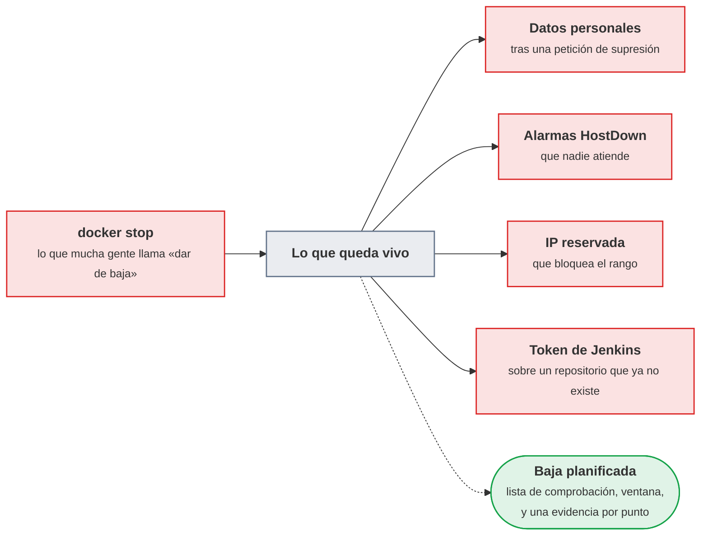
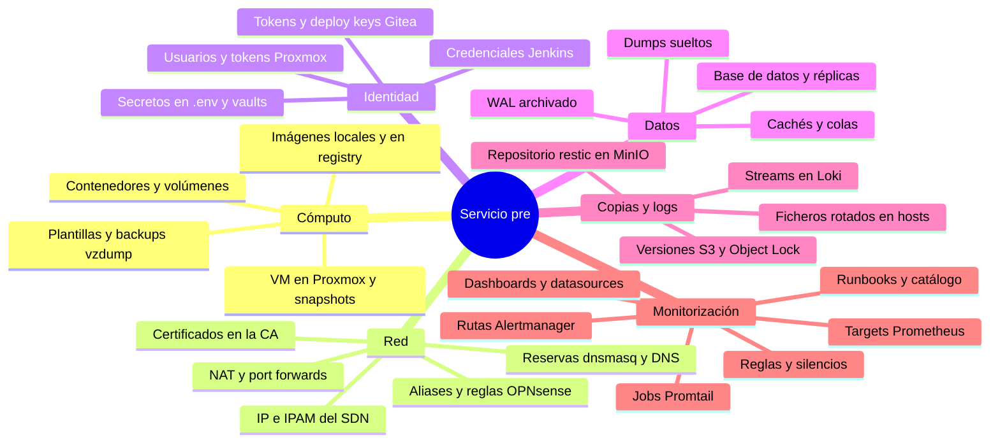
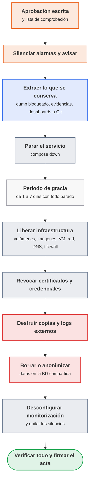
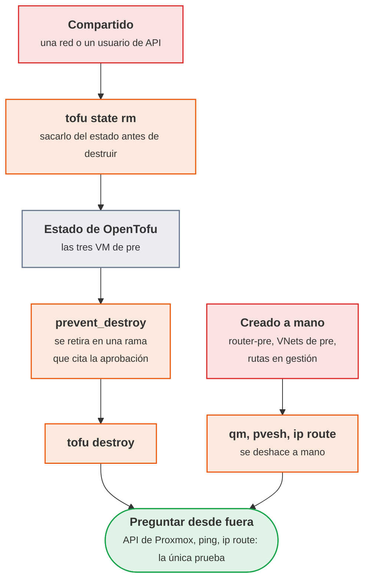

# UT8 · Terminación segura del contenedor

<p class="ut-meta">10 h · Sesiones 35 a 39 · RA5 CE a, b, c, d</p>

Esta es la última unidad en el centro. Durante el curso el servicio se ha levantado, instrumentado, protegido, probado, copiado y actualizado; ahora toca lo contrario: retirarlo sin dejar rastro. El sujeto de la baja es el entorno **pre**, creado con OpenTofu en la UT5 de Despliegue (8 de enero) y estrenado en esta asignatura en la UT7 (11 de febrero) para ensayar actualizaciones. Se da de baja de verdad: contenedores e imágenes, VM y redes, rutas desde gestión, credenciales, copias, correo de alertas, datos y toda referencia en la monitorización. Son cinco sesiones, de la 35 a la 39. La práctica evaluable, el acta de baja, no tiene sesión propia: se construye en las cinco hojas y se entrega por Aules antes del examen de la segunda evaluación, el 23 de marzo (sesión 40), que entra UT4, UT7 y UT8. En la formación en empresa se pide exactamente esto cuando un cliente deja de serlo.

## Introducción

Antes de entrar en las sesiones, tres cosas: lo que hay que saber hacer al terminar la unidad, los conceptos y herramientas que van a aparecer, y el plan de las cinco sesiones con lo que se explica y lo que se practica en cada una.

### Qué tienes que saber hacer al terminar

- Inventariar todo lo que un servicio ha dejado en la infraestructura y planificar su baja como un cambio con aprobación, ventana y comunicación (CE a).
- Terminar la aplicación y liberar contenedores, volúmenes, imágenes, VM, redes, rutas, DNS, certificados y credenciales, verificando cada punto con un comando lanzado desde fuera (CE a).
- Eliminar copias de seguridad y logs externos de forma que nadie pueda recuperarlos, eligiendo el método según el soporte (CE b).
- Borrar o anonimizar datos confidenciales en una base de datos que sigue en uso, y saber por qué un DELETE no basta (CE c).
- Retirar targets, reglas, rutas, dashboards y conectividad de la monitorización sin disparar alarmas fantasma (CE d).
- Redactar un acta de baja con evidencias que aguante una auditoría.

### Los conceptos de la unidad

Un jueves de marzo, dos días después de "dar de baja" el entorno pre parando los contenedores, alguien lanza desde Jenkins el despliegue a pre. La carpeta de pre seguía con su job habilitado y su credencial, así que la imagen vuelve a app01-pre y el servicio que todo el mundo daba por muerto se levanta otra vez. A la vez, Prometheus lleva dos días con tres targets en rojo, Alertmanager ha abierto una incidencia por cada uno y el compañero de guardia ha recibido avisos a las once de la noche por un servicio que se sabía que se iba a apagar. Y en MinIO siguen las copias de la base de datos de pre, con los correos y teléfonos de los usuarios de prueba, que nadie va a rotar ni a vigilar nunca más. Eso es lo que pasa cuando terminar un servicio se confunde con `docker stop`. El objetivo de la unidad es sencillo de decir: que del entorno pre no quede nada que no se haya decidido conservar, y poder demostrarlo con un acta en la que cada línea lleva su prueba.

| Herramienta o concepto | Qué es, en una frase | Para qué se usa en esta unidad |
|---|---|---|
| ITIL y el cambio normal | Un catálogo de buenas prácticas para gestionar servicios de TI; un "cambio normal" es el que necesita aprobación, evaluación de riesgo y ventana | Para tratar la baja como un cambio con solicitud, aprobación y acta, no como un apagado |
| RGPD, LOPDGDD y NIST SP 800-88 | Las dos normas de protección de datos aplicables en España y la guía del instituto de estándares de EE. UU. sobre borrado de soportes | Para decidir qué se conserva, hasta cuándo, y qué método de borrado vale para cada soporte |
| OpenTofu | La herramienta que describe la infraestructura en ficheros y la crea o destruye a partir de ellos (ya vista en Despliegue) | `tofu destroy` deshace las tres VM de pre que `tofu apply` creó, después de retirar en una rama el `prevent_destroy` que las protege |
| Proxmox: `qm` y `pvesh` | Los mandos de línea del hipervisor del aula | Destruir `router-pre` y las VNets de pre, que se crearon a mano y no están en el estado de OpenTofu |
| Docker Compose y registry Distribution | Compose gestiona el conjunto de contenedores de un proyecto; el registry es el almacén de imágenes de gitea01 | `compose down -v --rmi all` limpia app01-pre; el borrado por digest y el garbage collect limpian el registry |
| La CA del curso | La autoridad de la A3.2 de Despliegue, en `~/ca` del puesto de administración, que apunta en `index.txt` todo lo que firma | Comprobar que no hay certificados de pre y saber revocar uno publicando una CRL |
| Jenkins | El servidor de integración continua de Despliegue, con una carpeta por entorno | Borrar la carpeta `servicio/pre` y su credencial `ssh-pre` sin tocar el pipeline, que sigue construyendo |
| restic, MinIO y `mc` | El programa de copias cifradas del laboratorio, el almacén S3 donde guarda su repositorio y el cliente de línea de comandos de MinIO | Borrar las copias de pre de un repositorio que se conserva y comprobar que el bucket no guarda versiones antiguas |
| Loki, `logcli` y Mailpit | El almacén de logs de la UT1, su cliente de terminal y el buzón de pruebas donde llegan las alertas por correo | Comprobar que no quedan logs de pre y borrar solo los correos de alertas de pre |
| Prometheus (`promtool`), Alertmanager (`amtool`) y Grafana | La pila de monitorización que se usa durante todo el curso; `promtool` y `amtool` son las utilidades de terminal que validan y consultan Prometheus y Alertmanager | Silenciar pre, retirar sus targets y dashboards y expirar el silencio al final |
| PostgreSQL | La base de datos del servicio | Entender por qué `DELETE` no borra, usar `VACUUM FULL` y anonimizar con una sal de un solo uso |
| photorec (paquete testdisk) | Herramienta de recuperación de ficheros borrados | Demostrar sobre imágenes de prueba qué se recupera tras `rm`, tras `shred` y con un snapshot |

**Cómo está organizada la unidad.** La unidad sigue las cinco sesiones en orden y cada sesión trae primero la teoría que se explica y después su hoja de práctica. En la sesión 35 se planifica la baja como un cambio, se prepara el puesto de administración para toda la unidad y se inventaría con órdenes lo que pre ha dejado; de ahí sale la lista de comprobación, que se escribe ya en el acta. Las sesiones 36 y 37 ejecutan esa lista sobre la infraestructura, partida en dos mitades: primero lo que vive dentro de las máquinas (el servicio, sus contenedores y sus imágenes, con el volcado de bloqueo guardado antes) y después lo que vive fuera (las VM, las redes y las rutas, los certificados y las credenciales), que es la mitad que más tarda en verificarse. En la 38 se destruyen las copias, las imágenes del registry y los logs externos entendiendo por qué borrar no borra, y en la 39 se limpian los datos en una base compartida y la monitorización. Cada hoja añade sus filas y sus evidencias al acta, y el acta completa es la práctica evaluable; al final quedan los errores frecuentes como material de consulta.

!!! otra "Lo que hace falta de la otra asignatura"
    - pre lo creó Despliegue en dos tiempos: `router-pre` (ID 200) y las cuatro VNets de pre, a mano, en su [A2.5](https://victor-educ.github.io/apuntes-5166/ut/ut2-vpc/) del 11 de noviembre; las tres VM, con OpenTofu en la [UT5](https://victor-educ.github.io/apuntes-5166/ut/ut5-iac/) (A5.3, 8 de enero), en el repositorio `iac-lab` del puesto de administración, con el estado en MinIO y `prevent_destroy`. `tofu destroy` es el inverso de aquel `tofu apply`; lo que se hizo a mano se deshace a mano.
    - El último despliegue en pre es el de la [A6.8 de Despliegue](https://victor-educ.github.io/apuntes-5166/ut/ut6-ci/) (26 de febrero), que deja en Jenkins la carpeta `servicio/pre` con la credencial `ssh-pre` y en agent01 la ruta a pre. La práctica evaluable de su UT6 (10 de marzo) se entrega con aquellas evidencias y no despliega, así que la baja puede empezar el 9. El repositorio `servicio`, su webhook y el Multibranch no se tocan en ningún momento: el pipeline sigue construyendo.
    - La pila de monitorización es una sola, la de `/opt/monitoring` en mon01, y la [UT7 de Despliegue](https://victor-educ.github.io/apuntes-5166/ut/ut7-monitorizacion/) trabaja en ella el 12 y el 17 de marzo: añade sus targets con `env="dev"` en ficheros propios y deja el grupo `env: pre` del job `node` para que lo retire aquí la A8.5, el 18. Ninguna de las dos asignaturas detiene la pila.

### Plan de sesiones

Cada sesión son 110 minutos y empieza con una explicación corta antes del laboratorio. La columna «Se explica» recoge los apartados de teoría que se desarrollan en clase, con su duración aproximada; la columna «Se practica», el trabajo de laboratorio de esa sesión. Las sesiones marcadas solo como práctica no traen teoría nueva.

| Sesión | Fecha | Tipo | Se explica | Se practica |
|---:|-------|------|------------|-------------|
| [35](#sesion-35-plan-de-baja) | 25 feb | Teoría y práctica | La baja como cambio: aprobación, ventana, qué se conserva (10 min); dónde deja rastro un servicio y la lista de comprobación (15 min). | Preparar el puesto de administración para toda la unidad, inventariar con órdenes lo que pre ha dejado y abrir el acta de baja con la lista de comprobación. |
| [36](#sesion-36-liberar-la-infraestructura-servicio-y-contenedores) | 9 mar | Teoría y práctica | Orden correcto de la baja y periodo de gracia (10 min); cómo se liberan contenedores, volúmenes e imágenes y cómo se guarda el volcado de bloqueo (15 min). | Silenciar pre, guardar el volcado de bloqueo cifrado, deshabilitar el despliegue a pre y dejar app01-pre sin contenedores, volúmenes ni imágenes. |
| [37](#sesion-37-liberar-la-infraestructura-vm-red-y-credenciales) | 11 mar | Teoría y práctica | Lo que tofu destroy no se lleva y por qué se verifica desde fuera (10 min); cómo se liberan VM, redes, rutas, certificados y credenciales (20 min). | Retirar el prevent_destroy en una rama, destruir pre con tofu destroy, borrar router-pre y sus VNets, quitar las rutas a pre y la carpeta pre de Jenkins, y verificar cada punto desde fuera. |
| [38](#sesion-38-copias-y-logs) | 16 mar | Teoría y práctica | Por qué borrar no borra: SSD, copy-on-write, versionado; borrado criptográfico y borrado en el sistema de copias (15 min); borrar del registry (5 min); qué recupera photorec en cada caso (5 min). | Borrar las copias de pre en restic, sus etiquetas del registry y su correo en Mailpit, comprobar Loki e intentar recuperar con photorec en tres escenarios. |
| [39](#sesion-39-datos-y-monitorizacion) | 18 mar | Teoría y práctica | DELETE, DROP y VACUUM FULL; anonimización (10 min); desconfigurar targets, reglas y dashboards (5 min). | Anonimizar y borrar con VACUUM FULL en una base de prueba del PostgreSQL de dev; retirar los targets de pre, expirar el silencio y cerrar el acta. |

La [práctica evaluable](#practica-evaluable) no tiene sesión: es el acta de baja que se abre en la A8.1 y se completa en cada hoja, y se entrega por Aules antes del examen del 23 de marzo.

## Sesión 35 · Plan de baja

<p class="ut-meta" markdown>25 de febrero · Teoría y práctica · <span class="dur" tabindex="0" aria-label="La baja es un cambio más · 10 min&#10;Inventario de rastros · 15 min&#10;A8.1 Plan de baja · 85 min" data-dur="La baja es un cambio más · 10 min&#10;Inventario de rastros · 15 min&#10;A8.1 Plan de baja · 85 min">:material-school:<i class="dur-barra" style="--teoria:23%"></i>:material-flask:</span></p>

Al acabar esta sesión el puesto de administración está preparado para toda la unidad, con las variables, el túnel y las herramientas que usan las cinco hojas, y existe el acta de baja con el inventario real de lo que pre ha dejado y la lista de comprobación, con un comando de verificación por punto. La hoja se apoya en los dos apartados que se explican al principio: por qué la baja se trata como un cambio, con lo que la ley obliga a conservar, y el método para inventariar rastros, que termina en la lista de comprobación completa.

### La baja es un cambio más

Terminar un contenedor "para siempre" no es `docker stop`. Un servicio deja huella en la infraestructura, en la monitorización, en las copias y en los datos, y cada rastro es un coste o un riesgo: datos personales que siguen existiendo después de que el cliente pidiera su supresión, alarmas HostDown que nadie atiende, una IP reservada que impide reutilizar el rango, un token de Jenkins con permisos sobre un repositorio que ya no existe. Por eso la baja se planifica con una lista de comprobación y se documenta como cualquier otro cambio.



<p class="pie" markdown>Cada rastro que se queda es un coste o un riesgo. Por eso la baja se aprueba, se ejecuta y se documenta como cualquier otro cambio.</p>


En ITIL (el catálogo de buenas prácticas de gestión de servicios de TI), la baja de un servicio es un **cambio normal**: pasa por una solicitud (RFC), una evaluación de riesgo, la aprobación de quien tiene autoridad sobre el servicio (en una empresa pequeña el responsable técnico y el dueño del negocio; en una grande, el CAB, el comité que aprueba los cambios) y una ventana acordada. No es un cambio estándar (los cambios estándar son los repetitivos y de bajo riesgo, y una baja destruye datos, así que nunca lo es) ni una emergencia. En la práctica eso se traduce en cuatro cosas que tienen que existir antes de tocar nada:

1. **Confirmación escrita** del responsable del servicio con fecha. Un correo vale; una conversación en el pasillo no. Ese correo va al acta. En el laboratorio es la respuesta del profesor a la solicitud en Aules.
2. **Ventana de ejecución.** Aunque el servicio ya no dé tráfico, la baja toca sistemas compartidos (el firewall, Prometheus, la base de datos común). Se hace en horario en que alguien pueda deshacer un error.
3. **Comunicación.** A los usuarios que quedasen (aviso previo de cierre, normalmente con semanas), a los equipos que consumen la monitorización (para que no abran incidencias) y al equipo de soporte.
4. **Lista de lo que se conserva y hasta cuándo.** Esto es lo que más se olvida y lo que más problemas legales da en las dos direcciones: conservar de más incumple el principio de limitación del plazo de conservación, y borrar de menos incumple una obligación fiscal.

#### Qué hay que conservar por obligación legal

Esto no es asesoramiento jurídico, pero un técnico tiene que saber qué preguntar y a quién. En España los plazos orientativos son estos:

| Tipo de dato | Norma | Plazo habitual |
|---|---|---|
| Facturas y documentación contable | Código de Comercio, art. 30 | 6 años |
| Justificantes con trascendencia tributaria | Ley General Tributaria, art. 66 y siguientes | 4 años desde la prescripción |
| Datos personales de clientes tras el fin de la relación | RGPD art. 5.1.e y 17; LOPDGDD | Bloqueo (art. 32 LOPDGDD) mientras puedan derivarse responsabilidades; después supresión |
| Logs de acceso con IP o usuario | RGPD (son datos personales); ENS (Esquema Nacional de Seguridad) para el sector público | Entre 6 meses y 2 años según finalidad y política; el ENS pide al menos lo que dure el análisis de incidentes |
| Registros de actividades de tratamiento | RGPD art. 30 | Mientras exista el tratamiento, y se actualiza con la baja |

El mecanismo del artículo 32 de la LOPDGDD (bloqueo de datos) es el que da sentido a "qué se conserva por si acaso": los datos se dejan de tratar, se aíslan con acceso restringido al responsable y a la autoridad, y solo se destruyen cuando prescriben las responsabilidades. Técnicamente eso es un volcado cifrado en un sitio al que solo llega el DPO (el delegado de protección de datos) o el responsable, con fecha de destrucción apuntada en el acta. Lo que no puede ser es "lo dejamos en el bucket de siempre porque nunca se sabe".

El acta tiene que decir, para cada categoría de datos, una de tres cosas: se destruye ahora (y cómo), se bloquea hasta una fecha (y dónde), o se transfiere a otro servicio que hereda el tratamiento.

### Inventario de rastros

Antes de borrar hay que saber qué hay. Un servicio de un año deja rastros en sitios que nadie recuerda, y el que mejor conoce el sistema se fue hace tres meses. Hace falta un método, no memoria. El mapa siguiente agrupa los rastros en seis familias; conviene fijarse en que la mitad no están en el servicio sino alrededor de él (red, identidad, copias, monitorización), y esas son las que se olvidan.



<p class="pie" markdown>Seis sitios donde queda rastro de un servicio. El que siempre se olvida es el último: la monitorización sigue vigilando algo que ya no existe.</p>

El método es buscar el entorno por sus tres cadenas (la etiqueta `env="pre"`, el dominio `pre.lab` y el rango `10.20.`) en todos los sitios donde puedan estar escritas, y preguntar a cada sistema de la forma que ese sistema admite. La diferencia no es un capricho de cada herramienta: depende de dónde guarde la información y de si la deja ver en claro. En el laboratorio la lista es más corta que el mapa, pero tiene las mismas trampas:

- **Repositorios.** Lo que está en Git se encuentra con `git grep` de las tres cadenas: `iac-lab`, `operacion` y `entregas-5166` en el puesto de administración, `monitoring` y `alerting` en mon01. Que salga una línea que no estaba prevista es lo normal; se apunta.
- **OpenTofu frente a Proxmox.** `tofu state list` dice lo que la herramienta creó; la API de Proxmox, lo que existe. Comparar las dos listas es lo que descubre lo que se hizo a mano: `router-pre` y las VNets de pre son de la UT2 de Despliegue y no están en ningún estado.
- **Prometheus.** No basta con leer `prometheus.yml`: se pregunta a la API por las series que existen ahora mismo con `env="pre"`. Configuración y estado no siempre coinciden, y lo que sobra puede estar en cualquiera de los dos.
- **Jenkins y el registry.** Las credenciales de Jenkins están cifradas y solo se listan por la API de su carpeta; las etiquetas del registry, por la suya. Cuáles de esas etiquetas llegaron a pre lo dice `docker images` en app01-pre.
- **Red.** Las rutas hacia `10.20.0.0/16` están en tres máquinas de gestión (el puesto, agent01 y mon01), y los nombres de pre los sirve el dnsmasq de `router-pre`, que muere con él. OPNsense no sabe nada de pre, y eso también se comprueba.
- **Certificados.** En la CA del curso no hay API que preguntar: el fichero `index.txt` de `~/ca` lista todo lo emitido con su estado (V válido, R revocado, E expirado) y se lee buscando el dominio.
- **Copias, correo y logs.** `restic snapshots --tag pre` en el repositorio del laboratorio, una búsqueda en Mailpit por las direcciones de pre y `logcli series` en Loki.

Los comandos concretos de cada punto están en los pasos 4 y 5 de la [A8.1](#a81-plan-de-baja-sesion-35), que es donde se teclean. El resultado del inventario es la lista de comprobación de la baja: una fila por rastro, en orden de ejecución, con cómo se verifica que ya no está.

#### Lista de comprobación completa

Esta es la lista para pre, en el orden en que se ejecuta y con la hoja que se encarga de cada punto. Cada línea lleva el comando de verificación, porque una casilla marcada sin evidencia no vale nada en un acta; `amt`, `pve` y `rst` son abreviaturas que prepara la A8.1 para Alertmanager, la API de Proxmox y restic.

- [ ] Aprobación escrita archivada: `ev/01-aprobacion.txt` con la respuesta del profesor (A8.1)
- [ ] Silencio en Alertmanager para `env="pre"`, más largo que la ventana: `amt silence query env=pre` (A8.2)
- [ ] Volcado de bloqueo cifrado, comprobado y entregado al DPO: `pg_restore -l` y `sha256sum` (A8.2)
- [ ] Dashboards de pre exportados a Git, si los hay: `git -C ~/operacion log -1 -- dashboards/pre/` (A8.2)
- [ ] Job de despliegue a pre deshabilitado: la API de Jenkins lo da en `disabled` (A8.2)
- [ ] Servicio parado y app01-pre sin contenedores, volúmenes, imágenes ni redes propias: `docker ps -a`, `docker volume ls`, `docker images` vacíos (A8.2)
- [ ] `prevent_destroy` retirado en una rama de `iac-lab` que cita la aprobación: `git log -1` de la rama `baja-pre` (A8.3)
- [ ] VM de pre destruidas con OpenTofu: `tofu state list` vacío (A8.3)
- [ ] `router-pre` y VNets de pre destruidos: `pve` no lista nada de la franja 200 ni VNets `pre*`; `ping 10.10.0.2` sin respuesta (A8.3)
- [ ] Rutas a pre retiradas en el puesto, agent01 y mon01: `ip route show 10.20.0.0/16` vacío; `dig +short app01.pre.lab @10.10.0.1` vacío (A8.3)
- [ ] Carpeta `servicio/pre` y credencial `ssh-pre` borradas en Jenkins, con el historial de despliegues guardado: la carpeta responde 404 (A8.3)
- [ ] Ningún certificado de pre en la CA, o revocados con su CRL: `grep -i 'pre\.lab' ~/ca/index.txt` (A8.3)
- [ ] Copias de pre fuera del repositorio restic: `restic snapshots --tag pre` vacío y `restic check` sin errores (A8.4)
- [ ] Bucket sin versiones antiguas de lo borrado: `mc version info lab/backups` (A8.4)
- [ ] Etiquetas desplegadas en pre borradas del registry por digest: `tags/list` sin ellas; recolector de basura ejecutado o pendiente con fecha (A8.4)
- [ ] Correo de alertas de pre borrado de Mailpit sin tocar el resto: la búsqueda da 0 (A8.4)
- [ ] Loki sin streams de pre: `logcli series '{host=~".+-pre"}'` vacío (A8.4)
- [ ] Datos del tenant pre anonimizados y tablas borradas con `VACUUM FULL`: la consulta de control da 0 (A8.5)
- [ ] Réplicas y volcados sueltos revisados en db01 (A8.5)
- [ ] Targets de pre retirados: `count(up{env="pre"})` vacío (A8.5)
- [ ] Reglas, rutas y dashboards sin referencias a pre: `git grep` y búsquedas por API vacías (A8.5)
- [ ] Silencio expirado y sin alertas: `amt alert query env=pre` vacío (A8.5)
- [ ] Series de pre fuera del TSDB: por retención, como pendiente con fecha, o con `delete_series` (A8.5)
- [ ] Acta completa, sin filas sin evidencia ni pendientes sin fecha (A8.5)

### A8.1 Plan de baja (sesión 35)

<span class="et et-obj">Objetivo</span> El puesto de administración preparado para las cinco hojas de la unidad (variables, túnel a la pila y herramientas) y `operacion/baja/pre/acta.md` abierta con el inventario real de pre y la lista de comprobación, con un comando de verificación por punto.

<span class="et et-pre">Antes de empezar</span>

- Entra en el puesto de administración con `ssh -A ops@<IP de aula de admin01>`: el `-A` le presta tu clave para llegar a mon01, agent01, db01 y las VM de pre, como en la A5.5 de Despliegue.
- A mano, en el gestor de contraseñas del puesto: el token `tofu` de Proxmox (A5.1 de Despliegue), los secretos de las credenciales `tofu` y `restic` de MinIO (A5.2), la contraseña del usuario del registry (A6.6) y la de `admin` en Jenkins. En el puesto, `~/iac-lab/envs/pre` con su backend inicializado (A5.4) y el entorno de restic de la A7.4 en `/etc/restic/`.
- Se han explicado [la baja como cambio](#la-baja-es-un-cambio-mas), [el inventario de rastros](#inventario-de-rastros) y la [lista de comprobación completa](#lista-de-comprobacion-completa). La plantilla del acta está en la [práctica evaluable](#acta-de-baja).

<span class="et et-pas">Pasos</span>

1. Crea `~/baja-pre.env`, que cargarás al empezar cada sesión de la unidad. Copia el bloque, sustituye cada `...` por su secreto y la IP del nodo por la tuya. Lleva secretos: permisos 600 y fuera de cualquier repositorio.

    ```bash
    # ~/baja-pre.env · UT8. Se carga con ". ~/baja-pre.env" al empezar cada sesión
    export EV=~/operacion/baja/pre/ev             # evidencias: siempre aquí, nunca en una VM que se destruye
    export GPG_TTY=$(tty)
    # OpenTofu y Proxmox: el token de la A5.1 y la credencial tofu de MinIO de la A5.2 de Despliegue
    export TF_VAR_pve_token='terraform@pve!tofu=...'
    export AWS_ACCESS_KEY_ID=tofu AWS_SECRET_ACCESS_KEY='...'
    export PVE=https://192.168.1.50:8006/api2/json
    pve() { curl -sk -H "Authorization: PVEAPIToken=$TF_VAR_pve_token" "$PVE$1"; }
    # La pila de mon01: Prometheus, Alertmanager y Mailpit solo escuchan en su 127.0.0.1, se llega por túnel
    tunel() { ssh -fN -L 9090:127.0.0.1:9090 -L 9093:127.0.0.1:9093 -L 8025:127.0.0.1:8025 ops@10.10.0.20; }
    export P=http://localhost:9090 MP=http://localhost:8025/api/v1
    amt() { ssh ops@10.10.0.20 docker compose -f /opt/monitoring/compose.yml exec -T alertmanager amtool --alertmanager.url=http://localhost:9093 "$@"; }
    export G=https://grafana.lab GRAFANA_TOKEN='...'
    # Loki pide certificado de cliente: el del puesto, de la evaluable de la UT3
    export LOKI_ADDR=https://10.10.0.20:3100
    export LOKI_CLIENT_CERT_PATH=~/tls-monitorizacion/logcli.crt LOKI_CLIENT_KEY_PATH=~/tls-monitorizacion/logcli.key
    # Jenkins, con el usuario admin, y el registry de gitea01
    export J=https://jenkins.lab JENKINS_TOKEN='...'
    export R=https://registry.lab:5000/v2/app REG_USER=jenkins REG_PASS='...'
    # restic con el entorno de la A7.4 (/etc/restic, del usuario ops y con permisos 700), en una subshell
    rst() { ( set -a; . /etc/restic/env; set +a; exec restic "$@" ); }
    ```

2. Completa lo que falta en el puesto: la CA del curso en el almacén del sistema, para que `curl` y `logcli` confíen en `jenkins.lab`, `grafana.lab`, el registry y Loki sin repetir `--cacert` en cada orden; `jq`; y el cliente de MinIO con el alias `lab` y la credencial `restic`.

    ```bash
    chmod 600 ~/baja-pre.env
    sudo cp ~/ca/ca.crt /usr/local/share/ca-certificates/lab-5166-ca.crt && sudo update-ca-certificates
    sudo apt install -y jq
    curl -sSLo /tmp/mc https://dl.min.io/client/mc/release/linux-amd64/mc && sudo install /tmp/mc /usr/local/bin/mc
    mc alias set lab http://10.10.0.30:9000 restic '<secreto de restic>'
    ```

    Faltan los dos tokens del fichero. En Grafana, desde el navegador de tu puesto como en la UT3: Administration → Users and access → Service accounts → Add service account, nombre `baja-pre` y rol Editor, y dentro, Add service account token. En Jenkins, con el usuario `admin`: tu nombre arriba a la derecha → Security → API Token → Add new Token. Pega los dos en `~/baja-pre.env`.

3. Carga el fichero, abre el túnel y comprueba que llegas a todo lo que usará la unidad. Si algo no responde, arréglalo hoy: las hojas siguientes lo dan por hecho.

    ```bash
    . ~/baja-pre.env && tunel
    curl -s $P/-/ready                                    # Prometheus Server is Ready.
    amt silence query | head -3                           # responde aunque no haya silencios
    curl -s -H "Authorization: Bearer $GRAFANA_TOKEN" "$G/api/search?limit=1" | jq length
    curl -s -u admin:$JENKINS_TOKEN "$J/api/json?tree=mode"
    logcli labels | head -3
    rst snapshots --compact | tail -3
    pve /version | jq -r .data.version
    ```

4. Inventario desde el puesto: todo lo que se pregunta por API o vive en esta máquina. Hoy la carpeta `servicio/pre` de Jenkins todavía no existe (nace mañana, en la A6.8 de Despliegue), así que esa línea sale con error: es lo esperado, y la A8.2 la repite.

    ```bash
    mkdir -p $EV
    {
      echo "== OpenTofu: estado de envs/pre"; ( cd ~/iac-lab/envs/pre && tofu state list )
      echo "== Proxmox: franja 200 y VNets de pre"
      pve '/cluster/resources?type=vm' | jq -r '.data[] | select(.vmid>=200 and .vmid<300) | "\(.vmid) \(.name) \(.status)"'
      pve /cluster/sdn/vnets | jq -r '.data[].vnet | select(startswith("pre"))'
      echo "== Rutas a pre en el puesto"; ip route show 10.20.0.0/16
      echo "== Certificados de pre en la CA"; grep -i 'pre\.lab' ~/ca/index.txt
      echo "== Copias de pre"; rst snapshots --tag pre --compact
      echo "== Prometheus"; curl -s -G $P/api/v1/query --data-urlencode 'query=up{env="pre"}' \
        | jq -r '.data.result[] | "\(.metric.job) \(.metric.instance) \(.value[1])"'
      echo "== Registry"; curl -s -u "$REG_USER:$REG_PASS" $R/tags/list | jq -r '.tags[]'
      echo "== Jenkins"; curl -s -u admin:$JENKINS_TOKEN "$J/job/servicio/job/pre/credentials/store/folder/domain/_/api/json?depth=1" | jq -r '.credentials[].id'
      echo "== Grafana: dashboards con la etiqueta pre"; curl -s -H "Authorization: Bearer $GRAFANA_TOKEN" "$G/api/search?tag=pre" | jq -r '.[] | "\(.uid) \(.title)"'
      echo "== Mailpit: correos de pre"; curl -s -G $MP/search --data-urlencode 'query=10.20.' | jq .messages_count
      echo "== Loki"; logcli series --since=168h '{host=~".+-pre"}'
    } 2>&1 | tee $EV/00-inventario.txt
    ```

5. Inventario en las otras máquinas, por SSH desde la misma shell, y en los repositorios. Si tus copias de trabajo están en otra ruta, cámbiala en el bucle.

    ```bash
    {
      echo "== app01-pre"; ssh ops@10.20.2.10 'sudo docker compose ls; sudo docker images --format "{{.Repository}}:{{.Tag}}"'
      echo "== mon01"; ssh ops@10.10.0.20 'ip route show 10.20.0.0/16
        for r in monitoring alerting; do git -C /opt/$r grep -n -E "10\.20\.|pre\.lab|env.{0,3}pre"; done'
      echo "== agent01"; ssh ops@10.10.0.12 'ip route show 10.20.0.0/16'
      echo "== DNS de gestión"; dig +short app01.pre.lab @10.10.0.1
      echo "== Repositorios del puesto"
      for r in iac-lab operacion entregas-5166; do git -C ~/$r grep -c -E '10\.20\.|pre\.lab'; done
    } 2>&1 | tee -a $EV/00-inventario.txt
    ```

6. Abre el acta: copia la [plantilla](#acta-de-baja) en `~/operacion/baja/pre/acta.md` y rellena la identificación. Después escribe la lista de comprobación partiendo de la [lista completa](#lista-de-comprobacion-completa): una fila por rastro del inventario, en el mismo orden, con su verificación y la hoja que la ejecuta, y las columnas de resultado y evidencia vacías. Compara las dos primeras secciones del inventario: lo que lista Proxmox y no está en el estado de OpenTofu (`router-pre` y las VNets) se destruye a mano y lleva sus propias filas. Lo que no esperabas (un grupo `env: pre` en otro job, una etiqueta que no reconoces, correo de pre en Mailpit) va a "Incidencias durante la baja".

7. Rellena "Qué se conserva" con motivo, dónde y hasta cuándo: el volcado de bloqueo, el repositorio `servicio` con su webhook y su Multibranch (dev los sigue usando), el token de OpenTofu, el repositorio restic (guarda más copias que las de pre) y el historial de despliegues de Jenkins. Haz commit del acta y de `ev/00-inventario.txt`, y pide la aprobación subiendo el enlace del commit a la tarea de la A8.1 en Aules. La respuesta del profesor, con su fecha, se copia en `ev/01-aprobacion.txt` antes del 9 de marzo: es la aprobación escrita sin la que la A8.2 no empieza.

<span class="et et-com">Comprobación</span> `tunel` y las siete comprobaciones del paso 3 responden; `ev/00-inventario.txt` tiene todas sus secciones, con tres VM de pre en el estado de OpenTofu y cuatro en la franja 200 de Proxmox; la lista del acta empieza por la aprobación y el silencio y termina con la expiración del silencio y el cierre del acta; ninguna fila sin verificación.

<span class="et et-ent">Entrega</span> `acta.md` y `ev/00-inventario.txt` en un commit del repositorio `operacion`, y la solicitud de aprobación en Aules.

<span class="et et-ext">Si te sobra tiempo</span> Redacta en la identificación del acta la comunicación de la baja: el aviso a los usuarios, a soporte y a la guardia, con la fecha de cada uno.

## Sesión 36 · Liberar la infraestructura: servicio y contenedores

<p class="ut-meta" markdown>9 de marzo · Teoría y práctica · <span class="dur" tabindex="0" aria-label="El orden importa · 10 min&#10;Cómo se libera cada capa dentro de la VM · 15 min&#10;A8.2 Liberar el servicio y los contenedores · 85 min" data-dur="El orden importa · 10 min&#10;Cómo se libera cada capa dentro de la VM · 15 min&#10;A8.2 Liberar el servicio y los contenedores · 85 min">:material-school:<i class="dur-barra" style="--teoria:23%"></i>:material-flask:</span></p>

Primera mitad de la baja de la infraestructura: la que ocurre dentro de las máquinas. Al terminar la sesión pre está silenciado, el volcado de bloqueo está guardado y comprobado, el despliegue a pre está deshabilitado y en app01-pre no quedan contenedores, volúmenes, imágenes ni redes del servicio. Las VM siguen en pie a propósito: son el trabajo de la sesión siguiente. La sesión empieza por el orden de la baja y sigue con cómo se libera cada capa dentro de la máquina y cómo se guarda antes lo que se conserva: los bloques de comandos que teclea la hoja se ven antes en clase, de modo que en el laboratorio se copian tal cual.

### El orden importa

Hay una secuencia correcta y no es "borrar de arriba abajo". Si el servicio se para antes de silenciar las alarmas, Alertmanager abre incidencias, el receptor webhook crea tickets y el equipo de guardia recibe un aviso a las diez de la noche por un servicio que se sabía que iba a apagarse. Si los volúmenes se borran antes de haber verificado que la copia bloqueada existe y se puede restaurar, ya no hay vuelta atrás. Si la VM se destruye antes de exportar las evidencias que están dentro (logs de auditoría, por ejemplo), el acta se queda sin pruebas.



<p class="pie" markdown>El **periodo de gracia** es el último momento reversible: una vez pasado, lo que viene debajo ya no se puede deshacer. De ahí que se extraiga antes lo que se conserva.</p>

El periodo de gracia del paso E es opcional pero muy recomendable: el servicio está parado, nada se ha destruido, y si alguien grita ("el informe mensual tiraba de esa API") se levanta en un minuto. En una empresa una semana es lo habitual. En el laboratorio va del 9 al 11 de marzo: el servicio está parado y app01-pre vacía, pero db01-pre sigue intacta y la imagen sigue en el registry, así que volver atrás es habilitar el job de despliegue de pre y relanzarlo. Lo irreversible empieza el 11, con `tofu destroy`, y desde ese momento la única vuelta atrás es la copia bloqueada.

Los silencios se quitan al final, no antes, y con criterio: si el silencio se retira con los targets todavía configurados, salta todo. Primero se retiran los targets y las reglas, se comprueba que no hay alertas pendientes, y entonces se expira el silencio. La [lista de comprobación completa](#lista-de-comprobacion-completa) de la sesión 35 sigue exactamente este orden.

### Cómo se libera cada capa dentro de la VM

Aquí empieza la parte de manos en el teclado. En esta primera mitad se devuelve lo que el entorno pre tenía asignado dentro de app01-pre: los contenedores, los volúmenes, las imágenes y las redes de Docker. Antes se extrae lo que se conserva. Cada recurso tiene un comando para liberarlo y otro para comprobar que ya no está, y ese segundo es el que va al acta.

| Recurso | Cómo se libera | Cómo se verifica |
|---|---|---|
| Contenedores | `docker compose down` | `docker ps -a` vacío |
| Volúmenes | `docker compose down -v`; `docker volume rm` | `docker volume ls` vacío |
| Imágenes | `docker compose down --rmi all`; `docker image prune -a` en un host dedicado | `docker images` vacío; las del registry, en la sesión 38 |
| Redes | `docker compose down`; `docker network rm` | `docker network ls` sin redes propias |

#### Docker en app01-pre

En app01-pre el servicio es el compose de `/opt/servicio`, proyecto `servicio`, con un solo servicio, `app`: la base de datos de pre vive en db01-pre como paquete de Debian, no en un contenedor. `docker compose down` para y elimina contenedores y redes del proyecto, pero deja los volúmenes con nombre y las imágenes. Con `-v` elimina también los volúmenes declarados en el fichero y los anónimos; con `--rmi all`, las imágenes que usaba el proyecto. Es la forma limpia de terminar un despliegue de Compose porque usa las etiquetas `com.docker.compose.project` para saber qué es suyo y no toca otros proyectos del mismo host:

```bash
docker compose -f /opt/servicio/compose.yml down -v --rmi all --remove-orphans
docker ps -aq; docker volume ls -q; docker images -q          # vacíos
```

`--remove-orphans` limpia contenedores del proyecto que ya no aparecen en el fichero. Lo que `down -v` no ve son los volúmenes creados a mano con `docker volume create` y montados como `external: true`: se borran con `docker volume rm`, después de mirar quién más los usa con `docker ps -a --filter volume=<nombre>`.

`docker image prune -a` borra todas las imágenes sin contenedor del host entero, no solo las del proyecto, y `docker system prune -af --volumes` además contenedores parados, redes sin usar, caché de build y volúmenes anónimos. En app01-pre, donde solo vive este servicio y que se destruye dos días después, es aceptable; en un host compartido no se ejecuta nunca, y se borra imagen por imagen con `docker image rm`.

Un volumen borrado es un `rm -rf` de `/var/lib/docker/volumes/<nombre>/_data`: los bloques siguen en el disco de la VM hasta que el disco se destruye, y el porqué está en la [sesión 38](#por-que-borrar-no-borra).

#### El volcado de bloqueo

Lo que se conserva sale antes de destruir nada. Para pre es un volcado completo de su base de datos, cifrado, que queda bloqueado en el sentido del artículo 32 de la LOPDGDD: solo lo abre el DPO y tiene fecha de destrucción en el acta. Se pide desde el puesto de administración, de modo que el volcado viaja por SSH y no toca ningún disco sin cifrar:

```bash
ssh ops@10.20.3.10 'sudo -u postgres pg_dump -Fc servicio' | gpg -c --cipher-algo AES256 -o ~/pre-bloqueo.dump.gpg
gpg -d ~/pre-bloqueo.dump.gpg | pg_restore -l | head -5     # el índice del volcado: no está vacío
sha256sum ~/pre-bloqueo.dump.gpg                             # la huella que va al acta
```

`-Fc` es el formato propio de `pg_dump`, comprimido, que `pg_restore -l` sabe listar: esa lista es la prueba de que el volcado se puede restaurar, y sin ella no se destruye nada. `gpg -c` cifra con una frase de paso y no con la clave pública de nadie: en el laboratorio el DPO es el profesor, que recibe el fichero por un lado y la frase de paso por otro. En una empresa se cifra para la clave del DPO (`gpg -e -r <su clave>`) y la frase no viaja. Si `gpg` falla con `Inappropriate ioctl for device`, no sabe en qué terminal pedir la frase: le falta `GPG_TTY`, que carga el fichero de la A8.1.

### A8.2 Liberar el servicio y los contenedores (sesión 36)

<span class="et et-obj">Objetivo</span> pre silenciado, con el volcado de bloqueo guardado y comprobado, el despliegue a pre deshabilitado y app01-pre sin contenedores, volúmenes, imágenes ni redes del servicio, cada verificación en `$EV` y apuntada en el acta.

<span class="et et-pre">Antes de empezar</span>

- Entra en el puesto de administración con `ssh -A`, carga `. ~/baja-pre.env` y abre el túnel con `tunel`.
- La aprobación del profesor en `ev/01-aprobacion.txt`. Sin ella no se toca nada.
- La A6.8 de Despliegue (26 de febrero) fue el último despliegue en pre, y su práctica evaluable de mañana no despliega.
- Se han explicado [el orden de la baja](#el-orden-importa) y [cómo se libera cada capa dentro de la VM](#como-se-libera-cada-capa-dentro-de-la-vm): los bloques de ese apartado son los que se copian aquí.

<span class="et et-pas">Pasos</span>

1. Repite la parte del inventario que cambió con la A6.8 de Despliegue: la carpeta de pre en Jenkins, lo que está desplegado en app01-pre y la ruta de agent01. Añade al acta las filas que falten.

    ```bash
    { echo "== Jenkins: carpeta servicio/pre"
      curl -s -u admin:$JENKINS_TOKEN "$J/job/servicio/job/pre/api/json?tree=jobs[name]" | jq -r '.jobs[].name'
      curl -s -u admin:$JENKINS_TOKEN "$J/job/servicio/job/pre/credentials/store/folder/domain/_/api/json?depth=1" | jq -r '.credentials[].id'
      echo "== app01-pre"; ssh ops@10.20.2.10 'sudo docker compose ls; sudo docker images --format "{{.Repository}}:{{.Tag}}"'
      echo "== agent01"; ssh ops@10.10.0.12 'ip route show 10.20.0.0/16'
    } 2>&1 | tee $EV/00b-inventario.txt
    ```

    Las etiquetas `registry.lab:5000/app:<commit>` que salen en app01-pre son las que llegaron a pre: la A8.4 las borra del registry, y este fichero es lo único que las recordará cuando app01-pre ya no exista.

2. Silencia pre antes de tocar nada. El silencio dura más que la ventana entera, porque no se retira hasta la A8.5:

    ```bash
    amt silence add env=pre --duration=12d --author=ops --comment=baja-pre
    amt silence query env=pre | tee $EV/02-silencio.txt
    ```

3. Extrae el volcado de bloqueo con el bloque del [apartado](#el-volcado-de-bloqueo). `pg_restore` no suele estar en el puesto:

    ```bash
    sudo apt install -y postgresql-client
    ssh ops@10.20.3.10 'sudo -u postgres pg_dump -Fc servicio' | gpg -c --cipher-algo AES256 -o ~/pre-bloqueo.dump.gpg
    gpg -d ~/pre-bloqueo.dump.gpg | pg_restore -l | head -5 | tee $EV/03-dump-bloqueo.txt
    sha256sum ~/pre-bloqueo.dump.gpg | tee -a $EV/03-dump-bloqueo.txt
    ```

    Sube el `.gpg` a la tarea de la A8.2 en Aules y manda la frase de paso al profesor en un mensaje aparte; ninguno de los dos va al repositorio. Este es el paso que hay que hacer bien: desde el 11 de marzo, la única copia de los datos de pre es esta.

4. Si el inventario encontró dashboards de pre en Grafana, expórtalos a Git antes de que nadie los borre. Si la búsqueda salió vacía, pasa al paso siguiente.

    ```bash
    mkdir -p ~/operacion/dashboards/pre && H="Authorization: Bearer $GRAFANA_TOKEN"
    for uid in $(curl -s -H "$H" "$G/api/search?tag=pre" | jq -r '.[].uid'); do
      curl -s -H "$H" $G/api/dashboards/uid/$uid | jq '.dashboard' > ~/operacion/dashboards/pre/$uid.json
    done
    ```

5. Deshabilita el job de despliegue de la carpeta de pre, para que nadie vuelva a levantar el servicio mientras dura la baja. El Multibranch `ci` de la carpeta `servicio` no se toca: sigue construyendo.

    ```bash
    curl -s -o /dev/null -w '%{http_code}\n' -X POST -u admin:$JENKINS_TOKEN "$J/job/servicio/job/pre/job/despliegue/disable"
    curl -s -u admin:$JENKINS_TOKEN "$J/job/servicio/job/pre/job/despliegue/api/json?tree=color" | tee $EV/04-jenkins.txt   # disabled
    ```

6. Para el servicio sin destruir nada y comprueba desde fuera que ya no responde:

    ```bash
    ssh ops@10.20.2.10 'sudo docker compose -f /opt/servicio/compose.yml down --remove-orphans; sudo docker ps -a' | tee $EV/05-docker.txt
    { curl -s -m 5 http://10.20.2.10:8080/health || echo "API sin respuesta"; } | tee -a $EV/05-docker.txt
    ```

    Aquí empieza el periodo de gracia: db01-pre está intacta y la imagen sigue en el registry, así que habilitar el job y relanzar el despliegue devolvería el servicio.

7. Libera volúmenes, imágenes y redes, que es lo que `down` no se lleva, y deja la prueba de que no queda nada:

    ```bash
    ssh ops@10.20.2.10 'sudo docker compose -f /opt/servicio/compose.yml down -v --rmi all --remove-orphans
      sudo docker system prune -af --volumes >/dev/null
      echo "== contenedores"; sudo docker ps -aq
      echo "== volúmenes"; sudo docker volume ls -q
      echo "== imágenes"; sudo docker images -q
      echo "== redes propias"; sudo docker network ls --filter type=custom -q' | tee -a $EV/05-docker.txt
    ```

8. Cierra la mitad de hoy en el acta: resultado y evidencia de cada fila ejecutada (`ev/00b` y `ev/02` a `ev/05`), el volcado de bloqueo con su huella en "Qué se conserva" y cualquier desviación en "Incidencias". Haz commit en `operacion`, con los dashboards de pre si los había.

<span class="et et-com">Comprobación</span> `ev/02-silencio.txt` con el silencio activo y su fin después del 18 de marzo; `ev/03-dump-bloqueo.txt` con el índice del volcado y su huella; el job de despliegue en `disabled`; en `ev/05-docker.txt`, la API sin respuesta y las cuatro listas vacías. Las VM de pre siguen en pie: al acabar hoy, eso es lo correcto.

<span class="et et-ent">Entrega</span> Commit en `operacion` con el acta al día y las evidencias `ev/00b` y `ev/02` a `ev/05`; el `pre-bloqueo.dump.gpg` en Aules y su frase de paso aparte.

## Sesión 37 · Liberar la infraestructura: VM, red y credenciales

<p class="ut-meta" markdown>11 de marzo · Teoría y práctica · <span class="dur" tabindex="0" aria-label="Destruir lo declarado no basta · 10 min&#10;Cómo se libera cada capa fuera de la VM · 20 min&#10;A8.3 Liberar la VM, la red y las credenciales · 80 min" data-dur="Destruir lo declarado no basta · 10 min&#10;Cómo se libera cada capa fuera de la VM · 20 min&#10;A8.3 Liberar la VM, la red y las credenciales · 80 min">:material-school:<i class="dur-barra" style="--teoria:27%"></i>:material-flask:</span></p>

Segunda mitad de la baja: lo que vive fuera de las máquinas. Al terminar la sesión no existen las VM de pre, ni `router-pre`, ni sus VNets; ninguna máquina de gestión tiene ruta hacia pre; Jenkins ya no tiene carpeta ni credencial de pre; y está comprobado que la CA no firmó nada para pre. Lo que distingue esta mitad de la anterior es la verificación: dentro de una máquina basta con que un listado salga vacío, y aquí hay que preguntar desde fuera, que es lo que de verdad prueba que algo ya no está. La sesión empieza por las trampas de destruir infraestructura declarada y sigue con cómo se libera cada capa fuera de la máquina, que es el apartado más largo de la unidad y del que sale entero el procedimiento de la hoja: en el laboratorio los bloques se copian de ahí tal cual.

### Destruir lo declarado no basta

`tofu destroy` deshace lo que el código declaró, ni más ni menos, y en esa frase caben cuatro trampas que aparecen en la hoja de esta sesión.

**Lo que se creó a mano no está en el estado.** El estado de OpenTofu es la lista de lo que la herramienta creó. `router-pre` y las cuatro VNets de pre se crearon a mano en la UT2 de Despliegue, dos meses antes de que existiera el código, y sobreviven intactos a `tofu destroy`; lo mismo la pata de `router-pre` en gestión y las rutas que la usan. Por eso el inventario de la A8.1 comparó el estado con lo que lista Proxmox, y por eso la verificación se hace contra el sistema y nunca contra el plan.

**Y lo que está en el estado no siempre es de pre.** El caso contrario destruye de más: si un recurso compartido (una red, un usuario de API) entró en el estado de este entorno, `tofu destroy` se lo lleva, y con él el entorno que lo compartía. `tofu plan -destroy` es el único sitio donde eso se ve antes de que pase, y `tofu state rm` saca el recurso del estado sin tocarlo en el hipervisor.

**`prevent_destroy` para el plan, y hace bien.** Las VM de pre llevan `lifecycle { prevent_destroy = true }` desde la A5.3 de Despliegue, así que `tofu plan -destroy` falla con `Instance cannot be destroyed` en lugar de destruir. La protección no se salta: se retira en una rama de `iac-lab` que cita la aprobación del acta, se destruye desde esa rama y la rama no se fusiona. `main` sigue protegiendo, y la rama queda como prueba de quién levantó la protección, cuándo y con qué permiso.

**Revocar una credencial no es lo mismo que borrarla.** Un certificado borrado del servidor sigue siendo válido hasta su fecha de caducidad para cualquiera que conserve una copia de la clave privada; lo único que lo invalida es revocarlo y publicar la CRL. Con un token pasa al revés: muere en cuanto se borra del sistema que lo emitió, pero las copias que viajaron (un `.env` en un portátil, un workspace de Jenkins) no se borran solas y hay que pedir su destrucción por escrito. En el acta se anotan por separado las dos cosas: qué se revocó y a quién se le pidió destruir qué.



<p class="pie" markdown>`tofu destroy` solo deshace lo declarado, y solo cuando se levanta `prevent_destroy`. Lo creado a mano se deshace a mano, lo **compartido** se saca antes del estado, y la prueba de que algo ya no existe es siempre una pregunta desde fuera.</p>

### Cómo se libera cada capa fuera de la VM

La segunda mitad devuelve lo que el entorno tenía asignado fuera de las máquinas: las propias VM, el router y sus redes, las rutas que llevaban a él, los certificados y las credenciales. Cada recurso tiene un comando para liberarlo y otro para comprobar que ya no está, y aquí ese segundo comando se lanza desde fuera del recurso: la API del hipervisor no lista la VM, el `ping` no contesta, la tabla de rutas no tiene la entrada. La tabla resume el qué; el cómo y el por qué van debajo, por subapartados.

| Recurso | Cómo se libera | Cómo se verifica |
|---|---|---|
| VM declaradas | `tofu destroy` del entorno, tras retirar `prevent_destroy` | `tofu state list` vacío; Proxmox sin las VM |
| VM y redes creadas a mano | `qm destroy --purge`; `pvesh delete` de subredes y VNets | la API de Proxmox no las lista |
| Rutas y DNS | quitar la ruta y su unidad de systemd; el DNS de pre muere con su router | `ip route show` vacío; `ping` y `dig` sin respuesta |
| Reglas de firewall | quitar reglas y después aliases | matriz de reglas actualizada; escaneo desde fuera |
| Certificados | revocar en la CA y publicar la CRL | `index.txt` con `R`; `openssl verify -crl_check` |
| Credenciales | borrarlas en el sistema que las emitió | el listado por API ya no las tiene |
| Pipeline y repositorio | nada, si el servicio sigue en otros entornos | el pipeline sigue construyendo |

#### OpenTofu: la rama, el plan y el estado

El entorno pre nació con `tofu apply` en `envs/pre` de `iac-lab`, así que muere con `tofu destroy` desde el mismo directorio. Primero se retira la protección en una rama, y después se mira el plan antes de aplicarlo: `tofu plan -destroy` muestra todo lo que va a desaparecer, y es donde se descubre si el estado incluye algo compartido.

```bash
cd ~/iac-lab && git switch -c baja-pre
# borrar el bloque lifecycle { prevent_destroy = true } del recurso de las VM
git commit -am "Baja de pre: retira prevent_destroy (aprobación en operacion/baja/pre/ev/01-aprobacion.txt)"
git push -u origin baja-pre
cd envs/pre
tofu plan -destroy -out=destroy.plan      # Plan: 0 to add, 0 to change, 3 to destroy
tofu apply destroy.plan
tofu state list                           # vacío
```

Si el plan lista algo que no es de pre, se saca del estado antes de aplicar con `tofu state rm <dirección>`, que lo olvida sin tocarlo en Proxmox, y se repite el plan. Con el estado vacío, el fichero del estado en MinIO sigue guardando el historial y, con el provider de Proxmox, puede contener datos sensibles como la contraseña de cloud-init: recibe el mismo tratamiento que un volcado de base de datos.

#### Proxmox: lo que no está en el estado

`router-pre` (ID 200) y las VNets de pre se destruyen en el nodo con `qm` y `pvesh`, en ese orden, porque una VNet con una VM conectada no se deja borrar. Cada VNet lleva su subred, que se borra antes que la VNet, y los cambios del SDN no se aplican hasta `pvesh set /cluster/sdn`, igual que al crearlas en la A2.5 de Despliegue:

```bash
qm stop 200 --timeout 60 && qm destroy 200 --purge
i=0
for Z in mgmt front back data; do                  # premgmt 10.20.0.0/24 ... predata 10.20.3.0/24
  pvesh delete /cluster/sdn/vnets/pre$Z/subnets/lab-10.20.$i.0-24
  pvesh delete /cluster/sdn/vnets/pre$Z
  i=$((i+1))
done
pvesh set /cluster/sdn
```

`--purge` quita la VM de los trabajos de backup, de la replicación y de la configuración de alta disponibilidad; sin él, un trabajo de vzdump (las copias de VM de Proxmox) fallaría con "VM 200 not found" cada semana hasta que alguien lo edite. Los snapshots se destruyen con la VM; los backups vzdump ya hechos y las plantillas clonadas de ella, no: se listan con `pvesm list local --content backup` y `qm list`, y se borran aparte. En el laboratorio no hay trabajos de vzdump ni reservas en el IPAM del SDN, porque las direcciones de pre son fijas; cómo se borran las copias en Proxmox Backup Server y cómo se libera a mano una IP del IPAM está en [Para ampliar](../ampliacion.md#lo-que-proxmox-guarda-fuera-de-la-vm).

#### Rutas, DNS y firewall

Gestión llega a pre por un camino que se abrió a propósito en la A5.3 de Despliegue: la pata de `router-pre` en `devmgmt` con la `10.10.0.2`, y una ruta a `10.20.0.0/16` por ella en cada máquina que lo necesitaba (el puesto de administración en su unidad `ruta-lab.service`; agent01 y mon01 en `ruta-pre.service`). La pata muere con `router-pre`; las rutas no, y una ruta hacia una red que ya no existe es un camino abierto para la próxima vez que alguien use ese rango:

```bash
sudo sed -i '/10\.20\.0\.0\/16/d' /etc/systemd/system/ruta-lab.service     # en el puesto
sudo systemctl daemon-reload && sudo ip route del 10.20.0.0/16
sudo systemctl disable --now ruta-pre.service                               # en agent01 y en mon01
sudo rm /etc/systemd/system/ruta-pre.service && sudo systemctl daemon-reload
sudo ip route del 10.20.0.0/16
```

Quitar la unidad sin borrar la ruta deja la máquina mal hasta el próximo reinicio; borrar la ruta sin quitar la unidad la deja mal desde el próximo reinicio. Van las dos cosas.

Los nombres `<host>.pre.lab` los resolvía el dnsmasq de `router-pre`, así que desaparecen con él. Se comprueba además que el DNS de gestión tampoco los resuelve (`dig +short app01.pre.lab @10.10.0.1` vacío), porque un nombre que sigue apuntando a una IP libre es un problema futuro: cuando esa IP se reasigne, el nombre apuntará a una máquina que no es. En OPNsense no hay nada de pre, que nunca pasó por el cortafuegos. Si lo hubiera, el orden sería reglas primero y aliases después, porque un alias al que apunta una regla no se deja borrar, y la verificación sería un escaneo desde fuera y la matriz de reglas actualizada en un commit.

#### Certificados: revocar en la CA del curso

web01-pre se quedó como clon limpio, sin nginx ni certificado, así que en pre no hay nada que revocar, y eso se comprueba en el `index.txt` de la CA (`grep -i 'pre\.lab' ~/ca/index.txt` vacío). La revocación se explica igual, porque es lo que se hace con cualquier servicio que sí publicaba TLS. Un certificado de un servicio dado de baja sigue siendo válido hasta su caducidad aunque la máquina haya desaparecido; si alguien conserva la clave privada (en un volumen, en una copia), puede suplantar el servicio. Revocar es lo único que lo impide, y solo funciona si los clientes consultan la CRL, la lista de certificados revocados que publica la CA.

Con la CA del curso, `openssl ca` busca el certificado en `index.txt`, lo marca con `R` y la fecha, y `-gencrl` escribe la lista nueva. Los certificados emitidos están en `~/ca/emitidos/`, con el número de serie como nombre:

```bash
cd ~/ca
openssl ca -config ca.cnf -revoke emitidos/<serie>.pem -crl_reason cessationOfOperation
openssl ca -config ca.cnf -gencrl -out crl.pem
openssl verify -crl_check -CAfile ca.crt -CRLfile crl.pem emitidos/<serie>.pem    # certificate revoked
```

El motivo `cessationOfOperation` es el correcto para una baja (no `keyCompromise`, salvo constancia de que la clave se filtró). Los certificados del curso no llevan la extensión que dice dónde se publica la CRL, así que en el laboratorio la lista se reparte a mano a los clientes que la consultan. El certificado de la CA no se toca: se revocan los que firmó. La consulta en línea con un respondedor OCSP y la revocación con step-ca están en [Para ampliar](../ampliacion.md#ocsp-y-step-ca).

#### Credenciales y tokens

Cada sistema tiene las suyas, y un token que sobrevive a su servicio es una credencial huérfana: nadie lo rota, nadie lo audita y sigue siendo válido. En pre son las de Jenkins que dejó la A6.8 de Despliegue: la carpeta `servicio/pre`, con la credencial `ssh-pre` (la clave con la que el job de despliegue entraba en app01-pre) y el propio job `despliegue`, más el job de prueba `ver-ssh-pre` que quedó en `servicio/dev`. Se borran por la API, guardando antes el historial de despliegues, que es la única prueba de qué versión se desplegó y cuándo, y que desaparece con la carpeta:

```bash
JP=https://jenkins.lab/job/servicio/job/pre
curl -s -u admin:$JENKINS_TOKEN "$JP/job/despliegue/api/json?tree=builds[number,result,timestamp,actions[parameters[name,value]]]" > historial.json
curl -X POST -u admin:$JENKINS_TOKEN "$JP/credentials/store/folder/domain/_/credential/ssh-pre/doDelete"
curl -X POST -u admin:$JENKINS_TOKEN "$JP/doDelete"
```

Igual de importante es lo que no se toca, y el acta lo dice con su motivo: el Multibranch `ci`, `git-ro` y `registry-cred` son de la carpeta `servicio` y los usa el pipeline, que sigue construyendo; el token `tofu` de `terraform@pve` es el de la herramienta, no el del entorno, y es el que acaba de hacer el `tofu destroy`. En Gitea no hay nada exclusivo de pre, porque el webhook es del repositorio entero. Si lo hubiera, los tokens, las deploy keys y los webhooks se borran por su API (`DELETE /api/v1/repos/<dueño>/<repositorio>/keys/<id>` y las equivalentes).

Además de lo que está en los sistemas, están los secretos que viajaron: el `.env` de app01-pre, con la contraseña de la base de datos, muere con la VM, pero una copia en un portátil o en un workspace de Jenkins no. Esas se piden por escrito y se anotan como "solicitada destrucción a X, confirmada el día Y".

#### Archivar, no borrar el código

Si lo que se diera de baja fuera el servicio entero y no un entorno, el repositorio y el `Jenkinsfile` tampoco se borrarían: son el registro de cómo se hizo y pueden hacer falta para una auditoría o para resucitar el servicio. En Gitea el repositorio se archiva (Settings, Danger Zone, Archive, o `PATCH /api/v1/repos/ops/servicio` con `{"archived": true}`): queda en solo lectura, no acepta pushes ni issues, y se ve en la lista con la marca de archivado. En Jenkins no hay "archivar": el proyecto se deshabilita y se mueve a una carpeta `archivo/`, porque borrarlo elimina también el historial de builds y sus artefactos. En esta baja no se hace nada de eso: el repositorio `servicio`, su webhook y el Multibranch siguen, porque dev los usa.

### A8.3 Liberar la VM, la red y las credenciales (sesión 37)

<span class="et et-obj">Objetivo</span> pre sin VM, sin `router-pre` ni VNets, sin rutas desde gestión y sin carpeta en Jenkins, cada punto verificado desde fuera y guardado en `$EV`, con la retirada del `prevent_destroy` en una rama de `iac-lab` como evidencia de la aprobación.

<span class="et et-pre">Antes de empezar</span>

- Entra en el puesto de administración con `ssh -A` y carga `. ~/baja-pre.env`.
- A8.2 terminada: pre silenciado, volcado de bloqueo entregado y app01-pre vacía.
- La consola del nodo Proxmox (Shell en la interfaz web) abierta en otra pestaña: el paso 3 es lo único que se hace allí.
- Se han explicado [lo que `tofu destroy` no se lleva](#destruir-lo-declarado-no-basta) y [cómo se libera cada capa fuera de la VM](#como-se-libera-cada-capa-fuera-de-la-vm). Los bloques de ese apartado se copian aquí tal cual.

Los pasos están agrupados por máquina a propósito: el nodo se visita una sola vez, y todo lo demás se lanza desde la shell del puesto.

<span class="et et-pas">Pasos</span>

1. Retira la protección en una rama. Localiza el bloque, bórralo con el editor y sube la rama sin fusionarla:

    ```bash
    cd ~/iac-lab && git pull && git switch -c baja-pre
    grep -rn prevent_destroy modules/ envs/pre/            # el bloque lifecycle que hay que borrar
    nano <el fichero que haya salido>
    git commit -am "Baja de pre: retira prevent_destroy (aprobación en operacion/baja/pre/ev/01-aprobacion.txt)"
    git push -u origin baja-pre
    git log -1 --stat | tee $EV/06-rama-baja.txt
    ```

2. Plan de destrucción y ejecución. Lee el plan entero antes de aplicarlo: tiene que decir `3 to destroy` y listar solo las tres VM de pre. Si sale algo más, sácalo del estado con `tofu state rm`, repite el plan y anótalo en "Incidencias".

    ```bash
    cd ~/iac-lab/envs/pre
    tofu plan -destroy -out=destroy.plan | tee $EV/07-tofu-plan.txt
    tofu apply destroy.plan
    tofu state list | tee $EV/08-tofu-state.txt             # vacío
    ```

3. En la consola del nodo, lo que no está en el estado: `router-pre` y las cuatro VNets de pre, con el bloque del [apartado de Proxmox](#proxmox-lo-que-no-esta-en-el-estado) tal cual.

4. De vuelta en el puesto, la verificación desde fuera: la API de Proxmox no lista nada de la franja 200 ni VNets `pre*`, y ni la pata de gestión de `router-pre` ni app01-pre contestan.

    ```bash
    { pve '/cluster/resources?type=vm' | jq -r '.data[] | select(.vmid>=200 and .vmid<300) | .vmid'
      pve /cluster/sdn/vnets | jq -r '.data[].vnet | select(startswith("pre"))'
      ping -c1 -W2 10.10.0.2; ping -c1 -W2 10.20.2.10; } 2>&1 | tee $EV/09-proxmox.txt
    ```

5. Las rutas a pre, en las tres máquinas de gestión que las tenían, y la comprobación de que ni ellas ni el DNS de gestión saben ya nada de pre:

    ```bash
    sudo sed -i '/10\.20\.0\.0\/16/d' /etc/systemd/system/ruta-lab.service
    sudo systemctl daemon-reload && sudo ip route del 10.20.0.0/16
    for H in 10.10.0.12 10.10.0.20; do                    # agent01 y mon01
      ssh ops@$H 'sudo systemctl disable --now ruta-pre.service; sudo rm -f /etc/systemd/system/ruta-pre.service
                  sudo systemctl daemon-reload; sudo ip route del 10.20.0.0/16 2>/dev/null; true'
    done
    { ip route show 10.20.0.0/16; for H in 10.10.0.12 10.10.0.20; do ssh ops@$H ip route show 10.20.0.0/16; done
      dig +short app01.pre.lab @10.10.0.1; } | tee $EV/10-rutas-dns.txt     # vacío
    ```

6. Jenkins: guarda el historial de despliegues a pre, borra la credencial `ssh-pre` y después la carpeta `servicio/pre` entera, y también el job de prueba `ver-ssh-pre` que la A6.8 de Despliegue dejó en `servicio/dev` para comprobar que dev no veía la credencial. Comprueba que en `servicio` solo quedan el Multibranch `ci` y la carpeta `dev`:

    ```bash
    JP=$J/job/servicio/job/pre
    curl -s -u admin:$JENKINS_TOKEN "$JP/job/despliegue/api/json?tree=builds[number,result,timestamp,actions[parameters[name,value]]]" \
      | jq . > $EV/11-despliegues-pre.json
    curl -s -o /dev/null -w '%{http_code}\n' -X POST -u admin:$JENKINS_TOKEN "$JP/credentials/store/folder/domain/_/credential/ssh-pre/doDelete"
    curl -s -o /dev/null -w '%{http_code}\n' -X POST -u admin:$JENKINS_TOKEN "$JP/doDelete"
    curl -s -o /dev/null -w '%{http_code}\n' -X POST -u admin:$JENKINS_TOKEN "$J/job/servicio/job/dev/job/ver-ssh-pre/doDelete"
    { curl -s -o /dev/null -w 'carpeta pre: %{http_code}\n' -u admin:$JENKINS_TOKEN "$JP/api/json"    # 404
      curl -s -u admin:$JENKINS_TOKEN "$J/job/servicio/api/json?tree=jobs[name]" | jq -r '.jobs[].name'; } | tee $EV/12-jenkins.txt
    ```

7. Certificados: comprueba en la CA que no se emitió ninguno para pre. Si saliera alguno, revócalo con el bloque del [apartado de certificados](#certificados-revocar-en-la-ca-del-curso) y guarda también la salida de `openssl verify`.

    ```bash
    grep -i 'pre\.lab' ~/ca/index.txt | tee $EV/13-certificados.txt       # vacío
    ```

8. Cierra la mitad de hoy en el acta: resultado y evidencia de cada fila (`ev/06` a `ev/13`), la rama `baja-pre` y el historial de despliegues en "Qué se conserva", y cualquier desviación en "Incidencias". Haz commit en `operacion`.

<span class="et et-com">Comprobación</span> El plan dice `3 to destroy` y `tofu state list` sale vacío; la API de Proxmox no lista nada de la franja 200 ni VNets `pre*`; los dos `ping` fallan; `ip route show 10.20.0.0/16` vacío en las tres máquinas y `dig` sin respuesta; la carpeta de pre responde 404 y en `servicio` solo quedan `ci` y `dev`; `ev/13` vacío; la rama `baja-pre` está en Gitea y no en `main`.

<span class="et et-ent">Entrega</span> Commit en `operacion` con el acta al día y las evidencias `ev/06` a `ev/13`; la rama `baja-pre` en `iac-lab`.

<span class="et et-ext">Si te sobra tiempo</span> Practica la revocación que pre no ha necesitado: emite en `~/ca` un certificado de prueba `prueba.pre.lab` con las dos órdenes de la A3.2 de Despliegue, revócalo con el bloque del apartado de certificados y guarda la salida de `openssl verify` (`certificate revoked`) en `ev/13b-revocacion.txt`. Anota en el acta que era de prueba y que se revocó el mismo día.

## Sesión 38 · Copias y logs

<p class="ut-meta" markdown>16 de marzo · Teoría y práctica · <span class="dur" tabindex="0" aria-label="Por qué borrar no borra · 15 min&#10;Borrar del registry · 5 min&#10;Verificar con photorec sobre un volumen de pruebas · 5 min&#10;A8.4 Copias y logs · 85 min" data-dur="Por qué borrar no borra · 15 min&#10;Borrar del registry · 5 min&#10;Verificar con photorec sobre un volumen de pruebas · 5 min&#10;A8.4 Copias y logs · 85 min">:material-school:<i class="dur-barra" style="--teoria:23%"></i>:material-flask:</span></p>

En esta sesión cambia la escala: ya no se trata de quitar cosas de sistemas que obedecen a un comando, sino de garantizar que unos datos no se puedan recuperar. La explicación empieza por qué borrar no borra (SSD, copy-on-write, versionado, snapshots), y de ahí sale el orden de opciones: el borrado criptográfico primero y, detrás, el borrado en el sistema de copias, que es el que toca en el laboratorio. Siguen el registry, donde borrar una etiqueta tampoco borra las capas, y cinco minutos sobre qué tiene que recuperar photorec en cada escenario de la hoja.

### Por qué borrar no borra

`rm` desvincula el nombre del fichero de sus bloques y marca los bloques como libres. Los datos siguen ahí hasta que otra escritura los pise, y un `photorec` (herramienta de recuperación de ficheros borrados) los recupera en minutos. Sobre eso se apilan cuatro mecanismos modernos que hacen que ni siquiera sobrescribir garantice nada:


<p class="pie" markdown>Por eso la lista de opciones empieza por el cifrado y no por sobrescribir: el borrado fiable solo se consigue si los datos **nunca estuvieron en claro**.</p>

- **SSD y wear leveling.** El controlador del SSD reparte las escrituras entre celdas para que se desgasten por igual. Cuando `shred` escribe tres veces sobre el mismo LBA (la dirección lógica del bloque, lo que el sistema operativo cree que es "el mismo sitio"), el controlador escribe en tres páginas físicas distintas y deja la original marcada como inválida, legible con acceso al chip. TRIM (`fstrim`, `blkdiscard`) le dice al controlador que puede borrar esas páginas, pero "puede" no es "debe".
- **Copy-on-write en ZFS y btrfs.** Estos sistemas de ficheros nunca sobrescriben un bloque en su sitio: escriben el nuevo en otro lugar y actualizan los punteros. `shred` en ZFS crea tres copias nuevas y deja la original intacta, y si hay un snapshot, el bloque original está referenciado y ni siquiera se marca libre. Los snapshots de LVM-thin, el almacenamiento del nodo del curso, se comportan igual.
- **Versionado en el almacenamiento de objetos.** Un bucket S3 o MinIO con versionado activado no borra nunca: `DELETE` crea un marcador de borrado y la versión anterior sigue ahí. Con Object Lock en modo compliance, ni el administrador puede borrarla antes de que venza la retención.
- **Snapshots del hipervisor y backups.** El snapshot de "antes de la actualización" de la UT7 contiene el disco completo con los datos recién borrados dentro de la VM. Lo mismo un vzdump de cada domingo.

La consecuencia práctica es que el borrado fiable de un soporte que no se controla físicamente (una VM, un bucket en un proveedor, un disco de un servidor alquilado) solo se consigue de una manera: que los datos nunca hayan estado en claro. De ahí el orden de opciones.

#### Opciones de más a menos fiable

**1. Borrado criptográfico.** Si las copias estaban cifradas (restic, borg, gpg, LUKS, S3 con cifrado en servidor), se destruye la clave y los datos se vuelven ruido aunque el fichero exista, aunque haya versiones, aunque haya snapshots. NIST SP 800-88 lo reconoce como técnica de *Purge* (borrado que resiste incluso una recuperación de laboratorio) siempre que la clave se haya gestionado bien: nunca almacenada junto a los datos, nunca copiada a sitios fuera de control. En restic, el repositorio tiene una clave maestra que se guarda cifrada con cada contraseña en `keys/`, y destruir todos los ficheros de `keys/` y la contraseña equivale a destruirla:

```bash
restic key list                                         # apuntar los IDs en el acta
mc rm --recursive --force --versions lab/<bucket>/keys/  # todas las versiones de las claves
shred -u <fichero de contraseña>                         # y la contraseña, en todos los sitios donde estaba
restic snapshots                                        # Fatal: wrong password or no key found
```

En el laboratorio no se puede hacer así, y conviene ver por qué: `s3:http://10.10.0.30:9000/backups` es un solo repositorio para todo el curso y guarda más copias que las de pre, así que destruir su clave se llevaría también las demás. El borrado criptográfico exige que cada servicio tenga su propio repositorio o su propia clave, y eso se decide al diseñar las copias, no al darlas de baja. Con otras herramientas cambia dónde está la clave, no la idea; los detalles, en [Para ampliar](../ampliacion.md#borrado-criptografico-con-borg-luks-y-kms):

| Herramienta | Dónde está la clave | Cómo se destruye |
|---|---|---|
| restic | cifrada con cada contraseña, en `keys/` del repositorio | borrar `keys/` con sus versiones y la contraseña |
| borg | en el repositorio o en `~/.config/borg/keys/`, según el modo | destruir las copias de la clave y la frase de paso |
| LUKS | en los keyslots de la cabecera del volumen | `cryptsetup luksErase`, y destruir la copia de la cabecera |
| KMS de la nube | en el servicio gestor de claves del proveedor | borrado diferido: mientras dura la espera, los datos siguen legibles |

**2. Borrado en el sistema de copias.** Si el repositorio se conserva porque tiene otros clientes, que es el caso del laboratorio, se borran las copias del servicio y se reescribe. En restic, `forget` quita los snapshots y `--prune` reempaqueta y borra del almacén los packs que solo usaban ellos; `check` confirma después que el repositorio sigue sano para los demás. `forget` sin política de retención (`--keep-*`) no borra nada, así que los snapshots se le pasan por identificador, sacados de la búsqueda por etiqueta:

```bash
IDS=$(restic snapshots --tag pre --json | jq -r '.[].short_id')
restic forget --prune $IDS
restic snapshots --tag pre          # vacío
restic check                        # no errors were found
```

Los packs que `prune` borra desaparecen del almacén de objetos, y ahí está la trampa del punto siguiente.

**3. Almacenamiento de objetos.** Un bucket con versionado guarda la versión anterior de todo lo que se borra, packs de restic incluidos. Lo primero es saber si lo tiene; si lo tiene, se borran explícitamente las versiones que ya no son actuales y se comprueba que no hay replicación a otro bucket:

```bash
mc version info lab/backups                                      # un-versioned, o versioning is enabled
mc rm --recursive --versions --non-current --force lab/backups   # solo si tiene versionado
mc replicate ls lab/backups                                      # sin réplicas
```

El bucket `backups` se creó en la A5.2 de Despliegue con `mc mb`, sin versionado, así que lo que `prune` borra desaparece del bucket. Hacerlo versión por versión con la CLI de AWS está en [Para ampliar](../ampliacion.md#borrar-versiones-con-la-cli-de-aws). Si el bucket tiene Object Lock en modo *governance*, el borrado necesita `--bypass-governance-retention` y el permiso correspondiente; en modo *compliance* no hay forma de borrar antes de la fecha de retención, ni siquiera siendo root del proveedor. Eso es lo que se buscaba al activarlo contra el ransomware, y por eso la retención se decide contando con la baja: una retención de 90 días significa que el acta tendrá una fecha de destrucción 90 días posterior, y alguien tiene que volver a verificarla entonces.

**4. Sobrescritura y destrucción del soporte.** Cuando el soporte es propio y sale de servicio, la referencia que se cita en cualquier pliego es NIST SP 800-88 rev. 1, que ordena los métodos en tres niveles:

- *Clear*: sobrescritura lógica con las herramientas del sistema operativo; protege frente a una recuperación con software.
- *Purge*: borrado criptográfico, borrado seguro del propio firmware del disco o desmagnetizado; protege además frente a una recuperación de laboratorio.
- *Destroy*: trituración o perforación del soporte, con proveedor certificado y certificado de destrucción por número de serie.

El nivel exigible lo fija la normativa que aplique (ENS categoría alta, datos de salud, contratos que lo especifiquen) y el tipo de soporte, y esa elección es lo que hay que justificar en el acta. En una VM de Proxmox no se llega a ninguno de los tres: el disco virtual es un volumen del hipervisor, y sobrescribir desde dentro de la VM no toca el soporte físico. Las herramientas por tipo de soporte están en [Para ampliar](../ampliacion.md#borrado-fisico-de-soportes-por-tipo).

#### Logs externos

Los logs del servicio están en tres sitios: en Loki, en los ficheros de cada host y en cualquier sitio al que se reenviaran, como el correo de las alarmas. Los de los hosts (`/var/log/`, el journal, los JSON del driver de logs de Docker) mueren con las VM. Los otros dos, no.

En Loki 3.x el borrado por consulta lo hace el **compactor**, y hay que tenerlo configurado para ello:

```yaml
compactor:
  working_directory: /loki/compactor
  retention_enabled: true
  delete_request_store: filesystem
limits_config:
  deletion_mode: filter-and-delete
  retention_period: 168h
  retention_stream:
    - selector: '{host=~".+-pre"}'
      priority: 1
      period: 24h
```

Con eso, la petición de borrado se envía a la API del compactor y se ejecuta en el siguiente ciclo, después del periodo de cancelación (24 horas por defecto, `delete_request_cancel_period`), durante el cual se puede anular. No es inmediato, y eso se refleja en el acta. Desde la UT3 Loki pide certificado de cliente, así que las peticiones llevan el del puesto:

```bash
T=~/tls-monitorizacion; L=https://10.10.0.20:3100/loki/api/v1/delete
curl -s -X POST -G --cert $T/logcli.crt --key $T/logcli.key $L \
  --data-urlencode 'query={host="app01-pre"}' --data-urlencode 'start=1700000000' --data-urlencode "end=$(date +%s)"
curl -s --cert $T/logcli.crt --key $T/logcli.key $L | jq .          # received, y después processed
```

La `retention_stream` es el cinturón además de los tirantes: aunque llegue algún log rezagado, desaparece en un día. En el laboratorio pre no tuvo Promtail, así que Loki no debería guardar nada suyo: la hoja lo comprueba con `logcli series`, y solo si aparece algo manda la petición.

La bandeja de Mailpit, en cambio, sí guarda correo de pre: cada alerta que saltó con una dirección de pre dentro. Se borra de forma selectiva, buscando esos mensajes y borrándolos por su identificador, porque la bandeja es de toda la pila. La API tiene una trampa que conviene conocer antes de usarla: `DELETE /api/v1/messages` sin lista de identificadores no falla, borra todos los mensajes. Por eso la orden va detrás de la comprobación de que la lista no está vacía:

```bash
IDS=$(curl -s -G http://localhost:8025/api/v1/search --data-urlencode 'query=10.20.' | jq -c '[.messages[].ID]')
[ "$IDS" != "[]" ] && curl -s -X DELETE -H 'Content-Type: application/json' -d "{\"IDs\": $IDS}" http://localhost:8025/api/v1/messages
```

### Borrar del registry

Borrar una imagen de app01-pre no la quita del registry de gitea01, y ese es el rastro que más se olvida: la imagen que corrió en pre, con todo lo que llevaba dentro, sigue ahí para quien la pida. El registry del laboratorio es Distribution (`registry:2`), que no borra por etiqueta sino por **digest** del manifiesto, la huella SHA-256 que identifica su contenido, y solo si arrancó con el borrado habilitado (`REGISTRY_STORAGE_DELETE_ENABLED=true`; si no, responde 405).

Borrar por digest tiene una consecuencia que decide qué se borra: se lleva todas las etiquetas que apuntan a ese manifiesto. El pipeline sube cada imagen con dos, `app:<versión>` y `app:<commit>`, así que antes de borrar la etiqueta de un commit que llegó a pre se mira si comparte digest con otra que siga en uso. Si la comparte, no se borra y va al acta como conservada, con su motivo:

```bash
R=https://registry.lab:5000/v2/app; U="$REG_USER:$REG_PASS"
ACC='Accept: application/vnd.oci.image.manifest.v1+json,application/vnd.docker.distribution.manifest.v2+json,application/vnd.oci.image.index.v1+json,application/vnd.docker.distribution.manifest.list.v2+json'
digest() { curl -sI -u "$U" -H "$ACC" $R/manifests/$1 | awk -F': ' 'tolower($1)=="docker-content-digest" {print $2}' | tr -d '\r'; }
for T in $(curl -s -u "$U" $R/tags/list | jq -r '.tags[]'); do echo "$(digest $T) $T"; done | sort   # etiquetas agrupadas por digest
curl -s -o /dev/null -w '%{http_code}\n' -u "$U" -X DELETE $R/manifests/$(digest <etiqueta>)       # 202
```

La cabecera `Accept` no es un detalle: sin ella el registry puede devolver el digest de un manifiesto convertido y no el del real, y el DELETE responde 404. El DELETE desvincula el manifiesto, pero las capas siguen en el disco hasta que se ejecuta el recolector de basura, que necesita el registry parado:

```bash
docker compose -f /opt/registry/compose.yml stop registry
docker compose -f /opt/registry/compose.yml run --rm registry garbage-collect --delete-untagged /etc/docker/registry/config.yml
docker compose -f /opt/registry/compose.yml start registry
```

Si la imagen se hubiera subido además al registro de paquetes de Gitea o a uno público, habría que borrarla allí también.

### Verificar con photorec sobre un volumen de pruebas

Para que el "irrecuperable" del acta no sea un acto de fe, la A8.4 lo pone a prueba sobre volúmenes controlados del todo: un fichero imagen con un sistema de ficheros, un volcado reconocible escrito dentro, borrado de distintas formas, y photorec buscando qué queda. Lo que hay que saber antes de lanzarlo es qué debería salir en cada escenario, porque un resultado inesperado casi siempre es un error de la prueba y no un descubrimiento:

- **`rm` en ext4.** photorec recupera el volcado entero: encuentra la firma de texto y sigue los bloques. Solo si los datos llegaron al disco: sin `sync` antes del `rm`, ext4 puede no haberlos escrito nunca, y la prueba sale falsamente limpia.
- **`shred` en ext4.** ext4 sobrescribe en su sitio, así que photorec no encuentra nada legible. Es el único escenario donde sobrescribir funciona.
- **`shred` con un snapshot previo (btrfs, ZFS, LVM-thin).** El `shred` no ha servido para nada: el snapshot sigue apuntando a los bloques originales y el fichero se lee entero desde él.
- **Volumen cifrado con las claves destruidas.** photorec sobre la imagen en bruto encuentra solo ruido: ninguna firma de fichero.

```bash
dd if=/dev/zero of=prueba.img bs=1M count=64 && mkfs.ext4 -q prueba.img
sudo mount -o loop prueba.img /mnt/prueba          # se escribe el volcado, sync, se borra y umount
photorec /d rec /cmd prueba.img search             # modo no interactivo: deja lo recuperado en rec.1/
grep -rl 'INSERT INTO usuarios' rec.1/
```

`testdisk`, del mismo paquete, recupera particiones y tablas de ficheros enteras; sirve para demostrar que una tabla de particiones borrada con `wipefs` sigue siendo reconstruible. Ninguna de las dos herramientas hace nada contra un cifrado con clave destruida, y esa es la conclusión que tiene que aparecer en el informe de la hoja.

### A8.4 Copias y logs (sesión 38)

<span class="et et-obj">Objetivo</span> Las copias de pre fuera del repositorio restic, sus etiquetas fuera del registry, su correo fuera de Mailpit y Loki sin nada suyo, cada punto verificado en `$EV`, y un informe de photorec con tres escenarios que justifica qué método garantiza la irrecuperabilidad.

<span class="et et-pre">Antes de empezar</span>

- Entra en el puesto de administración con `ssh -A`, carga `. ~/baja-pre.env` y abre el túnel con `tunel`.
- A8.3 terminada: las VM de pre no existen. Queda lo que vivía fuera de ellas: las copias en MinIO, las imágenes en el registry de gitea01 y el correo en Mailpit.
- Trabajo que se puede traer hecho: `sudo apt install -y testdisk btrfs-progs` en el puesto, los dos paquetes de los pasos 6 y 7.
- Se han explicado [por qué borrar no borra](#por-que-borrar-no-borra), [cómo se borra del registry](#borrar-del-registry) y [qué tiene que recuperar photorec](#verificar-con-photorec-sobre-un-volumen-de-pruebas); los comandos están en [Opciones de más a menos fiable](#opciones-de-mas-a-menos-fiable) y [Logs externos](#logs-externos).

<span class="et et-pas">Pasos</span>

1. Copias de pre en restic: lístalas, bórralas por identificador con `--prune` y comprueba que el repositorio sigue sano para las demás.

    ```bash
    rst snapshots --tag pre | tee $EV/14-restic.txt
    IDS=$(rst snapshots --tag pre --json | jq -r '.[].short_id'); echo $IDS
    rst forget --prune $IDS 2>&1 | tail -5 | tee -a $EV/14-restic.txt
    { rst snapshots --tag pre; rst check; } 2>&1 | tee -a $EV/14-restic.txt     # ninguna de pre; no errors were found
    ```

2. Comprueba si el bucket guarda versiones antiguas de lo que `prune` acaba de borrar. Si dice `versioning is enabled`, borra las versiones no actuales con el `mc rm` del apartado y añade su salida al mismo fichero.

    ```bash
    mc version info lab/backups | tee $EV/15-minio.txt                    # un-versioned
    ```

3. Registry: lanza las cuatro primeras líneas del bloque del [apartado](#borrar-del-registry), que definen la función `digest` y listan las etiquetas agrupadas por digest, con `| tee $EV/16-registry-antes.txt` al final de la cuarta. Compara esa lista con las etiquetas que llegaron a pre, las de `ev/00b-inventario.txt`: borra las que no compartan digest con una etiqueta que siga en uso y anota en el acta las que se conservan y por qué. Las capas siguen ocupando disco hasta el recolector de basura: si no lo lanzas hoy, va a "Pendientes con fecha".

    ```bash
    for T in <etiquetas de pre que se borran>; do
      curl -s -o /dev/null -w "$T %{http_code}\n" -u "$U" -X DELETE $R/manifests/$(digest $T)
    done | tee $EV/17-registry.txt                                                # 202 en cada una
    curl -s -u "$U" $R/tags/list | jq -r '.tags[]' | tee -a $EV/17-registry.txt
    ```

    Si responde 405, el registry no admite borrados: en gitea01, añade `REGISTRY_STORAGE_DELETE_ENABLED: "true"` al `environment` de `/opt/registry/compose.yml`, `docker compose up -d`, repite y anótalo en "Incidencias".

4. Correo de pre en Mailpit, sin tocar el resto de la bandeja. La comprobación que va antes del DELETE no es opcional: con la lista vacía, esa orden borraría todos los mensajes.

    ```bash
    Q='query=10.20.'
    curl -s -G $MP/search --data-urlencode "$Q" | jq .messages_count | tee $EV/18-mailpit.txt
    IDS=$(curl -s -G $MP/search --data-urlencode "$Q" --data-urlencode limit=500 | jq -c '[.messages[].ID]')
    [ "$IDS" != "[]" ] && curl -s -X DELETE -H 'Content-Type: application/json' -d "{\"IDs\": $IDS}" $MP/messages
    { curl -s -G $MP/search --data-urlencode "$Q" | jq .messages_count; curl -s $MP/messages | jq .total; } \
      | tee -a $EV/18-mailpit.txt                                                 # 0 de pre; el resto, intacto
    ```

5. Loki: comprueba que no guarda streams de pre. Si sale alguno, manda la petición de borrado del apartado [Logs externos](#logs-externos) con ese selector y apunta en el acta que el compactor la procesa en 24 horas.

    ```bash
    logcli series --since=168h '{host=~".+-pre"}' 2>&1 | tee $EV/19-loki.txt      # vacío
    ```

6. Escenarios 1 y 2 de recuperación, `rm` y `shred` en ext4, con un volcado reconocible en una imagen de prueba cada uno:

    ```bash
    mkdir -p ~/photorec && cd ~/photorec
    for M in rm shred; do
      dd if=/dev/zero of=$M.img bs=1M count=64 status=none && mkfs.ext4 -q $M.img
      sudo mkdir -p /mnt/$M && sudo mount -o loop $M.img /mnt/$M
      for i in $(seq 1 500); do echo "INSERT INTO usuarios VALUES ($i, 'usuario$i@pre.lab', '6000000$i');"; done \
        | sudo tee /mnt/$M/dump.sql >/dev/null
      sync
      if [ $M = rm ]; then sudo rm /mnt/$M/dump.sql; else sudo shred -u -n 3 /mnt/$M/dump.sql; fi
      sudo umount /mnt/$M
      photorec /d rec-$M /cmd $M.img search >/dev/null
      echo "$M: $(grep -rl 'INSERT INTO usuarios' rec-$M.* 2>/dev/null | wc -l) ficheros con el volcado"
    done | tee $EV/20-photorec.txt
    ```

7. Escenario 3, `shred` con un snapshot previo, en btrfs, que es copy-on-write como ZFS. Si `sudo modprobe btrfs` falla, el kernel del puesto no lo trae: hazlo en tu portátil si es Linux y anótalo.

    ```bash
    dd if=/dev/zero of=cow.img bs=1M count=256 status=none && mkfs.btrfs -q cow.img
    sudo mkdir -p /mnt/cow && sudo mount -o loop cow.img /mnt/cow && sudo btrfs subvolume create /mnt/cow/datos
    for i in $(seq 1 500); do echo "INSERT INTO usuarios VALUES ($i, 'usuario$i@pre.lab', '6000000$i');"; done \
      | sudo tee /mnt/cow/datos/dump.sql >/dev/null
    sudo btrfs subvolume snapshot -r /mnt/cow/datos /mnt/cow/antes
    sudo shred -u -n 3 /mnt/cow/datos/dump.sql
    echo "cow: $(ls /mnt/cow/datos | wc -l) ficheros en datos/; $(sudo grep -c 'INSERT INTO usuarios' /mnt/cow/antes/dump.sql) líneas en el snapshot" \
      | tee -a $EV/20-photorec.txt
    sudo umount /mnt/cow
    ```

8. Redacta `~/operacion/baja/pre/informe-photorec.md` con una tabla (escenario, método, qué se recuperó, por qué) y la conclusión: qué método garantiza la irrecuperabilidad en un soporte que no controlas. Pon el acta al día con `ev/14` a `ev/20` y haz commit en `operacion`.

<span class="et et-com">Comprobación</span> `restic snapshots --tag pre` vacío y `restic check` sin errores; el bucket sin versionado o sin versiones antiguas; cada DELETE del registry con `202` y esas etiquetas fuera de `tags/list`; Mailpit con 0 correos de pre y el resto de la bandeja intacto; `ev/19` vacío; el escenario `rm` recupera al menos un fichero con el volcado, el `shred` ninguno, y el snapshot conserva las 500 líneas.

<span class="et et-ent">Entrega</span> Commit en `operacion` con el acta al día, `ev/14` a `ev/20` e `informe-photorec.md`.

<span class="et et-ext">Si te sobra tiempo</span> Libera las capas de las imágenes borradas: en gitea01, el recolector de basura del apartado del registry, con el registry parado, guardando su salida en `ev/17b-gc.txt`, y quita del acta ese pendiente. Después, un cuarto escenario: una imagen con LUKS, `cryptsetup luksErase` y photorec sobre la imagen en bruto, que no encuentra ningún fichero.

## Sesión 39 · Datos y monitorización

<p class="ut-meta" markdown>18 de marzo · Teoría y práctica · <span class="dur" tabindex="0" aria-label="Datos confidenciales en la base de datos interna · 10 min&#10;Desconfigurar la monitorización y las alarmas · 5 min&#10;A8.5 Datos y monitorización · 95 min" data-dur="Datos confidenciales en la base de datos interna · 10 min&#10;Desconfigurar la monitorización y las alarmas · 5 min&#10;A8.5 Datos y monitorización · 95 min">:material-school:<i class="dur-barra" style="--teoria:14%"></i>:material-flask:</span></p>

Última sesión de ejecución: al acabar, una base de prueba del PostgreSQL de dev no conserva datos personales del tenant pre, la monitorización no guarda ninguna referencia al entorno, con el silencio expirado y sin alertas, y el acta queda completa para entregar. La explicación inicial son dos cosas: qué hace de verdad un DELETE en PostgreSQL y cómo se anonimiza cuando hay que conservar estadísticas, y en qué orden se desconfigura la monitorización para no disparar alarmas fantasma.

### Datos confidenciales en la base de datos interna

En el laboratorio la base de datos de pre murió con db01-pre el 11 de marzo, y su única copia es el volcado de bloqueo. Pero el caso habitual en una empresa es otro: la base de datos se conserva porque otros servicios la usan, y lo que hay que borrar son las tablas y los datos de un servicio o de un cliente concreto. Ahí es donde `DELETE` engaña, y por eso la hoja lo practica en una base de prueba del PostgreSQL de dev, con datos sintéticos de un tenant `pre`.

PostgreSQL usa MVCC (control de concurrencia por versiones: cada modificación crea una versión nueva de la fila en vez de tocar la vieja): `DELETE` no borra la fila, marca la tupla como muerta y la deja en la página hasta que `VACUUM` la recicla. `VACUUM` normal libera el espacio para que la propia tabla lo reutilice, pero no lo devuelve al sistema operativo ni sobrescribe nada: los bytes siguen en el fichero de la tabla, legibles con un editor hexadecimal por cualquiera con acceso al directorio de datos o a una copia del mismo. `DROP TABLE` desvincula los ficheros de la tabla, con lo que aplica lo de la sesión anterior.

```sql
-- Antes: ver cuánto hay muerto
SELECT relname, n_live_tup, n_dead_tup FROM pg_stat_user_tables WHERE relname LIKE 'pre_%';
DELETE FROM pre_sesiones;   -- deja n_dead_tup = filas
VACUUM FULL pre_sesiones;   -- reescribe la tabla en un fichero nuevo y desvincula el viejo
DROP TABLE pre_sesiones;
```

`VACUUM FULL` bloquea la tabla en exclusiva mientras la reescribe, lo que en una tabla de 50 GB en producción puede ser una hora sin servicio; cómo se evita ese bloqueo está en [Para ampliar](../ampliacion.md#pg_repack-reescribir-sin-bloquear). El fichero antiguo se desvincula, no se sobrescribe. Hay tres sitios más donde viven los datos borrados y que la gente olvida: el **WAL** (el registro de escrituras de PostgreSQL: cada fila insertada o actualizada está en sus segmentos, y en el archivo de WAL si hay PITR, hasta que la retención los recicle), las **réplicas** (la réplica aplica el DELETE, pero su copia base inicial y sus propios WAL archivados no) y los **volcados sueltos** (el `pg_dump` en `/tmp` que alguien hizo para probar una migración, el fichero en un portátil, el que dejó el pipeline en un workspace de Jenkins).

#### Anonimizar cuando hay que conservar estadísticas

Si el negocio necesita conservar los pedidos por mes pero no a quién se hicieron, no se borra: se anonimiza. El RGPD (considerando 26) distingue **seudonimización**, que sigue siendo dato personal porque con información adicional se puede volver a identificar, de **anonimización**, que ya no lo es. Un `md5(email)` sin sal es seudonimización: cualquiera con una lista de correos puede calcular el hash y cruzar. Para que sea anonimización el hash lleva una sal aleatoria que se destruye al acabar, o directamente se sustituye por valores sintéticos que no derivan del original. Este es el guion completo sobre las tablas de la hoja, con la comprobación al final:

```sql
BEGIN;
-- Sal de un solo uso: vive en una tabla temporal y muere con la sesión
CREATE TEMP TABLE sal AS SELECT gen_random_uuid()::text AS s;
UPDATE usuarios u SET
  email     = encode(sha256(convert_to(u.email || (SELECT s FROM sal), 'UTF8')), 'hex') || '@anon.invalid',
  nombre    = 'Usuario ' || u.id,
  telefono  = NULL,
  fecha_nac = date_trunc('year', u.fecha_nac)    -- se conserva el año para estadísticas de edad
WHERE u.tenant = 'pre';
-- Texto libre: no se puede anonimizar, se borra
DELETE FROM comentarios WHERE usuario_id IN (SELECT id FROM usuarios WHERE tenant = 'pre');
-- Tabla exclusiva del servicio: fuera entera
DROP TABLE pre_sesiones;
COMMIT;
VACUUM (FULL, ANALYZE) usuarios, comentarios;
-- Comprobación: restos tiene que dar 0 y no quedar tuplas muertas
SELECT count(*) AS restos FROM usuarios WHERE tenant = 'pre' AND (email NOT LIKE '%@anon.invalid' OR telefono IS NOT NULL);
SELECT relname, n_live_tup, n_dead_tup FROM pg_stat_user_tables ORDER BY relname;
```

Los campos de texto libre (comentarios, notas del pedido, motivo de la devolución) no se pueden anonimizar de forma fiable: la gente escribe su teléfono en el comentario. Se borran. Y las columnas cuasi-identificadoras (código postal completo, fecha de nacimiento exacta, sexo) combinadas identifican a una persona aunque no haya nombre, así que se generalizan (año en vez de fecha, provincia en vez de código postal). Ante un encargo de "anonimizar la base de datos" sin más detalle, esa es la conversación que hay que tener antes de escribir el UPDATE.

#### Si la base de datos se elimina entera

Se para el servicio, se borra el volumen o el disco y se aplica al soporte lo de la sesión anterior. Con el volumen cifrado con LUKS, se destruyen las claves y listo. Sin cifrado, la única garantía en una VM es la destrucción del disco virtual más la confianza en que el almacenamiento del hipervisor no lo conserve en snapshots, que conviene verificar antes de destruir con `qm listsnapshot <ID>`. Es lo que pasó con db01-pre.

Quedan las **cachés y colas**: Redis guarda en memoria y, si tiene persistencia, en `dump.rdb` y en el AOF (su fichero de registro de escrituras); `FLUSHDB` y borrar los ficheros. En RabbitMQ o similar, se purga la cola y se borra el vhost. Un mensaje encolado con datos de un cliente puede sobrevivir años en una cola muerta que nadie consume.

### Desconfigurar la monitorización y las alarmas

Un servicio dado de baja que sigue en la monitorización genera alarmas eternas, ocupa retención y, lo peor, puede resucitar por error: alguien ve el target en rojo, piensa que se cayó y lo levanta desde una copia. El orden es el del diagrama de la sesión 36: se retiran los targets, se comprueba que no queda nada pendiente y solo entonces se expira el silencio.

**Prometheus.** pre entró en la monitorización en la A7.4 como un grupo de targets con `env: pre` dentro del job `node` de `/opt/monitoring/prometheus.yml`; desde la UT7 de Despliegue ese job lee además sus targets de dev de un fichero propio, y el grupo de pre sigue escrito a mano. Se borra ese grupo, se valida con `promtool` y se recarga sin reiniciar (`POST /-/reload`, que admite el Prometheus del curso desde la UT2). Al retirar un target, sus series dejan de salir en las consultas instantáneas enseguida, pero las muestras siguen en el TSDB hasta que la retención las expulse, 45 días en el laboratorio: `count_over_time(up{env="pre"}[7d])` las sigue viendo. Si el acta necesita que desaparezcan ya, lo hace la API de administración, si Prometheus arrancó con `--web.enable-admin-api`:

```bash
curl -X POST -G http://localhost:9090/api/v1/admin/tsdb/delete_series --data-urlencode 'match[]={env="pre"}'
curl -X POST http://localhost:9090/api/v1/admin/tsdb/clean_tombstones
```

`delete_series` marca las muestras como borradas; `clean_tombstones` reescribe los bloques para que desaparezcan del disco. Si no se hace, el acta lleva un pendiente con la fecha en que vence la retención.

**Reglas y rutas.** Las alarmas de la UT2 son genéricas: `HostDown` vigila cualquier target del job `node`, por eso saltó para pre y lo cubrió el silencio. No hay reglas ni rutas propias de pre que retirar, y eso se comprueba con `git grep` en `alerting` y preguntando a la API de reglas. Si las hubiera, se retiran con un commit, con el silencio todavía activo para que el vaivén de la recarga no dispare nada.

**Alertmanager.** Con los targets fuera y ninguna alerta de pre activa ni silenciada (`amtool alert query -s env=pre` vacío), se expira el silencio con `amtool silence expire` y se comprueba dos minutos después que no ha vuelto nada.

**Grafana.** Los dashboards de pre se exportaron a Git en la A8.2, antes de borrarlos, porque un dashboard bien hecho vale para el siguiente servicio y porque en una auditoría pueden pedir "qué se vigilaba". Los compartidos no se tocan: dejan de enseñar pre en cuanto no hay series. En el catálogo de alarmas tampoco se borra nada: la ficha de `HostDown` sigue valiendo para dev.

### A8.5 Datos y monitorización (sesión 39)

<span class="et et-obj">Objetivo</span> En una base de prueba del PostgreSQL de dev, los datos del tenant `pre` anonimizados y sus tablas borradas sin tuplas muertas; en la monitorización, ninguna referencia a pre, con el silencio expirado y sin alertas; y el acta de baja completa para entregar.

<span class="et et-pre">Antes de empezar</span>

- Entra en el puesto de administración con `ssh -A`, carga `. ~/baja-pre.env` y abre el túnel con `tunel`.
- Acceso por SSH con `sudo` a db01 de dev (10.10.3.10) y a mon01.
- Se han explicado [DELETE y VACUUM FULL](#datos-confidenciales-en-la-base-de-datos-interna), [la anonimización](#anonimizar-cuando-hay-que-conservar-estadisticas) y [la desconfiguración de la monitorización](#desconfigurar-la-monitorizacion-y-las-alarmas).

<span class="et et-pas">Pasos</span>

1. Crea en db01 la base de prueba `bajapre`, con datos sintéticos de dos tenants, y la función `sql`, que manda SQL desde el puesto a esa base:

    ```bash
    sql() { ssh ops@10.10.3.10 sudo -u postgres psql -X -d bajapre; }      # lee el SQL de la entrada estándar
    ssh ops@10.10.3.10 sudo -u postgres createdb bajapre
    sql <<'EOF'
    CREATE TABLE usuarios (id int PRIMARY KEY, tenant text, email text, nombre text, telefono text, fecha_nac date);
    INSERT INTO usuarios SELECT i, CASE WHEN i % 2 = 0 THEN 'pre' ELSE 'dev' END, 'usuario' || i || '@pre.lab',
           'Nombre ' || i, '600' || lpad(i::text, 6, '0'), date '1970-01-01' + i * 7 FROM generate_series(1, 2000) i;
    CREATE TABLE comentarios (id serial PRIMARY KEY, usuario_id int, texto text);
    INSERT INTO comentarios (usuario_id, texto) SELECT i, 'Llamadme al 600' || lpad(i::text, 6, '0') FROM generate_series(1, 2000) i;
    CREATE TABLE pre_sesiones AS SELECT i AS id, md5(i::text) AS token FROM generate_series(1, 5000) i;
    EOF
    ```

2. Mide antes de tocar nada, porque la medida de antes es la mitad de la evidencia:

    ```bash
    sql <<'EOF' | tee $EV/21-db-antes.txt
    SELECT count(*) AS usuarios_pre FROM usuarios WHERE tenant = 'pre';
    SELECT relname, n_live_tup, n_dead_tup FROM pg_stat_user_tables ORDER BY relname;
    EOF
    ```

3. Copia el guion del apartado [Anonimizar cuando hay que conservar estadísticas](#anonimizar-cuando-hay-que-conservar-estadisticas) en `~/operacion/baja/pre/anonimiza.sql`, que es evidencia del método, y ejecútalo. Termina con la consulta de control y las tuplas muertas, que es lo que va al acta:

    ```bash
    sql < ~/operacion/baja/pre/anonimiza.sql | tee $EV/22-db-control.txt      # restos 0, sin pre_sesiones, n_dead_tup 0
    ```

4. Revisa dónde más podrían vivir esos datos en db01, réplicas y volcados sueltos, y borra con `shred -u` lo que aparezca. Al terminar, borra la base de prueba, que ya ha cumplido.

    ```bash
    { echo 'SELECT count(*) AS replicas FROM pg_stat_replication;' | sql
      ssh ops@10.10.3.10 'sudo find /tmp /var/tmp /home /var/lib/postgresql -maxdepth 3 \( -name "*.sql*" -o -name "*.dump" \) 2>/dev/null'
    } | tee $EV/23-db-restos.txt
    ssh ops@10.10.3.10 sudo -u postgres dropdb bajapre
    ```

5. En mon01, quita del job `node` de `/opt/monitoring/prometheus.yml` el grupo de targets con `env: pre`, valida, haz commit solo de ese fichero con la etiqueta de entrega, y recarga por el túnel:

    ```bash
    ssh ops@10.10.0.20
    cd /opt/monitoring && nano prometheus.yml           # borra el grupo de las tres 10.20.x.10:9100 con env: pre
    docker compose exec prometheus promtool check config /etc/prometheus/prometheus.yml
    git commit -m "UT8: retirados los targets de pre" prometheus.yml && git tag entrega-5169-ut8
    git push && git push origin entrega-5169-ut8 && exit
    curl -s -X POST $P/-/reload
    curl -s -G $P/api/v1/query --data-urlencode 'query=count(up{env="pre"})' | jq '.data.result' | tee $EV/24-prometheus.txt   # []
    ```

6. Reglas, rutas y dashboards: comprueba que no queda ninguna referencia a pre. Si sale algo, retíralo con un commit en `alerting`, o borra en Grafana los dashboards de pre que exportaste en la A8.2 (`curl -s -X DELETE -H "Authorization: Bearer $GRAFANA_TOKEN" $G/api/dashboards/uid/<uid>`), y repite.

    ```bash
    { ssh ops@10.10.0.20 'git -C /opt/alerting grep -n -E "10\.20\.|pre\.lab|env.{0,3}pre"'
      curl -s $P/api/v1/rules | jq -r '.data.groups[].rules[] | select(.query | test("10[.]20[.]|\"pre\"")) | .name'
      curl -s -H "Authorization: Bearer $GRAFANA_TOKEN" "$G/api/search?tag=pre" | jq -r '.[].title'; } | tee $EV/25-reglas-dashboards.txt
    ```

7. Comprueba que no queda ninguna alerta de pre, ni activa ni silenciada, y solo entonces expira el silencio. Mientras corren los dos minutos de espera, ve abriendo el acta del paso siguiente en otra ventana.

    ```bash
    amt alert query -s env=pre                                   # vacío antes de expirar
    amt silence expire $(amt silence query -q env=pre)
    sleep 120; amt alert query env=pre | tee $EV/26-alertas.txt  # vacío
    ```

8. Cierra el acta: resultado y evidencia de las filas de hoy (`ev/21` a `ev/26`), "Qué se destruye y cómo" completo, los "Pendientes con fecha" (la retención de 45 días del TSDB, el recolector del registry si no se lanzó, la destrucción del volcado de bloqueo) y ninguna fila de la lista sin evidencia o sin fecha. Commit y push de `operacion`, y el enlace del commit en la tarea de la práctica evaluable.

<span class="et et-com">Comprobación</span> `restos` a 0, sin `pre_sesiones` y `n_dead_tup` a 0 en `usuarios` y `comentarios`; `count(up{env="pre"})` devuelve `[]`; `ev/25` vacío; `amt alert query env=pre` vacío dos minutos después de expirar el silencio; la etiqueta `entrega-5169-ut8` en Gitea; ninguna fila del acta sin evidencia o sin fecha.

<span class="et et-ent">Entrega</span> Commit en `operacion` con el acta completa, `anonimiza.sql` y `ev/21` a `ev/26`; commit y etiqueta `entrega-5169-ut8` en `monitoring`. Es la entrega de la práctica evaluable.

<span class="et et-ext">Si te sobra tiempo</span> Si Prometheus arrancó con `--web.enable-admin-api`, borra ya las series de pre con el bloque del apartado de monitorización, comprueba que `count_over_time(up{env="pre"}[30d])` sale vacío y quita ese pendiente del acta.

## Práctica evaluable

La práctica evaluable de la unidad no tiene sesión propia ni pide trabajo nuevo: es el acta de baja que abres en la A8.1 y completas en cada hoja, con sus evidencias. Se entrega por Aules **antes del examen del 23 de marzo** (sesión 40): el enlace al commit de `operacion` con `baja/pre/acta.md`, `baja/pre/ev/`, `anonimiza.sql` e `informe-photorec.md`, y la etiqueta `entrega-5169-ut8` del repositorio `monitoring`. El módulo 5166 corrige otra etiqueta del mismo repositorio (`entrega-5166-ut7`); aquí solo se mira lo que retira esta unidad. Si después de poner la etiqueta corriges algo, la mueves: `git tag -f entrega-5169-ut8 && git push -f origin entrega-5169-ut8`.

### Acta de baja

El acta es el entregable de la unidad y el documento que cierra la vida del servicio. Se guarda con las incidencias del servicio (en `operacion/`, en el gestor de incidencias, en el sistema documental de la empresa) y es lo que se enseña cuando dentro de dos años alguien pregunta "¿qué pasó con los datos de pre?". La plantilla lleva ya los números de evidencia que producen las hojas: cada fila apunta al `ev/NN` que dejó la hoja correspondiente.

```markdown
# Acta de baja · entorno pre del servicio del curso

## Identificación
- Servicio: API del curso, entorno pre (VM 210, 220 y 230; router-pre, 200; VNets premgmt, prefront, preback y predata; 10.20.0.0/16)
- Responsable del servicio: <el profesor>
- Ejecuta: <tu usuario>, con revisión de <quien revise>
- Solicitud: enviada el 2027-02-25 (commit <hash>), aprobada el <fecha> (ev/01-aprobacion.txt)
- Ventana: 2027-03-09 a 2027-03-18, con periodo de gracia del 9 al 11 de marzo
- Comunicación: <a quién se avisó y cuándo>

## Qué se conserva
| Elemento | Motivo | Dónde | Hasta | Responsable de destruirlo |
|---|---|---|---|---|
| Volcado completo cifrado (bloqueo, LOPDGDD art. 32) | Posibles reclamaciones | Entregado al DPO, fuera de los repositorios | 2030-03-18 | DPO |
| Repositorio servicio, su webhook y el Multibranch | Dev los sigue usando | Gitea ops/servicio; Jenkins servicio/ci | Indefinido | n/a |
| Rama baja-pre de iac-lab | Evidencia de la aprobación | Gitea ops/iac-lab | Indefinido | n/a |
| Historial de despliegues a pre | Trazabilidad | ev/11-despliegues-pre.json | Indefinido | n/a |
| Repositorio restic | Guarda copias de otros servicios | MinIO, bucket backups | Indefinido | n/a |

## Qué se destruye y cómo
| Elemento | Método | Fecha | Evidencia |
|---|---|---|---|
| VM de pre | tofu destroy desde la rama baja-pre | 2027-03-11 | ev/07-tofu-plan.txt, ev/08-tofu-state.txt |
| Copias de pre en restic | forget por identificador con prune; bucket sin versionado | 2027-03-16 | ev/14-restic.txt, ev/15-minio.txt |
| ... |

## Lista de comprobación
| # | Punto | Verificación | Hoja | Resultado | Evidencia |
|---|---|---|---|---|---|
| 1 | Aprobación escrita | respuesta del profesor en Aules | A8.1 | OK, <fecha> | ev/01-aprobacion.txt |
| 2 | Silencio activo | amt silence query env=pre | A8.2 | OK, id 7c1e… | ev/02-silencio.txt |
| ... |

## Incidencias durante la baja
- 2027-02-25: el inventario encontró router-pre y las cuatro VNets de pre fuera del estado de OpenTofu; se destruyen a mano (A8.3).

## Pendientes con fecha
- 2027-05-02: comprobar que la retención de 45 días ha expulsado las series de pre del TSDB (responsable: ops)
- 2030-03-18: destruir el volcado de bloqueo (responsable: DPO)

## Firmas
Ejecuta: ______  Revisa: ______  Responsable del servicio: ______  Fecha: ______
```

La sección de pendientes con fecha es la que distingue un acta útil de una que se archiva y se olvida: todo lo que no se pudo destruir en la ventana (una retención, un bloqueo legal, un recolector que no se lanzó) tiene fecha y nombre, y entra en el calendario del equipo.

### Enunciado

Entrega el acta de baja del entorno pre con todas las secciones de la plantilla y una evidencia por punto. No pide nada que no salga de un paso de las hojas:

- [ ] `acta.md` con todas las secciones y ninguna fila sin evidencia o sin fecha (abierta en la A8.1, pasos 6 y 7; cerrada en la A8.5, paso 8)
- [ ] Inventario real de pre, antes y después de la A6.8 de Despliegue: `ev/00` y `ev/00b` (de la A8.1, pasos 4 y 5, y de la A8.2, paso 1)
- [ ] Aprobación escrita: `ev/01` (de la A8.1, paso 7)
- [ ] Silencio, volcado de bloqueo comprobado, despliegue deshabilitado y app01-pre vacía: `ev/02` a `ev/05` (de la A8.2, pasos 2 a 7)
- [ ] Rama que retira `prevent_destroy` y destrucción con OpenTofu: `ev/06` a `ev/08` (de la A8.3, pasos 1 y 2)
- [ ] `router-pre`, VNets y rutas retirados, verificado desde fuera: `ev/09` y `ev/10` (de la A8.3, pasos 3 a 5)
- [ ] Carpeta de pre en Jenkins borrada con su historial guardado, y la CA sin certificados de pre: `ev/11` a `ev/13` (de la A8.3, pasos 6 y 7)
- [ ] Copias de pre fuera de restic y bucket comprobado: `ev/14` y `ev/15` (de la A8.4, pasos 1 y 2)
- [ ] Etiquetas de pre fuera del registry: `ev/16` y `ev/17` (de la A8.4, paso 3)
- [ ] Correo de pre fuera de Mailpit y Loki sin streams de pre: `ev/18` y `ev/19` (de la A8.4, pasos 4 y 5)
- [ ] Informe de photorec con tres escenarios y su conclusión: `ev/20` e `informe-photorec.md` (de la A8.4, pasos 6 a 8)
- [ ] Datos anonimizados y tablas borradas con `VACUUM FULL`, con la consulta de control: `anonimiza.sql` y `ev/21` a `ev/23` (de la A8.5, pasos 1 a 4)
- [ ] Monitorización sin referencias a pre y silencio expirado: `ev/24` a `ev/26` y la etiqueta `entrega-5169-ut8` (de la A8.5, pasos 5 a 7)

| Criterio | RA5 | Peso | De dónde sale |
|---|---|---|---|
| Aplicación terminada y todos los recursos de infraestructura liberados y verificados | a | 30 % | A8.1, A8.2, A8.3 y el registry de la A8.4 |
| Copias de seguridad y logs externos eliminados de forma irrecuperable | b | 30 % | A8.4 |
| Datos confidenciales borrados en la base de datos interna | c | 15 % | A8.5, pasos 1 a 4 |
| Conectividad y referencias en monitorización y alarmas eliminadas | d | 25 % | las rutas de la A8.3 y la A8.5, pasos 5 a 7 |

## Errores frecuentes en el laboratorio

**El despliegue vuelve a levantar pre.** Entre el 9 y el 11 de marzo alguien lanza el pipeline con `RUN_DEPLOY` y `ENV=pre`: el job de despliegue de la carpeta de pre seguía habilitado, lleva la imagen a app01-pre y la levanta, y las evidencias de la A8.2 dejan de ser ciertas sin que nadie lo diga. Orden correcto: deshabilitar ese job antes de parar el servicio, no después (paso 5 de la A8.2). Desde el 11 la carpeta ya no existe y el mismo lanzamiento falla en la etapa `Deploy`: es lo esperado, y el resto del pipeline sigue construyendo.

**`tofu plan -destroy` falla con `Instance cannot be destroyed`.** Es `prevent_destroy`, que hace su trabajo. No se salta con `-target` ni borrando el recurso del estado: se retira en la rama `baja-pre`, con referencia a la aprobación (paso 1 de la A8.3), y se repite el plan desde esa rama. Si el error sigue, el `git switch` no se hizo y el plan se está leyendo desde `main`.

**`tofu plan -destroy` quiere borrar algo que no es de pre.** Un recurso compartido (una red, un usuario de API) entró en el estado del entorno. Diagnóstico: el plan lo lista. Solución: `tofu state rm` de ese recurso antes de destruir, y mover su definición a un estado propio para el futuro.

**`pvesh delete` de una VNet responde que está en uso.** Queda una VM conectada: casi siempre `router-pre`, porque el bucle de las VNets se lanzó antes del `qm destroy 200`, o una VM de pre que el estado de OpenTofu no conocía. `qm config` de cada VM de la franja 200 dice cuál.

**Después de reiniciar mon01 vuelve la ruta a 10.20.0.0/16.** Se borró la ruta con `ip route del`, pero no la unidad `ruta-pre.service`, que la vuelve a poner en cada arranque. Van las dos cosas (paso 5 de la A8.3).

**`docker compose down -v` no borra un volumen.** Estaba declarado `external: true`. `docker volume ls` lo muestra y `docker volume rm` lo quita. La lección es que `down -v` solo gestiona lo que Compose creó.

**`gpg` falla con `Inappropriate ioctl for device` al cifrar el volcado.** No sabe en qué terminal pedir la frase de paso: falta `GPG_TTY`. Está en `~/baja-pre.env`; si la shell se abrió sin cargarlo, `export GPG_TTY=$(tty)` y se repite.

**Alertmanager avisa de HostDown de pre aunque hay un silencio.** El silencio se puso con `env=pre`, pero el grupo de targets de pre lleva otro valor (por ejemplo `env="pre-lab"`) porque en la A7.4 se escribió distinto. Diagnóstico: `amt alert query -s` muestra las etiquetas reales. Se corrige el matcher del silencio.

**`restic forget --tag pre --prune` no borra nada.** Sin política de retención (`--keep-*`), `forget` no quita ningún snapshot y lo dice: `no policy was specified, no snapshots will be removed`. Los snapshots se le pasan por identificador (paso 1 de la A8.4).

**El registry responde 405 al DELETE del manifiesto.** No arrancó con `REGISTRY_STORAGE_DELETE_ENABLED=true`. Se añade la variable al compose del registry y se reinicia. Y si responde 404 con un digest recién leído, es que se pidió el manifiesto sin la cabecera `Accept` correcta y el registry devolvió el digest de un manifiesto convertido, no del real.

**El DELETE de Mailpit vacía la bandeja entera.** Se lanzó con la lista de identificadores vacía, y `DELETE /api/v1/messages` sin identificadores borra todos los mensajes. Por eso la orden va detrás de la comprobación de que la lista no está vacía. Lo borrado no vuelve, y va a "Incidencias".

**La petición de borrado de Loki queda en "received" para siempre.** El compactor no tiene `retention_enabled: true` o el `deletion_mode` sigue en `disabled`. Los logs de Loki lo dicen: `delete requests are disabled`. Se corrige la configuración, se reinicia Loki y la petición se procesa en el siguiente ciclo.

**`count_over_time(up{env="pre"}[7d])` sigue devolviendo datos después de quitar los targets.** Es lo esperado: quitar el target detiene el scrape, no borra el TSDB. O se espera a la retención o se usan `delete_series` y `clean_tombstones`. Si `delete_series` responde 405, Prometheus no arrancó con `--web.enable-admin-api`.

**`VACUUM FULL` falla por falta de espacio.** Necesita el doble del tamaño de la tabla porque escribe la copia entera antes de borrar la original. Con `df -h` se ve. Solución en el laboratorio: borrar primero las tablas grandes con `DROP` y hacer `VACUUM FULL` solo en las que se conservan.

Los enlaces para ampliar y los apartados que van más allá de lo que se hace en clase están en [Para ampliar](../ampliacion.md#ut8-terminacion-segura-del-contenedor).
